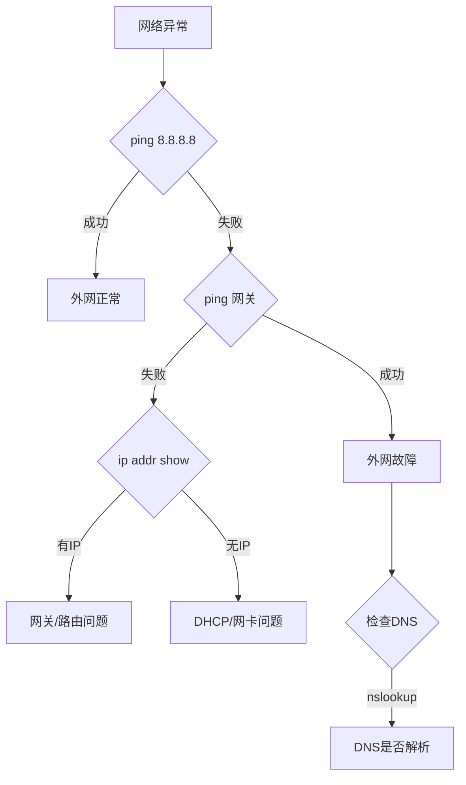

# 网络基础与应用

<a id="k9a963c65e6ab"></a>

## DOS与DDOS的区别

- **DOS**：攻击源为单一主机或少量主机，攻击流量集中，容易被识别和阻断。
- **DDOS（分布式拒绝服务攻击）**：攻击源为分布在多个地理位置的僵尸网络（Botnet），攻击流量分散且规模更大，防御难度显著增加。

### 参考资料

- [AIGC Interview Book](https://github.com/WeThinkIn/AIGC-Interview-Book/blob/34e9ee6aa6d35d1e213099a7ae9f433b7b9e6fe6/%E8%AE%A1%E7%AE%97%E6%9C%BA%E5%9F%BA%E7%A1%80/%E8%AE%A1%E7%AE%97%E6%9C%BA%E7%BD%91%E7%BB%9C%E9%AB%98%E9%A2%91%E7%9F%A5%E8%AF%86%E7%82%B9.md#L984)，来源许可：GPL-3.0。

<a id="k05380a166185"></a>

## Linux系统中如何优雅的进行端口管理？

在 Linux 中，“优雅地”管理端口意味着**系统化、清晰、安全且自动化地进行操作**。

### 🎯 端口管理核心：监控、控制与自动化

一个优雅的端口管理体系通常包含以下层次：

| 管理层次 | 核心目标 | 关键工具/命令 |
| :--- | :--- | :--- |
| **1. 实时监控** | 清晰掌握端口开放、连接及进程 | `ss`, `netstat`, `lsof`, `nmap` |
| **2. 精准控制** | 安全、灵活地开放或限制端口访问 | `firewalld` (推荐), `iptables`/`nftables` |
| **3. 服务集成** | 将端口作为服务的一部分来管理 | `systemd` socket 激活 |
| **4. 安全审计** | 定期检查，消除隐患 | `netstat` + `cron`, 自动化脚本 |

### 🔍 第一层：深度监控与探查

清晰地“看”是管理的第一步。

1.  **查看监听端口（LISTEN）**
```bash
    # 推荐：使用现代工具 ss (socket statistics)，更快速
    sudo ss -tulnp
    # 或使用经典工具 netstat
    sudo netstat -tulnp
```
    **关键参数解读**：`-t`(TCP), `-u`(UDP), `-l`(仅监听), `-n`(数字形式), `-p`(显示进程)。

2.  **查看活跃连接（ESTABLISHED）**
```bash
    # 查看所有活跃的TCP连接
    sudo ss -tan
    # 按状态（如ESTAB、TIME-WAIT）统计连接数
    sudo ss -tan | awk '{print $1}' | sort | uniq -c
```

3.  **精准定位端口对应进程**
```bash
    # 查找占用特定端口（如80）的进程
    sudo lsof -i :80
    # 或使用 ss
    sudo ss -ltnp 'sport = :80'
```

### 🛡️ 第二层：精准控制访问（防火墙）

使用防火墙是管理端口访问的核心。**`firewalld`** 因其动态管理能力成为多数现代发行版（如RHEL/CentOS/Fedora）的推荐工具。

1.  **`firewalld` 基础操作**
```bash
    # 查看默认区域和活动规则
    sudo firewall-cmd --list-all
    # 永久开放端口（如TCP 8080），--permanent 表示持久化
    sudo firewall-cmd --zone=public --add-port=8080/tcp --permanent
    # 永久关闭端口
    sudo firewall-cmd --zone=public --remove-port=8080/tcp --permanent
    # 重载配置使生效
    sudo firewall-cmd --reload
    # 更优雅的方式：添加富规则，限制特定IP访问端口
    sudo firewall-cmd --zone=public --add-rich-rule='rule family="ipv4" source address="192.168.1.100/32" port protocol="tcp" port="8080" accept' --permanent
```

2.  **`iptables`/`nftables` （传统/底层控制）**
    如果使用 `iptables`（或新一代的 `nftables`），规则更直接，但需注意顺序。
```bash
    # 允许访问TCP 22端口 (SSH)
    sudo iptables -A INPUT -p tcp --dport 22 -j ACCEPT
    # 拒绝所有其他入站连接（通常是最后一条规则）
    sudo iptables -A INPUT -j DROP
    # 保存规则（非常重要，否则重启失效）
    sudo iptables-save > /etc/iptables/rules.v4 # 具体路径因发行版而异
```

### ⚙️ 第三层：服务化与自动化集成

将端口管理融入服务配置，实现更高层次的优雅。

1.  **使用 `systemd` Socket 激活**
    这是非常“优雅”的模式：**仅在第一个连接到达时，才启动服务**，节省资源。
```ini
    <!-- 文件：/etc/systemd/system/my-service.socket -->
    [Socket]
    ListenStream=8080
    Accept=yes

    [Install]
    WantedBy=sockets.target
```
    然后创建对应的 `.service` 文件。系统会管理端口监听，实现按需启动。

2.  **端口变更时，通过服务管理同步**
    修改服务端口后，务必重启服务使配置生效。
```bash
    # 例如修改了SSH端口，需重启sshd
    sudo systemctl restart sshd
    # 并确保防火墙允许了新端口
    sudo firewall-cmd --add-port=新端口/tcp --permanent
    sudo firewall-cmd --reload
```

### 🔐 第四层：安全审计与自动化脚本

定期审计是安全管理的必要环节。

1.  **一键安全审计脚本**
    创建一个脚本（如 `port_audit.sh`），定期运行或加入 `cron` 计划任务。
```bash
    #!/bin/bash
    echo "=== 监听端口与进程 ==="
    sudo ss -tulnp
    echo -e "\n=== 异常高端口检查 (>10000) ==="
    sudo ss -tulnp | grep -E ':[0-9]{4,}' | grep -vE ':(102[5-9]|10[3-9]|1[1-9][0-9]|[2-9][0-9]{2,4})' # 过滤已知服务端口
    echo -e "\n=== 防火墙开放端口列表 ==="
    sudo firewall-cmd --list-ports
    # 或 sudo iptables -L INPUT -n --line-numbers
```
    `chmod +x port_audit.sh` 后即可执行。

2.  **使用 `nmap` 进行自我扫描**
```bash
    # 扫描本机开放端口（从外部视角）
    nmap -sT -p- localhost
    # 快速扫描常用端口
    nmap -sT -F localhost
```

### 🚨 常见陷阱与技巧

- **“Address already in use”**：端口被占用，用 `ss -tulnp | grep :端口号` 找出元凶。
- **防火墙规则顺序**：在 `iptables` 中，规则是从上到下匹配的。确保你的 `ACCEPT` 规则在通用的 `DROP` 规则**之前**。
- **服务重启**：修改了绑定端口的服务配置（如Nginx, SSH），**必须重启服务**。
- **临时 vs 永久**：`firewall-cmd` 不加 `--permanent` 是临时生效，重启后丢失。测试时可以先不加，确认无误再持久化。

### 参考资料

- [AIGC Interview Book](https://github.com/WeThinkIn/AIGC-Interview-Book/blob/34e9ee6aa6d35d1e213099a7ae9f433b7b9e6fe6/%E8%AE%A1%E7%AE%97%E6%9C%BA%E5%9F%BA%E7%A1%80/%E8%AE%A1%E7%AE%97%E6%9C%BA%E7%BD%91%E7%BB%9C%E9%AB%98%E9%A2%91%E7%9F%A5%E8%AF%86%E7%82%B9.md#L1231)，来源许可：GPL-3.0。

<a id="kaf1d4b4b79d5"></a>

## OSI 七层模型是什么？每一层的作用是什么？

**OSI 七层模型** 是国际标准化组织提出的一个网络分层模型，其大体结构以及每一层提供的功能如下图所示：


每一层都专注做一件事情，并且每一层都需要使用下一层提供的功能比如传输层需要使用网络层提供的路由和寻址功能，这样传输层才知道把数据传输到哪里去。

**OSI 的七层体系结构概念清楚，理论也很完整，但是它比较复杂而且不实用，而且有些功能在多个层中重复出现。**

上面这种图可能比较抽象，再来一个比较生动的图片。下面这个图片是我在国外的一个网站上看到的，非常赞！


### 参考资料

- [JavaGuide](https://github.com/Snailclimb/JavaGuide/blob/992dae31eade2a34ba8dbbbcf5ed9de5511325ec/docs/cs-basics/network/other-network-questions.md#L23)，来源许可：Apache-2.0。

<a id="k79e539a562d0"></a>

## PING 命令的作用是什么？

PING 命令是一种常用的网络诊断工具，经常用来测试网络中主机之间的连通性和网络延迟。

这里简单举一个例子，我们来 PING 一下百度。

```bash
# 发送4个PING请求数据包到 www.baidu.com
❯ ping -c 4 www.baidu.com

PING www.a.shifen.com (14.119.104.189): 56 data bytes
64 bytes from 14.119.104.189: icmp_seq=0 ttl=54 time=27.867 ms
64 bytes from 14.119.104.189: icmp_seq=1 ttl=54 time=28.732 ms
64 bytes from 14.119.104.189: icmp_seq=2 ttl=54 time=27.571 ms
64 bytes from 14.119.104.189: icmp_seq=3 ttl=54 time=27.581 ms

--- www.a.shifen.com ping statistics ---
4 packets transmitted, 4 packets received, 0.0% packet loss
round-trip min/avg/max/stddev = 27.571/27.938/28.732/0.474 ms
```

PING 命令的输出结果通常包括以下几部分信息：

1. **ICMP Echo Request（请求报文）信息**：序列号、TTL（Time to Live）值。
2. **目标主机的域名或 IP 地址**：输出结果的第一行。
3. **往返时间（RTT，Round-Trip Time）**：从发送 ICMP Echo Request（请求报文）到接收到 ICMP Echo Reply（响应报文）的总时间，用来衡量网络连接的延迟。
4. **统计结果（Statistics）**：包括发送的 ICMP 请求数据包数量、接收到的 ICMP 响应数据包数量、丢包率、往返时间（RTT）的最小、平均、最大和标准偏差值。

如果 PING 对应的目标主机无法得到正确的响应，则表明这两个主机之间的连通性存在问题（有些主机或网络管理员可能禁用了对 ICMP 请求的回复，这样也会导致无法得到正确的响应）。如果往返时间（RTT）过高，则表明网络延迟过高。

### 参考资料

- [JavaGuide](https://github.com/Snailclimb/JavaGuide/blob/992dae31eade2a34ba8dbbbcf5ed9de5511325ec/docs/cs-basics/network/other-network-questions.md#L495)，来源许可：Apache-2.0。

<a id="kc6bf528199ac"></a>

## PING 命令的工作原理是什么？

PING 基于网络层的 **ICMP（Internet Control Message Protocol，互联网控制报文协议）**，其主要原理就是通过在网络上发送和接收 ICMP 报文实现的。

ICMP 报文中包含了类型字段，用于标识 ICMP 报文类型。ICMP 报文的类型有很多种，但大致可以分为两类：

- **查询报文类型**：向目标主机发送请求并期望得到响应。
- **差错报文类型**：向源主机发送错误信息，用于报告网络中的错误情况。

PING 用到的 ICMP Echo Request（类型为 8）和 ICMP Echo Reply（类型为 0）属于查询报文类型。

- PING 命令会向目标主机发送 ICMP Echo Request。
- 如果两个主机的连通性正常，目标主机会返回一个对应的 ICMP Echo Reply。

### 参考资料

- [JavaGuide](https://github.com/Snailclimb/JavaGuide/blob/992dae31eade2a34ba8dbbbcf5ed9de5511325ec/docs/cs-basics/network/other-network-questions.md#L525)，来源许可：Apache-2.0。

<a id="k51353598909d"></a>

## 两个Linux服务器之间数据传输的命令有哪些？

在Linux系统中，有几种常用的命令可以用来在两台服务器之间传输数据。这些命令各有特点，适用于不同的场景和需求，Rocky下面为大家进行详细的总结与梳理：

1. **`scp` (Secure Copy Protocol)**
   - `scp` 命令是基于 SSH (Secure Shell) 协议的一种文件传输工具，它可以在两台服务器之间安全地复制文件或目录。由于`scp`使用SSH进行数据传输，所以它在传输过程中提供了通信加密，保证了数据的安全性和完整性。
   - 基本语法:
```bash
     scp [选项] 源文件 用户名@目标主机:目标路径
     scp [选项] 用户名@源主机:源文件路径 目标路径
```
   - 常用选项
     - `-P port`：指定SSH连接使用的端口。
     - `-p`：保留原文件的修改时间、访问时间和访问权限。
     - `-r`：递归复制整个目录。
     - `-q`：静默模式，不显示传输进度条和消息。
     - `-C`：开启压缩选项，传输时自动压缩数据。
   - 例子：
     - 将本地文件 `file.txt` 复制到远程服务器：
```bash
       scp file.txt username@remotehost:/path/to/destination/
```
     - 从远程服务器复制文件到本地：
```bash
       scp username@remotehost:/path/to/file.txt /local/destination/
```
     - 递归复制目录到远程服务器：
```bash
       scp -r /local/dir username@remotehost:/remote/dir
```
     - 指定SSH端口：
```bash
       scp -P 2222 file.txt username@remotehost:/path/
```
   - `scp` 支持递归复制目录（使用 `-r` 选项），指定端口（使用 `-P` 选项），以及更多功能。

   - 安全考虑

      由于`scp`依赖于SSH，它继承了SSH的所有安全特性，包括数据加密和用户身份验证。尽管如此，用户在使用`scp`时仍应注意：

      - 避免使用明文密码认证，应使用基于密钥的认证。
      - 确保SSH服务配置得当，如禁用root直接登录，使用强密码或密钥对等。
      - 注意检查目标主机的身份，以防止中间人攻击。

      `scp`虽然功能强大且安全，但由于其不支持同步更新（只能盲目复制），在需要高效同步文件或目录时，可能需要考虑使用`rsync`等工具。

2. **`rsync` (Remote Synchronization)**
   - `rsync` 是一个更为强大的数据同步工具，用于高效地同步文件和目录到不同的主机或本地文件系统。与 `scp` 相比，**`rsync` 最大的优势在于它能够进行增量备份，只复制变化的部分，大大提高了传输效率**。此外，`rsync` 还支持错误校正、无需开启远程 shell 用户的文件同步等功能。
   - 基本语法：
```bash
     rsync [选项] 源路径 目标用户@目标主机:目标路径
     rsync [选项] 目标用户@源主机:源路径 目标路径
```
   - 常用选项
      - `-a`（archive）: 归档模式，等同于 `-rlptgoD`，它包含了递归、保留符号链接、保留权限、保留时间戳、保留属主、保留组和保留设备文件（如果有必要）。
      - `-v`（verbose）: 输出详细信息，可以帮助调试。
      - `-u, --update`: 在复制文件时跳过那些在目标目录中已经存在且文件修改时间更新的文件。
      - `-z`（compress）: 数据传输过程中启用压缩。
      - `-h`（human-readable）: 输出易于阅读的格式。
      - `-n`（dry run）: 模拟运行，不进行实际的文件传输，常用于测试。
      - `--delete`: 删除目标目录中源目录不存在的文件，常用于镜像。
      - `-e`（executor）: 指定使用的远程 shell，通常是 `ssh`。
      - `--progress`: 显示进度条。
   - 例子：
     - 同步本地目录到远程服务器目录：
```bash
       rsync -avz /local/dir username@remotehost:/remote/dir
```
     - 从远程服务器同步目录到本地：
```bash
       rsync -avz username@remotehost:/remote/dir /local/dir
```
     - 使用非标准 SSH 端口：
```bash
       rsync -avz -e "ssh -p 2222" /local/dir/ username@remotehost:/remote/dir/
```
   - `rsync` 的 `-a` 选项代表归档模式，可保持所有权限等属性，`-v` 选项表示详细模式，`-z` 选项表示传输过程中进行压缩。

   - 安全考虑
      - 使用 `rsync` 时，最好通过 SSH 进行数据传输，这样可以保证数据在传输过程中的安全性。
      - 配置文件和权限应当谨慎设置，特别是在使用 `--delete` 选项时，因为这可能导致目标路径中的数据被删除。

  `rsync` 由于其灵活性和效率，是进行大规模文件同步和备份的首选工具。它的增量备份能力特别适合定期备份大数据量的场景。

3. **`sftp` (SSH File Transfer Protocol)**
   - `sftp` 是另一个基于 SSH 的文件传输协议，提供交互式的文件传输会话。
   - 基本使用：
     - 进入 `sftp` 会话：
```bash
       sftp username@remotehost
```
     - 在会话中，可以使用类似 `ftp` 的命令来上传或下载文件，如 `put`, `get`, `ls`, `cd` 等。

这些命令各有优势，选择哪个取决于我们的具体需求，如是否需要加密（`scp` 和 `rsync` 通过 SSH 提供加密），是否需要同步目录或仅传输单个文件，以及是否需要压缩等。在实际应用中，我们可以根据具体场景和需求灵活选择使用。

### 参考资料

- [AIGC Interview Book](https://github.com/WeThinkIn/AIGC-Interview-Book/blob/34e9ee6aa6d35d1e213099a7ae9f433b7b9e6fe6/%E8%AE%A1%E7%AE%97%E6%9C%BA%E5%9F%BA%E7%A1%80/%E8%AE%A1%E7%AE%97%E6%9C%BA%E7%BD%91%E7%BB%9C%E9%AB%98%E9%A2%91%E7%9F%A5%E8%AF%86%E7%82%B9.md#L102)，来源许可：GPL-3.0。

<a id="k0299798892d6"></a>

## 二、哪个带宽影响传输速度？取决于场景

### 1. 当客户端**从服务器下载数据**时：
- **关键带宽**：服务器的**上行带宽**
- **影响机制**：
  - 服务器作为数据提供方，需要将数据发送给客户端
  - 服务器上行带宽不足 → 成为传输瓶颈
- **典型场景**：
  - 用户访问网站（HTML/CSS/JS文件）
  - 下载APP或软件更新
  - 观看在线视频（如YouTube/Netflix）
  - 云盘文件下载

> 📊 **示例**：当100个用户同时从服务器下载1GB文件时，服务器需要100×1GB=100GB的上行流量。若服务器上行带宽仅1Gbps，理论最大传输速度为125MB/s，所有用户共享此带宽。

### 2. 当客户端**向服务器上传数据**时：
- **关键带宽**：服务器的**下行带宽**
- **影响机制**：
  - 服务器作为数据接收方，需要接收来自客户端的数据
  - 服务器下行带宽不足 → 成为传输瓶颈
- **典型场景**：
  - 用户提交表单/上传文件
  - 备份数据到云存储
  - 视频监控录像上传
  - 物联网设备数据上报

> 📊 **示例**：安全摄像头以5Mbps速率上传监控视频到服务器。若服务器下行带宽仅100Mbps，最多只能支持20个摄像头（100Mbps÷5Mbps=20）同时上传。

### 参考资料

- [AIGC Interview Book](https://github.com/WeThinkIn/AIGC-Interview-Book/blob/34e9ee6aa6d35d1e213099a7ae9f433b7b9e6fe6/%E8%AE%A1%E7%AE%97%E6%9C%BA%E5%9F%BA%E7%A1%80/%E8%AE%A1%E7%AE%97%E6%9C%BA%E7%BD%91%E7%BB%9C%E9%AB%98%E9%A2%91%E7%9F%A5%E8%AF%86%E7%82%B9.md#L1045)，来源许可：GPL-3.0。

<a id="ke4661c4e4de1"></a>

## 什么是 Mac 地址？

MAC 地址的全称是 **媒体访问控制地址（Media Access Control Address）**，用于标识链路层接口并在本地网络中传输数据帧。它属于网络接口，而不是整台设备的永久身份证；一台设备可以有多个网络接口，每个接口可以使用不同的 MAC 地址。


MAC 地址也常被称为 LAN 地址、物理地址或以太网地址。与用于网络层路由的 IP 地址不同，MAC 地址主要在当前链路或广播域内使用。

> 还有一点要知道的是，不仅仅是网络资源才有 IP 地址，网络设备也有 IP 地址，比如路由器。但从结构上说，路由器等网络设备的作用是组成一个网络，而且通常是内网，所以它们使用的 IP 地址通常是内网 IP，内网的设备在与内网以外的设备进行通信时，需要用到 NAT 协议。

以太网常见的 MAC 地址是 6 字节（48 比特）的 EUI-48。IEEE 会分配 MA-L、MA-M、MA-S 等不同大小的地址块，由厂商继续分配全局管理地址；此外还存在本地管理地址，不需要由 IEEE 全局分配。操作系统可以修改或随机化 MAC 地址，因此地址并不保证永久不变，不同网络中也可能出现相同地址。

最后，记住，MAC 地址有一个特殊地址：FF-FF-FF-FF-FF-FF（全 1 地址），该地址表示广播地址。

### 参考资料

- [JavaGuide](https://github.com/Snailclimb/JavaGuide/blob/992dae31eade2a34ba8dbbbcf5ed9de5511325ec/docs/cs-basics/network/other-network-questions2.md#L330)，来源许可：Apache-2.0。

<a id="k0fa46dc690e6"></a>

## 什么是API？

- **定义**：
  API 是一种定义好的通信协议，允许一个软件程序与另一个软件程序进行交互。
  在 AI 服务中，API 通常用来提供对 AI 模型或服务的访问接口。

- **作用**：
  - 将复杂的 AI 功能封装起来，通过简单的接口提供给开发者。
  - 提供标准化的调用方式，使得开发者可以方便地集成到自己的应用中。

### 参考资料

- [AIGC Interview Book](https://github.com/WeThinkIn/AIGC-Interview-Book/blob/34e9ee6aa6d35d1e213099a7ae9f433b7b9e6fe6/%E8%AE%A1%E7%AE%97%E6%9C%BA%E5%9F%BA%E7%A1%80/%E8%AE%A1%E7%AE%97%E6%9C%BA%E7%BD%91%E7%BB%9C%E9%AB%98%E9%A2%91%E7%9F%A5%E8%AF%86%E7%82%B9.md#L469)，来源许可：GPL-3.0。

<a id="k35ea9f40a857"></a>

## 什么是计算机中的端口号？

**端口号**在计算机网络中起着至关重要的作用，它用于区分同一主机上的多个网络服务。每当我们通过网络进行通信时，除了 IP 地址来标识主机之外，还需要使用端口号来标识特定的应用程序或服务。这可以帮助计算机在处理多个网络连接时，将数据发送到正确的进程。

### 1. **端口号的定义**

端口号是一个 16 位的整数，范围是从 **0** 到 **65535**。每个端口号都可以用来标识一个特定的进程或网络服务。

- **IP 地址** 用于定位网络中的主机或设备。
- **端口号** 用于定位主机上的具体服务或应用程序。

### 2. **端口号的分类**

端口号根据其范围通常被划分为三类：

1. **知名端口（Well-known Ports）**：0 - 1023
   - 这些端口号通常被分配给一些常见的、标准的服务和协议。例如：
     - **80**：HTTP（网页浏览）
     - **443**：HTTPS（安全网页浏览）
     - **22**：SSH（安全外壳协议，用于远程登录）
     - **25**：SMTP（简单邮件传输协议，用于发送邮件）
   - 这些端口号由互联网号码分配局（IANA）正式分配和管理。

2. **注册端口（Registered Ports）**：1024 - 49151
   - 这些端口号用于为特定的用户应用程序和服务注册。通常用于不需要系统权限的应用程序。例如：
     - **3306**：MySQL 数据库
     - **5432**：PostgreSQL 数据库
     - **8080**：HTTP 的替代端口，常用于开发和测试环境

3. **动态或私有端口（Dynamic/Private Ports）**：49152 - 65535
   - 这些端口号没有固定的分配，通常用于客户端应用程序与服务器建立短暂的通信。在通信结束后，端口号会被释放。例如：
     - 当你通过浏览器访问网页时，浏览器会临时分配一个动态端口（例如 **52345**），用于与网页服务器通信。

### 3. **端口的工作原理**

在计算机网络通信中，**传输层协议（TCP 和 UDP）**会利用端口号来标识发送方和接收方的具体应用程序或服务。

- **TCP（传输控制协议）端口**：面向连接，提供可靠的数据传输。常用于需要高可靠性的服务，如 HTTP、HTTPS、FTP 等。
- **UDP（用户数据报协议）端口**：面向无连接，不提供数据重传。适合实时通信或容忍少量数据丢失的应用程序，如视频流、在线游戏等。

当数据通过网络传输时，报文会携带两个端口号：
1. **源端口号**：表示发起通信的应用程序的端口号。
2. **目标端口号**：表示接收方应用程序监听的端口号。

例如：
- 当我们使用浏览器访问网页时，浏览器会使用一个动态源端口号（如 **52345**）与网页服务器的目标端口号（如 **80**，用于 HTTP）通信。

### 4. **常见端口号列表**

以下是一些常见服务的端口号：
| 协议/服务 | 默认端口号 |
| --------- | ---------- |
| HTTP      | 80         |
| HTTPS     | 443        |
| FTP       | 21         |
| SSH       | 22         |
| SMTP      | 25         |
| DNS       | 53         |
| MySQL     | 3306       |
| PostgreSQL| 5432       |

### 参考资料

- [AIGC Interview Book](https://github.com/WeThinkIn/AIGC-Interview-Book/blob/34e9ee6aa6d35d1e213099a7ae9f433b7b9e6fe6/%E8%AE%A1%E7%AE%97%E6%9C%BA%E5%9F%BA%E7%A1%80/%E8%AE%A1%E7%AE%97%E6%9C%BA%E7%BD%91%E7%BB%9C%E9%AB%98%E9%A2%91%E7%9F%A5%E8%AF%86%E7%82%B9.md#L401)，来源许可：GPL-3.0。

<a id="k8724a0a16f35"></a>

## 什么是零窗口（接收窗口为0时会怎样）？


如果接收方没有能力接收数据，就会将接收窗口设置为0，这时发送方必须暂停发送数据，但是会启动一个持续计时器(persistence timer)，到期后发送一个大小为1字节的探测数据包，以查看接收窗口状态。如果接收方能够接收数据，就会在返回的报文中更新接收窗口大小，恢复数据传送。

### 参考资料

- [Waking-Up](https://github.com/wolverinn/Waking-Up/blob/cf692b53e1b3d1b740a97dab0e4e71db801daf33/Computer%20Network.md#L136)，来源许可：GPL-3.0。

<a id="k8c8bc4d0675b"></a>

## 介绍一下AI行业中API的原理与作用

### **AI服务中的API概念详解**

在AI行业中，**API（Application Programming Interface，应用程序接口）** 是一种用于连接不同系统或服务的标准化接口。它允许开发者通过简单的请求与复杂的AI服务进行交互，而不需要深入了解服务的底层实现。API 是 AI 服务中的关键桥梁，使得复杂的 AI 模型可以以一种简单、可复用的方式被开发者调用，并将人工智能融入到各种项目中。

### 参考资料

- [AIGC Interview Book](https://github.com/WeThinkIn/AIGC-Interview-Book/blob/34e9ee6aa6d35d1e213099a7ae9f433b7b9e6fe6/%E8%AE%A1%E7%AE%97%E6%9C%BA%E5%9F%BA%E7%A1%80/%E8%AE%A1%E7%AE%97%E6%9C%BA%E7%BD%91%E7%BB%9C%E9%AB%98%E9%A2%91%E7%9F%A5%E8%AF%86%E7%82%B9.md#L463)，来源许可：GPL-3.0。

<a id="kecb0a2e437d9"></a>

## 介绍一下计算机中DOS攻击的概念

### 参考资料

- [AIGC Interview Book](https://github.com/WeThinkIn/AIGC-Interview-Book/blob/34e9ee6aa6d35d1e213099a7ae9f433b7b9e6fe6/%E8%AE%A1%E7%AE%97%E6%9C%BA%E5%9F%BA%E7%A1%80/%E8%AE%A1%E7%AE%97%E6%9C%BA%E7%BD%91%E7%BB%9C%E9%AB%98%E9%A2%91%E7%9F%A5%E8%AF%86%E7%82%B9.md#L979)，来源许可：GPL-3.0。

<a id="ka21c7c2b1d5c"></a>

## 介绍一下计算机中“0.0.0.0”ip地址的意义

在计算机网络中，**`0.0.0.0`** 是一个特殊的 IP 地址，具有多种用途，取决于具体使用场景。它并不指向任何特定的设备，而是用来表示 "所有 IP 地址" 或 "没有指定的地址"。下面是 `0.0.0.0` 在不同情况下的含义和用途：

### 1. **表示所有可用的 IPv4 地址**

当 `0.0.0.0` 被用在服务器或服务监听时，它表示该服务会监听设备上**所有可用的网络接口**。这是最常见的用途。

### 使用场景：
- **服务监听**：例如，在 Web 服务器中，如果服务器绑定到 `0.0.0.0`，那么该服务将监听所有可用的网络接口。这意味着无论你通过哪一个网络接口的 IP 地址访问（例如 `localhost`、局域网 IP 或公网 IP），服务器都会接受连接。

  **示例**：
  - `http://0.0.0.0:8080` 表示服务器在端口 8080 上监听所有接口。你可以通过 `localhost:8080` 或设备的局域网 IP 访问它。

### 2. **表示一个未指定的地址**

当一个设备或网络配置为 `0.0.0.0` 时，意味着该设备或网络接口目前**没有被分配具体的 IP 地址**，或者还没有获得一个有效的 IP 地址。

### 3. **默认路由**

在路由表中，`0.0.0.0/0` 通常表示**默认路由**。它告诉操作系统，当无法通过更具体的路由找到目的地时，将流量发往默认网关。

### 4. **表示无效或未知的源地址**

在某些情况下，`0.0.0.0` 也可以表示一个**无效的源地址**，即设备在某种状态下不清楚自己的 IP 地址，或故意不设置源地址（例如测试或调试的目的）。

### 参考资料

- [AIGC Interview Book](https://github.com/WeThinkIn/AIGC-Interview-Book/blob/34e9ee6aa6d35d1e213099a7ae9f433b7b9e6fe6/%E8%AE%A1%E7%AE%97%E6%9C%BA%E5%9F%BA%E7%A1%80/%E8%AE%A1%E7%AE%97%E6%9C%BA%E7%BD%91%E7%BB%9C%E9%AB%98%E9%A2%91%E7%9F%A5%E8%AF%86%E7%82%B9.md#L359)，来源许可：GPL-3.0。

<a id="keeaab6699018"></a>

## 介绍一下计算机中带宽的概念

### 一、技术定义与物理本质
**带宽（Bandwidth）**本质上是数据通道的**瞬时吞吐能力**，其技术内涵包含三个维度：
1. **物理层定义**：单位时间内可通过介质的最大比特数（单位：bps）
2. **系统层定义**：各子系统间数据传输的峰值速率（如GPU显存带宽900GB/s）
3. **工程实践定义**：有效载荷传输速率的95%置信区间值（排除协议开销）

**物理公式**： 

$$ \text{有效带宽} = \frac{\text{数据块大小}}{\text{传输总时间} - \text{协议延迟}} $$  

该公式在NVLink、PCIe等高速接口设计中至关重要

### 二、通俗案例：4K视频实时渲染流水线
假设某视频工作室需要实时处理8路4K视频流（单路数据量：3840×2160×24bit×60fps=11.2Gbps）

**带宽瓶颈场景**：
1. 采集卡到内存：需89.6Gbps带宽（8×11.2G）
2. 内存到GPU显存：PCIe 4.0×16理论带宽31.5GB/s（约252Gbps）
3. 显存内部处理：RTX 4090显存带宽1008GB/s

**关键决策点**：
- 采集卡选择：必须支持PCIe 4.0×8以上接口
- 内存配置：需四通道DDR5-6400（理论带宽204.8GB/s）
- 存储阵列：NVMe SSD组RAID0达到14GB/s读取速度

此案例展示带宽如何决定系统架构设计，失配将导致帧率下降或画质损失

### 1. AIGC领域：扩散模型推理加速
**典型场景**：Stable Diffusion生成1024×1024图像
- **带宽敏感点**：
  - 模型权重加载：FP16精度下UNet约3.4GB
  - 注意力矩阵计算：每层产生(64×64)×(head_dim)中间张量
  - 多GPU并行：梯度同步需要AllReduce通信

**优化案例**：
使用HBM3显存（带宽>1TB/s）可将单图生成耗时从15s降至3.2s。若改用GDDR6（带宽768GB/s），性能下降37%

### 3. 自动驾驶：传感器融合
**某L4级自动驾驶系统数据流**：
| 传感器       | 数据速率       | 传输接口        |
|-------------|---------------|----------------|
| 激光雷达     | 80Mbps/通道   | 车载以太网100BASE-T1|
| 毫米波雷达   | 15Mbps        | CAN FD         |
| 摄像头       | 2400Mbps（8MP@30fps）| FPD-Link III   |

**带宽挑战**：  
需在100ms内完成多传感器数据对齐，总带宽需求：  

$$ \frac{(80×5)+(15×6)+2400}{1000} = 3.07Gbps $$  

这要求车载网络交换机背板带宽至少4Gbps，否则会导致时序错位

### 四、带宽优化核心技术
1. **数据压缩**：
   - NVIDIA DLSS：通过AI超分降低4倍显存带宽需求
   - 梯度量化：在Horovod中使用FP16通信，减少50%网络带宽占用

2. **缓存策略**：
   - GPU共享内存：利用L2 Cache实现矩阵分块计算
   - 自动驾驶数据分级存储：热数据存SRAM（>500GB/s），冷数据存LPDDR5（102GB/s）

3. **协议优化**：
   - RDMA网络：消除TCP/IP协议栈开销，提升有效带宽利用率至98%
   - PCIe P2P传输：GPU间直连带宽可达200GB/s

### 参考资料

- [AIGC Interview Book](https://github.com/WeThinkIn/AIGC-Interview-Book/blob/34e9ee6aa6d35d1e213099a7ae9f433b7b9e6fe6/%E8%AE%A1%E7%AE%97%E6%9C%BA%E5%9F%BA%E7%A1%80/%E8%AE%A1%E7%AE%97%E6%9C%BA%E7%BD%91%E7%BB%9C%E9%AB%98%E9%A2%91%E7%9F%A5%E8%AF%86%E7%82%B9.md#L817)，来源许可：GPL-3.0。

<a id="kfacf9738b895"></a>

## 从输入网址到获得页面的过程

1. 浏览器解析URL，查询 DNS，检查域名是否在缓存中（浏览器自身的DNS缓存、操作系统的DNS缓存、本地的hosts文件和向本地DNS服务器进行查询）。如果 DNS 服务器和主机在同一个子网内，系统会按照 ARP 过程对 DNS 服务器进行 ARP查询，如果在不同的子网，系统会按照 ARP 过程对默认网关进行查询；
2. 浏览器获得域名对应的IP地址以后，向服务器请求建立链接，发起三次握手；
3. TCP/IP链接建立起来后，浏览器向服务器发送HTTP请求；
4. 服务器接收到这个请求，并根据路径参数映射到特定的请求处理器进行处理，并将处理结果及相应的视图返回给浏览器；
5. 浏览器对HTML、CSS、JS进行解析，构建DOM树，渲染视图；
6. 浏览器根据其请求到的资源、数据渲染页面，最终向用户呈现一个完整的页面。

[超详细版本1](https://github.com/skyline75489/what-happens-when-zh_CN)

[超详细版本2](https://segmentfault.com/a/1190000006879700)

### 参考资料

- [Datawhale](https://github.com/datawhalechina/daily-interview/blob/f35e8d555f8ff07d568eae569c3641bd76d0eac9/docs/03-computer-basics/computer-network/network-protocols.md#L27)，来源许可：GPL-3.0。

<a id="k2a380f689d05"></a>

## 传输层有哪些常见的协议？


- **TCP（Transmission Control Protocol，传输控制协议）**：提供 **面向连接** 的，**可靠** 的数据传输服务。
- **UDP（User Datagram Protocol，用户数据协议）**：提供 **无连接** 的，**尽最大努力** 的数据传输服务（不保证数据传输的可靠性），简单高效。

### 参考资料

- [JavaGuide](https://github.com/Snailclimb/JavaGuide/blob/992dae31eade2a34ba8dbbbcf5ed9de5511325ec/docs/cs-basics/network/other-network-questions.md#L89)，来源许可：Apache-2.0。

<a id="k56f5cfdafef3"></a>

## 在AI行业中两个服务器之间的通信有哪些注意事项？

在AI行业中，两个服务器之间的通信涉及到大量的数据传输和计算，这对通信的效率、可靠性和安全性提出了更高的要求。我们需要确保AI系统中服务器间通信的高效、安全和可靠，从而支持复杂的AI应用场景，如分布式训练、模型部署和大数据处理等。以下是两个服务器之间通信时需要特别注意的事项，结合AI应用的具体场景进行了详细解释：

### 1. **数据传输效率**
   - **大数据传输**：AI应用通常需要处理大量的数据集，如训练数据、模型权重等。为了提高传输效率，可以采用以下措施：
     - **压缩数据**：使用压缩算法（如gzip、lz4）在传输前对数据进行压缩，减少带宽占用。
     - **增量传输**：对于模型更新，采用差分更新的方式，仅传输变化部分（如参数更新、权重差异），而不是每次传输整个模型。
     - **分片传输**：将大数据集分割成较小的数据块，以并行方式进行传输，可以显著提高传输速度。
     - **异步传输**：使用异步通信机制，避免服务器等待数据传输完成后再执行其他任务，从而提高整体效率。

   - **带宽利用**：在两个服务器之间的数据传输中，带宽是一个关键因素。为了最大化带宽利用率，可以：
     - **多线程传输**：使用多线程或多通道技术同时传输多个数据块，提升带宽利用率。
     - **流量控制**：在传输大量数据时，使用流量控制技术防止网络拥塞，并确保传输的稳定性。

### 5. **通信协议与API设计**
   - **协议选择**：选择合适的通信协议对于保证数据传输的性能和可靠性至关重要，如TCP、UDP、HTTP/HTTPS、WebSocket等。
     - **gRPC**：一种高性能、开源的远程过程调用（RPC）框架，支持多语言，是AI行业中常用的跨服务器通信协议。
     - **RESTful API**：基于HTTP的API设计，简单易用，适用于传输频率不高的AI服务通信。
     - **消息队列**：在需要异步通信或解耦服务器之间的依赖时，使用Kafka、RabbitMQ等消息队列来缓冲数据并确保数据传输的可靠性。

   - **API设计**：良好的API设计可以提升服务器间通信的效率和易用性。
     - **幂等性**：确保API在多次调用时具有幂等性，即多次调用产生相同的结果，防止重复操作引发的错误。
     - **版本控制**：随着AI模型的更新，API接口可能会发生变化，采用版本控制机制确保新旧接口能够兼容。

### 参考资料

- [AIGC Interview Book](https://github.com/WeThinkIn/AIGC-Interview-Book/blob/34e9ee6aa6d35d1e213099a7ae9f433b7b9e6fe6/%E8%AE%A1%E7%AE%97%E6%9C%BA%E5%9F%BA%E7%A1%80/%E8%AE%A1%E7%AE%97%E6%9C%BA%E7%BD%91%E7%BB%9C%E9%AB%98%E9%A2%91%E7%9F%A5%E8%AF%86%E7%82%B9.md#L297)，来源许可：GPL-3.0。

<a id="k96a429dbd87e"></a>

## 在AI项目中，从云端读取传输信息失败，显示网络不可用，一般可以怎么解决呢？

当在AI项目中从云端读取或传输信息失败，并显示网络不可用时，可能有多种原因。**作为算法工程师，我们不需要知根知底关于网络方面的所有知识，但是我们需要知道常见的问题可能性，这样能够与网络部门的同事更好的沟通，同时知道网络端问题排查优化的相应成本，有利于整体AI项目的成本管理**。

以下是一些常见的网络不可用原因和相应的解决方案：

### 1. 检查网络连接

确保服务器或本地机器的网络连接正常。这是最基本的步骤，我们可以通过以下方式检查：

- **ping 命令**：检查与目标服务器的连接。
```bash
  ping www.WeThinkIn.com
```
- **curl 命令**：尝试从目标 URL 下载文件。
```bash
  curl -I https://www.WeThinkIn.com/path/to/image.jpg
```

### 2. 检查防火墙和安全组设置

如果我们使用的是云服务器（如 AWS、GCP、Azure），确保防火墙或安全组设置允许出站 HTTP/HTTPS 请求。

- **AWS 安全组**：在AWS管理控制台中，检查安全组的出站规则，确保允许端口 80（HTTP）和 443（HTTPS）。
- **本地防火墙**：检查本地机器的防火墙设置，确保允许 HTTP/HTTPS 流量。

### 3. 检查代理设置

有时项目组的网络或服务器环境可能需要通过代理访问。检查是否需要设置代理：

- **配置环境变量**：
```bash
  export http_proxy=http://proxy.WeThinkIn.com:port
  export https_proxy=https://proxy.WeThinkIn.com:port
```

### 4. 检查URL和权限

我们需要确保提供的URL正确，并且有权限访问该URL：

- **URL是否正确**：检查URL是否拼写正确。
- **权限问题**：如果URL需要身份验证，确保我们提供了正确的认证信息。

### 5. 重试机制

网络请求有时会因为临时问题失败，我们可以通过添加重试机制可以提高成功率。可以使用 `requests` 库的 `Retry` 机制：

```python
import requests
from requests.adapters import HTTPAdapter
from requests.packages.urllib3.util.retry import Retry

url = 'https://www.WeThinkIn.com/path/to/image.jpg'

# 创建一个 session
session = requests.Session()

# 定义重试策略
retries = Retry(total=5, backoff_factor=1, status_forcelist=[500, 502, 503, 504])

# 将重试策略应用到 HTTPAdapter
session.mount('http://', HTTPAdapter(max_retries=retries))
session.mount('https://', HTTPAdapter(max_retries=retries))

try:
    response = session.get(url, timeout=10)
    response.raise_for_status()  # 如果请求失败，抛出 HTTPError
    with open('image.jpg', 'wb') as f:
        f.write(response.content)
    print('Image downloaded successfully')
except requests.exceptions.RequestException as e:
    print(f'Error downloading image: {e}')
```

### 6. 检查云端服务状态

有时云端服务可能会有临时故障或维护，可以及时联系云服务提供商进行问题排查和解决。

### 7. 日志记录和错误处理

我们可以记录详细的错误日志，有助于诊断问题。确保捕获和记录所有可能的异常：

```python
import logging

logging.basicConfig(filename='download.log', level=logging.ERROR)

try:
    response = session.get(url, timeout=10)
    response.raise_for_status()
    with open('image.jpg', 'wb') as f:
        f.write(response.content)
    print('Image downloaded successfully')
except requests.exceptions.RequestException as e:
    logging.error(f'Error downloading image: {e}')
    print(f'Error downloading image: {e}')
```

### 参考资料

- [AIGC Interview Book](https://github.com/WeThinkIn/AIGC-Interview-Book/blob/34e9ee6aa6d35d1e213099a7ae9f433b7b9e6fe6/%E8%AE%A1%E7%AE%97%E6%9C%BA%E5%9F%BA%E7%A1%80/%E8%AE%A1%E7%AE%97%E6%9C%BA%E7%BD%91%E7%BB%9C%E9%AB%98%E9%A2%91%E7%9F%A5%E8%AF%86%E7%82%B9.md#L198)，来源许可：GPL-3.0。

<a id="k775843e3c4d1"></a>

## 复习建议

非常推荐大家看一下 《图解 HTTP》这本书，这本书页数不多，但是内容很是充实，不管是用来系统的掌握网络方面的一些知识还是说纯粹为了应付面试都有很大帮助。下面的一些文章只是参考。大二学习这门课程的时候，我们使用的教材是 《计算机网络第七版》（谢希仁编著），不推荐大家看这本教材，书非常厚而且知识偏理论，不确定大家能不能心平气和的读完。

### 参考资料

- [JavaGuide](https://github.com/Snailclimb/JavaGuide/blob/992dae31eade2a34ba8dbbbcf5ed9de5511325ec/docs/cs-basics/network/other-network-questions2.md#L352)，来源许可：Apache-2.0。

<a id="k5e90070adc6a"></a>

## 如何让两台服务器之间ssh免密通信？

在Ubuntu系统中设置基于SSH密钥的认证，可以在两台服务器之间进行无密码连接。这对于自动化任务（如文件传输、备份和远程命令执行）特别有用。以下是设置SSH密钥认证的步骤：

1. 创建.ssh目录

假定有2台Linux服务器主机，分别为A，B。

我们先在所有服务器主机上创建ssh目录并赋予权限:
```bash
mkdir /root/.ssh 
chmod 700 /root/.ssh
```

2. 生成公钥与私钥

我们接着需要生成所有服务器主机的公钥与私钥，执行以下命令：

```bash
$ cd ~  # 进⼊入用户目录
$ ssh-keygen -t rsa -P ""  # 生成ssh密码，-t 参数表示生成算法，可以选择rsa和dsa；-P表示使用的密码，""表示无密码。
```

3. 将公钥追加authorized_keys文件中

将第一台服务器主机A上生成公钥追加到authorized_keys文件中:
```bash
$ cd ~/.ssh  # 进入.ssh目录
$ cat id_rsa.pub >> authorized_keys   # 将id_rsa.pub的内容追加到authorized_keys文件中
```

接下来我们使用同样的命令在服务器主机B上生成id_rsa.pub并写入到服务器主机A的authorized_keys文件中，再将服务器主机A的authorized_keys文件复制到服务器主机B的对应路径下即可：/root/.ssh/

### 参考资料

- [AIGC Interview Book](https://github.com/WeThinkIn/AIGC-Interview-Book/blob/34e9ee6aa6d35d1e213099a7ae9f433b7b9e6fe6/%E8%AE%A1%E7%AE%97%E6%9C%BA%E5%9F%BA%E7%A1%80/%E8%AE%A1%E7%AE%97%E6%9C%BA%E7%BD%91%E7%BB%9C%E9%AB%98%E9%A2%91%E7%9F%A5%E8%AF%86%E7%82%B9.md#L68)，来源许可：GPL-3.0。

<a id="k816d4ec2d8f0"></a>

## 应用层有哪些常见的协议？


- **HTTP（Hypertext Transfer Protocol，超文本传输协议）**：是一种用于传输超文本和多媒体内容的应用层协议，主要为 Web 客户端与服务器之间的通信而设计。HTTP/1.x 和 HTTP/2 通常基于 TCP，HTTP/3 则运行在基于 UDP 的 QUIC 之上。
- **SMTP（Simple Mail Transfer Protocol，简单邮件发送协议）**：基于 TCP 协议，是一种用于发送电子邮件的协议。注意 ⚠️：SMTP 协议只负责邮件的发送，而不是接收。要从邮件服务器接收邮件，需要使用 POP3 或 IMAP 协议。
- **POP3/IMAP（邮件接收协议）**：基于 TCP 协议，两者都是负责邮件接收的协议。IMAP 协议是比 POP3 更新的协议，它在功能和性能上都更加强大。IMAP 支持邮件搜索、标记、分类、归档等高级功能，而且可以在多个设备之间同步邮件状态。几乎所有现代电子邮件客户端和服务器都支持 IMAP。
- **FTP（File Transfer Protocol，文件传输协议）**：基于 TCP 协议，是一种用于在计算机之间传输文件的协议，可以屏蔽操作系统和文件存储方式。注意 ⚠️：FTP 是一种不安全的协议，因为它在传输过程中不会对数据进行加密。建议在传输敏感数据时使用更安全的协议，如 SFTP。
- **Telnet（远程登陆协议）**：基于 TCP 协议，用于通过一个终端登陆到其他服务器。Telnet 协议的最大缺点之一是所有数据（包括用户名和密码）均以明文形式发送，这有潜在的安全风险。这就是为什么如今很少使用 Telnet，而是使用一种称为 SSH 的非常安全的网络传输协议的主要原因。
- **SSH（Secure Shell Protocol，安全的网络传输协议）**：基于 TCP 协议，通过加密和认证机制实现安全的访问和文件传输等业务
- **RTP（Real-time Transport Protocol，实时传输协议）**：通常基于 UDP 协议，但也支持 TCP 协议。它提供了端到端的实时传输数据的功能，但不包含资源预留存、不保证实时传输质量，这些功能由 WebRTC 实现。
- **DNS（Domain Name System，域名管理系统）**：通常基于 UDP 协议（端口 53），用于解决域名和 IP 地址的映射问题。当响应数据过大或进行区域传送时会改用 TCP。

关于这些协议的详细介绍请看 [应用层常见协议总结（应用层）](https://github.com/Snailclimb/JavaGuide/blob/992dae31eade2a34ba8dbbbcf5ed9de5511325ec/docs/cs-basics/network/application-layer-protocol.md) 这篇文章。

### 参考资料

- [JavaGuide](https://github.com/Snailclimb/JavaGuide/blob/992dae31eade2a34ba8dbbbcf5ed9de5511325ec/docs/cs-basics/network/other-network-questions.md#L74)，来源许可：Apache-2.0。

<a id="kbd0ac325c307"></a>

## 网络协议

RocketMQ 目前常见的是 Remoting 和 gRPC 两类接入方式：

| 对比项     | Remoting（传统协议）                | gRPC（5.x 新版 SDK）                      |
| ---------- | ----------------------------------- | ----------------------------------------- |
| **成熟度** | Java 生态使用时间长，路径短         | 适合多语言和云原生接入，通常经 Proxy 接入 |
| **扩展性** | 多语言接入需要分别适配              | 基于标准协议，客户端生态和网关治理更友好  |
| **取舍**   | 适合已有 4.x 客户端和内部高性能链路 | 链路多一层 Proxy 时，要额外关注延迟和容量 |

### 参考资料

- [JavaGuide](https://github.com/Snailclimb/JavaGuide/blob/992dae31eade2a34ba8dbbbcf5ed9de5511325ec/docs/high-performance/message-queue/rocketmq-questions.md#L557)，来源许可：Apache-2.0。

<a id="kcb45bd7bdd9c"></a>

## 网络字节序

网络字节顺序是 TCP/IP 中规定好的一种数据表示格式，它与具体的 CPU 类型、操作系统等无关，从而可以保证数据在不同主机之间传输时能够被正确解释。

网络字节顺序采用：大端（Big Endian）排列方式。

### 参考资料

- [huihut/interview](https://github.com/huihut/interview/blob/7a7166804a0ffc8f156e906bf4c1a94bb9f6a94b/README.md#L2072)，来源许可：CC-BY-NC-SA-4.0。

<a id="k1d3f43a5818d"></a>

## 网络层常见协议？可以说一下吗？

| 协议 | 名称                 | 作用                                                         |
| ---- | -------------------- | ------------------------------------------------------------ |
| IP   | 网际协议             | IP协议不但定义了数据传输时的基本单元和格式，还定义了数据报的递交方法和路由选择 |
| ICMP | Internet控制报文协议 | ICMP就是一个“错误侦测与回报机制”，其目的就是让我们能够检测网路的连线状况﹐也能确保连线的准确性，是ping和traceroute的工作协议 |
| RIP  | 路由信息协议         | 使用“跳数”(即metric)来衡量到达目标地址的路由距离             |
| IGMP | Internet组管理协议   | 用于实现组播、广播等通信                                     |

<p  id="四大拥塞控制算法总结极其重要"></p>

### 参考资料

- [阿秀面试笔记](https://github.com/forthespada/InterviewGuide/blob/25055ccfa146c11f2ccc986402ad36b34471e6c0/docs/notes/03-hunting_job/02-interview/03-04-net.md#L313)，来源许可：Apache-2.0。

<a id="kabed9507006f"></a>

## 网络层有哪些常见的协议？


- **IP（Internet Protocol，网际协议）**：TCP/IP 协议中最重要的协议之一，属于网络层的协议，主要作用是定义数据包的格式、对数据包进行路由和寻址，以便它们可以跨网络传播并到达正确的目的地。目前 IP 协议主要分为两种，一种是过去的 IPv4，另一种是较新的 IPv6，目前这两种协议都在使用，但后者已经被提议来取代前者。
- **ARP（Address Resolution Protocol，地址解析协议）**：ARP 协议解决的是网络层地址和链路层地址之间的转换问题。因为一个 IP 数据报在物理上传输的过程中，总是需要知道下一跳（物理上的下一个目的地）该去往何处，但 IP 地址属于逻辑地址，而 MAC 地址才是物理地址，ARP 协议解决了 IP 地址转 MAC 地址的一些问题。
- **ICMP（Internet Control Message Protocol，互联网控制报文协议）**：一种用于传输网络状态和错误消息的协议，常用于网络诊断和故障排除。例如，Ping 工具就使用了 ICMP 协议来测试网络连通性。
- **NAT（Network Address Translation，网络地址转换协议）**：NAT 协议的应用场景如同它的名称——网络地址转换，应用于内部网到外部网的地址转换过程中。具体地说，在一个小的子网（局域网，LAN）内，各主机使用的是同一个 LAN 下的 IP 地址，但在该 LAN 以外，在广域网（WAN）中，需要一个统一的 IP 地址来标识该 LAN 在整个 Internet 上的位置。
- **OSPF（Open Shortest Path First，开放式最短路径优先）**：一种内部网关协议（Interior Gateway Protocol，IGP），也是广泛使用的一种动态路由协议，基于链路状态算法，考虑了链路的带宽、延迟等因素来选择最佳路径。
- **RIP（Routing Information Protocol，路由信息协议）**：一种内部网关协议（Interior Gateway Protocol，IGP），也是一种动态路由协议，基于距离向量算法，使用固定的跳数作为度量标准，选择跳数最少的路径作为最佳路径。
- **BGP（Border Gateway Protocol，边界网关协议）**：一种用来在路由选择域之间交换网络层可达性信息（Network Layer Reachability Information，NLRI）的路由选择协议，具有高度的灵活性和可扩展性。

### 参考资料

- [JavaGuide](https://github.com/Snailclimb/JavaGuide/blob/992dae31eade2a34ba8dbbbcf5ed9de5511325ec/docs/cs-basics/network/other-network-questions.md#L96)，来源许可：Apache-2.0。

<a id="kc6701ededc4b"></a>

## 网络模块（基于 Netty）

RocketMQ 的 RPC 通信采用 Netty 作为底层通信库，基于 Reactor 多线程模型进行了深度扩展和优化。

**线程模型总结：**

- **Reactor 主线程**：1 个，负责监听连接
- **Reactor 线程池**：默认 3 个，负责网络数据处理
- **业务线程池**：动态调整，根据 CPU 核心数

### 参考资料

- [JavaGuide](https://github.com/Snailclimb/JavaGuide/blob/992dae31eade2a34ba8dbbbcf5ed9de5511325ec/docs/high-performance/message-queue/rocketmq-questions.md#L567)，来源许可：Apache-2.0。

<a id="kb0c3f08a049b"></a>

## 计算机中数据传输速度和哪些因素有关？

在计算机系统中，数据传输速度是决定系统性能的关键指标，其影响因素可分为**硬件、协议和软件**三个层面。下面Rocky从技术原理、实际案例及行业应用三个维度进行系统解析：

### 参考资料

- [AIGC Interview Book](https://github.com/WeThinkIn/AIGC-Interview-Book/blob/34e9ee6aa6d35d1e213099a7ae9f433b7b9e6fe6/%E8%AE%A1%E7%AE%97%E6%9C%BA%E5%9F%BA%E7%A1%80/%E8%AE%A1%E7%AE%97%E6%9C%BA%E7%BD%91%E7%BB%9C%E9%AB%98%E9%A2%91%E7%9F%A5%E8%AF%86%E7%82%B9.md#L904)，来源许可：GPL-3.0。

<a id="kac40362c8493"></a>

## 计算机服务器如何检查网络是否正常？

不管是在AIGC、传统深度学习还是自动驾驶领域，获悉计算机服务器系统的网络情况都是一个必要的通识，我们可以通过以下多种方式检查网络是否正常：

### 故障排查流程图


通过上述这些方法和工具，我们可以全面诊断计算机服务器系统的网络状态，快速定位并解决网络连接问题。

### 参考资料

- [AIGC Interview Book](https://github.com/WeThinkIn/AIGC-Interview-Book/blob/34e9ee6aa6d35d1e213099a7ae9f433b7b9e6fe6/%E8%AE%A1%E7%AE%97%E6%9C%BA%E5%9F%BA%E7%A1%80/%E8%AE%A1%E7%AE%97%E6%9C%BA%E7%BD%91%E7%BB%9C%E9%AB%98%E9%A2%91%E7%9F%A5%E8%AF%86%E7%82%B9.md#L1123)，来源许可：GPL-3.0。

<a id="k0b3fb7cf439e"></a>

## 计算机服务器的上行带宽与下行带宽对数据传输速度的影响？

在AI领域中，计算机服务器的上行带宽和下行带宽对数据传输速度的影响取决于**数据传输的方向**。这个认知不管是AIGC、传统深度学习还是自动驾驶方向，都非常有价值。

### 一、核心概念解析

| 带宽类型 | 定义 | 影响的数据传输方向 |
|---------|------|------------------|
| **上行带宽** | 服务器向外部发送数据的能力 | **服务器 → 客户端/其他服务器** |
| **下行带宽** | 服务器从外部接收数据的能力 | **客户端/其他服务器 → 服务器** |

### 参考资料

- [AIGC Interview Book](https://github.com/WeThinkIn/AIGC-Interview-Book/blob/34e9ee6aa6d35d1e213099a7ae9f433b7b9e6fe6/%E8%AE%A1%E7%AE%97%E6%9C%BA%E5%9F%BA%E7%A1%80/%E8%AE%A1%E7%AE%97%E6%9C%BA%E7%BD%91%E7%BB%9C%E9%AB%98%E9%A2%91%E7%9F%A5%E8%AF%86%E7%82%B9.md#L1034)，来源许可：GPL-3.0。

<a id="kf0c42d5f2e90"></a>

## 计算机网络体系结构


- Physical, Data Link, Network, Transport, Application
- 应用层：常见协议：
    - FTP(21端口)：文件传输协议
    - SSH(22端口)：远程登陆
    - TELNET(23端口)：远程登录
    - SMTP(25端口)：发送邮件
    - POP3(110端口)：接收邮件
    - HTTP(80端口)：超文本传输协议
    - DNS(53端口)：运行在UDP上，域名解析服务
- 传输层：TCP/UDP
- 网络层：IP、ARP、NAT、RIP...

路由器、交换机位于哪一层？

- 路由器网络层，根据IP地址进行寻址；
- 交换机数据链路层，根据MAC地址进行寻址

### 参考资料

- [Waking-Up](https://github.com/wolverinn/Waking-Up/blob/cf692b53e1b3d1b740a97dab0e4e71db801daf33/Computer%20Network.md#L366)，来源许可：GPL-3.0。
