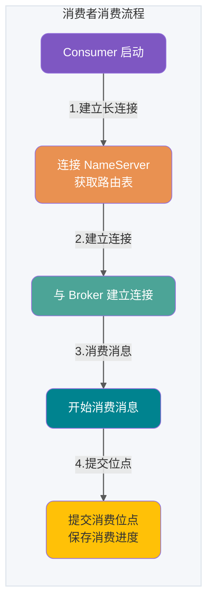
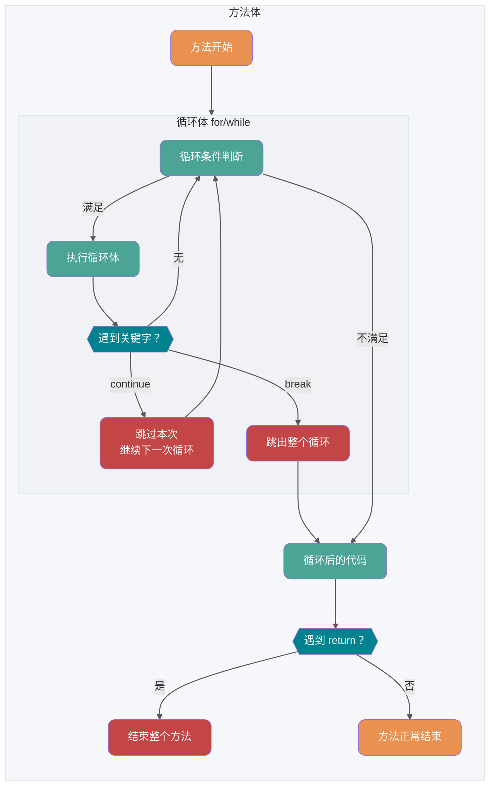
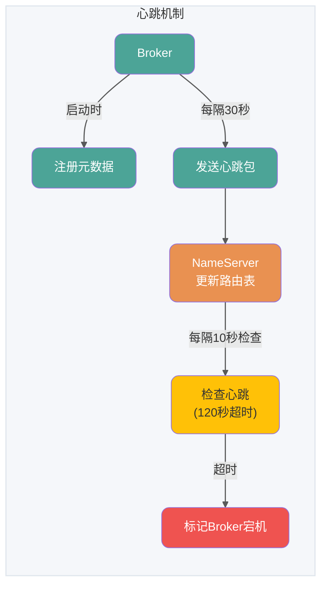
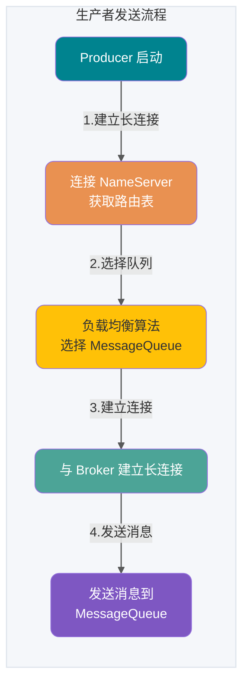

# Java综合问答

<a id="k9dfb21ef6826"></a>

## 1) 扩容因子默认为什么是0.75

如果扩容因子过高，空间利用率提高但是哈希冲突概率增加；如果扩容因子过低，会造成频繁扩容，哈希冲突概率降低，但是空间利用率变低。选择0.75是基于泊松分布，是时间和空间成本上寻求的一种折中选择

### 参考资料

- [Datawhale](https://github.com/datawhalechina/daily-interview/blob/f35e8d555f8ff07d568eae569c3641bd76d0eac9/docs/02-programming-languages/Java/java-fundamentals.md#L19)，来源许可：GPL-3.0。

<a id="k2a76c16154bc"></a>

## 2)为什么链表长度为8要转化为红黑树

首先和`hashcode`碰撞次数的泊松分布有关，主要是为了寻找一种时间和空间的平衡。在负载因子0.75（HashMap默认）的情况下，单个`hash`槽内元素个数为8的概率小于百万分之一，将7作为一个分水岭，等于7时不做转换，大于等于8才转红黑树，小于等于6才转链表。链表中元素个数为8时的概率已经非常小，再多的就更少了，所以原作者在选择链表元素个数时选择了8，是根据概率统计而选择的。红黑树中的`TreeNode`是链表中的`Node`所占空间的2倍，虽然红黑树的查找效率为$O(logN)$，要优于链表的$O(N)$，但是当链表长度比较小的时候，即使全部遍历，时间复杂度也不会太高。所以，要寻找一种时间和空间的平衡，即在链表长度达到一个阈值之后再转换为红黑树

### 参考资料

- [Datawhale](https://github.com/datawhalechina/daily-interview/blob/f35e8d555f8ff07d568eae569c3641bd76d0eac9/docs/02-programming-languages/Java/java-fundamentals.md#L23)，来源许可：GPL-3.0。

<a id="k0427b125dd4a"></a>

## AI 应用开发面试指南

面向后端开发者的 AI 应用开发、AI 编程实战与面试指南已开源，涵盖 LLM、Agent、RAG、MCP、Claude Code、Codex 等核心技术与工程实践。对标 JavaGuide！有帮助的话，欢迎 Star！

- **项目地址**：[https://github.com/Snailclimb/AIGuide](https://github.com/Snailclimb/AIGuide)
- **在线阅读**：[https://javaguide.cn/ai/](https://javaguide.cn/ai/)

### 参考资料

- [JavaGuide](https://github.com/Snailclimb/JavaGuide/blob/992dae31eade2a34ba8dbbbcf5ed9de5511325ec/README.md#L26)，来源许可：Apache-2.0。

<a id="kf5edc1346480"></a>

## AOT 有什么优点？为什么不全部使用 AOT 呢？

JDK 9 曾通过 JEP 295 引入实验性的 AOT（Ahead of Time Compilation）工具 `jaotc`，但该工具已在 JDK 17 中移除。因此，JDK 17 及之后的标准 JDK 不再包含这套内置 AOT 编译器；下文讨论的是一般意义上的 AOT，以及 GraalVM Native Image 等独立工具链（Native Image 是 GraalVM 提供的一项 AOT 技术，后文会进一步介绍 GraalVM）。和 JIT 不同，AOT 会在程序执行前将代码编译为机器码，能够减少运行时预热开销并改善启动速度，但具体的内存占用、峰值性能和适用场景取决于所使用的 AOT 实现与应用负载。

下面的对比以常见的 HotSpot JIT 和 GraalVM Native Image 为例。不同 AOT 工具的实现方式并不完全相同，实际表现还会受到构建参数、应用负载，以及是否使用 PGO（Profile-Guided Optimization，即利用程序实际运行时收集的性能信息辅助优化）等因素影响。

| 对比维度         | JIT（即时编译）                          | AOT（提前编译）                                    |
| ---------------- | ---------------------------------------- | -------------------------------------------------- |
| **编译时机**     | 运行时根据代码执行情况编译               | 构建阶段提前编译                                   |
| **启动与预热**   | 启动后通常需要解释执行和编译热点代码     | 通常启动更快，不需要等待 JIT 预热                  |
| **长期运行性能** | 可以利用运行时采集的信息持续优化热点代码 | 缺少完整的运行时信息，具体表现取决于实现和构建配置 |
| **运行时内存**   | 需要保存编译器、性能数据和生成的机器码   | Native Image 等实现通常占用更少的运行时内存        |
| **运行依赖**     | 需要 JVM 和相应运行时                    | Native Image 可以生成独立的本地可执行文件          |
| **动态特性**     | 支持运行时加载、反射和字节码生成         | 闭世界分析工具通常需要元数据或构建期处理           |
| **常见场景**     | 长时间运行、重视持续吞吐量的服务         | CLI、Serverless、弹性扩缩容和冷启动敏感的服务      |


AOT 的优势主要体现在启动速度和运行时内存占用，比较适合冷启动频繁、实例生命周期较短或者需要快速扩容的应用。JIT 则能根据程序运行时收集到的信息优化热点代码，长时间运行的服务通常更容易发挥这方面的优势。二者的吞吐量和延迟表现不能只由编译方式直接下结论，还需要结合具体工具链和实际负载测试。

提到 AOT 就不得不提 [GraalVM](https://www.graalvm.org/) 了！GraalVM 是一种高性能的 JDK（完整的 JDK 发行版本），它可以运行 Java 和其他 JVM 语言，以及 JavaScript、Python 等非 JVM 语言。 GraalVM 不仅能提供 AOT 编译，还能提供 JIT 编译。感兴趣的同学，可以去看看 GraalVM 的官方文档：<https://www.graalvm.org/latest/docs/>。如果觉得官方文档看着比较难理解的话，也可以找一些文章来看看，比如：

- [基于静态编译构建微服务应用](https://mp.weixin.qq.com/s/4haTyXUmh8m-dBQaEzwDJw)
- [走向 Native 化：Spring&Dubbo AOT 技术示例与原理讲解](https://cn.dubbo.apache.org/zh-cn/blog/2023/06/28/%e8%b5%b0%e5%90%91-native-%e5%8c%96springdubbo-aot-%e6%8a%80%e6%9c%af%e7%a4%ba%e4%be%8b%e4%b8%8e%e5%8e%9f%e7%90%86%e8%ae%b2%e8%a7%a3/)

### 参考资料

- [JavaGuide](https://github.com/Snailclimb/JavaGuide/blob/992dae31eade2a34ba8dbbbcf5ed9de5511325ec/docs/java/basis/java-basic-questions-01.md#L134)，来源许可：Apache-2.0。

<a id="ke2ea7d869dd9"></a>

## Apache Shiro

> Apache Shiro™ is a powerful and easy-to-use Java security framework that performs authentication, authorization, cryptography, and session management. With Shiro’s easy-to-understand API, you can quickly and easily secure any application – from the smallest mobile applications to the largest web and enterprise applications.

### 参考资料

- [Advanced Java](https://github.com/doocs/advanced-java/blob/80b89fb9496d7ea3213e402c8c3853399e00c363/docs/micro-services/micro-services-technology-stack.md#L59)，来源许可：CC-BY-SA-4.0。

<a id="kd4d7b4a578f9"></a>

## Apollo

Apollo（阿波罗）是携程框架部门研发的分布式配置中心，能够集中化管理应用不同环境、不同集群的配置，配置修改后能够实时推送到应用端，并且具备规范的权限、流程治理等特性，用于微服务配置管理场景。

### 参考资料

- [Advanced Java](https://github.com/doocs/advanced-java/blob/80b89fb9496d7ea3213e402c8c3853399e00c363/docs/micro-services/micro-services-technology-stack.md#L49)，来源许可：CC-BY-SA-4.0。

<a id="kd046be3506e2"></a>

## ArrayBlockingQueue 和 LinkedBlockingQueue 有什么区别？

`ArrayBlockingQueue` 和 `LinkedBlockingQueue` 是 Java 并发包中常用的两种阻塞队列实现，它们都是线程安全的。不过，不过它们之间也存在下面这些区别：

- 底层实现：`ArrayBlockingQueue` 基于数组实现，而 `LinkedBlockingQueue` 基于链表实现。
- 是否有界：`ArrayBlockingQueue` 是有界队列，必须在创建时指定容量大小。`LinkedBlockingQueue` 创建时可以不指定容量大小，默认是 `Integer.MAX_VALUE`，也就是无界的。但也可以指定队列大小，从而成为有界的。
- 锁是否分离： `ArrayBlockingQueue` 中的锁是没有分离的，即生产和消费用的是同一个锁；`LinkedBlockingQueue` 中的锁是分离的，即生产用的是 `putLock`，消费是 `takeLock`，这样可以防止生产者和消费者线程之间的锁争夺。
- 内存占用：`ArrayBlockingQueue` 需要提前分配数组内存，而 `LinkedBlockingQueue` 则是动态分配链表节点内存。这意味着，`ArrayBlockingQueue` 在创建时就会占用一定的内存空间，且往往申请的内存比实际所用的内存更大，而 `LinkedBlockingQueue` 则是根据元素的增加而逐渐占用内存空间。

### 参考资料

- [JavaGuide](https://github.com/Snailclimb/JavaGuide/blob/992dae31eade2a34ba8dbbbcf5ed9de5511325ec/docs/java/collection/java-collection-questions-01.md#L606)，来源许可：Apache-2.0。

<a id="k05bfa443586b"></a>

## BlockingQueue 的实现类有哪些？


Java 中常用的阻塞队列实现类有以下几种：

1. `ArrayBlockingQueue`：使用数组实现的有界阻塞队列。在创建时需要指定容量大小，并支持公平和非公平两种方式的锁访问机制。
2. `LinkedBlockingQueue`：使用单向链表实现的可选有界阻塞队列。在创建时可以指定容量大小，如果不指定则默认为 `Integer.MAX_VALUE`。和 `ArrayBlockingQueue` 不同的是， 它仅支持非公平的锁访问机制。
3. `PriorityBlockingQueue`：支持优先级排序的无界阻塞队列。元素必须实现 `Comparable` 接口或者在构造函数中传入 `Comparator` 对象，并且不能插入 null 元素。
4. `SynchronousQueue`：同步队列，是一种不存储元素的阻塞队列。每个插入操作都必须等待对应的删除操作，反之删除操作也必须等待插入操作。因此，`SynchronousQueue` 通常用于线程之间的直接传递数据。
5. `DelayQueue`：延迟队列，其中的元素只有到了其指定的延迟时间，才能够从队列中出队。
6. ……

日常开发中，这些队列使用的其实都不多，了解即可。

### 参考资料

- [JavaGuide](https://github.com/Snailclimb/JavaGuide/blob/992dae31eade2a34ba8dbbbcf5ed9de5511325ec/docs/java/collection/java-collection-questions-01.md#L591)，来源许可：Apache-2.0。

<a id="k8a6fa68d4cf7"></a>

## Broker（消息存储）

Broker 负责消息的存储、投递和查询以及服务高可用保证。

**存储机制：**

1. **消息写入**：收到消息后顺序追加到 CommitLog 文件
2. **文件分割**：文件超过固定大小（默认 1G）生成新文件
3. **逻辑分片**：MessageQueue 是逻辑分片，ConsumeQueue 是消息索引

**一个 Topic 分布在多个 Broker 上，一个 Broker 可以配置多个 Topic ，它们是多对多的关系**。

如果某个 Topic 消息量很大，应该给它多配置几个队列(上文中提到了提高并发能力)，并且 **尽量多分布在不同 Broker 上，以减轻某个 Broker 的压力** 。

Topic 消息量都比较均匀的情况下，如果某个 Broker 上的队列越多，则该 Broker 压力越大。


### 参考资料

- [JavaGuide](https://github.com/Snailclimb/JavaGuide/blob/992dae31eade2a34ba8dbbbcf5ed9de5511325ec/docs/high-performance/message-queue/rocketmq-questions.md#L465)，来源许可：Apache-2.0。

<a id="k170ce9c8b87e"></a>

## Checked Exception 和 Unchecked Exception 有什么区别？

**Checked Exception** 即 受检查异常，Java 代码在编译过程中，如果受检查异常没有被 `catch` 或者 `throws` 关键字处理的话，就没办法通过编译。

比如下面这段 IO 操作的代码：


除了 `RuntimeException` 及其子类以外，其他的 `Exception` 类及其子类都属于受检查异常。常见的受检查异常有：IO 相关的异常、`ClassNotFoundException`、`SQLException`...。

**Unchecked Exception** 即 **不受检查异常**，Java 代码在编译过程中，我们即使不处理不受检查异常也可以正常通过编译。

`RuntimeException` 及其子类属于非受检查异常；从 JLS 的分类来看，`Error` 及其子类也属于非受检查异常。常见的 `RuntimeException` 有：

- `NullPointerException`（空指针错误）
- `IllegalArgumentException`（参数错误比如方法入参类型错误）
- `NumberFormatException`（字符串转换为数字格式错误，`IllegalArgumentException` 的子类）
- `ArrayIndexOutOfBoundsException`（数组越界错误）
- `ClassCastException`（类型转换错误）
- `ArithmeticException`（算术错误）
- `SecurityException`（安全错误比如权限不够）
- `UnsupportedOperationException`（不支持的操作错误比如重复创建同一用户）
- ……


### 参考资料

- [JavaGuide](https://github.com/Snailclimb/JavaGuide/blob/992dae31eade2a34ba8dbbbcf5ed9de5511325ec/docs/java/basis/java-basic-questions-03.md#L31)，来源许可：Apache-2.0。

<a id="keaccb70d695f"></a>

## ClassNotFoundException 和 NoClassDefFoundError 的区别

- `ClassNotFoundException` 是 Exception，发生在使用反射等动态加载时找不到类，是可预期的，可以捕获处理。
- `NoClassDefFoundError` 是 Error，表示 JVM 或类加载器尝试加载类定义时找不到该定义。除了运行时缺少 JAR，还可能由类初始化失败后再次使用该类等情况触发。它通常会终止当前线程，但不等于整个 JVM 必然无法继续运行。

### 参考资料

- [JavaGuide](https://github.com/Snailclimb/JavaGuide/blob/992dae31eade2a34ba8dbbbcf5ed9de5511325ec/docs/java/basis/java-basic-questions-03.md#L26)，来源许可：Apache-2.0。

<a id="kcede900d2725"></a>

## Comparable 和 Comparator 的区别

`Comparable` 接口和 `Comparator` 接口都是 Java 中用于排序的接口，它们在实现类对象之间比较大小、排序等方面发挥了重要作用：

- `Comparable` 接口实际上是出自 `java.lang` 包 它有一个 `compareTo(Object obj)` 方法用来排序
- `Comparator` 接口实际上是出自 `java.util` 包它有一个 `compare(Object obj1, Object obj2)` 方法用来排序

一般我们需要对一个集合使用自定义排序时，我们就要重写 `compareTo()` 方法或 `compare()` 方法，当我们需要对某一个集合实现两种排序方式，比如一个 `song` 对象中的歌名和歌手名分别采用一种排序方法的话，我们可以重写 `compareTo()` 方法和使用自制的 `Comparator` 方法或者以两个 `Comparator` 来实现歌名排序和歌星名排序，第二种代表我们只能使用两个参数版的 `Collections.sort()`.

### Comparator 定制排序

```java
ArrayList<Integer> arrayList = new ArrayList<Integer>();
arrayList.add(-1);
arrayList.add(3);
arrayList.add(3);
arrayList.add(-5);
arrayList.add(7);
arrayList.add(4);
arrayList.add(-9);
arrayList.add(-7);
System.out.println("原始数组:");
System.out.println(arrayList);
// void reverse(List list)：反转
Collections.reverse(arrayList);
System.out.println("Collections.reverse(arrayList):");
System.out.println(arrayList);

// void sort(List list),按自然排序的升序排序
Collections.sort(arrayList);
System.out.println("Collections.sort(arrayList):");
System.out.println(arrayList);
// 定制排序的用法
Collections.sort(arrayList, new Comparator<Integer>() {
    @Override
    public int compare(Integer o1, Integer o2) {
        return o2.compareTo(o1);
    }
});
System.out.println("定制排序后：");
System.out.println(arrayList);
```

Output:

```plain
原始数组:
[-1, 3, 3, -5, 7, 4, -9, -7]
Collections.reverse(arrayList):
[-7, -9, 4, 7, -5, 3, 3, -1]
Collections.sort(arrayList):
[-9, -7, -5, -1, 3, 3, 4, 7]
定制排序后：
[7, 4, 3, 3, -1, -5, -7, -9]
```

### 重写 compareTo 方法实现按年龄来排序

```java
// person对象没有实现Comparable接口，所以必须实现，这样才不会出错，才可以使treemap中的数据按顺序排列
// 前面一个例子的String类已经默认实现了Comparable接口，详细可以查看String类的API文档，另外其他
// 像Integer类等都已经实现了Comparable接口，所以不需要另外实现了
public  class Person implements Comparable<Person> {
    private String name;
    private int age;

    public Person(String name, int age) {
        super();
        this.name = name;
        this.age = age;
    }

    public String getName() {
        return name;
    }

    public void setName(String name) {
        this.name = name;
    }

    public int getAge() {
        return age;
    }

    public void setAge(int age) {
        this.age = age;
    }

    /**
     * T重写compareTo方法实现按年龄来排序
     */
    @Override
    public int compareTo(Person o) {
        if (this.age > o.getAge()) {
            return 1;
        }
        if (this.age < o.getAge()) {
            return -1;
        }
        return 0;
    }
}

```

```java
    public static void main(String[] args) {
        TreeMap<Person, String> pdata = new TreeMap<Person, String>();
        pdata.put(new Person("张三", 30), "zhangsan");
        pdata.put(new Person("李四", 20), "lisi");
        pdata.put(new Person("王五", 10), "wangwu");
        pdata.put(new Person("小红", 5), "xiaohong");
        // 得到key的值的同时得到key所对应的值
        Set<Person> keys = pdata.keySet();
        for (Person key : keys) {
            System.out.println(key.getAge() + "-" + key.getName());

        }
    }
```

Output：

```plain
5-小红
10-王五
20-李四
30-张三
```

### 参考资料

- [JavaGuide](https://github.com/Snailclimb/JavaGuide/blob/992dae31eade2a34ba8dbbbcf5ed9de5511325ec/docs/java/collection/java-collection-questions-01.md#L378)，来源许可：Apache-2.0。

<a id="kddee93465f34"></a>

## Consumer（消费者）

**消费流程：**



**三种消费模式：**

- **拉取模式（Pull）**：消费者主动向 Broker 发送拉取请求
- **推模式（Push）**：长轮询机制，Broker 有消息时才返回
- **无状态模式（Pop）**：RocketMQ 5.0 新增，服务端管理重平衡和位点

### 参考资料

- [JavaGuide](https://github.com/Snailclimb/JavaGuide/blob/992dae31eade2a34ba8dbbbcf5ed9de5511325ec/docs/high-performance/message-queue/rocketmq-questions.md#L520)，来源许可：Apache-2.0。

<a id="k60840010c9ac"></a>

## continue、break 和 return 的区别是什么？

在循环结构中，当循环条件不满足或者循环次数达到要求时，循环会正常结束。但是，有时候可能需要在循环的过程中，当发生了某种条件之后，提前终止循环，这就需要用到下面几个关键词：

1. `continue`：指跳出当前的这一次循环，继续下一次循环。
2. `break`：指跳出整个循环体，继续执行循环下面的语句。

`return` 用于跳出所在方法，结束该方法的运行。return 一般有两种用法：

1. `return;`：直接使用 return 结束方法执行，用于没有返回值函数的方法
2. `return value;`：return 一个特定值，用于有返回值函数的方法



思考一下：下列语句的运行结果是什么？

```java
public static void main(String[] args) {
    boolean flag = false;
    for (int i = 0; i <= 3; i++) {
        if (i == 0) {
            System.out.println("0");
        } else if (i == 1) {
            System.out.println("1");
            continue;
        } else if (i == 2) {
            System.out.println("2");
            flag = true;
        } else if (i == 3) {
            System.out.println("3");
            break;
        } else if (i == 4) {
            System.out.println("4");
        }
        System.out.println("xixi");
    }
    if (flag) {
        System.out.println("haha");
        return;
    }
    System.out.println("heihei");
}
```

运行结果：

```plain
0
xixi
1
2
xixi
3
haha
```

### 参考资料

- [JavaGuide](https://github.com/Snailclimb/JavaGuide/blob/992dae31eade2a34ba8dbbbcf5ed9de5511325ec/docs/java/basis/java-basic-questions-01.md#L473)，来源许可：Apache-2.0。

<a id="k827000f61b64"></a>

## Disconf

Distributed Configuration Management Platform(分布式配置管理平台) , 它是专注于各种分布式系统配置管理 的通用组件/通用平台, 提供统一的配置管理服务, 是一套完整的基于 zookeeper 的分布式配置统一解决方案。

### 参考资料

- [Advanced Java](https://github.com/doocs/advanced-java/blob/80b89fb9496d7ea3213e402c8c3853399e00c363/docs/micro-services/micro-services-technology-stack.md#L43)，来源许可：CC-BY-SA-4.0。

<a id="ke32785f8d188"></a>

## Disruptor 为什么这么快？

- **RingBuffer（环形数组）** : Disruptor 内部的 RingBuffer 是通过数组实现的。由于这个数组中的所有元素在初始化时一次性全部创建，因此这些元素的内存地址一般来说是连续的。这样做的好处是，当生产者不断往 RingBuffer 中插入新的事件对象时，这些事件对象的内存地址就能够保持连续，从而利用 CPU 缓存的局部性原理，将相邻的事件对象一起加载到缓存中，提高程序的性能。这类似于 MySQL 的预读机制，将连续的几个页预读到内存里。除此之外，RingBuffer 基于数组还支持批量操作（一次处理多个元素）、还可以避免频繁的内存分配和垃圾回收（RingBuffer 是一个固定大小的数组，当向数组中添加新元素时，如果数组已满，则新元素将覆盖掉最旧的元素）。
- **避免了伪共享问题**：CPU 缓存内部是按照 Cache Line（缓存行）管理的，一般的 Cache Line 大小在 64 字节左右。Disruptor 为了确保目标字段独占一个 Cache Line，会在目标字段前后增加字节填充（前 56 个字节和后 56 个字节），这样可以避免 Cache Line 的伪共享（False Sharing）问题。同时，为了让 RingBuffer 存放数据的数组独占缓存行，数组的设计为 无效填充（128 字节）+ 有效数据。
- **无锁设计**：Disruptor 采用无锁设计，避免了传统锁机制带来的竞争和延迟。Disruptor 的无锁实现起来比较复杂，主要是基于 CAS、内存屏障（Memory Barrier）、RingBuffer 等技术实现的。

综上所述，Disruptor 之所以能够如此快，是基于一系列优化策略的综合作用，既充分利用了现代 CPU 缓存结构的特点，又避免了常见的并发问题和性能瓶颈。

不过，Disruptor 的性能优势也有前提：事件处理逻辑不能太重，消费者不能长时间阻塞，RingBuffer 容量要结合峰值流量评估。如果消费者里调用慢接口、慢 SQL 或长时间加锁，再快的队列也会被下游处理能力拖住。

关于 Disruptor 高性能队列原理的详细介绍，可以查看这篇文章：[Disruptor 高性能队列原理浅析](https://qin.news/disruptor/) （参考了美团技术团队的[高性能队列——Disruptor](https://tech.meituan.com/2016/11/18/disruptor.html)这篇文章）。

🌈 这里额外补充一点：**数组中对象元素地址连续为什么可以提高性能？**

CPU 缓存是通过将最近使用的数据存储在高速缓存中来实现更快的读取速度，并使用预取机制提前加载相邻内存的数据以利用局部性原理。

在计算机系统中，CPU 主要访问高速缓存和内存。高速缓存是一种速度非常快、容量相对较小的内存，通常被分为多级缓存，其中 L1、L2、L3 分别表示一级缓存、二级缓存、三级缓存。越靠近 CPU 的缓存，速度越快，容量也越小。相比之下，内存容量相对较大，但速度较慢。


为了加速数据的读取过程，CPU 会先将数据从内存中加载到高速缓存中，如果下一次需要访问相同的数据，就可以直接从高速缓存中读取，而不需要再次访问内存。这就是所谓的 **缓存命中** 。另外，为了利用 **局部性原理** ，CPU 还会根据之前访问的内存地址预取相邻的内存数据，因为在程序中，连续的内存地址通常会被频繁访问到，这样做可以提高数据的缓存命中率，进而提高程序的性能。

### 参考资料

- [JavaGuide](https://github.com/Snailclimb/JavaGuide/blob/992dae31eade2a34ba8dbbbcf5ed9de5511325ec/docs/high-performance/message-queue/disruptor-questions.md#L140)，来源许可：Apache-2.0。

<a id="k27eb7fcd9d89"></a>

## Disruptor 是什么？

Disruptor 是一个开源的高性能内存队列，诞生初衷是为了解决内存队列的性能和内存安全问题，由英国外汇交易公司 LMAX 开发。

根据 Disruptor 官方介绍，基于 Disruptor 开发的系统 LMAX（新的零售金融交易平台），单线程就能支撑每秒 600 万订单。Martin Fowler 在 2011 年写的一篇文章 [The LMAX Architecture](https://martinfowler.com/articles/lmax.html) 中专门介绍过这个 LMAX 系统的架构，感兴趣的可以看看这篇文章。。

LMAX 公司 2010 年在 QCon 演讲后，Disruptor 获得了业界关注，并获得了 2011 年的 Oracle 官方的 Duke's Choice Awards(Duke 选择大奖)。


> “Duke 选择大奖”旨在表彰过去一年里全球个人或公司开发的、最具影响力的 Java 技术应用，由甲骨文公司主办。含金量非常高！

我专门找到了 Oracle 官方当年颁布获得 Duke's Choice Awards 项目的那篇文章（文章地址：<https://blogs.oracle.com/java/post/and-the-winners-arethe-dukes-choice-award）> 。从文中可以看出，同年获得此大奖荣誉的还有大名鼎鼎的 Netty、JRebel 等项目。


Disruptor 提供的功能优点类似于 Kafka、RocketMQ 这类分布式队列，不过，其作为范围是 JVM(内存)。

- Github 地址：<https://github.com/LMAX-Exchange/disruptor>
- 官方教程： <https://lmax-exchange.github.io/disruptor/user-guide/index.html>

关于如何在 Spring Boot 项目中使用 Disruptor，可以看这篇文章：[Spring Boot + Disruptor 实战入门](https://mp.weixin.qq.com/s/0iG5brK3bYF0BgSjX4jRiA) 。

### 参考资料

- [JavaGuide](https://github.com/Snailclimb/JavaGuide/blob/992dae31eade2a34ba8dbbbcf5ed9de5511325ec/docs/high-performance/message-queue/disruptor-questions.md#L21)，来源许可：Apache-2.0。

<a id="k3fbf14ec0458"></a>

## Disruptor 核心概念有哪些？

- **Event**：你可以把 Event 理解为存放在队列中等待消费的消息对象。
- **EventFactory**：事件工厂用于生产事件，我们在初始化 `Disruptor` 类的时候需要用到。
- **EventHandler**：Event 在对应的 Handler 中被处理，你可以将其理解为生产消费者模型中的消费者。
- **EventProcessor**：EventProcessor 持有特定消费者(Consumer)的 Sequence，并提供用于调用事件处理实现的事件循环(Event Loop)。
- **Disruptor**：事件的生产和消费需要用到 `Disruptor` 对象。
- **RingBuffer**：RingBuffer（环形数组）用于保存事件。
- **WaitStrategy**：等待策略。决定了没有事件可以消费的时候，事件消费者如何等待新事件的到来。
- **Producer**：生产者，只是泛指调用 `Disruptor` 对象发布事件的用户代码，Disruptor 没有定义特定接口或类型。
- **ProducerType**：指定是单个事件发布者模式还是多个事件发布者模式（发布者和生产者的意思类似，我个人比较喜欢用发布者）。
- **Sequencer**：Sequencer 是 Disruptor 的真正核心。此接口有两个实现类 `SingleProducerSequencer`、`MultiProducerSequencer` ，它们定义在生产者和消费者之间快速、正确地传递数据的并发算法。

下面这张图摘自 Disruptor 官网，展示了 LMAX 系统使用 Disruptor 的示例。


### 参考资料

- [JavaGuide](https://github.com/Snailclimb/JavaGuide/blob/992dae31eade2a34ba8dbbbcf5ed9de5511325ec/docs/high-performance/message-queue/disruptor-questions.md#L98)，来源许可：Apache-2.0。

<a id="k916a7087ad6d"></a>

## Disruptor 等待策略有哪些？

**等待策略（WaitStrategy）** 决定了没有事件可以消费的时候，事件消费者如何等待新事件的到来。

常见的等待策略有下面这些：


- `BlockingWaitStrategy`：基于 `ReentrantLock`+`Condition` 来实现等待和唤醒操作，实现代码非常简单，是 Disruptor 默认的等待策略。虽然最慢，但也是 CPU 使用率最低和最稳定的选项生产环境推荐使用；
- `BusySpinWaitStrategy`：性能很好，存在持续自旋的风险，使用不当会造成 CPU 负载 100%，慎用；
- `LiteBlockingWaitStrategy`：基于 `BlockingWaitStrategy` 的轻量级等待策略，在没有锁竞争的时候会省去唤醒操作，但是作者说测试不充分，因此不建议使用;
- `TimeoutBlockingWaitStrategy`：带超时的等待策略，超时后会执行业务指定的处理逻辑;
- `LiteTimeoutBlockingWaitStrategy`：基于`TimeoutBlockingWaitStrategy`的策略，当没有锁竞争的时候会省去唤醒操作;
- `SleepingWaitStrategy`：三段式策略，第一阶段自旋，第二阶段执行 Thread.yield 让出 CPU，第三阶段睡眠执行时间，反复的睡眠；
- `YieldingWaitStrategy`：二段式策略，第一阶段自旋，第二阶段执行 Thread.yield 交出 CPU;
- `PhasedBackoffWaitStrategy`：四段式策略，第一阶段自旋指定次数，第二阶段自旋指定时间，第三阶段执行 `Thread.yield` 交出 CPU，第四阶段调用成员变量的`waitFor`方法，该成员变量可以被设置为`BlockingWaitStrategy`、`LiteBlockingWaitStrategy`、`SleepingWaitStrategy`三个中的一个。

等待策略本质是在延迟和 CPU 消耗之间做取舍：

- 延迟极敏感、机器资源独占时，可以评估 `BusySpinWaitStrategy` 或 `YieldingWaitStrategy`。
- 普通业务服务更推荐从 `BlockingWaitStrategy` 开始，稳定性和资源占用更可控。
- 如果既希望降低空转，又希望在短时间内快速响应，可以评估 `SleepingWaitStrategy` 或 `PhasedBackoffWaitStrategy`。

不要在共享业务机器上盲目使用忙等策略，否则很容易把 CPU 打满，影响同机其他服务。

### 参考资料

- [JavaGuide](https://github.com/Snailclimb/JavaGuide/blob/992dae31eade2a34ba8dbbbcf5ed9de5511325ec/docs/high-performance/message-queue/disruptor-questions.md#L115)，来源许可：Apache-2.0。

<a id="kd8de63ca671f"></a>

## Eureka

-   Eureka Server : 提供服务注册服务, 各个节点启动后，会在 Eureka Server 中进行注册。
-   Eureka Client : 简化与 Eureka Server 的交互操作。
-   Spring Cloud Netflix : [GitHub](https://github.com/spring-cloud/spring-cloud-netflix)，[文档](https://cloud.spring.io/spring-cloud-netflix/reference/html/)

### 参考资料

- [Advanced Java](https://github.com/doocs/advanced-java/blob/80b89fb9496d7ea3213e402c8c3853399e00c363/docs/micro-services/micro-services-technology-stack.md#L19)，来源许可：CC-BY-SA-4.0。

<a id="k2a870e995819"></a>

## Eureka 是什么

`Eureka` 在 [GitHub](https://github.com/Netflix/eureka) 上对其的定义为

> Eureka is a REST (Representational State Transfer) based service that is primarily used in the AWS cloud for locating services for the purpose of load balancing and failover of middle-tier servers.

At Netflix, Eureka is used for the following purposes apart from playing a critical part in mid-tier load balancing.

`Eureka` 是由 [Netflix](https://www.netflix.com) 公司开源，采用的是 Client / Server 模式进行设计，基于 http 协议和使用 Restful Api 开发的服务注册与发现组件，提供了完整的服务注册和服务发现，可以和 `Spring Cloud` 无缝集成。其中 Server 端扮演着服务注册中心的角色，主要是为 Client 端提供服务注册和发现等功能，维护着 Client 端的服务注册信息，同时定期心跳检测已注册的服务当不可用时将服务剔除下线，Client 端可以通过 Server 端获取自身所依赖服务的注册信息，从而完成服务间的调用。遗憾的是从其官方的 [github wiki](https://github.com/Netflix/eureka/wiki) 可以发现，2.0 版本已经不再开源。但是不影响我们对其进行深入了解，毕竟服务注册、服务发现相对来说还是比较基础和通用的，其它开源实现框架的思想也是想通的。

### 参考资料

- [Advanced Java](https://github.com/doocs/advanced-java/blob/80b89fb9496d7ea3213e402c8c3853399e00c363/docs/micro-services/how-eureka-enable-service-discovery-and-service-registration.md#L8)，来源许可：CC-BY-SA-4.0。

<a id="kcc3bba599961"></a>

## Exception 和 Error 有什么区别？

在 Java 中，所有的异常都有一个共同的祖先 `java.lang` 包中的 `Throwable` 类。`Throwable` 类有两个重要的子类:

- **`Exception`** :程序本身可以处理的异常，可以通过 `catch` 来进行捕获。`Exception` 又可以分为 Checked Exception（受检查异常，必须处理） 和 Unchecked Exception（不受检查异常，可以不处理）。
- **`Error`**：`Error` 属于程序无法处理的错误，~~我们没办法通过 `catch` 来进行捕获~~不建议通过 `catch` 捕获。例如 Java 虚拟机运行错误（`Virtual MachineError`）、虚拟机内存不够错误(`OutOfMemoryError`)、类定义错误（`NoClassDefFoundError`）等。这些异常发生时，Java 虚拟机（JVM）一般会选择线程终止。

### 参考资料

- [JavaGuide](https://github.com/Snailclimb/JavaGuide/blob/992dae31eade2a34ba8dbbbcf5ed9de5511325ec/docs/java/basis/java-basic-questions-03.md#L19)，来源许可：Apache-2.0。

<a id="k70f098abfc09"></a>

## finally 中的代码一定会执行吗？

不一定的！在某些情况下，finally 中的代码不会被执行。

就比如说 finally 之前虚拟机被终止运行的话，finally 中的代码就不会被执行。

```java
try {
    System.out.println("Try to do something");
    throw new RuntimeException("RuntimeException");
} catch (Exception e) {
    System.out.println("Catch Exception -> " + e.getMessage());
    // 终止当前正在运行的Java虚拟机
    System.exit(1);
} finally {
    System.out.println("Finally");
}
```

输出：

```plain
Try to do something
Catch Exception -> RuntimeException
```

另外，如果 JVM 进程被强制终止，例如调用 `Runtime.halt()`、操作系统直接结束进程或机器掉电，`finally` 块也可能来不及执行。普通的未捕获异常即使最终导致当前线程结束，在线程结束前仍会按语言规则执行 `finally`。

相关 issue：<https://github.com/Snailclimb/JavaGuide/issues/190>。

🧗🏻 进阶一下：从字节码角度分析 `try catch finally` 这个语法糖背后的实现原理。

### 参考资料

- [JavaGuide](https://github.com/Snailclimb/JavaGuide/blob/992dae31eade2a34ba8dbbbcf5ed9de5511325ec/docs/java/basis/java-basic-questions-03.md#L125)，来源许可：Apache-2.0。

<a id="k8fa1ebee633a"></a>

## gRPC

> A high-performance, open-source universal RPC framework

所谓 RPC(remote procedure call 远程过程调用) 框架实际是提供了一套机制，使得应用程序之间可以进行通信，而且也遵从 server/client 模型。使用的时候客户端调用 server 端提供的接口就像是调用本地的函数一样。

### 参考资料

- [Advanced Java](https://github.com/doocs/advanced-java/blob/80b89fb9496d7ea3213e402c8c3853399e00c363/docs/micro-services/micro-services-technology-stack.md#L88)，来源许可：CC-BY-SA-4.0。

<a id="k7d9bbc59eb4f"></a>

## Hystrix

> Hystrix is a latency and fault tolerance library designed to isolate points of access to remote systems, services and 3rd party libraries, stop cascading failure and enable resilience in complex distributed systems where failure is inevitable.

### 参考资料

- [Advanced Java](https://github.com/doocs/advanced-java/blob/80b89fb9496d7ea3213e402c8c3853399e00c363/docs/micro-services/micro-services-technology-stack.md#L111)，来源许可：CC-BY-SA-4.0。

<a id="ke2f1384f0075"></a>

## I/O 流为什么要分为字节流和字符流呢？

问题本质想问：**不管是文件读写还是网络发送接收，信息的最小存储单元都是字节，那为什么 I/O 流操作要分为字节流操作和字符流操作呢？**

个人认为主要有两点原因：

- 字符流是由 Java 虚拟机将字节转换得到的，这个过程还算是比较耗时；
- 如果我们不知道编码类型的话，使用字节流的过程中很容易出现乱码问题。

### 参考资料

- [JavaGuide](https://github.com/Snailclimb/JavaGuide/blob/992dae31eade2a34ba8dbbbcf5ed9de5511325ec/docs/java/basis/java-basic-questions-03.md#L597)，来源许可：Apache-2.0。

<a id="k0ad9e3a96e2e"></a>

## Java

Your choice:

- Goodrich, Tamassia, Goldwasser
    - [Data Structures and Algorithms in Java](https://www.amazon.com/Data-Structures-Algorithms-Michael-Goodrich/dp/1118771338/)
- Sedgewick and Wayne:
    - [Algorithms](https://www.amazon.com/Algorithms-4th-Robert-Sedgewick/dp/032157351X/)
    - Free Coursera course that covers the book (taught by the authors!):
        - [Algorithms I](https://www.coursera.org/learn/algorithms-part1)
        - [Algorithms II](https://www.coursera.org/learn/algorithms-part2)

### 参考资料

- [jwasham/coding-interview-university](https://github.com/jwasham/coding-interview-university/blob/717298bf219a30d7fb0671285c5f057b1bb74b27/README.md#L357)，来源许可：CC-BY-SA-4.0。

<a id="k3ffe7bf30627"></a>

## Java and time-traveling

* Pretend you have a time machine and pretend that you have the opportunity to go to a particular point in time during Java's (or C#, Python, Go or whatever) history, and talk with some of the JDK architects. What would you try to convince them of? Removing checked exceptions? Adding unsigned primitives? Adding multiple-inheritance?

### 参考资料

- [arialdomartini/Back-End-Developer-Interview-Questions](https://github.com/arialdomartini/Back-End-Developer-Interview-Questions/blob/5bcf6e9a7eb9ac0390abc8507a93f563d0e5efee/README.md#L437)，来源许可：GPL-2.0。

<a id="k54936ac4edcb"></a>

## Java IO 流了解吗？

IO 即 `Input/Output`，输入和输出。数据输入到计算机内存的过程即输入，反之输出到外部存储（比如数据库，文件，远程主机）的过程即输出。数据传输过程类似于水流，因此称为 IO 流。IO 流在 Java 中分为输入流和输出流，而根据数据的处理方式又分为字节流和字符流。

Java IO 流的 40 多个类都是从如下 4 个抽象类基类中派生出来的。

- `InputStream`/`Reader`: 所有的输入流的基类，前者是字节输入流，后者是字符输入流。
- `OutputStream`/`Writer`: 所有输出流的基类，前者是字节输出流，后者是字符输出流。

### 参考资料

- [JavaGuide](https://github.com/Snailclimb/JavaGuide/blob/992dae31eade2a34ba8dbbbcf5ed9de5511325ec/docs/java/basis/java-basic-questions-03.md#L588)，来源许可：Apache-2.0。

<a id="k6930bad13af8"></a>

## Java SE vs Java EE

- Java SE（Java Platform, Standard Edition）: Java 平台标准版，Java 编程语言的基础，它包含了支持 Java 应用程序开发和运行的核心类库以及虚拟机等核心组件。Java SE 可以用于构建桌面应用程序或简单的服务器应用程序。
- Java EE（Java Platform, Enterprise Edition）：Java 平台企业版，建立在 Java SE 的基础上，包含了支持企业级应用程序开发和部署的标准和规范（比如 Servlet、JSP、EJB、JDBC、JPA、JTA、JavaMail、JMS）。 Java EE 可以用于构建分布式、可移植、健壮、可伸缩和安全的服务端 Java 应用程序，例如 Web 应用程序。

简单来说，Java SE 是 Java 的基础版本，Java EE 是 Java 的高级版本。Java SE 更适合开发桌面应用程序或简单的服务器应用程序，Java EE 更适合开发复杂的企业级应用程序或 Web 应用程序。

除了 Java SE 和 Java EE，还有一个 Java ME（Java Platform，Micro Edition）。Java ME 是 Java 的微型版本，主要用于开发嵌入式消费电子设备的应用程序，例如手机、PDA、机顶盒、冰箱、空调等。Java ME 无需重点关注，知道有这个东西就好了，现在已经用不上了。

### 参考资料

- [JavaGuide](https://github.com/Snailclimb/JavaGuide/blob/992dae31eade2a34ba8dbbbcf5ed9de5511325ec/docs/java/basis/java-basic-questions-01.md#L34)，来源许可：Apache-2.0。

<a id="k18e1f1122ad7"></a>

## Java spi 思想的体现

spi 经典的思想体现，大家平时都在用，比如说 jdbc。

Java 定义了一套 jdbc 的接口，但是 Java 并没有提供 jdbc 的实现类。

但是实际上项目跑的时候，要使用 jdbc 接口的哪些实现类呢？一般来说，我们要**根据自己使用的数据库**，比如 mysql，你就将 `mysql-jdbc-connector.jar` 引入进来；oracle，你就将 `oracle-jdbc-connector.jar` 引入进来。

在系统跑的时候，碰到你使用 jdbc 的接口，他会在底层使用你引入的那个 jar 中提供的实现类。

### 参考资料

- [Advanced Java](https://github.com/doocs/advanced-java/blob/80b89fb9496d7ea3213e402c8c3853399e00c363/docs/distributed-system/dubbo-spi.md#L25)，来源许可：CC-BY-SA-4.0。

<a id="k92237061801d"></a>

## Java 与 Go 的使用情况

**回答：**

按真实使用深度回答：在哪类服务中使用 Java，在哪些模块中使用 Go，自己承担了设计、开发、调试还是仅做过练习。可以比较开发、测试、并发控制、性能排查和部署经验，避免只罗列语法差异。

Java 常见于 JVM 生态的业务服务，Go 常用于网络服务和基础设施工具，但这些是常见使用场景，并不是语言能力边界。并发层面，Go 的 goroutine 与 channel、Java 的线程、线程池以及特定版本的虚拟线程等，提供不同的编程抽象；选型仍需结合依赖生态、团队能力、运行环境和实际性能测量。

如果 Go 经验较少，可以明确说“Java 是主要开发语言，Go 已掌握基础并发模型并实现过【真实项目或练习】，尚未承担大规模生产调优”。准确描述熟练度比宣称“两个都精通”更能承受追问。

<a id="baidu-aigc-multimodal-agent-20260922-20260924-r2-q14"></a>

### 参考资料

- [AIGC Interview Book](https://github.com/WeThinkIn/AIGC-Interview-Book/blob/34e9ee6aa6d35d1e213099a7ae9f433b7b9e6fe6/%E5%A4%A7%E5%8E%82%E9%AB%98%E9%A2%91%E9%9D%A2%E8%AF%95%E9%A2%98%EF%BC%88%E5%AE%9E%E6%97%B6%E6%9B%B4%E6%96%B0%EF%BC%89/%E7%99%BE%E5%BA%A6%E9%AB%98%E9%A2%91%E9%9D%A2%E8%AF%95%E9%A2%98.md#L2141)，来源许可：GPL-3.0。

<a id="k81281ddf2a5c"></a>

## Java 中有哪些常见的语法糖？

Java 中最常用的语法糖主要有泛型、自动拆装箱、变长参数、枚举、内部类、增强 for 循环、try-with-resources 语法、lambda 表达式等。

关于这些语法糖的详细解读，请看这篇文章 [Java 语法糖详解](https://github.com/Snailclimb/JavaGuide/blob/992dae31eade2a34ba8dbbbcf5ed9de5511325ec/docs/java/basis/syntactic-sugar.md)。

<!-- @include: @article-footer.snippet.md -->

### 参考资料

- [JavaGuide](https://github.com/Snailclimb/JavaGuide/blob/992dae31eade2a34ba8dbbbcf5ed9de5511325ec/docs/java/basis/java-basic-questions-03.md#L631)，来源许可：Apache-2.0。

<a id="k788d657ab303"></a>

## Java 语言有哪些特点？

1. 简单易学（语法简单，上手容易）；
2. 面向对象（封装，继承，多态）；
3. 平台无关性（Java 虚拟机实现平台无关性）；
4. 支持多线程（C++ 语言没有内置的多线程机制，因此必须调用操作系统的多线程功能来进行多线程程序设计，而 Java 语言却提供了多线程支持）；
5. 可靠性（具备异常处理和自动内存管理机制）；
6. 安全性（Java 语言本身的设计就提供了多重安全防护机制如访问权限修饰符、限制程序直接访问操作系统资源）；
7. 高效性（通过 Just In Time 编译器等技术的优化，Java 语言的运行效率还是非常不错的）；
8. 支持网络编程并且很方便；
9. 编译与解释并存；
10. ……

> **🐛 修正（参见：[issue#544](https://github.com/Snailclimb/JavaGuide/issues/544)）**：C++11 开始（2011 年的时候），C++ 就引入了多线程库，在 Windows、Linux、macOS 都可以使用 `std::thread` 和 `std::async` 来创建线程。参考链接：<http://www.cplusplus.com/reference/thread/thread/?kw=thread>

🌈 拓展一下：

“Write Once, Run Anywhere（一次编写，随处运行）”这句宣传口号，真心经典，流传了好多年！以至于，直到今天，依然有很多人觉得跨平台是 Java 语言最大的优势。实际上，跨平台已经不是 Java 最大的卖点了，各种 JDK 新特性也不是。目前市面上虚拟化技术已经非常成熟，比如你通过 Docker 就很容易实现跨平台了。在我看来，Java 强大的生态才是！

### 参考资料

- [JavaGuide](https://github.com/Snailclimb/JavaGuide/blob/992dae31eade2a34ba8dbbbcf5ed9de5511325ec/docs/java/basis/java-basic-questions-01.md#L15)，来源许可：Apache-2.0。

<a id="k3420f6d1418c"></a>

## JDK 动态代理和 CGLIB 动态代理有什么区别？

1. JDK 动态代理是官方的，它要求被代理的类必须实现接口。它的原理是动态生成一个接口的实现类来作为代理。CGLIB 是第三方的，它不需要接口。它的原理是动态生成一个被代理类的子类来作为代理。但也正因为是继承，所以它不能代理 `final` 的类，被代理的方法也不能是 `final` 或 `private`。
2. 就二者的效率来说，大部分情况都是 JDK 动态代理更优秀，随着 JDK 版本的升级，这个优势更加明显。

### 参考资料

- [JavaGuide](https://github.com/Snailclimb/JavaGuide/blob/992dae31eade2a34ba8dbbbcf5ed9de5511325ec/docs/java/basis/java-basic-questions-03.md#L427)，来源许可：Apache-2.0。

<a id="k3a791fdd4524"></a>

## JDK 和 JRE

JDK（Java Development Kit）是一个功能齐全的 Java 开发工具包，供开发者使用，用于创建和编译 Java 程序。它包含了 JRE（Java Runtime Environment），以及编译器 javac 和其他工具，如 javadoc（文档生成器）、jdb（调试器）、jconsole（监控工具）、javap（反编译工具）等。

JRE 是运行已编译 Java 程序所需的环境，主要包含以下两个部分：

1. **JVM** : 也就是我们上面提到的 Java 虚拟机。
2. **Java 基础类库（Class Library）**：一组标准的类库，提供常用的功能和 API（如 I/O 操作、网络通信、数据结构等）。

简单来说，JRE 只包含运行 Java 程序所需的环境和类库，而 JDK 不仅包含 JRE，还包括用于开发和调试 Java 程序的工具。

如果需要编写、编译 Java 程序或使用 JDK 附带的开发工具，就需要安装 JDK。某些会在运行时编译 Java 源码的应用程序（如 JSP 转换为 Servlet）也可能需要 JDK。Java 核心反射 API 属于运行时类库，使用反射本身并不要求安装完整 JDK。

下图清晰展示了 JDK、JRE 和 JVM 的关系。


不过，从 JDK 9 开始，就不需要区分 JDK 和 JRE 的关系了，取而代之的是模块系统（JDK 被重新组织成 94 个模块）+ [jlink](http://openjdk.java.net/jeps/282) 工具（随 Java 9 一起发布的新命令行工具，用于生成自定义 Java 运行时映像，该映像仅包含给定应用程序所需的模块）。并且，从 JDK 11 开始，Oracle 不再提供单独的 JRE 下载。

在 [Java 9 新特性概览](https://javaguide.cn/java/new-features/java9.html)这篇文章中，我在介绍模块化系统的时候提到：

> 在引入了模块系统之后，JDK 被重新组织成 94 个模块。Java 应用可以通过新增的 jlink 工具，创建出只包含所依赖的 JDK 模块的自定义运行时镜像。这样可以极大的减少 Java 运行时环境的大小。

也就是说，可以用 jlink 根据自己的需求，创建一个更小的 runtime（运行时），而不是不管什么应用，都是同样的 JRE。

定制的、模块化的 Java 运行时映像有助于简化 Java 应用的部署和节省内存并增强安全性和可维护性。这对于满足现代应用程序架构的需求，如虚拟化、容器化、微服务和云原生开发，是非常重要的。

### 参考资料

- [JavaGuide](https://github.com/Snailclimb/JavaGuide/blob/992dae31eade2a34ba8dbbbcf5ed9de5511325ec/docs/java/basis/java-basic-questions-01.md#L59)，来源许可：Apache-2.0。

<a id="k88ea1e884119"></a>

## NameServer（注册中心）

NameServer 负责元数据的存储，扮演着集群“中枢神经系统”的角色，其核心作用是为生产者和消费者提供路由信息，帮助它们找到对应的 Broker 地址。

**核心功能：**

1. **Broker 管理**：Broker 启动时主动连接 NameServer，上报元数据信息。
2. **路由信息管理**：生产者和消费者从 NameServer 获取 Broker 路由表。

**心跳机制：**



**元数据包含：**

- Broker 的地址、名称、BrokerId
- 主节点地址
- 该 Broker 上的所有 Topic 的队列配置

### 参考资料

- [JavaGuide](https://github.com/Snailclimb/JavaGuide/blob/992dae31eade2a34ba8dbbbcf5ed9de5511325ec/docs/high-performance/message-queue/rocketmq-questions.md#L421)，来源许可：Apache-2.0。

<a id="k80909a54c159"></a>

## Object 类的常见方法有哪些？

Object 类是一个特殊的类，是所有类的父类，主要提供了以下方法。需要注意，`finalize()` 自 JDK 9 起已被弃用，并在 JDK 18 中被标记为待移除，不应在新代码中使用：

```java
/**
 * native 方法，用于返回当前运行时对象的 Class 对象，使用了 final 关键字修饰，故不允许子类重写。
 */
public final native Class<?> getClass()
/**
 * native 方法，用于返回对象的哈希码，主要使用在哈希表中，比如 JDK 中的HashMap。
 */
public native int hashCode()
/**
 * 用于比较 2 个引用是否指向同一个对象，String 类对该方法进行了重写以用于比较字符串的值是否相等。
 */
public boolean equals(Object obj)
/**
 * native 方法，用于创建并返回当前对象的一份拷贝。
 */
protected native Object clone() throws CloneNotSupportedException
/**
 * 返回类的名字实例的哈希码的 16 进制的字符串。建议 Object 所有的子类都重写这个方法。
 */
public String toString()
/**
 * native 方法，并且不能重写。唤醒一个在此对象监视器上等待的线程(监视器相当于就是锁的概念)。如果有多个线程在等待只会任意唤醒一个。
 */
public final native void notify()
/**
 * native 方法，并且不能重写。跟 notify 一样，唯一的区别就是会唤醒在此对象监视器上等待的所有线程，而不是一个线程。
 */
public final native void notifyAll()
/**
 * native方法，并且不能重写。暂停线程的执行。注意：sleep 方法没有释放锁，而 wait 方法释放了锁 ，timeout 是等待时间。
 */
public final native void wait(long timeout) throws InterruptedException
/**
 * 多了 nanos 参数，这个参数表示额外时间（以纳秒为单位，范围是 0-999999）。 所以超时的时间还需要加上 nanos 纳秒。。
 */
public final void wait(long timeout, int nanos) throws InterruptedException
/**
 * 跟之前的2个wait方法一样，只不过该方法一直等待，没有超时时间这个概念
 */
public final void wait() throws InterruptedException
/**
 * 实例被垃圾回收器回收的时候触发的操作
 */
protected void finalize() throws Throwable { }
```

### 参考资料

- [JavaGuide](https://github.com/Snailclimb/JavaGuide/blob/992dae31eade2a34ba8dbbbcf5ed9de5511325ec/docs/java/basis/java-basic-questions-02.md#L411)，来源许可：Apache-2.0。

<a id="kc36d274c7163"></a>

## Oracle JDK 和 OpenJDK 如何选择？

建议选择 OpenJDK 或者基于 OpenJDK 的发行版，比如 AWS 的 Amazon Corretto，阿里巴巴的 Alibaba Dragonwell。

🌈 拓展一下：

- BCL 协议（Oracle Binary Code License Agreement）：可以使用 JDK（支持商用），但是不能进行修改。
- OTN 协议（Oracle Technology Network License Agreement）：11 及之后新发布的 JDK 用的都是这个协议，可以自己私下用，但是商用需要付费。

### 参考资料

- [JavaGuide](https://github.com/Snailclimb/JavaGuide/blob/992dae31eade2a34ba8dbbbcf5ed9de5511325ec/docs/java/basis/java-basic-questions-01.md#L211)，来源许可：Apache-2.0。

<a id="k9faf47d872cf"></a>

## Producer（生产者）

**发送流程：**



**三种发送方式：**

- **单向发送（Oneway）**：发送后立即返回，不关心是否成功
- **同步发送（Sync）**：发送后等待响应
- **异步发送（Async）**：发送后立即返回，在回调方法中处理响应

### 参考资料

- [JavaGuide](https://github.com/Snailclimb/JavaGuide/blob/992dae31eade2a34ba8dbbbcf5ed9de5511325ec/docs/high-performance/message-queue/rocketmq-questions.md#L483)，来源许可：Apache-2.0。

<a id="k1a4984587993"></a>

## Proxy（代理层，5.0 新增）

RocketMQ 5.0 引入了 **Proxy** 组件，这是 **计算与存储分离** 架构的核心体现。Proxy 作为客户端与 Broker 之间的代理层，将客户端协议适配、权限管理、消费管理等计算逻辑从 Broker 中剥离出来，使 Broker 更专注于消息存储和高可用。这种设计对于云原生架构非常重要，使得计算层可以独立弹性扩展。

**两种部署模式：**

| 模式             | 说明                                            | 适用场景                                 |
| ---------------- | ----------------------------------------------- | ---------------------------------------- |
| **Local 模式**   | Proxy 和 Broker 同进程部署，只需新增 Proxy 配置 | 从旧版本平滑升级，或无特殊需求的场景     |
| **Cluster 模式** | Proxy 和 Broker 分别独立部署                    | 需要弹性扩展或对协议适配有定制需求的场景 |

**核心作用：**

- **协议适配**：支持 gRPC 协议接入，方便多语言客户端接入
- **计算卸载**：将认证鉴权、消费管理等计算逻辑从 Broker 剥离，降低 Broker 负载
- **弹性扩展**：Proxy 无状态，可独立水平扩展

> **注意**：在 5.0 版本中，使用新版 SDK（gRPC 协议）的客户端需要通过 Proxy 接入，而旧版 SDK（Remoting 协议）仍然可以直连 Broker。

Proxy 的价值不只是“多一层代理”。在云原生场景下，它可以把协议接入、认证鉴权、流量治理、消费管理这类计算逻辑从 Broker 中剥离出来，让 Broker 更稳定地承担存储职责。代价是链路多了一跳，需要额外关注 Proxy 的水平扩容、延迟、限流和监控。

### 参考资料

- [JavaGuide](https://github.com/Snailclimb/JavaGuide/blob/992dae31eade2a34ba8dbbbcf5ed9de5511325ec/docs/high-performance/message-queue/rocketmq-questions.md#L577)，来源许可：Apache-2.0。

<a id="k7f7542251bfe"></a>

## PullConsumer（拉模式消费者）

**核心特点：**

Pull 模式下，**应用程序对消息的拉取过程参与度高，可控性强**，可以自主决定何时进行消息拉取，从什么位置 offset 拉取消息。

**与 Push 模式的对比：**

| 特性           | Push 模式            | Pull 模式        |
| -------------- | -------------------- | ---------------- |
| **控制权**     | 客户端 SDK 自动拉取  | 应用程序主动拉取 |
| **可控性**     | 可控性不足           | 可控性高         |
| **开发复杂度** | 简单，只需实现监听器 | 需要管理拉取过程 |
| **适用场景**   | 消息处理可预估       | 需要精细控制拉取 |

**使用示例（DefaultMQPullConsumer）：**

```java
@Test
public void testPullConsumer() throws Exception {
    DefaultMQPullConsumer consumer = new DefaultMQPullConsumer("group1_pull");
    consumer.setNamesrvAddr(this.nameServer);
    String topic = "topic1";
    consumer.start();

    // 获取 Topic 对应的消息队列
    Set<MessageQueue> messageQueues = consumer.fetchSubscribeMessageQueues(topic);
    int maxNums = 10; // 每次拉取消息的最大数量

    while (true) {
        boolean found = false;
        for (MessageQueue messageQueue : messageQueues) {
            // 获取消费位置
            long offset = consumer.fetchConsumeOffset(messageQueue, false);
            // 拉取消息
            PullResult pullResult = consumer.pull(messageQueue, "tag8", offset, maxNums);

            switch (pullResult.getPullStatus()) {
                case FOUND:
                    found = true;
                    List<MessageExt> msgs = pullResult.getMsgFoundList();
                    System.out.println("收到消息，数量----" + msgs.size());
                    // 处理消息
                    for (MessageExt msg : msgs) {
                        System.out.println("处理消息——" + msg.getMsgId());
                    }
                    // 更新消费位置
                    long nextOffset = pullResult.getNextBeginOffset();
                    consumer.updateConsumeOffset(messageQueue, nextOffset);
                    break;
                case NO_NEW_MSG:
                    System.out.println("没有新消息");
                    break;
                case NO_MATCHED_MSG:
                    System.out.println("没有匹配的消息");
                    break;
                case OFFSET_ILLEGAL:
                    System.err.println("offset 错误");
                    break;
            }
        }
        if (!found) {
            // 没有队列中有新消息，则暂停一会
            TimeUnit.MILLISECONDS.sleep(5000);
        }
    }
}
```

**使用示例（DefaultLitePullConsumer - 推荐）：**

```java
DefaultLitePullConsumer litePullConsumer =
        new DefaultLitePullConsumer("lite_pull_consumer_test");
litePullConsumer.setConsumeFromWhere(ConsumeFromWhere.CONSUME_FROM_FIRST_OFFSET);
litePullConsumer.subscribe("TopicTest", "*");
litePullConsumer.start();

try {
    while (running) {
        // 应用程序主动调用 poll 方法拉取消息
        List<MessageExt> messageExts = litePullConsumer.poll();
        System.out.printf("%s%n", messageExts);
    }
} finally {
    litePullConsumer.shutdown();
}
```

**适用场景：**

- **需要精细控制拉取时机**：可以根据业务需求自主决定何时拉取消息
- **需要控制消费速率**：可以灵活调整拉取频率
- **批量消费场景**：可以一次性拉取大量消息进行批量处理
- **特殊消费需求**：如需要从特定 offset 开始消费、需要暂停消费等

**Pull 模式工作原理：**

1. **负载均衡**：RebalanceService 线程发现消费快照发生变化时，启动消息拉取线程
2. **消息拉取**：PullTaskImpl 拉取到消息后，把消息放到 consumeRequestCache
3. **消息消费**：应用程序调用 poll 方法，不停地从 consumeRequestCache 拉取消息进行业务处理

### 参考资料

- [JavaGuide](https://github.com/Snailclimb/JavaGuide/blob/992dae31eade2a34ba8dbbbcf5ed9de5511325ec/docs/high-performance/message-queue/rocketmq-questions.md#L1092)，来源许可：Apache-2.0。

<a id="kd858f65f0043"></a>

## PushConsumer（推模式消费者）

**核心特点：**

高度封装的消费者类型，消费消息仅仅通过消费监听器监听并返回结果。消息的获取、消费状态提交以及消费重试都通过 RocketMQ 的客户端 SDK 完成。

**适用场景：**

- 消息处理时间可预估
- 无异步化、高级定制需求
- 希望快速开发的场景

**使用示例：**

```java
public static void main(String[] args) throws InterruptedException, MQClientException {
    // 创建 Push 模式消费者
    DefaultMQPushConsumer consumer = new DefaultMQPushConsumer("CID_JODIE_1");

    // 订阅主题
    consumer.subscribe("TopicTest", "*");

    // 设置从哪里开始消费
    consumer.setConsumeFromWhere(ConsumeFromWhere.CONSUME_FROM_FIRST_OFFSET);

    // 注册消息监听器
    consumer.registerMessageListener(new MessageListenerConcurrently() {
        @Override
        public ConsumeConcurrentlyStatus consumeMessage(
                List<MessageExt> msgs,
                ConsumeConcurrentlyContext context) {
            System.out.printf("Receive New Messages: %s %n", msgs);
            // 业务处理逻辑
            return ConsumeConcurrentlyStatus.CONSUME_SUCCESS;
        }
    });

    consumer.start();
}
```

**消费监听器执行结果：**

- **返回消费成功**：表示该消息处理成功，服务端按照消费结果更新消费进度
- **返回消费失败**：表示该消息处理失败，需要根据消费重试逻辑判断是否进行重试消费
- **抛出异常**：按消费失败处理，需要根据消费重试逻辑判断是否进行重试消费

**使用注意事项：**

PushConsumer 消费时，不允许使用以下方式处理消息：

1. **错误方式一**：消息还未处理完成，就提前返回消费成功结果。此时如果消息消费失败，RocketMQ 服务端是无法感知的，因此不会进行消费重试。

2. **错误方式二**：在消费监听器内将消息再次分发到自定义的其他线程，消费监听器提前返回消费结果。此时如果消息消费失败，RocketMQ 服务端同样无法感知，因此也不会进行消费重试。

**传统 Remoting SDK 的 Push 模式工作原理（对应上面的 DefaultMQPushConsumer 示例）：**

1. **负载均衡**：RebalanceService 线程根据队列数量和消费者个数做负载均衡，将分配到的队列发布 pullRequest 到 pullRequestQueue
2. **消息拉取**：PullMessageService 线程不断从 pullRequestQueue 获取 pullRequest，从 Broker 拉取消息并缓存到 ProcessQueue
3. **消息消费**：ConsumeMessageService 线程从 ProcessQueue 获取消息，调用监听器处理业务逻辑
4. **位点提交**：消费完成后自动提交消费位点
5. **流控保护**：拉取前检查缓存阈值（1000 消息或 100M），超过则延迟拉取

### 参考资料

- [JavaGuide](https://github.com/Snailclimb/JavaGuide/blob/992dae31eade2a34ba8dbbbcf5ed9de5511325ec/docs/high-performance/message-queue/rocketmq-questions.md#L973)，来源许可：Apache-2.0。

<a id="kfc65fa25f533"></a>

## Queue

- `PriorityQueue`: `Object[]` 数组来实现小顶堆。详细可以查看：[PriorityQueue 源码分析](https://github.com/Snailclimb/JavaGuide/blob/992dae31eade2a34ba8dbbbcf5ed9de5511325ec/docs/java/collection/priorityqueue-source-code.md)。
- `DelayQueue`:`PriorityQueue`。详细可以查看：[DelayQueue 源码分析](https://github.com/Snailclimb/JavaGuide/blob/992dae31eade2a34ba8dbbbcf5ed9de5511325ec/docs/java/collection/delayqueue-source-code.md)。
- `ArrayDeque`: 可扩容动态双向数组。

再来看看 `Map` 接口下面的集合。

### 参考资料

- [JavaGuide](https://github.com/Snailclimb/JavaGuide/blob/992dae31eade2a34ba8dbbbcf5ed9de5511325ec/docs/java/collection/java-collection-questions-01.md#L50)，来源许可：Apache-2.0。

<a id="k8ae00b3b2335"></a>

## Queue 与 Deque 的区别

`Queue` 是单端队列，只能从一端插入元素，另一端删除元素，实现上一般遵循 **先进先出（FIFO）** 规则。

`Queue` 扩展了 `Collection` 的接口，根据 **因为容量问题而导致操作失败后处理方式的不同** 可以分为两类方法: 一种在操作失败后会抛出异常，另一种则会返回特殊值。

| `Queue` 接口 | 抛出异常  | 返回特殊值 |
| ------------ | --------- | ---------- |
| 插入队尾     | add(E e)  | offer(E e) |
| 删除队首     | remove()  | poll()     |
| 查询队首元素 | element() | peek()     |

`Deque` 是双端队列，在队列的两端均可以插入或删除元素。

`Deque` 扩展了 `Queue` 的接口, 增加了在队首和队尾进行插入和删除的方法，同样根据失败后处理方式的不同分为两类：

| `Deque` 接口 | 抛出异常      | 返回特殊值      |
| ------------ | ------------- | --------------- |
| 插入队首     | addFirst(E e) | offerFirst(E e) |
| 插入队尾     | addLast(E e)  | offerLast(E e)  |
| 删除队首     | removeFirst() | pollFirst()     |
| 删除队尾     | removeLast()  | pollLast()      |
| 查询队首元素 | getFirst()    | peekFirst()     |
| 查询队尾元素 | getLast()     | peekLast()      |

事实上，`Deque` 还提供有 `push()` 和 `pop()` 等其他方法，可用于模拟栈。

### 参考资料

- [JavaGuide](https://github.com/Snailclimb/JavaGuide/blob/992dae31eade2a34ba8dbbbcf5ed9de5511325ec/docs/java/collection/java-collection-questions-01.md#L521)，来源许可：Apache-2.0。

<a id="k3a103d0152fb"></a>

## RocketMQ 如何保证高性能读写

### 传统 IO 方式


传统的 IO 读写其实就是 read + write 的操作，整个过程会分为如下几步

- 用户调用 read()方法，开始读取数据，此时发生一次上下文从用户态到内核态的切换，也就是图示的切换 1
- 将磁盘数据通过 DMA 拷贝到内核缓存区
- 将内核缓存区的数据拷贝到用户缓冲区，这样用户，也就是我们写的代码就能拿到文件的数据
- read()方法返回，此时就会从内核态切换到用户态，也就是图示的切换 2
- 当我们拿到数据之后，就可以调用 write()方法，此时上下文会从用户态切换到内核态，即图示切换 3
- CPU 将用户缓冲区的数据拷贝到 Socket 缓冲区
- 将 Socket 缓冲区数据拷贝至网卡
- write()方法返回，上下文重新从内核态切换到用户态，即图示切换 4

整个过程发生了 4 次上下文切换和 4 次数据的拷贝，这在高并发场景下肯定会严重影响读写性能故引入了零拷贝技术

### mmap

mmap（memory map）是一种内存映射文件的方法，即将一个文件或者其它对象映射到进程的地址空间，实现文件磁盘地址和进程虚拟地址空间中一段虚拟地址的一一对映关系。

简单地说就是内核缓冲区和应用缓冲区共享，从而减少了从读缓冲区到用户缓冲区的一次 CPU 拷贝。基于此上述架构图可变为：


基于 mmap IO 读写其实就变成 mmap + write 的操作，也就是用 mmap 替代传统 IO 中的 read 操作。

当用户发起 mmap 调用时，内核主要是建立文件和进程虚拟地址空间的映射关系，并不会在这一步就把全部文件内容拷贝进内存。真正访问映射区域时，如果对应页还不在 Page Cache 中，才会触发缺页中断并把磁盘数据加载到内存；随后用户调用 write，仍需要把数据从内核缓冲区写到 Socket 缓冲区。

发生 4 次上下文切换和 3 次 IO 拷贝操作，在 Java 中的实现：

```java
FileChannel fileChannel = new RandomAccessFile("test.txt", "rw").getChannel();
MappedByteBuffer mappedByteBuffer = fileChannel.map(FileChannel.MapMode.READ_WRITE, 0, fileChannel.size());
```

### sendfile

sendfile()跟 mmap()一样，也会减少一次 CPU 拷贝，但是它同时也会减少两次上下文切换。


如图，用户在发起 sendfile()调用时会发生切换 1，之后数据通过 DMA 拷贝到内核缓冲区，再由内核把数据发送到 Socket 相关缓冲区，最后写入网卡，sendfile()返回，发生切换 2。不同操作系统和网卡能力下具体拷贝次数会有差异，但核心收益是减少用户态和内核态之间的数据拷贝与上下文切换。Java 也提供了相应 api：

```java
FileChannel channel = FileChannel.open(Paths.get("./test.txt"), StandardOpenOption.WRITE, StandardOpenOption.CREATE);
//调用transferTo方法向目标数据传输
channel.transferTo(position, len, target);
```

在如上代码中，并没有文件的读写操作，而是直接将文件的数据传输到 target 目标缓冲区，也就是说，sendfile 是无法知道文件的具体的数据的；但是 mmap 不一样，他是可以修改内核缓冲区的数据的。假设如果需要对文件的内容进行修改之后再传输，只有 mmap 可以满足。

通过上面的一些介绍，结论是基于零拷贝技术，可以减少 CPU 拷贝和上下文切换，从而提升文件读写和网络传输效率。

RocketMQ 快不只是因为 mmap。更关键的是 CommitLog 顺序追加写、Page Cache、ConsumeQueue 定长索引，以及刷盘和复制策略之间的取舍。mmap 主要降低文件读写路径上的额外拷贝和系统调用成本，是其中一个重要环节。

### 参考资料

- [JavaGuide](https://github.com/Snailclimb/JavaGuide/blob/992dae31eade2a34ba8dbbbcf5ed9de5511325ec/docs/high-performance/message-queue/rocketmq-questions.md#L1663)，来源许可：Apache-2.0。

<a id="k52f316fef8ec"></a>

## RocketMQ 是什么？


在讨论上述问题的解决方案之前，我们先来了解一下 RocketMQ 的内部构造。建议带着问题去阅读和了解。

RocketMQ 是一个基于 **Topic 的发布订阅消息系统**，Topic 下可以包含多个 MessageQueue，MessageQueue 是消息存储和传输的最小队列单元。它具有**高性能、高可靠、高实时、分布式** 的特点，采用 Java 语言开发，由阿里巴巴团队在 2016 年底贡献给 Apache，成为 Apache 顶级项目。在阿里内部，RocketMQ 很好地服务了集团大大小小上千个应用，在每年的双十一当天，更有万亿级消息通过 RocketMQ 流转。

RocketMQ 具备高吞吐、低延迟、高可用的特点，经过了双十一等大规模场景的验证。

从 RocketMQ 5.x 开始，官方更强调云原生架构：Proxy 层支持 gRPC、多语言 SDK 和多协议接入，Broker 更专注消息存储和高可用。这意味着新项目选型时，除了看传统的 NameServer、Broker、Producer、Consumer，也要关注是否需要 Proxy、gRPC SDK、Kubernetes 部署和云原生可观测能力。

### 参考资料

- [JavaGuide](https://github.com/Snailclimb/JavaGuide/blob/992dae31eade2a34ba8dbbbcf5ed9de5511325ec/docs/high-performance/message-queue/rocketmq-questions.md#L169)，来源许可：Apache-2.0。

<a id="kcd2f7487d342"></a>

## RocketMQ 高频问题

RocketMQ 面试通常更贴近业务消息场景，事务消息、延时消息、顺序消息和消息存储是常见追问。复习时可以从消息怎样经过 NameServer、Producer、Broker 和 Consumer 开始，再进入 CommitLog、ConsumeQueue 和刷盘复制机制。

相关内容：[RocketMQ 常见问题总结](https://github.com/Snailclimb/JavaGuide/blob/992dae31eade2a34ba8dbbbcf5ed9de5511325ec/docs/high-performance/message-queue/rocketmq-questions.md)

常见面试题：

- NameServer、Broker、Producer、Consumer 和 Proxy 分别负责什么？
- NameServer 节点之间不通信，怎样提供路由发现能力？
- CommitLog、ConsumeQueue 和 IndexFile 分别保存什么数据？
- RocketMQ 事务消息中的半消息、提交、回滚和事务回查怎样配合？
- 延时消息和定时消息适合哪些场景？消费者为什么仍要检查业务状态？
- RocketMQ 怎样保证同一业务分组内的消息有序？
- 同步刷盘、异步刷盘、同步复制和异步复制分别影响什么？
- 消息堆积后，增加消费者为什么不一定能提高处理速度？

事务消息解决本地事务与消息发送之间的协调，不能替消费者完成幂等和补偿。Broker 回查得到的仍然是生产者本地事务状态，消费者重复执行、下游失败和业务对账需要另行处理。

### 参考资料

- [JavaGuide](https://github.com/Snailclimb/JavaGuide/blob/992dae31eade2a34ba8dbbbcf5ed9de5511325ec/docs/high-performance/message-queue/message-queue-interview-questions.md#L100)，来源许可：Apache-2.0。

<a id="k16e21c49c8fc"></a>

## Sentinel

> A lightweight powerful flow control component enabling reliability and monitoring for microservices. (轻量级的流量控制、熔断降级 Java 库)

### 参考资料

- [Advanced Java](https://github.com/doocs/advanced-java/blob/80b89fb9496d7ea3213e402c8c3853399e00c363/docs/micro-services/micro-services-technology-stack.md#L115)，来源许可：CC-BY-SA-4.0。

<a id="kf87560f10e24"></a>

## Serverless 部署

AWS Lambda 是 serverless 部署技术的例子，支持 Java，Node.js 和 Python 服务；需要将服务打包成 ZIP 文件上载到 AWS Lambda 就可以部署。可以提供元数据，提供处理服务请求函数的名字（一个事件）。AWS Lambda 自动运行处理请求足够多的微服务，然而只根据运行时间和消耗内存量来计费。当然细节决定成败，AWS Lambda 也有限制。但是大家都不需要担心服务器，虚拟机或者容器内的任何方面绝对吸引人。

Lambda 函数 是无状态服务。一般通过激活 AWS 服务处理请求。例如，当映像上载到 S3 bucket 激活 Lambda 函数后，就可以在 DynamoDB 映像表中插入一个条目，给 Kinesis 流发布一条消息，触发映像处理动作。Lambda 函数也可以通过第三方 web 服务激活。

有四种方法激活 Lambda 函数：

-   直接方式，使用 web 服务请求
-   自动方式，回应例如 AWS S3，DynamoDB，Kinesis 或者 Simple Email Service 等产生的事件
-   自动方式，通过 AWS API 网关来处理应用客户端发出的 HTTP 请求 ​
-   定时方式，通过 cron 响应 ​--很像定时器方式

可以看出，AWS Lambda 是一种很方便部署微服务的方式。基于请求计费方式意味着用户只需要承担处理自己业务那部分的负载；另外，因为不需要了解基础架构，用户只需要开发自己的应用。

然而还是有不少限制。不需要用来部署长期服务，例如用来消费从第三方代理转发来的消息，请求必须在 300 秒内完成，服务必须是无状态，因为理论上 AWS Lambda 会为每个请求生成一个独立的实例；必须用某种支持的语言完成，服务必须启动很快，否则，会因为超时被停止。
部署微服务应用也是一种挑战。用各种语言和框架写成的服务成百上千。每种服务都是一种迷你应用，有自己独特的部署、资源、扩充和监控需求。有若干种微服务部署模式，包括单虚机单实例以及单容器单实例。另外可选模式还有 AWS Lambda，一种 serverless 方法。

### 参考资料

- [Advanced Java](https://github.com/doocs/advanced-java/blob/80b89fb9496d7ea3213e402c8c3853399e00c363/docs/micro-services/choose-microservice-deployment-strategy.md#L97)，来源许可：CC-BY-SA-4.0。

<a id="k39ea930b9b84"></a>

## SimpleConsumer

SimpleConsumer 是一种接口原子型的消费者类型，消息的获取、消费状态提交以及消费重试都是通过消费者业务逻辑主动发起调用完成。

**消息不可见时间（Invisible Time）：**

SimpleConsumer 的核心机制是 **消息不可见时间**。当消费者获取消息后，该消息在指定的不可见时间内对其他消费者不可见。如果在不可见时间内完成消费并提交 ACK，消息被标记为已消费；如果超时未提交 ACK，消息会重新变为可见状态，可被其他消费者获取。这与 PushConsumer 的定时重试队列机制不同，SimpleConsumer 通过动态修改不可见时间来实现更灵活的重试控制。

一个来自官网的例子：

```java
// 消费示例：使用 SimpleConsumer 消费普通消息，主动获取消息处理并提交。
ClientServiceProvider provider = ClientServiceProvider.loadService();
String topic = "YourTopic";
FilterExpression filterExpression = new FilterExpression("YourFilterTag", FilterExpressionType.TAG);
SimpleConsumer simpleConsumer = provider.newSimpleConsumerBuilder()
        // 设置消费者分组。
        .setConsumerGroup("YourConsumerGroup")
        // 设置接入点。
        .setClientConfiguration(ClientConfiguration.newBuilder().setEndpoints("YourEndpoint").build())
        // 设置预绑定的订阅关系。
        .setSubscriptionExpressions(Collections.singletonMap(topic, filterExpression))
        // 设置从服务端接受消息的最大等待时间
        .setAwaitDuration(Duration.ofSeconds(1))
        .build();
try {
    // SimpleConsumer 需要主动获取消息，并处理。
    List<MessageView> messageViewList = simpleConsumer.receive(10, Duration.ofSeconds(30));
    messageViewList.forEach(messageView -> {
        System.out.println(messageView);
        // 消费处理完成后，需要主动调用 ACK 提交消费结果。
        try {
            simpleConsumer.ack(messageView);
        } catch (ClientException e) {
            logger.error("Failed to ack message, messageId={}", messageView.getMessageId(), e);
        }
    });
} catch (ClientException e) {
    // 如果遇到系统流控等原因造成拉取失败，需要重新发起获取消息请求。
    logger.error("Failed to receive message", e);
}
```

SimpleConsumer 适用于以下场景：

- 消息处理时长不可控：如果消息处理时长无法预估，经常有长时间耗时的消息处理情况。建议使用 SimpleConsumer 消费类型，可以在消费时自定义消息的预估处理时长，若实际业务中预估的消息处理时长不符合预期，也可以通过接口提前修改。
- 需要异步化、批量消费等高级定制场景：SimpleConsumer 在 SDK 内部没有复杂的线程封装，完全由业务逻辑自由定制，可以实现异步分发、批量消费等高级定制场景。
- 需要自定义消费速率：SimpleConsumer 是由业务逻辑主动调用接口获取消息，因此可以自由调整获取消息的频率，自定义控制消费速率。

**SimpleConsumer 工作原理：**

1. **主动获取消息**：业务方调用 receive() 接口主动获取消息
2. **业务处理**：获取到的消息由业务方自行处理
3. **主动提交 ACK**：消费处理完成后，业务方主动调用 ack() 接口提交消费结果
4. **高可控性**：业务方可完全控制消息处理时机和消费速率

### 参考资料

- [JavaGuide](https://github.com/Snailclimb/JavaGuide/blob/992dae31eade2a34ba8dbbbcf5ed9de5511325ec/docs/high-performance/message-queue/rocketmq-questions.md#L1036)，来源许可：Apache-2.0。

<a id="k3902ecce2cc4"></a>

## SPI 的优缺点？

通过 SPI 机制能够大大地提高接口设计的灵活性，但是 SPI 机制也存在一些缺点，比如：

- `ServiceLoader` 会按需定位并实例化提供者；如果调用方为了选择实现而遍历全部提供者，才会触发对全部可用提供者的加载。
- 单个 `ServiceLoader` 实例不保证多线程安全；不同实例之间并不存在“同时 `load` 就必然冲突”的规则。

### 参考资料

- [JavaGuide](https://github.com/Snailclimb/JavaGuide/blob/992dae31eade2a34ba8dbbbcf5ed9de5511325ec/docs/java/basis/java-basic-questions-03.md#L500)，来源许可：Apache-2.0。

<a id="k1a33a2eeb794"></a>

## Throwable 类常用方法有哪些？

- `String getMessage()`: 返回异常发生时的详细信息
- `String toString()`: 返回异常发生时的简要描述
- `String getLocalizedMessage()`: 返回异常对象的本地化信息。使用 `Throwable` 的子类覆盖这个方法，可以生成本地化信息。如果子类没有覆盖该方法，则该方法返回的信息与 `getMessage()` 返回的结果相同
- `void printStackTrace()`: 在控制台上打印 `Throwable` 对象封装的异常信息

### 参考资料

- [JavaGuide](https://github.com/Snailclimb/JavaGuide/blob/992dae31eade2a34ba8dbbbcf5ed9de5511325ec/docs/java/basis/java-basic-questions-03.md#L65)，来源许可：Apache-2.0。

<a id="k9a6d7224b006"></a>

## try-catch-finally 如何使用？

- `try` 块：用于捕获异常。其后可接零个或多个 `catch` 块，如果没有 `catch` 块，则必须跟一个 `finally` 块。
- `catch` 块：用于处理 try 捕获到的异常。
- `finally` 块：无论是否捕获或处理异常，`finally` 块里的语句都会被执行。当在 `try` 块或 `catch` 块中遇到 `return` 语句时，`finally` 语句块将在方法返回之前被执行。

代码示例：

```java
try {
    System.out.println("Try to do something");
    throw new RuntimeException("RuntimeException");
} catch (Exception e) {
    System.out.println("Catch Exception -> " + e.getMessage());
} finally {
    System.out.println("Finally");
}
```

输出：

```plain
Try to do something
Catch Exception -> RuntimeException
Finally
```

**注意：不要在 finally 语句块中使用 return!** 当 try 语句和 finally 语句中都有 return 语句时，try 语句块中的 return 语句会被忽略。这是因为 try 语句中的 return 返回值会先被暂存在一个本地变量中，当执行到 finally 语句中的 return 之后，这个本地变量的值就变为了 finally 语句中的 return 返回值。

```java
public static void main(String[] args) {
    System.out.println(f(2));
}

public static int f(int value) {
    try {
        return value * value;
    } finally {
        if (value == 2) {
            return 0;
        }
    }
}
```

```plain
0
```

### 参考资料

- [JavaGuide](https://github.com/Snailclimb/JavaGuide/blob/992dae31eade2a34ba8dbbbcf5ed9de5511325ec/docs/java/basis/java-basic-questions-03.md#L72)，来源许可：Apache-2.0。

<a id="kf93695748d2c"></a>

## Vector 和 Stack 的区别?（了解即可）

- `Vector` 和 `Stack` 两者都是线程安全的，都是使用 `synchronized` 关键字进行同步处理。
- `Stack` 继承自 `Vector`，是一个后进先出的栈，而 `Vector` 是一个列表。

随着 Java 并发编程的发展，`Vector` 和 `Stack` 已经被淘汰，推荐使用并发集合类（例如 `ConcurrentHashMap`、`CopyOnWriteArrayList` 等）或者手动实现线程安全的方法来提供安全的多线程操作支持。

### 参考资料

- [JavaGuide](https://github.com/Snailclimb/JavaGuide/blob/992dae31eade2a34ba8dbbbcf5ed9de5511325ec/docs/java/collection/java-collection-questions-01.md#L127)，来源许可：Apache-2.0。

<a id="k4468bfabcd5c"></a>

## x 版本与 5.x 版本的区别

- **4.x 版本**：只支持延时消息，默认分为 18 个等级（1s 5s 10s 30s 1m 2m 3m 4m 5m 6m 7m 8m 9m 10m 20m 30m 1h 2h），也可以在配置文件中增加自定义的延时等级和时长。
- **5.x 版本**：支持通过毫秒级 Unix 时间戳设置投递时间，相比 4.x 固定延迟等级更灵活；但默认定时粒度为 1000ms，实际投递还会受服务端负载、存储恢复等因素影响，不能理解为严格毫秒级准时触发。

**定时消息生命周期**


- **初始化**：消息被生产者构建并完成初始化，待发送到服务端的状态。
- **定时中**：消息被发送到服务端，和普通消息不同的是，服务端不会直接构建消息索引，而是会将定时消息**单独存储在定时存储系统中**，等待定时时刻到达。
- **待消费**：定时时刻到达后，服务端将消息重新写入普通存储引擎，对下游消费者可见，等待消费者消费的状态。
- **消费中**：消息被消费者获取，并按照消费者本地的业务逻辑进行处理的过程。此时服务端会等待消费者完成消费并提交消费结果，如果一定时间后没有收到消费者的响应，RocketMQ 会对消息进行重试处理。
- **消费提交**：消费者完成消费处理，并向服务端提交消费结果；如果消费失败或超时，消息会按重试策略重新投递，超过最大重试次数后可能进入死信队列。RocketMQ 不会因为某个消费组消费成功就立即删除消息，而是按照消息保存机制滚动清理。
- **消息删除**：Apache RocketMQ 按照消息保存机制滚动清理最早的消息数据，将消息从物理文件中删除。

**使用限制**

1. **消息类型一致性**：定时消息仅支持在 MessageType 为 Delay 的主题内使用
2. **定时精度约束**：定时时长参数精确到毫秒级，但默认精度为 1000ms（秒级精度）

**使用建议**

定时消息的实现逻辑需要先经过定时存储等待触发，定时时间到达后才会被投递给消费者。因此，如果将大量定时消息的定时时间设置为同一时刻，则到达该时刻后会有大量消息同时需要被处理，会造成系统压力过大，导致消息分发延迟，影响定时精度。

### 参考资料

- [JavaGuide](https://github.com/Snailclimb/JavaGuide/blob/992dae31eade2a34ba8dbbbcf5ed9de5511325ec/docs/high-performance/message-queue/rocketmq-questions.md#L685)，来源许可：Apache-2.0。

<a id="kd4fb5a9d128e"></a>

## Zookeeper

> ZooKeeper is a centralized service for maintaining configuration information, naming, providing distributed synchronization, and providing group services.

[Zookeeper](https://github.com/apache/zookeeper) 是一个集中的服务, 用于维护配置信息、命名、提供分布式同步和提供组服务。

### 参考资料

- [Advanced Java](https://github.com/doocs/advanced-java/blob/80b89fb9496d7ea3213e402c8c3853399e00c363/docs/micro-services/micro-services-technology-stack.md#L25)，来源许可：CC-BY-SA-4.0。

<a id="kcc266fdb1fd4"></a>

## Zookeeper 和 Eureka 区别

Zookeeper 保证 CP，Eureka 保证 AP：

-   C：数据一致性；
-   A：服务可用性；
-   P：服务对网络分区故障的容错性，这三个特性在任何分布式系统中不能同时满足，最多同时满足两个。

### 参考资料

- [Advanced Java](https://github.com/doocs/advanced-java/blob/80b89fb9496d7ea3213e402c8c3853399e00c363/docs/micro-services/micro-services-technology-stack.md#L31)，来源许可：CC-BY-SA-4.0。

<a id="k20b3f232eb1d"></a>

## 不建议频繁创建和销毁生产者

Apache RocketMQ 的生产者是可以重复利用的底层资源，类似数据库的连接池。因此不需要在每次发送消息时动态创建生产者，且在发送结束后销毁生产者。这样频繁的创建销毁会在服务端产生大量短连接请求，严重影响系统性能。

正确示例：

```java
Producer p = ProducerBuilder.build();
for (int i =0;i<n;i++){
    Message m= MessageBuilder.build();
    p.send(m);
 }
p.shutdown();
```

### 参考资料

- [JavaGuide](https://github.com/Snailclimb/JavaGuide/blob/992dae31eade2a34ba8dbbbcf5ed9de5511325ec/docs/high-performance/message-queue/rocketmq-questions.md#L956)，来源许可：Apache-2.0。

<a id="k7893f93a7220"></a>

## 为什么不同消费者组要分别记录每个队列的消费进度？

因为不同消费者组订阅同一个 Topic 时，需要各自消费这些消息，消费速度也可能不同。以传统队列粒度的集群消费为例，消费位点按 **消费者组 + Topic + 队列** 分别记录，组内消费者共享该进度；发生重平衡时，接手队列的消费者可以从已提交的位点继续消费。

消费位点（ConsumerOffset）表示该组在该队列上下一次继续消费的位置。它不是消息 ID，也不是整个 Topic 共用的序号。下面假设两个组订阅同一个 Topic，没有过滤和重试，消息按队列顺序消费并已提交位点：

| 消费者组 | 队列 Q0 的消费进度                        | 队列 Q1 的消费进度                        |
| -------- | ----------------------------------------- | ----------------------------------------- |
| Group A  | offset 为 3：已消费 0～2，下一条从 3 开始 | offset 为 1：已消费 0，下一条从 1 开始    |
| Group B  | offset 为 1：已消费 0，下一条从 1 开始    | offset 为 4：已消费 0～3，下一条从 4 开始 |

Q0 和 Q1 的 offset 分别在各自队列内递增。Group A 推进 Q0 的位点，不会改变 Group B 的位点，也不会改变自身 Q1 的位点。

**位点更新不能简单理解为“每成功一条就加一”，也不能保证不重复消费。** 批量拉取、并发处理、消息过滤和位点提交都会影响进度的推进；例如前面的消息还没处理完，后面的消息即使先完成，也不能直接越过前面的消息提交进度。消费已成功但位点尚未持久化时发生故障，就可能再次消费。5.x 新版 SDK 的 PushConsumer、SimpleConsumer 通过逐条消息确认，由服务端管理消费状态，也不能套用“客户端每成功一条就将 offset 加一”的解释。

消息被某个组消费成功后不会立即从存储中删除，也不是必须等所有组都消费完才删除。RocketMQ 按保存时间、存储空间等清理策略回收消息，未消费的消息也可能被清理。消费进度管理、消息保留和业务幂等是不同的问题。

参考官方文档：[消费者负载均衡](https://rocketmq.apache.org/zh/docs/featureBehavior/08consumerloadbalance/)、[消费进度管理](https://rocketmq.apache.org/zh/docs/featureBehavior/09consumerprogress/)、[消息存储和清理机制](https://rocketmq.apache.org/zh/docs/featureBehavior/11messagestorepolicy/)。

可能你还有一个问题，**为什么一个主题中需要维护多个队列** ？

答案是 **提高并发能力**。每个主题中只存在一个队列也是可行的，不同消费者组仍可以分别订阅它，并维护各自的消费进度。下图展示的是队列粒度负载均衡下的单队列场景。


只有一个队列时，生产者的消息都写入这个队列，无法利用多个队列分散到不同 Broker。在队列粒度负载均衡下，同组也只有一个消费者实例能分到该队列，其他实例无法分担；这是队列分配策略的限制，不是维护消费位点必然导致的。消息粒度负载均衡允许组内多个消费者分担单队列中的不同消息，多队列仍有利于存储和读写负载的分散。

所以总结来说，RocketMQ 通过**使用在一个 Topic 中配置多个队列并且每个队列维护每个消费者组的消费位置** 实现了 **主题模式/发布订阅模式** 。

### 参考资料

- [JavaGuide](https://github.com/Snailclimb/JavaGuide/blob/992dae31eade2a34ba8dbbbcf5ed9de5511325ec/docs/high-performance/message-queue/rocketmq-questions.md#L314)，来源许可：Apache-2.0。

<a id="k3f4c529d80e4"></a>

## 为什么优先扩容而非直接转为红黑树？

数组扩容能减少哈希冲突的发生概率（即将元素重新分散到新的、更大的数组中），这在多数情况下比直接转换为红黑树更高效。

红黑树需要保持自平衡，维护成本较高。并且，过早引入红黑树反而会增加复杂度。

### 参考资料

- [JavaGuide](https://github.com/Snailclimb/JavaGuide/blob/992dae31eade2a34ba8dbbbcf5ed9de5511325ec/docs/java/collection/java-collection-questions-02.md#L229)，来源许可：Apache-2.0。

<a id="kc45f73eff3cc"></a>

## 为什么会出现这个问题呢？

这个和计算机保存浮点数的机制有很大关系。计算机使用有限位宽的二进制格式表示 `float` 和 `double`，许多十进制小数转换为二进制后会无限循环，只能舍入为有限位数，因此存在精度损失的风险。不过，像 0.5、0.25 这样能够表示为有限二进制小数的值可以被精确表示。

就比如说十进制下的 0.2 就没办法精确转换成二进制小数：

```java
// 0.2 转换为二进制数的过程为，不断乘以 2，直到不存在小数为止，
// 在这个计算过程中，得到的整数部分从上到下排列就是二进制的结果。
0.2 * 2 = 0.4 -> 0
0.4 * 2 = 0.8 -> 0
0.8 * 2 = 1.6 -> 1
0.6 * 2 = 1.2 -> 1
0.2 * 2 = 0.4 -> 0（发生循环）
...
```

关于浮点数的更多内容，建议看一下[计算机系统基础（四）浮点数](http://kaito-kidd.com/2018/08/08/computer-system-float-point/)这篇文章。

### 参考资料

- [JavaGuide](https://github.com/Snailclimb/JavaGuide/blob/992dae31eade2a34ba8dbbbcf5ed9de5511325ec/docs/java/basis/java-basic-questions-01.md#L861)，来源许可：Apache-2.0。

<a id="kd531c2ef5ddc"></a>

## 为什么必须要 NameServer？

先看一个简单的架构模型：


你可能会发现一个问题：NameServer 是做什么的？直接让 Producer、Consumer 和 Broker 进行生产和消费消息不行吗？

Broker 需要保证高可用，如果整个系统仅靠一个 Broker 来维持，压力会非常大，所以需要使用多个 Broker 来保证 **负载均衡**。如果消费者和生产者直接和多个 Broker 相连，当 Broker 变更时会牵连每个生产者和消费者，产生耦合问题。NameServer 注册中心就是用来解决这个问题的。

**NameServer 的设计哲学：**

NameServer 是 **无状态的、各节点之间互不通信** 的。这与 ZooKeeper 的强一致性（需要选举机制）形成了鲜明对比，体现了 RocketMQ 追求 **极致性能和简单架构** 的设计哲学。每个 Broker 与所有 NameServer 保持长连接，定期上报自身信息，即使某个 NameServer 节点宕机，也不会影响整个集群的可用性。

下面是官网的架构图：


和前面的简化架构图相比，主要是一些细节上的差别：

第一、Broker **做了集群并且还进行了主从部署** ，由于消息分布在各个 Broker 上，一旦某个 Broker 宕机，则该 Broker 上的消息读写都会受到影响。所以 RocketMQ 提供了 `master/slave` 的结构，`slave` 定时从 `master` 同步数据(同步刷盘或者异步刷盘)，如果 `master` 宕机，**则 `slave` 提供消费服务，但是不能写入消息** (后面还会详细说明)。

第二、为了保证 HA，NameServer 也做了集群部署，但它是 **去中心化** 的。也就意味着它没有主节点，可以明显看出 NameServer 的所有节点之间没有进行 `Info Replicate`。在 RocketMQ 中，**单个 Broker 和所有 NameServer 保持长连接**，并且 **每隔 30 秒** Broker 会向所有 NameServer 发送心跳，心跳包含了自身的 Topic 配置信息。NameServer **每隔 10 秒** 检查一次心跳，如果某个 Broker **超过 120 秒** 没有心跳，则认为该 Broker 已宕机。

第三、在生产者需要向 Broker 发送消息的时候，**需要先从 NameServer 获取关于 Broker 的路由信息**，然后通过 **轮询** 的方法去向每个队列中生产数据以达到 **负载均衡** 的效果。

第四、消费者通过 NameServer 获取所有 Broker 的路由信息后，向 Broker 发送 `Pull` 请求来获取消息数据。Consumer 可以以两种模式启动—— **广播（Broadcast）和集群（Cluster）**。广播模式下，一条消息会发送给 **同一个消费组中的所有消费者** ，集群模式下消息只会发送给一个消费者。

### 参考资料

- [JavaGuide](https://github.com/Snailclimb/JavaGuide/blob/992dae31eade2a34ba8dbbbcf5ed9de5511325ec/docs/high-performance/message-queue/rocketmq-questions.md#L598)，来源许可：Apache-2.0。
