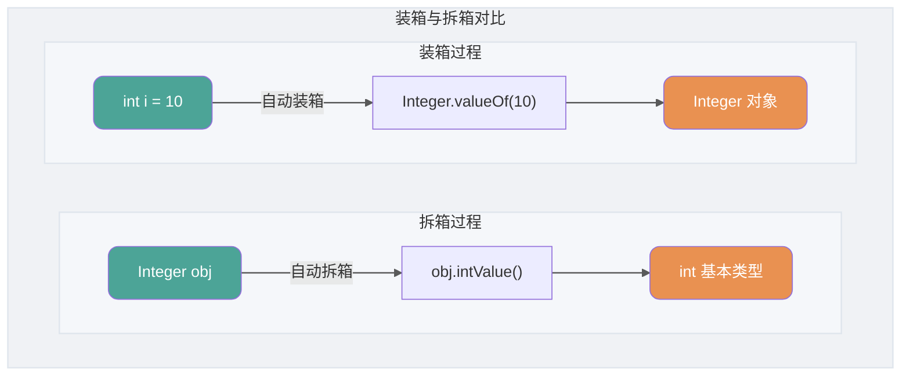
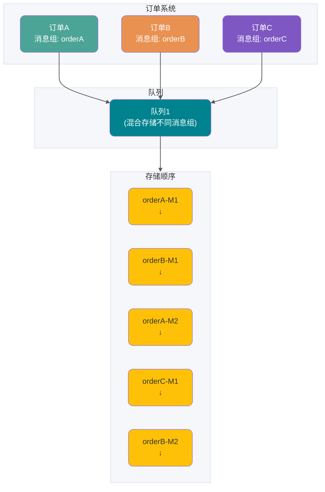

# Java综合问答

<a id="kd7c8e8a1e340"></a>

## 为什么成员变量有默认值？

JLS 规定，类变量、实例变量和数组元素在创建时会被初始化为各自类型的默认值，例如数值类型为 0、`boolean` 为 `false`、引用类型为 `null`。局部变量不进行默认初始化，并受“明确赋值”（definite assignment）规则约束：在读取局部变量前，编译器必须能够确定它已经被赋值。这里是语言规范直接规定的两套初始化规则，并不是因为编译器无法预测成员变量何时赋值。

**`final` 成员变量并不是默认初始化的例外。** 默认初始化与编译器的明确赋值检查是两回事：`final` 字段仍然必须由程序完成一次明确赋值，可以在声明时初始化；未在声明时初始化的实例 `final` 字段必须在每个构造方法正常结束前完成赋值（也可通过实例初始化块完成），静态 `final` 字段则必须在静态初始化块中完成赋值。

局部变量可以先声明，再赋值，也可以一直不读取：

```java
int unused; // 合法：只声明、不读取，不要求赋值
int count;
// System.out.println(count); // 编译错误：读取前没有明确赋值
count = 10;
System.out.println(count); // 合法
```

参考：[JLS §4.12.5 变量的初始值](https://docs.oracle.com/javase/specs/jls/se21/html/jls-4.html#jls-4.12.5)、[JLS §8.3.1.2 final 字段](https://docs.oracle.com/javase/specs/jls/se21/html/jls-8.html#jls-8.3.1.2)。

成员变量与局部变量代码示例：

```java
public class VariableExample {

    // 成员变量
    private String name;
    private int age;

    // 方法中的局部变量
    public void method() {
        int num1 = 10; // 栈中分配的局部变量
        String str = "Hello, world!"; // 栈中分配的局部变量
        System.out.println(num1);
        System.out.println(str);
    }

    // 带参数的方法中的局部变量
    public void method2(int num2) {
        int sum = num2 + 10; // 栈中分配的局部变量
        System.out.println(sum);
    }

    // 构造方法中的局部变量
    public VariableExample(String name, int age) {
        this.name = name; // 对成员变量进行赋值
        this.age = age; // 对成员变量进行赋值
        int num3 = 20; // 栈中分配的局部变量
        String str2 = "Hello, " + this.name + "!"; // 栈中分配的局部变量
        System.out.println(num3);
        System.out.println(str2);
    }
}

```

### 参考资料

- [JavaGuide](https://github.com/Snailclimb/JavaGuide/blob/992dae31eade2a34ba8dbbbcf5ed9de5511325ec/docs/java/basis/java-basic-questions-01.md#L932)，来源许可：Apache-2.0。

<a id="k817bbb2a9bf0"></a>

## 为什么浮点数运算的时候会有精度丢失的风险？

浮点数运算精度丢失代码演示：

```java
float a = 2.0f - 1.9f;
float b = 1.8f - 1.7f;
System.out.printf("%.9f",a);// 0.100000024
System.out.println(b);// 0.099999905
System.out.println(a == b);// false
```

### 参考资料

- [JavaGuide](https://github.com/Snailclimb/JavaGuide/blob/992dae31eade2a34ba8dbbbcf5ed9de5511325ec/docs/java/basis/java-basic-questions-01.md#L849)，来源许可：Apache-2.0。

<a id="k22a9e8ea38b0"></a>

## 为什么要用 Disruptor？

Disruptor 主要解决了 JDK 内置线程安全队列的性能和内存安全问题。

**JDK 中常见的线程安全的队列如下**：

| 队列名字                | 锁                      | 是否有界 |
| ----------------------- | ----------------------- | -------- |
| `ArrayBlockingQueue`    | 加锁（`ReentrantLock`） | 有界     |
| `LinkedBlockingQueue`   | 加锁（`ReentrantLock`） | 有界     |
| `LinkedTransferQueue`   | 无锁（`CAS`）           | 无界     |
| `ConcurrentLinkedQueue` | 无锁（`CAS`）           | 无界     |

从上表中可以看出：这些队列要不就是加锁有界，要不就是无锁无界。而加锁的队列势必会影响性能，无界的队列又存在内存溢出的风险。

因此，一般情况下，我们都是不建议使用 JDK 内置线程安全队列。

**Disruptor 就不一样了！它在无锁的情况下还能保证队列有界，并且还是线程安全的。**

下面这张图是 Disruptor 官网提供的 Disruptor 和 ArrayBlockingQueue 的延迟直方图对比。


Disruptor 真的很快，关于它为什么这么快这个问题，会在后文介绍到。

此外，Disruptor 还提供了丰富的扩展功能比如支持批量操作、支持多种等待策略。

### 参考资料

- [JavaGuide](https://github.com/Snailclimb/JavaGuide/blob/992dae31eade2a34ba8dbbbcf5ed9de5511325ec/docs/high-performance/message-queue/disruptor-questions.md#L44)，来源许可：Apache-2.0。

<a id="k56e23a98d54d"></a>

## 为什么说 Java 语言“编译与解释并存”？

其实这个问题我们讲字节码的时候已经提到过，因为比较重要，所以我们这里再提一下。

我们可以将高级编程语言按照程序的执行方式分为两种：

- **编译型**：[编译型语言](https://zh.wikipedia.org/wiki/%E7%B7%A8%E8%AD%AF%E8%AA%9E%E8%A8%80) 会通过[编译器](https://zh.wikipedia.org/wiki/%E7%B7%A8%E8%AD%AF%E5%99%A8)将源代码一次性翻译成可被该平台执行的机器码。一般情况下，编译语言的执行速度比较快，开发效率比较低。常见的编译性语言有 C、C++、Go、Rust 等等。
- **解释型**：[解释型语言](https://zh.wikipedia.org/wiki/%E7%9B%B4%E8%AD%AF%E8%AA%9E%E8%A8%80)会通过[解释器](https://zh.wikipedia.org/wiki/直譯器)一句一句的将代码解释（interpret）为机器代码后再执行。解释型语言开发效率比较快，执行速度比较慢。常见的解释性语言有 Python、JavaScript、PHP 等等。


根据维基百科介绍：

> 为了改善解释语言的效率而发展出的[即时编译](https://zh.wikipedia.org/wiki/即時編譯)技术，已经缩小了这两种语言间的差距。这种技术混合了编译语言与解释型语言的优点，它像编译语言一样，先把程序源代码编译成[字节码](https://zh.wikipedia.org/wiki/字节码)。到执行期时，再将字节码直译，之后执行。[Java](https://zh.wikipedia.org/wiki/Java)与[LLVM](https://zh.wikipedia.org/wiki/LLVM)是这种技术的代表产物。
>
> 相关阅读：[基本功 | Java 即时编译器原理解析及实践](https://mp.weixin.qq.com/s/7PH8o1tbjLsM4-nOnjbwLw)

### 补充说明

这是因为常见的 Java 实现同时使用编译和解释技术：Java 源码先由编译器生成字节码（`.class` 文件），字节码可由 JVM 解释执行，也可在运行时由 JIT 编译为机器码。字节码并非必须由解释器执行，具体执行策略由 JVM 实现决定。

### 参考资料

- [JavaGuide](https://github.com/Snailclimb/JavaGuide/blob/992dae31eade2a34ba8dbbbcf5ed9de5511325ec/docs/java/basis/java-basic-questions-01.md#L113)，来源许可：Apache-2.0。
- [JavaGuide](https://github.com/Snailclimb/JavaGuide/blob/992dae31eade2a34ba8dbbbcf5ed9de5511325ec/docs/java/basis/java-basic-questions-01.md#L130)，来源许可：Apache-2.0。

<a id="k001e4d85c250"></a>

## 为什么选择阈值 8 和 64？

1. 泊松分布表明，链表长度达到 8 的概率极低（小于千万分之一）。在绝大多数情况下，链表长度都不会超过 8。阈值设置为 8，可以保证性能和空间效率的平衡。
2. 数组长度阈值 64 同样是经过实践验证的经验值。在小数组中扩容成本低，优先扩容可以避免过早引入红黑树。数组大小达到 64 时，冲突概率较高，此时红黑树的性能优势开始显现。

> TreeMap、TreeSet 以及 JDK1.8 之后的 HashMap 底层都用到了红黑树。红黑树就是为了解决二叉查找树的缺陷，因为二叉查找树在某些情况下会退化成一个线性结构。

我们来结合源码分析一下 `HashMap` 链表到红黑树的转换。

**1、 `putVal` 方法中执行链表转红黑树的判断逻辑。**

链表的长度大于 8 的时候，就执行 `treeifyBin`（转换红黑树）的逻辑。

```java
// 遍历链表
for (int binCount = 0; ; ++binCount) {
    // 遍历到链表最后一个节点
    if ((e = p.next) == null) {
        p.next = newNode(hash, key, value, null);
        // 如果链表元素个数大于TREEIFY_THRESHOLD（8）
        if (binCount >= TREEIFY_THRESHOLD - 1) // -1 for 1st
            // 红黑树转换（并不会直接转换成红黑树）
            treeifyBin(tab, hash);
        break;
    }
    if (e.hash == hash &&
        ((k = e.key) == key || (key != null && key.equals(k))))
        break;
    p = e;
}
```

**2、`treeifyBin` 方法中判断是否真的转换为红黑树。**

```java
final void treeifyBin(Node<K,V>[] tab, int hash) {
    int n, index; Node<K,V> e;
    // 判断当前数组的长度是否小于 64
    if (tab == null || (n = tab.length) < MIN_TREEIFY_CAPACITY)
        // 如果当前数组的长度小于 64，那么会选择先进行数组扩容
        resize();
    else if ((e = tab[index = (n - 1) & hash]) != null) {
        // 否则才将列表转换为红黑树

        TreeNode<K,V> hd = null, tl = null;
        do {
            TreeNode<K,V> p = replacementTreeNode(e, null);
            if (tl == null)
                hd = p;
            else {
                p.prev = tl;
                tl.next = p;
            }
            tl = p;
        } while ((e = e.next) != null);
        if ((tab[index] = hd) != null)
            hd.treeify(tab);
    }
}
```

将链表转换成红黑树前会判断，如果当前数组的长度小于 64，那么会选择先进行数组扩容，而不是转换为红黑树。

### 参考资料

- [JavaGuide](https://github.com/Snailclimb/JavaGuide/blob/992dae31eade2a34ba8dbbbcf5ed9de5511325ec/docs/java/collection/java-collection-questions-02.md#L235)，来源许可：Apache-2.0。

<a id="k48980efd9b6a"></a>

## 主从复制原理

主从复制，是指将一台`redis`服务器的数据，复制到其他的`redis`服务器。前者称为主节点(`master`)，后者称为从节点(`slave`)。数据的复制是单向的，只能由主节点到从节点

**作用**

* 数据冗余：主从复制实现了数据的热备份，是持久化之外的一种数据冗余方式
* 故障恢复：当主节点出现问题时，可以由从节点提供服务，实现快速的故障恢复；实际上是一种服务的冗余
* 负载均衡：在主从复制的基础上，配合读写分离，可以由主节点提供写服务，由从节点提供读服务（即写`redis`数据时应用连接主节点，读`redis`数据时应用连接从节点），分担服务器负载；尤其是在写少读多的场景下，通过多个从节点分担读负载，可以大大提高`redis`服务器的并发量
* 高可用基石：除了上述作用以外，主从复制还是哨兵和集群能够实施的基础，因此说主从复制是`redis`高可用的基础

**原理**

* 通过从服务器发送到`PSYNC`命令给主服务器

* 如果是首次连接，触发一次**全量复制**。此时主节点会启动一个后台线程，生成 `RDB` 快照文件

* 主节点会将这个 `RDB` 发送给从节点，`slave` 会先写入本地磁盘，再从本地磁盘加载到内存中

* `master`会将此过程中的写命令写入缓存，从节点**实时同步**这些数据

* 如果网络断开了连接，自动重连后主节点通过命令传播**增量复制**给从节点部分缺少的数据

### 参考资料

- [Datawhale](https://github.com/datawhalechina/daily-interview/blob/f35e8d555f8ff07d568eae569c3641bd76d0eac9/docs/02-programming-languages/Java/java-fundamentals.md#L470)，来源许可：GPL-3.0。

<a id="k8831412156ad"></a>

## 事件驱动架构

对许多应用来说，这个解决方案就是使用事件驱动架构（event-driven architecture）。在这种架构中，当某件重要事情发生时，微服务会发布一个事件，例如更新一个业务实体。当订阅这些事件的微服务接收此事件时，就可以更新自己的业务实体，也可能会引发更多的事件发布。

可以使用事件来实现跨多服务的业务交易。交易一般由一系列步骤构成，每一步骤都由一个更新业务实体的微服务和发布激活下一步骤的事件构成。下图展现如何使用事件驱动方法，在创建订单时检查信用可用度，微服务通过消息代理（Messsage Broker）来交换事件。

1. 订单服务创建一个带有 NEW 状态的 Order （订单），发布了一个 “Order Created Event（创建订单）” 的事件。


2. 客户服务消费 Order Created Event 事件，为此订单预留信用，发布 “Credit Reserved Event（信用预留）” 事件。


3. 订单服务消费 Credit Reserved Event ，改变订单的状态为 OPEN。


更复杂的场景可以引入更多步骤，例如在检查用户信用的同时预留库存等。

考虑到（a）每个服务原子性更新数据库和发布事件，然后，（b）消息代理确保事件传递至少一次，然后可以跨多个服务完成业务交易（此交易不是 ACID 事务）。这种模式提供弱确定性，例如最终一致性 eventual consistency。这种交易类型被称作 BASE model。

亦可以使用事件来维护不同微服务拥有数据预连接（pre-join）的实现视图。维护此视图的服务订阅相关事件并且更新视图。例如，客户订单视图更新服务（维护客户订单视图）会订阅由客户服务和订单服务发布的事件。


当客户订单视图更新服务收到客户或者订单事件，就会更新 客户订单视图数据集。可以使用文档数据库（例如 MongoDB）来实现客户订单视图，为每个用户存储一个文档。客户订单视图查询服务负责响应对客户以及最近订单（通过查询客户订单视图数据集）的查询。

事件驱动架构也是既有优点也有缺点，此架构可以使得事务跨多个服务且提供最终一致性，并且可以使应用维护最终视图；而缺点在于编程模式比 ACID 事务模式更加复杂：为了从应用层级失效中恢复，还需要完成补偿性事务，例如，如果信用检查不成功则必须取消订单；另外，应用必须应对不一致的数据，这是因为临时（in-flight）事务造成的改变是可见的，另外当应用读取未更新的最终视图时也会遇见数据不一致问题。另外一个缺点在于订阅者必须检测和忽略冗余事件。

### 参考资料

- [Advanced Java](https://github.com/doocs/advanced-java/blob/80b89fb9496d7ea3213e402c8c3853399e00c363/docs/micro-services/event-driven-data-management-for-microservices.md#L32)，来源许可：CC-BY-SA-4.0。

<a id="kaa2227b69aba"></a>

## 事物隔离级别

- 读未提交（read uncommitted，RU） 一个事务还没提交，它的变更就能被其它事务看到
- 读已提交（read committed，RC） 一个事务提交后，其变更才会被其他事务看到
- 可重复读（repeatable read，RR） 一个事务执行过程中看到的数据，和该事务在启动时看到的数据一致。 自然未提交的变更对其他事务也是不可见的。一个事务启动时，能够看到所有已提交的事务结果。但之后的该事务执行期间，其他事务的更新对它就不可见了
- 串行化（serializable） 对同行记录，“写”加“写锁”，“读”加“读锁”。出现读写锁冲突时，后访问的事务必须等前一个事务执行完成

### 参考资料

- [Datawhale](https://github.com/datawhalechina/daily-interview/blob/f35e8d555f8ff07d568eae569c3641bd76d0eac9/docs/02-programming-languages/Java/java-fundamentals.md#L305)，来源许可：GPL-3.0。

<a id="k8f11b774e9d4"></a>

## 什么是 BlockingQueue？

`BlockingQueue`（阻塞队列）是一个接口，继承自 `Queue`。它为插入和移除操作分别提供了抛出异常、返回特殊值、持续阻塞和超时等待四种处理方式。其中，`take()` 可以在队列为空时阻塞，`put()` 可以在容量受限的队列已满时阻塞。

```java
public interface BlockingQueue<E> extends Queue<E> {
  // ...
}
```

`BlockingQueue` 常用于生产者-消费者模型中，生产者线程会向队列中添加数据，而消费者线程会从队列中取出数据进行处理。


### 参考资料

- [JavaGuide](https://github.com/Snailclimb/JavaGuide/blob/992dae31eade2a34ba8dbbbcf5ed9de5511325ec/docs/java/collection/java-collection-questions-01.md#L577)，来源许可：Apache-2.0。

<a id="k223afbdf97e2"></a>

## 什么是可变长参数？

从 Java5 开始，Java 支持定义可变长参数，所谓可变长参数就是允许在调用方法时传入不定长度的参数。就比如下面这个方法就可以接受 0 个或者多个参数。

```java
public static void method1(String... args) {
   //......
}
```

另外，可变参数只能作为函数的最后一个参数，但其前面可以有也可以没有任何其他参数。

```java
public static void method2(String arg1, String... args) {
   //......
}
```

### 参考资料

- [JavaGuide](https://github.com/Snailclimb/JavaGuide/blob/992dae31eade2a34ba8dbbbcf5ed9de5511325ec/docs/java/basis/java-basic-questions-01.md#L1227)，来源许可：Apache-2.0。

<a id="kd47e75f0339e"></a>

## 什么是自动拆装箱？

- **装箱（Boxing）**：将基本类型用它们对应的引用类型包装起来；
- **拆箱（Unboxing）**：将包装类型转换为基本数据类型；



举例：

```java
Integer i = 10;  //装箱
int n = i;   //拆箱
```

上面这两行代码对应的字节码为：

```java
   L1

    LINENUMBER 8 L1

    ALOAD 0

    BIPUSH 10

    INVOKESTATIC java/lang/Integer.valueOf (I)Ljava/lang/Integer;

    PUTFIELD AutoBoxTest.i : Ljava/lang/Integer;

   L2

    LINENUMBER 9 L2

    ALOAD 0

    ALOAD 0

    GETFIELD AutoBoxTest.i : Ljava/lang/Integer;

    INVOKEVIRTUAL java/lang/Integer.intValue ()I

    PUTFIELD AutoBoxTest.n : I

    RETURN
```

从字节码中，我们发现装箱其实就是调用了 包装类的 `valueOf()` 方法，拆箱其实就是调用了 `xxxValue()` 方法。

因此，

- `Integer i = 10` 等价于 `Integer i = Integer.valueOf(10)`
- `int n = i` 等价于 `int n = i.intValue()`;

注意：**如果频繁拆装箱的话，也会严重影响系统的性能。我们应该尽量避免不必要的拆装箱操作。**

```java
private static long sum() {
    // 应该使用 long 而不是 Long
    Long sum = 0L;
    for (long i = 0; i <= Integer.MAX_VALUE; i++)
        sum += i;
    return sum;
}
```

### 参考资料

- [JavaGuide](https://github.com/Snailclimb/JavaGuide/blob/992dae31eade2a34ba8dbbbcf5ed9de5511325ec/docs/java/basis/java-basic-questions-01.md#L756)，来源许可：Apache-2.0。

<a id="kd5d25916fb13"></a>

## 什么是语法糖？

**语法糖（Syntactic sugar）** 代指的是编程语言为了方便程序员开发程序而设计的一种特殊语法，这种语法对编程语言的功能并没有影响。实现相同的功能，基于语法糖写出来的代码往往更简单简洁且更易阅读。

举个例子，Java 中的 `for-each` 就是一个常用的语法糖，其原理其实就是基于普通的 for 循环和迭代器。

```java
String[] strs = {"JavaGuide", "公众号：JavaGuide", "博客：https://javaguide.cn/"};
for (String s : strs) {
    System.out.println(s);
}
```

不过，JVM 其实并不能识别语法糖，Java 语法糖要想被正确执行，需要先通过编译器进行解糖，也就是在程序编译阶段将其转换成 JVM 认识的基本语法。这也侧面说明，Java 中真正支持语法糖的是 Java 编译器而不是 JVM。如果你去看 `com.sun.tools.javac.main.JavaCompiler` 的源码，你会发现在 `compile()` 中有一个步骤就是调用 `desugar()`，这个方法就是负责解语法糖的实现的。

### 参考资料

- [JavaGuide](https://github.com/Snailclimb/JavaGuide/blob/992dae31eade2a34ba8dbbbcf5ed9de5511325ec/docs/java/basis/java-basic-questions-03.md#L616)，来源许可：Apache-2.0。

<a id="kc91a0b9edcc7"></a>

## 什么是顺序消息

顺序消息是 Apache RocketMQ 提供的一种高级消息类型，支持消费者按照发送消息的先后顺序获取消息，从而实现业务场景中的顺序处理。

**应用场景**

在有序事件处理、撮合交易、数据实时增量同步等场景下，异构系统间需要维持强一致的状态同步，上游的事件变更需要按照顺序传递到下游进行处理。

- **撮合交易**：以证券、股票交易撮合场景为例，对于出价相同的交易单，坚持按照先出价先交易的原则，下游处理订单的系统需要严格按照出价顺序来处理订单。
- **数据实时增量同步**：以数据库变更增量同步场景为例，上游源端数据库按需执行增删改操作，将二进制操作日志作为消息，通过 RocketMQ 传输到下游搜索系统，下游系统按顺序还原消息数据，实现状态数据按序刷新。

### 参考资料

- [JavaGuide](https://github.com/Snailclimb/JavaGuide/blob/992dae31eade2a34ba8dbbbcf5ed9de5511325ec/docs/high-performance/message-queue/rocketmq-questions.md#L723)，来源许可：Apache-2.0。

<a id="k332508132711"></a>

## 介绍一下 Java 的内存模型

`Java` 内存模型（`Java Memory Model，JMM`）就是一种符合内存模型规范的，屏蔽了各种硬件和操作系统的访问差异的，保证了 `Java` 程序在各种平台下对内存的访问都能保证效果一致的机制及规范。`JMM` 是一种规范，是解决由于多线程通过共享内存进行通信时，存在的本地内存数据不一致、编译器会对代码指令重排序、处理器会对代码乱序执行等带来的问题。目的是保证并发编程场景中的原子性、可见性和有序性。所以，`Java` 内存模型，除了定义了一套规范，还提供了一系列原语，封装了底层实现后，供开发者直接使用。我们前面提到，并发编程要解决**原子性、有序性和一致性**的问题。

* **原子性：** 在 `Java` 中，为了保证原子性，提供了两个高级的字节码指令 `Monitorenter` 和 `Monitorexit`。这两个字节码，在 `Java` 中对应的关键字就是 `Synchronized`。因此，在 `Java` 中可以使用 `Synchronized` 来保证方法和代码块内的操作是原子性的
* **可见性：**` Java` 内存模型是通过在变量修改后将新值同步回主内存，在变量读取前从主内存刷新变量值的这种依赖主内存作为传递媒介的方式来实现的。`Java` 中的 `Volatile` 关键字修饰的变量在被修改后可以立即同步到主内存。被其修饰的变量在每次使用之前都从主内存刷新。因此，可以使用 `Volatile` 来保证多线程操作时变量的可见性。除了 `Volatile`，`Java` 中的 `Synchronized` 和 `Final` 两个关键字也可以实现可见性。只不过实现方式不同
* **有序性：**在 `Java` 中，可以使用 `Synchronized` 和 `Volatile` 来保证多线程之间操作的有序性。区别：`Volatile` 禁止指令重排。`Synchronized` 保证同一时刻只允许一条线程操作

### 参考资料

- [Datawhale](https://github.com/datawhalechina/daily-interview/blob/f35e8d555f8ff07d568eae569c3641bd76d0eac9/docs/02-programming-languages/Java/java-fundamentals.md#L134)，来源许可：GPL-3.0。

<a id="kbb814686d8ba"></a>

## 何谓 SPI?

SPI 即 Service Provider Interface，字面意思就是：“服务提供者的接口”，我的理解是：专门提供给服务提供者或者扩展框架功能的开发者去使用的一个接口。

SPI 将服务接口和具体的服务实现分离开来，将服务调用方和服务实现者解耦，能够提升程序的扩展性、可维护性。修改或者替换服务实现并不需要修改调用方。

很多框架都使用了 Java 的 SPI 机制，比如：Spring 框架、数据库加载驱动、日志接口、以及 Dubbo 的扩展实现等等。


### 参考资料

- [JavaGuide](https://github.com/Snailclimb/JavaGuide/blob/992dae31eade2a34ba8dbbbcf5ed9de5511325ec/docs/java/basis/java-basic-questions-03.md#L475)，来源许可：Apache-2.0。

<a id="k14dd60dccd33"></a>

## 你更倾向于使用 Checked Exception 还是 Unchecked Exception？

默认使用 Unchecked Exception，只在必要时才用 Checked Exception。

我们可以把 Unchecked Exception（比如 `NullPointerException`）看作是代码 Bug。对待 Bug，最好的方式是让它暴露出来然后去修复代码，而不是用 `try-catch` 去掩盖它。

一般来说，只在一种情况下使用 Checked Exception：当这个异常是业务逻辑的一部分，并且调用方必须处理它时。比如说，一个余额不足异常。这不是 bug，而是一个正常的业务分支，我需要用 Checked Exception 来强制调用者去处理这种情况，比如提示用户去充值。这样就能在保证关键业务逻辑完整性的同时，让代码尽可能保持简洁。

### 参考资料

- [JavaGuide](https://github.com/Snailclimb/JavaGuide/blob/992dae31eade2a34ba8dbbbcf5ed9de5511325ec/docs/java/basis/java-basic-questions-03.md#L57)，来源许可：Apache-2.0。

<a id="kbab0fb79bed5"></a>

## 使用事件源

Event sourcing （事件源）通过使用根本不同的事件中心方式来获得不需 2PC 的原子性，保证业务实体的一致性。 这种应用保存业务实体一系列状态改变事件，而不是存储实体现在的状态。应用可以通过重放事件来重建实体现在状态。只要业务实体发生变化，新事件就会添加到时间表中。因为保存事件是单一操作，因此肯定是原子性的。

为了理解事件源工作方式，考虑事件实体作为一个例子。传统方式中，每个订单映射为 ORDER 表中一行，例如在 ORDER_LINE_ITEM 表中。但是对于事件源方式，订单服务以事件状态改变方式存储一个订单：创建的，已批准的，已发货的，取消的；每个事件包括足够数据来重建订单状态。


事件是长期保存在事件数据库中，提供 API 添加和获取实体事件。事件存储跟之前描述的消息代理类似，提供 API 来订阅事件。事件存储将事件递送到所有感兴趣的订阅者，事件存储是事件驱动微服务架构的基干。

事件源方法有很多优点：解决了事件驱动架构关键问题，使得只要有状态变化就可以可靠地发布事件，也就解决了微服务架构中数据一致性问题。另外，因为是持久化事件而不是对象，也就避免了 object relational impedance mismatch problem。

数据源方法提供了 100%可靠的业务实体变化监控日志，使得获取任何时点实体状态成为可能。另外，事件源方法可以使得业务逻辑可以由事件交换的松耦合业务实体构成。这些优势使得单体应用移植到微服务架构变的相对容易。

事件源方法也有不少缺点，因为采用不同或者不太熟悉的变成模式，使得重新学习不太容易；事件存储只支持主键查询业务实体，必须使用 Command Query Responsibility Segregation (CQRS) 来完成查询业务，因此，应用必须处理最终一致数据。

### 参考资料

- [Advanced Java](https://github.com/doocs/advanced-java/blob/80b89fb9496d7ea3213e402c8c3853399e00c363/docs/micro-services/event-driven-data-management-for-microservices.md#L92)，来源许可：CC-BY-SA-4.0。

<a id="kb3ca2bdc32f2"></a>

## 分散数据管理

数据管理的去中心化有许多不同的呈现方式。在最抽象的层面上，这意味着使系统间存在差异的世界概念模型。在整合一个大型企业时，客户的销售视图将不同于支持视图，这是一个常见的问题。客户的销售视图中的一些事情可能不会出现在支持视图中。它们确实可能有不同的属性和(更坏的)共同属性，这些共同属性在语义上有微妙的不同。

这个问题常见于应用程序之间，但也可能发生在应用程序内部，尤其当应用程序被划分成分离的组件时。一个有用的思维方式是[有界上下文](http://martinfowler.com/bliki/BoundedContext.html)(Bounded Context)内的领域驱动设计(Domain-Driven Design, DDD)理念。DDD 把一个复杂域划分成多个有界的上下文，并且映射出它们之间的关系。这个过程对单体架构和微服务架构都是有用的，但在服务和上下文边界间有天然的相关性，边界有助于澄清和加强分离，就像业务能力部分描述的那样。

和概念模型的去中心化决策一样，微服务也去中心化数据存储决策。虽然单体应用程序更喜欢单一的逻辑数据库做持久化存储，但企业往往倾向于一系列应用程序共用一个单一的数据库——这些决定是供应商授权许可的商业模式驱动的。微服务更倾向于让每个服务管理自己的数据库，或者同一数据库技术的不同实例，或完全不同的数据库系统 - 这就是所谓的[混合持久化](https://martinfowler.com/bliki/PolyglotPersistence.html)(Polyglot Persistence)。你可以在单体应用程序中使用混合持久化，但它更常出现在为服务里。


对跨微服务的数据来说，去中心化责任对管理升级有影响。处理更新的常用方法是在更新多个资源时使用事务来保证一致性。这个方法通常用在单体中。

像这样使用事务有助于一致性，但会产生显著地临时耦合，这在横跨多个服务时是有问题的。分布式事务是出了名的难以实现，因此微服务架构强调[服务间的无事务协作](http://www.eaipatterns.com/ramblings/18_starbucks.html)，对一致性可能只是最后一致性和通过补偿操作处理问题有明确的认知。

对很多开发团队来说，选择用这样的方式管理不一致性是一个新的挑战，但这通常与业务实践相匹配。通常业务处理一定程度的不一致，以快速响应需求，同时有某些类型的逆转过程来处理错误。这种权衡是值得的，只要修复错误的代价小于更大一致性下损失业务的代价。

### 参考资料

- [Advanced Java](https://github.com/doocs/advanced-java/blob/80b89fb9496d7ea3213e402c8c3853399e00c363/docs/micro-services/microservices-introduction.md#L101)，来源许可：CC-BY-SA-4.0。

<a id="k426815deb42b"></a>

## 单主机多服务实例模式

部署微服务的一种方法就是单主机多服务实例模式，使用这种模式，需要提供若干台物理或者虚拟机，每台机器上运行多个服务实例。很多情况下，这是传统的应用部署方法。每个服务实例运行一个或者多个主机的 well-known 端口，主机可以看做宠物。

下图展示的是这种架构：


这种模式有一些参数，一个参数代表每个服务实例由多少进程构成。例如，需要在 Apache Tomcat Server 上部署一个 Java 服务实例作为 web 应用。一个 Node.js 服务实例可能有一个父进程和若干个子进程构成。

另外一个参数定义同一进程组内有多少服务实例运行。例如，可以在同一个 Apache Tomcat Server 上运行多个 Java web 应用，或者在同一个 OSGI 容器内运行多个 OSGI 捆绑实例。

单主机多服务实例模式也是优缺点并存。主要优点在于资源利用有效性。多服务实例共享服务器和操作系统，如果进程组运行多个服务实例效率会更高，例如，多个 web 应用共享同一个 Apache Tomcat Server 和 JVM。

另一个优点在于部署服务实例很快。只需将服务拷贝到主机并启动它。如果服务用 Java 写的，只需要拷贝 JAR 或者 WAR 文件即可。对于其它语言，例如 Node.js 或者 Ruby，需要拷贝源码。也就是说网络负载很低。

因为没有太多负载，启动服务很快。如果服务是自包含的进程，只需要启动就可以；否则，如果是运行在容器进程组中的某个服务实例，则需要动态部署进容器中，或者重启容器。

除了上述优点外，单主机多服务实例也有缺陷。其中一个主要缺点是服务实例间很少或者没有隔离，除非每个服务实例是独立进程。如果想精确监控每个服务实例资源使用，就不能限制每个实例资源使用。因此有可能造成某个糟糕的服务实例占用了主机的所有内存或者 CPU。

同一进程内多服务实例没有隔离。所有实例有可能，例如，共享同一个 JVM heap。某个糟糕服务实例很容易攻击同一进程中其它服务；更甚至于，有可能无法监控每个服务实例使用的资源情况。

另一个严重问题在于运维团队必须知道如何部署的详细步骤。服务可以用不同语言和框架写成，因此开发团队肯定有很多需要跟运维团队沟通事项。其中复杂性增加了部署过程中出错的可能性。

可以看到，尽管熟悉，但是单主机多服务实例有很多严重缺陷。下面看看是否有其他部署微服务方式能够避免这些问题。

### 参考资料

- [Advanced Java](https://github.com/doocs/advanced-java/blob/80b89fb9496d7ea3213e402c8c3853399e00c363/docs/micro-services/choose-microservice-deployment-strategy.md#L11)，来源许可：CC-BY-SA-4.0。

<a id="k9f7544af81bc"></a>

## 单体式应用的不足

不幸的是，这种简单方法却有很大的局限性。一个简单的应用会随着时间推移逐渐变大。在每次的 sprint 中， 开发团队都会面对新“故事”，然后开发许多新代码。几年后，这个小而简单的应用会变成了一个巨大的怪物。这儿有一个例子，我最近和一个开发者讨论，他正在 写一个工具，用来分析他们一个拥有数百万行代码的应用中 JAR 文件之间的依赖关系。我很确信这个代码正是很多开发者经过多年努力开发出来的一个怪物。

一旦你的应用变成一个又大又复杂的怪物，那开发团队肯定很痛苦。敏捷开发和部署举步维艰，其中最主要问题就是这个应用太复杂，以至于任何单个开发 者都不可能搞懂它。因此，修正 bug 和正确的添加新功能变的非常困难，并且很耗时。另外，团队士气也会走下坡路。如果代码难于理解，就不可能被正确的修 改。最终会走向巨大的、不可理解的泥潭。

单体式应用也会降低开发速度。应用越大，启动时间会越长。比如，最近的一个调查表明，有时候应用的启动时间居然超过了 12 分钟。我还听说某些应用需要 40 分钟启动时间。如果开发者需要经常重启应用，那么大部分时间就要在等待中渡过，生产效率受到极大影响。

另外，复杂而巨大的单体式应用也不利于持续性开发。今天，SaaS 应用常态就是每天会改变很多次，而这对于单体式应用模式非常困难。另外，这种变化带来的影响并没有很好的被理解，所以不得不做很多手工测试。那么接下来，持续部署也会很艰难。

单体式应用在不同模块发生资源冲突时，扩展将会非常困难。比如，一个模块完成一个 CPU 敏感逻辑，应该部署在 AWS EC2 Compute Optimized instances，而另外一个内存数据库模块更合适于 EC2 Memory-optimized instances。然而，由于这些模块部署在一起，因此不得不在硬件选择上做一个妥协。

单体式应用另外一个问题是可靠性。因为所有模块都运行在一个进程中，任何一个模块中的一个 bug，比如内存泄露，将会有可能弄垮整个进程。除此之外，因为所有应用实例都是唯一的，这个 bug 将会影响到整个应用的可靠性。

最后，单体式应用使得采用新架构和语言非常困难。比如，设想你有两百万行采用 XYZ 框架写的代码。如果想改成 ABC 框架，无论是时间还是成本都是非常昂贵的，即使 ABC 框架更好。因此，这是一个无法逾越的鸿沟。你不得不在最初选择面前低头。

总结一下：一开始你有一个很成功的关键业务应用，后来就变成了一个巨大的，无法理解的怪物。因为采用过时的，效率低的技术，使得雇佣有潜力的开发者很困难。应用无法扩展，可靠性很低，最终，敏捷性开发和部署变的无法完成。

那么如何应对呢？

### 参考资料

- [Advanced Java](https://github.com/doocs/advanced-java/blob/80b89fb9496d7ea3213e402c8c3853399e00c363/docs/micro-services/advantages-and-disadvantages-of-microservice.md#L15)，来源许可：CC-BY-SA-4.0。

<a id="kecc18955df38"></a>

## 单虚拟机单实例模式

但是用单虚拟机单实例模式，一般将服务打包成虚拟机映像（image），例如一个 Amazon EC2 AMI。每个服务实例是一个使用此映像启动的 VM（例如，EC2 实例）。下图展示了此架构：


Netfix 采用这种架构部署 video streaming service。Netfix 使用 Aminator 将每个服务打包成一个 EC2 AMI。每个运行服务实例就是一个 EC2 实例。

有很多工具可以用来搭建自己的 VMs。可以配置持续集成（CI）服务（例如，Jenkins）避免 Aminator 将服务打包成 EC2 AMI。packer.io 是自动虚机映像创建的另外一种选择。跟 Aminator 不同，它支持一系列虚拟化技术，例如 EC2，DigitalOcean，VirtualBox 和 VMware。​

Boxfuse 公司有一个创新方法创建虚机映像，克服了如下缺陷。Boxfuse 将 java 应用打包成最小虚机映像，它们创建迅速，启动很快，因为对外暴露服务接口少而更加安全。

CloudNative 公司有一个用于创建 EC2 AMI 的 SaaS 应用，Bakery。用户微服务架构通过测试后，可以配置自己的 CI 服务器激活 Bakery。Bakery 将服务打包成 AMI。使用如 Bakery 的 SaaS 应用意味着用户不需要浪费时间在设置自己的 AMI 创建架构。

每虚拟机服务实例模式有许多优势，主要的 VM 优势在于每个服务实例都是完全独立运行的，都有各自独立的 CPU 和内存而不会被其它服务占用。

另外一个好处在于用户可以使用成熟云架构，例如 AWS 提供的，云服务都提供如负载均衡和扩展性等有用功能。

还有一个好处在于服务实施技术被自包含了。一旦服务被打包成 VM 就成为一个黑盒子。VM 的管理 API 成为部署服务的 API，部署成为一个非常简单和可靠的事情。

单虚拟机单实例模式也有缺点。一个缺点就是资源利用效率不高。每个服务实例占用整个虚机的资源，包括操作系统。而且，在一个典型的公有 IaaS 环境，虚机资源都是标准化的，有可能未被充分利用。

而且，公有 IaaS 根据 VM 来收费，而不管虚机是否繁忙；例如 AWS 提供了自动扩展功能，但是对随需应用缺乏快速响应，使得用户不得不多部署虚机，从而增加了部署费用。

另外一个缺点在于部署服务新版本比较慢。虚机镜像因为大小原因创建起来比较慢，同样原因，虚机初始化也比较慢，操作系统启动也需要时间。但是这并不一直是这样，一些轻量级虚机，例如使用 Boxfuse 创建的虚机，就比较快。

第三个缺点是对于运维团队，它们负责许多客制化工作。除非使用如 Boxfuse 之类的工具，可以帮助减轻大量创建和管理虚机的工作；否则会占用大量时间从事与核心业务不太无关的工作。

那么我们来看看另外一种仍然具有虚机特性，但是比较轻量的微服务部署方法。

### 参考资料

- [Advanced Java](https://github.com/doocs/advanced-java/blob/80b89fb9496d7ea3213e402c8c3853399e00c363/docs/micro-services/choose-microservice-deployment-strategy.md#L41)，来源许可：CC-BY-SA-4.0。

<a id="ke58766e8dd2a"></a>

## 去中心化的治理

集中治理的一个后果是单一技术平台的标准化发展趋势。经验表明，这种方法正在收缩 ——不是每个问题都是钉子，不是每个问题都是锤子。我们更喜欢使用正确的工具来完成工作，而单体应用程序在一定程度上可以利用语言的优势，这是不常见的。

把单体的组件分裂成服务，在构建这些服务时可以有自己的选择。你想使用 Node.js 开发一个简单的报告页面？去吧。用 C++ 实现一个特别粗糙的近乎实时的组件？好极了。你想换用一个更适合组件读操作数据的不同风格的数据库？我们有技术来重建它。

当然，仅仅因为你可以做些什么，而不意味着你应该这样做——但用这种方式划分系统意味着你可以选择。

团队在构建微服务时也更喜欢用不同的方法来达标。他们更喜欢生产有用的工具这种想法，而不是写在纸上的标准，这样其他开发者可以用这些工具解决他们所面临的相似的问题。有时，这些工具通常在实施中收获并与更广泛的群体共享，但不完全使用一个内部开源模型。现在 git 和 github 已经成为事实上的版本控制系统的选择，在内部开放源代码的实践也正变得越来越常见。

Netflix 是遵循这一理念的一个很好的例子。尤其是，以库的形式分享有用的且经过市场检验的代码，这激励其他开发者用类似的方式解决相似的问题，同时还为采用不同方法敞开了大门。共享库倾向于聚焦在数据存储、进程间通信和我们接下来要深入讨论的基础设施自动化的共性问题。

对于微服务社区来说，开销特别缺乏吸引力。这并不是说社区不重视服务合约。恰恰相反，因为他们有更多的合约。只是他们正在寻找不同的方式来管理这些合约。像 [Tolerant Reader](https://martinfowler.com/bliki/TolerantReader.html) 和 [Consumer-Driven Contracts](https://martinfowler.com/articles/consumerDrivenContracts.html) 这样的模式通常被用于微服务。这些援助服务合约在独立进化。执行消费者驱动的合约作为构建的一部分，增加了信心并对服务是否在运作提供了更快的反馈。事实上，我们知道澳大利亚的一个团队用消费者驱动的合约这种模式来驱动新业务的构建。他们使用简单的工具定义服务的合约。这已变成自动构建的一部分，即使新服务的代码还没写。服务仅在满足合约的时候才被创建出来 - 这是在构建新软件时避免 "YAGNI"[9] 困境的一个优雅的方法。围绕这些成长起来的技术和工具，通过减少服务间的临时耦合，限制了中心合约管理的需要。

也许去中心化治理的最高境界就是亚马逊广为流传的 build it/run it 理念。团队要对他们构建的软件的各方面负责，包括 7\*24 小时的运营。这一级别的责任下放绝对是不规范的，但我们看到越来越多的公司让开发团队负起更多责任。Netflix 是采用这一理念的另一家公司[11]。每天凌晨 3 点被传呼机叫醒无疑是一个强有力的激励，使你在写代码时关注质量。这是关于尽可能远离传统的集中治理模式的一些想法。

### 参考资料

- [Advanced Java](https://github.com/doocs/advanced-java/blob/80b89fb9496d7ea3213e402c8c3853399e00c363/docs/micro-services/microservices-introduction.md#L85)，来源许可：CC-BY-SA-4.0。

<a id="kb2f74c729047"></a>

## 哪些组件用到了 Disruptor？

用到 Disruptor 的开源项目还是挺多的，这里简单举几个例子：

- **Log4j2**：Log4j2 是一款常用的日志框架，它基于 Disruptor 来实现异步日志。
- **SOFATracer**：SOFATracer 是蚂蚁金服开源的分布式应用链路追踪工具，它基于 Disruptor 来实现异步日志。
- **Storm** : Storm 是一个开源的分布式实时计算系统，它基于 Disruptor 来实现工作进程内发生的消息传递（同一 Storm 节点上的线程间，无需网络通信）。
- **HBase**：HBase 是一个分布式列存储数据库系统，它基于 Disruptor 来提高写并发性能。
- ……

### 参考资料

- [JavaGuide](https://github.com/Snailclimb/JavaGuide/blob/992dae31eade2a34ba8dbbbcf5ed9de5511325ec/docs/high-performance/message-queue/disruptor-questions.md#L88)，来源许可：Apache-2.0。

<a id="kbcf3ac7621f6"></a>

## 围绕业务能力进行组织

在将大型应用程序拆分为多个部分时，管理层往往侧重于技术层面，从而导致 UI 团队、服务器端逻辑团队、数据库团队的划分。当团队按照这些方式分开时，即便是简单的更改也可能导致跨团队项目的时间和预算批准。一个聪明的团队将围绕这个进行优化，“两害相权取其轻”——只需将逻辑强制应用到他们可以访问的任何应用程序中。换句话说，逻辑无处不在。这是康威定律[5]的一个例子。

> 任何设计系统（广义上的）的组织都会产生一种设计，其结构是组织通信结构的副本。
 —— 梅尔文•康威，1967 年


微服务采用不同的划分方式，它是围绕业务功能将系统拆分为多个服务 。这些服务为该业务领域采用广泛的软件实现，包括用户界面、持久化存储和任何外部协作。因此，团队是跨职能的，包括开发所需的全部技能：用户体验、数据库和项目管理。


以这种方式组建的一家公司是 [www.comparethemarket.com](http://www.comparethemarket.com/)。跨职能团队负责构建和运营每个产品，每个产品拆分为多个独立的服务，彼此通过消息总线来通信。

大型单体应用程序也可以围绕业务功能进行模块化，尽管这不是常见的情况。当然，我们会敦促构建单体应用系统的大型团队根据业务线来将自己分解为若干小团队。我们在这里看到的主要问题是，它们往往围绕太多的上下文进行组织。如果单体跨越了模块边界，对团队的个体成员来说，很难将它们装入短期的记忆中。此外，我们看到模块化生产线需要大量的规则来执行。服务组件所要求的更加明确的分离，使得它更容易保持团队边界清晰。

### 参考资料

- [Advanced Java](https://github.com/doocs/advanced-java/blob/80b89fb9496d7ea3213e402c8c3853399e00c363/docs/micro-services/microservices-introduction.md#L43)，来源许可：CC-BY-SA-4.0。

<a id="k7430fc70bc70"></a>

## 基建自动化

基础设施自动化技术在过去几年中发生了巨大变化——特别是云和 AWS 的发展降低了构建、部署和运行微服务的操作复杂性。

许多使用微服务构建的产品或系统都是由具有丰富的持续交付和持续集成经验的团队构建的。以这种方式构建软件的团队广泛使用基础设施自动化技术。如下面显示的构建管道所示。


由于这并不是一篇关于持续交付的文章，我们在这里只关注持续交付的几个关键特性。我们希望有尽可能多的信心确保我们的软件正常运行，因此我们进行了大量的**自动化测试**。想让软件达到“晋级”(Promotion)状态从而“推上”流水线，就意味着要在每一个新的环境中，对软件进行**自动化部署**。

一个单体应用程序可以非常愉快地通过这些环境构建、测试和推动。事实证明，一旦你为单体投入了自动化整体生产，那么部署更多的应用程序似乎不再那么可怕了。请记住，持续交付的目标之一就是让“部署”工作变得“枯燥”，所以无论是一个还是三个应用程序，只要部署工作依旧很“枯燥”，那么就没什么可担心的了[12]。

我们看到团队大量的基础设施自动化的另一个领域是在管理生产环境中的微服务。与我们上面的断言（只要部署很无聊）相比，单体和微服务之间没有太大的区别，但是每个部署的运行环境可能会截然不同。


### 参考资料

- [Advanced Java](https://github.com/doocs/advanced-java/blob/80b89fb9496d7ea3213e402c8c3853399e00c363/docs/micro-services/microservices-introduction.md#L117)，来源许可：CC-BY-SA-4.0。

<a id="kc572a5947fb3"></a>

## 复习时先抓住哪些问题？

| 模块           | 需要讲清楚的内容                                       | 常见追问方向                                            |
| -------------- | ------------------------------------------------------ | ------------------------------------------------------- |
| 使用场景与限制 | 为什么使用 MQ，哪些链路不适合改成异步                  | 异步、解耦、削峰、最终一致性、RPC 与 MQ                 |
| 可靠性与语义   | 消息从生产到消费的每个环节怎样确认、重试和恢复         | 消息丢失、重复消费、幂等、顺序、重试、死信、积压        |
| 中间件原理     | 主流 MQ 怎样组织消息、复制数据并协调消费者             | Kafka、RocketMQ、RabbitMQ、分区、副本、消费组、确认机制 |
| 选型与治理     | 怎样结合业务能力、运维经验和故障目标选择并管理消息队列 | 吞吐、延迟、回放、事务消息、监控、扩容、容灾、Disruptor |

回答消息可靠性问题时，不能只报一个配置项。生产者确认、Broker 持久化与复制、消费者确认、业务幂等和补偿对账需要一起说明；任何一段处理不完整，都可能表现为消息丢失、重复或结果不一致。

### 补充说明

| 模块       | 需要讲清楚的内容                                 | 常见追问方向                                            |
| ---------- | ------------------------------------------------ | ------------------------------------------------------- |
| 流量入口   | 怎样缩短用户访问距离，并把请求分配给可用节点     | CDN、回源、缓存策略、四层/七层负载均衡、调度算法        |
| 数据库优化 | 读写量和数据规模增长后，怎样定位并缓解数据库瓶颈 | SQL、索引、读写分离、分库分表、深度分页、冷热分离       |
| 消息队列   | 哪些任务可以异步处理，怎样应对突发流量           | 可靠性、重复消费、顺序、积压、Kafka、RocketMQ、RabbitMQ |
| 综合设计   | 如何从指标、瓶颈和业务约束推导方案               | 容量、压测、一致性、成本、灰度和回滚                    |

高性能优化没有固定的组件清单。相同的慢查询，可能源于缺少索引、深度分页、热点数据、连接池等待，也可能是下游接口拖慢了整条链路。先用指标确定瓶颈，再讨论方案和代价。

### 参考资料

- [JavaGuide](https://github.com/Snailclimb/JavaGuide/blob/992dae31eade2a34ba8dbbbcf5ed9de5511325ec/docs/high-performance/message-queue/message-queue-interview-questions.md#L21)，来源许可：Apache-2.0。
- [JavaGuide](https://github.com/Snailclimb/JavaGuide/blob/992dae31eade2a34ba8dbbbcf5ed9de5511325ec/docs/high-performance/high-performance-system-interview-questions.md#L25)，来源许可：Apache-2.0。

<a id="k276369f4222e"></a>

## 如何使用 try-with-resources 代替 try-catch-finally？

1. **适用范围（资源的定义）：** 任何实现 `java.lang.AutoCloseable` 或者 `java.io.Closeable` 的对象
2. **关闭资源和 finally 块的执行顺序：** 在 `try-with-resources` 语句中，任何 catch 或 finally 块在声明的资源关闭后运行

《Effective Java》中明确指出：

> 面对必须要关闭的资源，我们总是应该优先使用 `try-with-resources` 而不是 `try-finally`。随之产生的代码更简短，更清晰，产生的异常对我们也更有用。`try-with-resources` 语句让我们更容易编写必须要关闭的资源的代码，若采用 `try-finally` 则几乎做不到这点。

Java 中类似于 `InputStream`、`OutputStream`、`Scanner`、`PrintWriter` 等的资源都需要我们调用 `close()` 方法来手动关闭，一般情况下我们都是通过 `try-catch-finally` 语句来实现这个需求，如下：

```java
//读取文本文件的内容
Scanner scanner = null;
try {
    scanner = new Scanner(new File("D://read.txt"));
    while (scanner.hasNext()) {
        System.out.println(scanner.nextLine());
    }
} catch (FileNotFoundException e) {
    e.printStackTrace();
} finally {
    if (scanner != null) {
        scanner.close();
    }
}
```

使用 Java 7 之后的 `try-with-resources` 语句改造上面的代码:

```java
try (Scanner scanner = new Scanner(new File("test.txt"))) {
    while (scanner.hasNext()) {
        System.out.println(scanner.nextLine());
    }
} catch (FileNotFoundException fnfe) {
    fnfe.printStackTrace();
}
```

当然多个资源需要关闭的时候，使用 `try-with-resources` 实现起来也非常简单，如果你还是用 `try-catch-finally` 可能会带来很多问题。

通过使用分号分隔，可以在 `try-with-resources` 块中声明多个资源。

```java
try (BufferedInputStream bin = new BufferedInputStream(new FileInputStream(new File("test.txt")));
     BufferedOutputStream bout = new BufferedOutputStream(new FileOutputStream(new File("out.txt")))) {
    int b;
    while ((b = bin.read()) != -1) {
        bout.write(b);
    }
}
catch (IOException e) {
    e.printStackTrace();
}
```

### 参考资料

- [JavaGuide](https://github.com/Snailclimb/JavaGuide/blob/992dae31eade2a34ba8dbbbcf5ed9de5511325ec/docs/java/basis/java-basic-questions-03.md#L157)，来源许可：Apache-2.0。

<a id="kb32bf07fd1f9"></a>

## 如何保证消息的顺序性

RocketMQ 的消息顺序性分为两部分：**生产顺序性**和**消费顺序性**。

**生产顺序性**

如需保证消息生产的顺序性，则必须满足以下条件：

1. **单一生产者**：消息生产的顺序性仅支持单一生产者
2. **串行发送**：生产者使用多线程并行发送时，不同线程间产生的消息将无法判定其先后顺序

满足以上条件的生产者，将顺序消息发送至 RocketMQ 后，会保证设置了同一**消息组**的消息，按照发送顺序存储在同一队列中。

**消息组（MessageGroup）**

RocketMQ 顺序消息的顺序关系通过消息组（MessageGroup）判定和识别，发送顺序消息时需要为每条消息设置归属的消息组。

- **相同消息组**的多条消息之间遵循先进先出的顺序关系
- **不同消息组**、无消息组的消息之间不涉及顺序性

基于消息组的顺序判定逻辑，支持按照业务逻辑做细粒度拆分，可以在满足业务局部顺序的前提下提高系统的并行度和吞吐能力。



**说明**：

- orderA 消息组的 M1、M2 保持顺序
- orderB 消息组的 M1、M2 保持顺序
- 不同消息组可以混合存储在同一个队列中

**消费顺序性**

如需保证消息消费的顺序性，则必须满足以下条件：

1. **投递顺序**：RocketMQ 通过客户端 SDK 和服务端通信协议保障消息按照服务端存储顺序投递
2. **有限重试**：顺序消息投递仅在重试次数限定范围内，超过最大重试次数后将不再重试，跳过这条消息消费

**消费者类型对顺序消费的影响**

- **PushConsumer**：RocketMQ 保证消息按照存储顺序一条一条投递给消费者
- **SimpleConsumer**：消费者可能一次拉取多条消息，此时消息消费的顺序性需要由业务方自行保证

**生产顺序性和消费顺序性组合**

| 生产顺序                     | 消费顺序 | 顺序性效果                               |
| ---------------------------- | -------- | ---------------------------------------- |
| 设置消息组，保证消息顺序发送 | 顺序消费 | 按照消息组粒度，严格保证消息顺序         |
| 设置消息组，保证消息顺序发送 | 并发消费 | 并发消费，尽可能按时间顺序处理           |
| 未设置消息组，消息乱序发送   | 顺序消费 | 只能保证队列存储顺序，不保证业务发送顺序 |
| 未设置消息组，消息乱序发送   | 并发消费 | 并发消费，尽可能按照时间顺序处理         |

**使用限制**

1. **消息类型一致性**：顺序消息仅支持在 MessageType 为 FIFO 的主题内使用；RocketMQ 5.x 中还要为有序消息设置 MessageGroup，并把消费者组配置为顺序投递，否则仍可能按并发方式投递
2. 顺序消息消费失败进行消费重试时，为保障消息的顺序性，后续消息不可被消费，必须等待前面的消息消费完成后才能被处理

**使用建议**

1. **串行消费**：消息消费建议串行处理，避免一次消费多条消息导致乱序
2. **消息组尽可能打散**：建议将业务以消息组粒度进行拆分，例如将订单 ID、用户 ID 作为消息组关键字，可实现同一终端用户的消息按照顺序处理，不同用户的消息无需保证顺序

### 参考资料

- [JavaGuide](https://github.com/Snailclimb/JavaGuide/blob/992dae31eade2a34ba8dbbbcf5ed9de5511325ec/docs/high-performance/message-queue/rocketmq-questions.md#L734)，来源许可：Apache-2.0。

<a id="ka79daea11d1f"></a>

## 如何实现动态代理？

动态代理是一种非常强大的设计模式，它允许我们在**不修改源代码**的情况下，对一个类或对象的方法进行**功能增强（Enhancement）**。

在 Java 中，实现动态代理最主流的方式有两种：**JDK 动态代理** 和 **CGLIB 动态代理**。

**第一种：JDK 动态代理**

Java 官方提供的，其核心要求是目标类必须实现一个或多个接口。JDK 动态代理在运行时，会利用 `Proxy.newProxyInstance()` 方法，动态地创建一个实现了这些接口的代理类的实例。这个代理类在内存中生成，你看不到它的 `.java` 或 `.class` 文件。

当你调用代理对象的任何一个方法时，这个调用都会被转发到我们提供的一个 `InvocationHandler` 接口的 `invoke` 方法中。在 `invoke` 方法里，我们就可以在调用原始方法（目标方法）之前或之后，加入我们自己的增强逻辑。

**第二种：CGLIB 动态代理**

CGLIB 是一个第三方的代码生成库。它的原理与 JDK 完全不同，它不要求被代理的类实现接口。它在运行时，动态生成目标类的子类作为代理类（通过 ASM 字节码操作技术）。然后，它会重写父类（也就是被代理类）中所有非 `final`、`private` 和 `static` 的方法。

当你调用代理对象的任何一个方法时，这个调用会被 CGLIB 的 `MethodInterceptor` 接口的 `intercept` 方法拦截。和 `InvocationHandler` 的 `invoke` 方法一样，我们可以在 `intercept` 方法里，在调用原始的父类方法之前或之后，加入我们的增强逻辑。

### 参考资料

- [JavaGuide](https://github.com/Snailclimb/JavaGuide/blob/992dae31eade2a34ba8dbbbcf5ed9de5511325ec/docs/java/basis/java-basic-questions-03.md#L396)，来源许可：Apache-2.0。

<a id="k271a0cec21da"></a>

## 如何抽取模块

抽取模块第一步就是定义好模块和单体应用之间粗粒度接口，由于单体应用需要微服务的数据，反之亦然，因此更像是一个双向 API。因为必须在负责依赖关系和细粒度接口模式之间做好平衡，因此开发这种 API 很有挑战性，尤其对使用域模型模式的业务逻辑层来说更具有挑战，因此经常需要改变代码来解决依赖性问题，如图所示：

一旦完成粗粒度接口，也就将此模块转换成独立微服务。为了实现，必须写代码使得单体应用和微服务之间通过使用进程间通信（IPC）机制的 API 来交换信息。如图所示迁移前后对比：


此例中，正在使用 Y 模块的 Z 模块是备选抽取模块，其元素正在被 X 模块使用，迁移第一步就是定义一套粗粒度 APIs，第一个接口应该是被 X 模块使用的内部接口，用于激活 Z 模块；第二个接口是被 Z 模块使用的外部接口，用于激活 Y 模块。

迁移第二步就是将模块转换成独立服务。内部和外部接口都使用基于 IPC 机制的代码，一般都会将 Z 模块整合成一个微服务基础框架，来出来割接过程中的问题，例如服务发现。

抽取完模块，也就可以开发、部署和扩展另外一个服务，此服务独立于单体应用和其它服务。可以从头写代码实现服务；这种情况下，将服务和单体应用整合的 API 代码成为容灾层，在两种域模型之间进行翻译工作。每抽取一个服务，就朝着微服务方向前进一步。随着时间推移，单体应用将会越来越简单，用户就可以增加更多独立的微服务。
将现有应用迁移成微服务架构的现代化应用，不应该通过从头重写代码方式实现，相反，应该通过逐步迁移的方式。有三种策略可以考虑：将新功能以微服务方式实现；将表现层与业务数据访问层分离；将现存模块抽取变成微服务。随着时间推移，微服务数量会增加，开发团队的弹性和效率将会大大增加。

### 参考资料

- [Advanced Java](https://github.com/doocs/advanced-java/blob/80b89fb9496d7ea3213e402c8c3853399e00c363/docs/micro-services/migrating-from-a-monolithic-architecture-to-a-microservices-architecture.md#L69)，来源许可：CC-BY-SA-4.0。

<a id="k2df0d8187d73"></a>

## 如果一个类没有声明构造方法，该程序能正确执行吗？

构造方法是一种特殊的方法，主要作用是完成对象的初始化工作。

如果一个类没有声明构造方法，也可以执行！因为一个类即使没有声明构造方法也会有默认的不带参数的构造方法。如果我们自己添加了类的构造方法（无论是否有参），Java 就不会添加默认的无参数的构造方法了。

我们一直在不知不觉地使用构造方法，这也是为什么我们在创建对象的时候后面要加一个括号（因为要调用无参的构造方法）。如果我们重载了有参的构造方法，记得都要把无参的构造方法也写出来（无论是否用到），因为这可以帮助我们在创建对象的时候少踩坑。

### 参考资料

- [JavaGuide](https://github.com/Snailclimb/JavaGuide/blob/992dae31eade2a34ba8dbbbcf5ed9de5511325ec/docs/java/basis/java-basic-questions-02.md#L139)，来源许可：Apache-2.0。

<a id="k3ece67212753"></a>

## 如果移位的位数超过数值所占有的位数会怎样？

当 int 类型左移/右移位数大于等于 32 位操作时，会先求余（%）后再进行左移/右移操作。也就是说左移/右移 32 位相当于不进行移位操作（32%32=0），左移/右移 42 位相当于左移/右移 10 位（42%32=10）。当 long 类型进行左移/右移操作时，由于 long 对应的二进制是 64 位，因此求余操作的基数也变成了 64。

也就是说：`x<<42` 等同于 `x<<10`，`x>>42` 等同于 `x>>10`，`x >>>42` 等同于 `x >>> 10`。

**左移运算符代码示例**：

```java
int i = -1;
System.out.println("初始数据：" + i);
System.out.println("初始数据对应的二进制字符串：" + Integer.toBinaryString(i));
i <<= 10;
System.out.println("左移 10 位后的数据 " + i);
System.out.println("左移 10 位后的数据对应的二进制字符 " + Integer.toBinaryString(i));
```

输出：

```plain
初始数据：-1
初始数据对应的二进制字符串：11111111111111111111111111111111
左移 10 位后的数据 -1024
左移 10 位后的数据对应的二进制字符 11111111111111111111110000000000
```

由于左移位数大于等于 32 位操作时，会先求余（%）后再进行左移操作，所以下面的代码左移 42 位相当于左移 10 位（42%32=10），输出结果和前面的代码一样。

```java
int i = -1;
System.out.println("初始数据：" + i);
System.out.println("初始数据对应的二进制字符串：" + Integer.toBinaryString(i));
i <<= 42;
System.out.println("左移 10 位后的数据 " + i);
System.out.println("左移 10 位后的数据对应的二进制字符 " + Integer.toBinaryString(i));
```

右移运算符使用类似，篇幅问题，这里就不做演示了。

### 参考资料

- [JavaGuide](https://github.com/Snailclimb/JavaGuide/blob/992dae31eade2a34ba8dbbbcf5ed9de5511325ec/docs/java/basis/java-basic-questions-01.md#L434)，来源许可：Apache-2.0。

<a id="k8fb321954daf"></a>

## 字符串常量池的作用了解吗？

**字符串常量池** 是 JVM 为了提升性能和减少内存消耗针对字符串（String 类）专门开辟的一块区域，主要目的是为了避免字符串的重复创建。

```java
// 1.在字符串常量池中查询字符串对象 "ab"，如果没有则创建"ab"并放入字符串常量池
// 2.将字符串对象 "ab" 的引用赋值给 aa
String aa = "ab";
// 直接返回字符串常量池中字符串对象 "ab"，赋值给引用 bb
String bb = "ab";
System.out.println(aa==bb); // true
```

更多关于字符串常量池的介绍可以看一下 [Java 内存区域详解](https://javaguide.cn/java/jvm/memory-area.html) 这篇文章。

### 参考资料

- [JavaGuide](https://github.com/Snailclimb/JavaGuide/blob/992dae31eade2a34ba8dbbbcf5ed9de5511325ec/docs/java/basis/java-basic-questions-02.md#L747)，来源许可：Apache-2.0。

<a id="k4f4f40f5f71c"></a>

## 字符型常量和字符串常量的区别？

- **形式** : 字符常量是单引号引起的一个字符，字符串常量是双引号引起的 0 个或若干个字符。
- **含义** : 字符常量是一个 `char` 值，表示 UTF-16 代码单元，可以参与数值运算；字符串常量是对 `String` 对象的引用，不是语言层面暴露的内存地址。
- **占用空间**：`char` 值是 16 位无符号整数。`String` 对象的内存占用属于 JVM 实现细节，不能通过字符串编码后的字节数直接得出。

⚠️ 注意 `char` 在 Java 中占两个字节。

字符型常量和字符串常量代码示例：

```java
public class StringExample {
    // 字符型常量
    public static final char LETTER_A = 'A';

    // 字符串常量
    public static final String GREETING_MESSAGE = "Hello, world!";
    public static void main(String[] args) {
        System.out.println("字符型常量占用的字节数为："+Character.BYTES);
        System.out.println("字符串使用 UTF-8 编码后的字节数为："+GREETING_MESSAGE.getBytes(java.nio.charset.StandardCharsets.UTF_8).length);
    }
}
```

输出：

```plain
字符型常量占用的字节数为：2
字符串使用 UTF-8 编码后的字节数为：13
```

### 参考资料

- [JavaGuide](https://github.com/Snailclimb/JavaGuide/blob/992dae31eade2a34ba8dbbbcf5ed9de5511325ec/docs/java/basis/java-basic-questions-01.md#L1010)，来源许可：Apache-2.0。

<a id="k04d0de326057"></a>

## 存储机制

至此，刷盘和复制的问题已经解决了。

接下来讨论 **队列是以什么样的形式存在的？队列中的消息又是如何进行存储持久化的？** 这涉及到 RocketMQ 的存储结构设计。首先介绍 RocketMQ 消息存储架构中的三大角色——CommitLog、ConsumeQueue 和 IndexFile。

**存储架构三大组件：**

- **CommitLog**：**消息主体以及元数据的存储主体**，存储 Producer 端写入的消息主体内容，消息内容不是定长的。单个文件大小默认 **1G**，文件名长度为 20 位，左边补零，剩余为起始偏移量，比如 00000000000000000000 代表第一个文件，起始偏移量为 0；当第一个文件写满后，第二个文件为 00000000001073741824，起始偏移量为 1073741824，以此类推。消息主要是 **顺序写入日志文件**，当文件满了，写入下一个文件。
- **ConsumeQueue**：指定 Topic 下某个 MessageQueue 的物理索引文件，**引入的目的主要是提高消息消费的性能**。由于 RocketMQ 是基于 Topic 的订阅模式，如果要遍历 CommitLog 文件根据 Topic 和队列检索消息是非常低效的。ConsumeQueue 保存了消息在 CommitLog 中的 **起始物理偏移量 offset**、消息大小 size 和消息 Tag 的 HashCode 值。ConsumeQueue 文件夹的组织方式为：topic/queue/file 三层组织结构，具体存储路径为：`$HOME/store/consumequeue/{topic}/{queueId}/{fileName}`。ConsumeQueue 文件采取定长设计，每一个条目共 **20 个字节**（8 字节 commitlog 物理偏移量 + 4 字节消息长度 + 8 字节 tag hashcode），单个文件由 **30 万个条目** 组成，每个 ConsumeQueue 文件大小约 **5.72M**。
- **IndexFile**：索引文件，提供了一种可以通过 key 或时间区间来查询消息的方法。

总结来说，整个消息存储的结构，最主要的就是 `CommitLog` 和 ConsumeQueue。MessageQueue 是 Topic 下的逻辑队列，ConsumeQueue 是这个逻辑队列对应的物理索引文件，不要把两者完全等同。


RocketMQ 采用的是 **混合型的存储结构** ，即 Broker 单个实例下所有的队列共用一个日志数据文件（CommitLog）来存储消息。而 Kafka 会为每个分区（Partition）分配一个独立的存储文件。

RocketMQ 这么做的原因是 **提高数据的写入效率** ，不分 Topic 意味着有更大的几率获取 **成批** 的消息进行顺序写入，但也带来一个问题：读取消息时如果遍历整个 CommitLog 文件，效率很低。

所以，RocketMQ 使用 ConsumeQueue 作为每个队列的索引文件来 **提升读取消息的效率**。可以直接根据队列的消息序号，计算出索引的全局位置（索引序号 × 索引固定长度 20），然后直接读取这条索引，再根据索引中记录的消息的全局位置找到消息。

下面结合架构图来理解存储结构：


> 如果上面没看懂的读者一定要认真看下面的流程分析！

首先，在图的最上面可以把 `ConsumeQueue` 理解为某个 MessageQueue 的索引文件，而不是消息主体本身。

在图中最左边说明了红色方块代表被写入的消息，虚线方块代表等待被写入的消息。左边的生产者发送消息会指定 Topic、`QueueId` 和具体消息内容，而在 Broker 中不区分消息类型，直接 **全部顺序存储到 CommitLog**。根据生产者指定的 Topic 和 `QueueId`，将这条消息在 CommitLog 中的偏移量（offset）、消息大小和 tag 的 hash 值存入对应的 ConsumeQueue 索引文件中。

在每个队列中都保存了 `ConsumeOffset` 即每个消费者组的消费位置，消费者拉取消息进行消费时只需要根据 `ConsumeOffset` 获取下一个未被消费的消息即可。

以上就是 RocketMQ 存储架构的核心原理。

最后留一个思考题：**为什么 CommitLog 文件要设计成固定大小的长度呢？** 提示：与 **内存映射机制（mmap）** 有关。

### 参考资料

- [JavaGuide](https://github.com/Snailclimb/JavaGuide/blob/992dae31eade2a34ba8dbbbcf5ed9de5511325ec/docs/high-performance/message-queue/rocketmq-questions.md#L1766)，来源许可：Apache-2.0。

<a id="k65be46089d7e"></a>

## 学习重点

- 大模型基础题重点讲清 Token、上下文、采样参数、结构化输出、模型调用和评测。
- Agent 题重点讲清 Agent Loop、Memory、Prompt、Context、MCP、Skills 和工作流。
- RAG 题重点讲清文档处理、向量检索、混合检索、Rerank、GraphRAG、知识库更新和评测。
- 系统设计题重点讲清模型网关、可观测、成本、安全、灰度和实时语音 Agent。

### 参考资料

- [JavaGuide](https://github.com/Snailclimb/JavaGuide/blob/992dae31eade2a34ba8dbbbcf5ed9de5511325ec/docs/ai/interview-questions/README.md#L24)，来源许可：Apache-2.0。

<a id="k66afdaed2ac9"></a>

## 延时双删

> 1. 先删除(淘汰)缓存
> 2. 再写数据库（这两步和原来一样）
> 3. 休眠1秒，再次删除(淘汰)缓存

或者

> 1. 先写数据库
> 2. 再删除(淘汰)缓存（这两步和原来一样）
> 3. 休眠1秒，再次删除(淘汰)缓存

这个1秒应该看你的业务场景，应该自行评估自己的项目的读数据业务逻辑的耗时，然后写数据的休眠时间则在读数据业务逻辑的耗时基础上，加几百ms即可，这么做确保读请求结束，写请求可以删除读请求造成的缓存脏数据

**为了性能更快，可以把第二次删除缓存可以做成异步的，这样不会阻塞请求了，如果再严谨点，防止第二次删除缓存失败，这个异步删除缓存可以加上重试机制，失败一直重试，直到成功**

**方案一**

> 1. 更新数据库数据
> 2. 缓存因为种种问题删除失败
> 3. 将需要删除的key发送至消息队列
> 4. 自己消费消息，获得需要删除的key
> 5. 继续重试删除操作，直到成功


该方案有一个缺点，对业务线代码造成大量的侵入，于是有了方案二，启动一个订阅程序去订阅数据库的Binlog，获得需要操作的数据。在应用程序中，另起一段程序，获得这个订阅程序传来的信息，进行删除缓存操作

**方案二**

> 1. 更新数据库数据
> 2. 数据库会将操作信息写入binlog日志当中
> 3. 订阅程序提取出所需要的数据以及key
> 4. 另起一段非业务代码，获得该信息
> 5. 尝试删除缓存操作，发现删除失败
> 6. 将这些信息发送至消息队列
> 7. 重新从消息队列中获得该数据，重试操作


### 参考资料

- [Datawhale](https://github.com/datawhalechina/daily-interview/blob/f35e8d555f8ff07d568eae569c3641bd76d0eac9/docs/02-programming-languages/Java/java-fundamentals.md#L528)，来源许可：GPL-3.0。

<a id="ka01e16358acb"></a>

## 开发单体式应用

假设你正准备开发一款与 Uber 和 Hailo 竞争的出租车调度软件，经过初步会议和需求分析，你可能会手动或者使用基于 Rails、Spring Boot、Play 或者 Maven 的生成器开始这个新项目，它的六边形架构是模块化的 ，架构图如下：


应用核心是业务逻辑，由定义服务、域对象和事件的模块完成。围绕着核心的是与外界打交道的适配器。适配器包括数据库访问组件、生产和处理消息的消息组件，以及提供 API 或者 UI 访问支持的 web 模块等。

尽管也是模块化逻辑，但是最终它还是会打包并部署为单体式应用。具体的格式依赖于应用语言和框架。例如，许多 Java 应用会被打包为 WAR 格式， 部署在 Tomcat 或者 Jetty 上，而另外一些 Java 应用会被打包成自包含的 JAR 格式，同样，Rails 和 Node.js 会被打包成层级目录。

这种应用开发风格很常见，因为 IDE 和其它工具都擅长开发一个简单应用，这类应用也很易于调试，只需要简单运行此应用，用 Selenium 链接 UI 就可以完成端到端测试。单体式应用也易于部署，只需要把打包应用拷贝到服务器端，通过在负载均衡器后端运行多个拷贝就可以轻松实现应用扩展。在早期这 类应用运行的很好。

### 参考资料

- [Advanced Java](https://github.com/doocs/advanced-java/blob/80b89fb9496d7ea3213e402c8c3853399e00c363/docs/micro-services/advantages-and-disadvantages-of-microservice.md#L3)，来源许可：CC-BY-SA-4.0。

<a id="k1e61a9c0cfe8"></a>

## 强引用、软引用、弱引用、虚引用的区别

* **强引用**：如果一个对象具有强引用，垃圾回收器绝不会回收它。当内存空间不足时，JVM 宁愿抛出OOM错误，使程序异常终止；

* **软引用**：如果内存空间足够，垃圾回收器就不会回收它。如果内存空间不足了，就会回收这些对象的内存，只要垃圾回收器没有回收它，该对象就可以被程序使用

* **弱引用**：只具有弱引用的对象拥有更短暂的生命周期。在垃圾回收器线程扫描它所管辖的内存区域的过程中，一旦发现了只具有弱引用的对象，不管当前内存空间足够与否，都会回收它的内存

* **虚引用**：在任何时候都可能被垃圾回收器回收

### 参考资料

- [Datawhale](https://github.com/datawhalechina/daily-interview/blob/f35e8d555f8ff07d568eae569c3641bd76d0eac9/docs/02-programming-languages/Java/java-fundamentals.md#L35)，来源许可：GPL-3.0。

<a id="k50e951a819cb"></a>

## 微处理架构——处理复杂事物

许多公司，比如 Amazon、eBay 和 NetFlix，通过采用微处理结构模式解决了上述问题。其思路不是开发一个巨大的单体式的应用，而是将应用分解为小的、互相连接的微服务。

一个微服务一般完成某个特定的功能，比如下单管理、客户管理等等。每一个微服务都是微型六角形应用，都有自己的业务逻辑和适配器。一些微服务还会 发布 API 给其它微服务和应用客户端使用。其它微服务完成一个 Web UI，运行时，每一个实例可能是一个云 VM 或者是 Docker 容器。

比如，一个前面描述系统可能的分解如下：


每一个应用功能区都使用微服务完成，另外，Web 应用会被拆分成一系列简单的 Web 应用（比如一个对乘客，一个对出租车驾驶员）。这样的拆分对于不同用户、设备和特殊应用场景部署都更容易。

每一个后台服务开放一个 REST API，许多服务本身也采用了其它服务提供的 API。比如，驾驶员管理使用了告知驾驶员一个潜在需求的通知服务。UI 服务激活其它服务来更新 Web 页面。所有服务都是采用异步的，基于消息的通讯。微服务内部机制将会在后续系列中讨论。

一些 REST API 也对乘客和驾驶员采用的移动应用开放。这些应用并不直接访问后台服务，而是通过 API Gateway 来传递中间消息。API Gateway 负责负载均衡、缓存、访问控制、API 计费监控等等任务，可以通过 NGINX 方便实现，后续文章将会介绍到 API Gateway。


微服务架构模式在上图中对应于代表可扩展 Scale Cube 的 Y 轴，这是一个在《The Art of Scalability》书中描述过的三维扩展模型。另外两个可扩展轴，X 轴由负载均衡器后端运行的多个应用副本组成，Z 轴是将需求路由到相关服务。

应用基本可以用以上三个维度来表示，Y 轴代表将应用分解为微服务。运行时，X 轴代表运行多个隐藏在负载均衡器之后的实例，提供吞吐能力。一些应用可能还是用 Z 轴将服务分区。下面的图演示行程管理服务如何部署在运行于 AWS EC2 上的 Docker 上。


运行时，行程管理服务由多个服务实例构成。每一个服务实例都是一个 Docker 容器。为了保证高可用，这些容器一般都运行在多个云 VM 上。服务实例前是一层诸如 NGINX 的负载均衡器，他们负责在各个实例间分发请求。负载均衡器也同时处理其它请求，例如缓存、权限控制、API 统计和监控。

这种微服务架构模式深刻影响了应用和数据库之间的关系， **不像传统多个服务共享一个数据库，微服务架构每个服务都有自己的数据库** 。另外，这种思路也影响到了企业级数据模式。同时，这种模式意味着多份数据，但是，如果你想获得微服务带来的好处，每个服务独有一个数据库是必须的，因为这种架构需要这种松耦合。下面的图演示示例应用数据库架构。


每种服务都有自己的数据库，另外，每种服务可以用更适合自己的数据库类型，也被称作多语言一致性架构。比如，驾驶员管理（发现哪个驾驶员更靠近乘客），必须使用支持地理信息查询的数据库。

表面上看来，微服务架构模式有点像 SOA，他们都由多个服务构成。但是，可以从另外一个角度看此问题，微服务架构模式是一个不包含 Web 服务 （WS-）和 ESB 服务的 SOA。微服务应用乐于采用简单轻量级协议，比如 REST，而不是 WS-，在微服务内部避免使用 ESB 以及 ESB 类似功能。微服 务架构模式也拒绝使用 canonical schema 等 SOA 概念。

### 参考资料

- [Advanced Java](https://github.com/doocs/advanced-java/blob/80b89fb9496d7ea3213e402c8c3853399e00c363/docs/micro-services/advantages-and-disadvantages-of-microservice.md#L35)，来源许可：CC-BY-SA-4.0。

<a id="kd5dc97adfda1"></a>

## 成员变量与局部变量的区别？

| 对比维度 | 成员变量（字段）                                                                | 局部变量                                                 |
| -------- | ------------------------------------------------------------------------------- | -------------------------------------------------------- |
| 定义位置 | 定义在类中，方法之外；分为实例变量和静态变量                                    | 定义在方法、构造方法或代码块中                           |
| 修饰符   | 可以使用访问控制修饰符、`static`、`final` 等                                    | 不能使用访问控制修饰符和 `static`，可以使用 `final`      |
| 存储方式 | 实例字段属于对象状态；静态字段属于类，具体存储由 JVM 实现决定                   | 在 JVM 的执行模型中保存在栈帧的局部变量表中              |
| 生存时间 | 实例变量随对象存在；静态变量随类存在，直到类卸载                                | 与所在代码块的执行及作用域有关，方法结束后对应栈帧被销毁 |
| 默认值   | 有类型对应的默认值，如 `0`、`false`、`null`；`final` 字段还必须满足明确赋值规则 | 没有默认值；可以先声明不赋值，但读取前必须明确赋值       |

方法参数和构造方法参数在 JLS 中属于单独的变量类别，调用时由实参初始化，不能把它们和方法体内尚未赋值的局部变量混为一谈。另外，局部引用变量和它指向的对象也要区分：引用保存在局部变量表中，对象通常分配在堆中。JIT 优化可能消除部分实际存储。

### 参考资料

- [JavaGuide](https://github.com/Snailclimb/JavaGuide/blob/992dae31eade2a34ba8dbbbcf5ed9de5511325ec/docs/java/basis/java-basic-questions-01.md#L920)，来源许可：Apache-2.0。

<a id="k89638e4b31d8"></a>

## 排序操作

```java
void reverse(List list)//反转
void shuffle(List list)//随机排序
void sort(List list)//按自然排序的升序排序
void sort(List list, Comparator c)//定制排序，由Comparator控制排序逻辑
void swap(List list, int i , int j)//交换两个索引位置的元素
void rotate(List list, int distance)//旋转。当distance为正数时，将list后distance个元素整体移到前面。当distance为负数时，将 list的前distance个元素整体移到后面
```

### 参考资料

- [JavaGuide](https://github.com/Snailclimb/JavaGuide/blob/992dae31eade2a34ba8dbbbcf5ed9de5511325ec/docs/java/collection/java-collection-questions-02.md#L621)，来源许可：Apache-2.0。

<a id="k58b450822c31"></a>

## 数据结构延伸阅读

Java 集合面试经常会追到底层数据结构。建议结合下面几篇一起复习：

- [线性数据结构详解](https://github.com/Snailclimb/JavaGuide/blob/992dae31eade2a34ba8dbbbcf5ed9de5511325ec/docs/cs-basics/data-structure/linear-data-structure.md)：理解数组、链表、栈、队列和 `ArrayList`、`LinkedList`、`ArrayDeque` 的关系。
- [哈希表面试题总结](https://github.com/Snailclimb/JavaGuide/blob/992dae31eade2a34ba8dbbbcf5ed9de5511325ec/docs/cs-basics/data-structure/hash-table.md)：理解哈希冲突、扩容和 `HashMap` 的底层思想。
- [红黑树详解](https://github.com/Snailclimb/JavaGuide/blob/992dae31eade2a34ba8dbbbcf5ed9de5511325ec/docs/cs-basics/data-structure/red-black-tree.md)：理解 `TreeMap`、`TreeSet` 以及 `HashMap` 树化链表时涉及的红黑树。
- [堆详解](https://github.com/Snailclimb/JavaGuide/blob/992dae31eade2a34ba8dbbbcf5ed9de5511325ec/docs/cs-basics/data-structure/heap.md)：理解 `PriorityQueue` 的底层结构和 Top K 题型。

<!-- @include: @article-footer.snippet.md -->

### 参考资料

- [JavaGuide](https://github.com/Snailclimb/JavaGuide/blob/992dae31eade2a34ba8dbbbcf5ed9de5511325ec/docs/java/collection/java-collection-questions-01.md#L615)，来源许可：Apache-2.0。

<a id="k8f6115888abf"></a>

## 无序性和不可重复性的含义是什么

- 无序性不等于随机性，无序性是指存储的数据在底层数组中并非按照数组索引的顺序添加，而是根据数据的哈希值决定的。
- 不可重复性是指添加的元素按照 `equals()` 判断时，返回 false，需要同时重写 `equals()` 方法和 `hashCode()` 方法。

### 参考资料

- [JavaGuide](https://github.com/Snailclimb/JavaGuide/blob/992dae31eade2a34ba8dbbbcf5ed9de5511325ec/docs/java/collection/java-collection-questions-01.md#L508)，来源许可：Apache-2.0。

<a id="kf480cdfeba98"></a>

## 既然 AOT 这么多优点，那为什么不全部使用这种编译方式呢？

以 GraalVM Native Image 为例，它在构建本地可执行文件时会进行闭世界分析：构建器从程序入口出发，分析哪些类、方法和字段可能在运行时被访问，只把可达代码和必要的元数据放进最终产物。程序依旧可以接收动态输入和创建对象；构建阶段完全未知的代码则不会自动进入分析结果。

下面这段代码中的类名来自运行时参数，构建器无法仅靠静态调用关系确定要保留哪些类：

```java
String className = args[0];
Class<?> clazz = Class.forName(className);
Object instance = clazz.getDeclaredConstructor().newInstance();
```

反射、动态代理和 JNI 在 Native Image 中仍然可以使用。对于静态分析无法推断的动态访问，通常需要[可达性元数据](https://www.graalvm.org/latest/reference-manual/native-image/metadata/)，提前声明运行时可能访问的类、方法、字段、代理接口和 JNI 元素。运行时动态加载未知类、生成并加载新字节码的限制会更严格，因为相关代码在构建阶段并不存在。

Spring 使用 AOT 处理来适配这种执行方式。它会在构建阶段分析应用上下文，生成 Java 源码、代理字节码以及反射、资源和代理所需的 `RuntimeHints`。CGLIB 通常借助 ASM 在运行时生成代理类；到了 Native Image 场景，这类工作可以提前到构建阶段完成。框架或应用提供相应的构建期适配后，Spring、CGLIB 和 ASM 仍可参与 AOT 应用的构建与运行。具体机制可以参考 [Spring AOT 官方文档](https://docs.spring.io/spring-framework/reference/core/aot.html)。

AOT 把一部分运行时工作和信息搬到了构建阶段，同时增加了构建时间、元数据维护和兼容性适配成本。对于依赖运行时动态加载、Java Agent 或大量动态字节码生成的应用，JIT 模式通常更省事；对于冷启动和内存占用敏感的应用，AOT 更有吸引力。

### 参考资料

- [JavaGuide](https://github.com/Snailclimb/JavaGuide/blob/992dae31eade2a34ba8dbbbcf5ed9de5511325ec/docs/java/basis/java-basic-questions-01.md#L159)，来源许可：Apache-2.0。

<a id="k450f8ce8a953"></a>

## 是否有交流群？

有的，目前微信群“**Doocs 的技术朋友们**”已经接近 200 号人，如果你希望加入，请通过微信与我联系。

**注意**，群内禁止一切垃圾广告信息，包括小程序助力信息、小游戏、社群推广、公众号推广、支付宝推广码等；交流 GitHub、开发相关，可以自由分享一些开发相关知识，但不提倡整天水群，建议还是多花点时间提升自己。

  

### 参考资料

- [Advanced Java](https://github.com/doocs/advanced-java/blob/80b89fb9496d7ea3213e402c8c3853399e00c363/docs/extra-page/subscriptions-for-doocs.md#L48)，来源许可：CC-BY-SA-4.0。

<a id="k9a2ad5c335c3"></a>

## 普通消息

普通消息一般应用于微服务解耦、事件驱动、数据集成等场景，这些场景大多数要求数据传输通道具有可靠传输的能力，且对消息的处理时机、处理顺序没有特别要求。以在线的电商交易场景为例，上游订单系统将用户下单支付这一业务事件封装成独立的普通消息并发送至 RocketMQ 服务端，下游按需从服务端订阅消息并按照本地消费逻辑处理下游任务。每个消息之间都是相互独立的，且不需要产生关联。另外还有日志系统，以离线的日志收集场景为例，通过埋点组件收集前端应用的相关操作日志，并转发到 RocketMQ 。

**普通消息生命周期**


- 初始化：消息被生产者构建并完成初始化，待发送到服务端的状态。
- 待消费：消息被发送到服务端，对消费者可见，等待消费者消费的状态。
- 消费中：消息被消费者获取，并按照消费者本地的业务逻辑进行处理的过程。 此时服务端会等待消费者完成消费并提交消费结果，如果一定时间后没有收到消费者的响应，RocketMQ 会对消息进行重试处理。
- 消费提交：消费者完成消费处理，并向服务端提交消费结果；如果消费失败或超时，消息会按重试策略重新投递，超过最大重试次数后可能进入死信队列。RocketMQ 不会因为某个消费组消费成功就立即删除消息，而是按照消息保存机制滚动清理，消息在保存时间到期或存储空间不足被删除前，消费者仍然可以回溯消息重新消费。
- 消息删除：RocketMQ 按照消息保存机制滚动清理最早的消息数据，将消息从物理文件中删除。

### 参考资料

- [JavaGuide](https://github.com/Snailclimb/JavaGuide/blob/992dae31eade2a34ba8dbbbcf5ed9de5511325ec/docs/high-performance/message-queue/rocketmq-questions.md#L628)，来源许可：Apache-2.0。

<a id="k75631e2eb176"></a>

## 智能端点和哑管

在不同进程之间建立通信时，我们已经看到许多产品和方法，都强调将大量的智能特性放入通信机制本身。一个很好的例子是企业服务总线（ESB），其中 ESB 产品通常包括用于消息路由、编排、转换和应用业务规则的复杂工具。

微服务社区倾向于采用另一种方法：智能端点和哑管。基于微服务构建的应用程序的目标是尽可能的解耦和尽可能的内聚——他们拥有自己的领域逻辑，他们的行为更像经典 UNIX 理念中的过滤器——接收请求，应用适当的逻辑并产生响应。使用简单的 REST 风格的协议来编排它们，而不是使用像 WS-Choreography 或者 BPEL 或者通过中心工具编制(orchestration)等复杂的协议。

最常用的两种协议是带有资源 API 的 HTTP 请求-响应和轻量级消息传递[8]。对第一种协议最好的表述是

> 本身就是 web，而不是隐藏在 web 的后面。
 ——[Ian Robinson](http://www.amazon.com/gp/product/0596805829?ie=UTF8&tag=martinfowlerc-20&linkCode=as2&camp=1789&creative=9325&creativeASIN=0596805829)

微服务团队使用的规则和协议，正是构建万维网的规则和协议(在更大程度上是 UNIX 的)。从开发者和运营人员的角度讲，通常使用的资源可以很容易的缓存。

第二种常用方法是在轻量级消息总线上传递消息。选择的基础设施是典型的哑的(哑在这里只充当消息路由器)——像 RabbitMQ 或 ZeroMQ 这样简单的实现仅仅提供一个可靠的异步交换结构 ——在服务里，智能特性仍旧存在于那些生产和消费诸多消息的各个端点中，即存在于各个服务中。

单体应用中，组件都在同一进程内执行，它们之间通过方法调用或函数调用通信。把单体变成微服务最大的问题在于通信模式的改变。一种幼稚的转换是从内存方法调用转变成 RPC，这导致频繁通信且性能不好。相反，你需要用粗粒度通信代替细粒度通信。

### 参考资料

- [Advanced Java](https://github.com/doocs/advanced-java/blob/80b89fb9496d7ea3213e402c8c3853399e00c363/docs/micro-services/microservices-introduction.md#L69)，来源许可：CC-BY-SA-4.0。

<a id="k3a7c40329dd4"></a>

## 更新服务列表（Update）

由上面的 `获取服务列表（Fetch）` 操作过程可知，本地也会缓存一份，所以这里需要定期的去到注册中心 `Eureka Server` 获取服务的最新配置，然后比较更新本地缓存，这个更新的间隔时间可以通过配置 `eureka.client.registry-fetch-interval-seconds` 修改，默认为 `30` 秒，能进行这一步更新服务列表的前提是你要配置 `eureka.client.register-with-eureka=true` ，这个默认值为 `true` 。主要调用流程如下图所示：


### 参考资料

- [Advanced Java](https://github.com/doocs/advanced-java/blob/80b89fb9496d7ea3213e402c8c3853399e00c363/docs/micro-services/how-eureka-enable-service-discovery-and-service-registration.md#L111)，来源许可：CC-BY-SA-4.0。

<a id="k02147ee413b9"></a>

## 服务下线（Cancel）

当服务提供者（比如 `Demo` 中的 `service-provider` ）停止服务时，会发送请求告知注册中心 `Eureka Server` 进行服务剔除下线操作，防止服务消费者从注册中心调用到不存在的服务。服务下线就是发送一个 `DELETE` 请求带上当前实例信息到类 `InstanceResource` 的 `cancelLease` 方法进行服务剔除下线操作。


进入到 `PeerAwareInstanceRegistryImpl` 的 `cancel` 方法可以看到，服务续约步骤大体上和服务注册一致，先在当前 `Eureka Server` 节点剔除下线该服务，服务下线成功后再用异步的方式同步状态到其它 `Eureka Server` 节上，主要调用流程如下图所示：


### 补充说明

当服务提供者方服务停止时，要发送 `DELETE` 请求告知注册中心 `Eureka Server` 自己已经下线，好让注册中心将自己剔除下线，防止服务消费方从注册中心获取到不可用的服务。这个过程实现比较简单，在类 `DiscoveryClient` 的 `shutdown` 方法加上注解 `@PreDestroy` ，当服务停止时会自动触发服务剔除下线，执行服务下线逻辑，主要调用流程如下图所示：


### 参考资料

- [Advanced Java](https://github.com/doocs/advanced-java/blob/80b89fb9496d7ea3213e402c8c3853399e00c363/docs/micro-services/how-eureka-enable-service-discovery-and-service-registration.md#L59)，来源许可：CC-BY-SA-4.0。
- [Advanced Java](https://github.com/doocs/advanced-java/blob/80b89fb9496d7ea3213e402c8c3853399e00c363/docs/micro-services/how-eureka-enable-service-discovery-and-service-registration.md#L91)，来源许可：CC-BY-SA-4.0。

<a id="k1059a76c7e67"></a>

## 服务剔除（Eviction）

服务剔除是注册中心 `Eureka Server` 在启动时就启动一个守护线程 `evictionTimer` 来定期（默认为 `60` 秒）执行检测服务的，判断标准就是超过一定时间没有进行 `Renew` 的服务，默认的失效时间是 `90` 秒，也就是说当一个已注册的服务在 `90` 秒内没有向注册中心 `Eureka Server` 进行服务续约（Renew），就会被从注册中心剔除下线。失效时间可以通过配置 `eureka.instance.leaseExpirationDurationInSeconds` 进行修改，定期执行检测服务可以通过配置 `eureka.server.evictionIntervalTimerInMs` 进行修改，主要调用流程如下图所示：


### 参考资料

- [Advanced Java](https://github.com/doocs/advanced-java/blob/80b89fb9496d7ea3213e402c8c3853399e00c363/docs/micro-services/how-eureka-enable-service-discovery-and-service-registration.md#L69)，来源许可：CC-BY-SA-4.0。

<a id="kc230a01b05db"></a>

## 服务注册（Register）

注册中心提供了服务注册接口，用于当有新的服务启动后进行调用来实现服务注册，或者心跳检测到服务状态异常时，变更对应服务的状态。服务注册就是发送一个 `POST` 请求带上当前实例信息到类 `ApplicationResource` 的 `addInstance` 方法进行服务注册。


可以看到方法调用了类 `PeerAwareInstanceRegistryImpl` 的 `register` 方法，该方法主要分为两步：

1. 调用父类 `AbstractInstanceRegistry` 的 `register` 方法把当前服务注册到注册中心
2. 调用 `replicateToPeers` 方法使用异步的方式向其它的 `Eureka Server` 节点同步服务注册信息

服务注册信息保存在一个嵌套的 `map` 中，它的结构如下：


第一层 `map` 的 `key` 是应用名称（对应 `Demo` 里的 `SERVICE-PROVIDER` ），第二层 `map` 的 `key` 是应用对应的实例名称（对应 `Demo` 里的 `mghio-mbp:service-provider:9999` ），一个应用可以有多个实例，主要调用流程如下图所示：


### 补充说明

一个服务要对外提供服务，首先要在注册中心 `Eureka Server` 进行服务相关信息注册，能进行这一步的前提是你要配置 `eureka.client.register-with-eureka=true` ，这个默认值为 `true` ，注册中心不需要把自己注册到注册中心去，把这个配置设为 `false` ，这个调用比较简单，主要调用流程如下图所示：


### 参考资料

- [Advanced Java](https://github.com/doocs/advanced-java/blob/80b89fb9496d7ea3213e402c8c3853399e00c363/docs/micro-services/how-eureka-enable-service-discovery-and-service-registration.md#L30)，来源许可：CC-BY-SA-4.0。
- [Advanced Java](https://github.com/doocs/advanced-java/blob/80b89fb9496d7ea3213e402c8c3853399e00c363/docs/micro-services/how-eureka-enable-service-discovery-and-service-registration.md#L79)，来源许可：CC-BY-SA-4.0。

<a id="kec2fdff88c5d"></a>

## 服务续约（Renew）

服务续约会由服务提供者（比如 `Demo` 中的 `service-provider` ）定期调用，类似于心跳，用来告知注册中心 `Eureka Server` 自己的状态，避免被 `Eureka Server` 认为服务失效将其剔除下线。服务续约就是发送一个 `PUT` 请求带上当前实例信息到类 `InstanceResource` 的 `renewLease` 方法进行服务续约操作。


进入到 `PeerAwareInstanceRegistryImpl` 的 `renew` 方法可以看到，服务续约步骤大体上和服务注册一致，先更新当前 `Eureka Server` 节点的状态，服务续约成功后再用异步的方式同步状态到其它 `Eureka Server` 节上，主要调用流程如下图所示：


### 补充说明

服务续约是由服务提供者方定期（默认为 `30` 秒）发起心跳的，主要是用来告知注册中心 `Eureka Server` 自己状态是正常的还活着，可以通过配置 `eureka.instance.lease-renewal-interval-in-seconds` 来修改，当然服务续约的前提是要配置 `eureka.client.register-with-eureka=true` ，将该服务注册到注册中心中去，主要调用流程如下图所示：


### 参考资料

- [Advanced Java](https://github.com/doocs/advanced-java/blob/80b89fb9496d7ea3213e402c8c3853399e00c363/docs/micro-services/how-eureka-enable-service-discovery-and-service-registration.md#L49)，来源许可：CC-BY-SA-4.0。
- [Advanced Java](https://github.com/doocs/advanced-java/blob/80b89fb9496d7ea3213e402c8c3853399e00c363/docs/micro-services/how-eureka-enable-service-discovery-and-service-registration.md#L85)，来源许可：CC-BY-SA-4.0。

<a id="k27daa15f008f"></a>

## 构造方法有哪些特点？是否可被 override?

构造方法具有以下特点：

- **名称与类名相同**：构造方法的名称必须与类名完全一致。
- **没有返回值**：构造方法没有返回类型，且不能使用 `void` 声明。
- **自动执行**：在生成类的对象时，构造方法会自动执行，无需显式调用。

构造方法**不能被重写（override）**，但**可以被重载（overload）**。因此，一个类中可以有多个构造方法，这些构造方法可以具有不同的参数列表，以提供不同的对象初始化方式。

### 参考资料

- [JavaGuide](https://github.com/Snailclimb/JavaGuide/blob/992dae31eade2a34ba8dbbbcf5ed9de5511325ec/docs/java/basis/java-basic-questions-02.md#L147)，来源许可：Apache-2.0。

<a id="k08ac7001baa2"></a>

## 查找，替换操作

```java
int binarySearch(List list, Object key)//对List进行二分查找，返回索引，注意List必须是有序的
int max(Collection coll)//根据元素的自然顺序，返回最大的元素。 类比int min(Collection coll)
int max(Collection coll, Comparator c)//根据定制排序，返回最大元素，排序规则由Comparatator类控制。类比int min(Collection coll, Comparator c)
void fill(List list, Object obj)//用指定的元素代替指定list中的所有元素
int frequency(Collection c, Object o)//统计元素出现次数
int indexOfSubList(List list, List target)//统计target在list中第一次出现的索引，找不到则返回-1，类比int lastIndexOfSubList(List source, list target)
boolean replaceAll(List list, Object oldVal, Object newVal)//用新元素替换旧元素
```

### 参考资料

- [JavaGuide](https://github.com/Snailclimb/JavaGuide/blob/992dae31eade2a34ba8dbbbcf5ed9de5511325ec/docs/java/collection/java-collection-questions-02.md#L632)，来源许可：Apache-2.0。

<a id="k0d85e0b81fea"></a>

## 核心组件要点

| 组件           | 技术要点                                 |
| -------------- | ---------------------------------------- |
| **NameServer** | 轻量级注册中心，各节点无数据同步         |
| **Broker**     | 消息存储与投递，支持主从部署             |
| **Proxy**      | 5.0 新增，协议适配与计算卸载（可选组件） |
| **Producer**   | 同步、异步、单向多种发送方式             |
| **Consumer**   | Push/Pull/Simple 三种消费模式            |

### 参考资料

- [JavaGuide](https://github.com/Snailclimb/JavaGuide/blob/992dae31eade2a34ba8dbbbcf5ed9de5511325ec/docs/high-performance/message-queue/rocketmq-questions.md#L411)，来源许可：Apache-2.0。

<a id="k5dedd29f1b25"></a>

## 注释有哪几种形式？

Java 中的注释有三种：

1. **单行注释**：通常用于解释方法内某单行代码的作用。

2. **多行注释**：通常用于解释一段代码的作用。

3. **文档注释**：通常用于生成 Java 开发文档。

用的比较多的还是单行注释和文档注释，多行注释在实际开发中使用的相对较少。


在我们编写代码的时候，如果代码量比较少，我们自己或者团队其他成员还可以很轻易地看懂代码，但是当项目结构一旦复杂起来，我们就需要用到注释了。注释并不会执行（编译器在编译代码之前会把代码中的所有注释抹掉，字节码中不保留注释），是我们程序员写给自己看的，注释是你的代码说明书，能够帮助看代码的人快速地理清代码之间的逻辑关系。因此，在写程序的时候随手加上注释是一个非常好的习惯。

《Clean Code》这本书明确指出：

> **代码的注释不是越详细越好。实际上好的代码本身就是注释，我们要尽量规范和美化自己的代码来减少不必要的注释。**
>
> **若编程语言足够有表达力，就不需要注释，尽量通过代码来阐述。**
>
> 举个例子：
>
> 去掉下面复杂的注释，只需要创建一个与注释所言同一事物的函数即可
>
> ```java
> // check to see if the employee is eligible for full benefits
> if ((employee.flags & HOURLY_FLAG) && (employee.age > 65))
> ```
>
> 应替换为
>
> ```java
> if (employee.isEligibleForFullBenefits())
> ```

### 参考资料

- [JavaGuide](https://github.com/Snailclimb/JavaGuide/blob/992dae31eade2a34ba8dbbbcf5ed9de5511325ec/docs/java/basis/java-basic-questions-01.md#L234)，来源许可：Apache-2.0。
