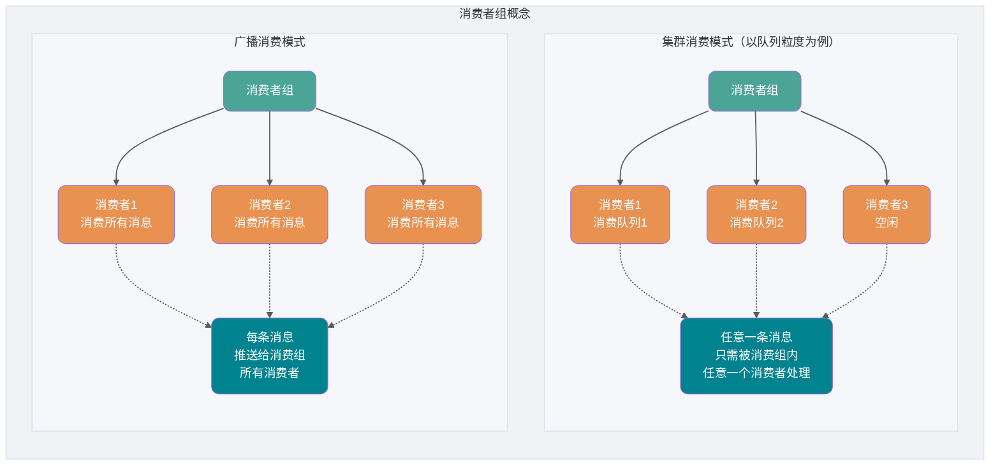
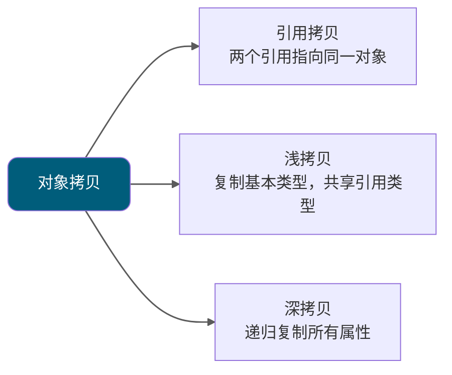
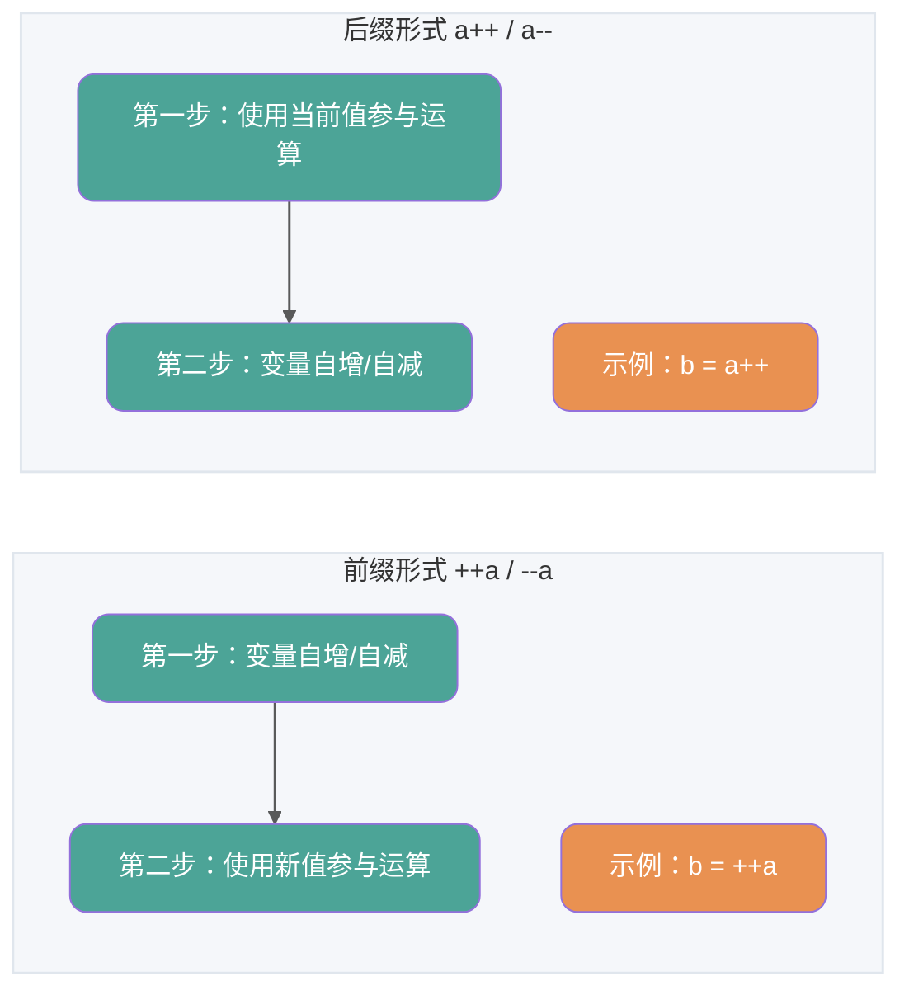
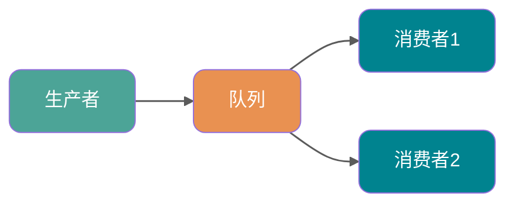
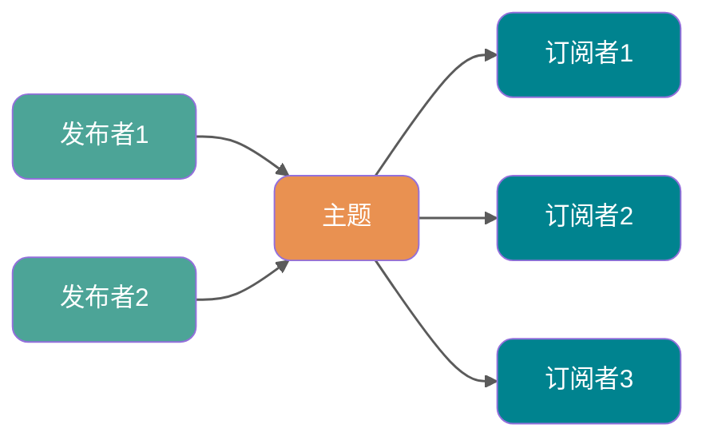
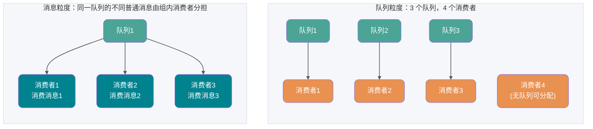

# Java综合问答

<a id="k8c1d58334a17"></a>

## 消费者分组

消费者分组是多个消费行为一致的消费者的负载均衡分组。消费者分组不是具体实体而是一个逻辑资源。通过消费者分组实现消费性能的水平扩展以及高可用容灾。

**消费者组的核心作用：**



消费者分组中的订阅关系、投递顺序性、消费重试策略是一致的。

- 订阅关系：Apache RocketMQ 以消费者分组的粒度管理订阅关系，实现订阅关系的管理和追溯。
- 投递顺序性：Apache RocketMQ 的服务端将消息投递给消费者消费时，支持顺序投递和并发投递，投递方式在消费者分组中统一配置。
- 消费重试策略： 消费者消费消息失败时的重试策略，包括重试次数、死信队列设置等。

RocketMQ 服务端 5.x 版本：上述消费者的消费行为从关联的消费者分组中统一获取，因此，同一分组内所有消费者的消费行为必然是一致的，客户端无需关注。

RocketMQ 服务端 3.x/4.x 历史版本：上述消费逻辑由消费者客户端接口定义，因此，您需要自己在消费者客户端设置时保证同一分组下的消费者的消费行为一致。(来自官方网站)

**两种消费模式对比：**

| 对比维度     | 集群消费模式                                   | 广播消费模式                         |
| ------------ | ---------------------------------------------- | ------------------------------------ |
| **消息消费** | 任意一条消息只需被消费组内的任意一个消费者处理 | 每条消息推送给消费组所有消费者       |
| **扩缩容**   | 可通过扩缩消费者数量来提升或降低消费能力       | 扩缩消费者数量无法提升或降低消费能力 |
| **适用场景** | 需要提升消费能力、避免重复消费                 | 需要所有消费者都收到消息             |

### 参考资料

- [JavaGuide](https://github.com/Snailclimb/JavaGuide/blob/992dae31eade2a34ba8dbbbcf5ed9de5511325ec/docs/high-performance/message-queue/rocketmq-questions.md#L1218)，来源许可：Apache-2.0。

<a id="ke9dc2e454091"></a>

## 深拷贝和浅拷贝区别了解吗？什么是引用拷贝？



关于深拷贝和浅拷贝区别，我这里先给结论：

- **浅拷贝**：浅拷贝会在堆上创建一个新的对象（区别于引用拷贝的一点），不过，如果原对象内部的属性是引用类型的话，浅拷贝会直接复制内部对象的引用地址，也就是说拷贝对象和原对象共用同一个内部对象。
- **深拷贝**：深拷贝会完全复制整个对象，包括这个对象所包含的内部对象。

上面的结论没有完全理解的话也没关系，我们来看一个具体的案例！

### 浅拷贝

浅拷贝的示例代码如下，我们这里实现了 `Cloneable` 接口，并重写了 `clone()` 方法。

`clone()` 方法的实现很简单，直接调用的是父类 `Object` 的 `clone()` 方法。

```java
public class Address implements Cloneable{
    private String name;
    // 省略构造函数、Getter&Setter方法
    @Override
    public Address clone() {
        try {
            return (Address) super.clone();
        } catch (CloneNotSupportedException e) {
            throw new AssertionError();
        }
    }
}

public class Person implements Cloneable {
    private Address address;
    // 省略构造函数、Getter&Setter方法
    @Override
    public Person clone() {
        try {
            Person person = (Person) super.clone();
            return person;
        } catch (CloneNotSupportedException e) {
            throw new AssertionError();
        }
    }
}
```

测试：

```java
Person person1 = new Person(new Address("武汉"));
Person person1Copy = person1.clone();
// true
System.out.println(person1.getAddress() == person1Copy.getAddress());
```

从输出结构就可以看出， `person1` 的克隆对象和 `person1` 使用的仍然是同一个 `Address` 对象。

### 深拷贝

这里我们简单对 `Person` 类的 `clone()` 方法进行修改，连带着要把 `Person` 对象内部的 `Address` 对象一起复制。

```java
@Override
public Person clone() {
    try {
        Person person = (Person) super.clone();
        person.setAddress(person.getAddress().clone());
        return person;
    } catch (CloneNotSupportedException e) {
        throw new AssertionError();
    }
}
```

```java
Person person1 = new Person(new Address("武汉"));
Person person1Copy = person1.clone();
// false
System.out.println(person1.getAddress() == person1Copy.getAddress());
```

从输出结构就可以看出，显然 `person1` 的克隆对象和 `person1` 包含的 `Address` 对象已经是不同的了。

**那什么是引用拷贝呢？** 简单来说，引用拷贝就是两个不同的引用指向同一个对象。

我专门画了一张图来描述浅拷贝、深拷贝和引用拷贝：


### 参考资料

- [JavaGuide](https://github.com/Snailclimb/JavaGuide/blob/992dae31eade2a34ba8dbbbcf5ed9de5511325ec/docs/java/basis/java-basic-questions-02.md#L308)，来源许可：Apache-2.0。

<a id="k6d0baa350c62"></a>

## 演化设计

微服务从业者通常有进化设计的背景，并把服务分解视为进一步的工具，使应用程序开发人员能够控制应用程序中的更改，而不会降低变更速度。变更控制并不一定意味着变更的减少——在正确的态度和工具的帮助下，你可以对软件进行频繁，快速且有良好控制的更改。

每当要试图将软件系统分解为组件时，你就会面临这样的决策，即如何进行拆分——我们决定拆分应用程序的原则是什么？组件的关键属性具有独立替换和可升级性的特点[13]——这意味着我们寻找这些点，想象如何在不影响其协作者的情况下重写组件。实际上，许多微服务组通过明确地期望许多服务被废弃而不是长期演变来进一步考虑这一点。

Guardian 网站是设计和构建成单体应用程序的一个很好的例子，但是它也在微服务方向上不断发展演化。原先的单体系统仍然是网站的核心，但他们更喜欢通过构建一些微服务 API 的方式来添加新的功能。这种方法对于本质上是临时的功能尤其方便，例如处理体育赛事的专用页面。网站的这一部分可以使用快速开发语言快速组合在一起，在赛事结束后立即删除。我们在金融机构看到过类似的方法，为市场机会增加新服务，并在几个月甚至几周后丢弃。

这种强调可替换性的特点，是模块化设计一般性原则的一个特例，即通过变化模式来驱动模块化的实现[14]。大家都愿意将那些同时发生变化的东西放在同一个模块，很少变化的系统模块应该与目前正在经历大量变动的系统处于不同的服务中。如果你发现自己反复更改两项服务，那就表明它们应该合并了。

将组件放入服务中可以为更细粒度的发布计划添加机会。对于单体来说，任何更改都需要完整构建和部署整个应用程序。但是，使用微服务，你只需要重新部署你修改的服务。这可以简化并加快发布过程。缺点是你必须担心一项服务的变化会打破其消费者。传统的集成方法是尝试使用版本控制来解决这个问题，但微服务世界中的偏好是仅仅把使用版本控制作为最后的手段。我们可以通过设计服务尽可能容忍服务提供者的变化来避免大量的版本控制。

### 参考资料

- [Advanced Java](https://github.com/doocs/advanced-java/blob/80b89fb9496d7ea3213e402c8c3853399e00c363/docs/micro-services/microservices-introduction.md#L147)，来源许可：CC-BY-SA-4.0。

<a id="k0334ba7e5de1"></a>

## 灾备设计和异地多活

**灾备** = 容灾 + 备份。

- **备份**：将系统所产生的所有重要数据多备份几份。
- **容灾**：在异地建立两个完全相同的系统。当某个地方的系统突然挂掉，整个应用系统可以切换到另一个，这样系统就可以正常提供服务了。

**异地多活** 描述的是将服务部署在异地并且服务同时对外提供服务。和传统的灾备设计的最主要区别在于“多活”，即所有站点都是同时在对外提供服务的。异地多活是为了应对突发状况比如火灾、地震等自然或者人为灾害。

### 参考资料

- [JavaGuide](https://github.com/Snailclimb/JavaGuide/blob/992dae31eade2a34ba8dbbbcf5ed9de5511325ec/README.md#L462)，来源许可：Apache-2.0。

<a id="k319973556011"></a>

## 生产者分组

RocketMQ 5.x 新版领域模型里，**生产者是轻量、匿名的运行实体**，一般不再需要像早期版本那样重点管理生产者分组（ProducerGroup）。不过在 3.x/4.x 客户端、Spring 生态或兼容模式里，仍可能看到 ProducerGroup 配置，迁移时不要简单删除，要按实际客户端版本确认。

### 参考资料

- [JavaGuide](https://github.com/Snailclimb/JavaGuide/blob/992dae31eade2a34ba8dbbbcf5ed9de5511325ec/docs/high-performance/message-queue/rocketmq-questions.md#L1214)，来源许可：Apache-2.0。

<a id="k0d2a71a34c32"></a>

## 策略 1——停止挖掘

Law of Holes 是说当自己进洞就应该停止挖掘。对于单体式应用不可管理时这是最佳建议。换句话说，应该停止让单体式应用继续变大，也就是说当开发新功能时不应该为旧单体应用添加新代码，最佳方法应该是将新功能开发成独立微服务。如下图所示：


除了新服务和传统应用，还有两个模块，其一是请求路由器，负责处理入口（http）请求，有点像之前提到的 API 网关。路由器将新功能请求发送给新开发的服务，而将传统请求还发给单体式应用。

另外一个是胶水代码（glue code），将微服务和单体应用集成起来，微服务很少能独立存在，经常会访问单体应用的数据。胶水代码，可能在单体应用或者为服务或者二者兼而有之，负责数据整合。微服务通过胶水代码从单体应用中读写数据。​

微服务有三种方式访问单体应用数据：

-   换气单体应用提供的远程 API
-   直接访问单体应用数据库
-   自己维护一份从单体应用中同步的数据

胶水代码也被称为容灾层（anti-corruption layer），这是因为胶水代码保护微服务全新域模型免受传统单体应用域模型污染。胶水代码在这两种模型间提供翻译功能。术语 anti-corruption layer 第一次出现在 Eric Evans 撰写的必读书 _Domain Driven Design_，随后就被提炼为一篇白皮书。开发容灾层可能有点不是很重要，但却是避免单体式泥潭的必要部分。

将新功能以轻量级微服务方式实现由很多优点，例如可以阻止单体应用变的更加无法管理。微服务本身可以开发、部署和独立扩展。采用微服务架构会给开发者带来不同的切身感受。

然而，这方法并不解决任何单体式本身问题，为了解决单体式本身问题必须深入单体应用 ​ 做出改变。我们来看看这么做的策略。

### 参考资料

- [Advanced Java](https://github.com/doocs/advanced-java/blob/80b89fb9496d7ea3213e402c8c3853399e00c363/docs/micro-services/migrating-from-a-monolithic-architecture-to-a-microservices-architecture.md#L15)，来源许可：CC-BY-SA-4.0。

<a id="k943008261c00"></a>

## 自增自减运算符

在写代码的过程中，常见的一种情况是需要某个整数类型变量增加 1 或减少 1。Java 提供了自增运算符 (`++`) 和自减运算符 (`--`) 来简化这种操作。

`++` 和 `--` 运算符可以放在变量之前，也可以放在变量之后：

- **前缀形式**（例如 `++a` 或 `--a`）：先自增/自减变量的值，然后再使用该变量，例如，`b = ++a` 先将 `a` 增加 1，然后把增加后的值赋给 `b`。
- **后缀形式**（例如 `a++` 或 `a--`）：先使用变量的当前值，然后再自增/自减变量的值。例如，`b = a++` 先将 `a` 的当前值赋给 `b`，然后再将 `a` 增加 1。

为了方便记忆，可以使用下面的口诀：**符号在前就先加/减，符号在后就后加/减**。



下面来看一个考察自增自减运算符的高频笔试题：执行下面的代码后，`a`、`b`、 `c`、`d` 和 `e` 的值是？

```java
int a = 9;
int b = a++;
int c = ++a;
int d = c--;
int e = --d;
```

答案：`a = 11`、`b = 9`、 `c = 11`、 `d = 10`、 `e = 10`。

### 参考资料

- [JavaGuide](https://github.com/Snailclimb/JavaGuide/blob/992dae31eade2a34ba8dbbbcf5ed9de5511325ec/docs/java/basis/java-basic-questions-01.md#L305)，来源许可：Apache-2.0。

<a id="kf2cc869b80f8"></a>

## 获取服务列表（Fetch）

服务消费者方启动之后首先肯定是要先从注册中心 `Eureka Server` 获取到可用的服务列表同时本地也会缓存一份。这个获取服务列表的操作是在服务启动后 `DiscoverClient` 类实例化的时候执行的。


可以看出，能发生这个获取服务列表的操作前提是要保证配置了 `eureka.client.fetch-registry=true` ，该配置的默认值为 `true` ，主要调用流程如下图所示：


### 参考资料

- [Advanced Java](https://github.com/doocs/advanced-java/blob/80b89fb9496d7ea3213e402c8c3853399e00c363/docs/micro-services/how-eureka-enable-service-discovery-and-service-registration.md#L101)，来源许可：CC-BY-SA-4.0。

<a id="kd38cf17437f9"></a>

## 设计时为故障做好准备

使用服务作为组件的结果是，需要设计应用程序以便它们能够容忍服务的失败。如果服务提供者商不可用，任何服务呼叫都可能失败，客户必须尽可能优雅地对此做出响应。与单体设计相比，这是一个缺点，因为它这会引入额外的复杂性来处理它。结果是微服务团队不断反思服务失败是如何影响用户体验的。Netflix 的 [Simian Army](https://github.com/Netflix/SimianArmy) 能够引发服务甚至数据中心的故障在工作日发生故障，从而来测试应用程序的弹性和监控能力。

生产中的这种自动化测试足以让大多数运维团队兴奋得浑身颤栗，就像在一周的长假即将到来前一样。这并不是说单体架构风格不能构建先进的监控系统——只是根据我们的经验，这在单体系统中并不常见罢了。

由于服务可能随时发生故障，因此能够快速检测故障并在可能的情况下自动恢复服务就显得至关重要。微服务应用程序非常重视应用程序的实时监控，比如检查架构元素（数据库每秒获得多少请求）和业务相关度量（例如每分钟收到多少订单）。语义监控可以提供出现问题的早期预警系统，从而触发开发团队跟进和调查。

这对于微服务架构来说尤为重要，因为微服务偏好编排和事件写作，这会导致一些紧急状况。虽然许多权威人士对于偶然事件的价值持积极态度，但事实是，“突发行为”有时可能是一件坏事。监控至关重要，它能够快速发现不良紧急行为并进行修复。

单体系统也可以像微服务一样实现透明的监控——事实上，它们也应该如此。不同之处在于你必须能够知道在不同进程中运行的服务在何时断开了连接。对于同一过程中的库，这种透明性用处并不大。

微服务团队希望看到针对每个服务的复杂监控和日志记录，例如显示“运行/宕机”状态的仪表盘以及各种运维和业务相关的指标。有关断路器状态，当前吞吐量和延迟的详细信息也是我们在工作中经常遇到的其他例子。

### 参考资料

- [Advanced Java](https://github.com/doocs/advanced-java/blob/80b89fb9496d7ea3213e402c8c3853399e00c363/docs/micro-services/microservices-introduction.md#L133)，来源许可：CC-BY-SA-4.0。

<a id="k5a5accf286ab"></a>

## 说一说 PriorityQueue

`PriorityQueue` 是在 JDK1.5 中被引入的, 其与 `Queue` 的区别在于元素出队顺序是与优先级相关的，即总是优先级最高的元素先出队。

这里列举其相关的一些要点：

- `PriorityQueue` 利用了二叉堆的数据结构来实现的，底层使用可变长的数组来存储数据
- `PriorityQueue` 通过堆元素的上浮和下沉，实现了在 O(logn) 的时间复杂度内插入元素和删除堆顶元素。
- `PriorityQueue` 是非线程安全的，且不支持存储 `NULL`。未提供 `Comparator` 时，元素需要实现 `Comparable`；提供 `Comparator` 时，元素需要能够被该比较器相互比较。
- `PriorityQueue` 默认是小顶堆，但可以接收一个 `Comparator` 作为构造参数，从而来自定义元素优先级的先后。

`PriorityQueue` 在面试中可能更多的会出现在手撕算法的时候，典型例题包括堆排序、求第 K 大的数、带权图的遍历等，所以需要会熟练使用才行。

如果想先补堆和 Top K 的算法模板，可以看 [堆详解](https://github.com/Snailclimb/JavaGuide/blob/992dae31eade2a34ba8dbbbcf5ed9de5511325ec/docs/cs-basics/data-structure/heap.md) 和 [Top K 问题面试题总结](https://github.com/Snailclimb/JavaGuide/blob/992dae31eade2a34ba8dbbbcf5ed9de5511325ec/docs/cs-basics/algorithms/top-k.md)。

### 参考资料

- [JavaGuide](https://github.com/Snailclimb/JavaGuide/blob/992dae31eade2a34ba8dbbbcf5ed9de5511325ec/docs/java/collection/java-collection-questions-01.md#L562)，来源许可：Apache-2.0。

<a id="k122c183fa644"></a>

## 超过 long 整型的数据应该如何表示？

基本数值类型都有一个表达范围，如果超过这个范围就会有数值溢出的风险。

在 Java 中，64 位 long 整型是最大的整数类型。

```java
long l = Long.MAX_VALUE;
System.out.println(l + 1); // -9223372036854775808
System.out.println(l + 1 == Long.MIN_VALUE); // true
```

`BigInteger` 内部使用 `int[]` 数组来存储任意大小的整形数据。

相对于常规整数类型的运算来说，`BigInteger` 运算的效率会相对较低。

### 参考资料

- [JavaGuide](https://github.com/Snailclimb/JavaGuide/blob/992dae31eade2a34ba8dbbbcf5ed9de5511325ec/docs/java/basis/java-basic-questions-01.md#L902)，来源许可：Apache-2.0。

<a id="k8a48a588daa6"></a>

## 这个算法应该如何设计呢？

我们首先可能会想到采用 % 取余的操作来实现。对于非负的 `hash`，当 `length` 是 2 的幂次方时，`hash % length` 等价于 `hash & (length - 1)`。`HashMap` 使用后者计算数组下标。

除了上面所说的位运算比取余效率高之外，我觉得更重要的一个原因是：**长度是 2 的幂次方，可以让 `HashMap` 在扩容的时候更均匀**。例如:

- length = 8 时，length - 1 = 7 的二进制位 `0111`
- length = 16 时，length - 1 = 15 的二进制位 `1111`

这时候原本存在 `HashMap` 中的元素计算新的数组位置时 `hash&(length-1)`，取决 hash 的第四个二进制位（从右数），会出现两种情况：

1. 第四个二进制位为 0，数组位置不变，也就是说当前元素在新数组和旧数组的位置相同。
2. 第四个二进制位为 1，数组位置在新数组扩容之后的那一部分。

这里列举一个例子：

```plain
假设有一个元素的哈希值为 10101100

旧数组元素位置计算：
hash        = 10101100
length - 1  = 00000111
& -----------------
index       = 00000100  (4)

新数组元素位置计算：
hash        = 10101100
length - 1  = 00001111
& -----------------
index       = 00001100  (12)

看第四位（从右数）：
1.高位为 0：位置不变。
2.高位为 1：移动到新位置（原索引位置+原容量）。
```

⚠️注意：这里列举的场景看的是第四个二进制位，更准确点来说看的是高位（从右数），例如 `length = 32` 时，`length - 1 = 31`，二进制为 `11111`，这里看的就是第五个二进制位。

也就是说扩容之后，在旧数组元素 hash 值比较均匀（至于 hash 值均不均匀，取决于前面讲的对象的 `hashcode()` 方法和扰动函数）的情况下，新数组元素也会被分配的比较均匀，最好的情况是会有一半在新数组的前半部分，一半在新数组后半部分。

这样也使得扩容机制变得简单和高效，扩容后只需检查哈希值高位的变化来决定元素的新位置，要么位置不变（高位为 0），要么就是移动到新位置（高位为 1，原索引位置+原容量）。

最后，简单总结一下 `HashMap` 的长度是 2 的幂次方的原因：

1. 位运算效率更高：位运算(&)比取余运算(%)更高效。对于非负的 `hash`，当长度为 2 的幂次方时，`hash % length` 等价于 `hash & (length - 1)`。
2. 可以更好地保证哈希值的均匀分布：扩容之后，在旧数组元素 hash 值比较均匀的情况下，新数组元素也会被分配的比较均匀，最好的情况是会有一半在新数组的前半部分，一半在新数组后半部分。
3. 扩容机制变得简单和高效：扩容后只需检查哈希值高位的变化来决定元素的新位置，要么位置不变（高位为 0），要么就是移动到新位置（高位为 1，原索引位置+原容量）。

### 参考资料

- [JavaGuide](https://github.com/Snailclimb/JavaGuide/blob/992dae31eade2a34ba8dbbbcf5ed9de5511325ec/docs/java/collection/java-collection-questions-02.md#L302)，来源许可：Apache-2.0。

<a id="ka11fbc8c1063"></a>

## 适合谁看

- 准备 AI 应用开发、AI 工程师、后端转 AI 相关岗位面试的同学。
- 已经看过一些 AI 概念，但回答面试题时容易说散、说浅，或者只停留在 Demo 层面的读者。
- 想把项目经历整理成“问题 -> 原理 -> 方案 -> 取舍 -> 落地”表达方式的开发者。

### 参考资料

- [JavaGuide](https://github.com/Snailclimb/JavaGuide/blob/992dae31eade2a34ba8dbbbcf5ed9de5511325ec/docs/ai/interview-questions/README.md#L18)，来源许可：Apache-2.0。

<a id="ke8486b82744d"></a>

## 通过服务进行组件化

只要我们参与软件行业，就一直希望通过将组件集成在一起来构建系统，就像我们在物理世界中看到的事物的构建方式一样。在过去的几十年中，我们已经看到了大多数语言平台的公共软件库都取得了极大的进展。

在谈论组件时，就会碰到一个有关定义的难题，即什么是组件？我们的定义是，组件是可独立更换和升级的软件单元。

微服务架构也会使用软件库，但组件化软件的主要方式是拆分为多个服务。我们把库定义为链接到程序并使用内存函数调用来调用的组件，而服务是一种进程外组件，通过 Web 服务请求或远程过程调用等机制进行通信。（这与许多面向对象程序中的服务对象的概念是不同的[3]。）

将服务作为组件（而不是库）的一个主要原因是服务可以独立部署。如果你有一个应用程序[4]是由单一进程里的多个库组成，任何一个组件的更改都会导致整个应用程序的重新部署。但如果应用程序可拆分为多个服务，那么单个服务的变更只需要重新部署该服务即可。当然这也不是绝对的，一些服务接口的修改可能会导致多个服务之间的协同修改，但一个好的微服务架构的目的是通过内聚服务边界和服务协议的演进机制来最小化这些协同修改。

将服务用作组件的另一个结果是更明确的组件接口。大多数语言没有一个良好的机制来定义显式发布的接口。通常，它只是文档和规则来阻止客户端破坏组件的封装，这会导致组件之间过于紧耦合。通过使用显式远程调用机制，服务可以更轻松地避免这种情况。

像这样使用服务确实存在一些不好的地方。远程调用比进程内调用更昂贵，远程 API 需要设计成较粗的粒度，这通常更难以使用。如果你需要更改组件之间的职责分配，那么当你跨越进程边界时，这种组件行为的改动会更加难以实现。

近似地，我们可以把一个个服务映射为一个个运行时进程，但这仅仅是一个近似而已。一个服务可能包括多个始终一起开发和部署的进程，比如一个应用系统的进程和仅由该服务使用的数据库。

### 参考资料

- [Advanced Java](https://github.com/doocs/advanced-java/blob/80b89fb9496d7ea3213e402c8c3853399e00c363/docs/micro-services/microservices-introduction.md#L27)，来源许可：CC-BY-SA-4.0。

<a id="k580edb8abd6f"></a>

## 遇到方法重载的情况怎么办呢？会优先匹配固定参数还是可变参数的方法呢？

答案是会优先匹配固定参数的方法，因为固定参数的方法匹配度更高。

我们通过下面这个例子来证明一下。

```java
/**
 * 微信搜 JavaGuide 回复"面试突击"即可免费领取个人原创的 Java 面试手册
 *
 * @author Guide哥
 * @date 2021/12/13 16:52
 **/
public class VariableLengthArgument {

    public static void printVariable(String... args) {
        for (String s : args) {
            System.out.println(s);
        }
    }

    public static void printVariable(String arg1, String arg2) {
        System.out.println(arg1 + arg2);
    }

    public static void main(String[] args) {
        printVariable("a", "b");
        printVariable("a", "b", "c", "d");
    }
}
```

输出：

```plain
ab
a
b
c
d
```

另外，Java 的可变参数编译后实际会被转换成一个数组，我们看编译后生成的 `class` 文件就可以看出来了。

```java
public class VariableLengthArgument {

    public static void printVariable(String... args) {
        String[] var1 = args;
        int var2 = args.length;

        for(int var3 = 0; var3 < var2; ++var3) {
            String s = var1[var3];
            System.out.println(s);
        }

    }
    // ......
}
```

### 参考资料

- [JavaGuide](https://github.com/Snailclimb/JavaGuide/blob/992dae31eade2a34ba8dbbbcf5ed9de5511325ec/docs/java/basis/java-basic-questions-01.md#L1245)，来源许可：Apache-2.0。

<a id="k30cc7234099c"></a>

## 那 SPI 和 API 有啥区别？

说到 SPI 就不得不说一下 API（Application Programming Interface） 了，从广义上来说它们都属于接口，而且很容易混淆。下面先用一张图说明一下：


一般模块之间都是通过接口进行通讯，因此我们在服务调用方和服务实现方（也称服务提供者）之间引入一个“接口”。

- 当实现方提供了接口和实现，我们可以通过调用实现方的接口从而拥有实现方给我们提供的能力，这就是 **API**。这种情况下，接口和实现都是放在实现方的包中。调用方通过接口调用实现方的功能，而不需要关心具体的实现细节。
- 当接口存在于调用方这边时，这就是 **SPI**。由接口调用方确定接口规则，然后由不同的厂商根据这个规则对这个接口进行实现，从而提供服务。

举个通俗易懂的例子：公司 H 是一家科技公司，新设计了一款芯片，然后现在需要量产了，而市面上有好几家芯片制造业公司，这个时候，只要 H 公司指定好了这芯片生产的标准（定义好了接口标准），那么这些合作的芯片公司（服务提供者）就按照标准交付自家特色的芯片（提供不同方案的实现，但是给出来的结果是一样的）。

### 参考资料

- [JavaGuide](https://github.com/Snailclimb/JavaGuide/blob/992dae31eade2a34ba8dbbbcf5ed9de5511325ec/docs/java/basis/java-basic-questions-03.md#L487)，来源许可：Apache-2.0。

<a id="k56c2b31b2738"></a>

## 那为什么 JDK 还要同时提供这两个方法呢？

这是因为在一些容器（比如 `HashMap`、`HashSet`）中，有了 `hashCode()` 之后，判断元素是否在对应容器中的效率会更高（参考添加元素进 `HashSet` 的过程）！

我们在前面也提到了添加元素进 `HashSet` 的过程，如果 `HashSet` 在对比的时候，同样的 `hashCode` 有多个对象，它会继续使用 `equals()` 来判断是否真的相同。也就是说 `hashCode` 帮助我们大大缩小了查找成本。

### 参考资料

- [JavaGuide](https://github.com/Snailclimb/JavaGuide/blob/992dae31eade2a34ba8dbbbcf5ed9de5511325ec/docs/java/basis/java-basic-questions-02.md#L563)，来源许可：Apache-2.0。

<a id="k413034227c9d"></a>

## 重载和重写有什么区别？

> 重载就是同样的一个方法能够根据输入数据的不同，做出不同的处理
>
> 重写就是当子类继承自父类的相同方法，输入数据一样，但要做出有别于父类的响应时，你就要覆盖父类方法

### 重载

发生在同一个类中（或者父类和子类之间），方法名必须相同，参数类型不同、个数不同、顺序不同，方法返回值和访问修饰符可以不同。

《Java 核心技术》这本书是这样介绍重载的：

> 如果多个方法(比如 `StringBuilder` 的构造方法)有相同的名字、不同的参数， 便产生了重载。
>
> ```java
> StringBuilder sb = new StringBuilder();
> StringBuilder sb2 = new StringBuilder("HelloWorld");
> ```
>
> 编译器必须挑选出具体执行哪个方法，它通过用各个方法给出的参数类型与特定方法调用所使用的值类型进行匹配来挑选出相应的方法。 如果编译器找不到匹配的参数， 就会产生编译时错误， 因为根本不存在匹配， 或者没有一个比其他的更好(这个过程被称为重载解析(overloading resolution))。
>
> Java 允许重载任何方法， 而不只是构造器方法。

综上：重载就是同一个类中多个同名方法根据不同的传参来执行不同的逻辑处理。

### 重写

重写是子类实例方法与父类可访问实例方法之间的声明关系，由编译器按规则检查；运行期发生的是对重写方法的动态分派。

1. 方法名、参数列表必须相同，子类方法返回值类型应比父类方法返回值类型更小或相等，抛出的异常范围小于等于父类，访问修饰符范围大于等于父类。
2. 如果父类方法访问修饰符为 `private/final/static` 则子类就不能重写该方法，但是被 `static` 修饰的方法能够被再次声明。
3. 构造方法无法被重写

### 总结

综上：**重写就是子类对父类方法的重新改造，外部样子不能改变，内部逻辑可以改变。**

| 区别点         | 重载 (Overloading)                                                                   | 重写 (Overriding)                                                                            |
| -------------- | ------------------------------------------------------------------------------------ | -------------------------------------------------------------------------------------------- |
| **发生范围**   | 同一个类中。                                                                         | 父类与子类之间（存在继承关系）。                                                             |
| **方法签名**   | 方法名**必须相同**，但**参数列表必须不同**（参数的类型、个数或顺序至少有一项不同）。 | 方法名、参数列表**必须完全相同**。                                                           |
| **返回类型**   | 与返回值类型**无关**，可以任意修改。                                                 | 子类方法的返回类型必须与父类方法的返回类型**相同**，或者是其**子类**。                       |
| **访问修饰符** | 与访问修饰符**无关**，可以任意修改。                                                 | 子类方法的访问权限**不能低于**父类方法的访问权限。（public > protected > default > private） |
| **绑定时期**   | 编译时绑定或称静态绑定                                                               | 运行时绑定 (Run-time Binding) 或称动态绑定                                                   |

**方法的重写要遵循“两同两小一大”**（以下内容摘录自《疯狂 Java 讲义》，[issue#892](https://github.com/Snailclimb/JavaGuide/issues/892)）：

- “两同”即方法名相同、形参列表相同；
- “两小”指的是子类方法返回值类型应比父类方法返回值类型更小或相等，子类方法声明抛出的异常类应比父类方法声明抛出的异常类更小或相等；
- “一大”指的是子类方法的访问权限应比父类方法的访问权限更大或相等。

⭐️ 关于 **重写的返回值类型** 这里需要额外多说明一下，上面的表述不太清晰准确：如果方法的返回类型是 void 和基本数据类型，则返回值重写时不可修改。但是如果方法的返回值是引用类型，重写时是可以返回该引用类型的子类的。

```java
public class Hero {
    public String name() {
        return "超级英雄";
    }
}
public class SuperMan extends Hero{
    @Override
    public String name() {
        return "超人";
    }
    public Hero hero() {
        return new Hero();
    }
}

public class SuperSuperMan extends SuperMan {
    @Override
    public String name() {
        return "超级超级英雄";
    }

    @Override
    public SuperMan hero() {
        return new SuperMan();
    }
}
```

### 参考资料

- [JavaGuide](https://github.com/Snailclimb/JavaGuide/blob/992dae31eade2a34ba8dbbbcf5ed9de5511325ec/docs/java/basis/java-basic-questions-01.md#L1145)，来源许可：Apache-2.0。

<a id="k1e7153a77a3d"></a>

## 队列模型和主题模型是什么？

在谈 RocketMQ 的技术架构之前，我们先来了解一下两个名词概念——**队列模型** 和 **主题模型** 。

首先，为什么消息队列叫消息队列？

实际上，早期的消息中间件是通过 **队列** 这一模型来实现的，可能是历史原因，我们都习惯把消息中间件称为消息队列。

但是，如今例如 RocketMQ、Kafka 这些优秀的消息中间件不仅仅是通过一个 **队列** 来实现消息存储的。

### 队列模型

就像我们理解队列一样，消息中间件的队列模型就真的只是一个队列。


队列模型的特点：**一个消息只能被一个消费者消费**。



在一开始我跟你提到了一个 **“广播”** 的概念，也就是说如果我们此时我们需要将一个消息发送给多个消费者(比如此时我需要将信息发送给短信系统和邮件系统)，这个时候单个队列即不能满足需求了。

当然你可以让 Producer 生产消息放入多个队列中，然后每个队列去对应每一个消费者。问题是可以解决，创建多个队列并且复制多份消息是会很影响资源和性能的。而且，这样子就会导致生产者需要知道具体消费者个数然后去复制对应数量的消息队列，这就违背我们消息中间件的 **解耦** 这一原则。

### 主题模型

那么有没有好的方法去解决这一个问题呢？有，那就是 **主题模型** 或者可以称为 **发布订阅模型** 。

> 感兴趣的同学可以去了解一下设计模式里面的观察者模式并且手动实现一下，我相信你会有所收获的。

在主题模型中，消息的生产者称为 **发布者(Publisher)** ，消息的消费者称为 **订阅者(Subscriber)** ，存放消息的容器称为 **主题(Topic)** 。

其中，发布者将消息发送到指定主题中，订阅者需要 **提前订阅主题** 才能接受特定主题的消息。


主题模型的特点：**一个 Topic 可以被多个消费者组订阅，每个消费者组都有独立的消费进度**。在集群消费模式下，同一消费者组内通常只由一个消费者实例处理某条消息；在广播消费模式下，同一消费者组内的每个消费者都会收到消息。



### RocketMQ 中的消息模型

RocketMQ 中的消息模型就是按照 **主题模型** 所实现的。那么 **主题** 到底是怎么实现的呢？

其实对于主题模型的实现来说每个消息中间件的底层设计都是不一样的，就比如 Kafka 中的 **分区** ，RocketMQ 中的 **队列** ，RabbitMQ 中的 Exchange 。我们可以理解为 **主题模型/发布订阅模型** 就是一个标准，那些中间件只不过照着这个标准去实现而已。

所以，RocketMQ 中的 **主题模型** 到底是如何实现的呢？先看一张图：


我们可以看到在整个图中有 `Producer Group`、Topic、`Consumer Group` 三个角色。这个图更接近早期和兼容模型，理解 5.x 时要记住：新版领域模型里生产者本身是轻量、匿名的，生产者组不再是重点概念。

- `Producer Group` 生产者组：在早期客户端和兼容场景中代表某一类生产者，比如我们有多个秒杀系统作为生产者，这多个合在一起就是一个 `Producer Group` 生产者组，它们一般生产相同的消息。
- `Consumer Group` 消费者组：代表某一类的消费者，比如我们有多个短信系统作为消费者，这多个合在一起就是一个 `Consumer Group` 消费者组，它们一般消费相同的消息。
- Topic 主题：代表一类消息，比如订单消息，物流消息等等。

你可以看到图中生产者组中的生产者会向主题发送消息，而 **主题中存在多个队列**，生产者每次生产消息之后会把消息发送到指定主题下的某个队列。

每个主题中都有多个队列(分布在不同的 Broker 中，如果是集群的话，Broker 又分布在不同的服务器中)，集群消费模式下，一个消费者集群多台机器共同消费一个 `topic` 的多个队列。

**负载均衡策略对比**

下面对比的是**同一消费者组内的集群消费（共享消费）**。负载均衡粒度取决于客户端类型和消费协议，不能只看 Broker 的版本：传统 3.x/4.x Remoting SDK 的消费者采用队列粒度；5.x 新版 SDK 的 PushConsumer、SimpleConsumer 采用消息粒度；PullConsumer 仍采用队列粒度。



- **队列粒度负载均衡**：在分配稳定时，同一消费者组内，一个队列只分配给一个消费者实例；一个消费者可以分到多个队列。如果某个消费者挂掉，会通过重平衡把它的队列分配给组内其他消费者。如果消费者数多于队列数，就会有消费者分不到队列。这种模式容易出现负载不均：某个消费者处理速度较慢，或者分到的队列消息较多，就可能出现该消费者积压、其他消费者空闲的情况。不同消费者组可以分别消费同一个队列，不受组内独占分配的限制。
- **消息粒度负载均衡**：5.x 新版 SDK 的 PushConsumer、SimpleConsumer 可以让同一消费者组内的多个消费者分担同一个队列中的不同消息。图中只是一次分配示例，消息不会固定绑定到某个消费者。消息被取走后，在不可见时间内不会再投递给**同组**其他消费者；消费失败或超时仍可能触发重试，因此不代表绝不会重复消费。这种方式可以缓解队列分配不均和消费者处理能力差异造成的积压，但不能消除业务处理慢等所有瓶颈。顺序消息还受消息组顺序约束，不能把同一消息组内的消息任意并行处理。

下面这张图仅适用于**队列粒度负载均衡**。消费者个数小于队列个数并不是问题，一个消费者可以消费多个队列；如果希望扩容后的消费者都能分到队列，就需要有足够的队列。消息粒度负载均衡下，消费者实例数则不受队列数的直接限制。


### 参考资料

- [JavaGuide](https://github.com/Snailclimb/JavaGuide/blob/992dae31eade2a34ba8dbbbcf5ed9de5511325ec/docs/high-performance/message-queue/rocketmq-questions.md#L181)，来源许可：Apache-2.0。

<a id="k48a87674855f"></a>

## 静态代理和动态代理有什么区别？

静态代理和动态代理的核心差异在于 **代理关系的确定时机、实现灵活性及维护成本**。

| 对比维度         | 静态代理 (Static Proxy)                                                                  | 动态代理 (Dynamic Proxy)                                                       |
| ---------------- | ---------------------------------------------------------------------------------------- | ------------------------------------------------------------------------------ |
| 代理关系确定时机 | 编译期（编译后生成固定的 `.class` 字节码文件）                                           | 运行时（动态生成代理类字节码并加载到 JVM）                                     |
| 实现方式         | 在编译前手动编写代理类，常通过组合和委托调用目标对象                                     | 无需手动编写具体代理类，通过 `Handler`/`Interceptor` 封装增强逻辑              |
| 接口依赖         | 不是必须；基于接口的静态代理通常让代理类与目标类遵循同一接口                             | JDK 动态代理面向接口，CGLIB 等子类代理面向可继承的实现类                       |
| 代码量与维护性   | 代码量大（目标类越多，代理类越多），维护成本高；接口新增方法时，目标类与代理类需同步修改 | 代码量极少（通用增强逻辑可复用），维护性好；与接口解耦，接口变更不影响代理逻辑 |
| 核心优势         | 实现简单、逻辑直观，无额外框架依赖                                                       | 灵活性强、复用性高，降低重复编码，适配复杂场景                                 |
| 典型应用场景     | 简单的装饰器模式、少量固定类的增强需求                                                   | Spring AOP、RPC 框架（如 Dubbo）、ORM 框架                                     |

### 参考资料

- [JavaGuide](https://github.com/Snailclimb/JavaGuide/blob/992dae31eade2a34ba8dbbbcf5ed9de5511325ec/docs/java/basis/java-basic-questions-03.md#L414)，来源许可：Apache-2.0。

<a id="k24b9385180bb"></a>

## 静态变量有什么作用？

静态变量也就是被 `static` 关键字修饰的变量。它可以被类的所有实例共享，无论一个类创建了多少个对象，它们都共享同一份静态变量。也就是说，静态变量只会被分配一次内存，即使创建多个对象，这样可以节省内存。


静态变量是通过类名来访问的，例如 `StaticVariableExample.staticVar`（如果被 `private` 关键字修饰就无法这样访问了）。

```java
public class StaticVariableExample {
    // 静态变量
    public static int staticVar = 0;
}
```

通常情况下，静态变量会被 `final` 关键字修饰成为常量。

```java
public class ConstantVariableExample {
    // 常量
    public static final int constantVar = 0;
}
```

### 参考资料

- [JavaGuide](https://github.com/Snailclimb/JavaGuide/blob/992dae31eade2a34ba8dbbbcf5ed9de5511325ec/docs/java/basis/java-basic-questions-01.md#L986)，来源许可：Apache-2.0。

<a id="k614f146c4fd4"></a>

## 静态方法为什么不能调用非静态成员？

静态方法在静态上下文中执行，没有隐式的当前实例 `this`，因此不能直接访问实例成员。静态方法仍然可以通过一个显式的对象引用访问该对象的实例成员，这与类加载或成员是否已经“分配内存”无关。

```java
public class Example {
    // 定义一个字符型常量
    public static final char LETTER_A = 'A';

    // 定义一个字符串常量
    public static final String GREETING_MESSAGE = "Hello, world!";

    public static void main(String[] args) {
        // 输出字符型常量的值
        System.out.println("字符型常量的值为：" + LETTER_A);

        // 输出字符串常量的值
        System.out.println("字符串常量的值为：" + GREETING_MESSAGE);
    }
}
```

### 参考资料

- [JavaGuide](https://github.com/Snailclimb/JavaGuide/blob/992dae31eade2a34ba8dbbbcf5ed9de5511325ec/docs/java/basis/java-basic-questions-01.md#L1090)，来源许可：Apache-2.0。

<a id="k599b28cff024"></a>

## 静态方法和实例方法有何不同？

**1、调用方式**

在外部调用静态方法时，可以使用 `类名.方法名` 的方式，也可以使用 `对象.方法名` 的方式，而实例方法只有后面这种方式。也就是说，**调用静态方法可以无需创建对象**。

不过，需要注意的是一般不建议使用 `对象.方法名` 的方式来调用静态方法。这种方式非常容易造成混淆，静态方法不属于类的某个对象而是属于这个类。

因此，一般建议使用 `类名.方法名` 的方式来调用静态方法。

```java
public class Person {
    public void method() {
      //......
    }

    public static void staicMethod(){
      //......
    }
    public static void main(String[] args) {
        Person person = new Person();
        // 调用实例方法
        person.method();
        // 调用静态方法
        Person.staicMethod()
    }
}
```

**2、访问类成员是否存在限制**

静态方法在访问本类的成员时，只允许访问静态成员（即静态成员变量和静态方法），不允许访问实例成员（即实例成员变量和实例方法），而实例方法不存在这个限制。

### 参考资料

- [JavaGuide](https://github.com/Snailclimb/JavaGuide/blob/992dae31eade2a34ba8dbbbcf5ed9de5511325ec/docs/java/basis/java-basic-questions-01.md#L1112)，来源许可：Apache-2.0。

<a id="k17a7a6ec13d6"></a>

## 高频问题

- 面试官问“你做过 AI 应用吗”，如何从业务场景、架构、效果评测和上线治理回答？
- 大模型 API 调用为什么需要重试、限流、fallback 和结构化校验？
- Agent 和普通工作流的区别是什么？
- RAG 检索不到、检索错、生成错分别怎么排查？
- AI 应用系统设计如何体现稳定性、可观测性、成本控制和安全治理？

### 参考资料

- [JavaGuide](https://github.com/Snailclimb/JavaGuide/blob/992dae31eade2a34ba8dbbbcf5ed9de5511325ec/docs/ai/interview-questions/README.md#L49)，来源许可：Apache-2.0。
