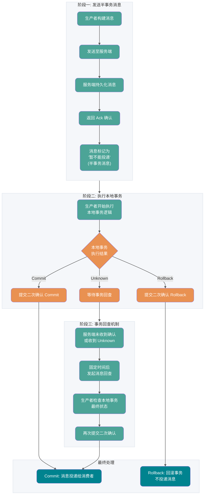

# Spring与应用框架

<a id="k8deff4dc3a26"></a>

## Agent 怎么调用 Spring Cloud 微服务？统一网关和 Nacos 在链路里分别起什么作用？

**难度评分：⭐⭐⭐⭐ (4/5)  |  考察频率：⭐⭐⭐ (3/5)**

Agent 通过受控工具适配层调用 Spring Cloud 微服务，模型只填写允许的业务参数，适配器注入认证信息、链路标识、超时和幂等键。统一网关可承担路由、认证接入、限流与观测；业务服务仍负责资源级授权和事务，不因请求经过网关就跳过检查。

Nacos 提供服务发现与配置管理能力：服务注册后，客户端或网关可按配置发现可用实例。它通常不承载每次业务请求的数据转发，也不负责模型规划或代替网关执行鉴权。具体链路取决于使用的 Spring Cloud 与服务发现集成方式。

例如预约工具调用预约服务，服务事务校验场次并写入结果；超时后按幂等键查询，不把网关重试和 Runtime 重试叠加成多次提交。对模型可选目标采用服务白名单，禁止它自行生成任意内网 URL。配置更新同样需要版本、灰度和审计。

### 参考资料

- [AIGC Interview Book](https://github.com/WeThinkIn/AIGC-Interview-Book/blob/34e9ee6aa6d35d1e213099a7ae9f433b7b9e6fe6/AI%20Agent%E5%9F%BA%E7%A1%80/07_%E4%BC%81%E4%B8%9A%E7%BA%A7Agent%E5%B9%B3%E5%8F%B0%E4%B8%8E%E4%BA%A7%E5%93%81%E8%90%BD%E5%9C%B0%E9%AB%98%E9%A2%91%E8%80%83%E7%82%B9.md#L322)，来源许可：GPL-3.0。

<a id="ka8a64c7866ea"></a>

## AOP 常见的通知类型有哪些？


- **Before**（前置通知）：目标对象的方法调用之前触发
- **After** （后置通知）：目标对象的方法调用之后触发
- **AfterReturning**（返回通知）：目标对象的方法调用完成，在返回结果值之后触发
- **AfterThrowing**（异常通知）：目标对象的方法运行中抛出 / 触发异常后触发。AfterReturning 和 AfterThrowing 两者互斥。如果方法调用成功无异常，则会有返回值；如果方法抛出了异常，则不会有返回值。
- **Around** （环绕通知）：编程式控制目标对象的方法调用。环绕通知是所有通知类型中可操作范围最大的一种，因为它可以直接拿到目标对象，以及要执行的方法，所以环绕通知可以任意的在目标对象的方法调用前后搞事，甚至不调用目标对象的方法

### 参考资料

- [JavaGuide](https://github.com/Snailclimb/JavaGuide/blob/992dae31eade2a34ba8dbbbcf5ed9de5511325ec/docs/system-design/framework/spring/spring-knowledge-and-questions-summary.md#L634)，来源许可：Apache-2.0。

<a id="kd84904bc63e1"></a>

## Autowired 和 @Resource 的区别是什么？

`@Autowired` 是 Spring 内置的注解，默认注入逻辑为**先按类型（byType）匹配，若存在多个同类型 Bean，则再尝试按名称（byName）筛选**。

具体来说：

1. 优先根据接口 / 类的类型在 Spring 容器中查找匹配的 Bean。若只找到一个符合类型的 Bean，直接注入，无需考虑名称；
2. 若找到多个同类型的 Bean（例如一个接口有多个实现类），则会尝试通过**属性名或参数名**与 Bean 的名称进行匹配（默认 Bean 名称为类名首字母小写，除非通过 `@Bean(name = "...")` 或 `@Component("...")` 显式指定）。

当一个接口存在多个实现类时：

- 若属性名与某个 Bean 的名称一致，则注入该 Bean；
- 若属性名与所有 Bean 名称都不匹配，会抛出 `NoUniqueBeanDefinitionException`，此时需要通过 `@Qualifier` 显式指定要注入的 Bean 名称。

举例说明：

```java
// SmsService 接口有两个实现类：SmsServiceImpl1、SmsServiceImpl2（均被 Spring 管理）

// 报错：byType 匹配到多个 Bean，且属性名 "smsService" 与两个实现类的默认名称（smsServiceImpl1、smsServiceImpl2）都不匹配
@Autowired
private SmsService smsService;

// 正确：属性名 "smsServiceImpl1" 与实现类 SmsServiceImpl1 的默认名称匹配
@Autowired
private SmsService smsServiceImpl1;

// 正确：通过 @Qualifier 显式指定 Bean 名称 "smsServiceImpl1"
@Autowired
@Qualifier(value = "smsServiceImpl1")
private SmsService smsService;
```

实际开发实践中，我们还是建议通过 `@Qualifier` 注解来显式指定名称而不是依赖变量的名称。

`@Resource` 源自 **JSR-250** 规范。在 JDK 6 到 JDK 10 中，`javax.annotation.Resource` 曾随 JDK 提供；从 JDK 11 开始需要单独引入 API 依赖。Spring 5/Java EE 8 项目通常使用 `javax.annotation-api`，Spring 6/Jakarta EE 9 及以上项目使用 `jakarta.annotation-api`。

Spring 对 `@Resource`（无参数情况）的处理逻辑如下：

1. **按名称（byName）匹配：** 默认取字段名（Field Name）作为 bean 的名称去容器中查找。如果找到了该名称的 Bean，则直接注入。
2. **回退到按类型（byType）匹配：** 如果**没有**找到同名的 Bean，Spring 会退而求其次，尝试根据字段的**类型**去查找。**按类型匹配的结果判定**
   - **找到 1 个 Bean**：注入成功。
   - **找到 0 个 Bean**：抛出异常 (`NoSuchBeanDefinitionException`)。
   - **找到 >1 个 Bean**：抛出异常 (`NoUniqueBeanDefinitionException`)。

`@Resource` 有两个比较重要且日常开发常用的属性：`name`（名称）、`type`（类型）。

```java
public @interface Resource {
    String name() default "";
    Class<?> type() default Object.class;
}
```

如果仅指定 `name` 属性则注入方式为`byName`，如果仅指定`type`属性则注入方式为`byType`，如果同时指定`name` 和`type`属性（不建议这么做）则注入方式为`byType`+`byName`。

```java
// 报错，byName 和 byType 都无法匹配到 bean
@Resource
private SmsService smsService;
// 正确注入 SmsServiceImpl1 对象对应的 bean
@Resource
private SmsService smsServiceImpl1;
// 正确注入 SmsServiceImpl1 对象对应的 bean（比较推荐这种方式）
@Resource(name = "smsServiceImpl1")
private SmsService smsService;
```

**简单总结一下**：

- `@Autowired` 是 Spring 提供的注解，`@Resource` 是 Jakarta Annotations/JSR-250 规范提供的注解。
- `Autowired` 默认的注入方式为`byType`（根据类型进行匹配），`@Resource`默认注入方式为 `byName`（根据名称进行匹配）。
- 当一个接口存在多个实现类的情况下，`@Autowired` 和`@Resource`都需要通过名称才能正确匹配到对应的 Bean。`Autowired` 可以通过 `@Qualifier` 注解来显式指定名称，`@Resource`可以通过 `name` 属性来显式指定名称。
- `@Autowired` 支持在构造函数、方法、字段和参数上使用。`@Resource` 主要用于字段和方法上的注入，不支持在构造函数或参数上使用。

考虑到 `@Resource` 的语义更清晰（名称优先），并且是 Java 标准，能减少对 Spring 框架的强耦合，我们通常**更推荐使用 `@Resource`**，尤其是在需要按名称注入的场景下。而 `@Autowired` 配合构造器注入，在实现依赖注入的不可变性和强制性方面有优势，也是一种非常好的实践。

### 参考资料

- [JavaGuide](https://github.com/Snailclimb/JavaGuide/blob/992dae31eade2a34ba8dbbbcf5ed9de5511325ec/docs/system-design/framework/spring/spring-knowledge-and-questions-summary.md#L238)，来源许可：Apache-2.0。

<a id="kfbf0e06893ef"></a>

## Bean 的作用域有哪些?

Spring 中 Bean 的作用域通常有下面几种：

- **singleton** : IoC 容器中只有唯一的 bean 实例。Spring 中的 bean 默认都是单例的，是对单例设计模式的应用。
- **prototype** : 每次获取都会创建一个新的 bean 实例。也就是说，连续 `getBean()` 两次，得到的是不同的 Bean 实例。
- **request** （仅 Web 应用可用）: 每一次 HTTP 请求都会产生一个新的 bean（请求 bean），该 bean 仅在当前 HTTP request 内有效。
- **session** （仅 Web 应用可用） : 每一次来自新 session 的 HTTP 请求都会产生一个新的 bean（会话 bean），该 bean 仅在当前 HTTP session 内有效。
- **application/global-session** （仅 Web 应用可用）：每个 Web 应用在启动时创建一个 Bean（应用 Bean），该 bean 仅在当前应用启动时间内有效。
- **websocket** （仅 Web 应用可用）：每一次 WebSocket 会话产生一个新的 bean。

### 参考资料

- [JavaGuide](https://github.com/Snailclimb/JavaGuide/blob/992dae31eade2a34ba8dbbbcf5ed9de5511325ec/docs/system-design/framework/spring/spring-knowledge-and-questions-summary.md#L386)，来源许可：Apache-2.0。

<a id="ke947b1de1a4b"></a>

## Component 和 @Bean 的区别是什么？

- `@Component` 注解作用于类，而`@Bean`注解作用于方法。
- `@Component`通常是通过类路径扫描来自动侦测以及自动装配到 Spring 容器中（我们可以使用 `@ComponentScan` 注解定义要扫描的路径从中找出标识了需要装配的类自动装配到 Spring 的 bean 容器中）。`@Bean` 注解通常是我们在标有该注解的方法中定义产生这个 bean,`@Bean`告诉了 Spring 这是某个类的实例，当我需要用它的时候还给我。
- `@Bean` 注解比 `@Component` 注解的自定义性更强，而且很多地方我们只能通过 `@Bean` 注解来注册 bean。比如当我们引用第三方库中的类需要装配到 `Spring`容器时，则只能通过 `@Bean`来实现。

`@Bean`注解使用示例：

```java
@Configuration
public class AppConfig {
    @Bean
    public TransferService transferService() {
        return new TransferServiceImpl();
    }

}
```

上面的代码相当于下面的 xml 配置

```xml
<beans>
    <bean id="transferService" class="com.acme.TransferServiceImpl"/>
</beans>
```

下面这个例子是通过 `@Component` 无法实现的。

```java
@Bean
public OneService getService(status) {
    case (status)  {
        when 1:
                return new serviceImpl1();
        when 2:
                return new serviceImpl2();
        when 3:
                return new serviceImpl3();
    }
}
```

### 参考资料

- [JavaGuide](https://github.com/Snailclimb/JavaGuide/blob/992dae31eade2a34ba8dbbbcf5ed9de5511325ec/docs/system-design/framework/spring/spring-knowledge-and-questions-summary.md#L183)，来源许可：Apache-2.0。

<a id="k86a849734d1b"></a>

## IoC 解决了什么问题?

IoC 的思想就是两方之间不互相依赖，由第三方容器来管理相关资源。这样有什么好处呢？

1. 对象之间的耦合度或者说依赖程度降低；
2. 资源变的容易管理；比如你用 Spring 容器提供的话很容易就可以实现一个单例。

例如：现有一个针对 User 的操作，利用 Service 和 Dao 两层结构进行开发

在没有使用 IoC 思想的情况下，Service 层想要使用 Dao 层的具体实现的话，需要通过 new 关键字在`UserServiceImpl` 中手动 new 出 `IUserDao` 的具体实现类 `UserDaoImpl`（不能直接 new 接口类）。

很完美，这种方式也是可以实现的，但是我们想象一下如下场景：

开发过程中突然接到一个新的需求，针对`IUserDao` 接口开发出另一个具体实现类。因为 Server 层依赖了`IUserDao`的具体实现，所以我们需要修改`UserServiceImpl`中 new 的对象。如果只有一个类引用了`IUserDao`的具体实现，可能觉得还好，修改起来也不是很费力气，但是如果有许许多多的地方都引用了`IUserDao`的具体实现的话，一旦需要更换`IUserDao` 的实现方式，那修改起来将会非常的头疼。


使用 IoC 的思想，我们将对象的控制权（创建、管理）交由 IoC 容器去管理，我们在使用的时候直接向 IoC 容器 “要” 就可以了


### 参考资料

- [JavaGuide](https://github.com/Snailclimb/JavaGuide/blob/992dae31eade2a34ba8dbbbcf5ed9de5511325ec/docs/system-design/framework/spring/spring-knowledge-and-questions-summary.md#L136)，来源许可：Apache-2.0。

<a id="k1b7ae94dfba2"></a>

## JPA 的审计功能是做什么的？有什么用？

审计功能主要是帮助我们记录数据库操作的具体行为比如某条记录是谁创建的、什么时间创建的、最后修改人是谁、最后修改时间是什么时候。

```java
@Data
@AllArgsConstructor
@NoArgsConstructor
@MappedSuperclass
@EntityListeners(value = AuditingEntityListener.class)
public abstract class AbstractAuditBase {

    @CreatedDate
    @Column(updatable = false)
    @JsonIgnore
    private Instant createdAt;

    @LastModifiedDate
    @JsonIgnore
    private Instant updatedAt;

    @CreatedBy
    @Column(updatable = false)
    @JsonIgnore
    private String createdBy;

    @LastModifiedBy
    @JsonIgnore
    private String updatedBy;
}
```

- `@CreatedDate`: 表示该字段为创建时间字段，在这个实体被 insert 的时候，会设置值

- `@CreatedBy` :表示该字段为创建人，在这个实体被 insert 的时候，会设置值

  `@LastModifiedDate`、`@LastModifiedBy`同理。

### 参考资料

- [JavaGuide](https://github.com/Snailclimb/JavaGuide/blob/992dae31eade2a34ba8dbbbcf5ed9de5511325ec/docs/system-design/framework/spring/spring-knowledge-and-questions-summary.md#L1117)，来源许可：Apache-2.0。

<a id="kea14c826723e"></a>

## Lazy 能解决循环依赖吗？

`@Lazy` 用来标识类是否需要懒加载/延迟加载，可以作用在类上、方法上、构造器上、方法参数上、成员变量中。

Spring Boot 2.2 新增了**全局懒加载属性**，开启后全局 bean 被设置为懒加载，需要时再去创建。

配置文件配置全局懒加载：

```properties
#默认false
spring.main.lazy-initialization=true
```

编码的方式设置全局懒加载：

```java
SpringApplication springApplication=new SpringApplication(Start.class);
springApplication.setLazyInitialization(true);
springApplication.run(args);
```

如非必要，尽量不要用全局懒加载。全局懒加载会让 Bean 第一次使用的时候加载会变慢，并且它会延迟应用程序问题的发现（当 Bean 被初始化时，问题才会出现）。

如果一个 Bean 没有被标记为懒加载，那么它会在 Spring IoC 容器启动的过程中被创建和初始化。如果一个 Bean 被标记为懒加载，那么它不会在 Spring IoC 容器启动时立即实例化，而是在第一次被请求时才创建。这可以帮助减少应用启动时的初始化时间，也可以用来解决循环依赖问题。

循环依赖问题是如何通过`@Lazy` 解决的呢？这里举一个例子，比如说有两个 Bean，A 和 B，他们之间发生了循环依赖，可以在 A 对 B 的注入点上添加 `@Lazy`，例如构造参数 `A(@Lazy B b)`。此时延迟解析的是依赖 B，而不是简单地把 `@Lazy` 标在 A 的构造器或类型上。

- 首先 Spring 会去创建 A 的 Bean，创建时需要注入 B 的属性；
- 由于在 A 对 B 的注入点上标注了 `@Lazy`，因此 Spring 会创建一个 B 的延迟解析代理对象，并将代理对象注入 A；
- 之后开始执行 B 的实例化、初始化，在注入 B 中的 A 属性时，此时 A 已经创建完毕了，就可以将 A 给注入进去。

从上面的加载流程可以看出： `@Lazy` 解决循环依赖的关键点在于代理对象的使用。

- **没有 `@Lazy` 的情况下**：在 Spring 容器初始化 `A` 时会立即尝试创建 `B`，而在创建 `B` 的过程中又会尝试创建 `A`，最终导致循环依赖（即无限递归，最终抛出异常）。
- **使用 `@Lazy` 的情况下**：Spring 不会立即创建 `B`，而是会注入一个 `B` 的代理对象。由于此时 `B` 仍未被真正初始化，`A` 的初始化可以顺利完成。等到 `A` 实例实际调用 `B` 的方法时，代理对象才会触发 `B` 的真正初始化。

`@Lazy` 注入点代理能够在一定程度上打破循环依赖链，包括某些构造器注入场景。但这并不是从设计上消除循环依赖，复杂依赖关系下也可能产生更隐蔽的初始化问题，因此最佳实践仍然是尽量避免设计上的循环依赖。

### 参考资料

- [JavaGuide](https://github.com/Snailclimb/JavaGuide/blob/992dae31eade2a34ba8dbbbcf5ed9de5511325ec/docs/system-design/framework/spring/spring-knowledge-and-questions-summary.md#L926)，来源许可：Apache-2.0。

<a id="k3bf87315daf9"></a>

## Spring AI框架的skills调用更像Claude Code还是其他Harness agent？

**回答：**

如果这里的 skills 指的是模型可调用的工具或函数，那么 Spring AI 的调用机制更像通用 tool calling / function calling harness，而不是完整的 Claude Code 形态。

Spring AI 的核心抽象是把 Java 方法、函数或自定义回调包装成 tool。应用在请求里把工具定义提供给模型，工具定义通常包含名称、描述和参数 schema。模型不会直接拿到 Java 方法或系统 API 的执行权限，它只是返回“我要调用哪个工具、参数是什么”。真正的工具解析、执行、结果回传，是由应用侧的 ToolCallback、ToolCallbackResolver、ToolCallingManager 等组件完成的。

所以 Spring AI 更像后端应用里的工具调用框架：它提供工具注册、工具解析、参数绑定、执行管理、观测和与 Spring Bean 体系集成的能力，适合把数据库查询、业务服务、外部 API、工作流操作封装成模型可调用工具。

Claude Code 则更像面向代码仓库的端到端 coding agent。它运行在终端环境中，围绕代码理解、文件检索、编辑、执行命令、测试、提交等工作流设计，有更强的上下文管理、工具选择、权限确认和工程任务闭环能力。它不是只提供一个 tool calling API，而是把工具调用放进完整的软件开发循环里。

因此可以总结：Spring AI 默认更像“业务应用内的工具调用 harness”；Claude Code 更像“带文件系统和命令行能力的 coding agent”。如果在 Spring AI 上进一步接入 MCP、动态工具发现、规划器、执行器、记忆和评估模块，也可以搭出类似 Claude Code 的 agentic harness，但这需要应用层自己补齐编排能力。

<a id="ant-agent-20260520-q6"></a>

### 参考资料

- [AIGC Interview Book](https://github.com/WeThinkIn/AIGC-Interview-Book/blob/34e9ee6aa6d35d1e213099a7ae9f433b7b9e6fe6/%E5%A4%A7%E5%8E%82%E9%AB%98%E9%A2%91%E9%9D%A2%E8%AF%95%E9%A2%98%EF%BC%88%E5%AE%9E%E6%97%B6%E6%9B%B4%E6%96%B0%EF%BC%89/%E8%9A%82%E8%9A%81%E9%9B%86%E5%9B%A2%E9%AB%98%E9%A2%91%E9%9D%A2%E8%AF%95%E9%A2%98.md#L147)，来源许可：GPL-3.0。

<a id="kf7f37b92a8f6"></a>

## Spring AOP 和 AspectJ AOP 有什么区别？

| 特性           | Spring AOP                                               | AspectJ                                    |
| -------------- | -------------------------------------------------------- | ------------------------------------------ |
| **增强方式**   | 运行时增强（基于动态代理）                               | 编译时增强、类加载时增强（直接操作字节码） |
| **切入点支持** | 方法级（Spring Bean 范围内，不支持 final 和 staic 方法） | 方法级、字段、构造器、静态方法等           |
| **性能**       | 运行时依赖代理，有一定开销，切面多时性能较低             | 运行时无代理开销，性能更高                 |
| **复杂性**     | 简单，易用，适合大多数场景                               | 功能强大，但相对复杂                       |
| **使用场景**   | Spring 应用下比较简单的 AOP 需求                         | 高性能、高复杂度的 AOP 需求                |

**如何选择？**

- **功能考量**：AspectJ 支持更复杂的 AOP 场景，Spring AOP 更简单易用。如果你需要增强 `final` 方法、静态方法、字段访问、构造器调用等，或者需要在非 Spring 管理的对象上应用增强逻辑，AspectJ 是唯一的选择。
- **性能考量**：切面数量较少时两者性能差异不大，但切面较多时 AspectJ 性能更优。

**一句话总结**：简单场景优先使用 Spring AOP；复杂场景或高性能需求时，选择 AspectJ。

### 参考资料

- [JavaGuide](https://github.com/Snailclimb/JavaGuide/blob/992dae31eade2a34ba8dbbbcf5ed9de5511325ec/docs/system-design/framework/spring/spring-knowledge-and-questions-summary.md#L617)，来源许可：Apache-2.0。

<a id="k039739f2345a"></a>

## Spring Cloud Gateway 如何实现动态路由？

在使用 Spring Cloud Gateway 的时候，官方文档提供的方案总是基于配置文件或代码配置的方式。

Spring Cloud Gateway 作为微服务的入口，需要尽量避免重启，而现在配置更改需要重启服务不能满足实际生产过程中的动态刷新、实时变更的业务需求，所以我们需要在 Spring Cloud Gateway 运行时动态配置网关。

实现动态路由的方式有很多种，其中一种推荐的方式是基于 Nacos 注册中心来做。 Spring Cloud Gateway 可以从注册中心获取服务的元数据（例如服务名称、路径等），然后根据这些信息自动生成路由规则。这样，当你添加、移除或更新服务实例时，网关会自动感知并相应地调整路由规则，无需手动维护路由配置。

其实这些复杂的步骤并不需要我们手动实现，通过 Nacos Server 和 Spring Cloud Alibaba Nacos Config 即可实现配置的动态变更，官方文档地址：<https://github.com/alibaba/spring-cloud-alibaba/wiki/Nacos-config> 。

### 参考资料

- [JavaGuide](https://github.com/Snailclimb/JavaGuide/blob/992dae31eade2a34ba8dbbbcf5ed9de5511325ec/docs/distributed-system/spring-cloud-gateway-questions.md#L75)，来源许可：Apache-2.0。

<a id="k79dc62d234bf"></a>

## Spring Cloud Gateway 如何自定义全局异常处理？

在 SpringBoot 项目中，我们捕获全局异常只需要在项目中配置 `@RestControllerAdvice`和 `@ExceptionHandler`就可以了。不过，这种方式在 Spring Cloud Gateway 下不适用。

Spring Cloud Gateway 提供了多种全局处理的方式，比较常用的一种是实现`ErrorWebExceptionHandler`并重写其中的`handle`方法。

```java
@Order(-1)
@Component
@RequiredArgsConstructor
public class GlobalErrorWebExceptionHandler implements ErrorWebExceptionHandler {
    private final ObjectMapper objectMapper;

    @Override
    public Mono<Void> handle(ServerWebExchange exchange, Throwable ex) {
    // ...
    }
}
```

### 参考资料

- [JavaGuide](https://github.com/Snailclimb/JavaGuide/blob/992dae31eade2a34ba8dbbbcf5ed9de5511325ec/docs/distributed-system/spring-cloud-gateway-questions.md#L141)，来源许可：Apache-2.0。

<a id="kf4faa89e5ee6"></a>

## Spring Cloud Gateway 支持限流吗？

Spring Cloud Gateway 自带了限流过滤器，对应的接口是 `RateLimiter`，`RateLimiter` 接口只有一个实现类 `RedisRateLimiter` （基于 Redis + Lua 实现的限流），提供的限流功能比较简易且不易使用。

从 Sentinel 1.6.0 版本开始，Sentinel 引入了 Spring Cloud Gateway 的适配模块，可以提供两种资源维度的限流：route 维度和自定义 API 维度。也就是说，Spring Cloud Gateway 可以结合 Sentinel 实现更强大的网关流量控制。

### 参考资料

- [JavaGuide](https://github.com/Snailclimb/JavaGuide/blob/992dae31eade2a34ba8dbbbcf5ed9de5511325ec/docs/distributed-system/spring-cloud-gateway-questions.md#L135)，来源许可：Apache-2.0。

<a id="ka0aa2f9efd7d"></a>

## Spring Cloud Gateway 的工作流程？

Spring Cloud Gateway 的工作流程如下图所示：


这是 Spring 官方博客中的一张图，原文地址：<https://spring.io/blog/2022/08/26/creating-a-custom-spring-cloud-gateway-filter>。

具体的流程分析：

1. **路由判断**：客户端的请求到达网关后，先经过 Gateway Handler Mapping 处理，这里面会做断言（Predicate）判断，看下符合哪个路由规则，这个路由映射后端的某个服务。
2. **请求过滤**：然后请求到达 Gateway Web Handler，这里面有很多过滤器，组成过滤器链（Filter Chain），这些过滤器可以对请求进行拦截和修改，比如添加请求头、参数校验等等，有点像净化污水。然后将请求转发到实际的后端服务。这些过滤器逻辑上可以称作 Pre-Filters，Pre 可以理解为“在...之前”。
3. **服务处理**：后端服务会对请求进行处理。
4. **响应过滤**：后端处理完结果后，返回给 Gateway 的过滤器再次做处理，逻辑上可以称作 Post-Filters，Post 可以理解为“在...之后”。
5. **响应返回**：响应经过过滤处理后，返回给客户端。

总结：客户端的请求先通过匹配规则找到合适的路由，就能映射到具体的服务。然后请求经过过滤器处理后转发给具体的服务，服务处理后，再次经过过滤器处理，最后返回给客户端。

### 参考资料

- [JavaGuide](https://github.com/Snailclimb/JavaGuide/blob/992dae31eade2a34ba8dbbbcf5ed9de5511325ec/docs/distributed-system/spring-cloud-gateway-questions.md#L33)，来源许可：Apache-2.0。

<a id="k6a0f9e4fc781"></a>

## Spring Cloud Gateway 的断言是什么？

断言（Predicate）这个词听起来比较抽象，它可以理解为对请求条件做一次判断：结果为真就匹配当前路由，结果为假就继续匹配其他路由。

在 Gateway 中，如果客户端发送的请求满足了断言的条件，则映射到指定的路由器，就能转发到指定的服务上进行处理。

断言配置的示例如下，配置了两个路由规则，有一个 predicates 断言配置，当请求 url 中包含 `api/thirdparty`，就匹配到了第一个路由 `route_thirdparty`。


常见的路由断言规则如下图所示：


### 参考资料

- [JavaGuide](https://github.com/Snailclimb/JavaGuide/blob/992dae31eade2a34ba8dbbbcf5ed9de5511325ec/docs/distributed-system/spring-cloud-gateway-questions.md#L51)，来源许可：Apache-2.0。

<a id="ka8f745d55f4c"></a>

## Spring Cloud Gateway 的路由和断言是什么关系？

Route 路由和 Predicate 断言的对应关系如下：：


- **一对多**：一个路由规则可以包含多个断言。如上图中路由 Route1 配置了三个断言 Predicate。
- **同时满足**：如果一个路由规则中有多个断言，则需要同时满足才能匹配。如上图中路由 Route2 配置了两个断言，客户端发送的请求必须同时满足这两个断言，才能匹配路由 Route2。
- **第一个匹配成功**：如果一个请求可以匹配多个路由，则映射第一个匹配成功的路由。如上图所示，客户端发送的请求满足 Route3 和 Route4 的断言，但是 Route3 的配置在配置文件中靠前，所以只会匹配 Route3。

### 参考资料

- [JavaGuide](https://github.com/Snailclimb/JavaGuide/blob/992dae31eade2a34ba8dbbbcf5ed9de5511325ec/docs/distributed-system/spring-cloud-gateway-questions.md#L65)，来源许可：Apache-2.0。

<a id="kd0de6223d333"></a>

## Spring Cloud Gateway 的过滤器有哪些？

过滤器 Filter 按照请求和响应可以分为两种：

- **Pre 类型**：在请求被转发到微服务之前，对请求进行拦截和修改，例如参数校验、权限校验、流量监控、日志输出以及协议转换等操作。
- **Post 类型**：微服务处理完请求后，返回响应给网关，网关可以再次进行处理，例如修改响应内容或响应头、日志输出、流量监控等。

另外一种分类是按照过滤器 Filter 作用的范围进行划分：

- **GatewayFilter**：局部过滤器，应用在单个路由或一组路由上的过滤器。标红色表示比较常用的过滤器。
- **GlobalFilter**：全局过滤器，应用在所有路由上的过滤器。

### 局部过滤器

常见的局部过滤器如下图所示：


具体怎么用呢？这里有个示例，如果 URL 匹配成功，则去掉 URL 中的 “api”。

```yaml
filters: #过滤器
  - RewritePath=/api/(?<segment>.*),/$\{segment} # 将跳转路径中包含的 “api” 替换成空
```

当然我们也可以自定义过滤器，本篇不做展开。

### 全局过滤器

常见的全局过滤器如下图所示：


全局过滤器最常见的用法是进行负载均衡。配置如下所示：

```yaml
spring:
  cloud:
    gateway:
      routes:
        - id: route_member # 第三方微服务路由规则
          uri: lb://passjava-member # 负载均衡，将请求转发到注册中心注册的 passjava-member 服务
          predicates: # 断言
            - Path=/api/member/** # 如果前端请求路径包含 api/member，则应用这条路由规则
          filters: #过滤器
            - RewritePath=/api/(?<segment>.*),/$\{segment} # 将跳转路径中包含的api替换成空
```

这里有个关键字 `lb`，用到了全局过滤器 `LoadBalancerClientFilter`，当匹配到这个路由后，会将请求转发到 passjava-member 服务，且支持负载均衡转发，也就是先将 passjava-member 解析成实际的微服务的 host 和 port，然后再转发给实际的微服务。

### 参考资料

- [JavaGuide](https://github.com/Snailclimb/JavaGuide/blob/992dae31eade2a34ba8dbbbcf5ed9de5511325ec/docs/distributed-system/spring-cloud-gateway-questions.md#L85)，来源许可：Apache-2.0。

<a id="k96ab55b7cfd5"></a>

## Spring Cloud 微服务架构

-   [什么是微服务？微服务之间是如何独立通讯的？](https://github.com/docs/micro-services/what's-microservice-how-to-communicate.md)
-   Spring Cloud 和 Dubbo 有哪些区别？
-   Spring Boot 和 Spring Cloud，谈谈你对它们的理解？
-   什么是服务熔断？什么是服务降级？
-   微服务的优缺点分别是什么？说一下你在项目开发中碰到的坑？
-   [你所知道的微服务技术栈都有哪些？](https://github.com/docs/micro-services/micro-services-technology-stack.md)
-   [微服务治理策略](https://github.com/docs/micro-services/micro-service-governance.md)
-   Eureka 和 Zookeeper 都可以提供服务注册与发现的功能，它们有什么区别？
-   [谈谈服务发现组件 Eureka 的主要调用过程？](https://github.com/docs/micro-services/how-eureka-enable-service-discovery-and-service-registration.md)
-   ......

### 参考资料

- [Advanced Java](https://github.com/doocs/advanced-java/blob/80b89fb9496d7ea3213e402c8c3853399e00c363/README.md#L139)，来源许可：CC-BY-SA-4.0。
- [Advanced Java](https://github.com/doocs/advanced-java/blob/80b89fb9496d7ea3213e402c8c3853399e00c363/docs/micro-services/README.md#L10)，来源许可：CC-BY-SA-4.0。

<a id="k813354bce99f"></a>

## Spring MVC 的核心组件有哪些？

记住了下面这些组件，也就记住了 SpringMVC 的工作原理。

- **`DispatcherServlet`**：**核心的中央处理器**，负责接收请求、分发，并给予客户端响应。
- **`HandlerMapping`**：**处理器映射器**，根据 URL 去匹配查找能处理的 `Handler` ，并会将请求涉及到的拦截器和 `Handler` 一起封装。
- **`HandlerAdapter`**：**处理器适配器**，根据 `HandlerMapping` 找到的 `Handler` ，适配执行对应的 `Handler`；
- **`Handler`**：**请求处理器**，处理实际请求的处理器。
- **`ViewResolver`**：**视图解析器**，根据 `Handler` 返回的逻辑视图 / 视图，解析并渲染真正的视图，并传递给 `DispatcherServlet` 响应客户端

### 参考资料

- [JavaGuide](https://github.com/Snailclimb/JavaGuide/blob/992dae31eade2a34ba8dbbbcf5ed9de5511325ec/docs/system-design/framework/spring/spring-knowledge-and-questions-summary.md#L715)，来源许可：Apache-2.0。

<a id="k99f63ec33e6a"></a>

## Spring 事务中的隔离级别有哪几种?

和事务传播行为这块一样，为了方便使用，Spring 也相应地定义了一个枚举类：`Isolation`

```java
public enum Isolation {

    DEFAULT(TransactionDefinition.ISOLATION_DEFAULT),
    READ_UNCOMMITTED(TransactionDefinition.ISOLATION_READ_UNCOMMITTED),
    READ_COMMITTED(TransactionDefinition.ISOLATION_READ_COMMITTED),
    REPEATABLE_READ(TransactionDefinition.ISOLATION_REPEATABLE_READ),
    SERIALIZABLE(TransactionDefinition.ISOLATION_SERIALIZABLE);

    private final int value;

    Isolation(int value) {
        this.value = value;
    }

    public int value() {
        return this.value;
    }

}
```

下面我依次对每一种事务隔离级别进行介绍：

- **`TransactionDefinition.ISOLATION_DEFAULT`** :使用后端数据库默认的隔离级别，MySQL 默认采用的 `REPEATABLE_READ` 隔离级别 Oracle 默认采用的 `READ_COMMITTED` 隔离级别.
- **`TransactionDefinition.ISOLATION_READ_UNCOMMITTED`** :最低的隔离级别，使用这个隔离级别很少，因为它允许读取尚未提交的数据变更，**可能会导致脏读、幻读或不可重复读**
- **`TransactionDefinition.ISOLATION_READ_COMMITTED`** : 允许读取并发事务已经提交的数据，**可以阻止脏读，但是幻读或不可重复读仍有可能发生**
- **`TransactionDefinition.ISOLATION_REPEATABLE_READ`** : 对同一字段的多次读取结果都是一致的，除非数据是被本身事务自己所修改，**可以阻止脏读和不可重复读，但幻读仍有可能发生。**
- **`TransactionDefinition.ISOLATION_SERIALIZABLE`** : 最高的隔离级别，完全服从 ACID 的隔离级别。所有的事务依次逐个执行，这样事务之间就完全不可能产生干扰，也就是说，**该级别可以防止脏读、不可重复读以及幻读**。但是这将严重影响程序的性能。通常情况下也不会用到该级别。

### 参考资料

- [JavaGuide](https://github.com/Snailclimb/JavaGuide/blob/992dae31eade2a34ba8dbbbcf5ed9de5511325ec/docs/system-design/framework/spring/spring-knowledge-and-questions-summary.md#L1015)，来源许可：Apache-2.0。

<a id="k1523cda31513"></a>

## Spring 包含的模块有哪些？

**Spring4.x 版本**：


**Spring5.x 版本**：


Spring5.x 版本中 Web 模块的 Portlet 组件已经被废弃掉，同时增加了用于异步响应式处理的 WebFlux 组件。

Spring 各个模块的依赖关系如下：


### Core Container

Spring 框架的核心模块，也可以说是基础模块，主要提供 IoC 依赖注入功能的支持。Spring 其他所有的功能基本都需要依赖于该模块，我们从上面那张 Spring 各个模块的依赖关系图就可以看出来。

- **spring-core**：Spring 框架基本的核心工具类。
- **spring-beans**：提供对 bean 的创建、配置和管理等功能的支持。
- **spring-context**：提供对国际化、事件传播、资源加载等功能的支持。
- **spring-expression**：提供对表达式语言（Spring Expression Language） SpEL 的支持，只依赖于 core 模块，不依赖于其他模块，可以单独使用。

### AOP

- **spring-aspects**：该模块为与 AspectJ 的集成提供支持。
- **spring-aop**：提供了面向切面的编程实现。
- **spring-instrument**：提供了为 JVM 添加代理（agent）的功能。 具体来讲，它为 Tomcat 提供了一个织入代理，能够为 Tomcat 传递类文 件，就像这些文件是被类加载器加载的一样。没有理解也没关系，这个模块的使用场景非常有限。

### Data Access/Integration

下面的模块列表主要基于 Spring Framework 5.x。现代 Spring Framework 已经移除了一些旧技术的集成，实际使用时应以目标 Spring 版本的官方模块清单为准。

- **spring-jdbc**：提供了对数据库访问的抽象 JDBC。不同的数据库都有自己独立的 API 用于操作数据库，而 Java 程序只需要和 JDBC API 交互，这样就屏蔽了数据库的影响。
- **spring-tx**：提供对事务的支持。
- **spring-orm**：在 Spring Framework 5.x 中提供对 Hibernate、JPA 等 ORM 技术的支持；更早的 Spring 版本还提供过 iBATIS 集成。
- **spring-oxm**：提供 OXM（Object-to-XML Mapping）抽象。不同 Spring 版本支持的具体实现不同，例如 JAXB；Castor、XMLBeans、JiBX 等属于旧版本集成。
- **spring-jms** : 消息服务。自 Spring Framework 4.1 以后，它还提供了对 spring-messaging 模块的继承。

### Spring Web

- **spring-web**：对 Web 功能的实现提供一些最基础的支持。
- **spring-webmvc**：提供对 Spring MVC 的实现。
- **spring-websocket**：提供了对 WebSocket 的支持，WebSocket 可以让客户端和服务端进行双向通信。
- **spring-webflux**：提供对 WebFlux 的支持。WebFlux 是 Spring Framework 5.0 中引入的响应式、非阻塞 Web 框架，可以运行在 Netty 上，也可以运行在支持非阻塞 I/O 的 Servlet 容器上。应用是否端到端非阻塞，还取决于数据访问和其他下游调用是否包含阻塞操作。

### Messaging

**spring-messaging** 是从 Spring4.0 开始新加入的一个模块，主要职责是为 Spring 框架集成一些基础的报文传送应用。

### Spring Test

Spring 团队提倡测试驱动开发（TDD）。有了控制反转 (IoC)的帮助，单元测试和集成测试变得更简单。

Spring 的测试模块对 JUnit（单元测试框架）、TestNG（类似 JUnit）、Mockito（主要用来 Mock 对象）、PowerMock（解决 Mockito 的问题比如无法模拟 final, static， private 方法）等等常用的测试框架支持的都比较好。

### 参考资料

- [JavaGuide](https://github.com/Snailclimb/JavaGuide/blob/992dae31eade2a34ba8dbbbcf5ed9de5511325ec/docs/system-design/framework/spring/spring-knowledge-and-questions-summary.md#L38)，来源许可：Apache-2.0。

<a id="kb259ad917f06"></a>

## Spring 循环依赖了解吗，怎么解决？

循环依赖是指 Bean 对象循环引用，是两个或多个 Bean 之间相互持有对方的引用，例如 CircularDependencyA → CircularDependencyB → CircularDependencyA。

```java
@Component
public class CircularDependencyA {
    @Autowired
    private CircularDependencyB circB;
}

@Component
public class CircularDependencyB {
    @Autowired
    private CircularDependencyA circA;
}
```

单个对象的自我依赖也会出现循环依赖，但这种概率极低，属于是代码编写错误。

```java
@Component
public class CircularDependencyA {
    @Autowired
    private CircularDependencyA circA;
}
```

Spring 框架可以通过三级缓存解决部分单例 Bean 的 Setter/字段注入循环依赖。构造器循环依赖、原型 Bean 循环依赖等场景不能依靠该机制解决。

Spring 中的三级缓存其实就是三个 Map，如下：

```java
// 一级缓存
/** Cache of singleton objects: bean name to bean instance. */
private final Map<String, Object> singletonObjects = new ConcurrentHashMap<>(256);

// 二级缓存
/** Cache of early singleton objects: bean name to bean instance. */
private final Map<String, Object> earlySingletonObjects = new HashMap<>(16);

// 三级缓存
/** Cache of singleton factories: bean name to ObjectFactory. */
private final Map<String, ObjectFactory<?>> singletonFactories = new HashMap<>(16);
```

简单来说，Spring 的三级缓存包括：

1. **一级缓存（singletonObjects）**：存放最终形态的 Bean（已经实例化、属性填充、初始化），单例池，为“Spring 的单例属性”⽽⽣。一般情况我们获取 Bean 都是从这里获取的，但是并不是所有的 Bean 都在单例池里面，例如原型 Bean 就不在里面。
2. **二级缓存（earlySingletonObjects）**：存放过渡 Bean（半成品，尚未属性填充），也就是三级缓存中`ObjectFactory`产生的对象，与三级缓存配合使用的，可以防止 AOP 的情况下，每次调用`ObjectFactory#getObject()`都是会产生新的代理对象的。
3. **三级缓存（singletonFactories）**：存放`ObjectFactory`，`ObjectFactory`的`getObject()`方法（最终调用的是`getEarlyBeanReference()`方法）可以生成原始 Bean 对象或者代理对象（如果 Bean 被 AOP 切面代理）。三级缓存只会对单例 Bean 生效。

接下来说一下 Spring 创建 Bean 的流程：

1. 先去 **一级缓存 `singletonObjects`** 中获取，存在就返回；
2. 如果不存在或者对象正在创建中，于是去 **二级缓存 `earlySingletonObjects`** 中获取；
3. 如果还没有获取到，就去 **三级缓存 `singletonFactories`** 中获取，通过执行 `ObjectFacotry` 的 `getObject()` 就可以获取该对象，获取成功之后，从三级缓存移除，并将该对象加入到二级缓存中。

在三级缓存中存储的是 `ObjectFacoty` ：

```java
public interface ObjectFactory<T> {
    T getObject() throws BeansException;
}
```

Spring 在创建 Bean 的时候，如果允许循环依赖的话，Spring 就会将刚刚实例化完成，但是属性还没有初始化完的 Bean 对象给提前暴露出去，这里通过 `addSingletonFactory` 方法，向三级缓存中添加一个 `ObjectFactory` 对象：

```java
// AbstractAutowireCapableBeanFactory # doCreateBean #
public abstract class AbstractAutowireCapableBeanFactory ... {
	protected Object doCreateBean(...) {
        //...

        // 支撑循环依赖：将 ()->getEarlyBeanReference 作为一个 ObjectFactory 对象的 getObject() 方法加入到三级缓存中
		addSingletonFactory(beanName, () -> getEarlyBeanReference(beanName, mbd, bean));
    }
}
```

那么上边在说 Spring 创建 Bean 的流程时说了，如果一级缓存、二级缓存都取不到对象时，会去三级缓存中通过 `ObjectFactory` 的 `getObject` 方法获取对象。

```java
class A {
    // 使用了 B
    private B b;
}
class B {
    // 使用了 A
    private A a;
}
```

以上面的循环依赖代码为例，整个解决循环依赖的流程如下：

- 当 Spring 创建 A 之后，发现 A 依赖了 B ，又去创建 B，B 依赖了 A ，又去创建 A；
- 在 B 创建 A 的时候，那么此时 A 就发生了循环依赖，由于 A 此时还没有初始化完成，因此在 **一二级缓存** 中肯定没有 A；
- 那么此时就去三级缓存中调用 `getObject()` 方法去获取 A 的 **前期暴露的对象** ，也就是调用上边加入的 `getEarlyBeanReference()` 方法，生成一个 A 的 **前期暴露对象**；
- 然后就将这个 `ObjectFactory` 从三级缓存中移除，并且将前期暴露对象放入到二级缓存中，那么 B 就将这个前期暴露对象注入到依赖，来支持循环依赖。

**只用两级缓存够吗？** 在没有 AOP 的情况下，确实可以只使用一级和二级缓存来解决循环依赖问题。但是，当涉及到 AOP 时，三级缓存就显得非常重要了，因为它确保了即使在 Bean 的创建过程中有多次对早期引用的请求，也始终只返回同一个代理对象，从而避免了同一个 Bean 有多个代理对象的问题。

**最后总结一下 Spring 如何解决三级缓存**：

在三级缓存这一块，主要记一下 Spring 是如何支持循环依赖的即可，也就是如果发生循环依赖的话，就去 **三级缓存 `singletonFactories`** 中拿到三级缓存中存储的 `ObjectFactory` 并调用它的 `getObject()` 方法来获取这个循环依赖对象的前期暴露对象（虽然还没初始化完成，但是可以拿到该对象在堆中的存储地址了），并且将这个前期暴露对象放到二级缓存中，这样在循环依赖时，就不会重复初始化了！

不过，这种机制也有一些缺点，比如增加了内存开销（需要维护三级缓存，也就是三个 Map），降低了性能（需要进行多次检查和转换）。它只适用于部分单例 Bean 的 Setter/字段注入循环依赖，非单例 Bean、构造器循环依赖等场景仍然无法通过三级缓存解决。

### 参考资料

- [JavaGuide](https://github.com/Snailclimb/JavaGuide/blob/992dae31eade2a34ba8dbbbcf5ed9de5511325ec/docs/system-design/framework/spring/spring-knowledge-and-questions-summary.md#L818)，来源许可：Apache-2.0。

<a id="k9e99a7ab1d87"></a>

## Spring 框架中用到了哪些设计模式？

> 关于下面这些设计模式的详细介绍，可以看我写的 [Spring 中的设计模式详解](https://javaguide.cn/system-design/framework/spring/spring-design-patterns-summary.html) 这篇文章。

- **工厂设计模式** : Spring 使用工厂模式通过 `BeanFactory`、`ApplicationContext` 创建 bean 对象。
- **代理设计模式** : Spring AOP 功能的实现。
- **单例设计模式** : Spring 中的 Bean 默认都是单例的。
- **模板方法模式** : Spring 中 `jdbcTemplate`、`hibernateTemplate` 等以 Template 结尾的对数据库操作的类，它们就使用到了模板模式。
- **包装器设计模式** : 我们的项目需要连接多个数据库，而且不同的客户在每次访问中根据需要会去访问不同的数据库。这种模式让我们可以根据客户的需求能够动态切换不同的数据源。
- **观察者模式:** Spring 事件驱动模型就是观察者模式很经典的一个应用。
- **适配器模式** : Spring AOP 的增强或通知(Advice)使用到了适配器模式、spring MVC 中也是用到了适配器模式适配`Controller`。
- ……

### 参考资料

- [JavaGuide](https://github.com/Snailclimb/JavaGuide/blob/992dae31eade2a34ba8dbbbcf5ed9de5511325ec/docs/system-design/framework/spring/spring-knowledge-and-questions-summary.md#L803)，来源许可：Apache-2.0。

<a id="kb77aca78bc37"></a>

## Spring 管理事务的方式有几种？

- **编程式事务**：在代码中硬编码(在分布式系统中推荐使用) : 通过 `TransactionTemplate`或者 `TransactionManager` 手动管理事务，事务范围过大会出现事务未提交导致超时，因此事务要比锁的粒度更小。
- **声明式事务**：在 XML 配置文件中配置或者直接基于注解（单体应用或者简单业务系统推荐使用） : 实际是通过 AOP 实现（基于`@Transactional` 的全注解方式使用最多）

### 参考资料

- [JavaGuide](https://github.com/Snailclimb/JavaGuide/blob/992dae31eade2a34ba8dbbbcf5ed9de5511325ec/docs/system-design/framework/spring/spring-knowledge-and-questions-summary.md#L978)，来源许可：Apache-2.0。

<a id="k697bb7fee761"></a>

## Spring,Spring MVC,Spring Boot 之间什么关系?

很多人对 Spring,Spring MVC,Spring Boot 这三者傻傻分不清楚！这里简单介绍一下这三者，其实很简单，没有什么高深的东西。

Spring 包含了多个功能模块（上面刚刚提到过），其中最重要的是 Spring-Core（主要提供 IoC 依赖注入功能的支持） 模块， Spring 中的其他模块（比如 Spring MVC）的功能实现基本都需要依赖于该模块。

下图对应的是 Spring 4.x 版本。Spring 5.0 引入了用于响应式处理的 WebFlux，并逐步淘汰了 Portlet 相关支持；现代 Spring 版本的模块组成请以官方文档为准。


Spring MVC 是 Spring 中的一个很重要的模块，主要赋予 Spring 快速构建 MVC 架构的 Web 程序的能力。MVC 是模型(Model)、视图(View)、控制器(Controller)的简写，其核心思想是通过将业务逻辑、数据、显示分离来组织代码。


使用 Spring 进行开发各种配置过于麻烦比如开启某些 Spring 特性时，需要用 XML 或 Java 进行显式配置。于是，Spring Boot 诞生了！

Spring 旨在简化 J2EE 企业应用程序开发。Spring Boot 旨在简化 Spring 开发（减少配置文件，开箱即用！）。

Spring Boot 只是简化了配置，如果你需要构建 MVC 架构的 Web 程序，你还是需要使用 Spring MVC 作为 MVC 框架，只是说 Spring Boot 帮你简化了 Spring MVC 的很多配置，真正做到开箱即用！

### 参考资料

- [JavaGuide](https://github.com/Snailclimb/JavaGuide/blob/992dae31eade2a34ba8dbbbcf5ed9de5511325ec/docs/system-design/framework/spring/spring-knowledge-and-questions-summary.md#L96)，来源许可：Apache-2.0。

<a id="k134e422f0ac2"></a>

## SpringBoot 允许循环依赖发生么？

SpringBoot 2.6.x 以前是默认允许循环依赖的，也就是说你的代码出现了循环依赖问题，一般情况下也不会报错。SpringBoot 2.6.x 以后官方不再推荐编写存在循环依赖的代码，建议开发者自己写代码的时候去减少不必要的互相依赖。这其实也是我们最应该去做的，循环依赖本身就是一种设计缺陷，我们不应该过度依赖 Spring 而忽视了编码的规范和质量，说不定未来某个 SpringBoot 版本就彻底禁止循环依赖的代码了。

SpringBoot 2.6.x 以后，如果你不想重构循环依赖的代码的话，也可以采用下面这些方法：

- 在全局配置文件中设置允许循环依赖存在：`spring.main.allow-circular-references=true`。最简单粗暴的方式，不太推荐。
- 在导致循环依赖的 Bean 上添加 `@Lazy` 注解，这是一种比较推荐的方式。`@Lazy` 用来标识类是否需要懒加载/延迟加载，可以作用在类上、方法上、构造器上、方法参数上、成员变量中。
- ……

### 参考资料

- [JavaGuide](https://github.com/Snailclimb/JavaGuide/blob/992dae31eade2a34ba8dbbbcf5ed9de5511325ec/docs/system-design/framework/spring/spring-knowledge-and-questions-summary.md#L964)，来源许可：Apache-2.0。

<a id="k5c78a936ac58"></a>

## SpringMVC 工作原理了解吗?

**Spring MVC 原理如下图所示：**

> SpringMVC 工作原理的图解我没有自己画，直接图省事在网上找了一个非常清晰直观的，原出处不明。


**流程说明（重要）：**

1. 客户端（浏览器）发送请求， `DispatcherServlet`拦截请求。
2. `DispatcherServlet` 根据请求信息调用 `HandlerMapping` 。`HandlerMapping` 根据 URL 去匹配查找能处理的 `Handler`（也就是我们平常说的 `Controller` 控制器） ，并会将请求涉及到的拦截器和 `Handler` 一起封装。
3. `DispatcherServlet` 调用 `HandlerAdapter`适配器执行 `Handler` 。
4. `Handler` 完成对用户请求的处理后，会返回一个 `ModelAndView` 对象给`DispatcherServlet`，`ModelAndView` 顾名思义，包含了数据模型以及相应的视图的信息。`Model` 是返回的数据对象，`View` 是个逻辑上的 `View`。
5. `ViewResolver` 会根据逻辑 `View` 查找实际的 `View`。
6. `DispaterServlet` 把返回的 `Model` 传给 `View`（视图渲染）。
7. 把 `View` 返回给请求者（浏览器）

上述流程是传统开发模式（JSP，Thymeleaf 等）的工作原理。然而现在主流的开发方式是前后端分离，这种情况下 Spring MVC 的 `View` 概念发生了一些变化。由于 `View` 通常由前端框架（Vue, React 等）来处理，后端不再负责渲染页面，而是只负责提供数据，因此：

- 前后端分离时，后端通常不再返回具体的视图，而是返回**纯数据**（通常是 JSON 格式），由前端负责渲染和展示。
- `View` 的部分在前后端分离的场景下往往不需要设置，Spring MVC 的控制器方法只需要返回数据，不再返回 `ModelAndView`，而是直接返回数据，Spring 会自动将其转换为 JSON 格式。相应的，`ViewResolver` 也将不再被使用。

怎么做到呢？

- 使用 `@RestController` 注解代替传统的 `@Controller` 注解，这样所有方法默认会返回 JSON 格式的数据，而不是试图解析视图。
- 如果你使用的是 `@Controller`，可以结合 `@ResponseBody` 注解来返回 JSON。

### 参考资料

- [JavaGuide](https://github.com/Snailclimb/JavaGuide/blob/992dae31eade2a34ba8dbbbcf5ed9de5511325ec/docs/system-design/framework/spring/spring-knowledge-and-questions-summary.md#L725)，来源许可：Apache-2.0。

<a id="k579ffc178557"></a>

## Spring的控制反转、AOP

**回答：**

Spring 的控制反转 IoC 指的是对象创建和依赖管理的控制权从业务代码转移到 Spring 容器。传统写法是类自己 new 依赖对象，而 IoC 下，类只声明自己需要什么依赖，由容器负责创建 Bean、解析依赖、注入依赖、管理生命周期。依赖注入 DI 是 IoC 最常见的实现方式。

IoC 的价值是降低耦合、提升可测试性和可配置性。例如 Service 不需要关心 Repository 怎么创建，只依赖接口；测试时可以替换 mock 实现；不同环境可以注入不同配置。

Spring Bean 的大致生命周期包括：读取 BeanDefinition，实例化对象，属性注入，执行 aware 接口回调，执行 BeanPostProcessor 前置处理，初始化方法，执行后置处理，最后进入可使用状态；容器关闭时执行销毁回调。面试不一定要背所有细节，但要理解容器在对象创建和增强中起核心作用。

AOP 面向切面编程用于把横切逻辑从业务逻辑中抽离，例如事务、日志、权限、监控、缓存、限流。核心概念包括 Join Point、Pointcut、Advice、Aspect、Weaving。

Spring AOP 主要基于代理实现。如果目标类实现接口，默认可以用 JDK 动态代理；如果没有接口，通常用 CGLIB 生成子类代理。调用代理对象的方法时，代理会在目标方法前后执行切面逻辑。例如 `@Transactional` 本质上就是通过代理在方法执行前开启事务，成功后提交，异常时回滚。

常见坑是自调用失效：同一个类内部 `this.method()` 调用不会经过 Spring 代理，因此事务或切面可能不生效。另一个坑是方法可见性和 final 方法，CGLIB 对 final 方法无法覆盖。可以总结为：IoC 解决对象管理和依赖解耦，AOP 解决横切关注点复用，两者共同构成 Spring 的核心。

<a id="ant-agent-20260520-q13"></a>

### 参考资料

- [AIGC Interview Book](https://github.com/WeThinkIn/AIGC-Interview-Book/blob/34e9ee6aa6d35d1e213099a7ae9f433b7b9e6fe6/%E5%A4%A7%E5%8E%82%E9%AB%98%E9%A2%91%E9%9D%A2%E8%AF%95%E9%A2%98%EF%BC%88%E5%AE%9E%E6%97%B6%E6%9B%B4%E6%96%B0%EF%BC%89/%E8%9A%82%E8%9A%81%E9%9B%86%E5%9B%A2%E9%AB%98%E9%A2%91%E9%9D%A2%E8%AF%95%E9%A2%98.md#L256)，来源许可：GPL-3.0。

<a id="k3b973d1c7c55"></a>

## 什么是 Spring Bean？

简单来说，Bean 代指的就是那些被 IoC 容器所管理的对象。

我们需要告诉 IoC 容器帮助我们管理哪些对象，这个是通过配置元数据来定义的。配置元数据可以是 XML 文件、注解或者 Java 配置类。

```xml
<!-- Constructor-arg with 'value' attribute -->
<bean id="..." class="...">
   <constructor-arg value="..."/>
</bean>
```

下图简单地展示了 IoC 容器如何使用配置元数据来管理对象。


`org.springframework.beans`和 `org.springframework.context` 这两个包是 IoC 实现的基础，如果想要研究 IoC 相关的源码的话，可以去看看

### 参考资料

- [JavaGuide](https://github.com/Snailclimb/JavaGuide/blob/992dae31eade2a34ba8dbbbcf5ed9de5511325ec/docs/system-design/framework/spring/spring-knowledge-and-questions-summary.md#L157)，来源许可：Apache-2.0。

<a id="kde25baaea5f0"></a>

## 什么是 Spring Cloud Gateway？

Spring Cloud Gateway 属于 Spring Cloud 生态系统中的网关，其诞生的目标主要是为了替代 **Zuul 1.x**。Zuul 1.x 基于 Servlet 阻塞 I/O 架构，在高并发场景下性能有限。而 Zuul 2.x 虽然采用了 Netty 非阻塞架构，但 Spring Cloud 官方并未正式集成 Zuul 2.x。Spring Cloud Gateway 起步要比 Zuul 2.x 更早。

为了提升网关的性能，Spring Cloud Gateway 基于 Spring WebFlux 。Spring WebFlux 使用 Reactor 库来实现响应式编程模型，底层基于 Netty 实现同步非阻塞的 I/O。


Spring Cloud Gateway 不仅提供统一的路由方式，并且基于 Filter 链的方式提供了网关基本的功能，例如：安全，监控/指标，限流。

Spring Cloud Gateway 和 Zuul 2.x 的差别不大，也是通过过滤器来处理请求。不过，目前更加推荐使用 Spring Cloud Gateway 而非 Zuul，Spring Cloud 生态对其支持更加友好。

- GitHub 地址： <https://github.com/spring-cloud/spring-cloud-gateway>
- 官网： <https://spring.io/projects/spring-cloud-gateway>

### 参考资料

- [JavaGuide](https://github.com/Snailclimb/JavaGuide/blob/992dae31eade2a34ba8dbbbcf5ed9de5511325ec/docs/distributed-system/spring-cloud-gateway-questions.md#L18)，来源许可：Apache-2.0。

<a id="k027551c5407c"></a>

## 什么是 Spring 框架?

Spring 是一款开源的轻量级 Java 开发框架，旨在提高开发人员的开发效率以及系统的可维护性。

我们一般说 Spring 框架指的都是 Spring Framework，它是很多模块的集合，使用这些模块可以很方便地协助我们进行开发，比如说 Spring 支持 IoC（Inversion of Control:控制反转） 和 AOP(Aspect-Oriented Programming:面向切面编程)、可以很方便地对数据库进行访问、可以很方便地集成第三方组件（电子邮件，任务，调度，缓存等等）、对单元测试支持比较好、支持 RESTful Java 应用程序的开发。


Spring 最核心的思想就是不重新造轮子，开箱即用，提高开发效率。

Spring 翻译过来就是春天的意思，可见其目标和使命就是为 Java 程序员带来春天啊！感动！

🤐 多提一嘴：**语言的流行通常需要一个杀手级的应用，Spring 就是 Java 生态的一个杀手级的应用框架。**

Spring 提供的核心功能主要是 IoC 和 AOP。学习 Spring ，一定要把 IoC 和 AOP 的核心思想搞懂！

- Spring 官网：<https://spring.io/>
- GitHub 地址： <https://github.com/spring-projects/spring-framework>

### 参考资料

- [JavaGuide](https://github.com/Snailclimb/JavaGuide/blob/992dae31eade2a34ba8dbbbcf5ed9de5511325ec/docs/system-design/framework/spring/spring-knowledge-and-questions-summary.md#L19)，来源许可：Apache-2.0。

<a id="kd564621b393d"></a>

## 什么是事务消息

事务消息是 Apache RocketMQ 提供的一种高级消息类型，支持在分布式场景下保障消息生产和本地事务的最终一致性。简单来讲，就是将本地事务（数据库的 DML 操作）与发送消息合并在同一个事务中。

**应用场景**

在分布式系统调用的特点为一个核心业务逻辑的执行，同时需要调用多个下游业务进行处理。如何保证核心业务和多个下游业务的执行结果完全一致，是分布式事务需要解决的主要问题。

以电商交易场景为例，用户支付订单这一核心操作的同时会涉及到下游物流发货、积分变更、购物车状态清空等多个子系统的变更：

- **主分支订单系统状态更新**：由未支付变更为支付成功
- **物流系统状态新增**：新增待发货物流记录，创建订单物流记录
- **积分系统状态变更**：变更用户积分，更新用户积分表
- **购物车系统状态变更**：清空购物车，更新用户购物车记录

**传统方案的问题**

- **传统 XA 事务方案**：基于 XA 协议的分布式事务系统可以实现一致性，但多分支环境下资源锁定范围大，并发度低
- **基于普通消息方案**：普通消息和订单事务无法保证一致，容易出现消息发送成功但订单没有执行成功、订单执行成功但消息没有发送成功等情况

**RocketMQ 事务消息方案**

RocketMQ 事务消息的方案，具备高性能、可扩展、业务开发简单的优势，支持二阶段的提交能力，将二阶段提交和本地事务绑定，实现 **本地事务和消息发送** 的最终一致性。

**事务消息处理流程**



1. 生产者将消息发送至 RocketMQ 服务端
2. 服务端将消息持久化成功之后，向生产者返回 Ack 确认消息已经发送成功，此时消息被标记为“暂不能投递”，这种状态下的消息即为**半事务消息**
3. 生产者开始执行本地事务逻辑
4. 生产者根据本地事务执行结果向服务端提交二次确认结果（Commit 或 Rollback）
5. 如果服务端未收到二次确认结果，或收到的结果为 Unknown，经过固定时间后，服务端将对消息生产者发起**消息回查**
6. 生产者收到消息回查后，需要检查对应消息的本地事务执行的最终结果
7. 生产者根据检查到的本地事务的最终状态再次提交二次确认

**事务消息生命周期**

- **初始化**：半事务消息被生产者构建并完成初始化，待发送到服务端的状态
- **事务待提交**：半事务消息被发送到服务端后会被持久化到事务相关的存储中，但不会直接进入普通可消费状态；它需要等待第二阶段本地事务返回 Commit 或 Rollback 后再决定是否投递。此时消息对下游消费者不可见
- **消息回滚**：第二阶段如果事务执行结果明确为回滚，服务端会将半事务消息回滚，该事务消息流程终止
- **提交待消费**：第二阶段如果事务执行结果明确为提交，服务端会将半事务消息重新存储到普通存储系统中，此时消息对下游消费者可见
- **消费中**：消息被消费者获取，并按照消费者本地的业务逻辑进行处理的过程
- **消费提交**：消费者完成消费处理，并向服务端提交消费结果；如果消费失败或超时，仍会进入重试、死信或补偿流程
- **消息删除**：RocketMQ 按照消息保存机制滚动清理最早的消息数据

**使用限制**

1. **消息类型一致性**：事务消息仅支持在 MessageType 为 Transaction 的主题内使用
2. **消费事务性**：RocketMQ 事务消息保证本地主分支事务和下游消息发送事务的一致性，但不保证消息消费结果和上游事务的一致性
3. **中间状态可见性**：事务消息为最终一致性，即消息提交到下游消费端处理完成之前，下游分支和上游事务之间的状态会不一致
4. **事务超时机制**：事务消息的生命周期存在超时机制，半事务消息被生产者发送服务端后，如果在指定时间内服务端无法确认提交或者回滚状态，则消息默认会被回滚
5. **事务回查机制**：服务端默认 **每隔 60 秒** 对未确认的半事务消息发起回查；半事务消息默认最大超时时间为 **4 小时**，超时后会被强制回滚。老版本或部分云厂商实现可能还会暴露最大回查次数参数，面试和生产配置时要按实际版本确认。

**使用建议**

1. **避免大量未决事务导致超时**：生产者应该尽量避免本地事务返回未知结果，大量的事务检查会导致系统性能受损
2. **正确处理“进行中”的事务**：消息回查时，对于正在进行中的事务不要返回 Rollback 或 Commit 结果，应继续保持 Unknown 的状态
3. **本地事务状态要可查询**：事务回查依赖生产者查询本地事务最终状态，建议落库或写可靠存储，不要只放进进程内存。
4. **下游消费仍需幂等**：事务消息解决的是“本地事务和消息发送”的一致性，不保证消费者业务一定成功，消费端仍然要有重试、幂等和补偿。

### 参考资料

- [JavaGuide](https://github.com/Snailclimb/JavaGuide/blob/992dae31eade2a34ba8dbbbcf5ed9de5511325ec/docs/high-performance/message-queue/rocketmq-questions.md#L839)，来源许可：Apache-2.0。

<a id="kdd53f13df20b"></a>

## 介绍一下动态代理在框架中的实际应用场景

动态代理最典型的应用场景就是**Spring AOP**。

AOP（Aspect-Oriented Programming:面向切面编程）能够将那些与业务无关，却为业务模块所共同调用的逻辑或责任（例如事务处理、日志管理、权限控制等）封装起来，便于减少系统的重复代码，降低模块间的耦合度，并有利于未来的可拓展性和可维护性。

**相关解释：** [谈谈自己对于 AOP 的了解](Spring%E4%B8%8E%E5%BA%94%E7%94%A8%E6%A1%86%E6%9E%B6.md#kc9a71b986bb1)

### 参考资料

- [JavaGuide](https://github.com/Snailclimb/JavaGuide/blob/992dae31eade2a34ba8dbbbcf5ed9de5511325ec/docs/java/basis/java-basic-questions-03.md#L432)，来源许可：Apache-2.0。

<a id="kb335d550e1e2"></a>

## 从 Spring 的角度，如何缩短应用启动时间

**回答：**

先定义启动完成的时刻：进程创建、Spring ApplicationContext 刷新完成、端口开始监听和真正能够处理业务请求是不同指标。应记录总启动耗时、CPU 与内存、类加载、Bean 创建、自动配置以及数据库和远端依赖初始化的时间。

可以借助 ApplicationStartup 及 BufferingApplicationStartup 等启动步骤记录能力，并结合可用的启动端点、日志或 JFR 定位瓶颈。随后缩小组件扫描范围，清理不需要的 starter 和自动配置，避免重复初始化，检查 Bean 构造器、初始化方法和应用启动监听器中是否执行了耗时网络访问或全量数据加载。

对非关键 Bean 可以采用懒加载，使初始化推迟到首次使用；代价是错误发现更晚、首次请求变慢，内存峰值也不一定在启动时暴露。认证、路由、必要配置及业务关键依赖不能为了“启动快”而在就绪信号之后仍不可用。可选缓存预热可以异步进行，但需要降级策略、并发控制和明确完成状态。

外部数据库迁移、连接建立和远程配置读取也要单独分析。合理设置超时和重试，避免无界等待；必要迁移应纳入发布流程与就绪条件，不能简单删除。并行初始化只有在依赖关系清楚、框架和组件支持时才考虑，不应任意并发执行全部 Bean 生命周期。

进一步可以评估 Spring AOT 与原生镜像等方案，但要结合版本支持、反射与动态代理配置、构建成本和运行时限制。优化后不仅比较冷启动，还要验证首次请求、完整功能、资源峰值和失败时的就绪行为，防止把启动成本转移给用户。

<a id="alibaba-taotian-ai-app-20261020-942091198347345920-q10"></a>

### 参考资料

- [AIGC Interview Book](https://github.com/WeThinkIn/AIGC-Interview-Book/blob/34e9ee6aa6d35d1e213099a7ae9f433b7b9e6fe6/%E5%A4%A7%E5%8E%82%E9%AB%98%E9%A2%91%E9%9D%A2%E8%AF%95%E9%A2%98%EF%BC%88%E5%AE%9E%E6%97%B6%E6%9B%B4%E6%96%B0%EF%BC%89/%E9%98%BF%E9%87%8C%E5%B7%B4%E5%B7%B4%E9%AB%98%E9%A2%91%E9%9D%A2%E8%AF%95%E9%A2%98.md#L2512)，来源许可：GPL-3.0。

<a id="kbd4d9c83f8ee"></a>

## 使用本地事务发布事件

获得原子性的一个方法是对发布事件应用采用 multi-step process involving only local transactions，技巧在于一个 EVENT 表，此表在存储业务实体数据库中起到消息列表功能。应用发起一个（本地）数据库交易，更新业务实体状态，向 EVENT 表中插入一个事件，然后提交此次交易。另外一个独立应用进程或者线程查询此 EVENT 表，向消息代理发布事件，然后使用本地交易标志此事件为已发布，如下图所示：


订单服务向 ORDER 表插入一行，然后向 EVENT 表中插入 Order Created event，事件发布线程或者进程查询 EVENT 表，请求未发布事件，发布他们，然后更新 EVENT 表标志此事件为已发布。

此方法也是优缺点都有。优点是可以确保事件发布不依赖于 2PC，应用发布业务层级事件而不需要推断他们发生了什么；而缺点在于此方法由于开发人员必须牢记发布事件，因此有可能出现错误。另外此方法对于某些使用 NoSQL 数据库的应用是个挑战，因为 NoSQL 本身交易和查询能力有限。

此方法因为应用采用了本地交易更新状态和发布事件而不需要 2PC，现在再看看另外一种应用简单更新状态获得原子性的方法。

### 参考资料

- [Advanced Java](https://github.com/doocs/advanced-java/blob/80b89fb9496d7ea3213e402c8c3853399e00c363/docs/micro-services/event-driven-data-management-for-microservices.md#L66)，来源许可：CC-BY-SA-4.0。

<a id="kaac97ae42fc0"></a>

## 多个切面的执行顺序如何控制？

1、通常使用`@Order` 注解直接定义切面顺序

```java
// 值越小优先级越高
@Order(3)
@Component
@Aspect
public class LoggingAspect implements Ordered {
```

**2、实现`Ordered` 接口重写 `getOrder` 方法。**

```java
@Component
@Aspect
public class LoggingAspect implements Ordered {

    // ....

    @Override
    public int getOrder() {
        // 返回值越小优先级越高
        return 1;
    }
}
```

### 参考资料

- [JavaGuide](https://github.com/Snailclimb/JavaGuide/blob/992dae31eade2a34ba8dbbbcf5ed9de5511325ec/docs/system-design/framework/spring/spring-knowledge-and-questions-summary.md#L644)，来源许可：Apache-2.0。

<a id="k0e810771d47c"></a>

## 如何配置 bean 的作用域呢？

xml 方式：

```xml
<bean id="..." class="..." scope="singleton"></bean>
```

注解方式：

```java
@Bean
@Scope(value = ConfigurableBeanFactory.SCOPE_PROTOTYPE)
public Person personPrototype() {
    return new Person();
}
```

### 参考资料

- [JavaGuide](https://github.com/Snailclimb/JavaGuide/blob/992dae31eade2a34ba8dbbbcf5ed9de5511325ec/docs/system-design/framework/spring/spring-knowledge-and-questions-summary.md#L397)，来源许可：Apache-2.0。

<a id="k181dafc5712d"></a>

## 将一个类声明为 Bean 的注解有哪些?

- `@Component`：通用的注解，可标注任意类为 `Spring` 组件。如果一个 Bean 不知道属于哪个层，可以使用`@Component` 注解标注。
- `@Repository` : 对应持久层即 Dao 层，主要用于数据库相关操作。
- `@Service` : 对应服务层，主要涉及一些复杂的逻辑，需要用到 Dao 层。
- `@Controller` : 对应 Spring MVC 控制层，主要用于接受用户请求并调用 `Service` 层返回数据给前端页面。

### 参考资料

- [JavaGuide](https://github.com/Snailclimb/JavaGuide/blob/992dae31eade2a34ba8dbbbcf5ed9de5511325ec/docs/system-design/framework/spring/spring-knowledge-and-questions-summary.md#L176)，来源许可：Apache-2.0。

<a id="k5d0c1c389706"></a>

## 有哪些控制请求访问权限的方法？


- `permitAll()`：无条件允许任何形式访问，不管你登录还是没有登录。
- `anonymous()`：允许匿名访问，也就是没有登录才可以访问。
- `denyAll()`：无条件决绝任何形式的访问。
- `authenticated()`：只允许已认证的用户访问。
- `fullyAuthenticated()`：只允许完整认证的用户访问，不接受匿名认证或 remember-me 认证。
- `hasRole(String)` : 只允许指定的角色访问。
- `hasAnyRole(String)` : 指定一个或者多个角色，满足其一的用户即可访问。
- `hasAuthority(String)`：只允许具有指定权限的用户访问
- `hasAnyAuthority(String)`：指定一个或者多个权限，满足其一的用户即可访问。
- `hasIpAddress(String)` : 只允许指定 ip 的用户访问。

### 参考资料

- [JavaGuide](https://github.com/Snailclimb/JavaGuide/blob/992dae31eade2a34ba8dbbbcf5ed9de5511325ec/docs/system-design/framework/spring/spring-knowledge-and-questions-summary.md#L1168)，来源许可：Apache-2.0。

<a id="k5e978b88fcce"></a>

## 注入 Bean 的方式有哪些？

依赖注入 (Dependency Injection, DI) 的常见方式：

1. 构造函数注入：通过类的构造函数来注入依赖项。
1. Setter 注入：通过类的 Setter 方法来注入依赖项。
1. Field（字段） 注入：直接在类的字段上使用注解（如 `@Autowired` 或 `@Resource`）来注入依赖项。

构造函数注入示例：

```java
@Service
public class UserService {

    private final UserRepository userRepository;

    public UserService(UserRepository userRepository) {
        this.userRepository = userRepository;
    }

    //...
}
```

Setter 注入示例：

```java
@Service
public class UserService {

    private UserRepository userRepository;

    @Autowired
    public void setUserRepository(UserRepository userRepository) {
        this.userRepository = userRepository;
    }

    //...
}
```

Field 注入示例：

```java
@Service
public class UserService {

    @Autowired
    private UserRepository userRepository;

    //...
}
```

### 参考资料

- [JavaGuide](https://github.com/Snailclimb/JavaGuide/blob/992dae31eade2a34ba8dbbbcf5ed9de5511325ec/docs/system-design/framework/spring/spring-knowledge-and-questions-summary.md#L315)，来源许可：Apache-2.0。

<a id="k9cf0c2677d94"></a>

## 注入 Bean 的注解有哪些？

Spring 提供的 `@Autowired`，以及 Jakarta 规范提供的 `@Resource` 和 `@Inject`，都可以用于注入 Bean。

| Annotation   | Package                                        | Source                                 |
| ------------ | ---------------------------------------------- | -------------------------------------- |
| `@Autowired` | `org.springframework.beans.factory.annotation` | Spring 2.5+                            |
| `@Resource`  | `jakarta.annotation`（Spring 6+）              | Jakarta Annotations / JSR-250          |
| `@Inject`    | `jakarta.inject`（Spring 6+）                  | Jakarta Dependency Injection / JSR-330 |

`@Autowired` 和`@Resource`使用的比较多一些。

### 参考资料

- [JavaGuide](https://github.com/Snailclimb/JavaGuide/blob/992dae31eade2a34ba8dbbbcf5ed9de5511325ec/docs/system-design/framework/spring/spring-knowledge-and-questions-summary.md#L226)，来源许可：Apache-2.0。

<a id="k363f98f787c6"></a>

## 说说自己对于 Spring MVC 了解?

MVC 是模型(Model)、视图(View)、控制器(Controller)的简写，其核心思想是通过将业务逻辑、数据、显示分离来组织代码。


网上有很多人说 MVC 不是设计模式，只是软件设计规范，我个人更倾向于 MVC 同样是众多设计模式中的一种。**[java-design-patterns](https://github.com/iluwatar/java-design-patterns)** 项目中就有关于 MVC 的相关介绍。


想要真正理解 Spring MVC，我们先来看看 Model 1 和 Model 2 这两个没有 Spring MVC 的时代。

**Model 1 时代**

很多学 Java 后端比较晚的朋友可能并没有接触过 Model 1 时代下的 JavaWeb 应用开发。在 Model1 模式下，整个 Web 应用几乎全部用 JSP 页面组成，只用少量的 JavaBean 来处理数据库连接、访问等操作。

这个模式下 JSP 即是控制层（Controller）又是表现层（View）。显而易见，这种模式存在很多问题。比如控制逻辑和表现逻辑混杂在一起，导致代码重用率极低；再比如前端和后端相互依赖，难以进行测试维护并且开发效率极低。


**Model 2 时代**

学过 Servlet 并做过相关 Demo 的朋友应该了解“Java Bean(Model)+ JSP（View）+Servlet（Controller） ”这种开发模式，这就是早期的 JavaWeb MVC 开发模式。

- Model:系统涉及的数据，也就是 dao 和 bean。
- View：展示模型中的数据，只是用来展示。
- Controller：接受用户请求，并将请求发送至 Model，最后返回数据给 JSP 并展示给用户


Model2 模式下还存在很多问题，Model2 的抽象和封装程度还远远不够，使用 Model2 进行开发时不可避免地会重复造轮子，这就大大降低了程序的可维护性和复用性。

于是，很多 JavaWeb 开发相关的 MVC 框架应运而生比如 Struts2，但是 Struts2 比较笨重。

**Spring MVC 时代**

随着 Spring 轻量级开发框架的流行，Spring 生态圈出现了 Spring MVC 框架， Spring MVC 是当前最优秀的 MVC 框架。相比于 Struts2 ， Spring MVC 使用更加简单和方便，开发效率更高，并且 Spring MVC 运行速度更快。

MVC 是一种设计模式，Spring MVC 是一款很优秀的 MVC 框架。Spring MVC 可以帮助我们进行更简洁的 Web 层的开发，并且它天生与 Spring 框架集成。Spring MVC 下我们一般把后端项目分为 Service 层（处理业务）、Dao 层（数据库操作）、Entity 层（实体类）、Controller 层(控制层，返回数据给前台页面)。

### 参考资料

- [JavaGuide](https://github.com/Snailclimb/JavaGuide/blob/992dae31eade2a34ba8dbbbcf5ed9de5511325ec/docs/system-design/framework/spring/spring-knowledge-and-questions-summary.md#L675)，来源许可：Apache-2.0。

<a id="kc9a71b986bb1"></a>

## 谈谈自己对于 AOP 的了解

AOP(Aspect-Oriented Programming:面向切面编程)能够将那些与业务无关，却为业务模块所共同调用的逻辑或责任（例如事务处理、日志管理、权限控制等）封装起来，便于减少系统的重复代码，降低模块间的耦合度，并有利于未来的可拓展性和可维护性。

Spring AOP 就是基于动态代理的，如果要代理的对象，实现了某个接口，那么 Spring AOP 会使用 **JDK Proxy**，去创建代理对象，而对于没有实现接口的对象，就无法使用 JDK Proxy 去进行代理了，这时候 Spring AOP 会使用 **Cglib** 生成一个被代理对象的子类来作为代理，如下图所示：


当然你也可以使用 **AspectJ** ！Spring AOP 已经集成了 AspectJ ，AspectJ 应该算的上是 Java 生态系统中最完整的 AOP 框架了。

AOP 切面编程涉及到的一些专业术语：

| 术语              |                                 含义                                  |
| :---------------- | :-------------------------------------------------------------------: |
| 目标(Target)      |                             被通知的对象                              |
| 代理(Proxy)       |                 向目标对象应用通知之后创建的代理对象                  |
| 连接点(JoinPoint) |             目标对象的所属类中，定义的所有方法均为连接点              |
| 切入点(Pointcut)  | 被切面拦截 / 增强的连接点（切入点一定是连接点，连接点不一定是切入点） |
| 通知(Advice)      |      增强的逻辑 / 代码，也即拦截到目标对象的连接点之后要做的事情      |
| 切面(Aspect)      |                     切入点(Pointcut)+通知(Advice)                     |
| Weaving(织入)     |           将通知应用到目标对象，进而生成代理对象的过程动作            |

### 参考资料

- [JavaGuide](https://github.com/Snailclimb/JavaGuide/blob/992dae31eade2a34ba8dbbbcf5ed9de5511325ec/docs/system-design/framework/spring/spring-knowledge-and-questions-summary.md#L595)，来源许可：Apache-2.0。
