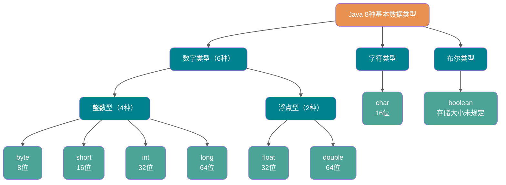

# 语言基础与对象

<a id="k513988da06e0"></a>

## Future 接口有什么用？

`Future` 接口是异步思想的典型运用，主要用在一些需要执行耗时任务的场景，避免程序一直原地等待耗时任务执行完成，执行效率太低。具体来说是这样的：当我们执行某一耗时的任务时，可以将这个耗时任务交给一个子线程去异步执行，同时我们可以干点其他事情，不用傻傻等待耗时任务执行完成。等我们的事情干完后，我们再通过 `Future` 获取到耗时任务的执行结果。这样一来，程序的执行效率就明显提高了。

这其实就是多线程中经典的 **Future 模式**，你可以将其看作是一种设计模式，核心思想是异步调用，主要用在多线程领域，并非 Java 语言独有。

在 Java 中，`Future` 是一个泛型接口，位于 `java.util.concurrent` 包下。它有 5 个经典抽象方法，主要包括下面 4 类功能；JDK 19 起又增加了 `resultNow()`、`exceptionNow()` 和 `state()` 三个默认查询方法。

- 取消任务；
- 判断任务是否被取消;
- 判断任务是否已经执行完成;
- 获取任务执行结果。

```java
// V 代表了Future执行的任务返回值的类型
public interface Future<V> {
    // 取消任务执行
    // 成功取消返回 true，否则返回 false
    boolean cancel(boolean mayInterruptIfRunning);
    // 判断任务是否被取消
    boolean isCancelled();
    // 判断任务是否已经执行完成
    boolean isDone();
    // 获取任务执行结果
    V get() throws InterruptedException, ExecutionException;
    // 指定时间内没有返回计算结果就抛出 TimeOutException 异常
    V get(long timeout, TimeUnit unit)

        throws InterruptedException, ExecutionException, TimeoutExceptio

}
```

简单理解就是：我有一个任务，提交给了 `Future` 来处理。任务执行期间我自己可以去做任何想做的事情。并且，在这期间我还可以取消任务以及获取任务的执行状态。一段时间之后，我就可以 `Future` 那里直接取出任务执行结果。

### 参考资料

- [JavaGuide](https://github.com/Snailclimb/JavaGuide/blob/992dae31eade2a34ba8dbbbcf5ed9de5511325ec/docs/java/concurrent/java-concurrent-questions-03.md#L1051)，来源许可：Apache-2.0。

<a id="k50fd5a5fb265"></a>

## hashCode() 有什么用？

`hashCode()` 的作用是获取哈希码（`int` 整数），也称为散列码。这个哈希码的作用是确定该对象在哈希表中的索引位置。


`hashCode()` 定义在 JDK 的 `Object` 类中，这就意味着 Java 中的任何类都包含有 `hashCode()` 函数。另外需要注意的是：`Object` 的 `hashCode()` 方法是本地方法，也就是用 C 语言或 C++ 实现的。

> ⚠️ 注意：该方法在 **Oracle OpenJDK8** 中默认是 “使用线程局部状态来实现 Marsaglia's xor-shift 随机数生成”, 并不是 “地址” 或者 “地址转换而来”, 不同 JDK/VM 可能不同。在 **Oracle OpenJDK8** 中有六种生成方式（其中第五种是返回地址）, 通过添加 VM 参数: -XX:hashCode=4 启用第五种。参考源码:
>
> - <https://hg.openjdk.org/jdk8u/jdk8u/hotspot/file/87ee5ee27509/src/share/vm/runtime/globals.hpp>（1127 行）
> - <https://hg.openjdk.org/jdk8u/jdk8u/hotspot/file/87ee5ee27509/src/share/vm/runtime/synchronizer.cpp>（537 行开始）

```java
public native int hashCode();
```

散列表存储的是键值对(key-value)，它的特点是：**能根据“键”快速的检索出对应的“值”。这其中就利用到了散列码！（可以快速找到所需要的对象）**

### 参考资料

- [JavaGuide](https://github.com/Snailclimb/JavaGuide/blob/992dae31eade2a34ba8dbbbcf5ed9de5511325ec/docs/java/basis/java-basic-questions-02.md#L529)，来源许可：Apache-2.0。

<a id="k84b404203bbf"></a>

## Java 中的几种基本数据类型了解么？

Java 中有 8 种基本数据类型，分别为：

- 6 种数字类型：
  - 4 种整数型：`byte`、`short`、`int`、`long`
  - 2 种浮点型：`float`、`double`
- 1 种字符类型：`char`
- 1 种布尔型：`boolean`。



这 8 种基本数据类型的默认值以及所占空间的大小如下：

| 基本类型  | 位数   | 字节   | 默认值   | 取值范围                                                                                       |
| :-------- | :----- | :----- | :------- | ---------------------------------------------------------------------------------------------- |
| `byte`    | 8      | 1      | 0        | -128 ~ 127                                                                                     |
| `short`   | 16     | 2      | 0        | -32768（-2^15） ~ 32767（2^15 - 1）                                                            |
| `int`     | 32     | 4      | 0        | -2147483648 ~ 2147483647                                                                       |
| `long`    | 64     | 8      | 0L       | -9223372036854775808（-2^63） ~ 9223372036854775807（2^63 -1）                                 |
| `char`    | 16     | 2      | '\u0000' | 0 ~ 65535（2^16 - 1）                                                                          |
| `float`   | 32     | 4      | 0f       | 约 -3.4028235E38 ~ 3.4028235E38，最小正非零值约 1.4E-45，另含 ±0、±∞、NaN                      |
| `double`  | 64     | 8      | 0d       | 约 -1.7976931348623157E308 ~ 1.7976931348623157E308，最小正非零值约 4.9E-324，另含 ±0、±∞、NaN |
| `boolean` | 未规定 | 未规定 | false    | true、false                                                                                    |

可以看到，像 `byte`、`short`、`int`、`long` 能表示的最大正数都减 1 了。这是为什么呢？这是因为在二进制补码表示法中，最高位是用来表示符号的（0 表示正数，1 表示负数），其余位表示数值部分。所以，如果我们要表示最大的正数，我们需要把除了最高位之外的所有位都设为 1。如果我们再加 1，就会导致溢出，变成一个负数。

对于 `boolean`，官方文档未明确定义，它依赖于 JVM 厂商的具体实现。逻辑上理解是占用 1 位，但是实际中会考虑计算机高效存储因素。

另外，Java 的每种基本类型所占存储空间的大小不会像其他大多数语言那样随机器硬件架构的变化而变化。这种所占存储空间大小的不变性是 Java 程序比用其他大多数语言编写的程序更具可移植性的原因之一（《Java 编程思想》2.2 节有提到）。

**注意：**

1. 整数字面量默认按 `int` 解析；超出 `int` 范围或需要显式写成 `long` 字面量时，应在数值后加 **L**。能通过赋值转换表示的 `int` 字面量可以直接赋给 `long`，例如 `long n = 1;`。
2. 带小数点或指数的浮点字面量默认是 `double`，赋给 `float` 时通常需要加 **f 或 F**；整数字面量在可转换时可直接赋给 `float`，例如 `float n = 1;`。
3. `char a = 'h'`char :单引号，`String a = "hello"` :双引号。

这八种基本类型都有对应的包装类分别为：`Byte`、`Short`、`Integer`、`Long`、`Float`、`Double`、`Character`、`Boolean`。

### 参考资料

- [JavaGuide](https://github.com/Snailclimb/JavaGuide/blob/992dae31eade2a34ba8dbbbcf5ed9de5511325ec/docs/java/basis/java-basic-questions-01.md#L567)，来源许可：Apache-2.0。

<a id="k6164d5e7a7ab"></a>

## Java 语言关键字有哪些？

| 分类                 | 关键字   |            |          |              |            |           |        |
| :------------------- | -------- | ---------- | -------- | ------------ | ---------- | --------- | ------ |
| 访问控制             | private  | protected  | public   |              |            |           |        |
| 类，方法和变量修饰符 | abstract | class      | extends  | final        | implements | interface | native |
|                      | new      | static     | strictfp | synchronized | transient  | volatile  | enum   |
| 程序控制             | break    | continue   | return   | do           | while      | if        | else   |
|                      | for      | instanceof | switch   | case         | default    | assert    |        |
| 错误处理             | try      | catch      | throw    | throws       | finally    |           |        |
| 包相关               | import   | package    |          |              |            |           |        |
| 基本类型             | boolean  | byte       | char     | double       | float      | int       | long   |
|                      | short    |            |          |              |            |           |        |
| 变量引用             | super    | this       | void     |              |            |           |        |
| 保留字               | goto     | const      |          |              |            |           |        |

> Tips：所有的关键字都是小写的，在 IDE 中会以特殊颜色显示。
>
> `default` 这个关键字很特殊，既属于程序控制，也属于类，方法和变量修饰符，还属于访问控制。
>
> - 在程序控制中，当在 `switch` 中匹配不到任何情况时，可以使用 `default` 来编写默认匹配的情况。
> - 在类，方法和变量修饰符中，从 JDK8 开始引入了默认方法，可以使用 `default` 关键字来定义一个方法的默认实现。
> - 在访问控制中，如果一个方法前没有任何修饰符，则默认会有一个修饰符 `default`，但是这个修饰符加上了就会报错。

⚠️ 注意：虽然 `true`, `false`, 和 `null` 看起来像关键字但实际上他们是字面值，同时你也不可以作为标识符来使用。

官方文档：[https://docs.oracle.com/javase/tutorial/java/nutsandbolts/\_keywords.html](https://docs.oracle.com/javase/tutorial/java/nutsandbolts/_keywords.html)

### 参考资料

- [JavaGuide](https://github.com/Snailclimb/JavaGuide/blob/992dae31eade2a34ba8dbbbcf5ed9de5511325ec/docs/java/basis/java-basic-questions-01.md#L277)，来源许可：Apache-2.0。

<a id="k0f0854ab6fc7"></a>

## Object 类的 hashCode 方法的作用

`hashCode `的哈希码主要作用是给散列表快速确定索引的，通过哈希码先判断对象是否有可能相同（因为相同的对象哈希码也一定相同），再去用 equals() 做进一步的比较，这样可以大大减少使用 `equals()`比较的次数

### 参考资料

- [Datawhale](https://github.com/datawhalechina/daily-interview/blob/f35e8d555f8ff07d568eae569c3641bd76d0eac9/docs/02-programming-languages/Java/java-fundamentals.md#L50)，来源许可：GPL-3.0。

<a id="kbb36fb5662e1"></a>

## String s1 = new String("abc");这句话创建了几个字符串对象？

先说答案：会创建 1 或 2 个字符串对象。

1. 字符串常量池中不存在 "abc"：会创建 2 个 字符串对象。一个在字符串常量池中，由 `ldc` 指令触发创建。一个在堆中，由 `new String()` 创建，并使用常量池中的 "abc" 进行初始化。
2. 字符串常量池中已存在 "abc"：会创建 1 个 字符串对象。该对象在堆中，由 `new String()` 创建，并使用常量池中的 "abc" 进行初始化。

下面开始详细分析。

1、如果字符串常量池中不存在字符串对象 “abc”，那么它首先会在字符串常量池中创建字符串对象 "abc"，然后在堆内存中再创建其中一个字符串对象 "abc"。

示例代码（JDK 1.8）：

```java
String s1 = new String("abc");
```

对应的字节码：

```java
// 在堆内存中分配一个尚未初始化的 String 对象。
// #2 是常量池中的一个符号引用，指向 java/lang/String 类。
// 在类加载的解析阶段，这个符号引用会被解析成直接引用，即指向实际的 java/lang/String 类。
0 new #2 <java/lang/String>
// 复制栈顶的 String 对象引用，为后续的构造函数调用做准备。
// 此时操作数栈中有两个相同的对象引用：一个用于传递给构造函数，另一个用于保持对新对象的引用，后续将其存储到局部变量表。
3 dup
// JVM 先检查字符串常量池中是否存在 "abc"。
// 如果常量池中已存在 "abc"，则直接返回该字符串的引用；
// 如果常量池中不存在 "abc"，则 JVM 会在常量池中创建该字符串字面量并返回它的引用。
// 这个引用被压入操作数栈，用作构造函数的参数。
4 ldc #3 <abc>
// 调用构造方法，使用从常量池中加载的 "abc" 初始化堆中的 String 对象
// 新的 String 对象将包含与常量池中的 "abc" 相同的内容，但它是一个独立的对象，存储于堆中。
6 invokespecial #4 <java/lang/String.<init> : (Ljava/lang/String;)V>
// 将堆中的 String 对象引用存储到局部变量表
9 astore_1
// 返回，结束方法
10 return
```

`ldc (load constant)` 指令的确是从常量池中加载各种类型的常量，包括字符串常量、整数常量、浮点数常量，甚至类引用等。对于字符串常量，`ldc` 指令的行为如下：

1. **从常量池加载字符串**：`ldc` 首先检查字符串常量池中是否已经有内容相同的字符串对象。
2. **复用已有字符串对象**：如果字符串常量池中已经存在内容相同的字符串对象，`ldc` 会将该对象的引用加载到操作数栈上。
3. **没有则创建新对象并加入常量池**：如果字符串常量池中没有相同内容的字符串对象，JVM 会在常量池中创建一个新的字符串对象，并将其引用加载到操作数栈中。

2、如果字符串常量池中已存在字符串对象“abc”，则只会在堆中创建 1 个字符串对象“abc”。

```java
// 字符串常量池中已存在字符串对象“abc”
String s1 = "abc";
// 下面这段代码只会在堆中创建 1 个字符串对象“abc”
String s2 = new String("abc");
```

```java
0 ldc #2 <abc>
2 astore_1
3 new #3 <java/lang/String>
6 dup
7 ldc #2 <abc>
9 invokespecial #4 <java/lang/String.<init> : (Ljava/lang/String;)V>
12 astore_2
13 return
```

这里就不对上面的字节码进行详细注释了，7 这个位置的 `ldc` 命令不会在堆中创建新的字符串对象“abc”，这是因为 0 这个位置已经执行了一次 `ldc` 命令，已经在堆中创建过一次字符串对象“abc”了。7 这个位置执行 `ldc` 命令会直接返回字符串常量池中字符串对象“abc”对应的引用。

### 参考资料

- [JavaGuide](https://github.com/Snailclimb/JavaGuide/blob/992dae31eade2a34ba8dbbbcf5ed9de5511325ec/docs/java/basis/java-basic-questions-02.md#L762)，来源许可：Apache-2.0。

<a id="k82b2ec54b913"></a>

## String 为什么是不可变的？

`String` 类中使用 `final` 关键字修饰字符数组来保存字符串，~~所以 `String` 对象是不可变的。~~

```java
public final class String implements java.io.Serializable, Comparable<String>, CharSequence {
    private final char value[];
  //...
}
```

> 🐛 修正：我们知道被 `final` 关键字修饰的类不能被继承，修饰的方法不能被重写，修饰的变量是基本数据类型则值不能改变，修饰的变量是引用类型则不能再指向其他对象。因此，`final` 关键字修饰的数组保存字符串并不是 `String` 不可变的根本原因，因为这个数组保存的字符串是可变的（`final` 修饰引用类型变量的情况）。
>
> `String` 真正不可变有下面几点原因：
>
> 1. 保存字符串的数组被 `final` 修饰且为私有的，并且 `String` 类没有提供/暴露修改这个字符串的方法。
> 2. `String` 类被 `final` 修饰导致其不能被继承，进而避免了子类破坏 `String` 不可变。
>
> 相关阅读：[如何理解 String 类型值的不可变？ - 知乎提问](https://www.zhihu.com/question/20618891/answer/114125846)
>
> 补充（来自[issue 675](https://github.com/Snailclimb/JavaGuide/issues/675)）：在 Java 9 之后，`String`、`StringBuilder` 与 `StringBuffer` 的实现改用 `byte` 数组存储字符串。
>
> ```java
> public final class String implements java.io.Serializable,Comparable<String>, CharSequence {
>     // @Stable 注解表示变量最多被修改一次，称为“稳定的”。
>     @Stable
>     private final byte[] value;
> }
>
> abstract class AbstractStringBuilder implements Appendable, CharSequence {
>     byte[] value;
>
> }
> ```
>
> **Java 9 为何要将 `String` 的底层实现由 `char[]` 改成了 `byte[]` ?**
>
> 新版的 String 内部支持两种编码方案：Latin-1 和 UTF-16。如果字符串中的所有字符都能用 Latin-1 表示，就使用 Latin-1；否则使用 UTF-16。汉字不在 Latin-1 的字符范围内。Latin-1 方案下，每个字符内容使用一个字节存储，相比原来的 `char[]` 可以节省一半的字符数据空间。
>
> JDK 官方就说了绝大部分字符串对象只包含 Latin-1 可表示的字符。
>
> 
>
> 如果字符串包含 Latin-1 无法表示的字符（例如汉字），内部会使用 UTF-16，每个代码单元使用两个字节。
>
> 这是官方的介绍：<https://openjdk.java.net/jeps/254>。

### 参考资料

- [JavaGuide](https://github.com/Snailclimb/JavaGuide/blob/992dae31eade2a34ba8dbbbcf5ed9de5511325ec/docs/java/basis/java-basic-questions-02.md#L647)，来源许可：Apache-2.0。

<a id="k22d19ee41f71"></a>

## String 类型的变量和常量做“+”运算时发生了什么？

先来看字符串不加 `final` 关键字拼接的情况（JDK1.8）：

```java
String str1 = "str";
String str2 = "ing";
String str3 = "str" + "ing";
String str4 = str1 + str2;
String str5 = "string";
System.out.println(str3 == str4);//false
System.out.println(str3 == str5);//true
System.out.println(str4 == str5);//false
```

> **注意**：比较 String 字符串的值是否相等，可以使用 `equals()` 方法。 `String` 中的 `equals` 方法是被重写过的。 `Object` 的 `equals` 方法判断两个引用是否指向同一个对象，而 `String` 的 `equals` 方法比较的是字符串的值是否相等。如果你使用 `==` 比较两个字符串是否相等的话，IDEA 还是提示你使用 `equals()` 方法替换。


**对于编译期可以确定值的字符串表达式，编译器会进行常量折叠，并把结果作为字符串常量写入 class 文件的常量池；对应的字符串对象在运行时被创建并驻留到字符串池中。**

在编译过程中，Javac 编译器（下文中统称为编译器）会进行一个叫做 **常量折叠(Constant Folding)** 的代码优化。《深入理解 Java 虚拟机》中是也有介绍到：


常量折叠会把常量表达式的值求出来作为常量嵌在最终生成的代码中，这是 Javac 编译器会对源代码做的极少量优化措施之一（代码优化几乎都在即时编译器中进行）。

对于 `String str3 = "str" + "ing";` 编译器会给你优化成 `String str3 = "string";`。

并不是所有的常量都会进行折叠，只有编译器在程序编译期就可以确定值的常量才可以：

- 基本数据类型( `byte`、`boolean`、`short`、`char`、`int`、`float`、`long`、`double`)以及字符串常量。
- `final` 修饰的基本数据类型和字符串变量
- 字符串通过 “+”拼接得到的字符串、基本数据类型之间算数运算（加减乘除）、基本数据类型的位运算（<<、\>>、\>>>）

**引用的值在程序编译期是无法确定的，编译器无法对其进行优化。**

对象引用和“+”的字符串拼接方式，实际上是通过 `StringBuilder` 调用 `append()` 方法实现的，拼接完成之后调用 `toString()` 得到一个 `String` 对象。

```java
String str4 = new StringBuilder().append(str1).append(str2).toString();
```

我们在平时写代码的时候，尽量避免多个字符串对象拼接，因为这样会重新创建对象。如果需要改变字符串的话，可以使用 `StringBuilder` 或者 `StringBuffer`。

不过，字符串使用 `final` 关键字声明之后，可以让编译器当做常量来处理。

示例代码：

```java
final String str1 = "str";
final String str2 = "ing";
// 下面两个表达式其实是等价的
String c = "str" + "ing";// 常量池中的对象
String d = str1 + str2; // 常量池中的对象
System.out.println(c == d);// true
```

被 `final` 关键字修饰之后的 `String` 会被编译器当做常量来处理，编译器在程序编译期就可以确定它的值，其效果就相当于访问常量。

如果，编译器在运行时才能知道其确切值的话，就无法对其优化。

示例代码（`str2` 在运行时才能确定其值）：

```java
final String str1 = "str";
final String str2 = getStr();
String c = "str" + "ing";// 常量池中的对象
String d = str1 + str2; // 在堆上创建的新的对象
System.out.println(c == d);// false
public static String getStr() {
      return "ing";
}
```

### 参考资料

- [JavaGuide](https://github.com/Snailclimb/JavaGuide/blob/992dae31eade2a34ba8dbbbcf5ed9de5511325ec/docs/java/basis/java-basic-questions-02.md#L866)，来源许可：Apache-2.0。

<a id="k6f1004b82db5"></a>

## String#intern 方法有什么作用？

`String.intern()` 是一个 `native`（本地） 方法，用来处理字符串常量池中的字符串对象引用。它的工作流程可以概括为以下两种情况：

1. **常量池中已有相同内容的字符串对象**：如果字符串常量池中已经有一个与调用 `intern()` 方法的字符串内容相同的 `String` 对象，`intern()` 方法会直接返回常量池中该对象的引用。
2. **常量池中没有相同内容的字符串对象**：如果字符串常量池中还没有一个与调用 `intern()` 方法的字符串内容相同的对象，`intern()` 方法会将当前字符串对象的引用添加到字符串常量池中，并返回该引用。

总结：

- `intern()` 方法的主要作用是确保字符串引用在常量池中的唯一性。
- 当调用 `intern()` 时，如果常量池中已经存在相同内容的字符串，则返回常量池中已有对象的引用；否则，将该字符串添加到常量池并返回其引用。

示例代码（JDK 1.8） :

```java
// s1 指向字符串常量池中的 "Java" 对象
String s1 = "Java";
// s2 也指向字符串常量池中的 "Java" 对象，和 s1 是同一个对象
String s2 = s1.intern();
// 在堆中创建一个新的 "Java" 对象，s3 指向它
String s3 = new String("Java");
// s4 指向字符串常量池中的 "Java" 对象，和 s1 是同一个对象
String s4 = s3.intern();
// s1 和 s2 指向的是同一个常量池中的对象
System.out.println(s1 == s2); // true
// s3 指向堆中的对象，s4 指向常量池中的对象，所以不同
System.out.println(s3 == s4); // false
// s1 和 s4 都指向常量池中的同一个对象
System.out.println(s1 == s4); // true
```

### 参考资料

- [JavaGuide](https://github.com/Snailclimb/JavaGuide/blob/992dae31eade2a34ba8dbbbcf5ed9de5511325ec/docs/java/basis/java-basic-questions-02.md#L835)，来源许可：Apache-2.0。

<a id="kdb2c792ed25d"></a>

## String、StringBuffer、StringBuilder 的区别？

**常见问法：** String 、StringBuffer 、StringBuilder 的区别

**可变性**

`String` 是不可变的（后面会详细分析原因），每次修改都会生成新的对象，并将引用指向新的实例，而 `StringBuffer` 和 `StringBuilder` 都是可变的，它们在修改字符串时不会创建新对象，而是直接在原有字符数组上进行操作。

`StringBuilder` 与 `StringBuffer` 都继承自 `AbstractStringBuilder` 类，在 `AbstractStringBuilder` 中也是使用字符数组保存字符串，不过没有使用 `final` 和 `private` 关键字修饰，最关键的是这个 `AbstractStringBuilder` 类还提供了很多修改字符串的方法比如 `append` 方法。

```java
abstract class AbstractStringBuilder implements Appendable, CharSequence {
    char[] value;
    public AbstractStringBuilder append(String str) {
        if (str == null)
            return appendNull();
        int len = str.length();
        ensureCapacityInternal(count + len);
        str.getChars(0, len, value, count);
        count += len;
        return this;
    }
    //...
}
```

**线程安全性**

`String` 中的对象是不可变的，也就可以理解为常量，线程安全。`AbstractStringBuilder` 是 `StringBuilder` 与 `StringBuffer` 的公共父类，定义了一些字符串的基本操作，如 `expandCapacity`、`append`、`insert`、`indexOf` 等公共方法。`StringBuffer` 对方法加了同步锁或者对调用的方法加了同步锁，所以是线程安全的。`StringBuilder` 并没有对方法进行加同步锁，所以是非线程安全的。


**性能**

两者的性能差异主要来源于线程安全机制：

- `StringBuffer` 的方法通常是同步的（线程安全），因此会带来一定的性能开销；
- `StringBuilder` 没有同步开销（非线程安全），在单线程场景下通常具有更好的性能表现。
  相同情况下使用 `StringBuilder` 相比使用 `StringBuffer` 仅能获得 10%~15% 左右的性能提升，但却要冒多线程不安全的风险。
  另外，具体的性能差异并不是固定的，在现代 JVM 中由于锁优化（如锁消除），两者在某些场景下性能差距可能较小。

**对于三者使用的总结：**

- 操作少量的数据: 适用 `String`
- 单线程操作字符串缓冲区下操作大量数据: 适用 `StringBuilder`
- 多线程操作字符串缓冲区下操作大量数据: 适用 `StringBuffer`

### 补充说明

|               | 是否可变 | 线程是否安全 | 性能 |
| :-----------: | :------: | :----------: | :--: |
|    String     |  不可变  |     安全     |  低  |
| StringBuilder |   可变   |    不安全    |  高  |
| StringBuffer  |   可变   |     安全     | 较高 |

### 参考资料

- [JavaGuide](https://github.com/Snailclimb/JavaGuide/blob/992dae31eade2a34ba8dbbbcf5ed9de5511325ec/docs/java/basis/java-basic-questions-02.md#L602)，来源许可：Apache-2.0。
- [Datawhale](https://github.com/datawhalechina/daily-interview/blob/f35e8d555f8ff07d568eae569c3641bd76d0eac9/docs/02-programming-languages/Java/java-fundamentals.md#L27)，来源许可：GPL-3.0。

<a id="kd00a186835c5"></a>

## Transactional(rollbackFor = Exception.class)注解了解吗？

`Exception` 分为运行时异常 `RuntimeException` 和非运行时异常。事务管理对于企业应用来说是至关重要的，即使出现异常情况，它也可以保证数据的一致性。

当 `@Transactional` 注解作用于类上时，该类的所有 public 方法将都具有该类型的事务属性，同时，我们也可以在方法级别使用该标注来覆盖类级别的定义。

`@Transactional` 注解默认回滚策略是只有在遇到`RuntimeException`(运行时异常) 或者 `Error` 时才会回滚事务，而不会回滚 `Checked Exception`（受检查异常）。这是因为 Spring 认为`RuntimeException`和 Error 是不可预期的错误，而受检异常是可预期的错误，可以通过业务逻辑来处理。


如果想要修改默认的回滚策略，可以使用 `@Transactional` 注解的 `rollbackFor` 和 `noRollbackFor` 属性来指定哪些异常需要回滚，哪些异常不需要回滚。例如，如果想要让所有的异常都回滚事务，可以使用如下的注解：

```java
@Transactional(rollbackFor = Exception.class)
public void someMethod() {
// some business logic
}
```

如果想要让某些特定的异常不回滚事务，可以使用如下的注解：

```java
@Transactional(noRollbackFor = CustomException.class)
public void someMethod() {
// some business logic
}
```

### 参考资料

- [JavaGuide](https://github.com/Snailclimb/JavaGuide/blob/992dae31eade2a34ba8dbbbcf5ed9de5511325ec/docs/system-design/framework/spring/spring-knowledge-and-questions-summary.md#L1049)，来源许可：Apache-2.0。

<a id="k9ae98aa0a1e3"></a>

## 三种消费者类型对比

| 对比项         | PushConsumer                                                             | SimpleConsumer                                       | PullConsumer                                       |
| -------------- | ------------------------------------------------------------------------ | ---------------------------------------------------- | -------------------------------------------------- |
| 接口方式       | 使用监听器回调接口返回消费结果，消费者仅允许在监听器范围内处理消费逻辑。 | 业务方自行实现消息处理，并主动调用接口返回消费结果。 | 业务方自行按队列拉取消息，并可选择性地提交消费结果 |
| 消费并发度管理 | 由 SDK 管理消费并发度。                                                  | 由业务方消费逻辑自行管理消费线程。                   | 由业务方消费逻辑自行管理消费线程。                 |
| 负载均衡粒度   | 5.x SDK 默认是消息粒度，早期版本是队列粒度                               | 5.x SDK 默认是消息粒度                               | 队列粒度，吞吐攒批性能更好，但容易不均衡           |
| 接口灵活度     | 高度封装，不够灵活。                                                     | 原子接口，可灵活自定义。                             | 原子接口，可灵活自定义。                           |
| 适用场景       | 适用于无自定义流程的业务消息开发场景。                                   | 适用于需要高度自定义业务流程的业务开发场景。         | 仅推荐在流处理框架场景下集成使用                   |

**选择建议：**

- **普通场景**：优先使用 **PushConsumer**，开发简单，SDK 自动管理拉取和提交
- **消息处理时长不可控**：使用 **SimpleConsumer**，可以自定义处理时长
- **需要精细控制**：使用 **PullConsumer**，完全自主控制拉取过程

**注意**：生产环境中相同的 ConsumerGroup 下严禁混用 PullConsumer 和其他两种消费者，否则会导致消息消费异常。

### 参考资料

- [JavaGuide](https://github.com/Snailclimb/JavaGuide/blob/992dae31eade2a34ba8dbbbcf5ed9de5511325ec/docs/high-performance/message-queue/rocketmq-questions.md#L1194)，来源许可：Apache-2.0。

<a id="kd6b4ce1049ce"></a>

## 为什么不推荐使用 JDK 自带的序列化？

我们很少或者说几乎不会直接使用 JDK 自带的序列化方式，主要原因有下面这些原因：

- **不支持跨语言调用** : 如果调用的是其他语言开发的服务的时候就不支持了。
- **性能差**：相比于其他序列化框架性能更低，主要原因是序列化之后的字节数组体积较大，导致传输成本加大。
- **存在安全问题**：序列化和反序列化本身并不存在问题。但当输入的反序列化的数据可被用户控制，那么攻击者即可通过构造恶意输入，让反序列化产生非预期的对象，在此过程中执行构造的任意代码。相关阅读：[应用安全：JAVA 反序列化漏洞之殇](https://cryin.github.io/blog/secure-development-java-deserialization-vulnerability/)。

### 参考资料

- [JavaGuide](https://github.com/Snailclimb/JavaGuide/blob/992dae31eade2a34ba8dbbbcf5ed9de5511325ec/docs/java/basis/java-basic-questions-03.md#L572)，来源许可：Apache-2.0。

<a id="k10d7b048efde"></a>

## 为什么要有 hashCode？

我们以“HashSet 如何检查重复”为例子来说明为什么要有 hashCode？

当我们把对象加入 HashSet 时，HashSet 会先调用对象的 `hashCode()` 方法，得到一个“哈希值”，并通过内部散列函数对这个哈希值再做一次简单的转换（比如取余），决定这条数据应该放进底层数组的哪一个桶（bucket，对应到底层数组的某个位置）：

1. 如果该桶当前是空的，就直接将对象对应的节点插入到这个桶中。
2. 如果该桶中已经有其他元素，HashSet 会在这个桶对应的链表或红黑树中逐个比较：
   - 对于**哈希值不同**的节点，直接跳过；
   - 对于**哈希值相同**的节点，则会进一步调用 equals() 方法来检查这两个对象是否“相等”：
     – 如果 `equals()` 返回 true，说明集合中已经存在与当前对象等价的元素，`HashSet` 就不会再次加入它；
     – 如果返回 false， 则认为是新元素，会将该对象作为一个新节点加入到**同一个桶**的链表或红黑树中。

通过先利用 `hashCode()` 将候选范围缩小到同一个桶内，再在桶内少量元素上调用 `equals()` 做精确判断，`HashSet` 大大减少了 `equals()` 的调用次数，从而提高了查找和插入的执行效率。

### 参考资料

- [JavaGuide](https://github.com/Snailclimb/JavaGuide/blob/992dae31eade2a34ba8dbbbcf5ed9de5511325ec/docs/java/basis/java-basic-questions-02.md#L548)，来源许可：Apache-2.0。

<a id="k66787746947c"></a>

## 为什么重写 equals() 时必须重写 hashCode() 方法？

因为两个相等的对象的 `hashCode` 值必须是相等。也就是说如果 `equals` 方法判断两个对象是相等的，那这两个对象的 `hashCode` 值也要相等。

如果重写 `equals()` 时没有重写 `hashCode()` 方法的话就可能会导致 `equals` 方法判断是相等的两个对象，`hashCode` 值却不相等。

**思考**：重写 `equals()` 时没有重写 `hashCode()` 方法的话，使用 `HashMap` 可能会出现什么问题。

**总结**：

- `equals` 方法判断两个对象是相等的，那这两个对象的 `hashCode` 值也要相等。
- 两个对象有相同的 `hashCode` 值，他们也不一定是相等的（哈希碰撞）。

更多关于 `hashCode()` 和 `equals()` 的内容可以查看：[Java hashCode() 和 equals()的若干问题解答](https://www.cnblogs.com/skywang12345/p/3324958.html)

### 参考资料

- [JavaGuide](https://github.com/Snailclimb/JavaGuide/blob/992dae31eade2a34ba8dbbbcf5ed9de5511325ec/docs/java/basis/java-basic-questions-02.md#L585)，来源许可：Apache-2.0。

<a id="k9c7bf8041384"></a>

## 什么是反射？

简单来说，Java 反射 (Reflection) 是一种**在程序运行时，动态地获取类的信息并操作类或对象（方法、属性）的能力**。

通常情况下，我们写的代码在编译时类型就已经确定了，要调用哪个方法、访问哪个字段都是明确的。但反射允许我们在**运行时**才去探知一个类有哪些方法、哪些属性、它的构造函数是怎样的，并在访问控制和模块边界允许的情况下动态创建对象、调用方法或修改属性。

正是这种在运行时“反观自身”并进行操作的能力，使得反射成为许多**通用框架和库的基石**。它让代码更加灵活，能够处理在编译时未知的类型。

### 参考资料

- [JavaGuide](https://github.com/Snailclimb/JavaGuide/blob/992dae31eade2a34ba8dbbbcf5ed9de5511325ec/docs/java/basis/java-basic-questions-03.md#L330)，来源许可：Apache-2.0。

<a id="k049a7d48c101"></a>

## 什么是序列化？什么是反序列化？

如果我们需要持久化 Java 对象比如将 Java 对象保存在文件中，或者在网络传输 Java 对象，这些场景都需要用到序列化。

简单来说：

- **序列化**：将数据结构或对象转换成可以存储或传输的形式，通常是二进制字节流，也可以是 JSON, XML 等文本格式
- **反序列化**：将在序列化过程中所生成的数据转换为原始数据结构或者对象的过程

对于 Java 这种面向对象编程语言来说，我们序列化的都是对象（Object）也就是实例化后的类(Class)，但是在 C++这种半面向对象的语言中，struct（结构体）定义的是数据结构类型，而 class 对应的是对象类型。

下面是序列化和反序列化常见应用场景：

- 对象在进行网络传输（比如远程方法调用 RPC 的时候）之前需要先被序列化，接收到序列化的对象之后需要再进行反序列化；
- 将对象存储到文件之前需要进行序列化，将对象从文件中读取出来需要进行反序列化；
- 将对象存储到数据库（如 Redis）之前需要用到序列化，将对象从缓存数据库中读取出来需要反序列化；
- 将对象转换为需要长期保存或跨组件传递的字节表示时，通常需要序列化；普通 Java 对象在 JVM 内存中使用并不需要序列化。

维基百科是如是介绍序列化的：

> **序列化**（serialization）在计算机科学的数据处理中，是指将数据结构或对象状态转换成可取用格式（例如存成文件，存于缓冲，或经由网络中发送），以留待后续在相同或另一台计算机环境中，能恢复原先状态的过程。依照序列化格式重新获取字节的结果时，可以利用它来产生与原始对象相同语义的副本。对于许多对象，像是使用大量引用的复杂对象，这种序列化重建的过程并不容易。面向对象中的对象序列化，并不概括之前原始对象所关系的函数。这种过程也称为对象编组（marshalling）。从一系列字节提取数据结构的反向操作，是反序列化（也称为解编组、deserialization、unmarshalling）。

综上：**序列化的主要目的是把对象转换为适合网络传输或持久化到文件系统、数据库、缓存等介质的表示。**


<p style="text-align:right;font-size:13px;color:gray">https://www.corejavaguru.com/java/serialization/interview-questions-1</p>

### 参考资料

- [JavaGuide](https://github.com/Snailclimb/JavaGuide/blob/992dae31eade2a34ba8dbbbcf5ed9de5511325ec/docs/java/basis/java-basic-questions-03.md#L511)，来源许可：Apache-2.0。

<a id="kd9057916b450"></a>

## 什么是方法的返回值？方法有哪几种类型？

**方法的返回值** 是指我们获取到的某个方法体中的代码执行后产生的结果！（前提是该方法可能产生结果）。返回值的作用是接收出结果，使得它可以用于其他的操作！

我们可以按照方法的返回值和参数类型将方法分为下面这几种：

**1、无参数无返回值的方法**

```java
public void f1() {
    //......
}
// 下面这个方法也没有返回值，虽然用到了 return
public void f(int a) {
    if (...) {
        // 表示结束方法的执行，下方的输出语句不会执行
        return;
    }
    System.out.println(a);
}
```

**2、有参数无返回值的方法**

```java
public void f2(Parameter 1, ..., Parameter n) {
    //......
}
```

**3、有返回值无参数的方法**

```java
public int f3() {
    //......
    return x;
}
```

**4、有返回值有参数的方法**

```java
public int f4(int a, int b) {
    return a * b;
}
```

### 参考资料

- [JavaGuide](https://github.com/Snailclimb/JavaGuide/blob/992dae31eade2a34ba8dbbbcf5ed9de5511325ec/docs/java/basis/java-basic-questions-01.md#L1043)，来源许可：Apache-2.0。

<a id="k71ccc16f6396"></a>

## 什么是泛型？有什么作用？

**Java 泛型（Generics）** 是 JDK 5 中引入的一个新特性。使用泛型参数，可以增强代码的可读性以及稳定性。

编译器可以对泛型参数进行检测，并且通过泛型参数可以指定传入的对象类型。比如 `ArrayList<Person> persons = new ArrayList<Person>()` 这行代码就指明了该 `ArrayList` 对象只能传入 `Person` 对象，如果传入其他类型的对象就会报错。

```java
ArrayList<E> extends AbstractList<E>
```

并且，原生 `List` 返回类型是 `Object`，需要手动转换类型才能使用，使用泛型后编译器自动转换。

### 参考资料

- [JavaGuide](https://github.com/Snailclimb/JavaGuide/blob/992dae31eade2a34ba8dbbbcf5ed9de5511325ec/docs/java/basis/java-basic-questions-03.md#L224)，来源许可：Apache-2.0。

<a id="k2dc02c826be3"></a>

## 何谓注解？

`Annotation`（注解） 是 Java5 开始引入的新特性，可以看作是一种特殊的注释，主要用于修饰类、方法或者变量，提供某些信息供程序在编译或者运行时使用。

注解本质是一个继承了 `Annotation` 的特殊接口：

```java
@Target(ElementType.METHOD)
@Retention(RetentionPolicy.SOURCE)
public @interface Override {

}

public interface Override extends Annotation{

}
```

JDK 提供了很多内置的注解（比如 `@Override`、`@Deprecated`），同时，我们还可以自定义注解。

### 参考资料

- [JavaGuide](https://github.com/Snailclimb/JavaGuide/blob/992dae31eade2a34ba8dbbbcf5ed9de5511325ec/docs/java/basis/java-basic-questions-03.md#L444)，来源许可：Apache-2.0。

<a id="k8dadffdeaeac"></a>

## 使用 CompletableFuture，有一个任务失败，如何处理异常？

使用 `CompletableFuture` 的时候一定要以正确的方式进行异常处理，避免异常丢失或者出现不可控问题。

下面是一些建议：

- `whenComplete` 会在阶段正常或异常完成时执行回调，适合观察结果和记录异常；它默认保留原阶段的结果或异常。
- `exceptionally` 只在阶段异常完成时执行，并用回调的返回值恢复为正常结果；如果需要继续传播异常，可以在回调中显式抛出异常。
- `handle` 无论阶段正常还是异常完成都会执行，并根据结果和异常生成一个新的结果。
- `CompletableFuture.allOf` 可以等待多个阶段全部完成；只要其中一个阶段异常完成，返回的 `CompletableFuture` 也会异常完成，但仍需分别检查各阶段才能获得每个任务的结果或异常。
- ……

### 参考资料

- [JavaGuide](https://github.com/Snailclimb/JavaGuide/blob/992dae31eade2a34ba8dbbbcf5ed9de5511325ec/docs/java/concurrent/java-concurrent-questions-03.md#L1173)，来源许可：Apache-2.0。

<a id="kfbc9ed95e88d"></a>

## 创建一个对象用什么运算符？对象实例与对象引用有何不同？

使用 `new` 运算符可以创建对象实例。JVM 的堆用于分配类实例和数组；引用值可以保存在局部变量、对象字段、静态字段或数组元素中，并不一定存放在栈中。

- 一个对象引用可以指向 0 个或 1 个对象（一根绳子可以不系气球，也可以系一个气球）；
- 一个对象可以有 n 个引用指向它（可以用 n 条绳子系住一个气球）。

### 参考资料

- [JavaGuide](https://github.com/Snailclimb/JavaGuide/blob/992dae31eade2a34ba8dbbbcf5ed9de5511325ec/docs/java/basis/java-basic-questions-02.md#L98)，来源许可：Apache-2.0。

<a id="kadc1835bd871"></a>

## 包装类型的缓存机制了解么？

Java 基本数据类型的包装类型的大部分都用到了缓存机制来提升性能。

`Byte`,`Short`,`Integer`,`Long` 这 4 种包装类默认创建了数值 **[-128，127]** 的相应类型的缓存数据，`Character` 创建了数值在 **[0,127]** 范围的缓存数据，`Boolean` 直接返回 `TRUE` or `FALSE`。

对于 `Integer`，可以通过 JVM 参数 `-XX:AutoBoxCacheMax=<size>` 修改缓存上限，但不能修改下限 -128。实际使用时，并不建议设置过大的值，避免浪费内存，甚至是 OOM。

对于 `Byte`,`Short`,`Long` ,`Character` 没有类似 `-XX:AutoBoxCacheMax` 参数可以修改，因此缓存范围是固定的，无法通过 JVM 参数调整。`Boolean` 则直接返回预定义的 `TRUE` 和 `FALSE` 实例，没有缓存范围的概念。

**Integer 缓存源码：**

```java
public static Integer valueOf(int i) {
    if (i >= IntegerCache.low && i <= IntegerCache.high)
        return IntegerCache.cache[i + (-IntegerCache.low)];
    return new Integer(i);
}
private static class IntegerCache {
    static final int low = -128;
    static final int high;
    static {
        // high value may be configured by property
        int h = 127;
    }
}
```

**`Character` 缓存源码:**

```java
public static Character valueOf(char c) {
    if (c <= 127) { // must cache
      return CharacterCache.cache[(int)c];
    }
    return new Character(c);
}

private static class CharacterCache {
    private CharacterCache(){}
    static final Character cache[] = new Character[127 + 1];
    static {
        for (int i = 0; i < cache.length; i++)
            cache[i] = new Character((char)i);
    }

}
```

**`Boolean` 缓存源码：**

```java
public static Boolean valueOf(boolean b) {
    return (b ? TRUE : FALSE);
}
```

如果超出对应范围仍然会去创建新的对象，缓存的范围区间的大小只是在性能和资源之间的权衡。

两种浮点数类型的包装类 `Float`,`Double` 并没有实现缓存机制。

```java
Integer i1 = 33;
Integer i2 = 33;
System.out.println(i1 == i2);// 输出 true

Float i11 = 333f;
Float i22 = 333f;
System.out.println(i11 == i22);// 输出 false

Double i3 = 1.2;
Double i4 = 1.2;
System.out.println(i3 == i4);// 输出 false
```

下面我们来看一个问题：下面的代码的输出结果是 `true` 还是 `false` 呢？

```java
Integer i1 = 40;
Integer i2 = new Integer(40);
System.out.println(i1==i2);
```

`Integer i1=40` 这一行代码会发生装箱，也就是说这行代码等价于 `Integer i1=Integer.valueOf(40)`。因此，`i1` 直接使用的是缓存中的对象。而 `Integer i2 = new Integer(40)` 会直接创建新的对象。

因此，答案是 `false`。你答对了吗？

记住：**所有整型包装类对象之间值的比较，全部使用 equals 方法比较**。


### 参考资料

- [JavaGuide](https://github.com/Snailclimb/JavaGuide/blob/992dae31eade2a34ba8dbbbcf5ed9de5511325ec/docs/java/basis/java-basic-questions-01.md#L663)，来源许可：Apache-2.0。

<a id="k88c25b8349e9"></a>

## 和 equals 区别

* ==：如果是基本数据类型，比较的是值，如果是引用数据类型，比较的是地址
* `equals`：继承自 `Object` 类，具体实现时可以覆盖父类的实现。如果没有复写，则和 == 一样，比较地址；如果复写了则根据复写的判断方式

### 参考资料

- [Datawhale](https://github.com/datawhalechina/daily-interview/blob/f35e8d555f8ff07d568eae569c3641bd76d0eac9/docs/02-programming-languages/Java/java-fundamentals.md#L45)，来源许可：GPL-3.0。

<a id="k9368839582eb"></a>

## 和 equals() 的区别

**`==`** 对于基本类型和引用类型的作用效果是不同的：

- 对于基本数据类型来说，`==` 比较的是值。
- 对于引用数据类型来说，`==` 比较引用是否指向同一个对象（或都为 `null`），不是比较物理内存地址。

> 对于 `==` 来说，不管比较基本类型还是引用类型，其比较的都是操作数的值；引用值描述其所指向的对象，但 Java 语言不把它定义为可见的物理内存地址。

**`equals()`** 不能用于判断基本数据类型的变量，只能用来判断两个对象是否相等。`equals()` 方法存在于 `Object` 类中，而 `Object` 类是所有类的直接或间接父类，因此所有的类都有 `equals()` 方法。

`Object` 类 `equals()` 方法：

```java
public boolean equals(Object obj) {
     return (this == obj);
}
```

`equals()` 方法存在两种使用情况：

- **类没有重写 `equals()` 方法**：通过 `equals()` 比较该类的两个对象时，等价于通过“==”比较这两个对象，使用的默认是 `Object` 类 `equals()` 方法。
- **类重写了 `equals()` 方法**：一般我们都重写 `equals()` 方法来比较两个对象中的属性是否相等；若它们的属性相等，则返回 true（即，认为这两个对象相等）。

举个例子（这里只是为了举例。实际上，你按照下面这种写法的话，像 IDEA 这种比较智能的 IDE 都会提示你将 `==` 换成 `equals()`）：

```java
String a = new String("ab"); // a 为一个引用
String b = new String("ab"); // b为另一个引用,对象的内容一样
String aa = "ab"; // 放在常量池中
String bb = "ab"; // 从常量池中查找
System.out.println(aa == bb);// true
System.out.println(a == b);// false
System.out.println(a.equals(b));// true
System.out.println(42 == 42.0);// true
```

`String` 中的 `equals` 方法是被重写过的，因为 `Object` 的 `equals` 方法判断两个引用是否指向同一个对象，而 `String` 的 `equals` 方法比较的是字符串的值。

当使用字符串字面量创建 `String` 类型的对象（如 `String aa = "ab"`）时，虚拟机会在常量池中查找有没有已经存在的值和要创建的值相同的对象，如果有就把它赋给当前引用；如果没有，就在常量池中创建一个 `String` 对象并赋给当前引用。但当使用 `new` 关键字创建对象（如 `String a = new String("ab")`）时，虚拟机总是会在堆内存中**创建一个新的对象**并使用常量池中的值（如果没有，会先在字符串常量池中创建字符串对象 "ab"）进行初始化，然后赋给当前引用。

`String` 类 `equals()` 方法：

```java
public boolean equals(Object anObject) {
    if (this == anObject) {
        return true;
    }
    if (anObject instanceof String) {
        String anotherString = (String)anObject;
        int n = value.length;
        if (n == anotherString.value.length) {
            char v1[] = value;
            char v2[] = anotherString.value;
            int i = 0;
            while (n-- != 0) {
                if (v1[i] != v2[i])
                    return false;
                i++;
            }
            return true;
        }
    }
    return false;
}
```

### 参考资料

- [JavaGuide](https://github.com/Snailclimb/JavaGuide/blob/992dae31eade2a34ba8dbbbcf5ed9de5511325ec/docs/java/basis/java-basic-questions-02.md#L462)，来源许可：Apache-2.0。

<a id="k490bbf771ade"></a>

## 基本数据类型：如何解决浮点数运算的精度丢失问题？

`BigDecimal` 可以精确表示十进制数，并提供可显式指定精度和舍入规则的运算。使用有限精度、舍入除法或转换为 `float`、`double` 时仍可能发生舍入。通常情况下，大部分需要十进制精确运算结果的业务场景（比如涉及到钱的场景）都会使用 `BigDecimal`。

```java
BigDecimal a = new BigDecimal("1.0");
BigDecimal b = new BigDecimal("1.00");
BigDecimal c = new BigDecimal("0.8");

BigDecimal x = a.subtract(c);
BigDecimal y = b.subtract(c);

System.out.println(x); /* 0.2 */
System.out.println(y); /* 0.20 */
// 比较内容，不是比较值
System.out.println(Objects.equals(x, y)); /* false */
// 比较值相等用相等compareTo，相等返回0
System.out.println(0 == x.compareTo(y)); /* true */
```

关于 `BigDecimal` 的详细介绍，可以看看我写的这篇文章：[BigDecimal 详解](https://javaguide.cn/java/basis/bigdecimal.html)。

### 参考资料

- [JavaGuide](https://github.com/Snailclimb/JavaGuide/blob/992dae31eade2a34ba8dbbbcf5ed9de5511325ec/docs/java/basis/java-basic-questions-01.md#L880)，来源许可：Apache-2.0。

<a id="k67dedb2b81a0"></a>

## 基本类型和包装类型的区别？

- **用途**：除了定义一些常量和局部变量之外，我们在其他地方比如方法参数、对象属性中很少会使用基本类型来定义变量。并且，包装类型可用于泛型，而基本类型不可以。
- **存储方式**：基本数据类型的局部变量保存在当前栈帧的局部变量表中，基本数据类型的实例字段属于对象状态。包装类型属于对象类型，其实例通常分配在堆中，但 JIT 可能通过逃逸分析和标量替换消除实际分配。
- **占用空间**：相比于包装类型（对象类型）， 基本数据类型占用的空间往往非常小。
- **默认值**：成员变量包装类型不赋值就是 `null`，而基本类型有默认值且不是 `null`。
- **比较方式**：对于基本数据类型来说，`==` 比较的是值。对于包装数据类型来说，`==` 比较两个引用是否指向同一个对象（或都为 `null`）。比较包装对象表示的数值通常使用 `equals()` 或相应的 `compare()`/`compareTo()` 方法。

**为什么说对象实例通常存在于堆中呢？** JVM 规范将堆定义为分配类实例和数组的运行时数据区。不过，JIT 可以通过逃逸分析和标量替换消除某些对象的实际分配，这不等同于必须把完整对象分配到栈上。

⚠️ 注意：**基本数据类型存放在栈中是一个常见的误区！** 基本数据类型的存储位置取决于变量种类：局部变量保存在栈帧的局部变量表中，实例字段属于堆中对象的一部分；静态字段属于类，具体存储方式由 JVM 实现决定，不能笼统地说在方法区或元空间中。

```java
public class Test {
    // 成员变量，存放在堆中
    int a = 10;
    // 静态字段的存储属于 JVM 实现细节；在 JDK 8 及之后的 HotSpot 中位于 Java 堆。
    // 变量属于类，不属于对象。
    static int b = 20;

    public void method() {
        // 局部变量，存放在栈中
        int c = 30;
        static int d = 40; // 编译错误，不能在方法中使用 static 修饰局部变量
    }
}
```

### 参考资料

- [JavaGuide](https://github.com/Snailclimb/JavaGuide/blob/992dae31eade2a34ba8dbbbcf5ed9de5511325ec/docs/java/basis/java-basic-questions-01.md#L635)，来源许可：Apache-2.0。

<a id="k64cb4d308f6e"></a>

## 如果有些字段不想进行序列化怎么办？

对于不想进行序列化的变量，使用 `transient` 关键字修饰。

`transient` 关键字的作用是：阻止实例中那些用此关键字修饰的变量序列化；当对象被反序列化时，被 `transient` 修饰的变量值不会被持久化和恢复。

关于 `transient` 还有几点注意：

- `transient` 只能修饰变量，不能修饰类和方法。
- `transient` 修饰的变量，在反序列化后变量值将会被置成类型的默认值。例如，如果是修饰 `int` 类型，那么反序列后结果就是 `0`。
- `static` 变量因为不属于任何对象(Object)，所以无论有没有 `transient` 关键字修饰，均不会被序列化。

### 参考资料

- [JavaGuide](https://github.com/Snailclimb/JavaGuide/blob/992dae31eade2a34ba8dbbbcf5ed9de5511325ec/docs/java/basis/java-basic-questions-03.md#L554)，来源许可：Apache-2.0。

<a id="k7a76aacda16f"></a>

## 字符串拼接用“+” 还是 StringBuilder?

Java 不支持用户自定义运算符重载，但语言规范为字符串连接专门定义了 `+` 和 `+=` 运算符。

```java
String str1 = "he";
String str2 = "llo";
String str3 = "world";
String str4 = str1 + str2 + str3;
```

上面的代码对应的字节码如下：


对于这里展示的 JDK 8 字节码，字符串“+”拼接被 `javac` 转换为 `StringBuilder.append()` 调用。JDK 9 起，`javac` 默认改用 `invokedynamic` 和 `StringConcatFactory`，因此不能把 `StringBuilder` 视为所有版本都必须采用的实现方式。

不过，在循环内使用“+”进行字符串的拼接的话，存在比较明显的缺陷：**编译器不会创建单个 `StringBuilder` 以复用，会导致创建过多的 `StringBuilder` 对象**。

```java
String[] arr = {"he", "llo", "world"};
String s = "";
for (int i = 0; i < arr.length; i++) {
    s += arr[i];
}
System.out.println(s);
```

`StringBuilder` 对象是在循环内部被创建的，这意味着每循环一次就会创建一个 `StringBuilder` 对象。


如果直接使用 `StringBuilder` 对象进行字符串拼接的话，就不会存在这个问题了。

```java
String[] arr = {"he", "llo", "world"};
StringBuilder s = new StringBuilder();
for (String value : arr) {
    s.append(value);
}
System.out.println(s);
```


如果你使用 IDEA 的话，IDEA 自带的代码检查机制也会提示你修改代码。

在 JDK 9 中，字符串相加“+”改为用动态方法 `makeConcatWithConstants()` 来实现，通过提前分配空间从而减少了部分临时对象的创建。然而这种优化主要针对简单的字符串拼接，如： `a+b+c`。对于循环中的大量拼接操作，仍然会逐个动态分配内存（类似于两个两个 append 的概念），并不如手动使用 StringBuilder 来进行拼接效率高。这个改进是 JDK9 的 [JEP 280](https://openjdk.org/jeps/280) 提出的，关于这部分改进的详细介绍，推荐阅读这篇文章： [还在无脑用 StringBuilder？来重温一下字符串拼接吧](https://juejin.cn/post/7182872058743750715) 以及参考 [issue#2442](https://github.com/Snailclimb/JavaGuide/issues/2442)。

### 参考资料

- [JavaGuide](https://github.com/Snailclimb/JavaGuide/blob/992dae31eade2a34ba8dbbbcf5ed9de5511325ec/docs/java/basis/java-basic-questions-02.md#L694)，来源许可：Apache-2.0。

<a id="kf5b799fb5b05"></a>

## 实体之间的关联关系注解有哪些？

- `@OneToOne` : 一对一。
- `@ManyToMany`：多对多。
- `@OneToMany` : 一对多。
- `@ManyToOne`：多对一。

利用 `@ManyToOne` 和 `@OneToMany` 也可以表达多对多的关联关系。

### 参考资料

- [JavaGuide](https://github.com/Snailclimb/JavaGuide/blob/992dae31eade2a34ba8dbbbcf5ed9de5511325ec/docs/system-design/framework/spring/spring-knowledge-and-questions-summary.md#L1155)，来源许可：Apache-2.0。

<a id="k663661010f01"></a>

## 对象的相等和引用相等的区别

- 对象相等通常由 `equals()` 定义，用于比较类型约定的逻辑状态或值。
- 引用相等由 `==` 判断，表示两个引用是否指向同一个对象（或都为 `null`），Java 语言并不暴露或比较物理内存地址。

这里举一个例子：

```java
String str1 = "hello";
String str2 = new String("hello");
String str3 = "hello";
// 使用 == 比较字符串的引用相等
System.out.println(str1 == str2);
System.out.println(str1 == str3);
// 使用 equals 方法比较字符串的相等
System.out.println(str1.equals(str2));
System.out.println(str1.equals(str3));

```

输出结果：

```plain
false
true
true
true
```

从上面的代码输出结果可以看出：

- `str1` 和 `str2` 不相等，而 `str1` 和 `str3` 相等。这是因为 `==` 运算符比较的是字符串的引用是否相等。
- `str1`、 `str2`、`str3` 三者的内容都相等。这是因为 `equals` 方法比较的是字符串的内容，即使这些字符串的对象引用不同，只要它们的内容相等，就认为它们是相等的。

### 参考资料

- [JavaGuide](https://github.com/Snailclimb/JavaGuide/blob/992dae31eade2a34ba8dbbbcf5ed9de5511325ec/docs/java/basis/java-basic-questions-02.md#L105)，来源许可：Apache-2.0。

<a id="kf91c53c6eea7"></a>

## 常见序列化协议有哪些？

JDK 自带的序列化方式一般不会用，因为序列化效率低并且存在安全问题。比较常用的序列化协议有 Hessian、Kryo、Protobuf、ProtoStuff，这些都是基于二进制的序列化协议。

像 JSON 和 XML 这种属于文本类序列化方式。虽然可读性比较好，但是性能较差，一般不会选择。

### 参考资料

- [JavaGuide](https://github.com/Snailclimb/JavaGuide/blob/992dae31eade2a34ba8dbbbcf5ed9de5511325ec/docs/java/basis/java-basic-questions-03.md#L566)，来源许可：Apache-2.0。

<a id="kf4c3c2056b02"></a>

## 异常使用有哪些需要注意的地方？

- 不要把异常定义为静态变量，因为这样会导致异常栈信息错乱。每次手动抛出异常，我们都需要手动 new 一个异常对象抛出。
- 抛出的异常信息一定要有意义。
- 建议抛出更加具体的异常，比如字符串转换为数字格式错误的时候应该抛出 `NumberFormatException` 而不是其父类 `IllegalArgumentException`。
- 避免重复记录日志：如果在捕获异常的地方已经记录了足够的信息（包括异常类型、错误信息和堆栈跟踪等），那么在业务代码中再次抛出这个异常时，就不应该再次记录相同的错误信息。重复记录日志会使得日志文件膨胀，并且可能会掩盖问题的实际原因，使得问题更难以追踪和解决。
- ……

### 参考资料

- [JavaGuide](https://github.com/Snailclimb/JavaGuide/blob/992dae31eade2a34ba8dbbbcf5ed9de5511325ec/docs/java/basis/java-basic-questions-03.md#L214)，来源许可：Apache-2.0。

<a id="k3f10c0ad2723"></a>

## 接口和抽象类有什么共同点和区别？

### 接口和抽象类的共同点

- **实例化**：接口和抽象类都不能直接实例化，只能被实现（接口）或继承（抽象类）后才能创建具体的对象。
- **抽象方法**：接口和抽象类都可以包含抽象方法。抽象方法没有方法体，必须在子类或实现类中实现。

### 参考资料

- [JavaGuide](https://github.com/Snailclimb/JavaGuide/blob/992dae31eade2a34ba8dbbbcf5ed9de5511325ec/docs/java/basis/java-basic-questions-02.md#L244)，来源许可：Apache-2.0。

<a id="k76ea84d391ad"></a>

## 接口和抽象类的区别

- **设计目的**：接口主要用于对类的行为进行约束，你实现了某个接口就具有了对应的行为。抽象类主要用于代码复用，强调的是所属关系。
- **继承和实现**：一个类只能继承一个类（包括抽象类），因为 Java 不支持多继承。但一个类可以实现多个接口，一个接口也可以继承多个其他接口。
- **成员变量**：接口中的成员变量只能是 `public static final` 类型的，不能被修改且必须有初始值。抽象类的成员变量可以有任何修饰符（`private`, `protected`, `public`），可以在子类中被重新定义或赋值。
- **方法**：
  - Java 8 之前，接口中的方法默认是 `public abstract`，也就是只能有方法声明。自 Java 8 起，可以在接口中定义 `default`（默认） 方法和 `static`（静态）方法。 自 Java 9 起，接口可以包含 `private` 方法。
  - 抽象类可以包含抽象方法和非抽象方法。抽象方法没有方法体，必须在子类中实现。非抽象方法有具体实现，可以直接在抽象类中使用或在子类中重写。

Java 8 为接口引入了 `default` 方法和 `static` 方法，Java 9 又允许接口声明 `private` 方法。这些方法让接口的使用更加灵活。

Java 8 引入的 `default` 方法用于提供接口方法的默认实现，可以在实现类中被覆盖。这样就可以在不修改实现类的情况下向现有接口添加新功能，从而增强接口的扩展性和向后兼容性。

```java
public interface MyInterface {
    default void defaultMethod() {
        System.out.println("This is a default method.");
    }
}
```

Java 8 引入的 `static` 方法无法在实现类中被覆盖，只能通过接口名直接调用（`MyInterface.staticMethod()`），类似于类中的静态方法。`static` 方法通常用于定义一些通用的、与接口相关的工具方法，一般很少用。

```java
public interface MyInterface {
    static void staticMethod() {
        System.out.println("This is a static method in the interface.");
    }
}
```

Java 9 允许在接口中使用 `private` 方法。`private` 方法可以用于在接口内部共享代码，不对外暴露。

```java
public interface MyInterface {
    // default 方法
    default void defaultMethod() {
        commonMethod();
    }

    // static 方法
    static void staticMethod() {
        commonMethod();
    }

    // 私有静态方法，可以被 static 和 default 方法调用
    private static void commonMethod() {
        System.out.println("This is a private method used internally.");
    }

      // 实例私有方法，只能被 default 方法调用。
    private void instanceCommonMethod() {
        System.out.println("This is a private instance method used internally.");
    }
}
```

### 参考资料

- [JavaGuide](https://github.com/Snailclimb/JavaGuide/blob/992dae31eade2a34ba8dbbbcf5ed9de5511325ec/docs/java/basis/java-basic-questions-02.md#L251)，来源许可：Apache-2.0。

<a id="k6e8d9627cabf"></a>

## 标识符和关键字的区别是什么？

在我们编写程序的时候，需要大量地为程序、类、变量、方法等取名字，于是就有了 **标识符**。简单来说， **标识符就是一个名字**。

有一些标识符，Java 语言已经赋予了其特殊的含义，只能用于特定的地方，这些特殊的标识符就是 **关键字**。简单来说，**关键字是被赋予特殊含义的标识符**。比如，在我们的日常生活中，如果我们想要开一家店，则要给这个店起一个名字，起的这个“名字”就叫标识符。但是我们店的名字不能叫“警察局”，因为“警察局”这个名字已经被赋予了特殊的含义，而“警察局”就是我们日常生活中的关键字。

### 参考资料

- [JavaGuide](https://github.com/Snailclimb/JavaGuide/blob/992dae31eade2a34ba8dbbbcf5ed9de5511325ec/docs/java/basis/java-basic-questions-01.md#L271)，来源许可：Apache-2.0。

<a id="k4b1783f0634c"></a>

## 泛型的使用方式有哪几种？

泛型一般有三种使用方式:**泛型类**、**泛型接口**、**泛型方法**。

**1.泛型类**：

```java
//此处T可以随便写为任意标识，常见的如T、E、K、V等形式的参数常用于表示泛型
//在实例化泛型类时，必须指定T的具体类型
public class Generic<T>{

    private T key;

    public Generic(T key) {
        this.key = key;
    }

    public T getKey(){
        return key;
    }
}
```

如何实例化泛型类：

```java
Generic<Integer> genericInteger = new Generic<Integer>(123456);
```

**2.泛型接口**：

```java
public interface Generator<T> {
    public T method();
}
```

实现泛型接口，不指定类型：

```java
class GeneratorImpl<T> implements Generator<T>{
    @Override
    public T method() {
        return null;
    }
}
```

实现泛型接口，指定类型：

```java
class GeneratorImpl implements Generator<String> {
    @Override
    public String method() {
        return "hello";
    }
}
```

**3.泛型方法**：

```java
   public static < E > void printArray( E[] inputArray )
   {
         for ( E element : inputArray ){
            System.out.printf( "%s ", element );
         }
         System.out.println();
    }
```

使用：

```java
// 创建不同类型数组：Integer, Double 和 Character
Integer[] intArray = { 1, 2, 3 };
String[] stringArray = { "Hello", "World" };
printArray( intArray  );
printArray( stringArray  );
```

> 注意：`public static <E> void printArray(E[] inputArray)` 是静态泛型方法。静态上下文没有当前实例，因此不能引用类声明的类型参数；这与“静态方法先加载”无关。静态方法可以声明并使用自己的类型参数 `<E>`。

### 参考资料

- [JavaGuide](https://github.com/Snailclimb/JavaGuide/blob/992dae31eade2a34ba8dbbbcf5ed9de5511325ec/docs/java/basis/java-basic-questions-03.md#L236)，来源许可：Apache-2.0。

<a id="kaa336e4f2f74"></a>

## 注解的解析方法有哪几种？

注解只有被解析之后才会生效，常见的解析方法有两种：

- **编译期直接扫描**：编译器在编译 Java 代码的时候扫描对应的注解并处理，比如某个方法使用 `@Override` 注解，编译器在编译的时候就会检测当前的方法是否重写了父类对应的方法。
- **运行期通过反射处理**：像框架中自带的注解(比如 Spring 框架的 `@Value`、`@Component`)都是通过反射来进行处理的。

### 参考资料

- [JavaGuide](https://github.com/Snailclimb/JavaGuide/blob/992dae31eade2a34ba8dbbbcf5ed9de5511325ec/docs/java/basis/java-basic-questions-03.md#L464)，来源许可：Apache-2.0。

<a id="k289899c2ea82"></a>

## 统一异常处理怎么做？

推荐使用注解的方式统一异常处理，具体会使用到 `@ControllerAdvice` + `@ExceptionHandler` 这两个注解 。

```java
@ControllerAdvice
@ResponseBody
public class GlobalExceptionHandler {

    @ExceptionHandler(BaseException.class)
    public ResponseEntity<?> handleAppException(BaseException ex, HttpServletRequest request) {
      //......
    }

    @ExceptionHandler(value = ResourceNotFoundException.class)
    public ResponseEntity<ErrorReponse> handleResourceNotFoundException(ResourceNotFoundException ex, HttpServletRequest request) {
      //......
    }
}
```

这种异常处理方式并不是给 `Controller` 创建 AOP 代理。`Controller` 方法抛出异常后，Spring MVC 会通过 `HandlerExceptionResolver` 处理链查找能够处理该异常的 `@ExceptionHandler` 方法。

`ExceptionHandlerMethodResolver` 中 `getMappedMethod` 方法决定了异常具体被哪个被 `@ExceptionHandler` 注解修饰的方法处理异常。

```java
@Nullable
  private Method getMappedMethod(Class<? extends Throwable> exceptionType) {
    List<Class<? extends Throwable>> matches = new ArrayList<>();
    //找到可以处理的所有异常信息。mappedMethods 中存放了异常和处理异常的方法的对应关系
    for (Class<? extends Throwable> mappedException : this.mappedMethods.keySet()) {
      if (mappedException.isAssignableFrom(exceptionType)) {
        matches.add(mappedException);
      }
    }
    // 不为空说明有方法处理异常
    if (!matches.isEmpty()) {
      // 按照匹配程度从小到大排序
      matches.sort(new ExceptionDepthComparator(exceptionType));
      // 返回处理异常的方法
      return this.mappedMethods.get(matches.get(0));
    }
    else {
      return null;
    }
  }
```

从源代码看出：**`getMappedMethod()`会首先找到可以匹配处理异常的所有方法信息，然后对其进行从小到大的排序，最后取最小的那一个匹配的方法(即匹配度最高的那个)。**

### 参考资料

- [JavaGuide](https://github.com/Snailclimb/JavaGuide/blob/992dae31eade2a34ba8dbbbcf5ed9de5511325ec/docs/system-design/framework/spring/spring-knowledge-and-questions-summary.md#L753)，来源许可：Apache-2.0。

<a id="k1be661502eb0"></a>

## 那为什么两个对象有相同的 hashCode 值，它们也不一定是相等的？

因为 `hashCode()` 所使用的哈希算法也许刚好会让多个对象传回相同的哈希值。越糟糕的哈希算法越容易碰撞，但这也与数据值域分布的特性有关（所谓哈希碰撞就是指不同的对象得到相同的 `hashCode` )。

总结下来就是：

- 如果两个对象的 `hashCode` 值相等，那这两个对象不一定相等（哈希碰撞）。
- 如果两个对象的 `hashCode` 值相等并且 `equals()` 方法也返回 `true`，我们才认为这两个对象相等。
- 如果两个对象的 `hashCode` 值不相等，我们就可以直接认为这两个对象不相等。

相信大家看了我前面对 `hashCode()` 和 `equals()` 的介绍之后，下面这个问题已经难不倒你们了。

### 参考资料

- [JavaGuide](https://github.com/Snailclimb/JavaGuide/blob/992dae31eade2a34ba8dbbbcf5ed9de5511325ec/docs/java/basis/java-basic-questions-02.md#L573)，来源许可：Apache-2.0。

<a id="ke9d3ce9d1928"></a>

## 面向对象和面向过程的区别

面向过程编程（Procedural-Oriented Programming，POP）和面向对象编程（Object-Oriented Programming，OOP）是两种常见的编程范式，两者的主要区别在于解决问题的方式不同：

- **面向过程编程（POP）**：面向过程把解决问题的过程拆成一个个方法，通过一个个方法的执行解决问题。
- **面向对象编程（OOP）**：面向对象会先抽象出对象，然后用对象执行方法的方式解决问题。

相比较于 POP，OOP 开发的程序一般具有下面这些优点：

- **易维护**：由于良好的结构和封装性，OOP 程序通常更容易维护。
- **易复用**：通过继承和多态，OOP 设计使得代码更具复用性，方便扩展功能。
- **易扩展**：模块化设计使得系统扩展变得更加容易和灵活。

POP 的编程方式通常更为简单和直接，适合处理一些较简单的任务。

POP 和 OOP 的性能差异主要取决于它们的运行机制，而不仅仅是编程范式本身。因此，简单地比较两者的性能是一个常见的误区（相关 issue : [面向过程：面向过程性能比面向对象高？？](https://github.com/Snailclimb/JavaGuide/issues/431)）。


在选择编程范式时，性能并不是唯一的考虑因素。代码的可维护性、可扩展性和开发效率同样重要。

现代编程语言基本都支持多种编程范式，既可以用来进行面向过程编程，也可以进行面向对象编程。

下面是一个求圆的面积和周长的示例，简单分别展示了面向对象和面向过程两种不同的解决方案。

**面向对象**：

```java
public class Circle {
    // 定义圆的半径
    private double radius;

    // 构造函数
    public Circle(double radius) {
        this.radius = radius;
    }

    // 计算圆的面积
    public double getArea() {
        return Math.PI * radius * radius;
    }

    // 计算圆的周长
    public double getPerimeter() {
        return 2 * Math.PI * radius;
    }

    public static void main(String[] args) {
        // 创建一个半径为3的圆
        Circle circle = new Circle(3.0);

        // 输出圆的面积和周长
        System.out.println("圆的面积为：" + circle.getArea());
        System.out.println("圆的周长为：" + circle.getPerimeter());
    }
}
```

我们定义了一个 `Circle` 类来表示圆，该类包含了圆的半径属性和计算面积、周长的方法。

**面向过程**：

```java
public class Main {
    public static void main(String[] args) {
        // 定义圆的半径
        double radius = 3.0;

        // 计算圆的面积和周长
        double area = Math.PI * radius * radius;
        double perimeter = 2 * Math.PI * radius;

        // 输出圆的面积和周长
        System.out.println("圆的面积为：" + area);
        System.out.println("圆的周长为：" + perimeter);
    }
}
```

我们直接定义了圆的半径，并使用该半径直接计算出圆的面积和周长。

### 参考资料

- [JavaGuide](https://github.com/Snailclimb/JavaGuide/blob/992dae31eade2a34ba8dbbbcf5ed9de5511325ec/docs/java/basis/java-basic-questions-02.md#L17)，来源许可：Apache-2.0。

<a id="kec2ec76c04ac"></a>

## 项目中哪里用到了泛型？

- 自定义接口通用返回结果 `CommonResult<T>` 通过参数 `T` 可根据具体的返回类型动态指定结果的数据类型
- 定义 `Excel` 处理类 `ExcelUtil<T>` 用于动态指定 `Excel` 导出的数据类型
- 构建集合工具类（参考 `Collections` 中的 `sort`, `binarySearch` 方法）。
- ……

### 参考资料

- [JavaGuide](https://github.com/Snailclimb/JavaGuide/blob/992dae31eade2a34ba8dbbbcf5ed9de5511325ec/docs/java/basis/java-basic-questions-03.md#L319)，来源许可：Apache-2.0。
