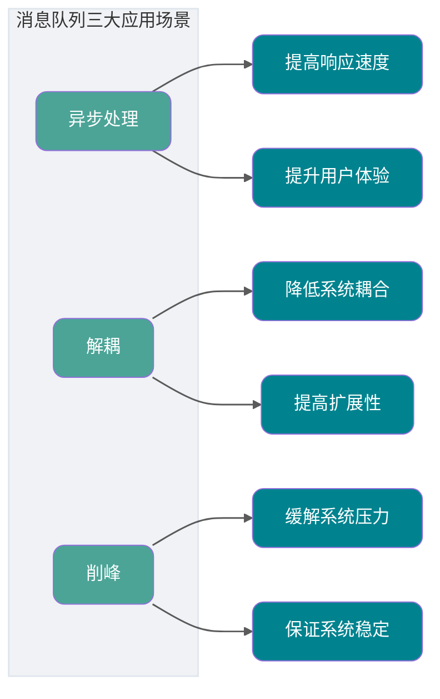

# 消息队列与事件流

<a id="k34053113cef7"></a>

## 如何自定义重试次数以及时间间隔?

从上面的代码可以知道，默认错误处理器的重试次数以及时间间隔是由 `FixedBackOff` 控制的，`FixedBackOff` 是 `DefaultErrorHandler` 初始化时默认的。所以自定义重试次数以及时间间隔，只需要在 `DefaultErrorHandler` 初始化的时候传入自定义的 `FixedBackOff` 即可。重新实现一个 `KafkaListenerContainerFactory` ，调用 `setCommonErrorHandler` 设置新的自定义的错误处理器就可以实现。

```Java
@Bean
public KafkaListenerContainerFactory kafkaListenerContainerFactory(ConsumerFactory<String, String> consumerFactory) {
    ConcurrentKafkaListenerContainerFactory factory = new ConcurrentKafkaListenerContainerFactory();
    // 自定义重试时间间隔以及次数
    FixedBackOff fixedBackOff = new FixedBackOff(1000, 5);
    factory.setCommonErrorHandler(new DefaultErrorHandler(fixedBackOff));
    factory.setConsumerFactory(consumerFactory);
    return factory;
}
```

### 参考资料

- [JavaGuide](https://github.com/Snailclimb/JavaGuide/blob/992dae31eade2a34ba8dbbbcf5ed9de5511325ec/docs/high-performance/message-queue/kafka-questions-01.md#L404)，来源许可：Apache-2.0。

<a id="k81aa1b2337e8"></a>

## 如何解决消息队列的延时以及过期失效问题？：面试官心理分析

你看这问法，其实本质针对的场景，都是说，可能你的消费端出了问题，不消费了；或者消费的速度极其慢。接着就坑爹了，可能你的消息队列集群的磁盘都快写满了，都没人消费，这个时候怎么办？或者是这整个就积压了几个小时，你这个时候怎么办？或者是你积压的时间太长了，导致比如 RabbitMQ 设置了消息过期时间后就没了怎么办？

所以就这事儿，其实线上挺常见的，一般不出，一出就是大 case。一般常见于，举个例子，消费端每次消费之后要写 mysql，结果 mysql 挂了，消费端 hang 那儿了，不动了；或者是消费端出了个什么岔子，导致消费速度极其慢。

### 参考资料

- [Advanced Java](https://github.com/doocs/advanced-java/blob/80b89fb9496d7ea3213e402c8c3853399e00c363/docs/high-concurrency/mq-time-delay-and-expired-failure.md#L7)，来源许可：CC-BY-SA-4.0。

<a id="kc4af5624063d"></a>

## 如何设计一个消息队列？

### 面试题

如果让你写一个消息队列，该如何进行架构设计？说一下你的思路。

### 面试官心理分析

其实聊到这个问题，一般面试官要考察两块：

-   你有没有对某一个消息队列做过较为深入的原理的了解，或者从整体了解把握住一个消息队列的架构原理。
-   看看你的设计能力，给你一个常见的系统，就是消息队列系统，看看你能不能从全局把握一下整体架构设计，给出一些关键点出来。

说实话，问类似问题的时候，大部分人基本都会蒙，因为平时从来没有思考过类似的问题，**大多数人就是平时埋头用，从来不去思考背后的一些东西**。类似的问题，比如，如果让你来设计一个 Spring 框架你会怎么做？如果让你来设计一个 Dubbo 框架你会怎么做？如果让你来设计一个 MyBatis 框架你会怎么做？

### 面试题剖析

其实回答这类问题，说白了，不求你看过那技术的源码，起码你要大概知道那个技术的基本原理、核心组成部分、基本架构构成，然后参照一些开源的技术把一个系统设计出来的思路说一下就好。

比如说这个消息队列系统，我们从以下几个角度来考虑一下：

-   首先这个 mq 得支持可伸缩性吧，就是需要的时候快速扩容，就可以增加吞吐量和容量，那怎么搞？设计个分布式的系统呗，参照一下 kafka 的设计理念，broker -> topic -> partition，每个 partition 放一个机器，就存一部分数据。如果现在资源不够了，简单啊，给 topic 增加 partition，然后做数据迁移，增加机器，不就可以存放更多数据，提供更高的吞吐量了？

-   其次你得考虑一下这个 mq 的数据要不要落地磁盘吧？那肯定要了，落磁盘才能保证别进程挂了数据就丢了。那落磁盘的时候怎么落啊？顺序写，这样就没有磁盘随机读写的寻址开销，磁盘顺序读写的性能是很高的，这就是 kafka 的思路。

-   其次你考虑一下你的 mq 的可用性啊？这个事儿，具体参考之前可用性那个环节讲解的 kafka 的高可用保障机制。多副本 -> leader & follower -> broker 挂了重新选举 leader 即可对外服务。

-   能不能支持数据 0 丢失啊？可以的，参考我们之前说的那个 kafka 数据零丢失方案。

mq 肯定是很复杂的，面试官问你这个问题，其实是个开放题，他就是看看你有没有从架构角度整体构思和设计的思维以及能力。确实这个问题可以刷掉一大批人，因为大部分人平时不思考这些东西。

### 参考资料

- [Advanced Java](https://github.com/doocs/advanced-java/blob/80b89fb9496d7ea3213e402c8c3853399e00c363/docs/high-concurrency/mq-design.md#L1)，来源许可：CC-BY-SA-4.0。

<a id="k7348bb65437c"></a>

## 如何设计一个消息队列？：面试官心理分析

其实聊到这个问题，一般面试官要考察两块：

**相关解释：** [如何设计一个消息队列？](%E6%B6%88%E6%81%AF%E9%98%9F%E5%88%97%E4%B8%8E%E4%BA%8B%E4%BB%B6%E6%B5%81-02.md#kc4af5624063d)

### 参考资料

- [Advanced Java](https://github.com/doocs/advanced-java/blob/80b89fb9496d7ea3213e402c8c3853399e00c363/docs/high-concurrency/mq-design.md#L7)，来源许可：CC-BY-SA-4.0。

<a id="k4d588bdefae8"></a>

## 如果用kafka，RocketMQ这些，你会怎么做？

**回答：**

延续延迟队列问题，需要区分消息产品及具体版本的能力。RocketMQ 提供延迟或定时消息，5.x 的相关接口可以指定投递时间；4.x 常见机制为延迟级别。支持的时间范围、精度、消息类型与重试行为要依据部署版本确认，不能把不同版本接口混用。

使用 RocketMQ 时发送业务 ID、目标时间、事件版本与幂等键，消息到期后消费者重新读取业务状态，条件满足才执行。持久化、重试和死信都需要配置；延迟消息不是实时操作系统定时器，负载与故障会增加实际触发偏差。

不能把 Kafka 的记录 timestamp 直接当作通用“到期后才投递”的保证。对于常见消费模型，可通过外部持久化调度器或 Kafka Streams 状态存储和定时逻辑实现；也可按延迟等级设置 retry topic，再由调度组件转入就绪 topic。

避免在一个消费线程里对尚未到期的消息长时间 sleep，这会阻塞同分区其他消息并影响 poll 活性。Kafka Streams 的 stream-time 依赖事件推进，空闲时不一定前进；需要墙上时间触发的业务应使用对应机制，并接受非硬实时调度。取消或更新定时任务还需版本检查，防止旧到期事件执行。

<a id="alibaba-qwen-20260916-q10"></a>

### 参考资料

- [AIGC Interview Book](https://github.com/WeThinkIn/AIGC-Interview-Book/blob/34e9ee6aa6d35d1e213099a7ae9f433b7b9e6fe6/%E5%A4%A7%E5%8E%82%E9%AB%98%E9%A2%91%E9%9D%A2%E8%AF%95%E9%A2%98%EF%BC%88%E5%AE%9E%E6%97%B6%E6%9B%B4%E6%96%B0%EF%BC%89/%E9%98%BF%E9%87%8C%E5%B7%B4%E5%B7%B4%E9%AB%98%E9%A2%91%E9%9D%A2%E8%AF%95%E9%A2%98.md#L2078)，来源许可：GPL-3.0。

<a id="k688b5f882889"></a>

## 本地消息表

本地消息表其实是国外的 ebay 搞出来的这么一套思想。

这个大概意思是这样的：

1. A 系统在自己本地一个事务里操作同时，插入一条数据到消息表；
2. 接着 A 系统将这个消息发送到 MQ 中去；
3. B 系统接收到消息之后，在一个事务里，往自己本地消息表里插入一条数据，同时执行其他的业务操作，如果这个消息已经被处理过了，那么此时这个事务会回滚，这样**保证不会重复处理消息**；
4. B 系统执行成功之后，就会更新自己本地消息表的状态以及 A 系统消息表的状态；
5. 如果 B 系统处理失败了，那么就不会更新消息表状态，那么此时 A 系统会定时扫描自己的消息表，如果有未处理的消息，会再次发送到 MQ 中去，让 B 再次处理；
6. 这个方案保证了最终一致性，哪怕 B 事务失败了，但是 A 会不断重发消息，直到 B 那边成功为止。

这个方案说实话最大的问题就在于**严重依赖于数据库的消息表来管理事务**啥的，如果是高并发场景咋办呢？咋扩展呢？所以一般确实很少用。


### 参考资料

- [Advanced Java](https://github.com/doocs/advanced-java/blob/80b89fb9496d7ea3213e402c8c3853399e00c363/docs/distributed-system/distributed-transaction.md#L87)，来源许可：CC-BY-SA-4.0。

<a id="k2ffe33086f22"></a>

## 消息写入硬盘后，硬盘坏了如何保证不丢失？

为了保证磁盘损坏导致丢失数据，RocketMQ 采用主从机构，集群部署，Leader 中的数据在多个 Follower 中都存有备份，防止单点故障导致数据丢失。

Master 节点挂了怎么办？Master 节点挂了之后 DLedger 登场

-   接管 MQ 的 commitLog
-   选举从节点
-   文件复制 uncommited 状态 多半从节点收到之后改为 commited

### 参考资料

- [Advanced Java](https://github.com/doocs/advanced-java/blob/80b89fb9496d7ea3213e402c8c3853399e00c363/docs/high-concurrency/how-to-ensure-the-reliable-transmission-of-messages.md#L193)，来源许可：CC-BY-SA-4.0。

<a id="kd30a81a9920c"></a>

## 消息队列与削峰

消息队列可以把非实时任务移出同步调用链，并在流量突增时暂存请求。引入 MQ 后，调用关系变成异步，生产者确认、Broker 持久化、消费者处理和重试策略都会影响最终结果。


相关内容：

- [消息队列面试题总结](https://javaguide.cn/high-performance/message-queue/message-queue-interview-questions.html)
- [消息队列基础常见问题总结](https://javaguide.cn/high-performance/message-queue/message-queue.html)
- [Kafka 常见面试题总结](https://javaguide.cn/high-performance/message-queue/kafka-questions-01.html)
- [RocketMQ 常见面试题总结](https://javaguide.cn/high-performance/message-queue/rocketmq-questions.html)
- [RabbitMQ 常见面试题总结](https://javaguide.cn/high-performance/message-queue/rabbitmq-questions.html)
- [Disruptor 常见面试题总结](https://javaguide.cn/high-performance/message-queue/disruptor-questions.html)

常见面试题：

- 消息队列怎样实现异步、解耦和削峰？引入后会增加哪些问题？
- 一条消息从生产者到消费者，哪些环节可能丢失？
- 至少一次投递为什么可能产生重复消息？消费者如何保证幂等？
- 全局顺序和分区顺序有什么区别？顺序消费会牺牲哪些能力？
- 消息积压时，怎样区分生产突增、消费变慢、分区不足和下游故障？
- Kafka 为什么吞吐量高？批处理、顺序写、页缓存和零拷贝分别起什么作用？
- Kafka 的 ACK、副本和消费者位点怎样影响消息可靠性？
- RocketMQ 事务消息解决什么问题？回查机制怎样处理未知状态？
- RabbitMQ 的 Exchange、Queue、Binding 和 Routing Key 如何配合？
- Disruptor 与跨进程消息队列有什么区别？它适合放在哪类进程内链路？

“消息不丢”不能只看 Broker 是否持久化。生产者发送后没有收到确认、消费者处理成功但位点提交失败、业务数据库写入后进程崩溃，都可能让消息丢失或重复。准备答案时要沿着整条传递链逐段说明。

### 参考资料

- [JavaGuide](https://github.com/Snailclimb/JavaGuide/blob/992dae31eade2a34ba8dbbbcf5ed9de5511325ec/docs/high-performance/high-performance-system-interview-questions.md#L86)，来源许可：Apache-2.0。

<a id="k1952c8d1a0c7"></a>

## 消息队列会带来副作用吗？

没有哪一门技术是“银弹”，消息队列也有它的副作用。

比如，本来好好的两个系统之间的调用，我中间加了个消息队列，如果消息队列挂了怎么办呢？是不是 **降低了系统的可用性** ？

那这样是不是要保证 HA(高可用)？是不是要搞集群？那么我 **整个系统的复杂度是不是上升了** ？

抛开上面的问题不讲，万一我发送方发送失败了，然后执行重试，这样就可能产生重复的消息。

或者我消费端处理失败了，请求重发，这样也会产生重复的消息。

对于一些微服务来说，消费重复消息会带来更大的麻烦，比如增加积分，这个时候我加了多次是不是对其他用户不公平？

那么，又 **如何解决重复消费消息的问题** 呢？

如果我们此时的消息需要保证严格的顺序性怎么办呢？比如生产者生产了一系列的有序消息(对一个 id 为 1 的记录进行删除增加修改)，但是我们知道在发布订阅模型中，对于主题是无顺序的，那么这个时候就会导致对于消费者消费消息的时候没有按照生产者的发送顺序消费，比如这个时候我们消费的顺序为修改删除增加，如果该记录涉及到金额的话是不是会出大事情？

那么，又 **如何解决消息的顺序消费问题** 呢？

就拿我们上面所讲的分布式系统来说，用户购票完成之后是不是需要增加账户积分？在同一个系统中我们一般会使用事务来进行解决，如果用 `Spring` 的话我们在上面伪代码中加入 `@Transactional` 注解就好了。但是在不同系统中如何保证事务呢？总不能这个系统我扣钱成功了你那积分系统积分没加吧？或者说我这扣钱明明失败了，你那积分系统给我加了积分。

那么，又如何 **解决分布式事务问题** 呢？

我们刚刚说了，消息队列可以进行削峰操作，那如果我的消费者如果消费很慢或者生产者生产消息很快，这样是不是会将消息堆积在消息队列中？

那么，又如何 **解决消息堆积的问题** 呢？

可用性降低、复杂度上升，同时还带来重复消费、顺序消费、分布式事务、消息堆积等一系列问题。这些问题如何解决？


下面我们逐一讨论这些问题的解决方案。

### 参考资料

- [JavaGuide](https://github.com/Snailclimb/JavaGuide/blob/992dae31eade2a34ba8dbbbcf5ed9de5511325ec/docs/high-performance/message-queue/rocketmq-questions.md#L135)，来源许可：Apache-2.0。

<a id="k24c633bb0603"></a>

## 消息队列基础与使用限制

消息队列把生产者和消费者之间的同步调用改成异步消息传递。主链路可以更快返回，突发流量也能暂存在 Broker 中，但系统同时增加了消息中间件、异步状态和故障恢复流程。


相关内容：

- [消息队列基础知识总结](https://github.com/Snailclimb/JavaGuide/blob/992dae31eade2a34ba8dbbbcf5ed9de5511325ec/docs/high-performance/message-queue/message-queue.md)
- [高性能系统设计面试题总结](https://github.com/Snailclimb/JavaGuide/blob/992dae31eade2a34ba8dbbbcf5ed9de5511325ec/docs/high-performance/high-performance-system-interview-questions.md)

常见面试题：

- 消息队列怎样实现异步、应用解耦和削峰填谷？
- 引入消息队列后，系统复杂度和数据一致性会发生什么变化？
- 哪些业务适合异步处理？支付结果、库存扣减等强实时链路能否直接异步化？
- RPC 和消息队列在通信方向、响应时效、耦合方式和故障处理上有什么区别？
- 点对点和发布订阅模型分别适合什么场景？
- 为什么不能把消息写入 MQ 就立即向用户返回“业务成功”？

回答“为什么使用 MQ”时，最好结合一个具体流程。例如订单创建后，哪些步骤必须同步完成，哪些通知、积分和风控任务可以异步处理；消费者失败时，用户看到的状态和后台补偿又怎样衔接。

### 参考资料

- [JavaGuide](https://github.com/Snailclimb/JavaGuide/blob/992dae31eade2a34ba8dbbbcf5ed9de5511325ec/docs/high-performance/message-queue/message-queue-interview-questions.md#L32)，来源许可：Apache-2.0。

<a id="kb861198fdd5b"></a>

## 消息队列有什么优缺点

优点上面已经说了，就是**在特殊场景下有其对应的好处**，**解耦**、**异步**、**削峰**。

缺点有以下几个：

-   系统可用性降低

    系统引入的外部依赖越多，越容易挂掉。本来你就是 A 系统调用 BCD 三个系统的接口就好了，ABCD 四个系统还好好的，没啥问题，你偏加个 MQ 进来，万一 MQ 挂了咋整？MQ 一挂，整套系统崩溃，你不就完了？如何保证消息队列的高可用，可以[点击这里查看](https://github.com/doocs/advanced-java/blob/80b89fb9496d7ea3213e402c8c3853399e00c363/docs/high-concurrency/how-to-ensure-high-availability-of-message-queues.md)。

-   系统复杂度提高

    硬生生加个 MQ 进来，你怎么[保证消息没有重复消费](https://github.com/doocs/advanced-java/blob/80b89fb9496d7ea3213e402c8c3853399e00c363/docs/high-concurrency/how-to-ensure-that-messages-are-not-repeatedly-consumed.md)？怎么[处理消息丢失的情况](https://github.com/doocs/advanced-java/blob/80b89fb9496d7ea3213e402c8c3853399e00c363/docs/high-concurrency/how-to-ensure-the-reliable-transmission-of-messages.md)？怎么保证消息传递的顺序性？头大头大，问题一大堆，痛苦不已。

-   一致性问题

    A 系统处理完了直接返回成功了，人都以为你这个请求就成功了；但是问题是，要是 BCD 三个系统那里，BD 两个系统写库成功了，结果 C 系统写库失败了，咋整？你这数据就不一致了。

    所以消息队列实际是一种非常复杂的架构，你引入它有很多好处，但是也得针对它带来的坏处做各种额外的技术方案和架构来规避掉，做好之后，你会发现，妈呀，系统复杂度提升了一个数量级，也许是复杂了 10 倍。但是关键时刻，用，还是得用的。

### 参考资料

- [Advanced Java](https://github.com/doocs/advanced-java/blob/80b89fb9496d7ea3213e402c8c3853399e00c363/docs/high-concurrency/why-mq.md#L83)，来源许可：CC-BY-SA-4.0。

<a id="k030991845c3a"></a>

## 消息队列能带来什么好处？

总结起来就是三个关键词：**异步、解耦、削峰**。这不仅是消息队列的核心价值，更是分布式架构设计的重要思想。



### 参考资料

- [JavaGuide](https://github.com/Snailclimb/JavaGuide/blob/992dae31eade2a34ba8dbbbcf5ed9de5511325ec/docs/high-performance/message-queue/rocketmq-questions.md#L104)，来源许可：Apache-2.0。

<a id="k754b29e7b3d9"></a>

## 消息队列能用来干什么？

### 异步

你可能会问，应用之间的通信又不是只能由消息队列解决，为什么中间非要插一个消息队列？直接进行通信不行吗？

这就引出了另一个概念——**同步通信**。比如业界使用较多的 Dubbo 就是一个适用于各个系统之间同步通信的 RPC 框架。

以购票系统为例，需求是用户在购买完成之后能接收到购买完成的短信通知。


我们省略中间的网络通信时间消耗，假如购票系统处理需要 150ms ，短信系统处理需要 200ms ，那么整个处理流程的时间消耗就是 150ms + 200ms = 350ms。

当然，乍看没什么问题。但仔细分析会发现问题：用户购票在购票系统处理完成时就已经完成了购买动作，而现在通过同步调用非要让整个请求时间变长。短信系统只是一个辅助功能，用于增强用户体验感，并非核心业务。整个调用流程显得 **头重脚轻**——购票是一个不太耗时的流程，但因为同步调用，必须等待发送短信这个较耗时的操作完成才能返回结果。如果再加一个发送邮件的需求呢？


这样整个系统的调用链又变长了，整个时间就变成了 550ms。

当我们在食堂排队打饭时，我们和食堂工作人员之间就是一个同步模型。

我们需要告诉工作人员：“请帮我加个鸡腿，再加个酸辣土豆丝，多打点饭”。

然后工作人员帮我们打饭配菜，我们需要等待这个过程完成。

最终我们从工作人员手中接过饭菜然后去寻找座位。

回想一下，我们在传达需求之后是 **同步等待工作人员配好饭菜** 的。如果增加更多菜品，工作人员打饭配菜的流程就会变长，我们等待的时间也会相应增加。

而在餐厅用餐时，我们告诉服务员来一碗牛肉面加个荷包蛋 **(传达一个消息)** ，然后可以在餐桌上做自己的事情 **(干自己其他事情)** ，等到牛肉面上桌我们再开始用餐。虽然做面的时间没有变短，但是我们只需要传达一个消息就可以干其他事情了，这就是 **异步** 的概念。

所以，为了解决这一个问题，聪明的程序员在中间也加了个类似于服务员的中间件——消息队列。这个时候我们就可以把模型给改造了。


这样，我们在将消息存入消息队列之后我们就可以直接返回了(我们告诉服务员我们要吃什么然后玩手机)，所以整个耗时只是 150ms + 10ms = 160ms。

> 但是你需要注意的是，整个流程的时长是没变的，就像你仅仅告诉服务员要吃什么是不会影响到做面的速度的。

### 解耦

回到最初同步调用的过程，我们写个伪代码简单概括一下。


那么第二步，我们又添加了一个发送邮件，我们就得重新去修改代码，如果我们又加一个需求：用户购买完还需要给他加积分，这个时候我们是不是又得改代码？


如果还觉得可以接受，那么当需要移除发送邮件服务时，是不是又得改代码、又得重启应用？


这样频繁改动代码显然很麻烦，此时可以 **使用消息队列进行解耦** 。需要注意的是，后面的发送短信、发送邮件、添加积分等操作都依赖于 `result`，即购票的处理结果（如订单号、用户账号等），也就是说后续服务都需要相同的消息来进行处理。因此可以通过 **“广播消息”** 模式来实现。

这里所说的“广播”并不是真正的广播，而是下游系统作为消费者去 **订阅** 特定的主题。比如主题可以命名为 `订票`，购买系统作为生产者将消息发送到消息队列，消费者订阅该主题后，从消息队列中拉取消息并消费。在生产者端只需要关注 **生产消息到指定主题** ，**消费者只需要关注从指定主题中拉取消息** 。


> 如果没有消息队列，每当一个新的业务接入，我们都要在主系统调用新接口、或者当我们取消某些业务，我们也得在主系统删除某些接口调用。有了消息队列，我们只需要关心消息是否送达了队列，至于谁希望订阅，接下来收到消息如何处理，是下游的事情，无疑极大地减少了开发和联调的工作量。

### 削峰

回到同步调用系统的场景，思考一下：如果此时有大量用户请求购票，整个系统会变成什么样？


假设有一万个请求进入购票系统，运行主业务的服务器配置通常较好，购票系统可以承受这一万个用户请求。但这意味着同时也会产生一万个调用短信服务的请求。短信系统并非主要业务，配备的硬件资源不会太高。此时短信系统能否承受这一万的峰值？很可能系统会 **直接崩溃** 。

短信业务并非主业务，能否 **折中处理** ？如果我们把购买完成的信息发送到消息队列中，而短信系统 **尽自己所能地去消息队列中取消息和消费消息** ，即使处理速度慢一点也无所谓，只要系统没有崩溃就可以接受。

系统可用性是最重要的，验证码短信的延迟几秒到达用户手机，通常是可以接受的。

### 参考资料

- [JavaGuide](https://github.com/Snailclimb/JavaGuide/blob/992dae31eade2a34ba8dbbbcf5ed9de5511325ec/docs/high-performance/message-queue/rocketmq-questions.md#L30)，来源许可：Apache-2.0。

<a id="kaccc1b2ee400"></a>

## 消息队列选型与项目追问

选型时先确认业务需要什么消息语义，再看团队是否具备对应的部署和故障处理经验。只比较单机吞吐量，很难得到可靠结论。

相关内容：

- [消息队列基础知识总结](https://github.com/Snailclimb/JavaGuide/blob/992dae31eade2a34ba8dbbbcf5ed9de5511325ec/docs/high-performance/message-queue/message-queue.md)
- [Disruptor 常见问题总结](https://github.com/Snailclimb/JavaGuide/blob/992dae31eade2a34ba8dbbbcf5ed9de5511325ec/docs/high-performance/message-queue/disruptor-questions.md)

常见面试题：

- Kafka、RocketMQ 和 RabbitMQ 在消息模型、吞吐、延迟、回放和运维上有什么区别？
- 日志流、订单事件、复杂路由和延时任务分别适合哪类产品？
- 公司已经稳定运行一种 MQ 时，什么情况下值得引入另一种产品？
- 消息队列应该监控哪些生产、存储、消费和业务指标？
- Broker、消费者或下游依赖故障后，系统怎样降级和恢复？
- Disruptor 和分布式消息队列有什么区别？

项目追问通常会落到具体数字和异常处理：峰值生产速率、消费延迟、分区或队列数量、消息保留时间、最大重试次数、积压告警阈值和故障恢复过程。没有参与过的配置和事故按学习结果回答即可，不要编造线上数据。

### 参考资料

- [JavaGuide](https://github.com/Snailclimb/JavaGuide/blob/992dae31eade2a34ba8dbbbcf5ed9de5511325ec/docs/high-performance/message-queue/message-queue-interview-questions.md#L140)，来源许可：Apache-2.0。

<a id="k25a88365fab9"></a>

## 消息队列面试场景

**面试官**：你好。

**候选人**：你好。

（面试官在你的简历上面看到了，呦，有个亮点，你在项目里用过 `MQ` ，比如说你用过 `ActiveMQ` ）

**面试官**：你在系统里用过消息队列吗？（面试官在随和的语气中展开了面试）

**候选人**：用过的（此时感觉没啥）

**面试官**：那你说一下你们在项目里是怎么用消息队列的？

**候选人**：巴拉巴拉，“我们啥啥系统发送个啥啥消息到队列，别的系统来消费啥啥的。比如我们有个订单系统，订单系统每次下一个新的订单的时候，就会发送一条消息到 `ActiveMQ` 里面去，后台有个库存系统负责获取消息然后更新库存。”

（部分同学在这里会进入一个误区，就是你仅仅就是知道以及回答你们是怎么用这个消息队列的，用这个消息队列来干了个什么事情？）

**面试官**：那你们为什么使用消息队列啊？你的订单系统不发送消息到 `MQ` ，直接订单系统调用库存系统一个接口，咔嚓一下，直接就调用成功，库存不也就更新了。

**候选人**：额。。。（楞了一下，为什么？我没怎么仔细想过啊，老大让用就用了），硬着头皮胡言乱语了几句。

（面试官此时听你楞了一下，然后听你胡言乱语了几句，开始心里觉得有点儿那什么了，怀疑你之前就压根儿没思考过这问题）

**面试官**：那你说说用消息队列都有什么优点和缺点？

（面试官此时心里想的是，你的 `MQ` 在项目里为啥要用，你没怎么考虑过，那我稍微简单点儿，我问问你消息队列你之前有没有考虑过如果用的话，优点和缺点分别是啥？）

**候选人**：这个。。。（确实平时没怎么考虑过这个问题啊。。。胡言乱语了）

（面试官此时心里已经更觉得你这哥儿们不行，平时都没什么思考）

**面试官**： `Kafka` 、 `ActiveMQ` 、 `RabbitMQ` 、 `RocketMQ` 都有什么区别？

（面试官问你这个问题，就是说，绕过比较虚的话题，直接看看你对各种 `MQ` 中间件是否了解，是否做过功课，是否做过调研）

**候选人**：我们就用过 `ActiveMQ` ，所以别的没用过。。。区别，也不太清楚。。。

（面试官此时更是觉得你这哥儿们平时就是瞎用，根本就没什么思考，觉得不行）

**面试官**：那你们是如何保证消息队列的高可用啊？

**候选人**：这个。。。我平时就是简单走 API 调用一下，不太清楚消息队列怎么部署的。。。

**面试官**：如何保证消息不被重复消费啊？如何保证消费的时候是幂等的啊？

**候选人**：啥？（ `MQ` 不就是写入&消费就可以了，哪来这么多问题）

**面试官**：如何保证消息的可靠性传输啊？要是消息丢失了怎么办啊？

**候选人**：我们没怎么丢过消息啊。。。

**面试官**：那如何保证消息的顺序性？

**候选人**：顺序性？什么意思？我为什么要保证消息的顺序性？它不是本来就有顺序吗？

**面试官**：如何解决消息队列的延时以及过期失效问题？消息队列满了以后该怎么处理？有几百万消息持续积压几小时，说说怎么解决？

**候选人**：不是，我这平时没遇到过这些问题啊，就是简单用用，知道 `MQ` 的一些功能。

**面试官**：如果让你写一个消息队列，该如何进行架构设计啊？说一下你的思路。

**候选人**：。。。。。我还是走吧。。。。

这其实是面试官的一种面试风格，就是说面试官的问题不是发散的，而是从一个小点慢慢铺开。比如说面试官可能会跟你聊聊高并发话题，就这个话题里面跟你聊聊缓存、 `MQ` 等等东西，**由浅入深，一步步深挖**。

其实上面是一个非常典型的关于消息队列的技术考察过程，好的面试官一定是从你做过的某一个点切入，然后层层展开深入考察，一个接一个问，直到把这个技术点刨根问底，问到最底层。

### 参考资料

- [Advanced Java](https://github.com/doocs/advanced-java/blob/80b89fb9496d7ea3213e402c8c3853399e00c363/docs/high-concurrency/mq-interview.md#L1)，来源许可：CC-BY-SA-4.0。

<a id="k630366d305d4"></a>

## 消费失败会怎么样？

在消费过程中，当其中一个消息消费异常时，会不会卡住后续队列消息的消费？这样业务岂不是卡住了？

生产者代码：

```Java
 for (int i = 0; i < 10; i++) {
   kafkaTemplate.send(KafkaConst.TEST_TOPIC, String.valueOf(i))
 }
```

消费者消代码：

```Java
   @KafkaListener(topics = {KafkaConst.TEST_TOPIC},groupId = "apple")
   private void customer(String message) throws InterruptedException {
       log.info("kafka customer:{}",message);
       Integer n = Integer.parseInt(message);
       if (n%5==0){
           throw new  RuntimeException();
       }
   }
```

在默认配置下，当消费异常会进行重试，重试多次后会跳过当前消息，继续进行后续消息的消费，不会一直卡在当前消息。下面是一段消费的日志，可以看出当 `test-0@95` 重试多次后会被跳过。

```Java
2023-08-10 12:03:32.918 DEBUG 9700 --- [ntainer#0-0-C-1] o.s.kafka.listener.DefaultErrorHandler   : Skipping seek of: test-0@95
2023-08-10 12:03:32.918 TRACE 9700 --- [ntainer#0-0-C-1] o.s.kafka.listener.DefaultErrorHandler   : Seeking: test-0 to: 96
2023-08-10 12:03:32.918  INFO 9700 --- [ntainer#0-0-C-1] o.a.k.clients.consumer.KafkaConsumer     : [Consumer clientId=consumer-apple-1, groupId=apple] Seeking to offset 96 for partition test-0

```

因此，即使某个消息消费异常，Kafka 消费者仍然能够继续消费后续的消息，不会一直卡在当前消息，保证了业务的正常进行。

### 参考资料

- [JavaGuide](https://github.com/Snailclimb/JavaGuide/blob/992dae31eade2a34ba8dbbbcf5ed9de5511325ec/docs/high-performance/message-queue/kafka-questions-01.md#L277)，来源许可：Apache-2.0。

<a id="k15538df37f55"></a>

## 消费者消费 MQ 如何保证不丢失？

1. 如果是网络问题导致的消费失败可以进行重试机制，默认每条消息重试 16 次
2. 多线程异步消费失败，MQ 认为已经消费成功但是实际上对于业务逻辑来说消息是没有落地的，解决方案就是按照 mq 官方推荐的先执行本地事务再返回成功状态。

### 参考资料

- [Advanced Java](https://github.com/doocs/advanced-java/blob/80b89fb9496d7ea3213e402c8c3853399e00c363/docs/high-concurrency/how-to-ensure-the-reliable-transmission-of-messages.md#L203)，来源许可：CC-BY-SA-4.0。

<a id="k090d747cf3f9"></a>

## 生产环境要关注哪些指标？

**1. 内存水位线**

- 监控 `rabbitmq_memory_limit` 占比
- 告警阈值：默认高水位为 0.4（40%）
- 影响：达到高水位后，RabbitMQ 会阻塞发布连接，生产者写入会变慢甚至停住
- 建议配置：

```ini
  vm_memory_high_watermark.relative = 0.4
  vm_memory_high_watermark_paging_ratio = 0.5
```

**2. 文件句柄消耗**

- 监控 File Descriptors 使用率
- 连接数突增时，文件句柄耗尽会导致新连接失败，严重时会影响节点稳定性
- 高连接数环境要提前调大系统限制，例如 `ulimit -n 100000`

**3. Channel 创建和销毁速率**

- 监控信道的创建与销毁速率
- 高频创建销毁 Channel 会带来额外 CPU 和 Erlang 进程开销
- Channel 应复用，但也不要在单个连接上无限堆，通常控制在几十到一两百以内

**4. 消息积压深度**

- 监控 Queue 消息数量和 Consumer Lag
- 告警阈值：根据业务定义（如 > 10,000 条）
- 工具：RabbitMQ Management UI、Prometheus + Grafana

**5. 磁盘空间与 I/O**

- 监控磁盘剩余空间和 IOPS
- 告警阈值：磁盘剩余 < 20% 触发告警
- Quorum Queue 对磁盘 I/O 要求较高，建议使用 NVMe SSD

### 参考资料

- [JavaGuide](https://github.com/Snailclimb/JavaGuide/blob/992dae31eade2a34ba8dbbbcf5ed9de5511325ec/docs/high-performance/message-queue/rabbitmq-questions.md#L345)，来源许可：Apache-2.0。

<a id="k0585830b5a72"></a>

## 生产者发送消息时如何保证不丢失？

解决发送时消息丢失的问题可以采用 RocketMQ 自带的**事务消息**机制

事务消息原理：首先生产者会发送一个**half 消息**(对原始消息的封装)，该消息对消费者不可见，MQ 通过 ACK 机制返回消息接受状态， 生产者执行本地事务并且返回给 MQ 一个状态(Commit、RollBack 等)，如果是 Commit 的话 MQ 就会把消息给到下游， RollBack 的话就会丢弃该消息，状态如果为 UnKnow 的话会过一段时间回查本地事务状态，默认回查 15 次，一直是 UnKnow 状态的话就会丢弃此消息。

为什么先发一个 half 消息，作用就是先判断下 MQ 有没有问题，服务正不正常。

### 参考资料

- [Advanced Java](https://github.com/doocs/advanced-java/blob/80b89fb9496d7ea3213e402c8c3853399e00c363/docs/high-concurrency/how-to-ensure-the-reliable-transmission-of-messages.md#L181)，来源许可：CC-BY-SA-4.0。

<a id="k3c76e778bf0a"></a>

## 说说 Broker 服务节点、Queue 队列、Exchange 交换器？

- **Broker**：可以看做 RabbitMQ 的服务节点。一般情况下一个 Broker 可以看做一个 RabbitMQ 服务器。
- **Queue**：RabbitMQ 的内部对象，用于存储消息。多个消费者可以订阅同一队列，这时队列中的消息会被平摊（轮询）给多个消费者进行处理。
- **Exchange**：生产者将消息发送到交换器，由交换器将消息路由到一个或者多个队列中。当路由不到时，或返回给生产者或直接丢弃。

### 参考资料

- [JavaGuide](https://github.com/Snailclimb/JavaGuide/blob/992dae31eade2a34ba8dbbbcf5ed9de5511325ec/docs/high-performance/message-queue/rabbitmq-questions.md#L132)，来源许可：Apache-2.0。

<a id="k872b2b451f8c"></a>

## 说说生产者 Producer 和消费者 Consumer

**生产者**：

- 消息生产者，就是投递消息的一方。
- 消息一般包含两个部分：**消息体**（payload）和**消息头**（Label/Headers）。

**消费者**：

- 消费消息，也就是接收消息的一方。
- 消费者连接到 RabbitMQ 服务器并订阅队列。业务通常处理消息体；routing key、headers、delivery tag 等属于路由或投递元数据，可以用于日志、幂等和确认处理，但不应该被当成业务消息体本身。

### 参考资料

- [JavaGuide](https://github.com/Snailclimb/JavaGuide/blob/992dae31eade2a34ba8dbbbcf5ed9de5511325ec/docs/high-performance/message-queue/rabbitmq-questions.md#L120)，来源许可：Apache-2.0。

<a id="k81ef5147c1d3"></a>

## 超时、重试与幂等

超时只表示调用方在期限内没有收到结果，不能证明服务端执行失败。查询请求可以在总时间预算内有限重试；支付、下单和库存扣减等写请求，必须先用幂等键、唯一约束或状态机控制重复执行。


相关内容：

- [超时&重试详解](https://javaguide.cn/high-availability/timeout-and-retry.html)
- [接口幂等方案总结](https://javaguide.cn/high-availability/idempotency.html)

常见面试题：

- 为什么远程调用必须设置超时？连接、读取、连接池和总 Deadline 分别限制什么？
- 超时时间应该参考 P99/P999、业务等待时间还是下游 SLA？
- 调用链中的 Timeout Budget 怎样逐层传递？
- 重试为什么可能放大故障？指数退避和 Jitter 解决什么问题？
- 哪些网络错误和 HTTP 状态适合重试？哪些错误应该直接失败？
- 什么是 Retry Budget？多层 SDK 同时重试会发生什么？
- 什么是幂等？HTTP 幂等语义和业务幂等有什么区别？
- 幂等键、唯一索引、Redis、乐观锁和状态机各适合什么场景？
- 支付接口怎样处理首次请求、并发重复请求和重复通知？
- 去重和幂等有什么区别？为什么入口去重不能代替服务端幂等？
- Token 防重复提交时，消费 Token 和执行业务的顺序有什么风险？
- 使用悲观锁做幂等时，怎样避免范围锁、死锁和长事务？

准备这部分时要多讲结果不确定的情况：服务端已经完成扣款，响应却丢在网络上；调用方超时后再次请求，如果没有稳定的业务请求号，就可能产生第二次扣款。

### 参考资料

- [JavaGuide](https://github.com/Snailclimb/JavaGuide/blob/992dae31eade2a34ba8dbbbcf5ed9de5511325ec/docs/high-availability/high-availability-system-interview-questions.md#L105)，来源许可：Apache-2.0。

<a id="kb0dc46a96f8a"></a>

## 重试失败后的数据如何再次处理?

当达到最大重试次数后，数据会直接被跳过，继续向后进行。当代码修复后，如何重新消费这些重试失败的数据呢？

**死信队列（Dead Letter Queue，简称 DLQ）** 是消息中间件中的一种特殊队列。它主要用于处理无法被消费者正确处理的消息，通常是因为消息格式错误、处理失败、消费超时等情况导致的消息被“丢弃”或“死亡”的情况。当消息进入队列后，消费者会尝试处理它。如果处理失败，或者超过一定的重试次数仍无法被成功处理，消息可以发送到死信队列中，而不是被永久性地丢弃。在死信队列中，可以进一步分析、处理这些无法正常消费的消息，以便定位问题、修复错误，并采取适当的措施。

`@RetryableTopic` 是 Spring Kafka 中的一个注解,它用于配置某个 Topic 支持消息重试，更推荐使用这个注解来完成重试。

```Java
// 重试 5 次，重试间隔 100 毫秒,最大间隔 1 秒
@RetryableTopic(
        attempts = "5",
        backoff = @Backoff(delay = 100, maxDelay = 1000)
)
@KafkaListener(topics = {KafkaConst.TEST_TOPIC}, groupId = "apple")
private void customer(String message) {
    log.info("kafka customer:{}", message);
    Integer n = Integer.parseInt(message);
    if (n % 5 == 0) {
        throw new RuntimeException();
    }
    System.out.println(n);
}
```

当达到最大重试次数后，如果仍然无法成功处理消息，消息会被发送到对应的死信队列中。对于死信队列的处理，既可以用 `@DltHandler` 处理，也可以使用 `@KafkaListener` 重新消费。

### 参考资料

- [JavaGuide](https://github.com/Snailclimb/JavaGuide/blob/992dae31eade2a34ba8dbbbcf5ed9de5511325ec/docs/high-performance/message-queue/kafka-questions-01.md#L443)，来源许可：Apache-2.0。

<a id="k607ddd4083ac"></a>

## 队列模型了解吗？Kafka 的消息模型知道吗？

> 题外话：早期的 JMS 和 AMQP 属于消息服务领域权威组织所做的相关的标准，我在 [JavaGuide](https://github.com/Snailclimb/JavaGuide)的 [《消息队列其实很简单》](https://github.com/Snailclimb/JavaGuide#%E6%95%B0%E6%8D%AE%E9%80%9A%E4%BF%A1%E4%B8%AD%E9%97%B4%E4%BB%B6)这篇文章中介绍过。但是，这些标准的进化跟不上消息队列的演进速度，这些标准实际上已经属于废弃状态。所以，可能存在的情况是：不同的消息队列都有自己的一套消息模型。

### 队列模型：早期的消息模型


**使用队列（Queue）作为消息通信载体，满足生产者与消费者模式，一条消息只能被一个消费者使用，未被消费的消息在队列中保留直到被消费或超时。** 比如：我们生产者发送 100 条消息的话，两个消费者来消费一般情况下两个消费者会按照消息发送的顺序各自消费一半（也就是你一个我一个的消费。）

**队列模型存在的问题：**

假如我们存在这样一种情况：我们需要将生产者产生的消息分发给多个消费者，并且每个消费者都能接收到完整的消息内容。

这种情况，队列模型就不好解决了。很多比较杠精的人就说：我们可以为每个消费者创建一个单独的队列，让生产者发送多份。这是一种非常愚蠢的做法，浪费资源不说，还违背了使用消息队列的目的。

### 发布-订阅模型:Kafka 消息模型

发布-订阅模型主要是为了解决队列模型存在的问题。


发布订阅模型（Pub-Sub） 使用**主题（Topic）** 作为消息通信载体，类似于**广播模式**；发布者发布一条消息，该消息通过主题传递给所有的订阅者，**在一条消息广播之后才订阅的用户则是收不到该条消息的**。

**在发布 - 订阅模型中，如果只有一个订阅者，那它和队列模型就基本是一样的了。所以说，发布 - 订阅模型在功能层面上是可以兼容队列模型的。**

**Kafka 采用的就是发布 - 订阅模型。**

> **RocketMQ 的消息模型和 Kafka 基本是完全一样的。唯一的区别是 Kafka 中没有队列这个概念，与之对应的是 Partition（分区）。**

### 参考资料

- [JavaGuide](https://github.com/Snailclimb/JavaGuide/blob/992dae31eade2a34ba8dbbbcf5ed9de5511325ec/docs/high-performance/message-queue/kafka-questions-01.md#L41)，来源许可：Apache-2.0。

<a id="k07ae6371932b"></a>

## 默认会重试多少次？

默认配置下，消费异常会进行重试，重试次数是多少, 重试是否有时间间隔？

看源码 `FailedRecordTracker` 类有个 `recovered` 函数，返回 Boolean 值判断是否要进行重试，下面是这个函数中判断是否重试的逻辑：

```java
	@Override
	public boolean recovered(ConsumerRecord<?, ?> record, Exception exception,
	    @Nullable MessageListenerContainer container,
	    @Nullable Consumer<?, ?> consumer) throws InterruptedException {

	    if (this.noRetries) {
         // 不支持重试
	        attemptRecovery(record, exception, null, consumer);
	        return true;
	    }
     // 取已经失败的消费记录集合
	    Map < TopicPartition, FailedRecord > map = this.failures.get();
	    if (map == null) {
	        this.failures.set(new HashMap < > ());
	        map = this.failures.get();
	    }
     //  获取消费记录所在的Topic和Partition
	    TopicPartition topicPartition = new TopicPartition(record.topic(), record.partition());
	    FailedRecord failedRecord = getFailedRecordInstance(record, exception, map, topicPartition);
     // 通知注册的重试监听器，消息投递失败
	    this.retryListeners.forEach(rl - >
	        rl.failedDelivery(record, exception, failedRecord.getDeliveryAttempts().get()));
	    // 获取下一次重试的时间间隔
    long nextBackOff = failedRecord.getBackOffExecution().nextBackOff();
	    if (nextBackOff != BackOffExecution.STOP) {
	        this.backOffHandler.onNextBackOff(container, exception, nextBackOff);
	        return false;
	    } else {
	        attemptRecovery(record, exception, topicPartition, consumer);
	        map.remove(topicPartition);
	        if (map.isEmpty()) {
	            this.failures.remove();
	        }
	        return true;
	    }
	}
```

其中， `BackOffExecution.STOP` 的值为 -1。

```java
@FunctionalInterface
public interface BackOffExecution {

	long STOP = -1;
	long nextBackOff();

}
```

`nextBackOff` 的值调用 `BackOff` 类的 `nextBackOff()` 函数。如果当前执行次数大于最大执行次数则返回 `STOP`，既超过这个最大执行次数后才会停止重试。

```Java
public long nextBackOff() {
  this.currentAttempts++;
  if (this.currentAttempts <= getMaxAttempts()) {
    return getInterval();
  }
  else {
    return STOP;
  }
}
```

那么这个 `getMaxAttempts` 的值又是多少呢？回到最开始，当执行出错会进入 `DefaultErrorHandler` 。`DefaultErrorHandler` 默认的构造函数是：

```Java
public DefaultErrorHandler() {
  this(null, SeekUtils.DEFAULT_BACK_OFF);
}
```

`SeekUtils.DEFAULT_BACK_OFF` 定义的是:

```Java
public static final int DEFAULT_MAX_FAILURES = 10;

public static final FixedBackOff DEFAULT_BACK_OFF = new FixedBackOff(0, DEFAULT_MAX_FAILURES - 1);
```

`DEFAULT_MAX_FAILURES` 的值是 10，`currentAttempts` 从 0 到 9，所以总共会执行 10 次，每次重试的时间间隔为 0。

最后，简单总结一下：Kafka 消费者在默认配置下会进行最多 10 次 的重试，每次重试的时间间隔为 0，即立即进行重试。如果在 10 次重试后仍然无法成功消费消息，则不再进行重试，消息将被视为消费失败。

### 参考资料

- [JavaGuide](https://github.com/Snailclimb/JavaGuide/blob/992dae31eade2a34ba8dbbbcf5ed9de5511325ec/docs/high-performance/message-queue/kafka-questions-01.md#L313)，来源许可：Apache-2.0。
