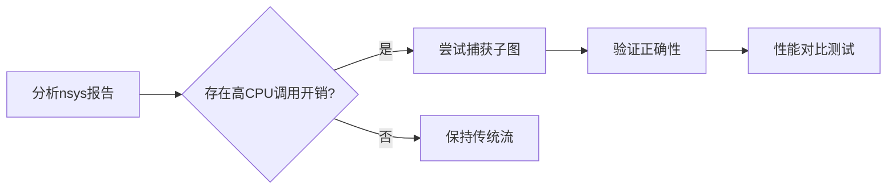

# 推理服务与部署

<a id="k98ff4ad1c4a7"></a>

## 二、与普通FP8的区别

| 维度 | 普通FP8 | MXFP8 |
|------|---------|-------|
| 元素格式 | E4M3 / E5M2 | E4M3 / E5M2 |
| 缩放粒度 | per-tensor / per-channel | 每32个元素一个block scale |
| scale格式 | FP32/FP16等 | E8M0（2的整数次幂） |
| 异常值处理 | 受全局scale限制 | 局部scale自适应，outlier影响局限在block内 |
| 存储开销 | 几乎可忽略 | 每32个元素多1字节scale（约3%） |
| 硬件支持 | Hopper及更新架构 | Blackwell原生支持MX Tensor Core |

### 参考资料

- [AIGC Interview Book](https://github.com/WeThinkIn/AIGC-Interview-Book/blob/34e9ee6aa6d35d1e213099a7ae9f433b7b9e6fe6/%E6%A8%A1%E5%9E%8B%E9%83%A8%E7%BD%B2%E5%9F%BA%E7%A1%80%EF%BC%88%E7%B2%BE%E5%8D%8E%E7%89%88%EF%BC%89/6.3%E5%A4%A7%E6%A8%A1%E5%9E%8B%E9%83%A8%E7%BD%B2%E6%8A%80%E6%9C%AF.md#L1473)，来源许可：GPL-3.0。

<a id="kbb7dea855602"></a>

## 二、为什么 Decode 阶段 Launch Overhead 突出

大模型 Decode 阶段的特点：
- 每次只处理 1 个 Token，计算量极小
- 但模型全层都要执行一遍（如 Llama-70B 有 80 层）
- 每层包含多个 Attention、MLP、LayerNorm 等计算，产生大量小 Kernel

```
Prefill 阶段（batch=1, seq_len=1024）：
  单个 MatMul Kernel ≈ 500 μs
  Launch Overhead 占比 ≈ 10 μs / 500 μs = 2%（可忽略）

Decode 阶段（batch=1, seq_len=1）：
  单个 MatMul Kernel ≈ 15 μs
  Launch Overhead 占比 ≈ 10 μs / 15 μs = 40%（严重！）
```

在 Decode 阶段，可能有上千个微小的 Kernel，每个耗时 10-50 μs，但总 Launch Overhead 可能高达毫秒级。

### 参考资料

- [AIGC Interview Book](https://github.com/WeThinkIn/AIGC-Interview-Book/blob/34e9ee6aa6d35d1e213099a7ae9f433b7b9e6fe6/%E6%A8%A1%E5%9E%8B%E9%83%A8%E7%BD%B2%E5%9F%BA%E7%A1%80%EF%BC%88%E7%B2%BE%E5%8D%8E%E7%89%88%EF%BC%89/6.4%E6%80%A7%E8%83%BD%E5%88%86%E6%9E%90%E4%B8%8E%E8%B0%83%E4%BC%98%E5%B7%A5%E5%85%B7.md#L1603)，来源许可：GPL-3.0。

<a id="k34bbc9381099"></a>

## 二、为什么Opset会影响兼容性？

兼容性问题主要来自三个方面。

1. 推理框架支持的Opset版本有限

不同推理引擎支持的Opset版本范围不同。如果导出的ONNX模型使用了较新的Opset，而目标推理框架版本较旧，就可能出现解析失败或算子不支持。

例如，ONNX Runtime通常对ONNX标准支持较全面，但某些硬件Execution Provider、TensorRT Parser或端侧推理框架可能只支持部分Opset和部分算子。

2. 同一算子在不同Opset中语义可能变化

有些算子在不同Opset版本中输入格式、属性字段或行为细节会变化。例如Resize、Slice、Pad、Upsample等算子历史上就经历过多次定义调整。

如果训练框架导出和推理框架解析时对算子语义理解不一致，就可能导致推理结果不正确。

3. 新模型结构可能依赖新算子

一些新模型结构会使用较新的算子或更复杂的组合。如果Opset版本过低，可能无法表达这些操作；如果Opset版本过高，目标推理框架又可能还没支持。

所以导出ONNX时不是Opset越新越好，而是要选择训练框架、模型结构和目标推理框架都支持的版本。

### 参考资料

- [AIGC Interview Book](https://github.com/WeThinkIn/AIGC-Interview-Book/blob/34e9ee6aa6d35d1e213099a7ae9f433b7b9e6fe6/%E6%A8%A1%E5%9E%8B%E9%83%A8%E7%BD%B2%E5%9F%BA%E7%A1%80%EF%BC%88%E7%B2%BE%E5%8D%8E%E7%89%88%EF%BC%89/6.2%E4%BC%A0%E7%BB%9F%E6%A8%A1%E5%9E%8B%E9%83%A8%E7%BD%B2%EF%BC%9AONNX%E4%B8%8ETensorRT.md#L179)，来源许可：GPL-3.0。

<a id="kde3af4635383"></a>

## 二、为什么不只学习真实标签？

真实标签通常是硬标签，例如一张图片的标签是“猫”。但老师模型的输出是一个概率分布，例如：

- 猫：0.85
- 狐狸：0.10
- 狗：0.03
- 车：0.01

这个分布包含了类别之间的相似性信息。学生模型学习这个分布，比只学习“猫”这个硬标签能获得更多知识。

这种来自老师模型的概率分布通常叫做**软标签（soft label）**。

### 参考资料

- [AIGC Interview Book](https://github.com/WeThinkIn/AIGC-Interview-Book/blob/34e9ee6aa6d35d1e213099a7ae9f433b7b9e6fe6/%E6%A8%A1%E5%9E%8B%E9%83%A8%E7%BD%B2%E5%9F%BA%E7%A1%80%EF%BC%88%E7%B2%BE%E5%8D%8E%E7%89%88%EF%BC%89/6.1%E6%8E%A8%E7%90%86%E9%83%A8%E7%BD%B2%E7%BB%BC%E8%BF%B0.md#L953)，来源许可：GPL-3.0。

<a id="k86a6fcde8ed6"></a>

## 二、为什么不能只用模型文件直接部署？

单个模型文件只能说明“模型怎么计算”，但生产推理还需要解决很多服务化问题：

1. **如何对外提供HTTP/gRPC接口**
2. **如何同时部署多个模型和多个版本**
3. **如何管理GPU上的多个模型实例**
4. **如何处理高并发请求**
5. **如何把小请求合并成batch提高吞吐**
6. **如何监控延迟、吞吐、错误率和GPU利用率**
7. **如何热加载、卸载或更新模型**
8. **如何在不同推理后端之间统一接口**

Triton就是为这些工程问题设计的。

### 参考资料

- [AIGC Interview Book](https://github.com/WeThinkIn/AIGC-Interview-Book/blob/34e9ee6aa6d35d1e213099a7ae9f433b7b9e6fe6/%E6%A8%A1%E5%9E%8B%E9%83%A8%E7%BD%B2%E5%9F%BA%E7%A1%80%EF%BC%88%E7%B2%BE%E5%8D%8E%E7%89%88%EF%BC%89/6.2%E4%BC%A0%E7%BB%9F%E6%A8%A1%E5%9E%8B%E9%83%A8%E7%BD%B2%EF%BC%9AONNX%E4%B8%8ETensorRT.md#L1672)，来源许可：GPL-3.0。

<a id="kfd669127aee7"></a>

## 二、为什么推理部署中需要模型压缩？

训练阶段通常更关注模型效果，可以使用很大的模型和充足的训练资源；但部署阶段要面对真实业务约束。

常见约束包括：

- **延迟约束**：用户请求需要快速返回
- **吞吐约束**：线上服务要同时处理大量请求
- **成本约束**：GPU、CPU、显存和电力成本都很高
- **端侧约束**：手机、摄像头、IoT设备算力和内存有限
- **包体约束**：移动端App或嵌入式固件不能太大

所以模型压缩的核心价值是：**让效果好的模型真正能上线、能跑快、能跑便宜。**

### 参考资料

- [AIGC Interview Book](https://github.com/WeThinkIn/AIGC-Interview-Book/blob/34e9ee6aa6d35d1e213099a7ae9f433b7b9e6fe6/%E6%A8%A1%E5%9E%8B%E9%83%A8%E7%BD%B2%E5%9F%BA%E7%A1%80%EF%BC%88%E7%B2%BE%E5%8D%8E%E7%89%88%EF%BC%89/6.1%E6%8E%A8%E7%90%86%E9%83%A8%E7%BD%B2%E7%BB%BC%E8%BF%B0.md#L761)，来源许可：GPL-3.0。

<a id="kb186e7bead15"></a>

## 二、为什么融合能加速？

深度学习推理中，很多算子的计算量不大，但会产生中间张量。如果每个算子都单独执行，就会带来：

- 多次读取和写入显存/内存
- 多次kernel launch
- 多次中间张量分配和释放
- 算子之间的调度开销

融合后，中间结果可以保存在寄存器、共享内存或缓存中，减少对全局内存的访问，从而提升性能。

### 参考资料

- [AIGC Interview Book](https://github.com/WeThinkIn/AIGC-Interview-Book/blob/34e9ee6aa6d35d1e213099a7ae9f433b7b9e6fe6/%E6%A8%A1%E5%9E%8B%E9%83%A8%E7%BD%B2%E5%9F%BA%E7%A1%80%EF%BC%88%E7%B2%BE%E5%8D%8E%E7%89%88%EF%BC%89/6.1%E6%8E%A8%E7%90%86%E9%83%A8%E7%BD%B2%E7%BB%BC%E8%BF%B0.md#L1295)，来源许可：GPL-3.0。

<a id="kcbf988604051"></a>

## 二、为什么要单独量化KV Cache？

**1. KV Cache是显存的最大消耗者**

在长上下文或多并发场景中，KV Cache往往比模型权重占用更多显存。例如：
- 100个并发请求 × 4096上下文 × 7B模型的KV Cache ≈ 数十GB
- 同等条件下模型权重可能只有14GB

**2. K Cache和V Cache的量化敏感度不同**

研究发现K Cache和V Cache对量化的敏感度不同：
- V Cache通常对量化更鲁棒（可以量化到更低位宽）
- K Cache用于计算Attention Score，对精度更敏感（通常需要保留较高精度）

因此很多实现对K和V采用不同的量化策略：K→INT8，V→INT4或K→FP16，V→INT8。

**3. Decode阶段是访存瓶颈**

Decode阶段每次都需要读取全部KV Cache来与当前Token计算注意力。量化KV Cache可以：
- 减少每次Decode的访存量（如INT8查表比FP16少一半带宽）
- 提高有效HBM带宽利用率
- 间接提高Decode速度

### 参考资料

- [AIGC Interview Book](https://github.com/WeThinkIn/AIGC-Interview-Book/blob/34e9ee6aa6d35d1e213099a7ae9f433b7b9e6fe6/%E6%A8%A1%E5%9E%8B%E9%83%A8%E7%BD%B2%E5%9F%BA%E7%A1%80%EF%BC%88%E7%B2%BE%E5%8D%8E%E7%89%88%EF%BC%89/6.3%E5%A4%A7%E6%A8%A1%E5%9E%8B%E9%83%A8%E7%BD%B2%E6%8A%80%E6%9C%AF.md#L1308)，来源许可：GPL-3.0。

<a id="kc11ae189bff0"></a>

## 二、为什么重要？

计算强度可以帮助判断程序更可能受什么限制：

- **计算强度高**：更可能是计算瓶颈
- **计算强度低**：更可能是访存瓶颈

例如，大矩阵乘法通常计算强度较高，适合GPU充分发挥算力；而ReLU、Add、LayerNorm等算子计算量较少、读写较多，容易受访存限制。

### 参考资料

- [AIGC Interview Book](https://github.com/WeThinkIn/AIGC-Interview-Book/blob/34e9ee6aa6d35d1e213099a7ae9f433b7b9e6fe6/%E6%A8%A1%E5%9E%8B%E9%83%A8%E7%BD%B2%E5%9F%BA%E7%A1%80%EF%BC%88%E7%B2%BE%E5%8D%8E%E7%89%88%EF%BC%89/6.1%E6%8E%A8%E7%90%86%E9%83%A8%E7%BD%B2%E7%BB%BC%E8%BF%B0.md#L1388)，来源许可：GPL-3.0。

<a id="k63639fa69a8a"></a>

## 二、为什么需要推理框架

训练框架可以把模型训练出来，但生产环境还需要解决性能、硬件适配和服务稳定性问题。推理框架的价值主要体现在：
1. **让模型跑得更快**：通过图优化、算子融合、量化、编译优化等方式降低推理延迟
2. **让硬件利用率更高**：充分利用CPU/GPU/NPU等硬件的算力和内存带宽
3. **让部署成本更低**：减少显存、内存、机器数量和电力成本
4. **让线上服务更稳定**：配合batching、并发调度、监控、热更新等能力支撑生产请求

### 参考资料

- [AIGC Interview Book](https://github.com/WeThinkIn/AIGC-Interview-Book/blob/34e9ee6aa6d35d1e213099a7ae9f433b7b9e6fe6/%E6%A8%A1%E5%9E%8B%E9%83%A8%E7%BD%B2%E5%9F%BA%E7%A1%80%EF%BC%88%E7%B2%BE%E5%8D%8E%E7%89%88%EF%BC%89/6.1%E6%8E%A8%E7%90%86%E9%83%A8%E7%BD%B2%E7%BB%BC%E8%BF%B0.md#L98)，来源许可：GPL-3.0。

<a id="kbd613cc45b13"></a>

## 二、为何需要“RoCE高网”？

1. **极致性能**  
   - **低延迟**：应用层时延可降至5μs（InfiniBand约2μs），远超TCP/IP的50μs。
   - **高吞吐**：支持400G/800G以太网带宽，满足AI训练、分布式存储的密集型流量需求。
   - **无损传输**：通过PFC（优先级流控）和ECN（显式拥塞通知）实现零丢包，避免重传开销。

2. **成本与生态优势**  
   - **兼容以太网**：无需专用硬件（如InfiniBand交换机），复用现有以太网基础设施，部署成本降低50%以上。
   - **开放生态**：支持多厂商设备互联，运维与传统以太网一致。

### 参考资料

- [AIGC Interview Book](https://github.com/WeThinkIn/AIGC-Interview-Book/blob/34e9ee6aa6d35d1e213099a7ae9f433b7b9e6fe6/%E6%A8%A1%E5%9E%8B%E9%83%A8%E7%BD%B2%E5%9F%BA%E7%A1%80/%E8%BE%B9%E4%BA%91%E7%AB%AF%E9%83%A8%E7%BD%B2%E7%9F%A5%E8%AF%86%E7%82%B9.md#L1309)，来源许可：GPL-3.0。

<a id="ke10132c78c9e"></a>

## 二、如何理解？

可以用下面的公式理解：

```text
可达到性能 = min(硬件峰值算力, 内存带宽 × 计算强度)
```

如果一个算子的计算强度很低，那么即使硬件峰值算力很高，也会因为内存带宽不足而跑不满，这就是访存瓶颈。

如果一个算子的计算强度很高，已经越过带宽限制区间，性能更接近硬件峰值算力，这时就是计算瓶颈。

### 参考资料

- [AIGC Interview Book](https://github.com/WeThinkIn/AIGC-Interview-Book/blob/34e9ee6aa6d35d1e213099a7ae9f433b7b9e6fe6/%E6%A8%A1%E5%9E%8B%E9%83%A8%E7%BD%B2%E5%9F%BA%E7%A1%80%EF%BC%88%E7%B2%BE%E5%8D%8E%E7%89%88%EF%BC%89/6.1%E6%8E%A8%E7%90%86%E9%83%A8%E7%BD%B2%E7%BB%BC%E8%BF%B0.md#L1412)，来源许可：GPL-3.0。

<a id="kd6f1d4a6239a"></a>

## 二、如何采集命中率数据

**vLLM 方式**：
```python
# vLLM 启动时开启 prometheus 指标
# vllm serve ... --enable-metrics

# 新版本 vLLM 直接暴露缓存命中率
# vllm:cache_hit_rate                        # 命中缓存的 Token 占比
# 也可用请求指标反推：
# vllm:prompt_tokens_total                   # 请求携带的总 Prompt Token 数
# 实际 Prefill 的 Token 数（从 request metrics / 日志统计）
# 命中缓存数 ≈ prompt_tokens_total - 实际 prefill token 数
```

**SGLang 方式**：
SGLang 的 RadixAttention 基于 Radix Tree 管理缓存，可以直接查询：
```python
# 通过 server_args 配置后，查看日志或 metrics
# cache_hit_rate: 0.85  表示 85% 的 Prompt Token 命中了缓存
```

### 参考资料

- [AIGC Interview Book](https://github.com/WeThinkIn/AIGC-Interview-Book/blob/34e9ee6aa6d35d1e213099a7ae9f433b7b9e6fe6/%E6%A8%A1%E5%9E%8B%E9%83%A8%E7%BD%B2%E5%9F%BA%E7%A1%80%EF%BC%88%E7%B2%BE%E5%8D%8E%E7%89%88%EF%BC%89/6.4%E6%80%A7%E8%83%BD%E5%88%86%E6%9E%90%E4%B8%8E%E8%B0%83%E4%BC%98%E5%B7%A5%E5%85%B7.md#L1956)，来源许可：GPL-3.0。

<a id="k69bba05ca67d"></a>

## 二、计算瓶颈怎么看？

如果模型中大矩阵乘法、卷积、Attention计算占主要时间，并且GPU计算单元利用率很高，就可能是计算瓶颈。

常见现象：
- GPU算力利用率高
- Tensor Core利用率高
- 主要耗时集中在GEMM、Conv、Attention等计算密集算子
- 降低精度后速度明显提升，例如FP32改FP16/INT8后明显变快

常见优化方式：
- 使用FP16/BF16/INT8/FP8等低精度
- 使用更高效的算子库
- 算子融合
- 选择更适合硬件的模型结构

### 参考资料

- [AIGC Interview Book](https://github.com/WeThinkIn/AIGC-Interview-Book/blob/34e9ee6aa6d35d1e213099a7ae9f433b7b9e6fe6/%E6%A8%A1%E5%9E%8B%E9%83%A8%E7%BD%B2%E5%9F%BA%E7%A1%80%EF%BC%88%E7%B2%BE%E5%8D%8E%E7%89%88%EF%BC%89/6.1%E6%8E%A8%E7%90%86%E9%83%A8%E7%BD%B2%E7%BB%BC%E8%BF%B0.md#L681)，来源许可：GPL-3.0。

<a id="kcd6347af040d"></a>

## 二、通俗案例解析：智能旅行规划系统

假设用户输入："帮我规划北京三日游，要包含故宫和环球影城，预算5000元"

**传统方式**需要工程师编写：
- 高德API调用（路线规划）
- 美团API接入（餐饮推荐）
- 天气预报接口（行程调整）
- 预算计算逻辑

**基于MCP的实现**：
```python
# MCP服务注册（伪代码）
register_tool("高德地图", type="navigation", params={"city": "北京"})
register_tool("美团餐饮", type="poi", params={"budget": 5000})
register_tool("天气预报", type="environment")

# LLM直接生成指令链
plan = llm.generate(
   "用户需求：北京三日游，故宫+环球影城，预算5000",
   allowed_tools=["高德地图", "美团餐饮", "天气预报"] 
)

# 输出结构化指令
{
  "day1": [
    {"tool": "高德地图", "action": "path_plan", 
     "params": {"start": "故宫", "end": "酒店"}},
    {"tool": "美团餐饮", "action": "recommend",
     "params": {"location": "故宫周边", "price_range": "人均100-150"}}
  ]
}
```
开发效率从**3人周**降至**2小时**，且后续可无缝替换同类服务（如将高德替换为百度地图）

### 参考资料

- [AIGC Interview Book](https://github.com/WeThinkIn/AIGC-Interview-Book/blob/34e9ee6aa6d35d1e213099a7ae9f433b7b9e6fe6/%E6%A8%A1%E5%9E%8B%E9%83%A8%E7%BD%B2%E5%9F%BA%E7%A1%80/%E5%A4%A7%E6%A8%A1%E5%9E%8B%E9%83%A8%E7%BD%B2.md#L1448)，来源许可：GPL-3.0。

<a id="kca2fab8d4c81"></a>

## 五、关键特性与生态支持

- **硬件设计**：全模块化系统（SoM），集成GPU、CPU、内存和电源管理，支持紧凑集成。  
- **软件生态**：JetPack SDK提供CUDA、TensorRT等工具链，支持TensorFlow、PyTorch等框架，优化AI推理效率。  
- **应用场景**：覆盖机器人、自动驾驶、工业视觉、智慧城市等领域，支持实时数据处理与边缘AI部署。  

### 参考资料

- [AIGC Interview Book](https://github.com/WeThinkIn/AIGC-Interview-Book/blob/34e9ee6aa6d35d1e213099a7ae9f433b7b9e6fe6/%E6%A8%A1%E5%9E%8B%E9%83%A8%E7%BD%B2%E5%9F%BA%E7%A1%80/%E8%BE%B9%E4%BA%91%E7%AB%AF%E9%83%A8%E7%BD%B2%E7%9F%A5%E8%AF%86%E7%82%B9.md#L336)，来源许可：GPL-3.0。

<a id="k11210abc5d0d"></a>

## 五、如何选择并行策略？

**决策树：**

```
模型能否放入单卡？
├── 能 → 使用数据并行（多卡多副本，提高吞吐）
└── 不能 → 模型多大？
    ├── 2-4张卡能放下 → 张量并行（TP=2/4/8）
    │   - 同节点内使用NVLink连接
    │   - 通常适合70B以下或能在单节点内切分的模型
    └── 需要更多卡 → 张量并行 + 流水线并行
        - 节点内用TP，跨节点用PP
        - 如Llama-405B需要TP=8+PP=2（16卡）
```

**vLLM中的典型配置：**
```bash
# 单节点4卡，TP=4（适合70B模型）
vllm serve model --tensor-parallel-size 4

# 多节点：节点内TP=4，跨2个节点PP=2（适合超大模型）
vllm serve model --tensor-parallel-size 4 --pipeline-parallel-size 2
```

### 参考资料

- [AIGC Interview Book](https://github.com/WeThinkIn/AIGC-Interview-Book/blob/34e9ee6aa6d35d1e213099a7ae9f433b7b9e6fe6/%E6%A8%A1%E5%9E%8B%E9%83%A8%E7%BD%B2%E5%9F%BA%E7%A1%80%EF%BC%88%E7%B2%BE%E5%8D%8E%E7%89%88%EF%BC%89/6.3%E5%A4%A7%E6%A8%A1%E5%9E%8B%E9%83%A8%E7%BD%B2%E6%8A%80%E6%9C%AF.md#L2353)，来源许可：GPL-3.0。

<a id="kebb8de96d868"></a>

## 什么是All-gather操作？

**All Gather** 是一种**集合通信操作**（Collective Communication），常见于并行计算和分布式系统中（如MPI、深度学习框架）。它的核心功能是让**所有参与进程**都收集到其他进程的数据副本，最终每个进程都拥有一份完整的全局数据集合。

### **示例**
假设有2个进程：
- **进程0** 数据：`A`
- **进程1** 数据：`B`

执行 `All Gather` 后，每个进程的结果为 `[A, B]`。

### **实现与优化**
- **MPI中的实现**：通过 `MPI_Allgather` 函数实现，数据按进程ID顺序拼接。
- **通信优化**：采用树形或环形拓扑减少带宽消耗，避免单点瓶颈。

通过All Gather，分布式系统中的节点能够高效共享全局信息，是许多并行算法和框架的基础操作。

### 参考资料

- [AIGC Interview Book](https://github.com/WeThinkIn/AIGC-Interview-Book/blob/34e9ee6aa6d35d1e213099a7ae9f433b7b9e6fe6/%E6%A8%A1%E5%9E%8B%E9%83%A8%E7%BD%B2%E5%9F%BA%E7%A1%80/%E8%BE%B9%E4%BA%91%E7%AB%AF%E9%83%A8%E7%BD%B2%E7%9F%A5%E8%AF%86%E7%82%B9.md#L520)，来源许可：GPL-3.0。

<a id="k6250116ede3a"></a>

## 什么是CUDA Graph？为什么它能降低大模型推理中的Launch Overhead？

**难度评分：⭐⭐⭐⭐ (4/5)  |  考察频率：⭐⭐⭐⭐ (4/5)**

### 一、大模型推理中的Launch Overhead问题

大模型推理（尤其是Decode阶段）涉及大量细碎的CUDA Kernel调用。以7B模型一次Decode为例：

- 几十个线性层（QKV投影、FFN等）
- 多个注意力计算Kernel
- LayerNorm、激活函数等小算子

每个Kernel从CPU端Launch到GPU执行，都涉及：
- CPU→GPU的命令队列写入
- GPU调度器解析命令
- Kernel启动前的准备工作

当每个Kernel的计算量很小时（如Decode阶段单Token的矩阵乘法），Kernel Launch的开销可能占据总延迟的明显比例。这就是**Launch Overhead**。

### 二、CUDA Graph的解决思路

CUDA Graph（CUDA图）允许将一系列CUDA操作**预先录制**为一个静态图，然后**一次性回放**：

**1. 捕获阶段（Capture）**
```
cudaStreamBeginCapture(stream)
// 执行一系列CUDA操作（Kernel launches, memcpy等）
kernel_A<<<...>>>(...)
kernel_B<<<...>>>(...)
kernel_C<<<...>>>(...)
cudaStreamEndCapture(stream, &graph)
// 得到一个cudaGraph对象
```

**2. 实例化阶段（Instantiate）**
```
cudaGraphInstantiate(&instance, graph)
// 编译图形为可执行的高效实例
```

**3. 执行阶段（Launch/Replay）**
```
cudaGraphLaunch(instance, stream)
// 一次性回放所有操作，只需要一次CPU→GPU提交
```

### 三、CUDA Graph在大模型推理中的应用

在Decode阶段，每次迭代的计算模式相对固定（主要是输入数据不同），因此适合评估CUDA Graph：

```
vLLM/SGLang的做法：
1. 预热Warmup阶段：执行几步Decode，同时捕获CUDA Graph
2. 日常推理阶段：直接Replay预录制的CUDA Graph
3. 每个Decode步骤 → 一次cudaGraphLaunch → 数百个Kernel一次性提交执行
```

**与直接Launch的对比：**
- 传统方式：100个Kernel → 100次CPU→GPU Launch提交 → 大量CPU开销和GPU调度延迟
- CUDA Graph：100个Kernel → 1次cudaGraphLaunch → 减少CPU提交开销，并让GPU调度更稳定

### 四、CUDA Graph的限制

1. **输入尺寸固定**：Graph的Kernel配置在捕获时确定，不能动态变化。因此适用于固定shape的Decode阶段，不太适合可变长输入的Prefill阶段
2. **动态控制流不支持**：不能在Graph中使用条件分支和循环
3. **调试困难**：Graph内的Kernel出错时难以定位具体位置
4. **内存地址固定**：KV Cache等数据的内存地址不能变化（这也是PagedAttention物理Block固定后配合CUDA Graph的重要原因）

### 五、实际收益

使用CUDA Graph后，Decode阶段每Token延迟通常会下降，尤其在batch size较小、Kernel Launch Overhead占比较高时更明显；具体收益取决于模型结构、batch形态、硬件和框架实现。

可以总结为：**CUDA Graph通过预录制→一次性回放的方式，减少Decode迭代中大量细小CUDA Kernel的Launch Overhead。它适合固定计算模式的Decode阶段，配合PagedAttention的固定物理Block地址，可在batch size较小时带来更稳定的延迟表现。vLLM和SGLang等框架都在合适场景中使用这类优化。**

### 参考资料

- [AIGC Interview Book](https://github.com/WeThinkIn/AIGC-Interview-Book/blob/34e9ee6aa6d35d1e213099a7ae9f433b7b9e6fe6/%E6%A8%A1%E5%9E%8B%E9%83%A8%E7%BD%B2%E5%9F%BA%E7%A1%80%EF%BC%88%E7%B2%BE%E5%8D%8E%E7%89%88%EF%BC%89/6.3%E5%A4%A7%E6%A8%A1%E5%9E%8B%E9%83%A8%E7%BD%B2%E6%8A%80%E6%9C%AF.md#L1696)，来源许可：GPL-3.0。

<a id="k03b8e424aa91"></a>

## 什么是cuda-graph？

**CUDA Graph** 是 NVIDIA 在 CUDA 10 中引入的一种**高性能 GPU 执行优化技术**。其核心思想是将一系列 CUDA 操作（如内核启动、内存复制等）预编译为一个可复用的“执行图”，从而大幅减少 CPU 与 GPU 之间的交互开销，尤其适用于**频繁执行相同计算流程的场景**。

### 七、最佳实践建议
1. **适用场景选择**：
   - 仅在**相同操作序列重复执行 ≥100 次**时启用
2. **渐进式优化**：

3. **内存策略**：
   - 使用 `cudaMallocAsync` 分配图内内存
   - 避免在图中捕获主机端内存操作

> ⚠️ **警告**：错误使用可能导致隐蔽的数值错误（如未同步的内存写入），建议在非关键路径验证后再部署。

### 参考资料

- [AIGC Interview Book](https://github.com/WeThinkIn/AIGC-Interview-Book/blob/34e9ee6aa6d35d1e213099a7ae9f433b7b9e6fe6/%E6%A8%A1%E5%9E%8B%E9%83%A8%E7%BD%B2%E5%9F%BA%E7%A1%80/%E8%BE%B9%E4%BA%91%E7%AB%AF%E9%83%A8%E7%BD%B2%E7%9F%A5%E8%AF%86%E7%82%B9.md#L1092)，来源许可：GPL-3.0。

<a id="k706b67e080ea"></a>

## 什么是diffusers?

Diffusers是一个功能强大的工具箱，旨在帮助用户更加方便地操作扩散模型。通过使用Diffusers，用户可以轻松地生成图像、音频等多种类型的数据，同时可以使用各种噪声调度器来调整模型推理的速度和质量。

### 功能和用途

Diffusers提供了一系列功能，可以帮助用户更好地使用扩散模型。以下是一些主要功能和用途：

### 1. 生成图像和音频

Diffusers使用户能够使用扩散模型生成高质量的图像和音频数据。无论是生成逼真的图像，还是合成自然的音频，Diffusers都能提供便捷的操作方式，帮助用户轻松实现他们的创意和需求。

### 2. 噪声调度器

在模型推理过程中，噪声调度器是非常重要的工具。它可以帮助用户调整模型的速度和质量，以满足不同的需求。Diffusers提供了多种类型的噪声调度器，用户可以根据自己的需求选择合适的调度策略，从而获得最佳的结果。

### 3. 支持多种类型的模型

Diffusers不仅兼容一种类型的模型，还支持多种类型的模型。无论您使用的是图像生成模型、音频生成模型还是其他类型的模型，Diffusers都能提供相应的支持和便利。

​	通过Huggingface Diffusers，用户可以更加方便地操作扩散模型，生成高质量的图像和音频数据。同时，噪声调度器功能也能帮助用户调整模型的速度和质量，以满足不同的需求。无论您是在进行研究、开发还是其他应用场景，Diffusers都是一个非常实用的工具箱。

下面是官方文档的链接：

[🧨 Diffusers (huggingface.co)](https://huggingface.co/docs/diffusers/zh/index)

### 参考资料

- [AIGC Interview Book](https://github.com/WeThinkIn/AIGC-Interview-Book/blob/34e9ee6aa6d35d1e213099a7ae9f433b7b9e6fe6/%E6%A8%A1%E5%9E%8B%E9%83%A8%E7%BD%B2%E5%9F%BA%E7%A1%80/%E8%BE%B9%E4%BA%91%E7%AB%AF%E9%83%A8%E7%BD%B2%E7%9F%A5%E8%AF%86%E7%82%B9.md#L1797)，来源许可：GPL-3.0。

<a id="k610f430d9866"></a>

## 什么是Encoder-Decoder(Seq2seq)模型?

Encoder-Decoder（序列到序列，Seq2seq）模型是一种广泛应用于序列到序列转换任务的经典架构，特别适用于处理输入和输出均为序列数据的复杂任务。该模型由两个主要组件构成：编码器（Encoder）和解码器（Decoder）。

编码器的核心功能是将输入序列（如源语言句子）转换成一个固定长度的上下文向量（Context Vector），该向量旨在捕获输入序列中的关键信息和语义内容。这一转换过程通常通过多层神经网络实现，确保输入序列的深层特征得以有效提取和压缩。

解码器则负责利用编码器生成的上下文向量，逐步生成输出序列（如目标语言句子）。在生成过程中，解码器不仅依赖于上下文向量，还可能考虑已生成的部分输出序列，以确保输出序列在语义和语法上的连贯性。

T5（Text-to-Text Transfer Transformer）模型是Seq2seq架构的一个杰出代表，它将多种自然语言处理（NLP）任务统一为文本到文本的转换形式。T5模型通过预训练和微调策略，在各种NLP任务中均展现出卓越的性能，包括但不限于机器翻译、文本摘要、问答系统等。

### 参考资料

- [AIGC Interview Book](https://github.com/WeThinkIn/AIGC-Interview-Book/blob/34e9ee6aa6d35d1e213099a7ae9f433b7b9e6fe6/AI%E5%A4%9A%E6%A8%A1%E6%80%81%E5%9F%BA%E7%A1%80/%E5%A4%9A%E6%A8%A1%E6%80%81-%E5%A4%A7%E6%A8%A1%E5%9E%8B%E4%B8%BB%E5%B9%B2.md#L36)，来源许可：GPL-3.0。

<a id="k1adee5f37c26"></a>

## 什么是FSDP？

**常见问法：** 什么是 FSDP？

### **核心原理**
1. **参数分片（Parameter Sharding）**  
   - 模型参数被均匀切分成多个分片，每个GPU仅存储其中一部分。
   - **前向传播**时，按需通过 **All Gather** 收集当前计算所需的完整参数。
   - **计算完成后**立即释放非本地的参数分片，回收显存。

2. **梯度与优化器状态分片**  
   - 梯度计算后，通过 **Reduce-Scatter** 将全局梯度聚合并分片到对应GPU。
   - 优化器状态（如动量、方差）仅维护本地参数分片相关的部分，进一步节省显存。

3. **通信优化**  
   - 仅在使用参数时触发通信（如All Gather），避免冗余数据传输。
   - 支持异步通信与计算重叠，减少训练速度损失。

### **FSDP 的优势**
1. **显存节省**  
   - 参数、梯度、优化器状态均分片，显存占用降至约 `1/N`（N为GPU数）。
   - 支持训练数十亿至万亿参数规模的模型（如GPT-3、LLaMA）。

2. **计算效率**  
   - 通信与计算重叠，避免GPU空闲。
   - 分片策略灵活，适配不同硬件拓扑。

3. **易用性**  
   - PyTorch原生支持（`torch.distributed.fsdp`），无需复杂代码修改。
   - 与混合精度训练（AMP）、激活检查点（Checkpointing）无缝兼容。

### **注意事项**
- **通信开销**：分片过多可能导致通信时间增加，需平衡分片粒度。
- **配置复杂性**：需合理设置分片策略（如按层分片或均匀分片）。
- **调试工具**：使用`torch.distributed`日志和NCCL调试工具排查通信问题。

通过 **FSDP**，开发者能够以较低硬件成本训练超大规模模型，突破了传统数据并行和模型并行的显存限制，成为当前大模型训练的核心技术之一。

### 补充说明

FSDP（Fully Sharded Data Parallel）可以看作 PyTorch 原生的全分片数据并行方案。它会将参数、梯度和优化器状态按 rank 分片保存。


训练时大致流程是：

```text
前向传播前：all-gather 当前层参数
前向计算：使用完整参数计算
前向后：释放非本地参数
反向传播前：all-gather 当前层参数
反向计算：计算梯度
反向后：reduce-scatter 梯度并释放参数
优化器更新：只更新本 rank 持有的参数分片
```

这样，每张 GPU 不需要长期持有完整模型参数，而是在计算某一层或某个模块时临时聚合所需参数。计算完成后释放非本地参数，用通信换显存。

### 参考资料

- [AIGC Interview Book](https://github.com/WeThinkIn/AIGC-Interview-Book/blob/34e9ee6aa6d35d1e213099a7ae9f433b7b9e6fe6/%E6%A8%A1%E5%9E%8B%E9%83%A8%E7%BD%B2%E5%9F%BA%E7%A1%80/%E8%BE%B9%E4%BA%91%E7%AB%AF%E9%83%A8%E7%BD%B2%E7%9F%A5%E8%AF%86%E7%82%B9.md#L873)，来源许可：GPL-3.0。
- [AIGC Interview Book](https://github.com/WeThinkIn/AIGC-Interview-Book/blob/34e9ee6aa6d35d1e213099a7ae9f433b7b9e6fe6/%E5%A4%A7%E6%A8%A1%E5%9E%8B%E5%9F%BA%E7%A1%80/03_%E9%A2%84%E8%AE%AD%E7%BB%83%EF%BC%9A%E8%AE%AD%E7%BB%83%E4%B8%8E%E6%95%B0%E6%8D%AE%E5%A4%84%E7%90%86.md#L793)，来源许可：GPL-3.0。

<a id="k23eb70cef347"></a>

## 什么是GPU内存带宽？

**GPU内存带宽（Memory Bandwidth）是指GPU从其内存 (vRAM)中读取或写入数据的速度，通常以每秒千兆字节（GB/s）为单位。这一指标非常重要，因为它直接影响到GPU在处理复杂计算任务时的数据传输效率，进而影响整体性能。**

### 内存带宽的组成

GPU内存带宽由以下几个部分组成：

1. **时钟频率**：内存的工作频率，通常以MHz或GHz为单位。更高的频率意味着更快的数据传输速度。
2. **内存总线宽度**：内存总线的宽度，通常以位（bits）为单位。常见的总线宽度有256位、384位等。总线越宽，数据传输能力越强。
3. **内存类型**：不同类型的显存（如GDDR5、GDDR6、HBM等）具有不同的性能和效率。新型内存通常具有更高的频率和更宽的总线。

### 计算公式

内存带宽的计算公式为：

$$\text{内存带宽} = \text{内存频率} \times \text{总线宽度} \times \text{数据传输速率}$$

对于双倍数据速率（DDR）的内存，每个时钟周期传输两次数据，因此数据传输速率为2。

举个例子，如果一个GPU使用GDDR6显存，频率为1750 MHz，总线宽度为256位，那么它的内存带宽计算如下：

$$\text{内存带宽} = 1750 \, \text{MHz} \times 256 \, \text{bits} \times 2 / 8 \, \text{(bits to bytes)} = 112 \, \text{GB/s}$$

### 内存带宽的重要性

内存带宽对于GPU的性能至关重要，尤其是在以下应用场景中：

1. **高性能计算（HPC）**：在进行科学计算、金融建模等高性能计算任务时，内存带宽影响数据的快速传输和处理。
2. **图形渲染**：复杂的图形渲染任务，如实时光线追踪（Ray Tracing），需要高带宽来处理大量的纹理和图像数据。
3. **AI领域（AIGC、传统深度学习、自动驾驶）**：训练和推理AI模型需要频繁访问大量数据，高内存带宽可以提高训练速度和推理效率。

Rocky认为我们通过理解和优化GPU内存带宽，可以显著提升计算任务的效率和性能，尤其在高要求的AI模型训练与推理任务中尤为重要。

### 参考资料

- [AIGC Interview Book](https://github.com/WeThinkIn/AIGC-Interview-Book/blob/34e9ee6aa6d35d1e213099a7ae9f433b7b9e6fe6/%E6%A8%A1%E5%9E%8B%E9%83%A8%E7%BD%B2%E5%9F%BA%E7%A1%80/%E6%A8%A1%E5%9E%8B%E9%83%A8%E7%BD%B2%E5%9F%BA%E7%A1%80%E6%A6%82%E5%BF%B5.md#L217)，来源许可：GPL-3.0。

<a id="k8095ce27f6c7"></a>

## 什么是Gstreamer

Gstreamer是一个媒体框架，可以实现采集，编码，解码，渲染，滤镜等一条龙的媒体解决方案。
1) Gstreamer有命令行工具进行测试验证。同时还可以通过代码框架直接封装命令来做工程开发，gstreamer只要知道的命令行实现方式，就可以马上命令行集成到代码中进行使用
2) Gstreamer是glib实现的，跨平台的实现，windows,linux,androd,ios，macos官方原生支持，而且官方发布了windows,linux,androd,ios包，如果没有特别需求，可以直接拿发布包集成使用。
3) Gstreamer采用插件实现方式，根据业务需要可以灵活裁剪插件，可以将发布包做的非常小，适合在嵌入式和移动端等应用领域。
4) Gstreamer采用插件管理各个模块，软件框架比较复杂，采用了异步，协程编程模型

### 参考资料

- [AIGC Interview Book](https://github.com/WeThinkIn/AIGC-Interview-Book/blob/34e9ee6aa6d35d1e213099a7ae9f433b7b9e6fe6/%E6%A8%A1%E5%9E%8B%E9%83%A8%E7%BD%B2%E5%9F%BA%E7%A1%80/%E6%95%B0%E6%8D%AE%E5%A4%84%E7%90%86%E7%9F%A5%E8%AF%86%E7%82%B9.md#L171)，来源许可：GPL-3.0。

<a id="k1f9a1682de0a"></a>

## 什么是H.264

H.264，同时也是MPEG-4第十部分，是由ITU-T视频编码专家组（VCEG）和ISO/IEC动态图像专家组（MPEG）联合组成的联合视频组（JVT，Joint Video Team）提出的高度压缩数字视频编解码器标准。这个标准通常被称之为H.264/AVC（或者AVC/H.264或者H.264/MPEG-4AVC或MPEG-4/H.264 AVC）而明确的说明它两方面的开发者。

H.264最大的优势是具有很高的数据压缩比率，在同等图像质量的条件下，H.264的压缩比是MPEG-2的2倍以上，是MPEG-4的1.5～2倍。举个例子，原始文件的大小如果为88GB，采用MPEG-2压缩标准压缩后变成3.5GB，压缩比为25∶1，而采用H.264压缩标准压缩后变为879MB，从88GB到879MB，H.264的压缩比达到惊人的102∶1。低码率（Low Bit Rate）对H.264的高的压缩比起到了重要的作用，和MPEG-2和MPEG-4ASP等压缩技术相比，H.264压缩技术将大大节省用户的下载时间和数据流量收费。尤其值得一提的是，H.264在具有高压缩比的同时还拥有高质量流畅的图像，正因为如此，经过H.264压缩的视频数据，在网络传输过程中所需要的带宽更少，也更加经济。

### 参考资料

- [AIGC Interview Book](https://github.com/WeThinkIn/AIGC-Interview-Book/blob/34e9ee6aa6d35d1e213099a7ae9f433b7b9e6fe6/%E6%A8%A1%E5%9E%8B%E9%83%A8%E7%BD%B2%E5%9F%BA%E7%A1%80/%E6%95%B0%E6%8D%AE%E5%A4%84%E7%90%86%E7%9F%A5%E8%AF%86%E7%82%B9.md#L200)，来源许可：GPL-3.0。

<a id="k3cc118789849"></a>

## 什么是H.265

H.265是ITU-TVCEG继H.264之后所制定的新的视频编码标准。H.265标准围绕着现有的视频编码标准H.264，保留原来的某些技术，同时对一些相关的技术加以改进。

新技术使用先进的技术用以改善码流、编码质量、延时和算法复杂度之间的关系，达到最优化设置。具体的研究内容包括：提高压缩效率、提高鲁棒性和错误恢复能力、减少实时的时延、减少信道获取时间和随机接入时延、降低复杂度等。H264由于算法优化，可以低于1Mbps的速度实现标清数字图像传送；H265则可以实现利用1~2Mbps的传输速度传送720P（分辨率1280*720）普通高清音视频传送。

H.265旨在在有限带宽下传输更高质量的网络视频，仅需原先的一半带宽即可播放相同质量的视频。这也意味着，我们的智能手机、平板机等移动设备将能够直接在线播放1080p的全高清视频。H.265标准也同时支持4K(4096×2160)和8K(8192×4320)超高清视频。可以说，H.265标准让网络视频跟上了显示屏“高分辨率化”的脚步。

### 参考资料

- [AIGC Interview Book](https://github.com/WeThinkIn/AIGC-Interview-Book/blob/34e9ee6aa6d35d1e213099a7ae9f433b7b9e6fe6/%E6%A8%A1%E5%9E%8B%E9%83%A8%E7%BD%B2%E5%9F%BA%E7%A1%80/%E6%95%B0%E6%8D%AE%E5%A4%84%E7%90%86%E7%9F%A5%E8%AF%86%E7%82%B9.md#L205)，来源许可：GPL-3.0。

<a id="k894d8e63906d"></a>

## 什么是InfiniBand网卡？

InfiniBand网卡（也称为**主机通道适配器，HCA**）是InfiniBand高性能网络的核心组件，负责在服务器、存储设备与InfiniBand交换机之间实现高速数据传输。

### 参考资料

- [AIGC Interview Book](https://github.com/WeThinkIn/AIGC-Interview-Book/blob/34e9ee6aa6d35d1e213099a7ae9f433b7b9e6fe6/%E6%A8%A1%E5%9E%8B%E9%83%A8%E7%BD%B2%E5%9F%BA%E7%A1%80/%E8%BE%B9%E4%BA%91%E7%AB%AF%E9%83%A8%E7%BD%B2%E7%9F%A5%E8%AF%86%E7%82%B9.md#L1341)，来源许可：GPL-3.0。

<a id="k17ecda53120b"></a>

## 什么是Jenkins？

Jenkins，原名为Hudson，是一个自由及开源的自动化工具，用于支持软件开发中的持续集成与持续部署。

开源的自动化工具: Jenkins是一个开放源代码软件，意味着任何人都可以查看它的源代码、对其进行修改和贡献。开源使得Jenkins能够免费提供，并确保其长期的发展和维护。

持续集成与持续部署的核心组件: Jenkins为开发团队提供了一个平台，使其能够自动化各种任务，例如代码构建、测试、部署等。这种自动化使得开发流程更为流畅，可以快速地发现和修复问题，从而加快软件的发布速度。

### 参考资料

- [AIGC Interview Book](https://github.com/WeThinkIn/AIGC-Interview-Book/blob/34e9ee6aa6d35d1e213099a7ae9f433b7b9e6fe6/%E6%A8%A1%E5%9E%8B%E9%83%A8%E7%BD%B2%E5%9F%BA%E7%A1%80/%E6%A8%A1%E5%9E%8B%E9%83%A8%E7%BD%B2%E5%9F%BA%E7%A1%80%E6%A6%82%E5%BF%B5.md#L1140)，来源许可：GPL-3.0。

<a id="k9844d620cc04"></a>

## 什么是nccl-test？

**NCCL-Test** 是 NVIDIA 官方提供的用于测试和验证 **NCCL（NVIDIA Collective Communications Library）** 库性能与正确性的工具集。NCCL 本身是优化多 GPU/多节点间通信（如 AllReduce、Broadcast 等集合操作）的核心库，广泛应用于分布式 AI 训练和 HPC 场景。以下是对 `nccl-tests` 的核心概述：

### 参考资料

- [AIGC Interview Book](https://github.com/WeThinkIn/AIGC-Interview-Book/blob/34e9ee6aa6d35d1e213099a7ae9f433b7b9e6fe6/%E6%A8%A1%E5%9E%8B%E9%83%A8%E7%BD%B2%E5%9F%BA%E7%A1%80/%E8%BE%B9%E4%BA%91%E7%AB%AF%E9%83%A8%E7%BD%B2%E7%9F%A5%E8%AF%86%E7%82%B9.md#L1223)，来源许可：GPL-3.0。

<a id="k072efb1fa0cb"></a>

## 什么是ONNX？它有什么作用？

> ONNX是一种开放的模型中间表示格式，用来描述神经网络的计算图、算子、参数和输入输出信息。它的作用是在PyTorch、TensorFlow等训练框架和ONNX Runtime、TensorRT、OpenVINO等推理框架之间建立统一交换格式，降低模型迁移和部署成本。

### 参考资料

- [AIGC Interview Book](https://github.com/WeThinkIn/AIGC-Interview-Book/blob/34e9ee6aa6d35d1e213099a7ae9f433b7b9e6fe6/%E6%A8%A1%E5%9E%8B%E9%83%A8%E7%BD%B2%E5%9F%BA%E7%A1%80%EF%BC%88%E7%B2%BE%E5%8D%8E%E7%89%88%EF%BC%89/6.2%E4%BC%A0%E7%BB%9F%E6%A8%A1%E5%9E%8B%E9%83%A8%E7%BD%B2%EF%BC%9AONNX%E4%B8%8ETensorRT.md#L47)，来源许可：GPL-3.0。

<a id="kf6498b191c7a"></a>

## 什么是Reduce-Scatter操作？

**Reduce-Scatter** 是一种**集合通信操作**（Collective Communication），常用于并行计算和分布式系统（如MPI、深度学习框架）。它的核心功能是**先对所有进程的数据进行聚合（Reduce），再将结果分块分发给所有进程**，每个进程最终仅保留聚合后的部分数据。

### **示例**
假设有2个进程，每个进程的本地数据为数组：
- **进程0** 数据：`[1, 2]`
- **进程1** 数据：`[3, 4]`

执行 **Reduce-Scatter（求和）**：
1. **Reduce阶段**：全局求和得到 `[1+3, 2+4] = [4, 6]`。
2. **Scatter阶段**：将结果分块分发：
   - 进程0 接收第0块：`4`
   - 进程1 接收第1块：`6`

最终每个进程仅保留自己的分块数据。

### **与AllReduce的对比**
| **操作**        | **结果分布**              | **通信开销**              | **典型场景**                 |
|-----------------|--------------------------|--------------------------|----------------------------|
| **AllReduce**   | 所有进程获得完整聚合结果  | 较高（需广播完整数据）    | 全局梯度更新                |
| **Reduce-Scatter** | 每个进程获得结果的分块    | 较低（仅分发部分数据）    | 分块参数更新、分布式存储    |

通过Reduce-Scatter，系统可在**降低通信和内存开销**的同时，实现数据的分布式处理，尤其适用于需要分块并行计算的场景。

### 参考资料

- [AIGC Interview Book](https://github.com/WeThinkIn/AIGC-Interview-Book/blob/34e9ee6aa6d35d1e213099a7ae9f433b7b9e6fe6/%E6%A8%A1%E5%9E%8B%E9%83%A8%E7%BD%B2%E5%9F%BA%E7%A1%80/%E8%BE%B9%E4%BA%91%E7%AB%AF%E9%83%A8%E7%BD%B2%E7%9F%A5%E8%AF%86%E7%82%B9.md#L689)，来源许可：GPL-3.0。

<a id="k33372aa1f4f9"></a>

## 什么是YUV

YUV是指亮度参量和色度参量分开表示的像素格式，其中“Y”表示明亮度（Luminance或Luma），也就是灰度值；而“U”和“V”表示的则是色度（Chrominance或Chroma），作用是描述影像色彩及饱和度，用于指定像素的颜色。
Y: 表示明亮度(Luminance或Luma)
U和V: 色度(Chrominance或者Chroma), 作用是描述影像色彩及饱和度，用于指定像素的颜色。

YCbCr其中Y是指亮度分量，Cb指蓝色色度分量，而Cr指红色色度分量。
YCbCr 则是在世界数字组织视频标准研制过程中作为ITU - R BT.601 建议的一部分，其实是YUV经过缩放和偏移的翻版。其中Y与YUV 中的Y含义一致,Cb,Cr 同样都指色彩，只是在表示方法上不同而已。在YUV 家族中，YCbCr 是在计算机系统中应用最多的成员，其应用领域很广泛，JPEG、MPEG均采用此格式。一般人们所讲的YUV大多是指YCbCr。YCbCr 有许多取样格式，如4∶4∶4,4∶2∶2,4∶1∶1 和4∶2∶0。

### 参考资料

- [AIGC Interview Book](https://github.com/WeThinkIn/AIGC-Interview-Book/blob/34e9ee6aa6d35d1e213099a7ae9f433b7b9e6fe6/%E6%A8%A1%E5%9E%8B%E9%83%A8%E7%BD%B2%E5%9F%BA%E7%A1%80/%E6%95%B0%E6%8D%AE%E5%A4%84%E7%90%86%E7%9F%A5%E8%AF%86%E7%82%B9.md#L218)，来源许可：GPL-3.0。

<a id="kf61b8669904d"></a>

## 什么是ZeRO？

**ZeRO（Zero Redundancy Optimizer）** 是微软提出的一种**分布式训练优化技术**，旨在**消除深度学习训练中的显存冗余**，支持高效训练超大规模模型（如万亿参数）。其核心思想是通过**分片（Sharding）技术**，将模型参数、梯度、优化器状态等分散存储在不同设备上，结合动态通信调度，显著降低单设备显存占用。

### **ZeRO 的三个阶段**
ZeRO 分阶段优化显存占用，用户可根据需求选择不同阶段：

| **阶段**      | **优化内容**                  | **显存节省比例** | **通信开销**       |
|---------------|------------------------------|------------------|--------------------|
| **ZeRO-1**    | 优化器状态分片（如Adam的动量）| 4x               | 低（仅梯度聚合）   |
| **ZeRO-2**    | 梯度分片 + 优化器状态分片     | 8x               | 中等（梯度分片聚合）|
| **ZeRO-3**    | 参数分片 + 梯度分片 + 优化器状态分片 | 至多 **N倍**（N为GPU数） | 高（动态参数通信） |

### **局限性**
1. **通信开销**：ZeRO-3 因频繁通信可能增加训练时间。
2. **配置复杂性**：需权衡分片粒度、Offload策略等。
3. **框架依赖**：DeepSpeed 或 PyTorch FSDP 需特定环境支持。

通过 ZeRO，训练超大模型的门槛显著降低，成为当前分布式深度学习领域的核心技术之一。

### 参考资料

- [AIGC Interview Book](https://github.com/WeThinkIn/AIGC-Interview-Book/blob/34e9ee6aa6d35d1e213099a7ae9f433b7b9e6fe6/%E6%A8%A1%E5%9E%8B%E9%83%A8%E7%BD%B2%E5%9F%BA%E7%A1%80/%E8%BE%B9%E4%BA%91%E7%AB%AF%E9%83%A8%E7%BD%B2%E7%9F%A5%E8%AF%86%E7%82%B9.md#L987)，来源许可：GPL-3.0。

<a id="kfad9649714e1"></a>

## 什么是Zigzag（锯齿形或之字形）顺序模式？

**Zigzag 顺序模式**是一种通过交替或来回移动的路径来优化数据访问或处理顺序的策略。其核心目标是**减少数据跳跃性访问**，从而提升缓存利用率、降低数据传输开销，或避免重复操作。通俗来说，它类似于“蛇形走位”，在处理多个数据块时，通过交替方向遍历，最大化利用相邻数据，减少冗余操作。

### 数学表示
对于二维矩阵 $A_{m \times n}$ ，Zigzag 遍历顺序可表示为：  

$$
\text{顺序} = \begin{cases} 
A_{i,j} \rightarrow A_{i,j+1} & \text{若 } i \text{ 为偶数行} \\
A_{i,j} \rightarrow A_{i,j-1} & \text{若 } i \text{ 为奇数行}
\end{cases}
$$

**面试点睛**：  
回答时需结合具体技术场景（如 Tiled VAE、激光雷达分块），强调 Zigzag 如何解决显存/内存瓶颈，并量化其收益（如速度提升 20%）。

### 参考资料

- [AIGC Interview Book](https://github.com/WeThinkIn/AIGC-Interview-Book/blob/34e9ee6aa6d35d1e213099a7ae9f433b7b9e6fe6/%E6%A8%A1%E5%9E%8B%E9%83%A8%E7%BD%B2%E5%9F%BA%E7%A1%80/%E6%95%B0%E6%8D%AE%E5%A4%84%E7%90%86%E7%9F%A5%E8%AF%86%E7%82%B9.md#L346)，来源许可：GPL-3.0。

<a id="k5b8c4f2ed9f1"></a>

## 什么是异构计算？

首先，<font color=DeepSkyBlue>异构现象</font>是指不同计算平台之间，由于硬件结构(包括计算核心和内存)，指令集和底层软件实现等方面的不同而有着不同的特性。

<font color=DeepSkyBlue>异构计算是指联合使用两个或者多个不同的计算平台，并进行协同运算</font>。比如CPU和GPU的异构计算，TPU和GPU的异构计算以及TPU/GPU/CPU的异构计算等等。

### 参考资料

- [AIGC Interview Book](https://github.com/WeThinkIn/AIGC-Interview-Book/blob/34e9ee6aa6d35d1e213099a7ae9f433b7b9e6fe6/%E6%A8%A1%E5%9E%8B%E9%83%A8%E7%BD%B2%E5%9F%BA%E7%A1%80/%E6%A8%A1%E5%9E%8B%E9%83%A8%E7%BD%B2%E5%9F%BA%E7%A1%80%E6%A6%82%E5%BF%B5.md#L749)，来源许可：GPL-3.0。

<a id="k6b017f3c9fe4"></a>

## 什么是推理框架，它有哪些核心功能？

> 推理框架是把训练好的模型高效部署到生产环境的系统，它通过模型加载、图优化、算子执行、内存管理、硬件适配和服务化能力，让模型在不同硬件上以更低延迟、更高吞吐和更低成本稳定运行。

### 面试问题：讲一下你对推理框架的理解

**难度评分：⭐⭐⭐ (3/5)  |  考察频率：⭐⭐⭐⭐⭐ (5/5)**

### 参考资料

- [AIGC Interview Book](https://github.com/WeThinkIn/AIGC-Interview-Book/blob/34e9ee6aa6d35d1e213099a7ae9f433b7b9e6fe6/%E6%A8%A1%E5%9E%8B%E9%83%A8%E7%BD%B2%E5%9F%BA%E7%A1%80%EF%BC%88%E7%B2%BE%E5%8D%8E%E7%89%88%EF%BC%89/6.1%E6%8E%A8%E7%90%86%E9%83%A8%E7%BD%B2%E7%BB%BC%E8%BF%B0.md#L87)，来源许可：GPL-3.0。

<a id="k3368fda67026"></a>

## 什么是模型剪枝？

<font color=DeepSkyBlue>模型剪枝按照剪枝粒度可分为突触剪枝、神经元剪枝、权重矩阵剪枝等，主要是将权重矩阵中不重要的参数设置为0，结合稀疏矩阵来进行存储和计算</font>。通常为了保证性能，需要逐步进行迭代剪枝，让精度损失限制在一个可接受的范围。

突触剪枝剪掉神经元之间的不重要的连接。对应到权重矩阵中，相当于将某个参数设置为0。

神经元剪枝则直接将某个节点直接裁剪。对应到权重矩阵中，相当于某一行和某一列置零。

除此之外，也可以将整个权重矩阵裁剪，每一层中只保留最重要的部分，这就是权重矩阵剪枝。相比突触剪枝和神经元剪枝，权重矩阵剪枝压缩率要大很多。

### 参考资料

- [AIGC Interview Book](https://github.com/WeThinkIn/AIGC-Interview-Book/blob/34e9ee6aa6d35d1e213099a7ae9f433b7b9e6fe6/%E6%A8%A1%E5%9E%8B%E9%83%A8%E7%BD%B2%E5%9F%BA%E7%A1%80/%E6%A8%A1%E5%9E%8B%E5%8E%8B%E7%BC%A9%E7%9F%A5%E8%AF%86%E7%82%B9.md#L30)，来源许可：GPL-3.0。

<a id="ka61328601238"></a>

## 什么是模型蒸馏？

模型蒸馏（Model Distillation）是一种模型压缩技术，旨在将一个**大型复杂模型（通常称为“教师模型”）**的知识转移到一个**小型简单模型（称为“学生模型”）**中。

模型蒸馏技术最开始由Hinton等人于2015年提出，主要用于改进小型模型的性能，使其在保持较低计算成本的同时，能够逼近大型模型的性能。

### 模型蒸馏的基本原理

模型蒸馏的基本思想是使用大型模型的输出（软标签）来训练小型模型。

大型模型的输出通常包含了关于类别概率的更多信息，这些信息比硬标签（即实际的类别标签）更能表达不同类别之间的相对关系。通过训练小型模型去学习逼近这些软标签，小型模型可以学习到更细致的决策边界。

### 模型蒸馏的步骤

1. **训练教师模型**：
   教师模型通常是一个大型深度网络，能够在AI细分任务上达到SOTA精度。

2. **生成软标签**：
   使用教师模型对训练数据集进行预测，记录输出的类别概率（软标签）。这些概率不仅表示最可能的类别，还提供了对其他类别的预测概率，包含了更丰富的信息。

3. **训练学生模型**：
   学生模型的结构比教师模型简单，其训练过程不仅使用真实的标签（硬标签），还使用教师模型生成的软标签。通常，训练过程中会使用一个**温度参数（T）**来调整软标签的"软化"程度。损失函数是硬标签的损失和软标签的损失的加权和。

4. **评估学生模型**：
   在独立的测试数据上评估学生模型的性能，验证其是否成功学习到了教师模型的知识。

### 温度调整（Temperature Scaling）

在蒸馏过程中，温度参数`T`用于控制软标签的平滑程度。较高的温度会使得概率分布更加平滑，使得学生模型能够从教师模型的预测中学到更细微的差别。损失函数通常是交叉熵损失，计算学生模型预测和软标签之间的差异。

### 模型蒸馏的优势

- **效率提升**：学生模型通常比教师模型更小、更快，适合部署在资源受限的环境中。
- **泛化能力**：学生模型通过学习教师模型的软标签，通常可以获得比直接训练更好的泛化能力。

### 实际应用

模型蒸馏已被广泛应用于多种任务，如AI绘画、图像分类、图像分割、目标检测、语音识别和自然语言处理等，特别是在需要模型部署到移动设备或需要实时处理的场景中。

总之，模型蒸馏是提高模型部署效率的有效技术，特别适合于需要在保持模型性能的同时减小模型大小和提升计算速度的应用场景。

### 参考资料

- [AIGC Interview Book](https://github.com/WeThinkIn/AIGC-Interview-Book/blob/34e9ee6aa6d35d1e213099a7ae9f433b7b9e6fe6/%E6%A8%A1%E5%9E%8B%E9%83%A8%E7%BD%B2%E5%9F%BA%E7%A1%80/%E6%A8%A1%E5%9E%8B%E5%8E%8B%E7%BC%A9%E7%9F%A5%E8%AF%86%E7%82%B9.md#L40)，来源许可：GPL-3.0。

<a id="k53953acc290c"></a>

## 什么是模型量化？

通常的深度学习模型参数是FP32浮点型的，而<font color=DeepSkyBlue>模型量化主要是使用FP16，INT8以及INT4等低精度类型来保存模型参数，从而有效的降低模型计算量和内存占用，并将精度损失限制在一个可接受的范围内</font>。

模型量化主要分在线量化和离线量化。在线量化在模型训练阶段采用量化方法进行量化。离线量化主要在模型离线工具（模型转换阶段）中采用量化方法进行量化。

<font color=DeepSkyBlue>工业界中主要使用离线量化作为通用模型量化的解决方案。</font>

### 参考资料

- [AIGC Interview Book](https://github.com/WeThinkIn/AIGC-Interview-Book/blob/34e9ee6aa6d35d1e213099a7ae9f433b7b9e6fe6/%E6%A8%A1%E5%9E%8B%E9%83%A8%E7%BD%B2%E5%9F%BA%E7%A1%80/%E6%A8%A1%E5%9E%8B%E5%8E%8B%E7%BC%A9%E7%9F%A5%E8%AF%86%E7%82%B9.md#L21)，来源许可：GPL-3.0。

<a id="k38e908ce6ff3"></a>

## 什么是流媒体

流媒体是指采用流式传输的方式在Internet播放的媒体格式。流媒体又叫流式媒体，它是指商家用一个视频传送服务器把节目当成数据包发出，传送到网络上。用户通过解压设备对这些数据进行解压后，节目就会像发送前那样显示出来。流媒体以流的方式在网络中传输音频、视频和多媒体文件的形式。流媒体文件格式是支持采用流式传输及播放的媒体格式。流式传输方式是将视频和音频等多媒体文件经过特殊的压缩方式分成一个个压缩包，由服务器向用户计算机连续、实时传送。在采用流式传输方式的系统中，用户不必像非流式播放那样等到整个文件全部下载完毕后才能看到当中的内容，而是只需要经过几秒钟或几十秒的启动延时即可在用户计算机上利用相应的播放器对压缩的视频或音频等流式媒体文件进行播放，剩余的部分将继续进行下载，直至播放完毕。

### 参考资料

- [AIGC Interview Book](https://github.com/WeThinkIn/AIGC-Interview-Book/blob/34e9ee6aa6d35d1e213099a7ae9f433b7b9e6fe6/%E6%A8%A1%E5%9E%8B%E9%83%A8%E7%BD%B2%E5%9F%BA%E7%A1%80/%E6%95%B0%E6%8D%AE%E5%A4%84%E7%90%86%E7%9F%A5%E8%AF%86%E7%82%B9.md#L48)，来源许可：GPL-3.0。

<a id="k464f961bbd42"></a>

## 什么是自定义算子？

### 参考资料

- [AIGC Interview Book](https://github.com/WeThinkIn/AIGC-Interview-Book/blob/34e9ee6aa6d35d1e213099a7ae9f433b7b9e6fe6/%E6%A8%A1%E5%9E%8B%E9%83%A8%E7%BD%B2%E5%9F%BA%E7%A1%80/%E8%87%AA%E5%AE%9A%E4%B9%89%E7%AE%97%E5%AD%90%E5%AE%9E%E7%8E%B0.md#L16)，来源许可：GPL-3.0。

<a id="k4a680756f81a"></a>

## 什么是计算强度？它为什么重要？

**难度评分：⭐⭐⭐⭐ (4/5)  |  考察频率：⭐⭐⭐⭐ (4/5)**

### 一、定义

计算强度通常指单位数据访问量对应的计算量，常用公式表示为：

```text
计算强度 = 计算量（FLOPs） / 数据访问量（Bytes）
```

计算强度越高，说明每读取一份数据能做更多计算；计算强度越低，说明程序大量时间可能花在搬数据上。

### 参考资料

- [AIGC Interview Book](https://github.com/WeThinkIn/AIGC-Interview-Book/blob/34e9ee6aa6d35d1e213099a7ae9f433b7b9e6fe6/%E6%A8%A1%E5%9E%8B%E9%83%A8%E7%BD%B2%E5%9F%BA%E7%A1%80%EF%BC%88%E7%B2%BE%E5%8D%8E%E7%89%88%EF%BC%89/6.1%E6%8E%A8%E7%90%86%E9%83%A8%E7%BD%B2%E7%BB%BC%E8%BF%B0.md#L1374)，来源许可：GPL-3.0。

<a id="k7f7d3426c999"></a>

## 介绍一下AI行业中规范的AI服务启动Shell脚本

**在AI行业中，AIGC、传统深度学习、自动驾驶等核心领域一般都使用Shell脚本启动AI程序服务**。Shell脚本可以自动化AI程序的启动、停止和监控过程，使得对AI服务管理变得更加高效和可靠。以下是Rocky总结的编写规范Shell脚本的详细步骤，并对每个步骤进行深入浅出的讲解。

### 2. 设置环境变量

```sh
# 定义环境变量
export MODEL_DIR="/path/to/model"
export DATA_DIR="/path/to/data"
export LOG_DIR="/path/to/logs"
export CONFIG_FILE="/path/to/config.yaml"
export PYTHON_ENV="/path/to/virtualenv/bin/python"
```
- **解释**：环境变量用于存储配置文件、数据目录、日志目录等路径。使用 `export` 命令将这些变量导出，**使其在当前Shell脚本的所有子进程中都可见和可访问，这意味着当前脚本启动的任何其他脚本或命令中都能访问到这些变量**。

### 完整示例脚本

```sh
#!/bin/bash
# This script is used to start the AI service.
# Author: WeTHinkIn
# Date: 2024-08-12

# 如果出现报错，及时结束程序
set -e

# 定义环境变量
export MODEL_DIR="/path/to/model"
export DATA_DIR="/path/to/data"
export LOG_DIR="/path/to/logs"
export CONFIG_FILE="/path/to/config.yaml"
export PYTHON_ENV="/path/to/virtualenv/bin/python"

# 首先确定要获取的AI服务代码的分支：检查启动Shell脚本时是否提供了第一个命令行参数，如果没有提供，则将变量branch设置为默认值"master"；如果提供了第一个命令行参数，则将变量branch设置为该参数的值。
if [ -z "$1" ]; then
  branch="master"
else
  branch="$1"
fi

# 清理当前工作目录，获取制定分支的最新AI服务代码
cd /path/to/code_path
git pull
git reset
git checkout .
git clean -f
git checkout $branch
git pull

# 下面两个命令可以停止特定端口（比如8888）上的已有程序，为即将启动的AI程序服务提供空闲端口
lsof -i :8888 | grep LISTEN | awk '{print $2}' | xargs kill -9
# 或者
pkill -f 'python.*8888'

# 启动AI程序服务
echo "Starting WeThinkIn AI service..."
nohup python /path/to/WeThinkIn.py --model_dir ${MODEL_DIR} --data_dir ${DATA_DIR} --config ${CONFIG_FILE} > ${LOG_DIR}/service.log 2>&1 &
echo "WeThinkIn AI service started. Logs are available at ${LOG_DIR}/service.log"

# 错误捕获与错误处理
handle_error() {
    echo "Error occurred in script at line: $1."
    exit 1
}

trap 'handle_error $LINENO' ERR
```

通过以上步骤，我们就可以编写出一个结构清晰、功能完整的Shell脚本，用于启动AI程序服务。Shell脚本中要包括环境变量设置、AI服务代码获取、服务启动和错误处理等功能，来保证Shell脚本的可维护性和鲁棒性。

### 参考资料

- [AIGC Interview Book](https://github.com/WeThinkIn/AIGC-Interview-Book/blob/34e9ee6aa6d35d1e213099a7ae9f433b7b9e6fe6/%E8%AE%A1%E7%AE%97%E6%9C%BA%E5%9F%BA%E7%A1%80/%E8%AE%A1%E7%AE%97%E6%9C%BA%E5%B7%A5%E7%A8%8B%E5%9F%BA%E7%A1%80%E9%AB%98%E9%A2%91%E7%9F%A5%E8%AF%86%E7%82%B9.md#L815)，来源许可：GPL-3.0。

<a id="kb9106d0320dd"></a>

## 介绍一下DDP和FSDP的原理与区别

### 1.1 核心思想

DDP采用“复制”的策略。其核心思想可以概括为：
**“一个模型，多处复制，数据分片，梯度聚合”**

*   **一个模型**：在每一个GPU上（每个进程），都拥有**完整的、相同的**模型副本。
*   **多处复制**：如果有N个GPU，那么就有N个完全一样的模型在同时运行。
*   **数据分片**：数据加载器会将一个大的训练批次（Batch）切分成N个更小的分片（Mini-Batch），每个GPU处理一个分片。
*   **梯度聚合**：在每个训练步骤（Step）的后向传播结束后，所有GPU需要将它们计算出的梯度进行同步平均，确保所有模型副本的权重保持一致。

### 1.2 工作流程详解

假设我们在一个有4个GPU的机器上使用DDP。

1.  **初始化阶段**：
    *   主进程（Rank 0）将模型初始化，然后将这个模型的状态字典（State Dict）广播到其他所有GPU进程。
    *   每个GPU上都构建了一个完全相同的模型副本。
    *   为每个模型副本创建一个优化器（如Adam）。
    *   初始化一个**集合通信库**（如NCCL），用于GPU间的高效通信。

2.  **训练循环（每一步）**：
    *   **a. 前向传播**：
        *   数据加载器将一个大的Batch（例如1024个样本）切分成4个小的Mini-Batch（每个256个样本）。
        *   每个GPU拿到属于自己的那个Mini-Batch（数据并行）。
        *   每个GPU独立地对自己的Mini-Batch进行前向传播，计算损失。
    *   **b. 后向传播**：
        *   每个GPU独立地进行后向传播，计算相对于自身模型参数的梯度。
        *   **注意**：此时，4个GPU上分别有4份不同的梯度，因为它们处理的数据不同。
    *   **c. 梯度同步（核心步骤）**：
        *   DDP使用 **`all-reduce`** 通信原语来同步梯度。
        *   **`all-reduce`** 操作会收集所有GPU上的梯度，并对它们进行**求和**或**平均**，然后将最终结果同步到每一个GPU上。
        *   例如，GPU0上的梯度 `g0` 会与GPU1的 `g1`、GPU2的 `g2`、GPU3的 `g3` 进行平均，最终每个GPU上的梯度都变为 `(g0 + g1 + g2 + g3) / 4`。
    *   **d. 参数更新**：
        *   梯度同步完成后，每个GPU上的优化器利用同步后的、完全一致的梯度，独立地更新自己持有的模型参数。
        *   由于所有模型的初始状态相同，并且用相同的梯度更新，所以更新后的参数在所有GPU上仍然保持一致。

### 1.3 优点与局限性

*   **优点**：
    *   **概念简单，实现成熟**：PyTorch等框架提供了开箱即用的支持。
    *   **性能优秀**：通信量相对固定（只同步梯度），在模型不是特别大时，扩展效率很高。

*   **局限性（也是FSDP要解决的问题）**：
    *   **显存冗余**：每个GPU都必须存储**完整的模型副本**、优化器状态和梯度。对于拥有100亿参数的模型，仅模型权重就可能占用40GB+显存，再加上优化器状态和梯度，单个GPU根本无法承受。
    *   **无法训练超大模型**：当模型规模超过单个GPU显存容量时，DDP就无法工作了。

### 2.1 核心思想

FSDP是DDP的“增强版”，它采用了“分片”的策略。其核心思想可以概括为：
**“模型分片，各处一份，用时聚合，用完释放”**

FSDP受DeepSpeed的ZeRO（零冗余优化器）启发，并将其集成到了PyTorch中。它的核心突破在于：**不再在每个GPU上保存完整的模型副本，而是将模型参数、梯度、优化器状态进行分片，分散到各个GPU上。**

### 2.2 工作原理详解

1.  **模型分片**：
    *   将整个模型划分为多个子模块（例如，Transformer的一个层可以作为一个分片单元）。
    *   在初始化时，每个GPU上只存储**整个模型的一部分参数**。例如，在一个4GPU的系统上，第一层可能在GPU0上，第二层在GPU1上，以此类推。

2.  **前向传播**：
    *   当计算需要某个特定子模块时（例如，数据流动到了第二层），FSDP会执行以下操作：
        *   **全收集**：向所有其他GPU发起通信，**收集（all-gather）** 该子模块所需的**所有分片参数**，在当前GPU上临时重建一个完整的该子模块。
        *   **计算**：使用重建的完整子模块和输入数据执行前向计算。
        *   **释放**：计算完成后，立即**释放**掉从其他GPU收集来的参数，只保留自己负责的那部分分片。这极大地节省了显存。

3.  **后向传播**：
    *   后向传播过程与前向传播类似，也是按需通过 **`all-gather`** 重建子模块，计算梯度，然后释放参数。
    *   计算出的梯度会与对应的分片参数在一起。对于模型参数的分片，其梯度自然也是分片的。

4.  **梯度与优化器状态分片**：
    *   **梯度同步**：后向传播结束后，FSDP不是对完整梯度进行 `all-reduce`，而是对分片的梯度进行 **`reduce-scatter`**。每个GPU负责对自己所持有的那一部分参数梯度进行求和，最终每个GPU只拥有全局梯度的一个分片。
    *   **优化器状态分片**：由于每个GPU只持有模型参数的一个分片和对应的梯度分片，因此优化器（如Adam的动量和方差状态）也只需要在同一个GPU上为这一部分参数进行初始化和更新。这再次大幅减少了显存占用。

### 2.3 核心优势

FSDP通过精妙的“分时复用”和“分片存储”策略，实现了**近乎线性的显存节省**。

*   **显存优化**：
    *   **模型状态**（参数、梯度、优化器状态）被分片到所有GPU上。在N个GPU上，每个GPU的模型状态显存占用理论上降为原来的 `1/N`。
    *   **激活值**：FSDP也支持将激活值计算也进行分片，进一步节省显存。

*   **通信权衡**：
    *   FSDP用**增加的通信量**换来了**巨量的显存节省**。
    *   `all-gather` 和 `reduce-scatter` 操作比DDP的 `all-reduce` 更复杂，通信量可能更大。
    *   但是，通过精细控制分片粒度（例如在层级别分片，而不是参数级别），可以找到通信和显存的最佳平衡点。

### 总结与对比

| 特性 | DDP（分布式数据并行） | FSDP（完全分片数据并行） |
| :--- | :--- | :--- |
| **核心策略** | **复制** | **分片** |
| **模型存储** | 每个GPU存储**完整模型副本** | 每个GPU只存储**模型的一个分片** |
| **优化器状态** | 每个GPU存储**完整优化器状态** | 每个GPU只存储**优化器状态的一个分片** |
| **梯度处理** | **All-Reduce**（同步平均） | **Reduce-Scatter**（同步并分片） |
| **参数使用** | 始终驻留显存 | 按需 **All-Gather**，用完即焚 |
| **显存效率** | 低，存在大量冗余 | **极高**，理论上显存需求与GPU数量成反比 |
| **通信开销** | 相对较低且固定 | 相对较高，取决于模型结构和分片策略 |
| **适用场景** | 模型能够放入单个GPU显存，追求高计算吞吐量 | **超大模型**训练，当模型无法放入单个GPU显存时 |

### 参考资料

- [AIGC Interview Book](https://github.com/WeThinkIn/AIGC-Interview-Book/blob/34e9ee6aa6d35d1e213099a7ae9f433b7b9e6fe6/%E6%A8%A1%E5%9E%8B%E9%83%A8%E7%BD%B2%E5%9F%BA%E7%A1%80/%E6%A8%A1%E5%9E%8B%E9%83%A8%E7%BD%B2%E5%9F%BA%E7%A1%80%E6%A6%82%E5%BF%B5.md#L641)，来源许可：GPL-3.0。

<a id="kd0313e33babb"></a>

## 介绍一下Group convolution的作用

**Group Convolution（分组卷积）** 是一种卷积操作的变体，最早在 AlexNet 中被提出，用于解决 GPU 显存不足的问题。后来，它在许多高效的模型架构（如 ResNeXt、MobileNet、ShuffleNet）中得到了广泛应用。

### 1. **Group Convolution 的原理**

Group Convolution 将输入特征图和卷积核分成多个组，每组独立进行卷积操作，最后将结果拼接起来。

### 参考资料

- [AIGC Interview Book](https://github.com/WeThinkIn/AIGC-Interview-Book/blob/34e9ee6aa6d35d1e213099a7ae9f433b7b9e6fe6/%E6%A8%A1%E5%9E%8B%E9%83%A8%E7%BD%B2%E5%9F%BA%E7%A1%80/%E6%A8%A1%E5%9E%8B%E5%8E%8B%E7%BC%A9%E7%9F%A5%E8%AF%86%E7%82%B9.md#L248)，来源许可：GPL-3.0。

<a id="k75277c5b85c7"></a>

## 介绍一下NF4精度的特点

NF4（Normalized Float 4-bit）是一种专门为深度学习模型设计的 4 位浮点数（4-bit floating-point）数值表示方式，旨在优化模型的存储和计算效率，同时尽量保持高精度。NF4 是目前低精度量化领域中的一种新兴方法，被广泛应用于大语言模型（LLMs）等参数量巨大的模型中。NF4精度具备以下优势：
- **存储高效**：仅占用 4-bit，适合大规模模型。
- **性能稳定**：在压缩显存占用的同时，精度损失较小。
- **硬件友好**：针对推理和部署场景进行优化。

它是当前大模型量化的重要方向之一，结合工具（如 BitsAndBytes、DeepSpeed）和框架支持，可以大幅提升 AIGC 模型的运行效率。

### 参考资料

- [AIGC Interview Book](https://github.com/WeThinkIn/AIGC-Interview-Book/blob/34e9ee6aa6d35d1e213099a7ae9f433b7b9e6fe6/%E6%A8%A1%E5%9E%8B%E9%83%A8%E7%BD%B2%E5%9F%BA%E7%A1%80/%E6%A8%A1%E5%9E%8B%E9%83%A8%E7%BD%B2%E5%9F%BA%E7%A1%80%E6%A6%82%E5%BF%B5.md#L805)，来源许可：GPL-3.0。

<a id="kb30c6a181a7c"></a>

## 介绍一下NVLink的概念

### 一、NVLink的核心知识

**NVLink** 是英伟达（NVIDIA）设计的一种**高速GPU互连技术**，旨在解决传统PCIe总线在带宽和延迟上的瓶颈，提升多GPU系统（或多GPU与CPU之间）的通信效率。其核心特点包括：

1. **高带宽**：  
   - NVLink的带宽远超PCIe。例如：  
     - PCIe 4.0 x16带宽为 **32 GB/s**（双向）。  
     - NVLink 3.0单链路带宽为 **50 GB/s**（单向），多链路叠加后可达 **600 GB/s**（如NVIDIA A100支持12条链路）。  
   - 带宽优势在多GPU并行计算中尤为关键。

2. **低延迟**：  
   - NVLink采用**点对点直连架构**，减少数据中转层级，通信延迟比PCIe低 **5-10倍**。

3. **灵活拓扑**：  
   - 支持多种连接方式（如GPU-GPU、GPU-CPU），并可通过**NVSwitch**芯片构建大规模GPU集群（如NVIDIA DGX系统）。

4. **内存一致性**：  
   - 支持**统一虚拟内存（UVA）**，允许GPU直接访问其他GPU或CPU的内存，简化编程模型。

### 二、通俗易懂的实际案例

**案例：多GPU训练大型语言模型（如GPT-4）**  
假设使用4块NVIDIA A100 GPU训练GPT-4模型：  
- **传统PCIe架构**：GPU之间通过PCIe交换数据，带宽受限，导致参数同步耗时较长（如每轮训练需10秒）。  
- **NVLink架构**：GPU通过NVLink直连，带宽提升数倍，参数同步时间缩短至2秒。  
- **效果**：训练速度提升约30%，显著降低训练成本。

### 参考资料

- [AIGC Interview Book](https://github.com/WeThinkIn/AIGC-Interview-Book/blob/34e9ee6aa6d35d1e213099a7ae9f433b7b9e6fe6/%E6%A8%A1%E5%9E%8B%E9%83%A8%E7%BD%B2%E5%9F%BA%E7%A1%80/%E8%BE%B9%E4%BA%91%E7%AB%AF%E9%83%A8%E7%BD%B2%E7%9F%A5%E8%AF%86%E7%82%B9.md#L154)，来源许可：GPL-3.0。

<a id="k8d7b5fc156c9"></a>

## 介绍一下torch、torchvision、CUDA、cuDNN之间的关系

**Torch**、**Torchvision**、**CUDA** 和 **cuDNN** 是在AI领域研发中紧密相关的组件。它们共同作用，尤其是在 **PyTorch** 生态系统中，用于加速神经网络模型的开发与训练。下面是它们之间的详细关系解释：

### 示例代码

```python
import torch
import torchvision
import torchvision.transforms as transforms
import torch.nn as nn
import torch.optim as optim

# 使用 Torchvision 加载 CIFAR-10 数据集
transform = transforms.Compose([transforms.ToTensor(), transforms.Normalize((0.5,), (0.5,))])
trainset = torchvision.datasets.CIFAR10(root='./data', train=True, download=True, transform=transform)
trainloader = torch.utils.data.DataLoader(trainset, batch_size=64, shuffle=True)

# 构建一个简单的卷积神经网络
class SimpleCNN(nn.Module):
    def __init__(self):
        super(SimpleCNN, self).__init__()
        self.conv1 = nn.Conv2d(3, 16, 3)  # 卷积层
        self.pool = nn.MaxPool2d(2, 2)    # 池化层
        self.fc1 = nn.Linear(16 * 6 * 6, 10)  # 全连接层

    def forward(self, x):
        x = self.pool(torch.relu(self.conv1(x)))
        x = x.view(-1, 16 * 6 * 6)
        x = self.fc1(x)
        return x

# 使用 CUDA 将模型移到 GPU
device = torch.device("cuda" if torch.cuda.is_available() else "cpu")
net = SimpleCNN().to(device)

# 定义损失函数和优化器
criterion = nn.CrossEntropyLoss()
optimizer = optim.SGD(net.parameters(), lr=0.001, momentum=0.9)

# 训练模型
for epoch in range(2):  # 多次循环遍历数据集
    running_loss = 0.0
    for inputs, labels in trainloader:
        inputs, labels = inputs.to(device), labels.to(device)  # 将数据转移到 GPU

        optimizer.zero_grad()
        outputs = net(inputs)
        loss = criterion(outputs, labels)
        loss.backward()  # 反向传播
        optimizer.step()  # 优化

        running_loss += loss.item()
    print(f"Epoch {epoch + 1}, Loss: {running_loss / len(trainloader)}")
```

### 参考资料

- [AIGC Interview Book](https://github.com/WeThinkIn/AIGC-Interview-Book/blob/34e9ee6aa6d35d1e213099a7ae9f433b7b9e6fe6/%E6%A8%A1%E5%9E%8B%E9%83%A8%E7%BD%B2%E5%9F%BA%E7%A1%80/%E6%8E%A8%E7%90%86%E6%A1%86%E6%9E%B6%E7%9F%A5%E8%AF%86%E7%82%B9.md#L216)，来源许可：GPL-3.0。

<a id="k5674b9e7c5ad"></a>

## 介绍一下XPU、MLU、MUSA各自的特点

**XPU**、**MLU** 和 **MUSA** 都是不同的硬件加速器架构，各自由不同的公司开发并用于加速 AI 和高性能计算任务。它们的主要功能是通过专门设计的硬件来加速大规模计算任务，特别是在AIGC、传统深度学习、自动驾驶等领域。以下是对每个加速器架构的详细介绍和它们的特点：

### 1. **XPU（Cross Processing Unit）**
   - **背景**：**XPU** 通常用作 Intel 的新一代可扩展异构计算平台的统称，涵盖了不同的硬件架构，用于处理 AI、数据分析和高性能计算任务。Intel 的 XPU 通过整合 CPU、GPU、FPGA 和专用 AI 加速器（如 Nervana 或 Habana）等硬件，实现广泛的计算场景支持。
   - **特点**：
     - **异构计算**：XPU 的主要特点是它能够支持异构计算，即在同一计算框架中结合 CPU、GPU、FPGA 和其他 AI 加速硬件来提高计算性能。
     - **通用性强**：XPU 设计的核心是通用计算，能够支持从数据中心到边缘设备的各种计算需求。
     - **软件兼容性**：借助 **oneAPI**，Intel 提供了一个统一的编程平台，使开发者能够使用单一代码库来开发支持不同硬件加速的应用程序，这大大简化了异构计算的开发复杂度。

   - **应用领域**：
     - 高性能计算（HPC）
     - AI 加速（如训练和推理任务）
     - 数据分析和处理

### 2. **MLU（Machine Learning Unit）**
   - **背景**：**MLU** 是由中国公司 **寒武纪科技**（Cambricon）开发的专用机器学习处理器，专门用于加速深度学习和 AI 相关的任务。MLU 处理器通常部署在数据中心、云计算平台和边缘计算设备中。
   - **特点**：
     - **AI 加速优化**：MLU 是为 AI 任务优化的芯片，特别擅长深度学习模型的训练和推理任务。与传统的 GPU 不同，它是专门为处理神经网络计算所设计的。
     - **自定义架构**：寒武纪在设计 MLU 架构时，采用了针对神经网络计算的定制硬件，使其在神经网络计算时比传统的通用处理器更高效。
     - **高吞吐量与能效比**：MLU 的设计目标是提供高吞吐量，并在大规模并行计算中保持较高的能效比。这使得 MLU 特别适合在数据中心进行大规模深度学习任务的处理。

   - **应用领域**：
     - 数据中心 AI 加速
     - 边缘计算设备
     - 云端 AI 服务

### 3. **MUSA（Machine Unified Smart Accelerator）**
   - **背景**：**MUSA** 是由 **摩尔线程**（Moore Threads）开发的一种 AI 加速架构。摩尔线程是一家中国的半导体公司，致力于开发用于高性能图形渲染和 AI 计算的图形处理器和加速器。
   - **特点**：
     - **多功能性**：MUSA 是一种智能加速器，能够同时支持图形渲染和 AI 计算任务。与单纯的 AI 加速器不同，MUSA 兼具 AI 和图形处理能力，适合图形计算与 AI 场景结合的应用。
     - **可编程性**：MUSA 支持丰富的编程模型，可以通过不同的 API 和框架来进行开发，适合需要自定义计算任务的用户。
     - **AI 与图形渲染结合**：MUSA 特别适合在图形处理和 AI 推理需要同时进行的场景中发挥作用，比如在实时渲染和 AI 驱动的增强现实、虚拟现实（AR/VR）应用中。

   - **应用领域**：
     - 高性能图形渲染
     - AI 推理加速
     - 混合场景应用，如游戏、虚拟现实、增强现实

### 参考资料

- [AIGC Interview Book](https://github.com/WeThinkIn/AIGC-Interview-Book/blob/34e9ee6aa6d35d1e213099a7ae9f433b7b9e6fe6/%E6%A8%A1%E5%9E%8B%E9%83%A8%E7%BD%B2%E5%9F%BA%E7%A1%80/%E8%BE%B9%E4%BA%91%E7%AB%AF%E9%83%A8%E7%BD%B2%E7%9F%A5%E8%AF%86%E7%82%B9.md#L58)，来源许可：GPL-3.0。

<a id="k12bedc13bb6c"></a>

## 介绍一下模型部署领域自定义算子的概念

不管是AIGC、传统深度学习还是自动驾驶领域，**涉及到AI模型的深入部署和优化**，就需要进行自定义算子的研发。**自定义算子（Custom Operator）** 是指开发者在标准框架（如 PyTorch、TensorFlow、ONNX 等）之外，为实现特殊功能或优化性能而编写的算子（Operator）。这些算子通常用于AI模型推理阶段，解决标准算子无法满足的需求，或对计算逻辑进行更高效的实现。

自定义算子主要用于：
1. 实现新的功能（如自定义激活函数）。
2. 针对硬件加速进行优化（如 GPU、TensorRT 插件）。
3. 支持AI模型的高效部署与跨平台适配。

通过正确实现和注册自定义算子，可以有效提升AI模型部署的灵活性与性能，满足AI实际业务的特殊需求。

### 参考资料

- [AIGC Interview Book](https://github.com/WeThinkIn/AIGC-Interview-Book/blob/34e9ee6aa6d35d1e213099a7ae9f433b7b9e6fe6/%E6%A8%A1%E5%9E%8B%E9%83%A8%E7%BD%B2%E5%9F%BA%E7%A1%80/%E8%87%AA%E5%AE%9A%E4%B9%89%E7%AE%97%E5%AD%90%E5%AE%9E%E7%8E%B0.md#L6)，来源许可：GPL-3.0。

<a id="kbfcc2d3c7bdb"></a>

## 代价与权衡

- **计算开销增加**：由于需要在反向传播中重新计算前向过程，增加了计算时间。
- **适用场景**：在内存资源极为有限的情况下，可接受一定的计算时间增加，换取内存的节省。

**sdpa_math：sdpa_math** 是指在 PyTorch 中使用 C++ 实现的 Scaled Dot-Product Attention，利用 PyTorch 的自定义 C++ 扩展（即 **PyTorch C++ Extensions**）来优化计算性能。

### 参考资料

- [AIGC Interview Book](https://github.com/WeThinkIn/AIGC-Interview-Book/blob/34e9ee6aa6d35d1e213099a7ae9f433b7b9e6fe6/%E6%A8%A1%E5%9E%8B%E9%83%A8%E7%BD%B2%E5%9F%BA%E7%A1%80/%E5%A4%A7%E6%A8%A1%E5%9E%8B%E9%83%A8%E7%BD%B2.md#L1708)，来源许可：GPL-3.0。

<a id="ka0a47c030ed8"></a>

## 企业私有化部署需要考虑哪些问题？

**难度评分：⭐⭐⭐ (3/5)  |  考察频率：⭐⭐⭐⭐ (4/5)**

私有化部署不仅是“把服务装到客户内网”，还包括数据、模型、工具、运维和合规全链路。

需要考虑：

- 模型部署：公有 API、私有模型、混合路由。
- 数据不出域：文档、代码、数据库、trace、记忆。
- 身份集成：SSO、LDAP、OIDC、企业 IAM。
- 网络边界：内网访问、VPC、专线、代理。
- 工具接入：数据库、工单、知识库、Git、IM、邮件。
- 审计合规：日志保留、脱敏、访问追踪。
- 算力资源：GPU、CPU、队列、弹性伸缩。
- 版本升级：离线包、灰度、回滚、兼容性。
- 安全扫描：镜像、依赖、MCP Server、插件。
- 运维交付：监控、告警、备份、灾备。

私有化场景的难点往往不是模型推理，而是客户系统集成和权限治理。

### 参考资料

- [AIGC Interview Book](https://github.com/WeThinkIn/AIGC-Interview-Book/blob/34e9ee6aa6d35d1e213099a7ae9f433b7b9e6fe6/AI%20Agent%E5%9F%BA%E7%A1%80/07_%E4%BC%81%E4%B8%9A%E7%BA%A7Agent%E5%B9%B3%E5%8F%B0%E4%B8%8E%E4%BA%A7%E5%93%81%E8%90%BD%E5%9C%B0%E9%AB%98%E9%A2%91%E8%80%83%E7%82%B9.md#L416)，来源许可：GPL-3.0。

<a id="k46ecd5757523"></a>

## 使用Docker部署模型服务时常见问题有哪些？

**难度评分：⭐⭐⭐⭐⭐ (5/5)  |  考察频率：⭐⭐⭐ (3/5)**

### 一、GPU不可见

常见原因包括没有安装NVIDIA Container Toolkit、启动容器时没有配置GPU参数、容器内CUDA版本和宿主机驱动不兼容等。

### 二、CUDA和驱动版本不匹配

容器内可以打包CUDA Runtime，但底层GPU驱动来自宿主机。如果版本不兼容，可能导致模型无法加载或推理失败。

### 三、镜像过大

模型服务镜像常包含CUDA、PyTorch、TensorRT、模型权重等，容易达到数GB甚至数十GB。需要合理拆分基础镜像、依赖层和模型文件。

### 四、模型文件管理困难

大模型权重通常不适合直接打进镜像，更常见做法是通过挂载目录、对象存储下载或模型仓库管理。

### 五、资源限制不合理

容器内存、共享内存、线程数、GPU显存和文件句柄限制设置不合理，可能导致OOM、加载失败或性能下降。

可以总结为：**Docker解决的是环境一致性和部署标准化问题，但GPU推理还要特别关注驱动、CUDA、显存、模型文件挂载和资源限制。**

### 参考资料

- [AIGC Interview Book](https://github.com/WeThinkIn/AIGC-Interview-Book/blob/34e9ee6aa6d35d1e213099a7ae9f433b7b9e6fe6/%E6%A8%A1%E5%9E%8B%E9%83%A8%E7%BD%B2%E5%9F%BA%E7%A1%80%EF%BC%88%E7%B2%BE%E5%8D%8E%E7%89%88%EF%BC%89/6.1%E6%8E%A8%E7%90%86%E9%83%A8%E7%BD%B2%E7%BB%BC%E8%BF%B0.md#L1653)，来源许可：GPL-3.0。

<a id="kd97cd155485a"></a>

## 使用哪款大模型、为什么，部署 GPU 环境，是否考虑高参数量并量化

**回答：**

模型选型先看任务和约束，再看榜单。维度包括工具调用与结构化输出、中文和领域知识、长上下文、推理质量、延迟、吞吐、价格、部署许可、数据合规、量化兼容和服务稳定性。金融场景尤其要关注可审计、拒答、权限、数字准确性和人工接管，不能只用通用问答分数。

通常采用强模型做复杂规划/难例，较小模型做路由、改写、摘要和高频简单请求，并用缓存、批处理、量化和模型路由控制成本。上线前用脱敏业务集、对抗集、工具故障集和人工盲评做端到端验证。

<a id="tencent-llm-collection-20260903-q46"></a>

### 参考资料

- [AIGC Interview Book](https://github.com/WeThinkIn/AIGC-Interview-Book/blob/34e9ee6aa6d35d1e213099a7ae9f433b7b9e6fe6/%E5%A4%A7%E5%8E%82%E9%AB%98%E9%A2%91%E9%9D%A2%E8%AF%95%E9%A2%98%EF%BC%88%E5%AE%9E%E6%97%B6%E6%9B%B4%E6%96%B0%EF%BC%89/%E8%85%BE%E8%AE%AF%E9%AB%98%E9%A2%91%E9%9D%A2%E8%AF%95%E9%A2%98.md#L812)，来源许可：GPL-3.0。

<a id="kd4c73dd3d1d2"></a>

## 全连接层（Fully Connected Layer）

全连接层的参数量由输入和输出的神经元数决定。

**公式**：

$$
\text{参数量} = \text{输入特征数} \times \text{输出特征数} + \text{输出特征数}
$$

**示例**：假设输入特征为 512，输出特征为 256。

$$
\text{参数量} = 512 \times 256 + 256 = 131328
$$

### 参考资料

- [AIGC Interview Book](https://github.com/WeThinkIn/AIGC-Interview-Book/blob/34e9ee6aa6d35d1e213099a7ae9f433b7b9e6fe6/%E6%A8%A1%E5%9E%8B%E9%83%A8%E7%BD%B2%E5%9F%BA%E7%A1%80/%E6%A8%A1%E5%9E%8B%E9%83%A8%E7%BD%B2%E5%9F%BA%E7%A1%80%E6%A6%82%E5%BF%B5.md#L283)，来源许可：GPL-3.0。

<a id="k4f51d0562321"></a>

## 六、RDMA部署要求

| **组件**         | **要求**                                  |
|------------------|------------------------------------------|
| **网卡**         | 支持RDMA的NIC（如Mellanox CX-6/CX-7）    |
| **交换机**       | RoCE需支持DCQCN/ECN流控（如Arista 7050） |
| **操作系统**     | Linux内核 ≥ 4.11（支持Soft-RoCE）        |
| **驱动/库**      | MLNX_OFED、libibverbs、perftest工具集    |

### 参考资料

- [AIGC Interview Book](https://github.com/WeThinkIn/AIGC-Interview-Book/blob/34e9ee6aa6d35d1e213099a7ae9f433b7b9e6fe6/%E6%A8%A1%E5%9E%8B%E9%83%A8%E7%BD%B2%E5%9F%BA%E7%A1%80/%E8%BE%B9%E4%BA%91%E7%AB%AF%E9%83%A8%E7%BD%B2%E7%9F%A5%E8%AF%86%E7%82%B9.md#L1583)，来源许可：GPL-3.0。

<a id="k7a7542be03d7"></a>

## 具体步骤：

1) 模型初始化时，系统根据用户设置的 max_total_token_num 预先申请 KV 缓存显存，并创建 Token Table 来记录输入 token 的实际存储位置。


2) 当处理新请求时，系统首先检查预分配的Token缓存中是否有可用的连续空间用于存储KV Cache。 TokenAttention 倾向于为请求分配连续的内存，以最大限度地减少推理过程中的内存访问。仅当连续空间不足时，才会为请求分配非连续的内存。分配的空间记录在Token Table中，用于后续的注意力计算。


3) 对于新生成的Token的缓存，只需从预先分配的Token缓存中找到未使用的空间并将相应的条目添加到Token表中即可。此外，为了有效地分配和释放Cache，我们利用Torch Tensor在GPU上的并行计算能力来管理预分配Token Cache的状态。首先，我们定义状态如下:

```python
self.mem_state = torch.ones((size,), dtype=torch.bool, device="cuda")
self._mem_cum_sum = torch.empty((size,), dtype=torch.int32, device="cuda")
self.indexes = torch.arange(0, size, dtype=torch.long, device="cuda")
self.can_use_mem_size = size
```

mem_state 记录了缓存的使用状态，其中1代表未使用，0代表已使用。 _mem_cum_sum 用于 mem_state 的累积和，用于有效地识别和选择未使用的空间进行缓存分配。分配过程如下：
```python
torch.cumsum(self.mem_state, dim=0, dtype=torch.int32, out=self._mem_cum_sum)
#
select_index = torch.logical_and(self._mem_cum_sum <= need_size, self.mem_state == 1)
select_index = self.indexes[select_index]
self.mem_state[select_index] = 0
self.can_use_mem_size -= len(select_index)
```


4) 请求完成后，可以通过删除 Token Table 上的记录来快速释放相应的显存，从而为调度新的请求让路。

```python
self.can_use_mem_size += free_index.shape[0]
self.mem_state[free_index] = 1
```


5) 由于Token级别的 GPU 内存管理，TokenAttention 可以实现 GPU 内存的零浪费。它可以准确地计算出系统可以容纳多少新Token进行计算。因此，当结合 Efficient Router 来管理请求时，它可以在推理过程中不断添加新的请求，充分利用每一块GPU内存，最大化GPU利用率。


### 参考资料

- [AIGC Interview Book](https://github.com/WeThinkIn/AIGC-Interview-Book/blob/34e9ee6aa6d35d1e213099a7ae9f433b7b9e6fe6/%E6%A8%A1%E5%9E%8B%E9%83%A8%E7%BD%B2%E5%9F%BA%E7%A1%80/%E5%A4%A7%E6%A8%A1%E5%9E%8B%E9%83%A8%E7%BD%B2.md#L872)，来源许可：GPL-3.0。

<a id="k55fb23e6affa"></a>

## 内存池、张量复用和算子融合分别如何降低内存开销？

**难度评分：⭐⭐⭐⭐ (4/5)  |  考察频率：⭐⭐⭐⭐ (4/5)**

### 一、内存池

内存池会预先申请一大块内存，后续重复使用，避免频繁向系统申请和释放内存。这样可以降低分配开销，也能减少内存碎片。

### 二、张量复用

如果两个中间张量的生命周期不重叠，就可以让它们复用同一块内存。推理框架会根据计算图分析张量生命周期，做静态内存规划。

### 三、算子融合

算子融合可以减少中间结果落到显存或内存中。例如将多个elementwise算子融合后，中间结果可以保存在寄存器或缓存中。

### 四、低精度和量化

使用FP16、BF16、INT8、INT4等低精度格式，可以直接减少权重、中间激活和缓存的内存占用。

### 五、显存交换与分层存储

当模型或KV Cache无法完全放入显存时，可以把部分数据放到CPU内存、SSD或远端存储中。但这种方式会引入数据搬运开销，通常作为显存不足时的补充手段。

### 参考资料

- [AIGC Interview Book](https://github.com/WeThinkIn/AIGC-Interview-Book/blob/34e9ee6aa6d35d1e213099a7ae9f433b7b9e6fe6/%E6%A8%A1%E5%9E%8B%E9%83%A8%E7%BD%B2%E5%9F%BA%E7%A1%80%EF%BC%88%E7%B2%BE%E5%8D%8E%E7%89%88%EF%BC%89/6.1%E6%8E%A8%E7%90%86%E9%83%A8%E7%BD%B2%E7%BB%BC%E8%BF%B0.md#L1440)，来源许可：GPL-3.0。

<a id="k540e05820cb1"></a>

## 内存注册（Memory Registration）

- **安全隔离机制**：  
  应用需预先注册内存区域，网卡只访问授权区域  
```c
  // Verbs API 示例
  struct ibv_mr *mr = ibv_reg_mr(pd, addr, length, IBV_ACCESS_REMOTE_WRITE);
```

### 参考资料

- [AIGC Interview Book](https://github.com/WeThinkIn/AIGC-Interview-Book/blob/34e9ee6aa6d35d1e213099a7ae9f433b7b9e6fe6/%E6%A8%A1%E5%9E%8B%E9%83%A8%E7%BD%B2%E5%9F%BA%E7%A1%80/%E8%BE%B9%E4%BA%91%E7%AB%AF%E9%83%A8%E7%BD%B2%E7%9F%A5%E8%AF%86%E7%82%B9.md#L1541)，来源许可：GPL-3.0。

<a id="k5e6ee4ac4919"></a>

## 分阶段加载与卸载（Layer-by-Layer Offloading）

- **方法**：
  - 在推理过程中，仅将当前需要计算的模型层加载到 GPU 中。
  - 计算完成后，立即将这部分权重卸载到 CPU 或磁盘，释放 GPU 显存。
  - 对于下一层的计算，重复上述过程。
- **优点**：
  - 显存使用峰值仅与单层计算的资源需求相关。
  - 对计算顺序较强的模型（如 Transformer）特别有效。
- **缺点**：
  - CPU/GPU 之间频繁的数据传输可能成为瓶颈。

### 参考资料

- [AIGC Interview Book](https://github.com/WeThinkIn/AIGC-Interview-Book/blob/34e9ee6aa6d35d1e213099a7ae9f433b7b9e6fe6/%E6%A8%A1%E5%9E%8B%E9%83%A8%E7%BD%B2%E5%9F%BA%E7%A1%80/%E5%A4%A7%E6%A8%A1%E5%9E%8B%E9%83%A8%E7%BD%B2.md#L1939)，来源许可：GPL-3.0。

<a id="kc241468e51c4"></a>

## 剪枝的基本流程和重要性判断方法是什么？

**难度评分：⭐⭐⭐ (3/5)  |  考察频率：⭐⭐⭐⭐ (4/5)**

### 一、基本思想

神经网络通常存在一定冗余，并不是每个参数、通道或层都同等重要。剪枝就是找出其中贡献较小的部分，把它们删除或置零，从而让模型更小、更快。

可以类比成修剪树枝：保留主干和重要分支，剪掉对结果影响较小的枝叶。

### 二、剪枝的一般流程

剪枝通常包括四步：

1. **训练原始模型**：先得到一个效果较好的大模型
2. **评估重要性**：判断哪些权重、通道、层或注意力头不重要
3. **执行剪枝**：删除或置零不重要部分
4. **微调恢复精度**：用训练数据继续训练一段时间，弥补剪枝带来的精度损失

### 参考资料

- [AIGC Interview Book](https://github.com/WeThinkIn/AIGC-Interview-Book/blob/34e9ee6aa6d35d1e213099a7ae9f433b7b9e6fe6/%E6%A8%A1%E5%9E%8B%E9%83%A8%E7%BD%B2%E5%9F%BA%E7%A1%80%EF%BC%88%E7%B2%BE%E5%8D%8E%E7%89%88%EF%BC%89/6.1%E6%8E%A8%E7%90%86%E9%83%A8%E7%BD%B2%E7%BB%BC%E8%BF%B0.md#L861)，来源许可：GPL-3.0。

<a id="k24e9a253069b"></a>

## 动态Shape、控制流和自定义算子为什么容易导致ONNX部署问题？

**难度评分：⭐⭐⭐⭐ (4/5)  |  考察频率：⭐⭐⭐⭐ (4/5)**

### 一、动态Shape的问题

动态Shape指的是模型输入或中间张量的某些维度在运行时才确定，例如batch size、图像高宽、序列长度等。

动态Shape容易带来问题，原因是：

1. **图优化更难**：很多融合、内存规划和kernel选择依赖静态shape
2. **后端支持不一致**：ONNX Runtime支持相对灵活，但TensorRT需要Optimization Profile
3. **shape推断可能失败**：某些Reshape、Concat、Slice等操作依赖运行时shape
4. **性能不稳定**：不同shape可能走不同kernel或触发不同内存分配

因此，动态Shape虽然提升灵活性，但会增加部署和调优复杂度。实际工程中通常只开放必要维度，并限制输入范围。

### 二、控制流的问题

控制流包括if、for、while等分支和循环。训练框架中这些逻辑可以依赖Python运行时灵活执行，但ONNX导出后需要转换成静态图中的If、Loop等节点。

问题在于：

- trace导出可能只记录某一次输入经过的分支。例如，若 forward 中有 `if x.shape[2] > 512: ... else: ...` 这样的数据相关分支，trace 只会记录 dummy input 走过的那一条路径，另一条分支将完全丢失
- script虽然能保留部分控制流，但目标推理后端不一定支持 ONNX 的 If/Loop 节点
- TensorRT、端侧Runtime等对ONNX控制流支持可能有限
- 数据相关分支会让图优化和shape推断更复杂

所以部署模型时通常希望forward逻辑尽量稳定，把复杂业务分支放到模型外部处理。

### 三、自定义算子的问题

自定义算子包括自定义CUDA op、自定义C++ op、自定义autograd Function或训练框架中特有的算子。

它们容易出问题是因为ONNX标准并不知道这个算子的语义。即使导出成功，目标推理框架也可能不知道如何执行。

常见解决方式有：

1. **用标准ONNX算子重写**：优先推荐，部署最简单
2. **注册Symbolic导出规则**：告诉PyTorch如何把自定义操作导出成ONNX节点
3. **实现ONNX Runtime Custom Op**：让ORT知道如何执行该节点
4. **实现TensorRT Plugin**：让TensorRT在构建Engine时支持该算子

### 四、三类问题的共同本质

动态Shape、控制流和自定义算子的共同问题是：它们都削弱了模型图的静态可分析性和后端可移植性。

推理部署更喜欢规则、静态、标准算子组成的图，因为这样更容易做：

- 图优化
- 算子融合
- 内存规划
- 硬件kernel选择
- 低精度量化

可以总结为：**动态Shape会增加shape推断、内存规划和后端优化难度；控制流可能在trace导出时被固化，或在推理后端不被支持；自定义算子没有标准语义，目标引擎无法直接执行。实际部署中应尽量使用标准算子、限制动态维度范围、简化forward逻辑，并在必要时实现Custom Op或TensorRT Plugin。**

### 参考资料

- [AIGC Interview Book](https://github.com/WeThinkIn/AIGC-Interview-Book/blob/34e9ee6aa6d35d1e213099a7ae9f433b7b9e6fe6/%E6%A8%A1%E5%9E%8B%E9%83%A8%E7%BD%B2%E5%9F%BA%E7%A1%80%EF%BC%88%E7%B2%BE%E5%8D%8E%E7%89%88%EF%BC%89/6.2%E4%BC%A0%E7%BB%9F%E6%A8%A1%E5%9E%8B%E9%83%A8%E7%BD%B2%EF%BC%9AONNX%E4%B8%8ETensorRT.md#L881)，来源许可：GPL-3.0。

<a id="k9ebacf334218"></a>

## 动态迁移（Dynamic Offloading）

- **方法**：
  - 根据当前的硬件利用率、任务需求或显存状态，动态决定哪些模块需要迁移到 GPU 或 CPU。
  - 结合运行时监控工具（如 NVIDIA's PyTorch Profiler）优化决策。
- **优点**：
  - 更智能，适应性强，可以根据任务负载动态调整。
- **缺点**：
  - 实现复杂度高，性能不确定性较大。

### 参考资料

- [AIGC Interview Book](https://github.com/WeThinkIn/AIGC-Interview-Book/blob/34e9ee6aa6d35d1e213099a7ae9f433b7b9e6fe6/%E6%A8%A1%E5%9E%8B%E9%83%A8%E7%BD%B2%E5%9F%BA%E7%A1%80/%E5%A4%A7%E6%A8%A1%E5%9E%8B%E9%83%A8%E7%BD%B2.md#L1960)，来源许可：GPL-3.0。

<a id="kaddc0d3002a9"></a>

## 参数介绍

SamplingParams有关参数
- temperature：Temperature 参数是文本生成模型中用于控制生成文本的随机性和创造性的一个重要的超参数。Temperature参数通常设置为 0.1 到 1.0 之间。
- top_k:模型预测的前k个最可能的下一个词。
- max_tokens:模型生成的最大长度。
- stop:生成模型停止生成的符号。

LLM有关参数
- model:LLM模型路径。
- tensor_parallel_size:并行处理的大小。
- gpu_memory_utilization:默认为0.9， cpu_swap_space默认4个G。若gpu_memory_utilization参数过小(分配的内存大小低于模型使用内存)或者过大(接近1.0)时，代码会崩溃。
- request_rate:请求速率

### 参考资料

- [AIGC Interview Book](https://github.com/WeThinkIn/AIGC-Interview-Book/blob/34e9ee6aa6d35d1e213099a7ae9f433b7b9e6fe6/%E6%A8%A1%E5%9E%8B%E9%83%A8%E7%BD%B2%E5%9F%BA%E7%A1%80/%E5%A4%A7%E6%A8%A1%E5%9E%8B%E9%83%A8%E7%BD%B2.md#L636)，来源许可：GPL-3.0。

<a id="k506a4c6216b4"></a>

## 同步调用

```
from openai import OpenAI

openai_api_base = "http://127.0.0.1:8000/v1"
openai_api_key = "EMPTY"
client = OpenAI(api_key=openai_api_key, base_url=openai_api_base)

def api_predict(conversation):
    response = client.chat.completions.create(
        model="Qwen",
        messages=conversation
    )
    for chunk in response:
        content = chunk.choices[0].delta.content
        if content:
            yield content

```

### 参考资料

- [AIGC Interview Book](https://github.com/WeThinkIn/AIGC-Interview-Book/blob/34e9ee6aa6d35d1e213099a7ae9f433b7b9e6fe6/%E6%A8%A1%E5%9E%8B%E9%83%A8%E7%BD%B2%E5%9F%BA%E7%A1%80/%E5%A4%A7%E6%A8%A1%E5%9E%8B%E9%83%A8%E7%BD%B2.md#L2356)，来源许可：GPL-3.0。

<a id="k1c89b9ae7fc2"></a>

## 哪些业务场景对推理加速最敏感？

**难度评分：⭐⭐⭐ (3/5)  |  考察频率：⭐⭐⭐⭐ (4/5)**

对推理加速最敏感的场景，通常具备一个或多个特点：**实时性要求高、并发请求多、模型规模大、部署资源受限**。

### 一、实时交互场景

这类场景对延迟非常敏感，用户希望很快得到反馈。

典型例子包括：
- 智能客服、语音助手、实时翻译
- 搜索排序、推荐系统、广告排序
- 人脸识别、OCR识别、拍照识物

这些场景中，推理延迟过高会直接影响用户体验和业务转化率。

### 二、高并发在线服务场景

这类场景每秒请求量很大，重点关注吞吐量和资源成本。

典型例子包括：
- 推荐系统召回与排序
- 广告点击率预估
- 内容审核
- 大模型API服务

在这些业务中，哪怕单次推理只优化几毫秒，放到每天千万级或亿级请求上，也会带来明显的成本收益。

### 三、端侧和边缘部署场景

端侧和边缘设备资源有限，通常受算力、内存、功耗和包体限制。

典型例子包括：
- 手机端图像美化、人脸检测、语音唤醒
- 摄像头侧的视频分析
- 工业质检设备
- IoT设备上的异常检测

这些场景不能简单依赖大服务器，因此必须通过模型压缩、量化、算子优化等方式让模型在小设备上跑起来。

### 四、大模型推理场景

大模型推理尤其需要加速，因为模型参数量大、KV Cache占用高、自回归解码逐token生成，天然容易出现延迟高和显存成本高的问题。

典型优化包括：
- PagedAttention 降低 KV Cache 浪费
- Continuous Batching 提升GPU利用率
- 量化降低显存和带宽压力
- 推测解码降低生成延迟

可以总结为：**推理加速最典型的应用场景包括实时交互、高并发在线服务、端侧/边缘部署和大模型服务。这些场景共同特点是对延迟、吞吐、成本或资源限制非常敏感。**

### 参考资料

- [AIGC Interview Book](https://github.com/WeThinkIn/AIGC-Interview-Book/blob/34e9ee6aa6d35d1e213099a7ae9f433b7b9e6fe6/%E6%A8%A1%E5%9E%8B%E9%83%A8%E7%BD%B2%E5%9F%BA%E7%A1%80%EF%BC%88%E7%B2%BE%E5%8D%8E%E7%89%88%EF%BC%89/6.1%E6%8E%A8%E7%90%86%E9%83%A8%E7%BD%B2%E7%BB%BC%E8%BF%B0.md#L479)，来源许可：GPL-3.0。

<a id="kde9f255be384"></a>

## 哪些场景更适合使用AOT或JIT编译？

**难度评分：⭐⭐⭐⭐ (4/5)  |  考察频率：⭐⭐⭐ (3/5)**

### 一、AOT编译

AOT是 Ahead-of-Time Compilation，即提前编译。

它是在模型真正上线运行之前，就根据目标硬件和输入规格完成编译，生成可直接部署的模型或引擎文件。

典型特点：
- 编译发生在部署前
- 首次请求延迟低
- 运行时更稳定
- 对未覆盖的动态输入适应性相对较弱，通常需要提前配置shape range或多个optimization profile

典型例子：TensorRT Engine、OpenVINO IR、部分端侧NPU模型格式。

### 二、JIT编译

JIT是 Just-in-Time Compilation，即即时编译。

它是在模型运行过程中，根据实际输入形状、执行路径和硬件环境进行编译或优化。

典型特点：
- 编译发生在运行时
- 能根据真实输入做更灵活的优化
- 首次运行可能有编译开销
- 需要缓存编译结果，否则会影响线上延迟

典型例子：XLA JIT、TorchScript JIT、TorchInductor中的部分运行时编译场景。

### 三、对比总结

| 对比维度 | AOT编译 | JIT编译 |
|---|---|---|
| 编译时机 | 部署前 | 运行时 |
| 首次请求延迟 | 较低 | 可能较高 |
| 动态输入适应性 | 较弱 | 较强 |
| 线上稳定性 | 较好 | 依赖缓存和编译策略 |
| 常见场景 | 生产部署、端侧部署 | 动态shape、研究框架、运行时优化 |

### 参考资料

- [AIGC Interview Book](https://github.com/WeThinkIn/AIGC-Interview-Book/blob/34e9ee6aa6d35d1e213099a7ae9f433b7b9e6fe6/%E6%A8%A1%E5%9E%8B%E9%83%A8%E7%BD%B2%E5%9F%BA%E7%A1%80%EF%BC%88%E7%B2%BE%E5%8D%8E%E7%89%88%EF%BC%89/6.1%E6%8E%A8%E7%90%86%E9%83%A8%E7%BD%B2%E7%BB%BC%E8%BF%B0.md#L1234)，来源许可：GPL-3.0。

<a id="k99488500bc1f"></a>

## 四、Triton和TensorRT是什么关系？

TensorRT主要负责把模型优化成适合NVIDIA GPU执行的Engine；Triton负责把这个Engine或其他模型格式托管成推理服务。

二者关系可以理解为：

```text
TensorRT：单模型、底层执行、性能优化
Triton：多模型、服务化、调度、并发、监控
```

在NVIDIA GPU生产部署中，常见组合是：

```text
PyTorch模型
  ↓ 导出ONNX
ONNX模型
  ↓ TensorRT构建
TensorRT Engine
  ↓ Triton托管
HTTP/gRPC推理服务
```

可以总结为：**Triton Inference Server主要解决模型上线后的服务化问题，包括统一HTTP/gRPC接口、多模型多版本管理、并发调度、Dynamic Batching、模型热加载和监控指标暴露。TensorRT偏向单模型底层优化，Triton偏向生产服务托管，两者经常组合使用：TensorRT负责生成高性能Engine，Triton负责对外提供高并发推理服务。**

### 参考资料

- [AIGC Interview Book](https://github.com/WeThinkIn/AIGC-Interview-Book/blob/34e9ee6aa6d35d1e213099a7ae9f433b7b9e6fe6/%E6%A8%A1%E5%9E%8B%E9%83%A8%E7%BD%B2%E5%9F%BA%E7%A1%80%EF%BC%88%E7%B2%BE%E5%8D%8E%E7%89%88%EF%BC%89/6.2%E4%BC%A0%E7%BB%9F%E6%A8%A1%E5%9E%8B%E9%83%A8%E7%BD%B2%EF%BC%9AONNX%E4%B8%8ETensorRT.md#L1726)，来源许可：GPL-3.0。

<a id="k5b50e4d3d95d"></a>

## 四、三者区别总结

| 量化对象 | 主要解决问题 | 难度 | 典型场景 |
|---|---|---|---|
| 权重量化 | 模型大小、权重显存、权重带宽 | 相对较低 | 大模型压缩、端侧部署 |
| 激活量化 | 中间张量显存、计算和访存 | 较高 | INT8端到端推理 |
| KV Cache量化 | 大模型长上下文和高并发显存压力 | 较高 | LLM推理服务 |

可以总结为：**权重量化主要让模型更小，激活量化主要让推理过程更省，KV Cache量化主要解决大模型长上下文和高并发时的显存压力。三者都属于量化，但优化对象和工程难点不同。**

### 参考资料

- [AIGC Interview Book](https://github.com/WeThinkIn/AIGC-Interview-Book/blob/34e9ee6aa6d35d1e213099a7ae9f433b7b9e6fe6/%E6%A8%A1%E5%9E%8B%E9%83%A8%E7%BD%B2%E5%9F%BA%E7%A1%80%EF%BC%88%E7%B2%BE%E5%8D%8E%E7%89%88%EF%BC%89/6.1%E6%8E%A8%E7%90%86%E9%83%A8%E7%BD%B2%E7%BB%BC%E8%BF%B0.md#L1191)，来源许可：GPL-3.0。

<a id="kf640f6006b05"></a>

## 四、与LangChain等框架的区别

SGLang的DSL与LangChain定位不同：
- LangChain侧重：组件串联、工具调用、链式抽象
- SGLang侧重：模型调用的编程模型 + 后端高效执行（RadixAttention等）

SGLang的DSL更底层、更灵活，性能更可控。LangChain更多是一个应用层框架。

可以总结为：**SGLang DSL通过gen/select/fork等操作和Python原生控制流，将Prompt构建、模型调用和结果处理统一在一个编程模型中。它解决了传统方法中Prompt与逻辑分离、并行调用复杂、输出格式不可控等痛点，尤其适合需要复杂调用链和结构化输出的Agent、多轮对话等场景。**

### 参考资料

- [AIGC Interview Book](https://github.com/WeThinkIn/AIGC-Interview-Book/blob/34e9ee6aa6d35d1e213099a7ae9f433b7b9e6fe6/%E6%A8%A1%E5%9E%8B%E9%83%A8%E7%BD%B2%E5%9F%BA%E7%A1%80%EF%BC%88%E7%B2%BE%E5%8D%8E%E7%89%88%EF%BC%89/6.3%E5%A4%A7%E6%A8%A1%E5%9E%8B%E9%83%A8%E7%BD%B2%E6%8A%80%E6%9C%AF.md#L975)，来源许可：GPL-3.0。

<a id="ka03844b1726e"></a>

## 四、为什么PD分离是顺势而为

既然两阶段瓶颈不同、对硬件的要求不同、优化方向不同，很自然的思路就是——把它们分开部署到不同的硬件上，各自使用最适合的配置。

可以总结为：**Prefill是计算密集型（瓶颈在FLOPS），Decode是访存密集型（瓶颈在HBM带宽）。两阶段放在一起会相互干扰，分开优化可以各取所需的硬件和策略。这就是PD分离架构的出发点。**

### 参考资料

- [AIGC Interview Book](https://github.com/WeThinkIn/AIGC-Interview-Book/blob/34e9ee6aa6d35d1e213099a7ae9f433b7b9e6fe6/%E6%A8%A1%E5%9E%8B%E9%83%A8%E7%BD%B2%E5%9F%BA%E7%A1%80%EF%BC%88%E7%B2%BE%E5%8D%8E%E7%89%88%EF%BC%89/6.3%E5%A4%A7%E6%A8%A1%E5%9E%8B%E9%83%A8%E7%BD%B2%E6%8A%80%E6%9C%AF.md#L1813)，来源许可：GPL-3.0。

<a id="kb88d729e01a9"></a>

## 四、为什么需要MXFP8？

- **缓解outlier问题**：per-tensor FP8的scale由全局最大值决定，个别outlier会压缩其他数值的表示范围；MXFP8按block缩放，outlier只影响所在block
- **精度更高**：在相同8位元素宽度下，block-wise scaling通常比per-tensor FP8更接近FP16
- **适配硬件趋势**：NVIDIA Blackwell的Tensor Core原生支持MXFP8/MXFP4，可以在不牺牲太多精度的情况下获得更高吞吐
- **为更低精度铺路**：同一套block scaling机制可扩展到MXFP6/MXFP4

### 参考资料

- [AIGC Interview Book](https://github.com/WeThinkIn/AIGC-Interview-Book/blob/34e9ee6aa6d35d1e213099a7ae9f433b7b9e6fe6/%E6%A8%A1%E5%9E%8B%E9%83%A8%E7%BD%B2%E5%9F%BA%E7%A1%80%EF%BC%88%E7%B2%BE%E5%8D%8E%E7%89%88%EF%BC%89/6.3%E5%A4%A7%E6%A8%A1%E5%9E%8B%E9%83%A8%E7%BD%B2%E6%8A%80%E6%9C%AF.md#L1496)，来源许可：GPL-3.0。
