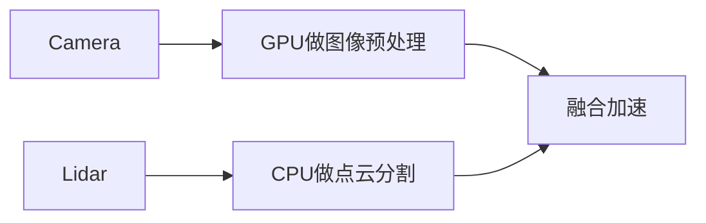

# 推理服务与部署

<a id="kf95f76510c61"></a>

## 四、历史型号（已逐步淘汰）

- **Jetson TK1**（2014年）：首款边缘计算开发板，基于Tegra K1芯片，支持CUDA平台。  
- **Jetson TX1**（2015年）：性能较TK1提升，引入64位CPU和更高能效设计。  

### 参考资料

- [AIGC Interview Book](https://github.com/WeThinkIn/AIGC-Interview-Book/blob/34e9ee6aa6d35d1e213099a7ae9f433b7b9e6fe6/%E6%A8%A1%E5%9E%8B%E9%83%A8%E7%BD%B2%E5%9F%BA%E7%A1%80/%E8%BE%B9%E4%BA%91%E7%AB%AF%E9%83%A8%E7%BD%B2%E7%9F%A5%E8%AF%86%E7%82%B9.md#L330)，来源许可：GPL-3.0。

<a id="kd0282f5d8d5a"></a>

## 四、多节点与容器化部署

1. **跨节点免密要求**：节点间需配置SSH无密码登录。  
2. **容器内运行**：  
   - 主机与容器共享端口（`docker run --network host`）。  
   - 修改容器SSH端口（非22），通过 `-mca plm_rsh_args "-p <port>"` 指定端口。  
3. **进入特定环境**：在容器启动脚本中激活 Conda（如 `~/.bashrc` 加入 `conda activate env`）。

### 参考资料

- [AIGC Interview Book](https://github.com/WeThinkIn/AIGC-Interview-Book/blob/34e9ee6aa6d35d1e213099a7ae9f433b7b9e6fe6/%E6%A8%A1%E5%9E%8B%E9%83%A8%E7%BD%B2%E5%9F%BA%E7%A1%80/%E8%BE%B9%E4%BA%91%E7%AB%AF%E9%83%A8%E7%BD%B2%E7%9F%A5%E8%AF%86%E7%82%B9.md#L1643)，来源许可：GPL-3.0。

<a id="k10e91a2c4b06"></a>

## 四、如何设置合理的Optimization Profile？

合理设置Profile可以遵循几个原则：

1. 只开放必要的动态维度

如果图像高宽固定，就只让batch动态；如果序列长度动态，就不要让无关维度也动态。

例如图像分类常见配置是：

```text
min: 1x3x224x224
opt: 8x3x224x224
max: 32x3x224x224
```

这样比同时开放H、W更容易优化。

2. opt shape选择最常见输入

opt shape应该来自真实业务统计，例如线上最常见batch size、图像尺寸或序列长度。

如果大部分请求batch为8，那么opt设置为8通常比设置为最大batch更合理。

3. 对差异很大的shape使用多个Profile

如果线上既有短序列，也有长序列，或者既有小图也有大图，可以设置多个Profile：

```text
Profile 0: 1x3x224x224  ~  8x3x224x224  ~  16x3x224x224
Profile 1: 1x3x512x512  ~  4x3x512x512  ~  8x3x512x512
Profile 2: 1x3x1024x1024 ~ 2x3x1024x1024 ~ 4x3x1024x1024
```

运行时根据输入shape选择合适Profile，可以获得更稳定的性能。

4. 结合显存和吞吐测试

Profile设置最终要通过压测验证：

- 是否能成功构建Engine
- 最大shape下是否OOM
- opt shape延迟是否满足要求
- 不同shape下吞吐是否稳定
- 是否存在某些shape异常慢

### 参考资料

- [AIGC Interview Book](https://github.com/WeThinkIn/AIGC-Interview-Book/blob/34e9ee6aa6d35d1e213099a7ae9f433b7b9e6fe6/%E6%A8%A1%E5%9E%8B%E9%83%A8%E7%BD%B2%E5%9F%BA%E7%A1%80%EF%BC%88%E7%B2%BE%E5%8D%8E%E7%89%88%EF%BC%89/6.2%E4%BC%A0%E7%BB%9F%E6%A8%A1%E5%9E%8B%E9%83%A8%E7%BD%B2%EF%BC%9AONNX%E4%B8%8ETensorRT.md#L1464)，来源许可：GPL-3.0。

<a id="k50c0e99a07bd"></a>

## 四、如果输出不一致如何排查？

常见排查思路：

1. **先检查输入预处理**：很多不一致来自NCHW/NHWC、RGB/BGR、归一化参数不同
2. **检查训练/推理模式**：确认Dropout关闭、BatchNorm使用固定统计量
3. **降低后端复杂度**：先用ONNX Runtime CPU EP对齐，再切到CUDA/TensorRT
4. **检查导出方式**：trace可能固化分支，复杂控制流可考虑script或改写forward
5. **定位具体算子**：用中间层输出或简化模型定位是哪一段开始出现误差

可以总结为：**验证ONNX正确性要在相同输入、相同预处理和推理模式下，分别运行PyTorch和ONNX Runtime，比较输出shape、dtype和数值误差，并进一步用真实数据验证任务指标。如果不一致，应先排查输入预处理和模型模式，再逐步定位算子或后端差异。**

### 参考资料

- [AIGC Interview Book](https://github.com/WeThinkIn/AIGC-Interview-Book/blob/34e9ee6aa6d35d1e213099a7ae9f433b7b9e6fe6/%E6%A8%A1%E5%9E%8B%E9%83%A8%E7%BD%B2%E5%9F%BA%E7%A1%80%EF%BC%88%E7%B2%BE%E5%8D%8E%E7%89%88%EF%BC%89/6.2%E4%BC%A0%E7%BB%9F%E6%A8%A1%E5%9E%8B%E9%83%A8%E7%BD%B2%EF%BC%9AONNX%E4%B8%8ETensorRT.md#L614)，来源许可：GPL-3.0。

<a id="k5ce392a0cd94"></a>

## 四、总结

截至2025年4月，英伟达的架构覆盖从图形渲染到AI计算的全面需求，**Blackwell**是当前最先进的消费级与专业级架构，而**Rubin**与**Feynman**则代表未来量子计算与硅光技术的融合方向。历史架构（如Turing、Ampere）仍在特定领域（如游戏、数据中心）广泛应用。

### 参考资料

- [AIGC Interview Book](https://github.com/WeThinkIn/AIGC-Interview-Book/blob/34e9ee6aa6d35d1e213099a7ae9f433b7b9e6fe6/%E6%A8%A1%E5%9E%8B%E9%83%A8%E7%BD%B2%E5%9F%BA%E7%A1%80/%E8%BE%B9%E4%BA%91%E7%AB%AF%E9%83%A8%E7%BD%B2%E7%9F%A5%E8%AF%86%E7%82%B9.md#L278)，来源许可：GPL-3.0。

<a id="k32e0a00d6943"></a>

## 四、技术对比分析

| 维度            | 传统API调用                     | MCP协议方案                  |
|-----------------|--------------------------------|-----------------------------|
| 开发成本         | 每个API需单独适配（平均3人日/个） | 一次接入永久复用（0.5人日/个）|
| 异常处理         | 需手动编写fallback逻辑          | 内置自动服务降级机制          |
| 多工具协同       | 需开发中间件协调                | 原生支持管道式调用            |
| 安全审计         | 分散在各服务                    | 统一权限控制与日志追踪        |

### 参考资料

- [AIGC Interview Book](https://github.com/WeThinkIn/AIGC-Interview-Book/blob/34e9ee6aa6d35d1e213099a7ae9f433b7b9e6fe6/%E6%A8%A1%E5%9E%8B%E9%83%A8%E7%BD%B2%E5%9F%BA%E7%A1%80/%E5%A4%A7%E6%A8%A1%E5%9E%8B%E9%83%A8%E7%BD%B2.md#L1530)，来源许可：GPL-3.0。

<a id="kbcc857ca3d2a"></a>

## 四、调度瓶颈怎么看？

如果GPU经常空闲、请求排队明显、CPU占用高、kernel很多但每个都很小，就可能是调度瓶颈。

常见现象：
- GPU利用率忽高忽低
- CPU预处理或后处理耗时明显
- kernel launch数量很多，小算子特别多
- 请求间等待时间长，batch凑不齐
- 多模型或多请求之间频繁同步

常见优化方式：
- 使用动态batching或continuous batching
- 合并小算子，减少kernel launch
- 异步执行，让计算和数据拷贝重叠
- 优化预处理/后处理，必要时放到GPU上执行
- 调整请求队列、超时时间和batch策略

### 参考资料

- [AIGC Interview Book](https://github.com/WeThinkIn/AIGC-Interview-Book/blob/34e9ee6aa6d35d1e213099a7ae9f433b7b9e6fe6/%E6%A8%A1%E5%9E%8B%E9%83%A8%E7%BD%B2%E5%9F%BA%E7%A1%80%EF%BC%88%E7%B2%BE%E5%8D%8E%E7%89%88%EF%BC%89/6.1%E6%8E%A8%E7%90%86%E9%83%A8%E7%BD%B2%E7%BB%BC%E8%BF%B0.md#L714)，来源许可：GPL-3.0。

<a id="k85be53203e97"></a>

## 团队落地AI产品时，怎么平衡大模型推理延迟与成本？

**回答：**

这是一个很好的反问，因为它直指 AI 产品能否规模化。一个成熟团队通常不会只靠单一强模型，而会做模型分层和链路拆分。

可期待的回答包括：简单任务走小模型或规则，复杂规划走强模型；高频请求做缓存；可异步的任务进入队列；长任务拆成可流式返回的阶段；对用户可见链路优化首 token 延迟；对成本敏感节点做 batch、量化或本地化部署；通过 observability 看每个节点的 token、延迟、失败率和业务收益。

你也可以继续追问：团队目前更关注首响延迟、总完成时间还是单位生成成本？是否有模型路由策略？是否允许降级生成？这些能帮你判断团队是否真的在做 AI 工程，而不是 demo。

<a id="xiaohongshu-ai-fullstack-20260702-q24"></a>

### 参考资料

- [AIGC Interview Book](https://github.com/WeThinkIn/AIGC-Interview-Book/blob/34e9ee6aa6d35d1e213099a7ae9f433b7b9e6fe6/%E5%A4%A7%E5%8E%82%E9%AB%98%E9%A2%91%E9%9D%A2%E8%AF%95%E9%A2%98%EF%BC%88%E5%AE%9E%E6%97%B6%E6%9B%B4%E6%96%B0%EF%BC%89/%E5%B0%8F%E7%BA%A2%E4%B9%A6%E9%AB%98%E9%A2%91%E9%9D%A2%E8%AF%95%E9%A2%98.md#L446)，来源许可：GPL-3.0。

<a id="k76c7d1f58273"></a>

## 在AI行业中，一些模型经过端侧部署框架转换格式后，在GPU上为什么比CPU跑得慢？

在AI端侧部署中，模型经框架转换后在GPU上运行反而比CPU慢的现象看似反直觉，实则蕴含深刻的硬件-软件协同问题。以下是Rocky针对此问题的系统性解析：

### 2. **传统深度学习：工厂质检系统**
- **典型场景**：PCB板缺陷检测  
- **硬件环境**：  
  - 工业边缘设备Jetson Nano  
  - CPU: 4核A57 @1.43GHz  
  - GPU: 128核Maxwell @921MHz  

- **性能悖论**：  
  | 模型            | CPU延迟 | GPU延迟 |  
  |-----------------|---------|---------|  
  | YOLOv5-nano     | 68ms    | 52ms    |  
  | 传统图像处理算法 | 22ms | 41ms<br>← 因OpenCV算子未GPU优化 |

- **破局之道**：  
  - 将传统算法移植到CUDA  
  - 部署混合调度器：  
```python  
    class HybridScheduler:  
        def select_backend(self, model):  
            if model.compute_density < 0.5:  # 计算密度阈值  
                return "CPU"  
            return "GPU"  
```

### 3. **自动驾驶：车载感知系统**
- **核心挑战**：  
  - 相机/激光雷达多传感器融合  
  - 必须满足100ms端到端延迟  

- **GPU减速案例**：  
```  
  传感器数据 → GPU预处理 → 目标检测 → 多模态融合  
          ↑_____________CPU干预___________|  
```
  因激光雷达点云处理含大量条件分支，GPU效率仅CPU的60%  

- **军工级解决方案**：  
  1. **异构计算流水线**：  

  2. **GPU保留模式**：  
     - 锁频至最高性能档位  
     - 独占分配50%显存  

### 面试回答结构化建议
**回答框架**：  
1. **分层解析原因**：  
   “该问题需从硬件特性、算子支持、资源竞争三个维度分析：  
   - 硬件层面：移动端GPU存在算力带宽双约束  
   - 软件层面：非标准算子触发昂贵内存拷贝  
   - 系统层面：多进程争用导致资源碎片化”  

2. **实例佐证**：  
   “以人脸检测为例，当自定义后处理算子无法在GPU执行时，单次推理增加3ms拷贝开销，这在低端机占比可达40%”  

**终极洞见**：  
“GPU在端侧的性能倒挂本质是**硬件能力与软件栈的错配**。破局关键在于：  
- 算子编译阶段：通过TVM/MNN实现100%算子覆盖  
- 运行时阶段：构建性能预测模型动态选择后端  
- 系统级优化：采用CPU-GPU-NPU协同计算框架”

### 参考资料

- [AIGC Interview Book](https://github.com/WeThinkIn/AIGC-Interview-Book/blob/34e9ee6aa6d35d1e213099a7ae9f433b7b9e6fe6/%E6%A8%A1%E5%9E%8B%E9%83%A8%E7%BD%B2%E5%9F%BA%E7%A1%80/%E6%8E%A8%E7%90%86%E6%A1%86%E6%9E%B6%E7%9F%A5%E8%AF%86%E7%82%B9.md#L775)，来源许可：GPL-3.0。

<a id="k749be0879bf1"></a>

## 在AI领域中模型一共有多少种主流部署形式？

**AI领域发展至今，Rocky认为目前主要有三大核心方向，包括AIGC、传统深度学习以及自动驾驶**。以下是这些领域中主流的模型部署形式：

### 1. AIGC领域的模型部署

**a. 云端部署**
- **特点**：模型部署在云服务器上，用户通过API调用服务进行内容生成。
- **优势**：可扩展，易于更新和维护，适合处理大量并发请求。
- **应用示例**：OpenAI的GPT-4模型作为API服务提供，用户可以通过互联网调用模型生成文本。

**b. 客户端部署**
- **特点**：模型部署在用户的设备上，如PC或移动设备。
- **优势**：保护用户数据隐私，减少网络延迟。
- **应用示例**：Adobe Photoshop的内容感知工具，可在用户设备上直接运行，不需数据上传到云端。

### 2. 深度学习领域的模型部署

**a. 云端部署**
- **特点**：模型部署在云服务器上，利用云计算的强大计算能力进行数据处理和模型推理。
- **优势**：提供强大的计算资源，易于扩展，便于管理。
- **应用示例**：在图像识别、语音识别等需要大规模数据处理的应用中，云端部署可以快速处理来自全球的请求。

**b. 边缘部署**
- **特点**：模型直接部署在本地设备上，如智能手机、IoT设备或本地服务器。
- **优势**：减少数据传输时间，提高响应速度，增强隐私保护。
- **应用示例**：在移动应用中，如实时语言翻译和增强现实（AR），模型在本地设备上运行，以实现低延迟和离线功能。

### 3. 自动驾驶领域的模型部署

**a. 车载部署**
- **特点**：模型直接部署在车辆的计算平台上，处理来自车载传感器的数据。
- **优势**：实时处理传感器数据，快速做出驾驶决策。
- **应用示例**：自动驾驶汽车中的决策系统，如特斯拉Autopilot，需要在车辆内部快速处理来自摄像头、雷达和其他传感器的数据。

**b. 云端部署**
- **特点**：某些控制功能和监控系统部署在云端控制中心。
- **优势**：可以进行更复杂的数据分析，实时监控和调整车辆行为。
- **应用示例**：远程监控和调度系统，可用于管理自动驾驶车队，例如在无人配送服务中进行调度和监控。

总之，AI模型的部署形式应根据具体的应用需求、数据敏感性、可用资源和所需的响应时间来决定。不同的部署策略具有各自的优势和限制，理解这些可以帮助我们选择最适合特定需求的部署方法。

### 参考资料

- [AIGC Interview Book](https://github.com/WeThinkIn/AIGC-Interview-Book/blob/34e9ee6aa6d35d1e213099a7ae9f433b7b9e6fe6/%E6%A8%A1%E5%9E%8B%E9%83%A8%E7%BD%B2%E5%9F%BA%E7%A1%80/%E6%A8%A1%E5%9E%8B%E9%83%A8%E7%BD%B2%E5%9F%BA%E7%A1%80%E6%A6%82%E5%BF%B5.md#L521)，来源许可：GPL-3.0。

<a id="kfcfe8fe459a4"></a>

## 在向量化之前，为什么要对长文档进行切片？如果不切片会有什么后果？

<a id="batch4-p1-q5"></a>

**相关解释：** [Embedding模型与Reranker差异，二者训练Loss区别](../10-RAG%E4%B8%8EAgent/RAG%E4%B8%8E%E6%A3%80%E7%B4%A2%E5%A2%9E%E5%BC%BA-01.md#k1abf61aa73cc)

### 参考资料

- [AIGC Interview Book](https://github.com/WeThinkIn/AIGC-Interview-Book/blob/34e9ee6aa6d35d1e213099a7ae9f433b7b9e6fe6/%E5%A4%A7%E5%8E%82%E9%AB%98%E9%A2%91%E9%9D%A2%E8%AF%95%E9%A2%98%EF%BC%88%E5%AE%9E%E6%97%B6%E6%9B%B4%E6%96%B0%EF%BC%89/%E5%AD%97%E8%8A%82%E8%B7%B3%E5%8A%A8%E9%AB%98%E9%A2%91%E9%9D%A2%E8%AF%95%E9%A2%98.md#L206)，来源许可：GPL-3.0。

<a id="k1894c8a436ac"></a>

## 在推理中的应用

在推理阶段，模型通常是冻结的（不更新权重），可以采用以下策略：
1. **权重分块**：
   - 将模型分为多个小模块（如 Transformer 的每一层）。
   - 每次仅加载一个模块进行计算。

2. **分布式推理**：
   - 使用多个设备分担权重存储和计算负载。
   - 示例：在 GPU1 上运行模型的前几层，GPU2 上运行后几层。

3. **流水线并行**：
   - 将模型切分为多个部分，每部分运行在不同设备上，同时处理不同批次的数据。

### 参考资料

- [AIGC Interview Book](https://github.com/WeThinkIn/AIGC-Interview-Book/blob/34e9ee6aa6d35d1e213099a7ae9f433b7b9e6fe6/%E6%A8%A1%E5%9E%8B%E9%83%A8%E7%BD%B2%E5%9F%BA%E7%A1%80/%E5%A4%A7%E6%A8%A1%E5%9E%8B%E9%83%A8%E7%BD%B2.md#L1980)，来源许可：GPL-3.0。

<a id="kf65b4c6b045f"></a>

## 在推理阶段，如何通过后处理校正来减少MLLMs中的幻觉？

在推理阶段，可以通过以下方法进行后处理校正来减少幻觉：

（1）Woodpecker：提取生成文本中的关键概念，通过视觉内容验证这些概念，检测并修正幻觉内容。
（2）LURE：使用一个专门的幻觉修正器模型，将潜在的幻觉描述转换为准确的描述。训练数据集包含图像和幻觉描述，目标是将幻觉描述修正为准确描述。

### 参考资料

- [AIGC Interview Book](https://github.com/WeThinkIn/AIGC-Interview-Book/blob/34e9ee6aa6d35d1e213099a7ae9f433b7b9e6fe6/AI%E5%A4%9A%E6%A8%A1%E6%80%81%E5%9F%BA%E7%A1%80/%E5%A4%9A%E6%A8%A1%E6%80%81-%E7%90%86%E8%AE%BA%E7%9F%A5%E8%AF%86.md#L411)，来源许可：GPL-3.0。

<a id="kbc2d93293461"></a>

## 在没有推理能力前，如何让模型“先思考后回答”？

通过**提示词工程**引导模型“思考”，即在 prompt 中显式要求模型列出推理过程，如加上：

- `"请一步步思考再作答"`（思维链）
- `"请验证你的答案是否与前提一致"`（自洽性）
- `"请考虑多种可能情况，再做判断"`（思维树）


### 参考资料

- [Datawhale](https://github.com/datawhalechina/daily-interview/blob/f35e8d555f8ff07d568eae569c3641bd76d0eac9/docs/04-ai-algorithms/llm/llm-interview-questions.md#L216)，来源许可：GPL-3.0。

<a id="k45cf96993208"></a>

## 在端侧 GPU（如 RTX 3060 6 GB）部署 7 B 级多模态模型几乎不可行，3 B 模型如何做到“精度不降反升”？

(1)训练数据质量 > 参数规模
OCRFlux-3B 使用了 110 万页「金融+学术」私域数据，经过多轮人工校验，去除了 GPT-4o 在低质量表格上的错误标签；数据清洗带来的增益远超额外 4 B 参数。

(2)任务特定的视觉 tokenizer
采用「切图-合并」策略：高分辨率页面先切成 448×448 不重叠子图，每张图经 ViT 编码后仅保留 64 个 visual token；相比 7 B 模型直接对 1344×1344 全图编码，推理时显存占用下降 ~4×。

(3)联合训练的单模型多任务
单页解析与跨页合并共享同一套权重，避免「两阶段流水线」带来的错误累积；同时利用 LoRA+ZeRO-3 在 8×A100 上仅 6 小时即可完成微调，极大降低了再训练门槛。

(4)量化与算子优化
推理侧支持 AWQ INT4 量化 + Flash-Attention2，RTX 3060 6 GB 上可跑 2048 token context，吞吐量 12 page/s，满足生产需求。

### 参考资料

- [AIGC Interview Book](https://github.com/WeThinkIn/AIGC-Interview-Book/blob/34e9ee6aa6d35d1e213099a7ae9f433b7b9e6fe6/AI%E5%A4%9A%E6%A8%A1%E6%80%81%E5%9F%BA%E7%A1%80/%E5%A4%9A%E6%A8%A1%E6%80%81-%E5%89%8D%E6%B2%BF%E6%8A%80%E6%9C%AF.md#L545)，来源许可：GPL-3.0。

<a id="k50c9b8ad47c1"></a>

## 在线剖析与离线剖析有何区别？采样、插桩与trace各适用于什么场景？

**难度评分：⭐⭐⭐ (3/5)  |  考察频率：⭐⭐⭐⭐ (4/5)**

### 一、在线剖析与离线剖析

| 维度 | 在线剖析（Online Profiling） | 离线剖析（Offline Profiling） |
|------|---------------------------|----------------------------|
| 定义 | 在生产环境或运行时实时采集性能数据 | 将运行时事件记录到文件，事后分析 |
| 数据采集方式 | 实时采样、实时指标暴露 | Trace/Log 文件落盘后回放分析 |
| 典型工具 | nvidia-smi、DCGM、Prometheus 指标 | Nsight Systems trace、PyTorch Profiler JSON |
| 性能开销 | 低（通常 < 1%） | 可较高（全量 trace 可能产生 GB 级数据） |
| 适用场景 | 线上监控、实时告警、异常检测 | 深度调优、瓶颈定位、版本间对比 |
| 数据粒度 | 粗（聚合指标为主） | 细（单次 kernel launch、API 调用） |

**选型策略**：先用在线剖析发现"有问题"，再用离线剖析深入分析"问题在哪"。

### 二、采集方式的三种范式

1. 采样（Sampling）
定期中断程序并记录当前调用栈，通过统计采样频率推断热点。
- **代表工具**：Linux perf、nvidia-smi 利用率查询
- **优点**：开销极低，适合长期运行的生产服务
- **缺点**：无法捕获瞬时事件，精度受采样频率限制

2. 插桩（Instrumentation）
在代码中手动或自动插入探针，记录函数的进入/退出和关键参数。
- **代表工具**：NVTX 标记、PyTorch Profiler `profiler.step()`、OpenTelemetry
- **优点**：精确记录关键区间，语义明确
- **缺点**：需要修改代码，覆盖不全会遗漏问题

3. Trace（全量追踪）
记录每一条 CUDA API 调用、kernel launch 和内存操作的时间戳。
- **代表工具**：Nsight Systems（CUDA trace）、PyTorch Profiler（with_stack）
- **优点**：信息最全，可精确重建执行 Timeline
- **缺点**：数据量大（GB 级），对被分析程序有性能干扰

### 三、三种范式的配合

```
采样（宏观监控）→ 发现异常
    ↓
插桩（分段定位）→ 缩小范围
    ↓
Trace（微观分析）→ 定位根因
```

可以总结为：**在线剖析适合监控和发现，离线剖析适合深度分析。采样给你"谁花的时间多"，插桩给你"哪个阶段慢"，Trace 给你"每个操作在什么时刻发生了什么"。三种范式通常配合使用——先用在线指标发现异常，再逐步下钻。**

### 参考资料

- [AIGC Interview Book](https://github.com/WeThinkIn/AIGC-Interview-Book/blob/34e9ee6aa6d35d1e213099a7ae9f433b7b9e6fe6/%E6%A8%A1%E5%9E%8B%E9%83%A8%E7%BD%B2%E5%9F%BA%E7%A1%80%EF%BC%88%E7%B2%BE%E5%8D%8E%E7%89%88%EF%BC%89/6.4%E6%80%A7%E8%83%BD%E5%88%86%E6%9E%90%E4%B8%8E%E8%B0%83%E4%BC%98%E5%B7%A5%E5%85%B7.md#L194)，来源许可：GPL-3.0。

<a id="kd0e27de6e9d2"></a>

## 在金融合同结构化解析中，如何通过多模态联合推理验证逻辑一致性？

**方法论**：  
- **规则引擎**：定义业务逻辑的谓词表达式，如  
   $$\forall \text{clause}_i \in \text{Contract}, \text{Amount}(\text{clause}_i) = \text{Sum}(\text{PaymentSchedule}_i)$$  
- **神经网络验证**：训练Siamese网络计算条款与表格的语义相似度：  
   $$s(\mathbf{t}, \mathbf{c}) = \sigma(\text{MLP}([\mathbf{t}; \mathbf{c}]))$$  
  低于阈值$\tau$时触发人工审核。  
**数据**：需标注矛盾样本（如故意修改金额）供模型学习。

### 参考资料

- [AIGC Interview Book](https://github.com/WeThinkIn/AIGC-Interview-Book/blob/34e9ee6aa6d35d1e213099a7ae9f433b7b9e6fe6/AI%E5%A4%9A%E6%A8%A1%E6%80%81%E5%9F%BA%E7%A1%80/%E5%A4%9A%E6%A8%A1%E6%80%81-%E5%89%8D%E6%B2%BF%E6%8A%80%E6%9C%AF.md#L580)，来源许可：GPL-3.0。

<a id="kf56bca12faf6"></a>

## 大模型如何实现高效推理？模型压缩技术有哪些？

- **推理优化**：  
  - **知识蒸馏**：用小模型（Student）模仿大模型（Teacher）的输出分布。  
  - **量化**：将FP32参数压缩为INT8/INT4，结合QAT（量化感知训练）。  
  - **剪枝**：移除冗余注意力头或神经元（如LayerDrop）。  
- **硬件加速**：  
  - 使用TensorRT或ONNX Runtime优化计算图，部署至GPU/TPU。  

### 参考资料

- [AIGC Interview Book](https://github.com/WeThinkIn/AIGC-Interview-Book/blob/34e9ee6aa6d35d1e213099a7ae9f433b7b9e6fe6/AI%E5%A4%9A%E6%A8%A1%E6%80%81%E5%9F%BA%E7%A1%80/%E5%A4%9A%E6%A8%A1%E6%80%81-%E5%A4%A7%E6%A8%A1%E5%9E%8B%E4%B8%BB%E5%B9%B2.md#L125)，来源许可：GPL-3.0。

<a id="kd89cf6030dcd"></a>

## 大模型如何赋能家庭服务机器人的场景适应？

个性化场景理解：
- 学习家庭特定布局和物体摆放习惯
- 适应不同用户的操作偏好和指令风格
- 基于历史交互进行行为个性化调整

开放式任务处理：
- 处理"整理一下房间"等模糊指令
- 根据场景上下文进行合理的任务解释
- 多任务间进行优先级判断和调度

异常情况处理：
- 检测环境变化和意外障碍物
- 生成替代方案应对计划外情况
- 主动向用户确认不确定操作

### 参考资料

- [AIGC Interview Book](https://github.com/WeThinkIn/AIGC-Interview-Book/blob/34e9ee6aa6d35d1e213099a7ae9f433b7b9e6fe6/%E5%85%B7%E8%BA%AB%E6%99%BA%E8%83%BD%E5%9F%BA%E7%A1%80/01_%E5%9F%BA%E7%A1%80%E7%9F%A5%E8%AF%86.md#L197)，来源许可：GPL-3.0。

<a id="kf72b5a5fa79f"></a>

## 大模型推理中显存OOM如何排查和解决？

**难度评分：⭐⭐⭐⭐ (4/5)  |  考察频率：⭐⭐⭐⭐⭐ (5/5)**


### 一、OOM的分类与定位

大模型推理中的OOM（Out of Memory）通常分为三类：

**类型1：模型加载OOM**
- 现象：模型加载阶段就报OOM，根本无法启动
- 原因：模型权重超过GPU可用显存

**类型2：KV Cache OOM**
- 现象：服务启动成功，但在运行一段时间后、处理到长文本或多并发时OOM
- 原因：KV Cache动态增长超出预留空间

**类型3：瞬时OOM**
- 现象：间歇性OOM，有时正常有时失败
- 原因：Prefill时大量激活值同时分配，瞬时显存峰值超过容量

### 二、OOM排查流程

**Step 1：确认显存使用情况**

```bash
# 实时监控显存
nvidia-smi -l 1
# 或使用
watch -n 1 nvidia-smi

# vLLM启动日志中查看预估显存分配
# 关键日志行：
# "GPU memory utilization: 0.9"
# "Total GPU memory: 80GB"
# "Free GPU memory: XX GB"
# "KV Cache capacity: XX tokens"
```

**Step 2：计算显存分配**

```
总显存分配 = 模型权重 + KV Cache池 + CUDA Context等固定开销

模型权重（FP16）= 参数量 × 2 字节
例如：7B × 2 = 14GB, 70B × 2 = 140GB

KV Cache池 = 总显存 × gpu_memory_utilization - 模型权重 - 固定开销

每个请求的KV Cache = 2 × 层数 × head_dim × kv_heads × 序列长度 × 2字节
```

**Step 3：根据OOM类型定位**

- 启动时OOM → 模型权重过大，需要TP或量化
- 运行中OOM → KV Cache设置过大或限制太宽松
- 瞬时OOM → Prefill burst，max-num-batched-tokens过大

### 三、解决方案

**方案1：降低gpu-memory-utilization**

```bash
vllm serve model --gpu-memory-utilization 0.8  # 从0.9降到0.8
```

减小KV Cache的总池子，降低OOM风险（但会减少可并发请求数）。

**方案2：限制max-model-len**

```bash
vllm serve model --max-model-len 4096  # 从8192降到4096
```

减小每个请求的最大KV Cache预留，有效降低OOM风险。

**方案3：限制max-num-seqs**

```bash
vllm serve model --max-num-seqs 64  # 减少最大并发序列数
```

减少同时活跃的请求数，限制KV Cache的总消耗。

**方案4：使用量化模型**

```bash
# INT4量化模型
vllm serve Qwen/Qwen2-7B-Instruct-AWQ --quantization awq

# FP8量化模型
vllm serve model --quantization fp8
```

模型权重减少到原来的1/4（INT4）或1/2（FP8），留出更多空间给KV Cache。

**方案5：张量并行**

```bash
vllm serve model --tensor-parallel-size 4
```

将模型权重切分到多张卡上，每张卡的权重压力减小。

**方案6：启用KV Cache量化（如LMDeploy）**

```bash
# LMDeploy启用KV Cache INT8量化
lmdeploy serve api_server model --kv-cache-dtype 8
```

### 四、OOM排查速查表

| 现象 | 常见原因 | 优先排查方向 |
|------|----------|-------------|
| 启动即OOM | 模型权重 > 显存 | 张量并行或量化 |
| 长文本OOM | max-model-len设太大 | 降低max-model-len |
| 高并发OOM | KV Cache池耗尽 | 降低max-num-seqs或gpu-memory-utilization |
| 间歇性OOM | Prefill burst瞬发峰值 | 降低max-num-batched-tokens |
| 运行几小时后OOM | 显存碎片或泄漏 | 重启服务，升级vLLM版本 |

可以总结为：**大模型推理OOM排查应首先区分是模型加载OOM、KV Cache OOM还是瞬时OOM，然后针对性解决：模型OOM用TP/量化，KV Cache OOM调低gpu-memory-utilization/max-model-len/max-num-seqs，瞬时OOM限制max-num-batched-tokens。量化模型+张量并行是最有效的OOM解决组合。**

### 参考资料

- [AIGC Interview Book](https://github.com/WeThinkIn/AIGC-Interview-Book/blob/34e9ee6aa6d35d1e213099a7ae9f433b7b9e6fe6/%E6%A8%A1%E5%9E%8B%E9%83%A8%E7%BD%B2%E5%9F%BA%E7%A1%80%EF%BC%88%E7%B2%BE%E5%8D%8E%E7%89%88%EF%BC%89/6.3%E5%A4%A7%E6%A8%A1%E5%9E%8B%E9%83%A8%E7%BD%B2%E6%8A%80%E6%9C%AF.md#L2513)，来源许可：GPL-3.0。

<a id="k072ad625060b"></a>

## 大模型推理服务有哪些性能指标？TTFT、TPOT、Throughput分别衡量什么？

**难度评分：⭐⭐⭐⭐ (4/5)  |  考察频率：⭐⭐⭐⭐⭐ (5/5)**

### 一、指标体系总览

大模型推理服务的性能评测通常关注四大类指标：

1. **延迟类**：TTFT、TPOT、E2E Latency
2. **吞吐类**：Throughput、QPS、Token/s
3. **资源类**：GPU利用率、显存占用、KV Cache利用率
4. **质量类**：生成质量（Perplexity、任务指标）、首Token正确率

### 二、TTFT（Time To First Token，首Token延迟）

**定义**：从请求发出到收到第一个生成Token的时间间隔。

**TTFT = 排队延迟 + Tokenization时间 + Prefill延迟 + 第一次Decode延迟**

**衡量什么**：用户感知的"响应速度"。TTFT越低，用户感觉响应越快。

**影响因素**：
- Prompt长度：长度越长，Prefill计算量越大，TTFT越高
- 排队情况：高负载时请求在队列中等待，TTFT 增加
- Prefill计算能力：GPU FLOPS越高，Prefill越快

**典型目标**：
- 交互式对话场景：< 200ms（理想），< 500ms（可接受）
- 批量处理场景：< 2s

### 三、TPOT（Time Per Output Token，逐Token延迟）

**定义**：生成阶段中，每个输出Token之间的平均时间间隔。

**TPOT ≈ 一次Decode的计算时间 + 访存时间**

**衡量什么**：生成过程的"流畅度"。TPOT越低，文字"流"得越快。

**影响因素**：
- KV Cache大小（已有的Token数）：序列越长，每次Decode需读取的KV Cache越多，TPOT越高
- HBM带宽：Decode是访存密集型，带宽越大TPOT越低
- Batch Size（并发请求数）：并发越多，每步需处理的请求越多，TPOT可能增加

**典型目标**（需按模型规模区分）：
- 7B/13B 模型交互式场景：< 15-20ms/Token（50+ Token/s 的输出速度）
- 70B+ 模型交互式场景：< 30-50ms/Token（受限于访存瓶颈，单用户 TPOT 难达到 20ms 以内）
- 流式体验（各规模通用）：< 50ms/Token（低于此值时用户感知流畅）
- 批量离线处理：> 100ms/Token 也可接受，关注吞吐而非逐 Token 延迟

### 四、E2E Latency（端到端延迟）

**定义**：从请求发出到收到完整回复（包括所有生成Token）的总时间。

**E2E Latency = TTFT + TPOT × (生成Token数 - 1)**

### 五、Throughput（吞吐量）

**定义**：单位时间内系统处理的Token总数。

**Throughput = 总输出Token数 / 时间（通常以 tokens/s 度量）**

**衡量什么**：系统的整体"产能"。

**影响因素**：
- 并发请求数
- 每批处理的Token数
- Continuous Batching的效率
- GPU数量和型号

**注意区分**：
- 单请求吞吐：延迟敏感型场景关注（TTFT、TPOT更重要）
- 系统总吞吐：批量离线场景关注（Throughput更重要）

### 六、QPS（Queries Per Second）

**定义**：单位时间内成功处理的请求数。

**注意**：大模型场景中QPS关联于多个变量（Prompt长度、生成长度），单纯比较QPS意义有限。通常需要标注输入/输出长度条件。

**正常化QPS**：固定条件（如Prompt=500 Tokens, Output=200 Tokens）下的QPS更有可比性。

### 七、其他重要指标

**1. GPU利用率（GPU Utilization）**：GPU计算单元的使用比例。Decode阶段因为访存绑定，利用率天然低（往往10-30%），不必追求100%利用率。

**2. KV Cache命中率**：Prefix Caching/RadixAttention的命中率。高命中率→更多请求跳过Prefill→更低TTFT。

**3. P50/P95/P99延迟**：延迟的百分位分布，P95/P99反映了"最差体验"。在在线服务中P99比Average Latency更重要。

**4. Time Per Query（TPQ）**：单个请求从进入系统到返回的耗时。

### 八、指标关系图

```
                   E2E Latency
    |←————————————————————————————————————→|
    |←—— TTFT ——→|←—— (N-1) × TPOT ——→|
    |              |                      |
发起请求    收到第1个Token   收到第2个Token   ...   收到第N个Token
```

可以总结为：**大模型推理服务指标中，TTFT衡量"用户等多快能看到第一个字"（取决于Prefill速度），TPOT衡量"生成有多流畅"（取决于Decode访存速度），Throughput衡量"系统多久能处理完一批任务"。在线服务优先关注TTFT和P99延迟，离线批量优先关注Throughput。**

### 参考资料

- [AIGC Interview Book](https://github.com/WeThinkIn/AIGC-Interview-Book/blob/34e9ee6aa6d35d1e213099a7ae9f433b7b9e6fe6/%E6%A8%A1%E5%9E%8B%E9%83%A8%E7%BD%B2%E5%9F%BA%E7%A1%80%EF%BC%88%E7%B2%BE%E5%8D%8E%E7%89%88%EF%BC%89/6.3%E5%A4%A7%E6%A8%A1%E5%9E%8B%E9%83%A8%E7%BD%B2%E6%8A%80%E6%9C%AF.md#L2028)，来源许可：GPL-3.0。

<a id="ka16afc277558"></a>

## 大模型推理服务有哪些特殊评估指标？

**难度评分：⭐⭐⭐⭐ (4/5)  |  考察频率：⭐⭐⭐⭐ (4/5)**


### 一、TTFT

TTFT是 Time To First Token，表示用户发出请求后，到收到第一个token所需时间。

```text
TTFT = 首个token返回时间 - 请求发送时间
```

它主要反映Prefill、排队和调度开销，直接影响用户感知的响应速度。

### 二、TPOT

TPOT是 Time Per Output Token，表示生成每个输出token的平均耗时。

```text
TPOT = Decode阶段耗时 / 输出token数量
```

它主要反映Decode阶段效率，和KV Cache读取、batch调度、显存带宽等因素有关。

### 三、tokens/s

tokens/s表示单位时间内系统处理或生成的token数量，常见口径包括输入tokens/s、输出tokens/s、单用户tokens/s和系统总tokens/s。

其中输入tokens/s通常反映Prefill阶段吞吐，输出tokens/s通常反映Decode阶段吞吐；单用户tokens/s更接近用户体感生成速度，系统总tokens/s更接近服务整体吞吐能力。

### 四、并发会话数

大模型服务还要关注在给定显存和延迟约束下，系统能同时服务多少个请求或会话。

长上下文、多轮对话和高并发都会显著影响这个指标。

### 参考资料

- [AIGC Interview Book](https://github.com/WeThinkIn/AIGC-Interview-Book/blob/34e9ee6aa6d35d1e213099a7ae9f433b7b9e6fe6/%E6%A8%A1%E5%9E%8B%E9%83%A8%E7%BD%B2%E5%9F%BA%E7%A1%80%EF%BC%88%E7%B2%BE%E5%8D%8E%E7%89%88%EF%BC%89/6.1%E6%8E%A8%E7%90%86%E9%83%A8%E7%BD%B2%E7%BB%BC%E8%BF%B0.md#L1782)，来源许可：GPL-3.0。

<a id="kf3816dca94f4"></a>

## 大模型服务化和传统模型服务化有什么不同？

**难度评分：⭐⭐⭐⭐ (4/5)  |  考察频率：⭐⭐⭐⭐ (4/5)**

| 对比维度 | 传统模型服务化 | 大模型服务化 |
|---|---|---|
| 推理模式 | 一次前向计算，一次性返回结果 | 自回归逐 token 生成，流式返回 |
| 调度策略 | batching + 并发控制 | Prefill/Decode 分离 + 连续批处理 + KV Cache 管理 |
| 主要内存瓶颈 | 权重 + 中间激活 | 权重 + KV Cache（长上下文和高并发显著放大） |
| 输入/输出特点 | 输入输出形状相对固定 | 输出长度动态变化，单请求可能持续数秒至数分钟 |
| 核心评估指标 | QPS、P99 延迟、GPU 利用率 | TTFT、TPOT、tokens/s、并发会话数、上下文长度 |
| 典型框架 | TensorRT、ONNX Runtime、OpenVINO | vLLM、TensorRT-LLM、SGLang

### 参考资料

- [AIGC Interview Book](https://github.com/WeThinkIn/AIGC-Interview-Book/blob/34e9ee6aa6d35d1e213099a7ae9f433b7b9e6fe6/%E6%A8%A1%E5%9E%8B%E9%83%A8%E7%BD%B2%E5%9F%BA%E7%A1%80%EF%BC%88%E7%B2%BE%E5%8D%8E%E7%89%88%EF%BC%89/6.1%E6%8E%A8%E7%90%86%E9%83%A8%E7%BD%B2%E7%BB%BC%E8%BF%B0.md#L1712)，来源许可：GPL-3.0。

<a id="kf6376df67660"></a>

## 大模型服务性能评测关键指标

在部署大模型服务接口时，对其性能进行评估是至关重要的，由于目前LLM推理都需要比较高级的GPU，使得LLM推理成本高，因此在不同使用场景下优化推理就很有必要。对于提供公共推理服务，比如openai等来说，提高吞吐率优先级比较高，而在一些专用的业务场景，则对首包延迟和整体请求延迟有着较高要求。
-   **Throughput**：总的吞吐（output tokens/seconds），对于LLM Serving重要，可以提高总的服务能力。
-   **Time to First Token(TTFT)**：在prefill阶段后返回的第一个token的时间，在stream输出模式下，对体验影响大，越小用户等待返回第一个token时间越小，体验越好。
-   **Time per output token**：生成每个token的时间，影响体验。
-   **Latency**：处理完整请求用时。
-   **QPS**：每秒处理完成的请求数，对于服务端来说，QPS越高越好。

### 参考资料

- [AIGC Interview Book](https://github.com/WeThinkIn/AIGC-Interview-Book/blob/34e9ee6aa6d35d1e213099a7ae9f433b7b9e6fe6/%E6%A8%A1%E5%9E%8B%E9%83%A8%E7%BD%B2%E5%9F%BA%E7%A1%80/%E5%A4%A7%E6%A8%A1%E5%9E%8B%E9%83%A8%E7%BD%B2.md#L2149)，来源许可：GPL-3.0。

<a id="k72214fdb43bc"></a>

## 如何从 Timeline 中识别不必要的 CPU-GPU 同步点（cudaDeviceSynchronize、cudaStreamSynchronize）？

**难度评分：⭐⭐⭐⭐ (4/5)  |  考察频率：⭐⭐⭐⭐ (4/5)**

### 一、CPU-GPU 同步的本质

CUDA 的 Kernel Launch 和 Memcpy 是**异步的**——CPU 发出指令后立即返回，GPU 在后台执行。但某些操作会强制 CPU 等待 GPU 完成：

```python
# 显式同步
torch.cuda.synchronize()              # 等待所有 Stream
torch.cuda.Stream.synchronize(stream)  # 等待特定 Stream

# 隐式同步
x = tensor.item()          # 将 GPU 张量转为 Python 标量
x = tensor.cpu().numpy()   # D2H 拷贝默认是同步的
torch.cuda.memory_stats()  # 涉及查询 GPU 状态
```

每次同步都会导致 GPU 端出现一个"气泡"——GPU 忙完后需要等 CPU 确认，下一个 Kernel 才能启动。

### 二、在 Timeline 中识别同步点

在 Nsight Systems 的 Timeline 中，CPU-GPU 同步表现为以下模式：

```
模式 1：显式同步
  CPU Thread:  [Launch K1] [Launch K2] [==== 等待 ====] [Launch K3]
  GPU Stream:  [Kernel 1 ] [Kernel 2 ]                 [Kernel 3 ]
                                        ↑ 明显空白 Gap

模式 2：隐式同步（D2H + .item()）
  CPU Thread:  [Kernel Launch] [==== Memcpy D2H ====] [处理数据]
  GPU Stream:  [Kernel        ]
  Copy Stream:                [D2H                    ]
               ↑ Kernel 之后的后续操作被阻塞

模式 3：频繁小同步
  Timeline 上 GPU 反复出现微小空白，间隔不规律
  通常是循环中每次迭代都调用了同步操作
```

### 三、定位技巧

**方法 1：Nsight Systems 的同步事件过滤**
在 Nsight Systems GUI 中，可以在 CUDA API 行中直接搜索 `cudaDeviceSynchronize`、`cudaStreamSynchronize` 等同步 API 调用，它们的持续时间会在 Timeline 上高亮显示。

**方法 2：PyTorch Profiler 找隐式同步**
```python
with profile(activities=[ProfilerActivity.CPU, ProfilerActivity.CUDA], with_stack=True) as prof:
    output = model(input)
    result = output.sum().item()  # 隐患！触发同步

# 在 Operator 页中找到 .item() 调用
# 在 Trace 页中看到它前后的 GPU 空闲 Gap
```

**方法 3：代码层面的预防**
```python
# 不好的写法
for i in range(n):
    loss = model(batch[i])
    losses.append(loss.item())  # 每次循环都同步

# 好的写法
losses = []
for i in range(n):
    losses.append(model(batch[i]))
losses = torch.tensor(losses).mean().item()  # 只同步一次
```

### 四、常见的不必要同步来源

| 来源 | 代码特征 | 影响 |
|------|---------|------|
| 日志打印张量值 | `print(tensor)` / `logger.info(tensor)` | 每次触发 D2H + 同步 |
| 训练中的 loss 记录 | `loss.item()` 在每步中使用 | 每步一次同步（训练正常，推理可优化） |
| 调试代码残留 | `assert torch.allclose(a, b)` | 比 `.item()` 开销更大 |
| 条件判断 GPU 值 | `if tensor > threshold:` | 隐式同步 |
| 显存查询 | `torch.cuda.memory_allocated()` | 同步 + 遍历显存分配器 |

可以总结为：**不必要的 CPU-GPU 同步是推理性能的隐性杀手。在 Nsight Systems Timeline 上表现为 GPU Kernel 之间的异常 Gap 对应 CPU 线程的同步等待。排查时优先关注 `.item()`、`.cpu()`、打印语句和调试代码残留。原则是"将 GPU 结果当作张量继续在 GPU 上处理，只在最终输出时才搬回 CPU"。**

### 参考资料

- [AIGC Interview Book](https://github.com/WeThinkIn/AIGC-Interview-Book/blob/34e9ee6aa6d35d1e213099a7ae9f433b7b9e6fe6/%E6%A8%A1%E5%9E%8B%E9%83%A8%E7%BD%B2%E5%9F%BA%E7%A1%80%EF%BC%88%E7%B2%BE%E5%8D%8E%E7%89%88%EF%BC%89/6.4%E6%80%A7%E8%83%BD%E5%88%86%E6%9E%90%E4%B8%8E%E8%B0%83%E4%BC%98%E5%B7%A5%E5%85%B7.md#L1670)，来源许可：GPL-3.0。

<a id="kecbbf478dd65"></a>

## 如何从产品需求反推模型选型与部署形态？

**难度评分：⭐⭐⭐ (3/5)  |  考察频率：⭐⭐⭐⭐ (4/5)**

部署形态由延迟、成本和合规三项约束共同决定，选型应从这三项约束出发反推模型规格。常见的部署形态有三种，各自对这三项约束的取舍不同：

1. **云端 API。** 云端 API 迭代快、无需自行运维，适合验证期和流量波动大的场景；代价是数据需要出域，金融、医疗和政务客户常因此直接排除这一方案。

2. **私有化部署。** 私有化部署满足等保和行业合规要求，模型规格受客户的 GPU 预算限制，通常借助 AWQ、GPTQ 一类 INT4 权重量化把模型放进现有显存[6,7]。

3. **端侧部署。** 端侧部署让数据不出设备，可以离线使用，调用也不再按次产生云端费用；但设备上只能运行小模型，并依赖 NPU 的低比特算力，能力上限明显。

延迟预算同时决定模型规格和交互设计。拍照解题这类异步任务允许用户等待数秒，实时语音则要对齐人类对话的话轮节奏。Stivers 等人 2009 年测量了 10 种语言中是非问句的应答时间，各语言的众数都落在 0 到 200 ms 之间，全样本的平均偏移约为 208 ms[8]。这是人类对话的测量分布，产品的超时阈值需要按自身的交互另行设定。同一个模型从异步交互改为实时交互时，可用的系统架构会随之改变。

成本按单次调用费用乘以日调用量，再对照毛利率，倒推可以承受的模型规格。免费、高频的功能如果全量使用最大的模型，推理费用会最先超出预算，下一问讨论如何用大小模型协同降低这部分费用。

> **面试速答**：选型先看三项约束：数据能否出域、用户能等多久、单次调用乘以流量后还剩多少毛利。云端 API 迭代快，私有化部署满足合规，端侧部署换来离线和隐私，但只能运行小模型。异步任务可以等待数秒，实时语音要对齐约一两百毫秒的话轮间隔，两者的架构不同。

### 参考资料

- [AIGC Interview Book](https://github.com/WeThinkIn/AIGC-Interview-Book/blob/34e9ee6aa6d35d1e213099a7ae9f433b7b9e6fe6/AI%E5%A4%9A%E6%A8%A1%E6%80%81%E5%9F%BA%E7%A1%80%EF%BC%88%E7%B2%BE%E5%8D%8E%E7%89%88%EF%BC%89/6_AI%E5%A4%9A%E6%A8%A1%E6%80%81%E4%B8%8B%E6%B8%B8%E5%BA%94%E7%94%A8%E9%AB%98%E9%A2%91%E8%80%83%E7%82%B9.md#L175)，来源许可：GPL-3.0。

<a id="k4569105f23d5"></a>

## 如何使用 NVIDIA Nsight Systems 进行系统级 Timeline 分析？

> Nsight Systems 是 NVIDIA GPU 性能分析的工具，提供系统级的 Timeline 视图。它能精确展示 CPU 线程、CUDA API 调用、GPU Kernel 执行和数据传输在一条统一时间轴上的时序关系，是定位 CPU-GPU 交互问题的首选工具。

### 参考资料

- [AIGC Interview Book](https://github.com/WeThinkIn/AIGC-Interview-Book/blob/34e9ee6aa6d35d1e213099a7ae9f433b7b9e6fe6/%E6%A8%A1%E5%9E%8B%E9%83%A8%E7%BD%B2%E5%9F%BA%E7%A1%80%EF%BC%88%E7%B2%BE%E5%8D%8E%E7%89%88%EF%BC%89/6.4%E6%80%A7%E8%83%BD%E5%88%86%E6%9E%90%E4%B8%8E%E8%B0%83%E4%BC%98%E5%B7%A5%E5%85%B7.md#L514)，来源许可：GPL-3.0。

<a id="k8f626fbe5fda"></a>

## 如何使用 trtexec 与 ONNX Runtime Profiler 进行推理引擎级分析？

> 当模型从 PyTorch 转换为 ONNX 或 TensorRT Engine 后，需要在推理引擎层面验证性能。trtexec 和 ONNX Runtime Profiler 分别服务于 TensorRT 和 ONNX Runtime 两大推理引擎，是模型部署环节不可或缺的评测工具。

### 参考资料

- [AIGC Interview Book](https://github.com/WeThinkIn/AIGC-Interview-Book/blob/34e9ee6aa6d35d1e213099a7ae9f433b7b9e6fe6/%E6%A8%A1%E5%9E%8B%E9%83%A8%E7%BD%B2%E5%9F%BA%E7%A1%80%EF%BC%88%E7%B2%BE%E5%8D%8E%E7%89%88%EF%BC%89/6.4%E6%80%A7%E8%83%BD%E5%88%86%E6%9E%90%E4%B8%8E%E8%B0%83%E4%BC%98%E5%B7%A5%E5%85%B7.md#L858)，来源许可：GPL-3.0。

<a id="k48975f5eca9b"></a>

## 如何分析 Kernel Launch Overhead、CPU-GPU 同步与算子级热点？

> 当推理任务被拆解为大量小 Kernel 时，Kernel Launch 开销和 CPU-GPU 同步开销可能成为隐藏的性能杀手——尤其在大模型 Decode 阶段，每次只生成一个 Token，每个 Kernel 的计算量极小，Launch 开销的占比被急剧放大。

### 参考资料

- [AIGC Interview Book](https://github.com/WeThinkIn/AIGC-Interview-Book/blob/34e9ee6aa6d35d1e213099a7ae9f433b7b9e6fe6/%E6%A8%A1%E5%9E%8B%E9%83%A8%E7%BD%B2%E5%9F%BA%E7%A1%80%EF%BC%88%E7%B2%BE%E5%8D%8E%E7%89%88%EF%BC%89/6.4%E6%80%A7%E8%83%BD%E5%88%86%E6%9E%90%E4%B8%8E%E8%B0%83%E4%BC%98%E5%B7%A5%E5%85%B7.md#L1583)，来源许可：GPL-3.0。

<a id="ka28e5e695306"></a>

## 如何分析 KV Cache 命中率与利用率？Prefix Caching 的效果如何量化评估？

**难度评分：⭐⭐⭐⭐ (4/5)  |  考察频率：⭐⭐⭐⭐ (4/5)**

### 一、Prefix Caching 的评估指标

vLLM 和 SGLang 都支持 Prefix Caching（自动缓存相同 Prompt 前缀的 KV Cache），评估其效果需要关注两个指标：

**1. KV Cache 命中率（Hit Rate）**
```
Hit Rate = 从缓存中复用的 Token 数 / 新请求的 Prompt Token 数
```
- 高命中率（> 80%）：大多数请求共享相同前缀（如 System Prompt），缓存价值大
- 低命中率（< 20%）：请求之间 Prompt 差异大，缓存价值有限

**2. 缓存空间利用率**
```
利用率 = 被命中的缓存 Token 数 / 总缓存 Token 数
```
- 如果总缓存很大但实际命中的少 → 大量"冷"缓存占用显存
- 需要调整缓存淘汰策略或限制缓存大小

### 参考资料

- [AIGC Interview Book](https://github.com/WeThinkIn/AIGC-Interview-Book/blob/34e9ee6aa6d35d1e213099a7ae9f433b7b9e6fe6/%E6%A8%A1%E5%9E%8B%E9%83%A8%E7%BD%B2%E5%9F%BA%E7%A1%80%EF%BC%88%E7%B2%BE%E5%8D%8E%E7%89%88%EF%BC%89/6.4%E6%80%A7%E8%83%BD%E5%88%86%E6%9E%90%E4%B8%8E%E8%B0%83%E4%BC%98%E5%B7%A5%E5%85%B7.md#L1934)，来源许可：GPL-3.0。

<a id="k4a55875cd087"></a>

## 如何判断推理瓶颈在计算、访存还是调度？

**难度评分：⭐⭐⭐⭐⭐ (5/5)  |  考察频率：⭐⭐⭐ (3/5)**


### 一、核心思路

推理慢不一定都是“算力不够”。常见瓶颈可以分为三类：

1. **计算瓶颈**：主要时间花在计算上，硬件算力不够
2. **访存瓶颈**：主要时间花在读写内存/显存上，计算单元在等数据
3. **调度瓶颈**：硬件没有被持续喂满，时间浪费在排队、同步、kernel launch或数据搬运上

### 参考资料

- [AIGC Interview Book](https://github.com/WeThinkIn/AIGC-Interview-Book/blob/34e9ee6aa6d35d1e213099a7ae9f433b7b9e6fe6/%E6%A8%A1%E5%9E%8B%E9%83%A8%E7%BD%B2%E5%9F%BA%E7%A1%80%EF%BC%88%E7%B2%BE%E5%8D%8E%E7%89%88%EF%BC%89/6.1%E6%8E%A8%E7%90%86%E9%83%A8%E7%BD%B2%E7%BB%BC%E8%BF%B0.md#L667)，来源许可：GPL-3.0。

<a id="k7e5d0108f4a3"></a>

## 如何判断算子存在问题

**回答：**

判断算子“有问题”先区分正确性与性能。正确性检查 shape、dtype、布局、mask、输出误差、NaN/Inf，训练路径还检查梯度；未定义行为或越界应先修复，不能拿错误结果的速度做比较。

性能问题要建立可比基线：同样输入与输出语义、硬件、精度、是否含拷贝、是否 warmup。再看该算子是否处于请求关键路径、占端到端时间多少，以及相邻转换和同步是否才是真正瓶颈。

异常现象包括某些 shape 延迟突增、吞吐远低于可达上限、HBM 流量过多、寄存器 spill、block 数不足或同步等待。‘耗时最长’不等于实现有缺陷，它也可能本来计算量最大；‘GPU 利用率低’也不能单独证明某个算子有错。

把问题转为可证伪假设，例如“输出转置产生一次额外 HBM 读写”或“长 head dimension 导致 spill”。用 trace、计数器和替代实现验证，最后根据关键路径占比判断优化价值。

<a id="kuaishou-ai-infra-20260928-0511386c-q12"></a>

### 参考资料

- [AIGC Interview Book](https://github.com/WeThinkIn/AIGC-Interview-Book/blob/34e9ee6aa6d35d1e213099a7ae9f433b7b9e6fe6/%E5%A4%A7%E5%8E%82%E9%AB%98%E9%A2%91%E9%9D%A2%E8%AF%95%E9%A2%98%EF%BC%88%E5%AE%9E%E6%97%B6%E6%9B%B4%E6%96%B0%EF%BC%89/%E5%BF%AB%E6%89%8B%E9%AB%98%E9%A2%91%E9%9D%A2%E8%AF%95%E9%A2%98.md#L537)，来源许可：GPL-3.0。

<a id="k22b5bd952d28"></a>

## 如何将ONNX模型从GPU切换到CPU中进行缓存？

在AI行业中，在算法服务推理运行结束后，将ONNX模型从GPU切换到CPU中进行缓存，是经典的高性能算法服务的一环。 **ONNX Runtime** 中，可以很方便地将模型从 **GPU** 切换到 **CPU** 上。通过 ONNX Runtime 提供的 `providers` 参数或 `set_providers` 方法，可以方便地在 GPU 和 CPU 之间切换模型的运行设备。只需指定 `"CPUExecutionProvider"` 就可以让模型在 CPU 上进行缓存。

### 方法一：在创建 `InferenceSession` 时指定 `CPUExecutionProvider`

ONNX Runtime 的 `InferenceSession` 支持多个计算提供者（Execution Providers），可以通过指定提供者将模型从 GPU 切换到 CPU。只需要在创建 `InferenceSession` 时将 `providers` 参数设置为 `["CPUExecutionProvider"]`，就会强制模型在 CPU 上运行。

```python
import onnxruntime as ort

# 指定使用 CPU 运行
session = ort.InferenceSession("model.onnx", providers=["CPUExecutionProvider"])
```

如果之前在使用 GPU（如 `"CUDAExecutionProvider"`）运行模型，将 `providers` 参数改为 `"CPUExecutionProvider"` 就可以切换到 CPU 上。

### 方法二：通过 `set_providers` 方法动态切换到 CPU

如果已经创建了使用 GPU 的 `InferenceSession`，可以通过 `set_providers` 方法动态切换到 CPU 而不重新加载模型。

```python
# 假设已有一个使用 GPU 的 session
session.set_providers(["CPUExecutionProvider"])
```

这样可以在同一个 `InferenceSession` 上切换到 CPU。

### 方法三：通过 `providers` 属性检查当前的计算提供者

可以使用 `session.get_providers()` 来查看当前可用的计算提供者，并确认是否成功切换到 CPU。

```python
print(session.get_providers())  # 输出当前会话使用的提供者
```

如果输出包含 `"CPUExecutionProvider"`，则表示会话已经在 CPU 上运行。

### 示例：完整流程

```python
import onnxruntime as ort

# 创建一个使用 GPU 的 session
session = ort.InferenceSession("model.onnx", providers=["CUDAExecutionProvider"])

# 进行推理
outputs = session.run(None, {"input_name": input_data})

# 切换到 CPU
session.set_providers(["CPUExecutionProvider"])

# 确认提供者已切换到 CPU
print("Current providers:", session.get_providers())

```

### 参考资料

- [AIGC Interview Book](https://github.com/WeThinkIn/AIGC-Interview-Book/blob/34e9ee6aa6d35d1e213099a7ae9f433b7b9e6fe6/%E6%A8%A1%E5%9E%8B%E9%83%A8%E7%BD%B2%E5%9F%BA%E7%A1%80/%E6%8E%A8%E7%90%86%E6%A1%86%E6%9E%B6%E7%9F%A5%E8%AF%86%E7%82%B9.md#L1046)，来源许可：GPL-3.0。

<a id="k9753d4585276"></a>

## 如何建立 Profile → Analyze → Hypothesize → Optimize → Verify 的闭环调优流程？

**难度评分：⭐⭐⭐⭐ (4/5)  |  考察频率：⭐⭐⭐⭐ (4/5)**

### 一、PAHOV 五步闭环模型

```
     ┌──────────────────────────────────┐
     │                                  │
     ▼                                  │
  Profile（采集数据）                    │
     │                                  │
     ▼                                  │
  Analyze（分析定位）                    │
     │                                  │
     ▼                                  │
  Hypothesize（提出假设）                │
     │                                  │
     ▼                                  │
  Optimize（实施优化）                   │
     │                                  │
     ▼                                  │
  Verify（验证效果）─────────────────────┘
```


### 二、各步骤的方法

1. Profile（采集数据）

**原则**：先粗后细，不要一上来就跑全量 Trace。

```
第一轮（粗）：
  - 代码打点，看各阶段大致耗时
  - nvidia-smi 看 GPU 利用率和显存
  - vLLM metrics（如果适用）

第二轮（中）：
  - PyTorch Profiler / trtexec 输出算子级时间分布
  - Nsight Systems 简短采集（2-3 次推理）

第三轮（细）：
  - Nsight Compute 对 top-2 热点 Kernel 做深度分析
  - Nsight Systems 全量采集（如果需要看多 GPU 通信）
```

**重要的采集原则**：
- **固定环境**：每次 profiling 的硬件、驱动、CUDA 版本相同
- **预热后采**：前几次推理丢弃（GPU 频率、缓存未稳定）
- **多次取稳**：至少跑 100+ 次推理，取 P50/P95/P99
- **记录基线**：每次采集结果存档，方便后续对比

2. Analyze（分析定位）

**分析工具链的使用顺序**：

```
数据 → 指标分析 → 系统分析 → 微架构分析

具体路径：
  TTFT 高？
    → nvidia-smi: GPU 利用率是否满？
       → 满 → Compute-Bound → Nsight Compute 分析 Prefill GEMM
       → 不满 → 检查 CPU/数据/排队 → Nsight Systems Timeline

  TPOT 高？
    → Nsight Systems: Kernel 片段是长是短？
       → 短且密 → Launch Overhead → 尝试 CUDA Graph
       → 长且少 → Nsight Compute 分析单个 Kernel → Memory-Bound？
```

3. Hypothesize（提出假设）

**优化的优先级判断矩阵**：

|  | 收益高 | 收益低 |
|---|-------|-------|
| **成本低** | 第一优先级（立即做） | 第二优先级（顺手做） |
| **成本高** | 第三优先级（规划做） | 第四优先级（不做） |

**假设示例**：
- "当前 Decode GEMM Memory-Bound，DRAM 利用率 80%。如果切换到 GQA 减少 KV heads 从 32 到 8，预计访存量降低 4×，每 Token 延迟降低 30-50%。"
- "当前 Launch Overhead 占比 35%。如果启用 CUDA Graph，预计每 Token 加速 20%。"

4. Optimize（实施优化）

每次只改一个变量——否则无法归因效果。

```
正确做法：
  Round 1: 仅启用 FP16 → 验证
  Round 2: 仅启用 CUDA Graph → 验证
  Round 3: 仅调整 max_num_seqs → 验证

错误做法：
  一次性改 FP16 + CUDA Graph + max_num_seqs + 量化
  → 效果好不知道归因于谁，效果差不知道谁拖了后腿
```

5. Verify（验证效果）

验证不能只看平均数！要对比 P50/P95/P99。

```
Before (FP32):
  Latency P50=5.2ms  P95=7.1ms  P99=12.3ms
  Throughput=192 qps

After (FP16):
  Latency P50=3.1ms  P95=4.2ms  P99=6.8ms
  Throughput=315 qps

检查：
  ✓ P50 提升 40%
  ✓ P95 提升 41%
  ✓ P99 提升 45%（尾部改善更多）
  ✓ Throughput 提升 64%
  ⚠ 需要跑精度验证（FP16 是否有精度损失）
```

### 三、全流程实战案例

```
目标：将 Llama-7B 推理的每 Token 延迟从 45ms 降至 25ms 以下

Round 1:
  Profile  → PyTorch Profiler: Decode 阶段单个 Token 的 GPU 时间分布
  Analyze  → GEMM 占比 55%，Attention 占比 25%，其余 20%
  Hypothesize → Decode GEMM (M=1) 严重 Memory-Bound
  Optimize → 启用 FP16（从 FP32）
  Verify   → TPOT 从 45ms 降至 28ms ✓

Round 2:
  Profile  → Nsight Systems: GPU Kernel 短而密集，Gap 明显
  Analyze  → Launch Overhead 占比约 25-30%
  Hypothesize → CUDA Graph 可显著减少 Launch 开销
  Optimize → 启用 CUDA Graph
  Verify   → TPOT 从 28ms 降至 22ms ✓

Round 3:
  Profile  → Nsight Compute: DRAM Throughput 仍高（72%）
  Analyze  → 仍处于 Memory-Bound，需减少显存访问量
  Hypothesize → KV Cache INT8 量化，减少每次 Decode 的 KV Cache 读量
  Optimize → 启用 KV Cache FP8 量化
  Verify   → TPOT 从 22ms 降至 18ms ✓（目标 25ms 以下达成）
```

可以总结为：**PAHOV 闭环调优方法论的五个步骤——Profile（先粗后细采数据）、Analyze（先指标后根源）、Hypothesize（先低成本高收益后高成本高收益）、Optimize（每次只改一个变量）、Verify（看分布不对称均值）。理念是"用数据驱动，用假设指导，用验证闭环"。**

### 参考资料

- [AIGC Interview Book](https://github.com/WeThinkIn/AIGC-Interview-Book/blob/34e9ee6aa6d35d1e213099a7ae9f433b7b9e6fe6/%E6%A8%A1%E5%9E%8B%E9%83%A8%E7%BD%B2%E5%9F%BA%E7%A1%80%EF%BC%88%E7%B2%BE%E5%8D%8E%E7%89%88%EF%BC%89/6.4%E6%80%A7%E8%83%BD%E5%88%86%E6%9E%90%E4%B8%8E%E8%B0%83%E4%BC%98%E5%B7%A5%E5%85%B7.md#L2096)，来源许可：GPL-3.0。

<a id="k29f290347b7c"></a>

## 如何建立推理服务的性能基线与SLO指标体系？

**难度评分：⭐⭐⭐⭐ (4/5)  |  考察频率：⭐⭐⭐⭐ (4/5)**

### 一、什么是性能基线（Performance Baseline）

性能基线是在**可控条件下**对推理服务性能的一次完整测量记录，作为后续性能比较的参照点。基线的价值在于回答"现在比以前快还是慢？"

性能基线通常包含：
- 硬件配置（GPU 型号、CPU、内存、网络）
- 软件版本（驱动、CUDA、推理框架版本）
- 模型信息（参数量、精度、batch size、序列长度）
- 测试负载（请求分布、并发数、输入长度分布）
- 测量结果（延迟 P50/P95/P99、吞吐、显存占用、GPU 利用率）

### 二、什么是 SLO（Service Level Objective）

SLO 是推理服务需要达到的性能目标，它由 SLI（Service Level Indicator，实际测量值）和 SLA（Service Level Agreement，对外承诺）共同定义。

推理服务的常见 SLO 指标：

| SLO 指标 | 说明 | 典型值示例 |
|---------|------|-----------|
| P95 延迟 | 95% 请求的端到端延迟不超过此值 | < 200ms（在线服务） |
| P99 延迟 | 99% 请求的端到端延迟不超过此值 | < 500ms |
| 吞吐下限 | 最小保证吞吐 | > 100 TPS |
| 可用性 | 服务正常响应时间占比 | > 99.9% |
| 显存水位 | 显存使用率上限 | < 85%（留余量） |
| TTFT P95 | 首 Token 延迟的 P95 | < 500ms（大模型） |
| TPOT 均值 | 每个输出 Token 的平均时间 | < 50ms（大模型） |

### 三、建立基线和 SLO 的操作步骤

```
1. 确定关键指标
   ↓
2. 设计压测场景（模拟真实流量分布）
   ↓
3. 在固定环境下多次测量取稳定值
   ↓
4. 记录为基线文档（版本化存储）
   ↓
5. 设定 SLO 阈值（SLO 以业务需求为准，基线测量值用于校准余量，通常预留 1.2-1.5×）
   ↓
6. 接入监控告警（Prometheus + Grafana）
   ↓
7. 每次模型/框架/配置变更后重新压测对比
```

### 四、大模型推理的特殊 SLO 考量

大模型推理的 SLO 比传统模型更复杂：

1. **TTFT vs TPOT 分开设定**：用户对首 Token 延迟和后续生成速度的容忍度不同
2. **长尾请求**：输出长度差异大，P99 延迟可能被长文本生成请求严重拉高——需要按输出长度分桶设定 SLO
3. **并发下的性能衰减**：高并发时 KV Cache 争抢可能导致性能非线性下降，SLO 需考虑不同并发等级
4. **Prefix Caching 命中率**：影响 TTFT 和吞吐，可设为内部指标

可以总结为：**建立性能基线和 SLO 是"先测量再管理"的思想——没有基线就无法判断优化是否有效，没有 SLO 就无法判断服务是否健康。大模型推理的 SLO 体系还需特别关注 TTFT/TPOT 分离、长尾管理和并发衰减。**

### 参考资料

- [AIGC Interview Book](https://github.com/WeThinkIn/AIGC-Interview-Book/blob/34e9ee6aa6d35d1e213099a7ae9f433b7b9e6fe6/%E6%A8%A1%E5%9E%8B%E9%83%A8%E7%BD%B2%E5%9F%BA%E7%A1%80%EF%BC%88%E7%B2%BE%E5%8D%8E%E7%89%88%EF%BC%89/6.4%E6%80%A7%E8%83%BD%E5%88%86%E6%9E%90%E4%B8%8E%E8%B0%83%E4%BC%98%E5%B7%A5%E5%85%B7.md#L128)，来源许可：GPL-3.0。

<a id="k01cd983089f7"></a>

## 如何影响显存、吞吐和稳定性？

混合精度的价值主要体现在三个方面：第一，降低显存占用，使更大的模型、更大的 batch size 和更长的上下文窗口成为可能；第二，利用 GPU Tensor Core 提升矩阵乘法吞吐，提高训练速度；第三，在保留关键状态高精度的前提下，尽量兼顾效率和数值稳定性。

大规模大语言模型预训练通常优先使用 BF16，因为 BF16 和 FP16 一样通常占 16 bit，但 BF16 的指数位更多，动态范围接近 FP32，因此比 FP16 更不容易出现 上溢（overflow）或下溢（underflow），训练稳定性通常更好，也通常不需要强依赖损失缩放。

FP16 的损失缩放会先把 loss 乘以 $s$ 后反传，再将梯度除以 $s$；发现 Inf/NaN 时跳过该更新并降低 $s$。FP8 通常把前向权重/激活置于 E4M3（精度较好、范围较窄）或 E5M2（范围较宽、精度较低），并使用每张量/块缩放与更高精度累积。

<a id="pretraining-section-21-question-05"></a>

### 参考资料

- [AIGC Interview Book](https://github.com/WeThinkIn/AIGC-Interview-Book/blob/34e9ee6aa6d35d1e213099a7ae9f433b7b9e6fe6/%E5%A4%A7%E6%A8%A1%E5%9E%8B%E5%9F%BA%E7%A1%80/03_%E9%A2%84%E8%AE%AD%E7%BB%83%EF%BC%9A%E8%AE%AD%E7%BB%83%E4%B8%8E%E6%95%B0%E6%8D%AE%E5%A4%84%E7%90%86.md#L648)，来源许可：GPL-3.0。

<a id="k0b90eacf0b0a"></a>

## 如何拆解推理全链路时耗？

> 推理服务的端到端延迟不等于模型推理时间。一个完整的推理请求通常经历：网络接收 → 请求排队 → 数据预处理 → 模型推理（含 H2D / 计算 / D2H）→ 后处理 → 网络返回。只有拆解清楚每个阶段的耗时，才能准确地定位"到底慢在哪"。

### 参考资料

- [AIGC Interview Book](https://github.com/WeThinkIn/AIGC-Interview-Book/blob/34e9ee6aa6d35d1e213099a7ae9f433b7b9e6fe6/%E6%A8%A1%E5%9E%8B%E9%83%A8%E7%BD%B2%E5%9F%BA%E7%A1%80%EF%BC%88%E7%B2%BE%E5%8D%8E%E7%89%88%EF%BC%89/6.4%E6%80%A7%E8%83%BD%E5%88%86%E6%9E%90%E4%B8%8E%E8%B0%83%E4%BC%98%E5%B7%A5%E5%85%B7.md#L1092)，来源许可：GPL-3.0。

<a id="kc110bcf28f66"></a>

## 如何构建TensorRT模型的缓存机制？

在TensorRT架构中，模型运行主要依赖GPU，因此直接支持将整个TensorRT引擎从GPU移动到CPU并非直接内置的功能。但是我们可以通过一些技巧，将TensorRT引擎对象序列化到CPU（或者磁盘），并在需要时反序列化加载到GPU，可以有效管理显存，特别是在多模型推理或资源有限的场景下。这种方法实现了类似“缓存”的机制，能够动态加载模型到GPU，同时释放未使用的GPU资源，从而提高硬件资源的利用效率。

### **1. 基本思路**

TensorRT模型（即引擎）在推理时需要加载到GPU中运行。如果需要将模型“缓存”到CPU，可以通过以下方法：
1. **序列化引擎**：
   - 在推理完成后，将引擎序列化为二进制数据并存储在CPU内存中（甚至可以存储到磁盘）。
2. **反序列化引擎**：
   - 在需要推理时，将二进制数据反序列化为TensorRT引擎，并加载到GPU中执行推理。

这种方法模拟了将模型缓存到CPU的过程，因为TensorRT本身无法直接在CPU上运行。

### **1. 加载模型并创建TensorRT引擎**
- 首先我们加载ONNX模型或已有的TensorRT引擎，并创建可用于推理的引擎。

```python
import tensorrt as trt

# 加载 TensorRT Logger
logger = trt.Logger(trt.Logger.WARNING)

# 创建 TensorRT Builder 和 Network
builder = trt.Builder(logger)
network = builder.create_network(flags=1 << int(trt.NetworkDefinitionCreationFlag.EXPLICIT_BATCH))

# 加载 ONNX 文件
onnx_file = "model.onnx"
with trt.OnnxParser(network, logger) as parser:
    with open(onnx_file, 'rb') as f:
        parser.parse(f.read())

# 构建引擎
config = builder.create_builder_config()
config.max_workspace_size = 1 << 30  # 设置最大工作空间
engine = builder.build_engine(network, config)
```

### **2. 将引擎序列化到CPU**
- 使用 TensorRT 的序列化功能，将引擎对象保存为二进制数据。

```python
# 序列化引擎
serialized_engine = engine.serialize()

# 将序列化后的引擎保存到 CPU 内存（或者存储到文件）
cached_engine_on_cpu = serialized_engine  # 模拟缓存到 CPU
```

### **3. 在需要时重新加载引擎到 GPU**
- 使用 TensorRT 的反序列化功能，将缓存的引擎加载回 GPU。

```python
# 反序列化引擎
runtime = trt.Runtime(logger)
engine_from_cpu = runtime.deserialize_cuda_engine(cached_engine_on_cpu)

# 创建执行上下文
context = engine_from_cpu.create_execution_context()
```

### **4. 推理流程**
- 构造输入和输出张量，并执行推理。

```python
import numpy as np
import pycuda.driver as cuda
import pycuda.autoinit  # 初始化 CUDA 上下文

# 创建输入和输出缓冲区
input_shape = (1, 3, 224, 224)  # 示例输入维度
output_shape = (1, 1000)  # 示例输出维度

# 在 GPU 上分配内存
d_input = cuda.mem_alloc(np.prod(input_shape) * np.float32().nbytes)
d_output = cuda.mem_alloc(np.prod(output_shape) * np.float32().nbytes)

# 创建主机上的输入数据
input_data = np.random.rand(*input_shape).astype(np.float32)
cuda.memcpy_htod(d_input, input_data)

# 执行推理
bindings = [int(d_input), int(d_output)]
context.execute_v2(bindings)

# 从 GPU 拷贝结果到主机
output_data = np.empty(output_shape, dtype=np.float32)
cuda.memcpy_dtoh(output_data, d_output)

print("Inference result:", output_data)
```

### 参考资料

- [AIGC Interview Book](https://github.com/WeThinkIn/AIGC-Interview-Book/blob/34e9ee6aa6d35d1e213099a7ae9f433b7b9e6fe6/%E6%A8%A1%E5%9E%8B%E9%83%A8%E7%BD%B2%E5%9F%BA%E7%A1%80/%E6%8E%A8%E7%90%86%E6%A1%86%E6%9E%B6%E7%9F%A5%E8%AF%86%E7%82%B9.md#L1242)，来源许可：GPL-3.0。

<a id="k299d864e74c3"></a>

## 如何用 Chrome Trace 和 TensorBoard 可视化 Profiler 结果并定位耗时算子？

**难度评分：⭐⭐⭐⭐ (4/5)  |  考察频率：⭐⭐⭐ (3/5)**

### 一、两种可视化方式的对比

| 维度 | TensorBoard | Chrome Trace（chrome://tracing） |
|------|------------|--------------------------------|
| 打开方式 | `tensorboard --logdir=./log_dir` | 浏览器打开 `chrome://tracing`，加载 JSON |
| 数据格式 | TensorBoard 专用 trace 文件 | Chrome Trace Event 格式 JSON |
| 优势 | 与 PyTorch 深度集成，自动聚合统计 | 更灵活，可查看 raw trace 细节 |
| 劣势 | 需要额外安装 tensorboard | 缺少 PyTorch 语义（算子聚合等） |
| 适用场景 | 日常分析、快速定位 | 深度排查、第三方工具集成 |

### 二、TensorBoard 可视化实操

使用 `tensorboard_trace_handler` 导出：

```python
on_trace_ready=torch.profiler.tensorboard_trace_handler('./log_dir')
```

在 TensorBoard 中可以看到：
- **Overview 页**：GPU 利用率、Est. SM Efficiency、Est. Achieved Occupancy 的汇总曲线
- **Operator 页**：按 GPU 时间排序的算子列表，快速定位 top-N 耗时算子
- **Trace 页**：Gantt 图式的时间线，展示 CPU/GPU 活动、Kernel 序列、数据传输
- **Memory 页**：显存分配时间线，峰值分配和释放事件

**定位耗时算子的标准流程**：
```
TensorBoard → Operator 页 → 按 "GPU Time" 降序排列
→ 发现 top3: aten::linear (35%)、aten::layer_norm (15%)、aten::softmax (12%)
→ 点击 aten::linear → 查看 Trace → 确认 GPU Kernel 执行模式
→ 结合 "Input Shapes" 列判断是否有 shape 不匹配导致的效率问题
```

### 三、Chrome Trace 深度分析

TensorBoard 的数据本质上是 Chrome Trace 格式，可以直接导出 JSON：

```python
prof.export_chrome_trace("trace.json")
```

在 `chrome://tracing` 中加载后可以：
- 按 CUDA Stream 分组查看 GPU Kernel 执行序列
- 测量相邻 Kernel 之间的 Gap 精确时长
- 验证异步操作的 overlap 情况（如计算与数据传输）
- 按 PID/TID 过滤，聚焦特定线程或 CUDA Stream

### 四、常见性能问题定位技巧

| 现象 | 在 Profiler 中的表现 | 可能原因 |
|------|---------------------|---------|
| GPU 利用率低 | GPU Timeline 大量空白 | DataLoader 慢、Python 逻辑阻塞 |
| Kernel 之间长 Gap | GPU Stream 上有明显空段 | CPU 处理开销大、算子 launch 序列化 |
| 突然的 GPU 空闲 | Kernel 执行暂停后恢复 | `.item()` 或 `cuda.synchronize()` 触发同步 |
| 某算子特别慢 | 单个 op GPU 时间占比异常高 | 输入 shape 不佳、未融合、kernel 选择不当 |
| 频繁显存分配 | Memory Timeline 密集的 alloc/free | 中间张量未复用、shape 频繁变化 |

可以总结为：**TensorBoard 是 PyTorch Profiler 的日常分析入口——提供算子聚合排序和汇总指标；Chrome Trace 是深度排查手段——精确查看 Kernel 序列、Gap 时长和 Stream 重叠。定位耗时算子的标准流程是"排序 → 定位 → 下钻 → 追踪调用栈"。**

### 参考资料

- [AIGC Interview Book](https://github.com/WeThinkIn/AIGC-Interview-Book/blob/34e9ee6aa6d35d1e213099a7ae9f433b7b9e6fe6/%E6%A8%A1%E5%9E%8B%E9%83%A8%E7%BD%B2%E5%9F%BA%E7%A1%80%EF%BC%88%E7%B2%BE%E5%8D%8E%E7%89%88%EF%BC%89/6.4%E6%80%A7%E8%83%BD%E5%88%86%E6%9E%90%E4%B8%8E%E8%B0%83%E4%BC%98%E5%B7%A5%E5%85%B7.md#L450)，来源许可：GPL-3.0。

<a id="kd8de370859ec"></a>

## 如何用 Nsight Compute 的 Roofline 分析图和 Source Page 定位 Kernel 瓶颈？

**难度评分：⭐⭐⭐⭐⭐ (5/5)  |  考察频率：⭐⭐⭐ (3/5)**

### 一、Roofline 分析图的构成

Roofline 模型在 Nsight Compute 中以可视化图表呈现，横轴是计算强度（FLOP/Byte），纵轴是可达性能（FLOP/s）：

```
纵轴 ↑ Performance (FLOP/s)
  │    ┌──────────────────────────────
  │    │  Memory-Bound 区  │  Compute-Bound 区
  │    │                   │    ┌──── 理论算力上限
  │    │    ┌──── 理论带宽上限（斜线）
  │    │   ╱
  │    │  ╱  ●← Kernel 性能点
  │    │ ╱
  │    └──────────────────────────────→ 横轴
  │                          计算强度 (FLOP/Byte)
```

**Roofline 图的两个区域**：
- **斜线区域（Memory-Bound）**：Kernel 性能受限于显存带宽，提升带宽或降低访存量才能加速
- **水平线区域（Compute-Bound）**：Kernel 性能受限于算力，提升计算效率或使用 Tensor Core 才能加速

### 二、解读 Roofline 图的关键步骤

**步骤 1：定位 Kernel 点**
Kernel 在图上的位置由两个值决定：
- 横坐标（计算强度）= 总 FLOP / 总 Byte 访问
- 纵坐标（实际性能）= 总 FLOP / 实际执行时间

**步骤 2：判断瓶颈类型**
- Kernel 点落在斜线上 → Memory-Bound → 优化访存
- Kernel 点落在水平线上 → Compute-Bound → 优化计算
- Kernel 点远离斜线且远离水平线 → Latency-Bound → 提升并行度

**步骤 3：量化优化空间**
```
Memory-Bound 优化上限 = (理论带宽 / 实际带宽) × 当前性能
Compute-Bound 优化上限 = (理论算力 / 实际算力) × 当前性能
```

### 三、Source Page 的实战用法

Source Page 将每个指标映射到具体的 CUDA C++ / PTX / SASS 源代码行：

**定位流程**：
```
1. 在 Roofline 图确认瓶颈类型（如 Memory-Bound）
2. 切换到 Source Page
3. 找到 DRAM 访问最多的代码行
4. 检查访存模式：是否合并访问（coalesced）？是否有 Bank Conflict？
```

**Source Page 中的关键信号**：

| 信号 | 含义 | 优化建议 |
|------|------|---------|
| Uncoalesced Global Access | 全局内存访问未合并 | 调整数据布局，确保相邻线程访问相邻地址 |
| Shared Memory Bank Conflict | Shared Memory 有 bank 冲突 | padding 或重排访问模式 |
| Long Scoreboard Stalls | Warp 长期等待数据 | 增加 Occupancy 以隐藏延迟 |
| Low Pipe Utilization | 某条执行流水线利用率低 | 检查是否有大量分支或指令依赖 |

### 四、典型案例：GEMM Kernel 分析

```
Roofline 分析：
  计算强度 = 50 FLOP/Byte（较高）
  性能点落在计算上限附近但未达到→ Compute-Bound，但算力未跑满

切换到 Source Page：
  → 发现 FFMA 指令占比只有 60%，其余为索引计算
  → 发现 Tensor Core 未启用（指令是 FP32 FFMA 而非 HMMA）

优化：
  → 启用 Tensor Core（调整精度到 FP16，确保 M/N/K 对齐到 16）
  → 重新分析，算力利用率从 40% 提升到 75%
```

可以总结为：**Roofline 图回答"瓶颈在计算还是访存"，Source Page 回答"瓶颈在哪一行代码/指令"。先用 Roofline 确定大方向，再用 Source Page 定位具体指令——这是 Nsight Compute 最经典的"先宏观后微观"分析模式。**

### 参考资料

- [AIGC Interview Book](https://github.com/WeThinkIn/AIGC-Interview-Book/blob/34e9ee6aa6d35d1e213099a7ae9f433b7b9e6fe6/%E6%A8%A1%E5%9E%8B%E9%83%A8%E7%BD%B2%E5%9F%BA%E7%A1%80%EF%BC%88%E7%B2%BE%E5%8D%8E%E7%89%88%EF%BC%89/6.4%E6%80%A7%E8%83%BD%E5%88%86%E6%9E%90%E4%B8%8E%E8%B0%83%E4%BC%98%E5%B7%A5%E5%85%B7.md#L774)，来源许可：GPL-3.0。

<a id="k405febb17eee"></a>

## 如何用 Nsight Systems 分析多 GPU 推理的通信与计算重叠情况？

**难度评分：⭐⭐⭐⭐⭐ (5/5)  |  考察频率：⭐⭐⭐ (3/5)**

### 一、多 GPU 推理的 Timeline 特征

多 GPU 推理（如张量并行）的 Nsight Systems Timeline 中会出现多行 GPU 活动：

```
GPU 0: [AllReduce] [Compute A] [AllReduce] [Compute B] [AllReduce]
GPU 1: [AllReduce] [Compute A] [AllReduce] [Compute B] [AllReduce]
```

关键分析维度：
- **通信时间占比**：AllReduce/NCCL 操作在总时间中的比例
- **计算与通信重叠**：AllReduce 执行时 GPU 是否同时在做计算
- **各 GPU 间的负载均衡**：各 GPU 的计算段长度是否一致

### 二、识别 NCCL 通信瓶颈

NCCL 通信在 Timeline 中通常以 NCCL Kernel 或 Copy Kernel 的形式出现：

**典型问题模式**：

```
理想情况（计算通信重叠）：
GPU 0: [Compute A]|[AllReduce A]||[Compute B]|[AllReduce B]
                   ↑ 与 Compute B 重叠
GPU 1: [Compute A]|[AllReduce A]||[Compute B]|[AllReduce B]

实际情况（串行化）：
GPU 0: [Compute A]|[AllReduce A          ]|[Compute B]|[AllReduce B]
GPU 1: [Compute A]| [AllReduce A         ]|[Compute B]|[AllReduce B]
                    ↑ GPU 空闲等待通信完成
```

判断通信是否为瓶颈的标准：
- **通信占比 > 20%**：需关注
- **通信占比 > 50%**：严重瓶颈，需优化并行策略
- **通信时将计算完全空闲**：说明未实现 overlap，优化空间大

### 三、分析计算与通信重叠的关键指标

```
重叠效率 = (通信时间内 GPU 同时执行计算的时间) / 总通信时间

高重叠效率（> 80%）→ 通信和计算并行良好
低重叠效率（< 30%）→ 基本是串行执行
```

在 Nsight Systems 中检查重叠的方法：
1. 放大 Timeline，找到通信 Kernel（NCCL）的时间段
2. 查看同 GPU 在该时间段内是否还有其他 Kernel 在执行
3. 如果通信时间段内 GPU 只有通信 Kernel，说明没有 overlap

### 四、Pipeline Bubble 分析

流水线并行（Pipeline Parallelism）中，Nsight Systems 能直接观察到 Pipeline Bubble：

```
GPU 0: [Microbatch 1][空闲=====][Microbatch 2][空闲=====]
GPU 1: [空闲=====][Microbatch 1][空闲=====][Microbatch 2]
```

- 气泡大小 = GPU 空闲时间 / 总时间
- 气泡占比越高，流水线效率越低
- 优化方向：增加 Microbatch 数量、调整调度策略（1F1B）

可以总结为：**多 GPU 推理的 Nsight Systems 分析主要看三点：通信时间占比是否合理、计算与通信是否有效重叠、Pipeline Bubble 是否显著。理想的 Timeline 中 NCCL 通信应与计算 Kernel 交错出现而非串行，各 GPU 计算段长度基本一致。**

### 参考资料

- [AIGC Interview Book](https://github.com/WeThinkIn/AIGC-Interview-Book/blob/34e9ee6aa6d35d1e213099a7ae9f433b7b9e6fe6/%E6%A8%A1%E5%9E%8B%E9%83%A8%E7%BD%B2%E5%9F%BA%E7%A1%80%EF%BC%88%E7%B2%BE%E5%8D%8E%E7%89%88%EF%BC%89/6.4%E6%80%A7%E8%83%BD%E5%88%86%E6%9E%90%E4%B8%8E%E8%B0%83%E4%BC%98%E5%B7%A5%E5%85%B7.md#L612)，来源许可：GPL-3.0。

<a id="kfa61f91b0cf0"></a>

## 如何让模型给出简洁推理而不是冗长推理？

可以在提示中要求：“只列关键依据，不展开冗长推理”“输出三步以内的简要理由”“最终答案必须先给出，理由不超过 100 字”。对于内部链路，可以让模型产生结构化中间状态，但面向用户只展示结论、依据和必要解释。

### 参考资料

- [AIGC Interview Book](https://github.com/WeThinkIn/AIGC-Interview-Book/blob/34e9ee6aa6d35d1e213099a7ae9f433b7b9e6fe6/%E5%A4%A7%E6%A8%A1%E5%9E%8B%E5%9F%BA%E7%A1%80/05_%E6%8F%90%E7%A4%BA%E5%B7%A5%E7%A8%8B%EF%BC%9A%E5%BA%94%E7%94%A8%E5%A4%A7%E6%A8%A1%E5%9E%8B%E7%9A%84%E9%AB%98%E7%BA%A7%E6%96%B9%E6%B3%95.md#L442)，来源许可：GPL-3.0。

<a id="k7f23050412a4"></a>

## 如何评估一个推理服务的性能和稳定性？

> 推理服务评估不能只看平均延迟，还要综合P50/P95/P99延迟、吞吐量、资源利用率、显存占用、错误率、超时率、SLA达成率和成本等指标。大模型服务还需要额外关注TTFT、TPOT、tokens/s和并发会话能力。

### 参考资料

- [AIGC Interview Book](https://github.com/WeThinkIn/AIGC-Interview-Book/blob/34e9ee6aa6d35d1e213099a7ae9f433b7b9e6fe6/%E6%A8%A1%E5%9E%8B%E9%83%A8%E7%BD%B2%E5%9F%BA%E7%A1%80%EF%BC%88%E7%B2%BE%E5%8D%8E%E7%89%88%EF%BC%89/6.1%E6%8E%A8%E7%90%86%E9%83%A8%E7%BD%B2%E7%BB%BC%E8%BF%B0.md#L1724)，来源许可：GPL-3.0。

<a id="kabd27820278a"></a>

## 如何评估代码能力和科学推理能力？

**难度评分：⭐⭐⭐⭐ (4/5) | 考察频率：⭐⭐⭐⭐ (4/5)**

- 是否理解科学概念和术语；
- 是否能进行因果分析和机制解释；
- 是否能基于证据推理；
- 是否能识别不充分证据和不确定性；
- 是否避免伪科学、过度推断和错误解释。

>**注**：科学、医学等专业任务不能只看选择题准确率。开放式回答还需要专家评审、证据核查、引用检查和安全边界评估。

<a id="evaluation-section-42"></a>

### 参考资料

- [AIGC Interview Book](https://github.com/WeThinkIn/AIGC-Interview-Book/blob/34e9ee6aa6d35d1e213099a7ae9f433b7b9e6fe6/%E5%A4%A7%E6%A8%A1%E5%9E%8B%E5%9F%BA%E7%A1%80/06_%E6%A8%A1%E5%9E%8B%E8%AF%84%E4%BC%B0%EF%BC%9A%E5%A4%9A%E7%BB%B4%E8%AF%84%E4%BC%B0%E5%A4%A7%E8%AF%AD%E8%A8%80%E6%A8%A1%E5%9E%8B.md#L468)，来源许可：GPL-3.0。

<a id="k57ed4ea076f7"></a>

## 如何评估推理服务的稳定性和线上可用性？

**难度评分：⭐⭐⭐⭐⭐ (5/5)  |  考察频率：⭐⭐⭐ (3/5)**

### 一、错误率和超时率

稳定服务首先要关注请求是否成功完成。常见指标包括：

- 5xx错误率
- 业务错误率
- 超时率
- OOM次数
- 模型加载失败次数

### 二、SLA和长尾延迟

线上服务通常会定义SLA，例如P99延迟低于某个阈值、可用性达到99.9%。因此需要持续监控P95/P99延迟和SLA达成率。

### 三、资源稳定性

需要观察：

- GPU显存是否持续增长
- 队列长度是否堆积
- CPU/GPU利用率是否异常波动
- 是否存在内存泄漏
- 是否频繁重启或重新加载模型

### 四、压测和灰度验证

上线前通常需要压测，验证服务在目标并发下是否满足延迟、吞吐和稳定性要求。上线时可以使用灰度发布，先让少量流量进入新版本，再逐步扩大。

可以总结为：**评估推理服务稳定性时，要同时看成功率、超时率、长尾延迟、资源利用率、队列堆积和故障恢复能力。性能测试看的是跑得快不快，稳定性评估看的是能不能长期稳定地跑。**

### 参考资料

- [AIGC Interview Book](https://github.com/WeThinkIn/AIGC-Interview-Book/blob/34e9ee6aa6d35d1e213099a7ae9f433b7b9e6fe6/%E6%A8%A1%E5%9E%8B%E9%83%A8%E7%BD%B2%E5%9F%BA%E7%A1%80%EF%BC%88%E7%B2%BE%E5%8D%8E%E7%89%88%EF%BC%89/6.1%E6%8E%A8%E7%90%86%E9%83%A8%E7%BD%B2%E7%BB%BC%E8%BF%B0.md#L1819)，来源许可：GPL-3.0。

<a id="kcb83c855b76b"></a>

## 如何评估数学推理能力？

**难度评分：⭐⭐⭐ (3/5) | 考察频率：⭐⭐⭐⭐⭐ (5/5)**

- **最终答案准确率**：答案是否正确。
- **推理步骤正确性**：中间步骤是否成立。
- **解题过程一致性**：过程和最终答案是否匹配。
- **多步推理成功率**：长链条推理是否稳定。
- **Pass@1**：单次生成答案正确率。
- **Pass@k**：采样 $`k`$ 次中至少一次正确的概率。若一道题生成 $`n`$ 个候选，其中 $`c`$ 个候选正确，常用无偏估计形式为 $`1-\frac{\binom{n-c}{k}}{\binom{n}{k}}`$。

<a id="evaluation-section-41-question-03"></a>

### 参考资料

- [AIGC Interview Book](https://github.com/WeThinkIn/AIGC-Interview-Book/blob/34e9ee6aa6d35d1e213099a7ae9f433b7b9e6fe6/%E5%A4%A7%E6%A8%A1%E5%9E%8B%E5%9F%BA%E7%A1%80/06_%E6%A8%A1%E5%9E%8B%E8%AF%84%E4%BC%B0%EF%BC%9A%E5%A4%9A%E7%BB%B4%E8%AF%84%E4%BC%B0%E5%A4%A7%E8%AF%AD%E8%A8%80%E6%A8%A1%E5%9E%8B.md#L456)，来源许可：GPL-3.0。

<a id="kab3e5e9eeba8"></a>

## 如何识别模型推理中的算子级热点？对 cost 最高的单算子如何进一步下钻分析？

**难度评分：⭐⭐⭐⭐ (4/5)  |  考察频率：⭐⭐⭐ (3/5)**

### 一、算子级热点识别的三步法

**Step 1：PyTorch Profiler 排序**
```
TensorBoard Operator 页 → 按 "GPU Time" 降序
输出：
  aten::linear     35%  ← 候选热点
  aten::layer_norm  15%
  aten::softmax     12%
  aten::gelu         8%
  ...
```

**Step 2：检查调用频次与单次耗时**
```
aten::linear: 总时间 35ms，调用 80 次，单次约 0.44ms → 频繁调用，每次不长
aten::softmax: 总时间 12ms，调用 1 次，单次约 12ms → 单次长，可能是大矩阵操作
```

两种情况优化方向不同：
- 频繁调用但每次短 → 优先考虑算子融合减少调用次数
- 调用次数少但单次长 → 优先考虑该算子本身的优化

**Step 3：输入 Shape 检查**
在 Profiler 中开启 `record_shapes=True`，检查热点算子的输入 shape：
- GEMM 的 M 或 K 很小 → 可能是 Memory-Bound（如 Decode 阶段）
- GEMM 的 M/N/K 不对齐到 8/16 的倍数 → Tensor Core 无法充分利用
- Softmax 的最后一维很大 → 可考虑 FlashAttention 等优化

### 二、单算子的分析流程

以 `aten::linear`（底层为 GEMM）为例：

```
Step 1: 用 Nsight Systems 确认该算子对应的具体 GPU Kernel
  → 在 Timeline 上定位到对应的 Kernel（如 ampere_sgemm_128x128_nn）

Step 2: 用 Nsight Compute 对该 Kernel 做深度分析
  → ncu --kernel-name regex:ampere_sgemm --set full

Step 3: 检查量化指标
  → Occupancy: 是否有足够的 warp 隐藏延迟
  → DRAM Throughput: 评估 Memory-Bound 程度
  → Tensor Core Utilization: 是否启用 Tensor Core
  → Shared Memory Bank Conflict: 是否有 bank 冲突
  → L1/L2 Cache Hit Rate: 数据复用效率

Step 4: 基于指标确定优化方向
  → Occupancy 低 → 调整 block size / 减少寄存器用
  → Tensor Core 未启用 → 确保精度为 FP16/INT8，shape 对齐
  → DRAM Throughput 高 → 尝试算子融合减少访存
  → Bank Conflict 高 → padding shared memory 访问模式
```

### 三、常见算子热点及优化

| 热点算子 | 常见原因 | 优化方向 |
|---------|---------|---------|
| GEMM/Linear | Shape 不利、未用 Tensor Core | Shape 对齐、FP16、算子融合 |
| Attention | O(n²) 复杂度、未用 FlashAttention | FlashAttention、PagedAttention |
| LayerNorm/Softmax | Memory-Bound 的逐元素操作 | 融合到前序 GEMM 中 |
| GELU/SiLU | 激活函数 Memory-Bound | 融合到后续 Linear |
| Concat/Split | 内存搬运开销 | 减少不必要的拼接拆分 |
| Gather/Scatter | 不规则访存 | 替换为批量的索引操作 |

可以总结为：**算子级热点识别的是"排序 → 分类 → 插桩"三步法——先用 Profiler 排序找到 top-N 算子，再按"频繁调用"vs"单次慢"分类，最后用 Nsight Compute 对最慢的 1-2 个 Kernel 做微架构分析。插桩时要关注 Occupancy、DRAM Throughput 和 Tensor Core Utilization 这三个指标。**

### 参考资料

- [AIGC Interview Book](https://github.com/WeThinkIn/AIGC-Interview-Book/blob/34e9ee6aa6d35d1e213099a7ae9f433b7b9e6fe6/%E6%A8%A1%E5%9E%8B%E9%83%A8%E7%BD%B2%E5%9F%BA%E7%A1%80%EF%BC%88%E7%B2%BE%E5%8D%8E%E7%89%88%EF%BC%89/6.4%E6%80%A7%E8%83%BD%E5%88%86%E6%9E%90%E4%B8%8E%E8%B0%83%E4%BC%98%E5%B7%A5%E5%85%B7.md#L1753)，来源许可：GPL-3.0。

<a id="kb8b5c7a297ce"></a>

## 如何识别计算瓶颈与访存瓶颈？

> 计算瓶颈（Compute-Bound）和访存瓶颈（Memory-Bound）是 GPU 性能分析中最主要的两个瓶颈。判断一个 Kernel 或模型属于哪一类，直接决定了优化方向——是降低计算量（量化、低精度）还是减少数据搬运（融合、缓存优化）。6.1 章节已介绍了 Roofline 模型的概念，本节聚焦于用工具进行实操判断。

### 参考资料

- [AIGC Interview Book](https://github.com/WeThinkIn/AIGC-Interview-Book/blob/34e9ee6aa6d35d1e213099a7ae9f433b7b9e6fe6/%E6%A8%A1%E5%9E%8B%E9%83%A8%E7%BD%B2%E5%9F%BA%E7%A1%80%EF%BC%88%E7%B2%BE%E5%8D%8E%E7%89%88%EF%BC%89/6.4%E6%80%A7%E8%83%BD%E5%88%86%E6%9E%90%E4%B8%8E%E8%B0%83%E4%BC%98%E5%B7%A5%E5%85%B7.md#L1251)，来源许可：GPL-3.0。

<a id="k3b908ab81e2b"></a>

## 如何迁移docker服务所在路径？

在使用docker过程中，"no space left on device"问题时，可以通过迁移docker服务所在路径来解决。

### 1. 停止 Docker 服务
首先，需要停止正在运行的 Docker 服务。这可以通过以下命令完成：

```bash
sudo systemctl stop docker
```

### 2. 创建新的 Docker 数据目录
在新的磁盘分区或目录中创建一个新的 Docker 数据目录。例如，在 `/data/docker` 目录中创建 Docker 数据目录：

```bash
sudo mkdir -p /data/dockerlib
```

### 3. 复制旧数据到新目录
将旧 Docker 数据目录中的所有内容复制到新的 Docker 数据目录中，可通过docker info命令查看旧数据目录路径：

```bash
sudo rsync -aP /var/lib/docker /data/dockerlib
```

### 4. 更新 Docker 配置文件
编辑 Docker 的配置文件 `/etc/docker/daemon.json`，将 `data-root` 选项指向新的 Docker 数据目录：

```json
{
  "data-root": "/data/dockerlib/docker"
}
```
保存并退出编辑器。

### 5. 启动 Docker 服务
启动 Docker 服务，并检查 Docker 是否正常运行：

```bash
sudo systemctl start docker
```

### 6. 验证迁移是否成功
通过 `docker info` 命令查看 Docker 服务的状态，确认 `Docker Root Dir` 是否指向新的数据目录：

```bash
docker info | grep "Docker Root Dir"
```


### 参考资料

- [AIGC Interview Book](https://github.com/WeThinkIn/AIGC-Interview-Book/blob/34e9ee6aa6d35d1e213099a7ae9f433b7b9e6fe6/%E8%AE%A1%E7%AE%97%E6%9C%BA%E5%9F%BA%E7%A1%80/%E8%AE%A1%E7%AE%97%E6%9C%BA%E5%B7%A5%E7%A8%8B%E5%9F%BA%E7%A1%80%E9%AB%98%E9%A2%91%E7%9F%A5%E8%AF%86%E7%82%B9.md#L1678)，来源许可：GPL-3.0。

<a id="kd0a85b5acc1d"></a>

## 如何进行 GPU 利用率、SM 活跃度与内存带宽分析？

> GPU 利用率是最容易被误读的指标。高利用率不一定代表高效率——GPU 可能在"假忙"（所有 warp 都在等内存数据）。真正有效的 GPU 分析需要结合 SM 活跃度、显存带宽利用率、计算单元利用率等多个维度综合判断。

### 参考资料

- [AIGC Interview Book](https://github.com/WeThinkIn/AIGC-Interview-Book/blob/34e9ee6aa6d35d1e213099a7ae9f433b7b9e6fe6/%E6%A8%A1%E5%9E%8B%E9%83%A8%E7%BD%B2%E5%9F%BA%E7%A1%80%EF%BC%88%E7%B2%BE%E5%8D%8E%E7%89%88%EF%BC%89/6.4%E6%80%A7%E8%83%BD%E5%88%86%E6%9E%90%E4%B8%8E%E8%B0%83%E4%BC%98%E5%B7%A5%E5%85%B7.md#L1414)，来源许可：GPL-3.0。

<a id="ke37612159af5"></a>

## 如何进行大模型推理性能Benchmark？有哪些常用评测工具？

**难度评分：⭐⭐⭐ (3/5)  |  考察频率：⭐⭐⭐⭐ (4/5)**

### 一、Benchmark的基本原则

一个有效的大模型推理Benchmark需要做到：

1. **控制变量**：固定输入长度/输出长度/并发数等关键参数
2. **预热（Warmup）**：排除CUDA Graph构建、模型首次加载等冷启动影响
3. **多轮测试**：取多次测试的中位数/P50/P95，而非单次
4. **真实负载模拟**：使用与实际场景相似的输入/输出长度分布、并发模式
5. **结果可复现**：记录硬件配置、框架版本、关键参数

### 二、常用评测工具

**1. vLLM benchmark_serving.py**

vLLM内置的压测脚本是最常用的评测工具：

```bash
# 使用随机数据压测
python benchmarks/benchmark_serving.py \
    --backend vllm \
    --model Qwen/Qwen2-7B-Instruct \
    --dataset-name random \
    --random-input-len 1024 \
    --random-output-len 128 \
    --num-prompts 1000 \
    --request-rate 10
```

输出结果包括：TTFT均值/P99、TPOT均值/P99、Throughput (tokens/s)、Request throughput (req/s)等。

**2. SGLang bench_serving**

SGLang也提供类似的内置评测工具：

```bash
python -m sglang.bench_serving \
    --backend sglang \
    --num-prompts 500 \
    --random-input-len 2048 \
    --random-output-len 512
```

**3. EvalScope**

阿里开源的LLM评测框架，支持性能Benchmark：

```python
from evalscope.perf import PerfBenchmark

benchmark = PerfBenchmark(
    model="Qwen2-7B",
    input_len_range=(100, 2000),
    output_len_range=(50, 500),
    concurrency=[1, 4, 16, 64]
)
results = benchmark.run()
```

**4. GenAI-Perf (NVIDIA)**

NVIDIA官方的大模型性能评测工具，与Triton Inference Server深度集成：

```bash
genai-perf profile \
    --model llama \
    --backend tensorrtllm \
    --num-prompts 100 \
    --request-rate 5
```

**5. Locust / wrk（通用压测）**

通用HTTP压测工具也适用于大模型API服务的压力测试：

```python
# Locust脚本示例
class LLMUser(HttpUser):
    @task
    def chat(self):
        self.client.post("/v1/chat/completions", json={
            "model": "qwen2-7b",
            "messages": [{"role": "user", "content": "你好"}],
            "max_tokens": 100
        })
```

### 三、Benchmark的常见模式

**模式1：固定压力测试**
- 设定固定的请求频率（如10 req/s）
- 观察延迟和吞吐是否稳定
- 适用：容量规划

**模式2：阶梯压力测试**
- 逐步增加请求频率（1→5→10→20→50 req/s）
- 找到系统的"拐点"——延迟开始快速上升的QPS
- 适用：容量上限评估

**模式3：突发压力测试**
- 模拟突发流量（如瞬时100个并发请求）
- 观察TTFT在突发下的表现
- 适用：弹性评估

**模式4：长文本专项测试**
- 使用不同长度的Prompt（1K/4K/16K/32K）
- 观察TTFT和显存的非线性增长
- 适用：长上下文能力评估

### 四、Benchmark结果解读

一份典型的评测报告应包含：

| 指标 | 值 | 备注 |
|------|-----|------|
| 模型 | Qwen2-7B-Instruct | FP16 |
| 并发数 | 32 | — |
| 平均输入长度 | 1024 tokens | — |
| 平均输出长度 | 256 tokens | — |
| TTFT (P50/P99) | 45ms / 120ms | P99在可接受范围 |
| TPOT (P50/P99) | 12ms / 18ms | 生成流畅 |
| Throughput | 3500 tokens/s | 系统总吞吐 |
| QPS | 13.7 req/s | — |
| GPU利用率 | 65% | Decode主导，利用率合理 |
| 显存占用 | 48GB / 80GB | 有充足KV Cache空间 |

可以总结为：**大模型推理Benchmark需要控制变量、预热、多次取样，模拟真实负载。常用工具包括vLLM/SGLang内置的bench_serving、EvalScope、GenAI-Perf等。Benchmark不仅是性能数字，更重要的是通过阶梯压测找到系统瓶颈和容量上限，以及通过P99延迟了解"最差用户体验"。**

### 参考资料

- [AIGC Interview Book](https://github.com/WeThinkIn/AIGC-Interview-Book/blob/34e9ee6aa6d35d1e213099a7ae9f433b7b9e6fe6/%E6%A8%A1%E5%9E%8B%E9%83%A8%E7%BD%B2%E5%9F%BA%E7%A1%80%EF%BC%88%E7%B2%BE%E5%8D%8E%E7%89%88%EF%BC%89/6.3%E5%A4%A7%E6%A8%A1%E5%9E%8B%E9%83%A8%E7%BD%B2%E6%8A%80%E6%9C%AF.md#L2133)，来源许可：GPL-3.0。

<a id="k424bc779982c"></a>

## 如何通过 nvidia-smi、DCGM、Nsight 工具组合定位 GPU 利用率异常（假性占满、idle bubble）？

**难度评分：⭐⭐⭐⭐ (4/5)  |  考察频率：⭐⭐⭐ (3/5)**

### 一、三层工具的分工

```
nvidia-smi → 第一眼：GPU 整体在干什么（秒级粒度）
    ↓ 如果发现异常
DCGM → 持续性监控：收集多维度指标的时间序列，发现趋势
    ↓ 如果需要深度分析
Nsight Systems/Compute → 微观分析：单次推理的细粒度行为
```

### 二、nvidia-smi：快速诊断

```bash
nvidia-smi dmon -s pucvmet -d 1
# p=power, u=utilization, c=clock, m=memory, e=temp, t=pcie
```

**常见异常模式**：

| 现象 | nvidia-smi 表现 | 可能原因 |
|------|----------------|---------|
| 假性占满 | GPU-Util 高，但功耗低、温度低 | Memory-Bound，SM 在等数据 |
| Idle Bubble | GPU-Util 周期性掉到 0 | CPU 处理跟不上，或批处理等待 |
| 显存泄漏 | Memory-Usage 持续增长不降 | 缓存未释放、KV Cache 无限增长 |
| 降频（Throttling） | 时钟频率低于额定值 | 温度过高、功耗墙 |
| PCIe 瓶颈 | PCIe Rx/Tx 持续高 | 数据加载成为瓶颈 |

### 三、DCGM：持续监控与告警

DCGM（Data Center GPU Manager）提供更丰富的 GPU 指标：

```bash
dcgmi dmon -e 1001,1002,1003,1004,1005,1006
```

| DCGM 指标 | 含义 | 用法 |
|-----------|------|------|
| DCGM_FI_PROF_GR_ENGINE_ACTIVE | 图形/计算引擎活跃比例 | 替代 nvidia-smi GPU-Util |
| DCGM_FI_PROF_SM_ACTIVE | SM 活跃比例 | 比 GPU-Util 更准确反映计算活动 |
| DCGM_FI_PROF_SM_OCCUPANCY | SM 平均 Occupancy | 反映 warp 并行度 |
| DCGM_FI_PROF_DRAM_ACTIVE | DRAM 活跃比例 | 反映显存访问活动 |
| DCGM_FI_PROF_PCIE_TX_BYTES | PCIe 发送字节 | 评估 D2H 传输 |
| DCGM_FI_PROF_PCIE_RX_BYTES | PCIe 接收字节 | 评估 H2D 传输 |
| DCGM_FI_DEV_FB_USED | 显存使用量 | 监控显存泄漏 |

**利用 DCGM 定位 Idle Bubble**：
```
如果 DCGM_FI_PROF_GR_ENGINE_ACTIVE 周期性从 100% 跌到 0%：
  → 存在 Idle Bubble
  → 用 DCGM_FI_PROF_SM_ACTIVE 确认 SM 同步空闲
  → 用 Nsight Systems 找 Bubble 对应时间段的 CPU 线程活动
```

### 四、三层工具联动定位流程

```
Step 1: nvidia-smi dmon（快速扫描）
  → 发现 GPU-Util 在 100% 和 20% 之间剧烈波动
  → 同时功耗也波动 → 怀疑 Idle Bubble

Step 2: DCGM 5 分钟监控（确认模式）
  → SM_ACTIVE 与 GR_ENGINE_ACTIVE 同步波动
  → PCIe_RX 在 SM 空闲前有峰值 → 可能是数据加载瓶颈
  → 显存使用稳定 → 排除显存泄漏

Step 3: Nsight Systems（精确定位根因）
  → 在 Idle Bubble 对应的 CPU 线程上发现 Python GIL 等待
  → 或者在 DataLoader 线程上发现 I/O 阻塞
  → 确认根因：磁盘 I/O 跟不上推理速度
```

可以总结为：**nvidia-smi、DCGM、Nsight 系列构成 GPU 分析的三层金字塔——nvidia-smi 看一眼（秒级粒度，判断症状），DCGM 持续看（时序趋势，确认模式），Nsight 深入看（微秒级粒度，定位根因）。常见的"假性占满"可以通过 SM_ACTIVE 和功耗与 GPU-Util 的背离来识别。**

### 参考资料

- [AIGC Interview Book](https://github.com/WeThinkIn/AIGC-Interview-Book/blob/34e9ee6aa6d35d1e213099a7ae9f433b7b9e6fe6/%E6%A8%A1%E5%9E%8B%E9%83%A8%E7%BD%B2%E5%9F%BA%E7%A1%80%EF%BC%88%E7%B2%BE%E5%8D%8E%E7%89%88%EF%BC%89/6.4%E6%80%A7%E8%83%BD%E5%88%86%E6%9E%90%E4%B8%8E%E8%B0%83%E4%BC%98%E5%B7%A5%E5%85%B7.md#L1504)，来源许可：GPL-3.0。
