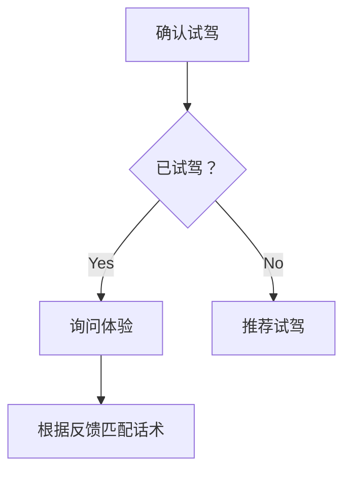

# 模型应用与工程实践

<a id="k333136cf459c"></a>

## 什么是MAGI-1模型，它的主要特点是什么？

MAGI-1是一个大规模的自回归视频生成模型，通过自回归地预测固定长度的视频块序列来生成视频。其主要特点包括：

- **自回归生成**：视频块按顺序生成，确保因果时间建模和实时流式生成。
- **高时间一致性**：通过逐步增加的噪声水平训练，确保视频的时间一致性。
- **可扩展性**：支持长达400万token的上下文长度，适用于大规模视频生成任务。
- **实时流式生成**：由于自回归设计和固定峰值推理成本，支持实时流式视频生成。


### 参考资料

- [AIGC Interview Book](https://github.com/WeThinkIn/AIGC-Interview-Book/blob/34e9ee6aa6d35d1e213099a7ae9f433b7b9e6fe6/AI%E8%A7%86%E9%A2%91%E5%9F%BA%E7%A1%80/03_%E8%A7%86%E9%A2%91%E7%94%9F%E6%88%90%E5%85%B8%E5%9E%8B%E6%A8%A1%E5%9E%8B%E4%B8%8E%E6%9E%B6%E6%9E%84.md#L882)，来源许可：GPL-3.0。

<a id="kf847c72a815c"></a>

## 什么是Ollama

**Ollama** 是一个开源框架，专注于在本地环境中快速部署和运行大型语言模型（LLMs），支持多种模型格式（如 GGUF、PyTorch 等），提供轻量化的推理服务。其核心目标是降低用户使用 LLMs 的门槛，尤其适合AI开发者和AI研究者进行本地实验或私有化部署。通过 Ollama，AI开发者能以极低门槛将前沿 AI 能力整合到实际业务中，同时保持对数据和模型的全流程控制。以下是其核心特性：

- **本地优先**：无需依赖云端服务，支持本地 CPU/GPU 推理。
- **多模型支持**：兼容 DeepSeek、Llama、Mistral、Phi 等主流模型。
- **轻量化 API**：提供类似 OpenAI 的 RESTful API，便于集成到现有系统中。
- **多模态扩展**：支持文本、图像生成（如 LLaVA）等多模态任务。
- **资源优化**：通过量化技术（如 4-bit/8-bit）降低显存占用。

### 参考资料

- [AIGC Interview Book](https://github.com/WeThinkIn/AIGC-Interview-Book/blob/34e9ee6aa6d35d1e213099a7ae9f433b7b9e6fe6/%E6%A8%A1%E5%9E%8B%E9%83%A8%E7%BD%B2%E5%9F%BA%E7%A1%80/%E5%A4%A7%E6%A8%A1%E5%9E%8B%E9%83%A8%E7%BD%B2.md#L1274)，来源许可：GPL-3.0。

<a id="k64999bc13c63"></a>

## 什么是上下文窗口？与词元有什么关联？

**上下文窗口（Context Window）** 是模型一次推理能够处理的最大词元序列长度。不同模型或 API 对输入和输出词元的计算方式可能不同，需要查看具体文档。

- **决定容量上限**：窗口越大，一次请求可以容纳的文本、代码、多轮对话或文档内容越多。

- **影响成本与延迟**：更长的输入通常增加长序列计算、响应时间和调用费用等。

- **不等于有效理解长度**：标称窗口表示“能放多少”，但不保证模型能稳定找到并使用所有信息。例：在长距离检索和跨段推理中，中间位置的信息利用仍可能退化。

<a id="concept-section-01-question-03"></a>

### 参考资料

- [AIGC Interview Book](https://github.com/WeThinkIn/AIGC-Interview-Book/blob/34e9ee6aa6d35d1e213099a7ae9f433b7b9e6fe6/%E5%A4%A7%E6%A8%A1%E5%9E%8B%E5%9F%BA%E7%A1%80/01_%E5%9F%BA%E7%A1%80%E6%A6%82%E5%BF%B5%E4%B8%8E%E6%A6%82%E8%BF%B0.md#L103)，来源许可：GPL-3.0。

<a id="kd46c65ee35a7"></a>

## 什么是人脸解析（Face Parsing）？

**难度评分：⭐⭐⭐ (3/5)  |  考察频率：⭐⭐⭐⭐ (4/5)**

Face Parsing 是面向人脸的像素级语义分割：输入 RGB 人脸图像，输出与图像对齐的类别 mask，例如背景、皮肤、头发、眉毛、眼睛、鼻子、嘴唇和牙齿等区域。它回答的是“每个像素属于哪一类”，区别于检测的框、关键点的坐标和识别的身份 embedding。

典型流程是检测与对齐后送入编码器-解码器或高分辨率分割网络，最后通过 Softmax 得到每个像素的类别概率。FCN、U-Net、DeepLab、HRNet 和实时场景常用的轻量化分割网络都可以作为结构基础。训练通常组合像素级交叉熵、类别加权和 Dice 等损失，以缓解背景占比过大和眼睛/嘴唇等小区域不平衡；后处理可进行边界细化、孔洞修复和多尺度融合。

它是美颜、虚拟化妆、换脸融合、AR 贴纸和局部身份保护的中间表示。质量评估除了 mIoU，还要单独检查细小区域边界和不同姿态/遮挡子集，避免平均分割指标掩盖“嘴唇边缘漏分”这类产品问题。

### 参考资料

- [AIGC Interview Book](https://github.com/WeThinkIn/AIGC-Interview-Book/blob/34e9ee6aa6d35d1e213099a7ae9f433b7b9e6fe6/%E7%BB%8F%E5%85%B8%E6%A8%A1%E5%9E%8B/%E4%BA%BA%E8%84%B8%E6%A8%A1%E5%9E%8B%E9%AB%98%E9%A2%91%E7%9F%A5%E8%AF%86%E7%82%B9.md#L179)，来源许可：GPL-3.0。

<a id="kf202c752d78b"></a>

## 什么是反问澄清提示？

反问澄清提示**要求模型在用户需求不完整时先澄清，而不是直接猜测**。例如用户说“帮我优化数据库”，模型应先问数据库类型、慢查询日志、数据规模、索引情况，而不是直接给一套通用建议。反问澄清适合需求分析、技术咨询、产品设计、故障排查等场景。

若问题已经足够明确，模型总是反问会降低用户体验。因此提示中可以规定：“只有缺少会改变答案的关键条件时才提问；否则基于合理假设直接回答，并标注假设。”

### 参考资料

- [AIGC Interview Book](https://github.com/WeThinkIn/AIGC-Interview-Book/blob/34e9ee6aa6d35d1e213099a7ae9f433b7b9e6fe6/%E5%A4%A7%E6%A8%A1%E5%9E%8B%E5%9F%BA%E7%A1%80/05_%E6%8F%90%E7%A4%BA%E5%B7%A5%E7%A8%8B%EF%BC%9A%E5%BA%94%E7%94%A8%E5%A4%A7%E6%A8%A1%E5%9E%8B%E7%9A%84%E9%AB%98%E7%BA%A7%E6%96%B9%E6%B3%95.md#L203)，来源许可：GPL-3.0。

<a id="k86605bb0b8cc"></a>

## 什么是在线查询阶段？

在线查询阶段负责响应用户问题。
典型流程包括：问题理解、查询改写、权限过滤、检索召回、重排序、上下文压缩与拼接、答案生成、引用输出和日志记录。
在线阶段主要影响响应延迟、最终答案质量、用户体验和调用成本。

> **注**：复杂 RAG 系统还会在在线阶段加入多轮对话改写、工具调用、二次检索和答案校验。

<a id="prompting-section-34-question-05"></a>

### 参考资料

- [AIGC Interview Book](https://github.com/WeThinkIn/AIGC-Interview-Book/blob/34e9ee6aa6d35d1e213099a7ae9f433b7b9e6fe6/%E5%A4%A7%E6%A8%A1%E5%9E%8B%E5%9F%BA%E7%A1%80/05_%E6%8F%90%E7%A4%BA%E5%B7%A5%E7%A8%8B%EF%BC%9A%E5%BA%94%E7%94%A8%E5%A4%A7%E6%A8%A1%E5%9E%8B%E7%9A%84%E9%AB%98%E7%BA%A7%E6%96%B9%E6%B3%95.md#L619)，来源许可：GPL-3.0。

<a id="k134afe557797"></a>

## 什么是大模型的“涌现能力”？

**难度评分：⭐⭐ (2/5) | 考察频率：⭐⭐⭐⭐ (4/5)**

**涌现能力（Emergent Abilities）** 通常指模型规模、数据量或计算量增加后，某些任务成绩在特定区间出现明显的非线性提升：小模型几乎不能完成任务，更大模型则突然超过评测阈值。[Brown et al., 2020](https://arxiv.org/abs/2005.14165)；[Schaeffer et al., 2023](https://arxiv.org/abs/2304.15004)

### 1. 核心特征

- **表观非线性**：部分任务成绩会在某个规模区间快速上升，而不是匀速改善。

- **多因素相关**：参数量、训练词元数、数据质量、架构、后训练和测试时计算都可能影响表现。

- **任务和指标相关**：不同任务、提示方式和评分方法可能得到不同的“涌现阈值”。

- **难以外推**：仅凭小模型和少量规模点，通常无法准确预测更大模型的具体能力。

### 2. 典型能力

- **上下文学习**：根据提示中的说明和少量示例完成新任务。

- **多约束指令遵循**：同时处理格式、内容和步骤等多项要求。

- **数学、代码和多步推理**：在部分任务中组织中间步骤并完成复杂求解。

- **代码与工具使用**：生成代码或按照约定格式调用搜索、数据库和执行器。

这些能力经常与规模扩展同时增强，但不能全部归因于参数量。数据、训练目标、后训练、提示、工具和评测方法都会影响最终结果。

> 部分“突然出现”可能来自离散评分或评测精度不足；换用连续指标后，能力提升有时会表现得更平滑。因此，涌现描述的是观察到的评测现象，不代表模型内部一定发生了清晰可定位的能力突变。

<a id="concept-section-03-question-02"></a>

**相关解释：** [什么是大模型的缩放定律？](%E6%A8%A1%E5%9E%8B%E5%BA%94%E7%94%A8%E4%B8%8E%E5%B7%A5%E7%A8%8B%E5%AE%9E%E8%B7%B5-05.md#k970f4078020a)

### 参考资料

- [AIGC Interview Book](https://github.com/WeThinkIn/AIGC-Interview-Book/blob/34e9ee6aa6d35d1e213099a7ae9f433b7b9e6fe6/%E5%A4%A7%E6%A8%A1%E5%9E%8B%E5%9F%BA%E7%A1%80/01_%E5%9F%BA%E7%A1%80%E6%A6%82%E5%BF%B5%E4%B8%8E%E6%A6%82%E8%BF%B0.md#L276)，来源许可：GPL-3.0。

<a id="k970f4078020a"></a>

## 什么是大模型的缩放定律？

**难度评分：⭐⭐⭐ (3/5) | 考察频率：⭐⭐⭐⭐ (4/5)**

**缩放定律（Scaling Law）** 描述在模型架构、训练方法和数据分布基本稳定时，预训练损失如何随**参数量 $N$ 、训练数据量 $D$ 和计算量 $C$ **增加而变化。这些关系常可近似为幂律：规模继续增加仍能降低损失，但收益逐渐变小。[Kaplan et al., 2020](https://arxiv.org/abs/2001.08361)

缩放定律主要预测预训练损失和计算最优配比。

### 1. Kaplan 等人的早期缩放定律

Kaplan 等人的研究指出，当其他资源不构成瓶颈时，模型损失与参数量、数据量和计算量分别近似满足幂律关系。[Kaplan et al., 2020](https://arxiv.org/abs/2001.08361)

- **参数量缩放**

```math
L(N) \propto N^{-\alpha_N}
```

- **数据量缩放**

```math
L(D) \propto D^{-\alpha_D}
```

- **计算量缩放**

```math
L(C) \propto C^{-\alpha_C}
```

其中：

- $N$ 表示模型参数量；
- $D$ 表示训练数据量，通常以词元数计量；
- $C$ 表示训练计算量，通常以浮点运算次数（Floating-Point Operations，FLOPs）计量；
- $L$ 表示验证集交叉熵损失；
- $\alpha$ 表示幂律指数，反映对应变量扩大后损失下降的速度。$\alpha_N = 0.076$，$\alpha_D = 0.095$，$\alpha_C = 0.050$。

Kaplan 等人的实验在固定计算预算下更倾向于扩大参数量，给出的计算最优关系可近似表示为：

```math
N_{opt} \propto C^{0.73}, D_{opt} \propto C^{0.27}
```

> **注**：这是特定模型、数据与拟合方法下的经验前沿。

### 2. DeepMind Chinchilla 修正缩放定律

Hoffmann 等人的研究提出 Chinchilla 缩放定律，重新估计了参数量与训练数据量的计算最优配比。核心结论是：固定算力下不能只增加参数，还要提供足够的训练 Tokens。[Hoffmann et al., 2022](https://arxiv.org/abs/2203.15556)

其损失函数可简化为：

```math
L(N, D) = L_{\infty} + \frac{A}{N^{\alpha}} + \frac{B}{D^{\beta}}
```

- $L_{\infty}$ 表示该论文所用数据分布、分词器与拟合设定下的渐近损失项，$L_{\infty}=1.69$ 。
- $N$ 表示模型参数量；
- $D$ 表示训练词元数；
- $A$、$B$、$\alpha$、$\beta$ 是通过实验拟合得到的常数， $A=406.4$、$B=410.7$、$\alpha=0.34$、$\beta=0.28$。[Hoffmann et al., 2022](https://arxiv.org/abs/2203.15556)

在计算量近似满足：

```math
C \approx 6ND
```

的情况下，对上面的简化损失式求最优，得到：

```math
N_{opt} \propto C^{\beta/(\alpha+\beta)}, \qquad D_{opt} \propto C^{\alpha/(\alpha+\beta)}
```

代入上述 $\alpha=0.34,\beta=0.28$，简化式给出的指数约为 $N_{opt}\propto C^{0.45}$、$D_{opt}\propto C^{0.55}$。总体结论可概括为两者在该实验范围内近似同步扩展，即“算力增加 100 倍、参数和数据各增加约 10 倍”。[Hoffmann et al., 2022](https://arxiv.org/abs/2203.15556)

### 3. 局限性

- **预测目标有限**：损失下降不保证推理、事实性、对话体验和工具调用同步提升。

- **依赖实验条件**：架构、数据分布、优化器和训练方法变化后，需要重新拟合。

- **不等于经济最优**：训练计算最优不一定等于部署成本、推理延迟或业务收益最优。

  

<a id="concept-section-03-question-04"></a>

### 参考资料

- [AIGC Interview Book](https://github.com/WeThinkIn/AIGC-Interview-Book/blob/34e9ee6aa6d35d1e213099a7ae9f433b7b9e6fe6/%E5%A4%A7%E6%A8%A1%E5%9E%8B%E5%9F%BA%E7%A1%80/01_%E5%9F%BA%E7%A1%80%E6%A6%82%E5%BF%B5%E4%B8%8E%E6%A6%82%E8%BF%B0.md#L326)，来源许可：GPL-3.0。

<a id="ke5632d4c27ce"></a>

## 什么是大语言模型？

**大语言模型（Large Language Model，LLM）** 是在大规模文本、代码等数据上训练的神经语言模型，主流实现通常采用变换器（Transformer）架构。它学习词元（Token）序列的概率分布，并根据上下文预测后续Token，因此可以生成文本、回答问题、处理代码和适配多种语言任务。[Brown et al., 2020](https://arxiv.org/abs/2005.14165)

**相关解释：** [什么是大模型的缩放定律？](%E6%A8%A1%E5%9E%8B%E5%BA%94%E7%94%A8%E4%B8%8E%E5%B7%A5%E7%A8%8B%E5%AE%9E%E8%B7%B5-05.md#k970f4078020a)

### 参考资料

- [AIGC Interview Book](https://github.com/WeThinkIn/AIGC-Interview-Book/blob/34e9ee6aa6d35d1e213099a7ae9f433b7b9e6fe6/%E5%A4%A7%E6%A8%A1%E5%9E%8B%E5%9F%BA%E7%A1%80/01_%E5%9F%BA%E7%A1%80%E6%A6%82%E5%BF%B5%E4%B8%8E%E6%A6%82%E8%BF%B0.md#L44)，来源许可：GPL-3.0。

<a id="keba82754b4b4"></a>

## 什么是思维树？

**思维树（Tree of Thoughts, ToT）** 是比 CoT 更复杂的推理框架。CoT 通常沿着一条路径推理，ToT 则生成多个候选思路或中间状态，并对这些状态进行评估、选择、扩展或回溯。

它适合搜索空间较大的任务，例如谜题、规划、复杂策略设计、多方案比较、需要尝试不同路径的数学或代码问题。

**相关解释：** [RAG 和微调的主要区别是什么？](../10-RAG%E4%B8%8EAgent/RAG%E4%B8%8E%E6%A3%80%E7%B4%A2%E5%A2%9E%E5%BC%BA-01.md#kec13f17a23bc)

### 参考资料

- [AIGC Interview Book](https://github.com/WeThinkIn/AIGC-Interview-Book/blob/34e9ee6aa6d35d1e213099a7ae9f433b7b9e6fe6/%E5%A4%A7%E6%A8%A1%E5%9E%8B%E5%9F%BA%E7%A1%80/05_%E6%8F%90%E7%A4%BA%E5%B7%A5%E7%A8%8B%EF%BC%9A%E5%BA%94%E7%94%A8%E5%A4%A7%E6%A8%A1%E5%9E%8B%E7%9A%84%E9%AB%98%E7%BA%A7%E6%96%B9%E6%B3%95.md#L455)，来源许可：GPL-3.0。

<a id="k06b238e8d7d0"></a>

## 什么是情境模拟提示？

**情境模拟提示（Simulation Prompting）** 是让模型在一个明确场景中模拟某类交互过程，例如面试模拟、客服对话、教学辅导、代码审查、需求评审或故障排查。它不仅要求模型扮演某个角色，还要求模型遵守场景流程、交互节奏、评价标准和边界条件。

### 参考资料

- [AIGC Interview Book](https://github.com/WeThinkIn/AIGC-Interview-Book/blob/34e9ee6aa6d35d1e213099a7ae9f433b7b9e6fe6/%E5%A4%A7%E6%A8%A1%E5%9E%8B%E5%9F%BA%E7%A1%80/05_%E6%8F%90%E7%A4%BA%E5%B7%A5%E7%A8%8B%EF%BC%9A%E5%BA%94%E7%94%A8%E5%A4%A7%E6%A8%A1%E5%9E%8B%E7%9A%84%E9%AB%98%E7%BA%A7%E6%96%B9%E6%B3%95.md#L259)，来源许可：GPL-3.0。

<a id="k4072a289d68a"></a>

## 什么是提示工程？

**提示工程（Prompt Engineering）** 是**围绕大语言模型输入上下文进行设计、调试、评估和迭代的方法体系**。它的**目标**是在不修改模型参数的情况下，让模型更稳定地完成任务，并满足业务约束、输出格式、安全边界和成本要求。

### 参考资料

- [AIGC Interview Book](https://github.com/WeThinkIn/AIGC-Interview-Book/blob/34e9ee6aa6d35d1e213099a7ae9f433b7b9e6fe6/%E5%A4%A7%E6%A8%A1%E5%9E%8B%E5%9F%BA%E7%A1%80/05_%E6%8F%90%E7%A4%BA%E5%B7%A5%E7%A8%8B%EF%BC%9A%E5%BA%94%E7%94%A8%E5%A4%A7%E6%A8%A1%E5%9E%8B%E7%9A%84%E9%AB%98%E7%BA%A7%E6%96%B9%E6%B3%95.md#L148)，来源许可：GPL-3.0。

<a id="k4b97ce15f056"></a>

## 什么是提示？系统提示、开发者提示和用户输入有什么区别？

**难度评分：⭐⭐ (2/5) | 考察频率：⭐⭐⭐⭐⭐ (5/5)**

### 1. 什么是提示？

**提示（Prompt）** 是用户或应用系统提供给大语言模型的**上下文、任务说明、约束条件和输出要求**。它是模型推理和生成时能够看到的输入环境，决定了模型应该扮演什么角色、解决什么任务、依赖什么信息、遵守什么边界、以什么格式输出。

大语言模型可以看作在**给定上下文中预测后续 token**。提示越清楚，模型越容易把概率分布集中到符合任务目标的输出上；提示越模糊，模型越容易在开放空间中生成看似合理但不稳定、不可控或不可验证的回答。

### 参考资料

- [AIGC Interview Book](https://github.com/WeThinkIn/AIGC-Interview-Book/blob/34e9ee6aa6d35d1e213099a7ae9f433b7b9e6fe6/%E5%A4%A7%E6%A8%A1%E5%9E%8B%E5%9F%BA%E7%A1%80/05_%E6%8F%90%E7%A4%BA%E5%B7%A5%E7%A8%8B%EF%BC%9A%E5%BA%94%E7%94%A8%E5%A4%A7%E6%A8%A1%E5%9E%8B%E7%9A%84%E9%AB%98%E7%BA%A7%E6%96%B9%E6%B3%95.md#L56)，来源许可：GPL-3.0。

<a id="kdc6676e63671"></a>

## 什么是查询重写？

**查询重写（Query Rewriting）** 是由于用户问题常常口语化、省略上下文、包含多意图或缺少关键词，直接检索可能召回不足，所以将用户原始问题改写成更适合检索系统理解的问题，让意图表达得更完整、更标准、更接近知识库语言。


但存在改写改变用户原意，导致召回方向偏移的风险和生成错误实体或扩展过多无关同义词。例：用户问“产品 A 不支持哪些地区”，改写成“产品 A 支持哪些地区”就会改变任务。

### 参考资料

- [AIGC Interview Book](https://github.com/WeThinkIn/AIGC-Interview-Book/blob/34e9ee6aa6d35d1e213099a7ae9f433b7b9e6fe6/%E5%A4%A7%E6%A8%A1%E5%9E%8B%E5%9F%BA%E7%A1%80/05_%E6%8F%90%E7%A4%BA%E5%B7%A5%E7%A8%8B%EF%BC%9A%E5%BA%94%E7%94%A8%E5%A4%A7%E6%A8%A1%E5%9E%8B%E7%9A%84%E9%AB%98%E7%BA%A7%E6%96%B9%E6%B3%95.md#L855)，来源许可：GPL-3.0。

<a id="kc050dffbb648"></a>

## 什么是正定矩阵？为什么协方差矩阵和 Hessian 经常要求半正定？

对称矩阵 $A \in \mathbb{R}^{n \times n}$ 若对任意非零向量 $x$ 都有：

$$
x^TAx > 0
$$

则称 $A$ 为正定矩阵；若：

$$
x^TAx \ge 0
$$

则称 $A$ 为半正定矩阵。

常见判定方式：

- 所有特征值均大于 0，则正定。
- 所有特征值均大于等于 0，则半正定。
- 正定矩阵的所有顺序主子式大于 0。
- 若存在满秩矩阵 $C$ 使 $A=C^TC$，则 $A$ 半正定；若 $C$ 可逆，则正定。

### 参考资料

- [AIGC Interview Book](https://github.com/WeThinkIn/AIGC-Interview-Book/blob/34e9ee6aa6d35d1e213099a7ae9f433b7b9e6fe6/%E6%95%B0%E5%AD%A6%26%E7%89%A9%E7%90%86%E6%9C%AC%E8%B4%A8%E5%8E%9F%E7%90%86%E5%9F%BA%E7%A1%80/01_AIGC%E6%97%B6%E4%BB%A3%E6%95%B0%E5%AD%A6%E5%9F%BA%E7%A1%80%E9%AB%98%E9%A2%91%E8%80%83%E7%82%B9.md#L232)，来源许可：GPL-3.0。

<a id="k0dcf41955d16"></a>

## 什么是稀疏模型？

### 稀疏模型（Sparse Model）的概念

稀疏模型（Sparse Model）是AI领域的一类模型，它通过减少模型的计算需求和存储需求来提高整体效率和可扩展性。这与传统的密集模型（Dense Model）形成对比，后者通常会使用所有可用的参数和计算资源。稀疏模型利用了一些关键的技术和策略，使得模型在保持或接近原有性能的情况下，大幅减少计算开销。

稀疏模型是深度学习领域的一种重要技术，通过减少模型的计算和存储需求，可以提高模型的效率和可扩展性。稀疏模型的方法多种多样，包括参数剪枝、激活稀疏化、结构化稀疏性以及专家混合模型等。尽管存在实现上的挑战，稀疏模型在处理超大规模数据和模型时具有重要的应用前景，是推动深度学习技术发展的重要方向之一。

### 参考资料

- [AIGC Interview Book](https://github.com/WeThinkIn/AIGC-Interview-Book/blob/34e9ee6aa6d35d1e213099a7ae9f433b7b9e6fe6/%E6%A8%A1%E5%9E%8B%E9%83%A8%E7%BD%B2%E5%9F%BA%E7%A1%80/%E6%A8%A1%E5%9E%8B%E5%8E%8B%E7%BC%A9%E7%9F%A5%E8%AF%86%E7%82%B9.md#L113)，来源许可：GPL-3.0。

<a id="k6fbe3907cc82"></a>

## 什么是结构化输出提示？

结构化输出提示要求模型按照固定字段输出，常用于信息抽取、分类、评审、工具调用和自动化流水线。

为了提高稳定性，应给出字段类型、枚举值、缺失值处理、禁止额外文本、输出示例和校验规则。更严格的系统还会使用 JSON Schema、函数调用（function calling / tool calling）或后处理解析器，而不是只依赖自然语言约束。

<a id="prompting-section-31"></a>

### 参考资料

- [AIGC Interview Book](https://github.com/WeThinkIn/AIGC-Interview-Book/blob/34e9ee6aa6d35d1e213099a7ae9f433b7b9e6fe6/%E5%A4%A7%E6%A8%A1%E5%9E%8B%E5%9F%BA%E7%A1%80/05_%E6%8F%90%E7%A4%BA%E5%B7%A5%E7%A8%8B%EF%BC%9A%E5%BA%94%E7%94%A8%E5%A4%A7%E6%A8%A1%E5%9E%8B%E7%9A%84%E9%AB%98%E7%BA%A7%E6%96%B9%E6%B3%95.md#L209)，来源许可：GPL-3.0。

<a id="kc21032ea0516"></a>

## 什么是语言模型

**回答：**

语言模型学习序列概率 $`p(x_{1:n})=\prod_t p(x_t|x_{\lt t})`$，训练时预测目标 token，推理时依据已生成前缀逐步采样或贪心解码。现代大模型多以 Transformer 为主干，注意力负责跨 token 交互，前馈层完成非线性变换。

CNN 可以通过因果卷积或扩张卷积建模语言，但感受野、长距离依赖和并行方式受限；理论上能做，当前通用大模型通常选择 Transformer 或其变体。

<a id="jd-damodel-20251211-20260205-p3-q9"></a>

### 参考资料

- [AIGC Interview Book](https://github.com/WeThinkIn/AIGC-Interview-Book/blob/34e9ee6aa6d35d1e213099a7ae9f433b7b9e6fe6/%E5%A4%A7%E5%8E%82%E9%AB%98%E9%A2%91%E9%9D%A2%E8%AF%95%E9%A2%98%EF%BC%88%E5%AE%9E%E6%97%B6%E6%9B%B4%E6%96%B0%EF%BC%89/%E4%BA%AC%E4%B8%9C%E9%AB%98%E9%A2%91%E9%9D%A2%E8%AF%95%E9%A2%98.md#L474)，来源许可：GPL-3.0。

<a id="kbe1e9de2050f"></a>

## 什么是通用/垂直大模型？

按照 **能力覆盖范围和应用场景**，大模型可以分为通用大模型和垂直大模型。

| 分类 | 核心定义 | 代表模型 | 核心特点 |
| :--- | :--- | :--- | :--- |
| 通用大模型 | 面向多领域、多任务训练，具备较强的通用理解、生成、推理和泛化能力 | GPT、Claude、Gemini、Qwen、GLM、DeepSeek 等通用系列 | 能力覆盖广，适合作为底座模型；但在高专业度场景中通常需要检索、微调或工具增强 |
| 垂直或专项模型 | 面向特定行业或任务优化，可能结合领域数据、继续预训练、微调、RAG 和工具链 | 代码、医疗、法律、金融、工业等模型 | 在目标场景中更贴合需求，但能力边界取决于底座模型和系统方案 |

> **注**：代码模型通常属于任务专项模型；医疗、法律、金融等则更接近行业垂直模型。

### 参考资料

- [AIGC Interview Book](https://github.com/WeThinkIn/AIGC-Interview-Book/blob/34e9ee6aa6d35d1e213099a7ae9f433b7b9e6fe6/%E5%A4%A7%E6%A8%A1%E5%9E%8B%E5%9F%BA%E7%A1%80/01_%E5%9F%BA%E7%A1%80%E6%A6%82%E5%BF%B5%E4%B8%8E%E6%A6%82%E8%BF%B0.md#L198)，来源许可：GPL-3.0。

<a id="k4cec8b525e45"></a>

## 什么是闭源/开源大模型？

| 分类 | 核心定义 | 代表模型 | 核心特点 |
| :--- | :--- | :--- | :--- |
| 闭源大模型 | 不开放模型权重，通常通过 API、在线平台或企业服务提供能力 | GPT、Claude、Gemini 等 | 开箱即用、服务成熟、综合能力强；但本地部署、深度定制和底层可控性较弱 |
| 开放权重模型 | 开放模型权重，允许用户下载、部署和微调，但许可证可能限制商用或再分发 | Llama、Qwen、DeepSeek、GLM、Mistral 等部分模型 | 可本地部署、可微调、数据可控性更强；但需要算力、工程能力和安全治理 |
| 开源模型 | 除权重外，还开放较完整的代码、训练方法或数据说明，并采用相应许可证 | 需根据具体项目判断 | 透明度和可改造性更高，但开放范围和复现条件仍可能不同 |

> **注**：很多被称为“开源大模型”的模型实际上只开放权重。能否商用、修改或再分发，应以具体版本的许可证为准。

### 参考资料

- [AIGC Interview Book](https://github.com/WeThinkIn/AIGC-Interview-Book/blob/34e9ee6aa6d35d1e213099a7ae9f433b7b9e6fe6/%E5%A4%A7%E6%A8%A1%E5%9E%8B%E5%9F%BA%E7%A1%80/01_%E5%9F%BA%E7%A1%80%E6%A6%82%E5%BF%B5%E4%B8%8E%E6%A6%82%E8%BF%B0.md#L187)，来源许可：GPL-3.0。

<a id="k8bb7e05ba38f"></a>

## 什么是随机森林算法

**回答：**

随机森林对多棵决策树做 bootstrap 抽样，并在每个节点随机抽取部分特征，再通过分类投票或回归平均降低方差。树之间的随机性降低相关性，集成后通常比单树更稳健。

关键超参包括树数、最大深度、叶节点最小样本和特征采样比例；要用 OOB 误差或交叉验证评估，并注意类别不平衡、特征泄漏和解释性边界。

<a id="jd-damodel-20251211-20260205-p5-q7"></a>

### 参考资料

- [AIGC Interview Book](https://github.com/WeThinkIn/AIGC-Interview-Book/blob/34e9ee6aa6d35d1e213099a7ae9f433b7b9e6fe6/%E5%A4%A7%E5%8E%82%E9%AB%98%E9%A2%91%E9%9D%A2%E8%AF%95%E9%A2%98%EF%BC%88%E5%AE%9E%E6%97%B6%E6%9B%B4%E6%96%B0%EF%BC%89/%E4%BA%AC%E4%B8%9C%E9%AB%98%E9%A2%91%E9%9D%A2%E8%AF%95%E9%A2%98.md#L684)，来源许可：GPL-3.0。

<a id="k6cd4185daf19"></a>

## 介绍Q-learning和DQN

**回答：**

Q-learning 学习动作价值函数并使用 Bellman 最优方程：

$$
Q(s,a)\leftarrow Q(s,a)+\alpha\left[r+\gamma\max_{a'}Q(s',a')-Q(s,a)\right].
$$

DQN 用神经网络近似 $Q(s,a)$，通过 replay buffer 打破样本相关性，用 target network 稳定目标。DQN 适合离散动作，连续动作通常改用 Actor-Critic 类方法。它的风险包括过估计、非平稳目标、探索不足和 replay 分布偏移。

<a id="tencent-llm-collection-20260903-q30"></a>

### 参考资料

- [AIGC Interview Book](https://github.com/WeThinkIn/AIGC-Interview-Book/blob/34e9ee6aa6d35d1e213099a7ae9f433b7b9e6fe6/%E5%A4%A7%E5%8E%82%E9%AB%98%E9%A2%91%E9%9D%A2%E8%AF%95%E9%A2%98%EF%BC%88%E5%AE%9E%E6%97%B6%E6%9B%B4%E6%96%B0%EF%BC%89/%E8%85%BE%E8%AE%AF%E9%AB%98%E9%A2%91%E9%9D%A2%E8%AF%95%E9%A2%98.md#L646)，来源许可：GPL-3.0。

<a id="kab51db45aba9"></a>

## 介绍一下AI行业中的API以及具体的作用

API（Application Programming Interface，应用程序编程接口）是一组定义和协议，用于构建和集成软件应用程序。它允许不同的软件系统相互通信和数据交换，提供了标准化的接口，简化了开发过程。

在人工智能（AI）行业中，API通常指AI服务提供商向开发者开放的接口，允许他们调用预训练的AI模型和算法，例如：

- **AIGC**：图像生成、视频生成、文本对话、音频生成等。
- **传统深度学习**：图像识别、物体检测、面部识别、文本分析、情感分析、机器翻译。
- **自动驾驶**：车载智能服务、车载娱乐服务等。

这些API使开发者无需从头开始训练复杂的AI模型，就能将先进的AI功能集成到自己的应用程序或服务中。

**API的具体作用**：

1. **简化开发流程**
   - **降低技术门槛**：开发者无需具备深厚的AI专业知识即可使用先进的AI功能。
   - **节省时间和资源**：避免了从零开始训练和部署模型的繁琐过程。

2. **加速产品上市**
   - **快速集成**：通过API，AI功能可以迅速集成到现有产品中。
   - **抢占市场先机**：更快地推出具备AI功能的产品，提升竞争力。

3. **促进创新**
   - **丰富功能组合**：API提供多样化的AI能力，鼓励开发者探索新应用场景。
   - **协同合作**：标准化的接口促进了不同团队和组织之间的协作。

4. **可扩展性和灵活性**
   - **按需调用**：根据需求灵活调用不同的AI服务，支持业务的可扩展性。
   - **资源优化**：按使用量付费，优化成本。

5. **持续更新和维护**
   - **技术迭代**：API提供商负责模型的更新和优化，开发者可持续受益于最新技术。
   - **降低维护成本**：减少了对模型维护和基础设施管理的需求。

6. **数据安全和合规性**
   - **安全保障**：许多AI API内置了安全机制，确保数据传输和处理的安全性。
   - **法规遵从**：帮助企业满足数据隐私和合规要求。

**实例举例**：

- **OpenAI API**
  - **功能**：提供GPT-4等大型语言模型的访问接口。
  - **应用**：文本生成、对话机器人、内容总结等。

- **Google Cloud AI APIs**
  - **功能**：包括视觉分析、语言处理、语音识别等多种AI服务。
  - **应用**：图像标签、情感分析、语音转文字等。

- **Amazon Web Services（AWS）AI服务**
  - **功能**：提供个性化推荐、欺诈检测、预测分析等。
  - **应用**：电商推荐系统、金融风险评估、库存预测等。

### 参考资料

- [AIGC Interview Book](https://github.com/WeThinkIn/AIGC-Interview-Book/blob/34e9ee6aa6d35d1e213099a7ae9f433b7b9e6fe6/%E8%AE%A1%E7%AE%97%E6%9C%BA%E5%9F%BA%E7%A1%80/%E8%AE%A1%E7%AE%97%E6%9C%BA%E5%B7%A5%E7%A8%8B%E5%9F%BA%E7%A1%80%E9%AB%98%E9%A2%91%E7%9F%A5%E8%AF%86%E7%82%B9.md#L1151)，来源许可：GPL-3.0。

<a id="kb1aa2e976ccb"></a>

## 介绍一下CogVideoX系列模型的VAE结构

和Sora类似，CogVideoX模型在输入端也是设计了一个3D Causal VAE结构对输入视频数据进行Latent编码。

**视频数据比起图像数据，本质上是增加了时间信息，所以其数据量级和计算量级也远超图像数据，处理难度也更高**。3D VAE架构主要通过3D卷积同时压缩视频的空间和时间维度，从而实现了对视频数据更高的压缩编码效率和更好的重建质量与连续性。
下图展示了3D VAE的结构示意图，主要包括一个Encoder（编码器）、一个Decoder（解码器）以及一个Latent Space Regularizer（潜在空间正则器）：

1. **编码器**：用于将输入视频数据转换为Latent Feature。这一过程中，编码器会通过四个下采样阶段逐步减少视频数据的空间和时间分辨率。
2. **解码器**：将视频数据的Latent Feature转换成原始的像素级视频。解码器也包含四个对称的上采样阶段，用于恢复视频数据的空间和时间分辨率。
3. **潜在空间正则化器**：通过KL散度来约束高斯Latent空间，对编码器生成的Latent Feature进行正则化。这对于AI视频大模型的生成效果和稳定性至关重要。


值得注意的是，编码器的前两个下采样阶段和解码器的最后两个上采样阶段涉及空间和时间维度，而最后一个阶段仅应用于空间采样。**所以3D VAE在时间维度上实现了4倍的压缩，而在空间维度上实现了8×8倍的压缩。总的来说，实现了视频数据从像素级到Latent Feature的4×8×8压缩比率，整体压缩效率还是非常高的**。

同时在3D VAE中采用了时间因果卷积，这是一种特殊的卷积网络，该卷积将所有填充放置在时间卷积的开头，如上图(b)中所示。这确保了未来帧的信息不会影响现在或过去的预测。这对于时间序列数据的处理非常重要，因为它保留了因果关系，使得模型的预测不会违反时间顺序。

由于处理视频数据的所有帧会消耗大量的GPU显存，**CogVideoX为了适应大规模视频的处理，在时间维度上应用了上下文并行（context parallel）的策略进行3D卷积操作**，将时间维度上的计算分配到多个GPU设备上进行并行计算，如上图中(b)所示。每个GPU设备只需要处理一部分时间段的数据，并将必要的信息传递给下一个GPU设备，这减少了GPU设备间的通信开销，并有效地分配了计算资源。由于卷积的因果性。

下图是**Rocky梳理的CogVideoX 3D VAE的完整结构图**，大家可以感受一下其魅力，看着这个完整结构图学习CogVideoX 3D VAE模型部分，相信大家脑海中的思路也会更加清晰：


### 参考资料

- [AIGC Interview Book](https://github.com/WeThinkIn/AIGC-Interview-Book/blob/34e9ee6aa6d35d1e213099a7ae9f433b7b9e6fe6/AI%E8%A7%86%E9%A2%91%E5%9F%BA%E7%A1%80/03_%E8%A7%86%E9%A2%91%E7%94%9F%E6%88%90%E5%85%B8%E5%9E%8B%E6%A8%A1%E5%9E%8B%E4%B8%8E%E6%9E%B6%E6%9E%84.md#L792)，来源许可：GPL-3.0。

<a id="k5c9a87c7b08a"></a>

## 介绍一下Gunicorn的原理，并举例其在AI行业的作用

**Gunicorn（Green Unicorn）** 是一个被广泛应用的 Python Web 服务器网关接口（WSGI）HTTP 服务器，适用于 UNIX 系统。它以简单、高效、轻量级著称，能够兼容多种 Web 框架，如 Django、Flask、Pyramid 等。

在 AI 行业，模型的部署和服务化是关键环节之一。Gunicorn 作为成熟的 Python WSGI 服务器，为 AI 模型的服务化部署提供了稳健、高性能的解决方案。通过与各种 Web 框架和异步工作类的结合，Gunicorn 能够满足 AI 应用对高并发、低延迟和稳定性的要求。在 AI 行业的实际应用中，合理地配置和使用 Gunicorn，可以有效提升模型服务的性能和可靠性。

### 1. WSGI 概述

- **WSGI（Web Server Gateway Interface）** 是 Python 应用程序或框架与 Web 服务器之间的标准接口。
- 它定义了一套简单的调用约定，使得不同的 Web 服务器和应用框架可以互相兼容。

### 2. Gunicorn 的架构

Gunicorn 采用了 **预分叉（Pre-fork）** 的工作模式，其架构主要包括：

- **Master（主进程）**：负责管理 Worker（工作进程），包括创建、监控和销毁。
- **Worker（工作进程）**：处理实际的客户端请求，每个进程独立运行。

### 3. Gunicorn 的工作原理

1. **启动阶段**：

   - Gunicorn 被启动后，创建一个 Master 进程。
   - Master 根据配置，预先 Fork 出多个 Worker 进程。

2. **请求处理**：

   - 客户端请求到达服务器后，由 Master 进程通过监听套接字（Socket）接受连接。
   - Master 将连接分配给空闲的 Worker 进程。

3. **响应阶段**：

   - Worker 进程根据 WSGI 应用程序处理请求，生成响应。
   - 响应通过套接字返回给客户端。

4. **进程管理**：

   - Master 监控 Worker 的状态，必要时重启或增减 Worker 数量。
   - 支持平滑重启和代码更新，确保服务的高可用性。

### 4. Worker 类型

Gunicorn 支持多种 Worker 类型，以满足不同的并发需求：

- **同步（sync）**：默认的 Worker 类型，每个请求占用一个线程，适用于 I/O 密集型应用。
- **异步（async）**：基于事件循环，如 **gevent**、**eventlet**，适用于高并发场景。
- **基于线程（threads）**：每个 Worker 可以处理多个线程，提高并发能力。

### 5. 配置与定制

- **配置文件**：Gunicorn 支持使用配置文件或命令行参数，灵活定制服务器行为。
- **中间件与插件**：支持自定义中间件，扩展功能，如日志、监控等。

### 二、Gunicorn 的优势

1. **高性能**：采用预分叉模型，减少进程创建和销毁的开销，提供稳定的性能表现。

2. **简单易用**：配置简洁，易于与各种 Python Web 框架集成。

3. **可扩展性**：支持多种 Worker 类型，适应不同的应用场景和并发需求。

4. **稳健性**：具备良好的错误处理和进程管理机制，确保服务的可靠运行。

### 1. AI 模型的服务化部署

在 AI 应用中，将训练好的模型部署为 Web 服务，供客户端调用是常见需求。Gunicorn 在这一过程中提供了可靠的服务器环境。

- **与 Flask 或 FastAPI 集成**：通过 WSGI 或 ASGI 接口，将模型封装为 API 服务。
- **处理高并发请求**：Gunicorn 的多 Worker 模型能够有效处理来自不同客户端的并发请求。
- **稳定性和可靠性**：确保模型服务在长时间运行下的稳定性。

### 2. 实例：使用 Flask 部署预测服务

```python
# app.py
from flask import Flask, request, jsonify
import joblib

app = Flask(__name__)
model = joblib.load('model.pkl')

@app.route('/predict', methods=['POST'])
def predict():
    data = request.json
    prediction = model.predict([data['features']])
    return jsonify({'prediction': prediction.tolist()})

if __name__ == '__main__':
    app.run()
```

**使用 Gunicorn 启动服务：**

```bash
gunicorn app:app --workers 4
```

- **解释**：
  - `app:app`：指定模块和应用实例。
  - `--workers 4`：启动 4 个 Worker 进程，提高并发处理能力。

**使用 Gunicorn 和 UvicornWorker 启动服务：**

```bash
gunicorn main:app --workers 2 --worker-class uvicorn.workers.UvicornWorker
```

- **解释**：
  - `--worker-class uvicorn.workers.UvicornWorker`：使用异步 Worker，支持高并发和异步请求。

### 四、Gunicorn在AI服务部署中的优势

1. **高效利用资源**：通过多进程模型，充分利用多核 CPU，提高吞吐量。

2. **易于扩展**：可以根据需求调整 Worker 数量，灵活应对流量变化。

3. **安全性**：隔离不同的 Worker 进程，防止单点故障。

4. **与容器化技术结合**：常与 Docker 等容器技术配合，构建可移植的部署方案。

### 参考资料

- [AIGC Interview Book](https://github.com/WeThinkIn/AIGC-Interview-Book/blob/34e9ee6aa6d35d1e213099a7ae9f433b7b9e6fe6/%E8%AE%A1%E7%AE%97%E6%9C%BA%E5%9F%BA%E7%A1%80/%E8%AE%A1%E7%AE%97%E6%9C%BA%E5%B7%A5%E7%A8%8B%E5%9F%BA%E7%A1%80%E9%AB%98%E9%A2%91%E7%9F%A5%E8%AF%86%E7%82%B9.md#L1205)，来源许可：GPL-3.0。

<a id="k2e04a5104818"></a>

## 介绍一下TPS和它的应用场景

TPS（Thin PlateSpline），薄板样条插值，是一种插值算法，经常用于图像变形等，通过少量的控制点就可以驱动图像进行变化。一般用于有弯曲的形变文本识别中，
当检测到不规则的文本区域，往往先使用TPS算法对文本区域纠正成矩形再进行识别，如STAR-Net、RARE等识别算法中皆引入了TPS模块。

### 参考资料

- [AIGC Interview Book](https://github.com/WeThinkIn/AIGC-Interview-Book/blob/34e9ee6aa6d35d1e213099a7ae9f433b7b9e6fe6/%E7%BB%8F%E5%85%B8%E6%A8%A1%E5%9E%8B/OCR%E9%AB%98%E9%A2%91%E7%9F%A5%E8%AF%86%E7%82%B9.md#L151)，来源许可：GPL-3.0。

<a id="kede76904f628"></a>

## 介绍一下Uvicorn的原理，并举例其在AI行业的作用

**Uvicorn** 是一个基于 Python 的高速、轻量级 ASGI（Asynchronous Server Gateway Interface）服务器，采用了基于事件循环的异步编程模型。它以高性能和低资源消耗著称，适用于部署基于异步框架（如 FastAPI、Starlette）的 Python Web 应用。

在 AI 行业，实时性和高并发能力对于模型服务化部署尤为重要。Uvicorn 作为现代化的高性能 ASGI 服务器，在 AI 行业的应用越来越广泛。它的高并发、低延迟和对异步协议的支持，使得 AI 应用能够满足实时性和高吞吐量的要求。通过与异步框架的结合，Uvicorn 为 AI 模型的部署和服务化提供了强大的支持。

### 1. ASGI 概述

- **ASGI（Asynchronous Server Gateway Interface）** 是 WSGI 的异步版本，旨在支持异步通信协议，如 WebSocket，以及高并发的异步应用。
- ASGI 定义了应用程序与服务器之间的接口标准，允许异步框架和服务器之间的互操作。

### 2. Uvicorn 的架构

Uvicorn 采用了现代化的异步编程技术，基于 **uvloop** 和 **httptools**，提供了高性能的网络 I/O 和 HTTP 处理。

- **uvloop**：一个基于 libuv 的高性能事件循环，比默认的 asyncio 事件循环快很多。
- **httptools**：用于解析 HTTP 协议的高效库。

### 3. Uvicorn 的工作原理

1. 事件循环机制

- **事件循环（Event Loop）**：核心组件，负责调度和执行异步任务。
- Uvicorn 使用 uvloop 作为事件循环的实现，提供了高效的异步 I/O 操作。

2. 异步请求处理

- **异步任务**：Uvicorn 能够处理异步函数（`async def`），在请求到来时创建协程进行处理。
- **并发性**：通过协程和事件循环，Uvicorn 能够在单个线程中处理大量的并发连接。

3. ASGI 应用接口

- **Scope**：请求的上下文信息，如类型、路径、头信息等。
- **Receive**：异步函数，用于接收客户端发送的消息。
- **Send**：异步函数，用于向客户端发送消息。

Uvicorn 接受客户端请求，创建 Scope，并调用 ASGI 应用的入口点，将 `scope`、`receive`、`send` 传递给应用程序。

4. 协程调度

- **协程（Coroutine）**：Python 中的异步函数，使用 `async def` 定义。
- Uvicorn 在事件循环中调度协程的执行，非阻塞地处理 I/O 操作，实现高效的资源利用。

### 4. Uvicorn 的特点

- **高性能**：利用 uvloop 和 httptools，提供了极快的请求处理速度。
- **低资源消耗**：异步编程模型减少了线程和进程的开销。
- **支持多种协议**：除了 HTTP，还支持 WebSocket 等异步通信协议。
- **易于集成**：与 FastAPI、Starlette 等异步框架无缝衔接。

### 二、Uvicorn 的优势

1. **高并发处理能力**

   - 通过异步 I/O 和事件循环，能够在单个线程中处理大量并发请求。

2. **低延迟**

   - 减少了上下文切换和线程调度的开销，提高了响应速度。

3. **支持异步特性**

   - 能够处理 WebSocket 等需要保持长连接的协议，适合实时通信场景。

4. **轻量级**

   - 安装和部署简单，启动速度快，占用资源少。

### 1. 实时推理服务

AI 应用常常需要提供实时的预测和推理服务，如聊天机器人、语音识别、实时推荐等。Uvicorn 的高并发和低延迟特性使其成为部署此类服务的理想选择。

示例：使用 FastAPI 部署实时预测服务

```python
# main.py
from fastapi import FastAPI
import asyncio
import torch

app = FastAPI()
model = torch.load('model.pt')

@app.post("/predict")
async def predict(data: dict):
    input_tensor = torch.tensor(data['input'])
    result = await asyncio.to_thread(model_predict, input_tensor)
    return {"result": result.tolist()}

def model_predict(input_tensor):
    with torch.no_grad():
        output = model(input_tensor)
    return output
```

**启动命令：**

```bash
uvicorn main:app --host 0.0.0.0 --port 8000
```

- **解释：**
  - 使用 Uvicorn 直接运行 ASGI 应用。
  - `--host` 和 `--port` 指定服务器监听的地址和端口。

**1. 使用多进程模式**

- Uvicorn 可以使用 `--workers` 参数启动多个进程，充分利用多核 CPU。

**示例：**

```bash
uvicorn main:app --host 0.0.0.0 --port 8000 --workers 4
```

- **解释：**
  - 启动 4 个进程，提升并发处理能力。

**2. 与 Gunicorn 结合**

- 使用 Gunicorn 管理进程，Uvicorn 作为工作进程，提供更稳健的进程管理。

```bash
gunicorn main:app --workers 4 --worker-class uvicorn.workers.UvicornWorker
```

- **解释：**
  - Gunicorn 负责进程管理，Uvicorn 提供异步处理。

### 2. 异步数据处理

在一些需要处理高吞吐量数据的 AI 应用中，如日志分析、实时监控等，Uvicorn 可以与异步框架结合，实现高效的数据接收和处理。

示例：实时数据接收与处理

```python
# main.py
from fastapi import FastAPI, WebSocket
from some_async_data_processing_library import process_data

app = FastAPI()

@app.websocket("/ws")
async def websocket_endpoint(websocket: WebSocket):
    await websocket.accept()
    while True:
        data = await websocket.receive_text()
        result = await process_data(data)
        await websocket.send_text(result)
```

- **解释：**
  - 使用 WebSocket 接收实时数据。
  - 异步处理数据，提高吞吐量。

### 3. 部署异步机器学习服务

一些机器学习任务，如异步训练、在线学习等，需要异步的处理方式。Uvicorn 能够支持这些异步任务的部署。

示例：异步任务队列

```python
# main.py
from fastapi import FastAPI, BackgroundTasks
import asyncio

app = FastAPI()

@app.post("/train")
async def train_model(data: dict, background_tasks: BackgroundTasks):
    background_tasks.add_task(async_train, data)
    return {"message": "Training started"}

async def async_train(data):
    await asyncio.sleep(10)  # 模拟长时间训练任务
    # 执行训练逻辑
```

- **解释：**
  - 使用 `BackgroundTasks` 在后台异步执行训练任务，不阻塞主线程。

### 4. 与 AI 框架的集成

- **FastAPI**：Uvicorn 是 FastAPI 推荐的 ASGI 服务器，二者结合能够高效地部署 AI 应用。
- **Starlette**：作为一个轻量级的 ASGI 框架，与 Uvicorn 完美配合。

### 四、Uvicorn在AI部署中的优势

1. **高效处理 I/O 密集型任务**

   - AI 应用中，经常需要处理大量的 I/O 操作，如读取数据、网络通信等。

2. **简化代码**

   - 异步编程模型使代码更加简洁，易于维护。

3. **灵活的扩展性**

   - 支持多种协议，方便扩展新的功能，如添加 WebSocket 支持。

4. **适合微服务架构**

   - 轻量级的特性，使其适合在容器化环境中部署微服务。

### 参考资料

- [AIGC Interview Book](https://github.com/WeThinkIn/AIGC-Interview-Book/blob/34e9ee6aa6d35d1e213099a7ae9f433b7b9e6fe6/%E8%AE%A1%E7%AE%97%E6%9C%BA%E5%9F%BA%E7%A1%80/%E8%AE%A1%E7%AE%97%E6%9C%BA%E5%B7%A5%E7%A8%8B%E5%9F%BA%E7%A1%80%E9%AB%98%E9%A2%91%E7%9F%A5%E8%AF%86%E7%82%B9.md#L1330)，来源许可：GPL-3.0。

<a id="k7ccef3e2b93b"></a>

## 介绍一下你了解的 Claude Code 上下文压缩机制。

**回答：**

公开说明中的核心行为是：接近上下文上限时管理历史内容，先清理较旧工具输出，再按需要总结对话；用户也可用 `/compact` 主动压缩并指定重点。`/context` 可以帮助观察空间占用。具体触发阈值和保留策略会变化，不应把某个历史版本的百分比说成永久契约。

压缩后的工作上下文保留摘要及需要继续执行的信息，降低旧消息对预算的占用。它是有损处理：早期细节和指令可能丢失，所以持久规则应写入 `CLAUDE.md`，任务状态、重要产物与证据应落盘。摘要并不等于长期记忆，也不等于把模型的 KV Cache 无损编码成更短文本。

需要区分三个机制：对话压缩改变下一次请求的内容；Prompt Caching 复用相同前缀的处理结果；模型内部 KV Cache 保存注意力计算所需的键和值。缓存命中不减少任务在逻辑上需要携带的信息，摘要则可能改变信息量与语义。

实际使用中，在阶段完成时记录目标、已验证结果、未完成项、文件位置、约束和下一步，再压缩；恢复后先检查关键状态。Skills 的按需加载和子任务上下文隔离也可以控制占用。公开文档只能支持公开行为的结论，不应把自己设计的摘要 Schema 当成 Claude Code 未公开的内部实现。

<a id="bytedance-agent-autumn-20260916-q13"></a>

### 参考资料

- [AIGC Interview Book](https://github.com/WeThinkIn/AIGC-Interview-Book/blob/34e9ee6aa6d35d1e213099a7ae9f433b7b9e6fe6/%E5%A4%A7%E5%8E%82%E9%AB%98%E9%A2%91%E9%9D%A2%E8%AF%95%E9%A2%98%EF%BC%88%E5%AE%9E%E6%97%B6%E6%9B%B4%E6%96%B0%EF%BC%89/%E5%AD%97%E8%8A%82%E8%B7%B3%E5%8A%A8%E9%AB%98%E9%A2%91%E9%9D%A2%E8%AF%95%E9%A2%98.md#L1414)，来源许可：GPL-3.0。

<a id="k20cce3c80c81"></a>

## 介绍一下你对 Computer Use 的了解情况。

**回答：**

Computer Use 让 Agent 通过屏幕观察和鼠标、键盘等动作操作已有图形界面。它适合缺少稳定 API 的桌面应用、跨应用工作流和部分旧系统。核心闭环是“观察界面、生成动作、执行、观察变化、验证目标”，模型负责提出动作，执行器负责把动作映射为真实系统操作。

图像中的按钮、坐标和文本是环境状态，不是可信指令。网页、邮件或图片可能包含诱导操作的内容，因此运行时需要限制权限、域名、文件范围和高风险动作，并记录轨迹以支持复核。

如果存在稳定 API、浏览器 DOM 或可访问性树，应优先使用可结构化定位和校验的接口；视觉交互作为必要补充。Computer Use 对窗口焦点、缩放、遮挡、异步加载和界面变化敏感，一次点击成功也不代表业务目标完成。

评估关注端到端任务完成率、动作错误率、恢复成功率、步数、延迟和成本。例如提交表单后，应检查服务端记录或可信回执，不能只凭模型说“已完成”。对于外部提交、付款和权限修改，应将确认放在执行前的确定性控制层。

<a id="bytedance-agent-autumn-20260916-q14"></a>

### 参考资料

- [AIGC Interview Book](https://github.com/WeThinkIn/AIGC-Interview-Book/blob/34e9ee6aa6d35d1e213099a7ae9f433b7b9e6fe6/%E5%A4%A7%E5%8E%82%E9%AB%98%E9%A2%91%E9%9D%A2%E8%AF%95%E9%A2%98%EF%BC%88%E5%AE%9E%E6%97%B6%E6%9B%B4%E6%96%B0%EF%BC%89/%E5%AD%97%E8%8A%82%E8%B7%B3%E5%8A%A8%E9%AB%98%E9%A2%91%E9%9D%A2%E8%AF%95%E9%A2%98.md#L1427)，来源许可：GPL-3.0。

<a id="k2665ab13f4da"></a>

## 介绍一下计算机中热插拔式和冷启动的相关概念

### **一、热插拔（Hot Plugging）**

**定义**：  
热插拔指在计算机系统保持运行状态下，动态插入或移除硬件设备的能力。这一过程无需关闭电源或中断系统运行，依赖硬件接口和操作系统的协同支持。

**核心机制**：
1. **硬件支持**：接口需设计为支持带电插拔（如USB、PCIe热插拔规范）。
2. **操作系统管理**：
   - **设备检测**：通过中断或轮询机制感知设备连接/断开。
   - **驱动加载**：动态加载或卸载设备驱动（如Linux的`udev`服务）。
   - **资源分配**：自动分配中断请求（IRQ）、内存地址等资源。
3. **信号稳定**：接口需防止插拔瞬间的电流冲击（如ESD防护电路）。

**应用场景**：
- **服务器/数据中心**：更换故障硬盘、扩展GPU加速卡。
- **个人设备**：插入U盘、外接显示器。
- **工业控制**：更换传感器或通信模块。

### **二、冷启动（Cold Boot）**

**定义**：  
冷启动指从完全断电状态启动计算机的过程，涵盖硬件自检、固件初始化、操作系统加载等完整流程。

**核心流程**：
1. **上电自检（POST）**：检测CPU、内存、主板等核心硬件状态。
2. **固件初始化**：BIOS/UEFI加载硬件配置（如启动顺序、安全启动）。
3. **操作系统加载**：引导程序（如GRUB）加载内核，初始化驱动程序和服务。

**应用场景**：
- **首次开机**：新设备初始化。
- **硬件故障恢复**：更换关键硬件后需冷启动重新配置。
- **系统重置**：修复软件冲突或配置错误。

### **三、热插拔与冷启动对比**

| **特性**          | **热插拔**                     | **冷启动**                     |
|-------------------|------------------------------|-------------------------------|
| **系统状态**       | 系统运行中                    | 系统完全断电后重新启动          |
| **硬件操作**       | 动态插入/移除设备              | 需要关闭电源后操作              |
| **耗时**           | 毫秒级（实时生效）            | 秒到分钟级（需完整初始化）       |
| **主要目的**       | 扩展或维护不中断服务           | 彻底初始化系统或修复问题        |
| **典型场景**       | 服务器更换硬盘、插入U盘        | 电脑首次开机、系统崩溃后重启     |

### **1. AIGC**
- **热插拔应用**：  
  - **动态扩展GPU资源**：在生成高分辨率视频时，插入额外GPU加速卡提升算力。  
  - **案例**：使用NVIDIA的NVLink技术，在运行中扩展多GPU集群以加速Stable Diffusion推理。  

- **冷启动挑战**：  
  - **模型加载延迟**：启动大型语言模型（如GPT-4）需加载数百GB参数，冷启动耗时长。  
  - **优化方案**：预加载模型至显存（如TensorRT的持久化缓存）或使用容器快照技术（如Docker镜像预热）。

### **2. 传统深度学习**
- **热插拔应用**：  
  - **分布式训练节点扩展**：在训练过程中动态加入计算节点（需框架支持如PyTorch Elastic）。  
  - **案例**：Kubernetes集群中动态添加GPU节点，无需中断正在运行的训练任务。  

- **冷启动问题**：  
  - **训练环境初始化**：每次启动训练任务需加载数据集、模型和优化器状态。  
  - **优化方案**：使用检查点（Checkpoint）恢复训练，或通过并行文件系统（如Lustre）加速数据加载。

### **3. 自动驾驶**
- **热插拔应用**：  
  - **车载模块升级**：在车辆运行中更换存储模块（如SSD）以更新高精地图。  
  - **案例**：特斯拉的OTA升级中，部分计算模块支持热插拔式固件更新。  

- **冷启动关键性**：  
  - **系统安全初始化**：车辆启动时需加载感知模型（如YOLOv7）、路径规划算法和实时操作系统（如ROS 2）。  
  - **挑战**：冷启动时间直接影响车辆响应速度（需优化至毫秒级，如NVIDIA DRIVE平台的快速启动技术）。

### 参考资料

- [AIGC Interview Book](https://github.com/WeThinkIn/AIGC-Interview-Book/blob/34e9ee6aa6d35d1e213099a7ae9f433b7b9e6fe6/%E8%AE%A1%E7%AE%97%E6%9C%BA%E5%9F%BA%E7%A1%80/%E8%AE%A1%E7%AE%97%E6%9C%BA%E5%B7%A5%E7%A8%8B%E5%9F%BA%E7%A1%80%E9%AB%98%E9%A2%91%E7%9F%A5%E8%AF%86%E7%82%B9.md#L2002)，来源许可：GPL-3.0。

<a id="ka17739f0bb24"></a>

## 介绍一下计算机领域的SOP概念

### ⭐ SOP核心概念解析
**定义与本质**：  
SOP（Standard Operating Procedure）即标准操作程序，是通过规范化、流程化方法确保任务执行**一致性**和**可追溯性**的管控体系。在计算机领域，SOP将复杂技术流程分解为可重复执行的步骤序列，形成质量控制的**核心骨架**。

**核心要素**：  
- **步骤分解**：将工作流拆解为原子化操作（如数据预处理→模型训练→验证部署）  
- **质量门控**：每个环节设置检查标准（如数据集需满足类别平衡度≥85%）  
- **异常处理**：预设偏差处理路径（如模型验证准确率低于阈值时触发再训练流程）  
- **知识沉淀**：通过文档化和版本控制实现经验复用

**计算机领域特性**：  
与传统行业相比，计算机领域SOP具有**动态迭代性**——如深度学习模型训练SOP需随框架更新而持续优化，同时强调**自动化嵌入**（CI/CD流水线）及**数据合规性**（满足GDPR等要求）。

### 🛠️ 通俗实际案例：飞机检修SOP
**背景**：  
厦门航空某航班因起落架插销未拔导致延误，引发重大损失。事后制定的检修SOP要求：  
1. **物理操作**：地勤拔销后后退15步至驾驶员可视区  
2. **视觉确认**：举手示意并等待驾驶员手势回应  
3. **数字记录**：扫描插销二维码录入维护系统  

**SOP价值**：  
该案例体现了SOP的**防错机制**（物理距离强制隔离风险）和**多模态验证**（人工确认+数字留痕），故障率降为零。迁移到计算机系统，类似思想体现在：代码提交需通过单元测试（物理操作）→同事Review（视觉确认）→CI系统记录（数字追溯）的链式控制。

### ⚙️ 三大领域应用详解
### 1. **AIGC领域：智能客服SOP导航**
**案例**：网易云商AI坐席辅助系统，将客户咨询转化为动态SOP：  
- **流程引擎**：用户询问“汽车优惠”时，系统推送SOP：  

- **实时辅助**：坐席界面同步显示当前节点的话术建议与下一步选项  
- **闭环优化**：通话录音→转文本→分析偏离SOP节点→更新流程  

**成效**：会话效率提升40%，新人培训周期缩短60%，体现AIGC领域SOP的**场景自适应**特性。

### 2. **传统深度学习：模型开发SOP**
**制药质量检测案例**（乐普生物）：  
- **数据管理SOP**：  
  - 图像采集：光源亮度≥1000lux，样本旋转角度±5°内  
  - 标注规则：细胞边界标注需双人背靠背标注，Kappa值≥0.85生效  
- **训练管控SOP**：  
```python
  if val_accuracy < 0.93:   # 质量门控
      trigger_retrain_pipeline(
          data_augment = "heavy", 
          lr_adjust = "reduce_on_plateau"
      )
```
- **部署规范**：模型加密后经QA签名才可推送产线  

**核心价值**：使算法团队交付误差率从18%降至3%，凸显SOP对**过程可控性**的保障。

### 3. **自动驾驶：车规级芯片SOP**
**征程5芯片SOP落地流程**：  
1. **安全认证**：ISO 26262 ASIL-D功能安全认证（故障率＜10⁻⁹/h）  
2. **实车验证**：  
   - 城区复杂场景≥1000km无接管行驶  
   - 极端工况测试（隧道GPS丢失/强眩光）  
3. **量产冻结**：  
   - 软件版本通过AEC-Q100认证  
   - 产线部署AI质检视觉系统  

**安全关键设计**：  
- **60ms延迟标准**：从感知到制动响应≤60ms（缩短1ms=减少16cm刹车距离）  
- **双冗余机制**：任何单点故障不导致系统崩溃，通过“安全岛”硬件隔离实现  

### 💎 总结与面试回答建议
**SOP核心价值**：  
> “将**不确定的人为操作**转化为**确定性的执行框架**”——通过乐普生物SOP体系降低83%质量事故，地平线芯片SOP确保100%合规量产，印证SOP是技术规模化的基石。

SOP不仅是操作手册，更是**工程智慧的结晶**。在AI算法领域，优秀的SOP设计需平衡**严谨性**（安全/合规）与**灵活性**（快速迭代），这正是算法工程师从“coder”迈向“architect”的关键跨越。

### 参考资料

- [AIGC Interview Book](https://github.com/WeThinkIn/AIGC-Interview-Book/blob/34e9ee6aa6d35d1e213099a7ae9f433b7b9e6fe6/%E8%AE%A1%E7%AE%97%E6%9C%BA%E5%9F%BA%E7%A1%80/%E8%AE%A1%E7%AE%97%E6%9C%BA%E5%B7%A5%E7%A8%8B%E5%9F%BA%E7%A1%80%E9%AB%98%E9%A2%91%E7%9F%A5%E8%AF%86%E7%82%B9.md#L2178)，来源许可：GPL-3.0。

<a id="k459cefaaa300"></a>

## 介绍下AICoding笔试题，拿到题目后如何解读、实现？

**回答：**

先复述实际笔试题的输入、输出、约束和验收标准，再讲自己如何实现。题目没有给出具体功能时，不能补造一道算法题或声称代码通过了多少测试。

可按以下顺序解释过程：

1. 把自然语言需求转成可检查条件，列明数据范围、权限、副作用、依赖与异常行为。
2. 识别题目中的歧义，给出最小澄清或明确可逆的假设，先确定一个完整的最小交付。
3. 拆分接口、核心逻辑、存储、错误处理与测试，先跑通一条成功路径，再补失败路径。
4. 使用 AI 辅助生成或审查代码时，保持修改范围可审阅，检查依赖、执行命令和敏感配置。
5. 用独立设计的样例、边界、故障和重复请求验证；修复后运行相应回归。
6. 交付可复现的启动方式、示例输入输出、测试结果和已知限制。

面试官通常还会追问如何判断生成代码可靠。可以说明自己检查了数据契约、错误分支、资源释放与实际行为，并能手动解释核心逻辑；仅让同一模型回答“代码是否正确”不能替代执行验证。

如果时间有限，优先交付能运行、可验证的小闭环，同时明确未完成的功能。不要把“成功生成代码”当作“满足业务需求”。

<a id="meituan-agent-20261012-18fa4134-q23"></a>

### 参考资料

- [AIGC Interview Book](https://github.com/WeThinkIn/AIGC-Interview-Book/blob/34e9ee6aa6d35d1e213099a7ae9f433b7b9e6fe6/%E5%A4%A7%E5%8E%82%E9%AB%98%E9%A2%91%E9%9D%A2%E8%AF%95%E9%A2%98%EF%BC%88%E5%AE%9E%E6%97%B6%E6%9B%B4%E6%96%B0%EF%BC%89/%E7%BE%8E%E5%9B%A2%E9%AB%98%E9%A2%91%E9%9D%A2%E8%AF%95%E9%A2%98.md#L1150)，来源许可：GPL-3.0。

<a id="kf63c67dd956d"></a>

## 介绍发表的顶会论文

**回答：**

论文介绍建议用“问题 -> 现有方法瓶颈 -> 核心假设 -> 方法与公式 -> 实验设计 -> 局限性”结构。不要只讲摘要和榜单，要能解释自己的贡献、基线为何公平、消融验证了什么、数据是否泄漏、指标是否与真实目标一致，以及如果重做会改什么。题面没有给出具体论文名称时，不能伪造论文细节，应围绕自己真实研究回答。

<a id="tencent-llm-collection-20260903-q29"></a>

### 参考资料

- [AIGC Interview Book](https://github.com/WeThinkIn/AIGC-Interview-Book/blob/34e9ee6aa6d35d1e213099a7ae9f433b7b9e6fe6/%E5%A4%A7%E5%8E%82%E9%AB%98%E9%A2%91%E9%9D%A2%E8%AF%95%E9%A2%98%EF%BC%88%E5%AE%9E%E6%97%B6%E6%9B%B4%E6%96%B0%EF%BC%89/%E8%85%BE%E8%AE%AF%E9%AB%98%E9%A2%91%E9%9D%A2%E8%AF%95%E9%A2%98.md#L639)，来源许可：GPL-3.0。

<a id="ke63b7edb3e39"></a>

## 介绍最终各个指标

**回答：**

评测集要按任务类型、难度、风险、工具路径、长度和失败模式分层，并按用户/文档/模板/时间切分，防止近重复泄漏。大模型生成评测题只能作为候选，必须经过去重、事实校验、规则验证和人工抽检；跨页文档要先恢复文档结构，把问题、证据页和答案绑定到同一版本。

Agent 评测采用端到端任务成功率、工具选择与参数正确率、状态一致性、引用准确率、幻觉/越权率、恢复率、轮数、延迟和成本等组合指标。代码任务必须执行测试，交易和权限任务必须检查真实状态。单一 LLM Judge 或榜单分数不能代表线上可靠性。

<a id="tencent-llm-collection-20260903-q125"></a>

### 参考资料

- [AIGC Interview Book](https://github.com/WeThinkIn/AIGC-Interview-Book/blob/34e9ee6aa6d35d1e213099a7ae9f433b7b9e6fe6/%E5%A4%A7%E5%8E%82%E9%AB%98%E9%A2%91%E9%9D%A2%E8%AF%95%E9%A2%98%EF%BC%88%E5%AE%9E%E6%97%B6%E6%9B%B4%E6%96%B0%EF%BC%89/%E8%85%BE%E8%AE%AF%E9%AB%98%E9%A2%91%E9%9D%A2%E8%AF%95%E9%A2%98.md#L1567)，来源许可：GPL-3.0。

<a id="k4f7b89a698f0"></a>

## 介绍第一篇顶会论文（共享屏幕）

**回答：**

<a id="tencent-llm-collection-20260903-q38"></a>

**相关解释：** [介绍发表的顶会论文](%E6%A8%A1%E5%9E%8B%E5%BA%94%E7%94%A8%E4%B8%8E%E5%B7%A5%E7%A8%8B%E5%AE%9E%E8%B7%B5-05.md#kf63c67dd956d)

### 参考资料

- [AIGC Interview Book](https://github.com/WeThinkIn/AIGC-Interview-Book/blob/34e9ee6aa6d35d1e213099a7ae9f433b7b9e6fe6/%E5%A4%A7%E5%8E%82%E9%AB%98%E9%A2%91%E9%9D%A2%E8%AF%95%E9%A2%98%EF%BC%88%E5%AE%9E%E6%97%B6%E6%9B%B4%E6%96%B0%EF%BC%89/%E8%85%BE%E8%AE%AF%E9%AB%98%E9%A2%91%E9%9D%A2%E8%AF%95%E9%A2%98.md#L738)，来源许可：GPL-3.0。

<a id="kaf69b4665da0"></a>

## 介绍第二篇顶会论文

**回答：**

<a id="tencent-llm-collection-20260903-q39"></a>

**相关解释：** [介绍发表的顶会论文](%E6%A8%A1%E5%9E%8B%E5%BA%94%E7%94%A8%E4%B8%8E%E5%B7%A5%E7%A8%8B%E5%AE%9E%E8%B7%B5-05.md#kf63c67dd956d)

### 参考资料

- [AIGC Interview Book](https://github.com/WeThinkIn/AIGC-Interview-Book/blob/34e9ee6aa6d35d1e213099a7ae9f433b7b9e6fe6/%E5%A4%A7%E5%8E%82%E9%AB%98%E9%A2%91%E9%9D%A2%E8%AF%95%E9%A2%98%EF%BC%88%E5%AE%9E%E6%97%B6%E6%9B%B4%E6%96%B0%EF%BC%89/%E8%85%BE%E8%AE%AF%E9%AB%98%E9%A2%91%E9%9D%A2%E8%AF%95%E9%A2%98.md#L745)，来源许可：GPL-3.0。

<a id="kba4dcd8515a4"></a>

## 从工程和应用角度，如果你要在项目里选型 Qwen3.5，你怎么权衡开源版 Qwen3.5-397B-A17B 跟托管版 Qwen3.5-Plus？各自更适合哪些场景？

可以从 **算力、数据安全、迭代速度和控制权** 四个维度来判断：

1. **托管版 Qwen3.5-Plus**
   - 特点：
     - 默认提供 **1M tokens** 上下文、FP8 优化、内置工具（搜索、代码执行、文件处理等）；
     - Qwen 团队持续在线对齐与安全更新，支持多种对话模式（Auto / Thinking / Fast）。
   - 适用场景：
     - 中小团队或不愿/不便自建大规模 GPU 集群；
     - 对 **工程集成和上线速度** 要求高，希望直接通过云 API 接入；
     - 对数据合规有云侧解决方案（如在对应区域的云部署），能接受部分数据在云上流转。

2. **开源版 Qwen3.5-397B-A17B**
   - 特点：
     - 权重完全开源，可自定义微调、部署策略、量化方案；
     - 适合与自身基础设施深度耦合，例如专有云、本地 GPU 集群、混合部署。
   - 适用场景：
     - 大厂、科研机构，有雄厚算力并希望对模型 **有完全控制权**（包括参数访问、微调、内网部署）；
     - 对数据隐私有极高要求，需要 **数据不出本地/不出国境**；
     - 希望在 Qwen3.5 架构基础上做二次研究或创新（例如进一步改造 MoE/注意力）。

3. **一个常见实践组合**
   - 生产环境中：
     - 高敏数据/边缘场景：本地部署一个中型版本（如 27B/35B 系列）做第一层处理；
     - 公网/低敏任务：调用托管版 Qwen3.5-Plus 获得更高质量和工具能力。
   - 研发环境中：
     - 使用开源权重做内部微调和离线评估；
     - 使用托管版做快速 POC 和业务验证。

### 参考资料

- [AIGC Interview Book](https://github.com/WeThinkIn/AIGC-Interview-Book/blob/34e9ee6aa6d35d1e213099a7ae9f433b7b9e6fe6/AI%E5%A4%9A%E6%A8%A1%E6%80%81%E5%9F%BA%E7%A1%80/Qwen-VL%E7%B3%BB%E5%88%97%E6%A8%A1%E5%9E%8B%E6%A0%B8%E5%BF%83%E8%80%83%E7%82%B9.md#L1705)，来源许可：GPL-3.0。

<a id="kd21c3f82651a"></a>

## 从文案到剪辑脚本再到成片完整流程是什么样的？

**回答：**

完整流程可以拆成“语义规划层、资产准备层、时间轴编排层、媒体渲染层、质量评估层”。

第一步是需求理解。解析用户输入，确定主题、目标平台、视频时长、风格、受众、口播/字幕比例、素材来源和禁用约束。

第二步是文案生成。模型生成主标题、开头 hook、分段脚本、行动召唤和字幕草稿。这里最好输出结构化内容，例如每段包含 `scene_goal`、`voiceover`、`visual_hint`、`duration`。

第三步是剪辑脚本生成。把文案拆成镜头列表，每个镜头包括时长、画面描述、素材关键词、字幕文本、配音文本、转场方式、BGM 节奏点。剪辑脚本必须是可执行的时间轴，而不是自然语言描述。

第四步是素材检索和生成。根据镜头描述检索本地素材库、云素材库或调用图像/视频生成模型补齐素材。素材要记录分辨率、比例、版权、时长、标签和适配镜头。

第五步是时间轴合成。对素材做裁剪、缩放、补帧、转码，生成字幕，合成 TTS 或配音，加入 BGM 和转场，形成 timeline。

第六步是渲染和导出。用 FFmpeg/MoviePy/服务端渲染引擎输出目标格式，例如 1080p、30fps、H.264、AAC。

第七步是质量评估和修复。检查音画同步、字幕完整性、黑帧、分辨率、时长、敏感词、脚本一致性。如果不通过，回到对应节点修复，而不是整条链路重跑。

<a id="xiaohongshu-ai-fullstack-20260702-q8"></a>

### 参考资料

- [AIGC Interview Book](https://github.com/WeThinkIn/AIGC-Interview-Book/blob/34e9ee6aa6d35d1e213099a7ae9f433b7b9e6fe6/%E5%A4%A7%E5%8E%82%E9%AB%98%E9%A2%91%E9%9D%A2%E8%AF%95%E9%A2%98%EF%BC%88%E5%AE%9E%E6%97%B6%E6%9B%B4%E6%96%B0%EF%BC%89/%E5%B0%8F%E7%BA%A2%E4%B9%A6%E9%AB%98%E9%A2%91%E9%9D%A2%E8%AF%95%E9%A2%98.md#L200)，来源许可：GPL-3.0。

<a id="k19c5d99de84a"></a>

## 代码实现与样例验证

**回答：**

下面代码使用临时变量保留旧状态，避免覆盖依赖；按下标遍历，避免 `nums[1:]` 额外复制数组。

```python
def max_product(nums):
    if not nums:
        raise ValueError("nums must be non-empty")
    max_end = min_end = best = nums[0]
    for i in range(1, len(nums)):
        x = nums[i]
        old_max, old_min = max_end, min_end
        max_end = max(x, x * old_max, x * old_min)
        min_end = min(x, x * old_max, x * old_min)
        best = max(best, max_end)
    return best
```

| 输入 | 输出 | 验证重点 |
| --- | --- | --- |
| `[2, 3, -2, 4]` | `6` | 全局答案不一定在末尾结束 |
| `[-2, 3, -4]` | `24` | 最小状态经负数变成最大状态 |
| `[-2, 0, -1]` | `0` | 零截断连续乘积 |
| `[-3]` | `-3` | 非空子数组，答案可以为负 |
| `[-2, -3, -4]` | `12` | 最优解可以舍弃负数前缀 |

常规整数运算模型下时间复杂度为 $O(n)$、额外空间为 $O(1)$。Python 返回精确大整数；若题目不保证乘积范围，额外空间恒定指的是状态数量恒定，不代表大整数占用的位数恒定。

<a id="baidu-aigc-multimodal-agent-20260922-20260924-r1-q5-6"></a>

### 参考资料

- [AIGC Interview Book](https://github.com/WeThinkIn/AIGC-Interview-Book/blob/34e9ee6aa6d35d1e213099a7ae9f433b7b9e6fe6/%E5%A4%A7%E5%8E%82%E9%AB%98%E9%A2%91%E9%9D%A2%E8%AF%95%E9%A2%98%EF%BC%88%E5%AE%9E%E6%97%B6%E6%9B%B4%E6%96%B0%EF%BC%89/%E7%99%BE%E5%BA%A6%E9%AB%98%E9%A2%91%E9%9D%A2%E8%AF%95%E9%A2%98.md#L1573)，来源许可：GPL-3.0。

<a id="kfa24ece90d78"></a>

## 代码：读 txt 井字棋（3×3），判断当前玩家是否获胜

<a id="batch4-p2-q8"></a>

**相关解释：** [手撕：反转链表](../21-%E6%95%B0%E6%8D%AE%E7%BB%93%E6%9E%84%E4%B8%8E%E7%AE%97%E6%B3%95/%E9%93%BE%E8%A1%A8%E3%80%81%E5%A0%86%E6%A0%88%E4%B8%8E%E9%98%9F%E5%88%97.md#k543820e7fcbe)

### 参考资料

- [AIGC Interview Book](https://github.com/WeThinkIn/AIGC-Interview-Book/blob/34e9ee6aa6d35d1e213099a7ae9f433b7b9e6fe6/%E5%A4%A7%E5%8E%82%E9%AB%98%E9%A2%91%E9%9D%A2%E8%AF%95%E9%A2%98%EF%BC%88%E5%AE%9E%E6%97%B6%E6%9B%B4%E6%96%B0%EF%BC%89/%E5%AD%97%E8%8A%82%E8%B7%B3%E5%8A%A8%E9%AB%98%E9%A2%91%E9%9D%A2%E8%AF%95%E9%A2%98.md#L325)，来源许可：GPL-3.0。

<a id="kbdcc34ebed97"></a>

## 令牌是针对不同的资源吗?还是针对协程？

**回答：**

令牌应表达受限资源或配额，协程只是获得令牌后执行工作的载体。需要先确认讨论的是令牌桶，还是并发信号量，两者语义不同。

令牌桶按时间补充令牌，约束平均速率与突发额度；令牌消耗后通常不在请求完成时归还。信号量许可约束同时占用资源的数量，任务结束或取消时应归还。把信号量许可叫作令牌很常见，但面试中要说清楚。

配额键可以是租户、用户、API、模型、GPU 池或数据库连接池，也可以采用加权许可，让大任务消耗更多资源预算。多个限额同时生效时需要统一获取顺序或协调器，避免拿着一部分许可长期等待另一部分。

协程数量本身可以作为进程保护上限，但它不能准确表示 GPU 显存、外部 QPS 或数据库并发容量。设计时应把限额绑定真实瓶颈，并通过指标校准。

<a id="alibaba-qwen-20260916-q7"></a>

### 参考资料

- [AIGC Interview Book](https://github.com/WeThinkIn/AIGC-Interview-Book/blob/34e9ee6aa6d35d1e213099a7ae9f433b7b9e6fe6/%E5%A4%A7%E5%8E%82%E9%AB%98%E9%A2%91%E9%9D%A2%E8%AF%95%E9%A2%98%EF%BC%88%E5%AE%9E%E6%97%B6%E6%9B%B4%E6%96%B0%EF%BC%89/%E9%98%BF%E9%87%8C%E5%B7%B4%E5%B7%B4%E9%AB%98%E9%A2%91%E9%9D%A2%E8%AF%95%E9%A2%98.md#L2027)，来源许可：GPL-3.0。

<a id="kce9d0d01bbca"></a>

## 企业级 Memory 系统需要哪些工程能力？

**难度评分：⭐⭐⭐ (3/5)  |  考察频率：⭐⭐⭐⭐ (4/5)**

本节只讨论 Memory 子系统的工程能力，例如存储、权限、CRUD、TTL、冲突和隐私。企业级 Agent 平台整体架构、Builder、模型网关、Registry 和产品治理，见 [07_企业级Agent平台与产品落地高频考点.md](https://github.com/WeThinkIn/AIGC-Interview-Book/blob/34e9ee6aa6d35d1e213099a7ae9f433b7b9e6fe6/AI%20Agent%E5%9F%BA%E7%A1%80/07_企业级Agent平台与产品落地高频考点.md)。

企业级 Memory 系统需要：

- 多租户隔离。
- user_id / tenant_id / project_id / agent_id 作用域。
- RBAC / ABAC 权限控制。
- 记忆 CRUD API。
- 记忆版本管理。
- 用户可查看和删除。
- PII 检测和脱敏。
- TTL、归档和遗忘机制。
- 向量检索和元数据过滤。
- 记忆质量评分。
- 冲突检测和合并。
- 审计日志。
- 检索命中率、使用率、污染率监控。
- 数据备份和合规删除。
- 与 RAG、Session Store、Tool Trace 解耦。

关键指标：

- 记忆写入准确率。
- 记忆检索命中率。
- 错误记忆率。
- 隐私违规率。
- 平均检索延迟。
- 上下文压缩比。
- 用户编辑/删除请求处理时延。
- 记忆对任务成功率的提升。

### 参考资料

- [AIGC Interview Book](https://github.com/WeThinkIn/AIGC-Interview-Book/blob/34e9ee6aa6d35d1e213099a7ae9f433b7b9e6fe6/AI%20Agent%E5%9F%BA%E7%A1%80/05_Agent%E8%AE%B0%E5%BF%86%E4%B8%8E%E4%B8%8A%E4%B8%8B%E6%96%87%E5%B7%A5%E7%A8%8B%E9%AB%98%E9%A2%91%E8%80%83%E7%82%B9.md#L641)，来源许可：GPL-3.0。

<a id="k99b0ae53d77d"></a>

## 会把上下文都会传给这个改写的大模型节点吗？

**回答：**

<a id="tencent-llm-collection-20260903-q64"></a>

**相关解释：** [agent 调用工具这个过程是怎么优化的？](../10-RAG%E4%B8%8EAgent/Agent%E3%80%81%E5%B7%A5%E5%85%B7%E4%B8%8E%E5%B7%A5%E4%BD%9C%E6%B5%81-01.md#k98cb3547adb1)

### 参考资料

- [AIGC Interview Book](https://github.com/WeThinkIn/AIGC-Interview-Book/blob/34e9ee6aa6d35d1e213099a7ae9f433b7b9e6fe6/%E5%A4%A7%E5%8E%82%E9%AB%98%E9%A2%91%E9%9D%A2%E8%AF%95%E9%A2%98%EF%BC%88%E5%AE%9E%E6%97%B6%E6%9B%B4%E6%96%B0%EF%BC%89/%E8%85%BE%E8%AE%AF%E9%AB%98%E9%A2%91%E9%9D%A2%E8%AF%95%E9%A2%98.md#L988)，来源许可：GPL-3.0。

<a id="ke9160fa926f3"></a>

## 传统 NLP 任务在大模型时代还重要吗？

重要。大模型不是取消传统 NLP 任务，而是把很多任务统一到一个生成或理解框架中。

传统任务仍然有价值：

- 用于评估模型能力。
- 用于构建业务系统。
- 用于理解 LLM 输出。
- 用于 RAG、Agent、搜索、推荐、知识库等系统。

### 参考资料

- [AIGC Interview Book](https://github.com/WeThinkIn/AIGC-Interview-Book/blob/34e9ee6aa6d35d1e213099a7ae9f433b7b9e6fe6/%E7%BB%8F%E5%85%B8%E6%A8%A1%E5%9E%8B/%E8%87%AA%E7%84%B6%E8%AF%AD%E8%A8%80%E5%A4%84%E7%90%86%E9%AB%98%E9%A2%91%E7%9F%A5%E8%AF%86%E7%82%B9.md#L237)，来源许可：GPL-3.0。

<a id="kdda8574f29bd"></a>

## 传统渲染管线包括哪些核心步骤？

渲染是从三维场景生成二维图像的过程。传统图形学中，一个简化的渲染管线可以表示为：

$$
I = R(M, A, P, L)
$$

其中：

- $M$：几何模型，如 Mesh、顶点、三角面、法线。
- $A$：外观属性，如纹理、材质、反照率、粗糙度。
- $P$：相机参数，如内参、外参、投影矩阵。
- $L$：光照条件，如点光、环境光、HDRI、球谐光照。
- $R$：渲染器。
- $I$：输出图像。

典型步骤：

1. **模型变换**

   将物体从局部坐标系变换到世界坐标系。

2. **视图变换**

   将世界坐标变换到相机坐标系。

3. **投影变换**

   将三维点投影到二维屏幕空间。

4. **裁剪与光栅化**

   判断三角形覆盖哪些像素。

5. **深度测试**

   用 Z-buffer 保留离相机最近的表面。

6. **着色**

   根据法线、材质、纹理和光照计算像素颜色。

7. **后处理**

   包括抗锯齿、色调映射、阴影、景深、运动模糊等。

### 参考资料

- [AIGC Interview Book](https://github.com/WeThinkIn/AIGC-Interview-Book/blob/34e9ee6aa6d35d1e213099a7ae9f433b7b9e6fe6/AI%E6%95%B0%E5%AD%97%E4%BA%BA%E5%9F%BA%E7%A1%80/05_3D%E6%95%B0%E5%AD%97%E4%BA%BA%E4%B8%8E%E5%8F%AF%E5%BE%AE%E6%B8%B2%E6%9F%93%E9%AB%98%E9%A2%91%E8%80%83%E7%82%B9.md#L601)，来源许可：GPL-3.0。

<a id="ke7c5e2913a61"></a>

## 传统渲染管线和可微渲染有什么区别？

传统渲染从 3D 场景到 2D 图像：

$$
I = R(M,A,P,L)
$$

其中 $M$ 是几何，$A$ 是材质/外观，$P$ 是相机，$L$ 是光照。

传统管线包括：

- 顶点变换
- 投影
- 光栅化
- Z-buffer
- 着色

问题在于光栅化和 Z-buffer 涉及离散选择，例如某像素是否在三角形内部、哪个三角形离相机最近，这些操作天然不可导。

可微渲染希望得到：

$$
\frac{\partial I}{\partial M},\quad \frac{\partial I}{\partial A},\quad \frac{\partial I}{\partial P},\quad \frac{\partial I}{\partial L}
$$

常见方式：

- 对不可导步骤做软化近似。
- 设计可微 rasterizer。
- 使用神经渲染替代部分传统管线。

**数字人中的作用：**

可微渲染让 2D 图像监督反向优化 3D 人脸/人体参数、材质、光照和表情。

### 参考资料

- [AIGC Interview Book](https://github.com/WeThinkIn/AIGC-Interview-Book/blob/34e9ee6aa6d35d1e213099a7ae9f433b7b9e6fe6/AI%E6%95%B0%E5%AD%97%E4%BA%BA%E5%9F%BA%E7%A1%80/01_AIGC%E6%97%B6%E4%BB%A3%E6%95%B0%E5%AD%97%E4%BA%BA%E5%9F%BA%E7%A1%80%E9%AB%98%E9%A2%91%E8%80%83%E7%82%B9.md#L648)，来源许可：GPL-3.0。

<a id="k1bec58516a3c"></a>

## 传统的静态词嵌入（如 word2vec）与大模型产生的上下文相关的嵌入相比，有什么区别？有了 与上下文相关的嵌入，静态词嵌入还有什么价值？


静态词嵌入的价值：

1. 轻量、计算快：适合资源受限场景，不需要大型模型推理
2. 可解释性强：向量空间更易可视化，便于分析词语相似性。
3. 预训练简单：不依赖上下文，可以用大规模语料快速训练。

### 参考资料

- [Datawhale](https://github.com/datawhalechina/daily-interview/blob/f35e8d555f8ff07d568eae569c3641bd76d0eac9/docs/04-ai-algorithms/llm/llm-interview-questions.md#L31)，来源许可：GPL-3.0。

<a id="k7a5b1bdf7a61"></a>

## 伪代码关键说明

- 循环范围：`i` 从1开始（跳过初始有序的第一个元素），到`n-1`结束（覆盖所有无序元素）。
- 终止条件：`while`循环有两个终止条件——要么遍历完有序区间（`j < 0`），要么找到小于等于`key`的元素（`arr[j] <= key`）。
- 插入位置：循环结束后，`j+1`就是`key`的最终位置（因为`j`停在小于等于`key`的元素索引，或-1）。

### 参考资料

- [AIGC Interview Book](https://github.com/WeThinkIn/AIGC-Interview-Book/blob/34e9ee6aa6d35d1e213099a7ae9f433b7b9e6fe6/%E5%A4%A7%E5%8E%82%E9%AB%98%E9%A2%91%E9%9D%A2%E8%AF%95%E9%A2%98%EF%BC%88%E5%AE%9E%E6%97%B6%E6%9B%B4%E6%96%B0%EF%BC%89/%E9%80%9A%E7%94%A8AIGC%E7%AE%97%E6%B3%95%E5%B2%97%E9%AB%98%E9%A2%91%E9%9D%A2%E8%AF%95%E9%A2%98.md#L1685)，来源许可：GPL-3.0。

<a id="kec7ae084c463"></a>

## 余弦相似度与欧几里得距离在工程应用中的具体区别是什么？

**回答：**

余弦关注方向，欧氏距离关注空间中的绝对位置；但工程上最关键的前提是向量是否归一化。

若 $\|\mathbf{x}\|_2=\|\mathbf{y}\|_2=1$，则：

$$
\|\mathbf{x}-\mathbf{y}\|_2^2=
2-2\mathbf{x}^{\top}\mathbf{y}
=2-2\cos(\mathbf{x},\mathbf{y})
$$

因此在单位向量上，按余弦从大到小、按点积从大到小、按欧氏距离从小到大，排序完全一致。此时选择哪种 metric 主要取决于向量库索引支持、实现效率和现有配置。

若没有归一化，两者就不等价。余弦消除模长影响，适合只关心方向的语义匹配；欧氏距离和点积会保留模长信息。如果模型训练时让模长表达置信度、流行度或其他信号，盲目归一化反而可能丢信息。

还要纠正两个常见误区。第一，不是所有 Embedding API 都保证返回单位向量，必须查模型说明或在代码中验证；BGE 常见用法会显式设置 `normalize_embeddings=True`。第二，欧氏检索不一定因为“要开方”而更慢，排序时可以直接比较平方距离，ANN 库也有专门优化。

所以工程结论是：遵循模型训练建议，入库与查询使用完全一致的归一化和 metric，并在同一评测集上比较召回率与延迟。

<a id="moonshot-agent-dev-20260721-q17"></a>

### 参考资料

- [AIGC Interview Book](https://github.com/WeThinkIn/AIGC-Interview-Book/blob/34e9ee6aa6d35d1e213099a7ae9f433b7b9e6fe6/%E5%A4%A7%E5%8E%82%E9%AB%98%E9%A2%91%E9%9D%A2%E8%AF%95%E9%A2%98%EF%BC%88%E5%AE%9E%E6%97%B6%E6%9B%B4%E6%96%B0%EF%BC%89/%E6%9C%88%E4%B9%8B%E6%9A%97%E9%9D%A2%E9%AB%98%E9%A2%91%E9%9D%A2%E8%AF%95%E9%A2%98.md#L305)，来源许可：GPL-3.0。

<a id="k04aa85603e47"></a>

## 你个人在未来发展有那三个方面需要改进

**回答：**

选择真实、可改进且有行动计划的三个方面。例如：系统设计经验不足，通过读生产代码和承担服务模块提升；业务指标理解有限，通过跟踪用户流程与实验学习；表达过细，通过先结论后证据和限时讲解训练。

每一点都说明目前影响、正在做的行动和验收方式。不要把‘过于追求完美’当作万能答案，也不要无依据地自我否定核心能力。

<a id="jd-damodel-20251211-20260205-p6"></a>

### 参考资料

- [AIGC Interview Book](https://github.com/WeThinkIn/AIGC-Interview-Book/blob/34e9ee6aa6d35d1e213099a7ae9f433b7b9e6fe6/%E5%A4%A7%E5%8E%82%E9%AB%98%E9%A2%91%E9%9D%A2%E8%AF%95%E9%A2%98%EF%BC%88%E5%AE%9E%E6%97%B6%E6%9B%B4%E6%96%B0%EF%BC%89/%E4%BA%AC%E4%B8%9C%E9%AB%98%E9%A2%91%E9%9D%A2%E8%AF%95%E9%A2%98.md#L907)，来源许可：GPL-3.0。

<a id="kc464c545f61a"></a>

## 你个人能提供三个什么价值

**回答：**

三个价值要与岗位匹配，并各配证据。可选择：把模糊需求拆成可交付模块；用测试和数据定位问题；在算法、后端、前端之间清晰协作。

例如分别讲一项独立交付、一次通过实验修复故障、一次接口或需求协商。用“我做了什么—产生什么可观察结果”表达，避免只说学习快、责任心强、沟通好。没有相关经历时，选自己确实能证明的能力。

<a id="jd-damodel-20251211-20260205-p5-q29"></a>

### 参考资料

- [AIGC Interview Book](https://github.com/WeThinkIn/AIGC-Interview-Book/blob/34e9ee6aa6d35d1e213099a7ae9f433b7b9e6fe6/%E5%A4%A7%E5%8E%82%E9%AB%98%E9%A2%91%E9%9D%A2%E8%AF%95%E9%A2%98%EF%BC%88%E5%AE%9E%E6%97%B6%E6%9B%B4%E6%96%B0%EF%BC%89/%E4%BA%AC%E4%B8%9C%E9%AB%98%E9%A2%91%E9%9D%A2%E8%AF%95%E9%A2%98.md#L898)，来源许可：GPL-3.0。

<a id="k13cce0f168c7"></a>

## 你为什么想来我们这，对业务了解多少？

**回答：**

从产品理解、岗位问题与真实能力匹配三层回答。小红书作为内容社区，用户既会主动搜索问题与经验，也会在信息流中发现图文和视频；内容理解、搜索推荐、创作者供给和可信体验彼此影响。不要在不了解具体团队时断言其内部模型架构、指标或组织安排。

可以这样组织：“我对内容社区感兴趣，因为图文语义、用户意图和推荐反馈会直接影响内容是否被准确理解、是否被需要它的人看到。我希望参与［与招聘描述一致的方向］，自己的［真实项目］在［多模态/检索/训练部署］方面有相关经验，也希望进一步学习从离线效果到线上用户价值的验证方法。”

准备时亲自体验不同入口，挑一个具体问题，例如长尾搜索、新内容发现或图文不一致，描述观察与可能机制，并说明这只是外部产品观察。再结合岗位要求解释能承担什么、仍需补齐什么。兴趣、能力和工作内容能互相对应，比笼统赞美平台更可信。

<a id="xiaohongshu-llm-20260922-q26"></a>

### 参考资料

- [AIGC Interview Book](https://github.com/WeThinkIn/AIGC-Interview-Book/blob/34e9ee6aa6d35d1e213099a7ae9f433b7b9e6fe6/%E5%A4%A7%E5%8E%82%E9%AB%98%E9%A2%91%E9%9D%A2%E8%AF%95%E9%A2%98%EF%BC%88%E5%AE%9E%E6%97%B6%E6%9B%B4%E6%96%B0%EF%BC%89/%E5%B0%8F%E7%BA%A2%E4%B9%A6%E9%AB%98%E9%A2%91%E9%9D%A2%E8%AF%95%E9%A2%98.md#L1680)，来源许可：GPL-3.0。

<a id="k1a0be1716a8d"></a>

## 你主要负责哪些模块、哪些具体开发工作？

**回答：**

按“模块边界—具体代码—关键决策—验收证据”回答。模块名称太宽时继续拆，例如“执行器”包含工具注册、参数校验、超时取消、状态持久化、幂等和错误归一化，明确哪些由自己实现。

可用这样的句式：“我负责【输入 API 到任务入队】和【某类工具适配】；设计了【接口/表/状态转移】，处理过【一个具体故障】。用【测试、trace 或指标】确认结果。模型服务和基础运维由【团队角色】负责。”

准备一个能深入讨论的决策：为什么采用任务队列而非请求内执行、为什么把幂等落在数据库、为什么某处选择规则而非模型。再说明当时的备选方案、约束和没有解决的问题。

区分独立开发、协作开发、框架配置与阅读学习。团队整体吞吐或节省工时只有在可归因、可核验时才归于自己的改动；无法公开数字时，用指标口径和证据类型说明贡献。

<a id="meituan-agent-20261012-18fa4134-q14"></a>

### 参考资料

- [AIGC Interview Book](https://github.com/WeThinkIn/AIGC-Interview-Book/blob/34e9ee6aa6d35d1e213099a7ae9f433b7b9e6fe6/%E5%A4%A7%E5%8E%82%E9%AB%98%E9%A2%91%E9%9D%A2%E8%AF%95%E9%A2%98%EF%BC%88%E5%AE%9E%E6%97%B6%E6%9B%B4%E6%96%B0%EF%BC%89/%E7%BE%8E%E5%9B%A2%E9%AB%98%E9%A2%91%E9%9D%A2%E8%AF%95%E9%A2%98.md#L958)，来源许可：GPL-3.0。

<a id="kd5349b515060"></a>

## 你们用的底层模型有哪些？

**回答：**

具体使用清单属于项目事实，题目没有提供，不能代替候选人编造。回答时列出真实供应商、模型 ID 或版本、部署方式、承担任务和回退策略，区分线上默认、灰度实验与仅调研过的模型。

选型应覆盖工具调用、结构化输出、中文与代码能力、多模态、上下文上限、延迟、费用、数据边界与供应商稳定性。规划、摘要、检索改写和执行决策可以使用不同模型，但需要通过真实任务验证，而非仅根据通用榜单分工。

系统侧维护能力矩阵与版本化路由策略：是否支持流式工具调用、哪些 Schema 特性、最大输入输出、图像格式、取消能力与错误类型。相同“OpenAI 兼容接口”外观并不保证语义完全一致。模型更新后也要跑兼容性与任务回归，避免别名自动升级导致不可解释变化。

<a id="alibaba-qwen-20260916-q22"></a>

### 参考资料

- [AIGC Interview Book](https://github.com/WeThinkIn/AIGC-Interview-Book/blob/34e9ee6aa6d35d1e213099a7ae9f433b7b9e6fe6/%E5%A4%A7%E5%8E%82%E9%AB%98%E9%A2%91%E9%9D%A2%E8%AF%95%E9%A2%98%EF%BC%88%E5%AE%9E%E6%97%B6%E6%9B%B4%E6%96%B0%EF%BC%89/%E9%98%BF%E9%87%8C%E5%B7%B4%E5%B7%B4%E9%AB%98%E9%A2%91%E9%9D%A2%E8%AF%95%E9%A2%98.md#L2211)，来源许可：GPL-3.0。

<a id="kf5d75693138f"></a>

## 你们的上下文是怎么组装的？

**回答：**

上下文是一次决策的输入视图，应从权威状态与可追溯证据构造。通常包括系统和安全规则、当前用户目标、计划状态、近期消息、历史摘要、检索证据、工具定义以及本轮工具结果。

先确定指令层级和信任边界：用户与工具返回的网页、日志、文档均不能覆盖系统权限。身份、租户和授权从服务端注入；检索先做权限与版本过滤，再按相关性选择。工具调用与结果保持合法配对，不能因为截断而遗留只有结果没有调用的历史。

预算可以表示为：

```math
T_{\mathrm{rules}}+T_{\mathrm{state}}+T_{\mathrm{history}}+T_{\mathrm{evidence}}+T_{\mathrm{tools}}+T_{\mathrm{output}}+T_{\mathrm{reserve}}\le C.
```

输出和安全余量必须预留，图片和工具 Schema 也占用上下文。长期硬约束单独结构化保存，近期原文解决指代，较早历史用摘要与证据引用表示。大型工具结果应先做分页和字段投影。

记录此次上下文使用的消息范围、摘要版本、检索片段和模型配置，便于复现。拼接顺序与长度需要通过任务回放验证，不能只看 Prompt 是否“写得完整”。

<a id="alibaba-qwen-20260916-q21"></a>

### 参考资料

- [AIGC Interview Book](https://github.com/WeThinkIn/AIGC-Interview-Book/blob/34e9ee6aa6d35d1e213099a7ae9f433b7b9e6fe6/%E5%A4%A7%E5%8E%82%E9%AB%98%E9%A2%91%E9%9D%A2%E8%AF%95%E9%A2%98%EF%BC%88%E5%AE%9E%E6%97%B6%E6%9B%B4%E6%96%B0%EF%BC%89/%E9%98%BF%E9%87%8C%E5%B7%B4%E5%B7%B4%E9%AB%98%E9%A2%91%E9%9D%A2%E8%AF%95%E9%A2%98.md#L2192)，来源许可：GPL-3.0。

<a id="k09dd5df05678"></a>

## 你们的数据集是怎么构建的？有多少？

**回答：**

“有多少”是项目事实，应从实际清单与版本统计中回答，不能凭题目补出一个数字。报告独立任务数、每任务试验次数、任务类别和环境版本，区分开发、回归、保留测试以及线上抽样集。

数据可以来自脱敏真实任务、人工设计边界案例、历史事故和受控合成。每个样本应包含目标、必要上下文、初始环境、允许操作、成功条件与评分方法；多轮任务保留交互与工具状态，不能只有一个问题和一段参考答案。

按业务重要性与失败代价分层，覆盖长任务、超时、工具异常、权限拒绝、上下文压缩、模型切换和重连。按用户、项目、时间或语义簇划分集合，防止同一任务的改写版本跨开发集与测试集泄漏。样本变更和标注仲裁都要版本化。

规模由覆盖与统计精度共同决定。对于独立二项样本估计成功率，正态近似下可粗略用：

```math
n\approx\frac{z^2p(1-p)}{\epsilon^2}.
```

例如 95% 置信、最保守取 $p=0.5$、希望误差约为 5 个百分点，得到约 385 个独立样本。这只是估计总体比例的示例，不是项目真实规模，也不保证稀有故障得到充分覆盖；聚类相关、配对比较和高风险场景需要另外设计样本量。

<a id="alibaba-qwen-20260916-q31"></a>

### 参考资料

- [AIGC Interview Book](https://github.com/WeThinkIn/AIGC-Interview-Book/blob/34e9ee6aa6d35d1e213099a7ae9f433b7b9e6fe6/%E5%A4%A7%E5%8E%82%E9%AB%98%E9%A2%91%E9%9D%A2%E8%AF%95%E9%A2%98%EF%BC%88%E5%AE%9E%E6%97%B6%E6%9B%B4%E6%96%B0%EF%BC%89/%E9%98%BF%E9%87%8C%E5%B7%B4%E5%B7%B4%E9%AB%98%E9%A2%91%E9%9D%A2%E8%AF%95%E9%A2%98.md#L2307)，来源许可：GPL-3.0。

<a id="kf94e8eec3be9"></a>

## 你做过最失败的一次模型迭代是什么？

**回答：**

用真实案例讲清楚错误假设及修复过程，比虚构一个漂亮的失败故事更有说服力。建议按“目标与基线 -> 当时的假设 -> 做了什么 -> 哪些证据证明失败 -> 自己承担什么责任 -> 如何止损 -> 沉淀了什么机制”回答。

可套用的表达框架是：“那次我希望改善［真实指标］，判断瓶颈在［真实假设］，于是修改了［模型/数据/目标］。离线［指标及分桶］发生了变化，但在［影子验证/灰度/回归集］中出现［真实问题］。我负责排查的部分是［范围］，最终发现［证据支持的原因］，随后［回滚或修复］。”所有数据和经历都需来自实际项目。

例如“离线 AUC 上涨但线上满意度下降”可以作为分析题：可能是数据穿越、曝光偏差、校准变化、长尾退化或延迟增加，不能仅凭结果就断言目标错了。应说明如何通过时间重放、分桶、组件替换或实验逐个排除，并报告最终证据。

复盘重点是可复用改进：补齐上线护栏、建立时间一致性检查、设置分桶验收、缩小发布批次、明确回滚负责人。不要把失败完全归咎于产品、数据或同事；同时也不必把所有问题都揽成个人失误，应准确表达自己的决策与协作范围。

<a id="xiaohongshu-llm-20260922-round-4"></a>
**HR 面与反问**

<a id="xiaohongshu-llm-20260922-q25"></a>

### 参考资料

- [AIGC Interview Book](https://github.com/WeThinkIn/AIGC-Interview-Book/blob/34e9ee6aa6d35d1e213099a7ae9f433b7b9e6fe6/%E5%A4%A7%E5%8E%82%E9%AB%98%E9%A2%91%E9%9D%A2%E8%AF%95%E9%A2%98%EF%BC%88%E5%AE%9E%E6%97%B6%E6%9B%B4%E6%96%B0%EF%BC%89/%E5%B0%8F%E7%BA%A2%E4%B9%A6%E9%AB%98%E9%A2%91%E9%9D%A2%E8%AF%95%E9%A2%98.md#L1664)，来源许可：GPL-3.0。

<a id="k9afcaec20809"></a>

## 你刚才提到会用判断做参数校验，那你知道python中用来实现装饰器时，能自动保留被装饰函数源信息，比如函数名文档字符串的标准库装饰器是什么吗？

**回答：**

标准库提供的是 `functools.wraps`。通常把它写在包装函数上：`@functools.wraps(original)`。它是 `functools.update_wrapper` 的便捷封装，帮助保留原函数的模块、名称、限定名、文档字符串、注解等元数据，并设置 `__wrapped__` 指向被包装对象；具体默认复制属性与 Python 版本有关。

保留元数据有实际作用：日志和监控能显示业务函数名，帮助文档与调试工具追踪原函数，`inspect.signature` 通常可以沿 `__wrapped__` 获取原签名。否则所有函数可能都显示为 `wrapper`，影响定位和依赖注入等依赖反射的功能。

但 `wraps` 不会把 `(*args, **kwargs)` 包装器的实际执行参数机制改写成原函数定义，也不会自动完成参数校验、类型检查或返回值透传。它更不会自动修正同步与异步的语义差异。这些仍然需要包装函数正确实现。

因此回答可以收束为：**`wraps` 负责元数据与可追溯性，参数转发和调用语义由包装器负责。**

<a id="hengsheng-ai-dev-20260923-q6"></a>

### 参考资料

- [AIGC Interview Book](https://github.com/WeThinkIn/AIGC-Interview-Book/blob/34e9ee6aa6d35d1e213099a7ae9f433b7b9e6fe6/%E5%A4%A7%E5%8E%82%E9%AB%98%E9%A2%91%E9%9D%A2%E8%AF%95%E9%A2%98%EF%BC%88%E5%AE%9E%E6%97%B6%E6%9B%B4%E6%96%B0%EF%BC%89/%E6%81%92%E7%94%9F%E7%94%B5%E5%AD%90%E9%AB%98%E9%A2%91%E9%9D%A2%E8%AF%95%E9%A2%98.md#L141)，来源许可：GPL-3.0。

<a id="kf5c29c6de301"></a>

## 你刚才提到所有节点都围绕共享state做读写。那这种全局共享状态的设计，相比每个节点独立传参的朴素实现实际带来了哪些额外的代价？

**回答：**

首先澄清“全局共享”：图状态通常属于一次运行或一个 thread 的执行上下文，不应成为所有用户共用的可变对象。把不同租户的数据放进一个无隔离字典，会造成更严重的泄漏与并发问题，这不是框架要求的设计。

相比独立传参，共享状态降低了节点之间传递大量参数的样板代码，却引入隐式依赖：节点究竟读写哪些字段、哪些字段何时有效，可能不再从函数签名一眼看出。状态 schema 需要明确所有者、读写范围和生命周期，不能随着需求增长变成什么都装的对象。

并行场景要付出更新合并成本。两个节点写同一标量不能默认“最后写入就是对的”；列表追加可能出现重复与顺序差异；reducer 还需处理冲突、幂等和确定性。checkpointer 负责保存执行状态，不等于自动解决业务并发一致性。

大状态还增加序列化、checkpoint 存储、网络和恢复成本。把二进制图片、完整文档、客户端连接或密钥直接塞进状态并不合适，应保存受权限控制的引用、摘要和版本；并设计保留期限、脱敏、加密与最小可见性。

最后是版本演进：暂停数天的旧流程，恢复时可能遇到新 schema、新节点逻辑或失效工具凭据。需要版本标记、兼容处理、测试和明确的恢复策略。小型流程可继续使用显式传参；大型图则通过子图、局部状态和输入输出契约限制共享范围。

<a id="hengsheng-ai-dev-20260923-q27"></a>

### 参考资料

- [AIGC Interview Book](https://github.com/WeThinkIn/AIGC-Interview-Book/blob/34e9ee6aa6d35d1e213099a7ae9f433b7b9e6fe6/%E5%A4%A7%E5%8E%82%E9%AB%98%E9%A2%91%E9%9D%A2%E8%AF%95%E9%A2%98%EF%BC%88%E5%AE%9E%E6%97%B6%E6%9B%B4%E6%96%B0%EF%BC%89/%E6%81%92%E7%94%9F%E7%94%B5%E5%AD%90%E9%AB%98%E9%A2%91%E9%9D%A2%E8%AF%95%E9%A2%98.md#L522)，来源许可：GPL-3.0。

<a id="kc0e19008a34e"></a>

## 你在里面做了哪些工作

**回答：**

把团队成果拆成自己负责的可验证模块：例如工具 schema 与适配器、任务状态管理、SFT 数据管线、评测集、模型服务或界面。说清输入输出、接口责任、代码范围，以及谁负责其他模块。

推荐表达：“我独立负责【模块】，针对【具体故障】设计了【改动】，用【测试集或实验】比较【指标】。上线或实验中仍存在【限制】，下一步计划是【措施】。”没有测量数据时说明已实现功能和验证范围，不编造提升数值。

最好准备一个失败案例：怎样从日志定位到参数生成、执行超时或数据泄漏，为什么替代方案不适合，以及如何做回归。它比笼统说‘参与了整个 Agent’更能证明贡献。

<a id="jd-damodel-20251211-20260205-p3-q4"></a>

### 参考资料

- [AIGC Interview Book](https://github.com/WeThinkIn/AIGC-Interview-Book/blob/34e9ee6aa6d35d1e213099a7ae9f433b7b9e6fe6/%E5%A4%A7%E5%8E%82%E9%AB%98%E9%A2%91%E9%9D%A2%E8%AF%95%E9%A2%98%EF%BC%88%E5%AE%9E%E6%97%B6%E6%9B%B4%E6%96%B0%EF%BC%89/%E4%BA%AC%E4%B8%9C%E9%AB%98%E9%A2%91%E9%9D%A2%E8%AF%95%E9%A2%98.md#L415)，来源许可：GPL-3.0。

<a id="k5d61486c049d"></a>

## 你如何保证每次调用大模型的稳定性？

**回答：**

大模型稳定性不能只靠“调低 temperature”。要从输入、输出、执行、评测和降级五个层面治理。

输入层要做 prompt 模板化和上下文裁剪。不同任务使用固定模板，明确角色、约束、输出格式、禁止事项和示例。上下文不能无限堆，要只保留和当前节点有关的信息，避免噪声干扰。

输出层要做结构化约束。比如要求模型输出 JSON Schema、函数调用参数或 DSL，并在拿到结果后做 schema validation。如果字段缺失、类型错误、时间轴不合法，就进入修复 prompt 或回退逻辑。

执行层要做超时、重试、幂等和熔断。模型 API 会受网络、限流、供应商波动影响，所以每次调用要有 request id、timeout、retry with backoff、fallback model、缓存和日志 trace。对于视频生成链路，重试必须节点级幂等，不能重复扣费或重复写脏数据。

评测层要做自动化检查。比如文案是否命中禁用词，镜头总时长是否等于目标时长，字幕是否为空，TTS 时长是否和字幕匹配，输出 JSON 是否可解析。模型输出不能直接进入生产链路，必须经过确定性校验。

降级层要准备备选方案。主模型失败时切到备选模型；复杂生成失败时退化成模板化脚本；素材检索不足时提示用户补充；最终答案置信度低时进入人工确认。稳定性本质是把模型的不确定性关在工程边界里。

<a id="xiaohongshu-ai-fullstack-20260702-q7"></a>

### 参考资料

- [AIGC Interview Book](https://github.com/WeThinkIn/AIGC-Interview-Book/blob/34e9ee6aa6d35d1e213099a7ae9f433b7b9e6fe6/%E5%A4%A7%E5%8E%82%E9%AB%98%E9%A2%91%E9%9D%A2%E8%AF%95%E9%A2%98%EF%BC%88%E5%AE%9E%E6%97%B6%E6%9B%B4%E6%96%B0%EF%BC%89/%E5%B0%8F%E7%BA%A2%E4%B9%A6%E9%AB%98%E9%A2%91%E9%9D%A2%E8%AF%95%E9%A2%98.md#L183)，来源许可：GPL-3.0。

<a id="k8fac1d4525a8"></a>

## 你平时用什么做ai coding？

**回答：**

可以按任务类型选择工具，而不是只依赖一个工具。

如果是仓库级代码修改、重构、测试修复，更适合用 Claude Code、Codex CLI 这类终端 coding agent，因为它们可以直接读取项目文件、定位引用、生成 diff、运行测试，并围绕当前仓库做闭环。对工程任务来说，能否验证修改比单纯生成代码更重要。

如果是日常 IDE 内补全、局部函数实现、解释报错、快速生成样板代码，可以用 Cursor、Trae 或 IDE 插件类工具，因为它们和编辑器交互顺滑，适合小步快改。

如果是方案设计、接口设计、复杂 bug 分析，可以先让模型梳理假设和排查路径，再用日志、测试、断点或命令验证。AI Coding 不能替代工程判断，尤其涉及并发、事务、安全、线上数据、权限操作时，必须以测试和可观测证据为准。

使用原则可以总结为：不直接相信生成结果，必须 review diff；关键逻辑必须跑测试或构造 case；不让 AI 在没有上下文的情况下大改架构；复杂任务先让它读代码并给计划，再分步骤修改；沉淀常用 prompt、脚本和项目规范，让 AI 更符合团队工程习惯。AI 会降低样板代码和信息检索成本，但真正有价值的仍是问题定义、系统设计、边界判断、质量验证和线上负责能力。

### 参考资料

- [AIGC Interview Book](https://github.com/WeThinkIn/AIGC-Interview-Book/blob/34e9ee6aa6d35d1e213099a7ae9f433b7b9e6fe6/%E5%A4%A7%E5%8E%82%E9%AB%98%E9%A2%91%E9%9D%A2%E8%AF%95%E9%A2%98%EF%BC%88%E5%AE%9E%E6%97%B6%E6%9B%B4%E6%96%B0%EF%BC%89/%E8%9A%82%E8%9A%81%E9%9B%86%E5%9B%A2%E9%AB%98%E9%A2%91%E9%9D%A2%E8%AF%95%E9%A2%98.md#L273)，来源许可：GPL-3.0。

<a id="k3a9a4364ec5b"></a>

## 你平时调试代码怎么调试的？

**回答：**

我会按“稳定复现 -> 缩小范围 -> 增加观测 -> 验证假设 -> 修复回归”的顺序调试，而不是一上来把整段代码交给 AI。

算法题或单文件脚本，最有效的是构造最小输入，用 `print` 输出关键指针、循环变量和分支路径，再与手工推演对比。复杂业务代码会使用结构化日志、断点调试器、单元测试和 trace ID；并发/分布式问题还要看时间线、请求链路和资源指标。

具体工具取决于问题：Python 用 `pdb`/IDE debugger、pytest 和日志；服务端看请求日志、指标和分布式 tracing；模型/Agent 链路还要记录 Prompt 版本、模型参数、工具输入输出和状态 checkpoint，保证同一问题可回放。

AI 可以帮助解释堆栈、生成测试用例和提出排查假设，但它拿不到完整运行环境，也可能误判。把 AI 当副驾驶，自己用证据验证，才是可复现的调试方式。

<a id="moonshot-agent-dev-20260721-q23"></a>

### 参考资料

- [AIGC Interview Book](https://github.com/WeThinkIn/AIGC-Interview-Book/blob/34e9ee6aa6d35d1e213099a7ae9f433b7b9e6fe6/%E5%A4%A7%E5%8E%82%E9%AB%98%E9%A2%91%E9%9D%A2%E8%AF%95%E9%A2%98%EF%BC%88%E5%AE%9E%E6%97%B6%E6%9B%B4%E6%96%B0%EF%BC%89/%E6%9C%88%E4%B9%8B%E6%9A%97%E9%9D%A2%E9%AB%98%E9%A2%91%E9%9D%A2%E8%AF%95%E9%A2%98.md#L441)，来源许可：GPL-3.0。

<a id="k28b4d66e79cf"></a>

## 你提到他用点和边的图结构替代LangChain原有的链式调用。那这个框架里最核心的节点抽象具体是怎么设计的？

**回答：**

以 LangGraph `StateGraph` 为例，节点通常是同步或异步可调用对象：读取约定的 state，可接收配置或运行上下文，返回部分状态更新；特定场景也可返回 `Command` 等控制对象。边和条件路由负责调度，节点无需知道整个系统所有后续步骤。

状态 schema 定义字段，reducer 决定该字段如何合并更新。没有特别 reducer 的字段通常按覆盖语义更新，并行写同一字段可能发生冲突；有 reducer 的字段按其规则合并。不同节点共享的是一份有执行语义的图状态，不是允许大家任意并发修改的进程全局字典。

以下示例展示“按稳定 ID 汇总已校验文档引用”的 reducer 与节点，作为挂载进图之前可独立测试的纯函数：

```python
from typing import Annotated, TypedDict

def merge_refs(left: dict[str, str], right: dict[str, str]):
    merged = dict(left)
    for key, value in right.items():
        if key in merged and merged[key] != value:
            raise ValueError("conflicting content for the same reference id")
        merged[key] = value
    return dict(sorted(merged.items()))

class State(TypedDict):
    query: str
    refs: Annotated[dict[str, str], merge_refs]
    evidence_ready: bool

def inspect_evidence(state: State):
    return {"evidence_ready": bool(state["refs"])}
```

节点只返回它负责的 `evidence_ready` 更新，不把整个旧 state 原样返回，减少覆盖并行结果的风险。该布尔检查仅演示节点契约，真实系统还需校验证据完整性、权限和时效，不能把“非空”当“足以回答”。

reducer 对相同 ID、相同内容重复合并保持幂等，对矛盾内容显式报错；稳定排序只让展示顺序确定，并不能代替业务优先级。生产中 ID 需包含合理的版本信息，schema 和静态类型也不等于自动运行时校验，外部输入必须另外验证。

<a id="hengsheng-ai-dev-20260923-q26"></a>

### 参考资料

- [AIGC Interview Book](https://github.com/WeThinkIn/AIGC-Interview-Book/blob/34e9ee6aa6d35d1e213099a7ae9f433b7b9e6fe6/%E5%A4%A7%E5%8E%82%E9%AB%98%E9%A2%91%E9%9D%A2%E8%AF%95%E9%A2%98%EF%BC%88%E5%AE%9E%E6%97%B6%E6%9B%B4%E6%96%B0%EF%BC%89/%E6%81%92%E7%94%9F%E7%94%B5%E5%AD%90%E9%AB%98%E9%A2%91%E9%9D%A2%E8%AF%95%E9%A2%98.md#L487)，来源许可：GPL-3.0。

<a id="kef99bf0e8f6a"></a>

## 你提到执行每一步之后，通过反思判断是否需要重规划。那你在实践中是怎么设计反思环节的判定标准，避免大模型频繁无意义的推翻原有计划，导致执行效率极低的。

**回答：**

反思应围绕可验证偏差，而不是要求模型每一步随意评论整个计划。先定义完成条件和进展指标，例如证据是否到齐、接口是否成功、约束是否违反、当前路径能否在剩余预算内完成。

可将触发分为硬条件和软条件。硬条件包括权限不满足、关键依赖失效、目标被用户修改、结果违反必须约束；软条件包括连续若干步无有效新增信息、同类工具调用反复失败、预计成本明显超预算。单个轻微波动通常不应触发全局推翻。

对软条件使用冷却期、连续确认或滞回：只有收益预估稳定超过阈值，才执行重规划。概念上可表示为：

```math
\widehat{\Delta U} > C_{\mathrm{replan}} + C_{\mathrm{switch}} + \delta
```

这里的收益估计必须来自任务进展、验证结果或历史统计，不能把模型口头“信心”当已校准概率。阈值通过离线回放和线上受控实验选择，不存在所有任务通用的固定值。

执行层记录行动签名、依赖和产物摘要，识别重复搜索、相同参数调用与无变化修订；发现循环后切换策略或终止。评估“成功率、耗时、成本、无效重规划率、漏掉必要重规划的比例”，比较无反思、每步反思和事件触发反思。这样才知道反思是否真正创造了价值。

<a id="hengsheng-ai-dev-20260923-q18"></a>

### 参考资料

- [AIGC Interview Book](https://github.com/WeThinkIn/AIGC-Interview-Book/blob/34e9ee6aa6d35d1e213099a7ae9f433b7b9e6fe6/%E5%A4%A7%E5%8E%82%E9%AB%98%E9%A2%91%E9%9D%A2%E8%AF%95%E9%A2%98%EF%BC%88%E5%AE%9E%E6%97%B6%E6%9B%B4%E6%96%B0%EF%BC%89/%E6%81%92%E7%94%9F%E7%94%B5%E5%AD%90%E9%AB%98%E9%A2%91%E9%9D%A2%E8%AF%95%E9%A2%98.md#L354)，来源许可：GPL-3.0。
