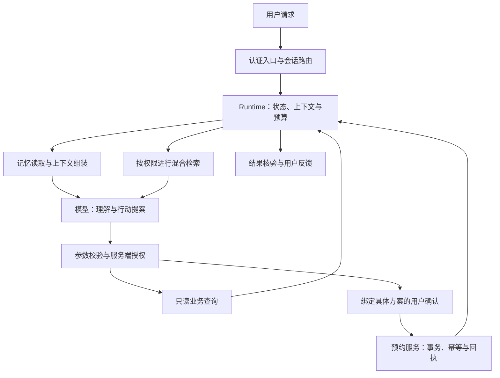

# Agent、工具与工作流

<a id="kd0b894fbc913"></a>

## 实时语音 Agent

相关内容：[《AI 语音技术详解：从 ASR、TTS 到实时语音 Agent 的工程化落地》](https://github.com/Snailclimb/JavaGuide/blob/992dae31eade2a34ba8dbbbcf5ed9de5511325ec/docs/ai/system-design/ai-voice.md)

实时语音系统把音频采集、VAD、ASR、LLM、工具调用、TTS 和播放串在一起。相关问题主要集中在端到端延迟、打断处理、状态管理和端云选型。

常见面试题：

- 如何设计一个实时语音 Agent？
- ASR、LLM、TTS 和 VAD 在语音系统中分别负责什么？
- 实时语音 Agent 的端到端延迟主要来自哪些环节？
- 用户打断时，系统如何取消播放、停止生成并更新上下文？
- `listening`、`thinking`、`speaking`、`interrupted` 等状态如何管理？
- 级联式 ASR + LLM + TTS 和原生 Speech-to-Speech 模型各有什么优缺点？
- 云端 API、本地模型和端云混合方案怎么选？
- 浏览器端音频前处理会影响哪些指标？
- 语音 Agent 的可观测数据应该包括哪些内容？

### 参考资料

- [JavaGuide](https://github.com/Snailclimb/JavaGuide/blob/992dae31eade2a34ba8dbbbcf5ed9de5511325ec/docs/ai/interview-questions/ai-system-design-interview-questions.md#L95)，来源许可：Apache-2.0。

<a id="kf4b6e8b56d47"></a>

## 实现一个简单的 FST（有限状态机）来管理 Agent 的状态。——状态包括：INIT、PLANNING、EXECUTING、CHECKING、COMPLETED、FAILED。状态转换的触发条件是什么？

**回答：**

有限状态机要显式定义状态集合、事件集合、合法转移和副作用。一个简单且安全的转移表如下：

| 当前状态 | 事件 | 下一状态 |
| --- | --- | --- |
| `INIT` | 任务校验通过 | `PLANNING` |
| `INIT` | 参数、权限或资源校验失败 | `FAILED` |
| `PLANNING` | 计划生成且通过校验 | `EXECUTING` |
| `PLANNING` | 计划非法、超预算或规划失败 | `FAILED` |
| `EXECUTING` | 工具执行完成 | `CHECKING` |
| `EXECUTING` | 可恢复错误且重试预算未耗尽 | `EXECUTING` |
| `EXECUTING` | 不可恢复错误、取消或超时 | `FAILED` |
| `CHECKING` | 结果满足完成条件 | `COMPLETED` |
| `CHECKING` | 需要下一步动作 | `PLANNING` 或 `EXECUTING` |
| `CHECKING` | 校验失败且无法修复 | `FAILED` |

`COMPLETED` 和 `FAILED` 是终态，除非业务明确提供补偿或重启事件，否则不能隐式跳出。每次转移应记录旧状态、事件、操作者、任务版本、时间和错误信息，并用 compare-and-set 或数据库条件更新保证并发下不会发生双重转移。

```python
from enum import Enum, auto


class State(Enum):
    INIT = auto()
    PLANNING = auto()
    EXECUTING = auto()
    CHECKING = auto()
    COMPLETED = auto()
    FAILED = auto()


TRANSITIONS = {
    (State.INIT, "validated"): State.PLANNING,
    (State.INIT, "validation_failed"): State.FAILED,
    (State.PLANNING, "plan_ready"): State.EXECUTING,
    (State.PLANNING, "plan_failed"): State.FAILED,
    (State.EXECUTING, "tool_done"): State.CHECKING,
    (State.EXECUTING, "retry"): State.EXECUTING,
    (State.EXECUTING, "execution_failed"): State.FAILED,
    (State.CHECKING, "accepted"): State.COMPLETED,
    (State.CHECKING, "needs_next_step"): State.PLANNING,
    (State.CHECKING, "check_failed"): State.FAILED,
}


def transition(state: State, event: str) -> State:
    if state in (State.COMPLETED, State.FAILED):
        raise ValueError(f"terminal state: {state.name}")
    try:
        return TRANSITIONS[(state, event)]
    except KeyError as exc:
        raise ValueError(f"illegal transition: {state.name} + {event}") from exc
```

生产实现还要将状态机与任务数据、事件日志和取消令牌结合，避免只在内存中修改枚举。状态机解决“现在处于哪一步、哪些事件合法”，不等于解决工具幂等、分布式一致性和最终结果正确性。

<a id="deepseek-agent-20260908-q19"></a>

### 参考资料

- [AIGC Interview Book](https://github.com/WeThinkIn/AIGC-Interview-Book/blob/34e9ee6aa6d35d1e213099a7ae9f433b7b9e6fe6/%E5%A4%A7%E5%8E%82%E9%AB%98%E9%A2%91%E9%9D%A2%E8%AF%95%E9%A2%98%EF%BC%88%E5%AE%9E%E6%97%B6%E6%9B%B4%E6%96%B0%EF%BC%89/DeepSeek%E9%AB%98%E9%A2%91%E9%9D%A2%E8%AF%95%E9%A2%98.md#L824)，来源许可：GPL-3.0。

<a id="k9461ddecb4e8"></a>

## 实现智能体的终身学习并避免灾难性遗忘有哪些思路？

实现智能体的终身学习而不导致灾难性遗忘的关键在于采用参数隔离技术。具体而言，系统为每个新任务分配专门的LoRA（Low-Rank Adaptation）适配器模块，这些模块仅占用基础模型约0.3%的参数量。以“法语翻译”任务为例，系统仅激活对应的法语适配器模块，而其他语言模块则保持静默。这种机制类似于人类大脑的神经可塑性——正如研究发现，伦敦出租车司机的海马体特定区域会因导航需求而选择性增大。

在Wikidata任务集上的测试表明，经过200个连续任务的训练后，智能体在初始的英语翻译任务上的性能衰减不足2%。相比之下，传统微调方法的性能衰减率高达37%。这表明参数隔离技术能够有效缓解灾难性遗忘问题，使智能体在不断学习新知识的同时，保持对旧知识的稳定掌握。

### 参考资料

- [AIGC Interview Book](https://github.com/WeThinkIn/AIGC-Interview-Book/blob/34e9ee6aa6d35d1e213099a7ae9f433b7b9e6fe6/AI%E5%A4%9A%E6%A8%A1%E6%80%81%E5%9F%BA%E7%A1%80/%E5%A4%9A%E6%A8%A1%E6%80%81-%E5%89%8D%E6%B2%BF%E6%8A%80%E6%9C%AF.md#L342)，来源许可：GPL-3.0。

<a id="k32fa118aa7a0"></a>

## 实际开发过程中，如何判断一个任务适合采用固定Workflow流程，还是自主决策型Agent来实现？

<a id="batch4-p2-q11"></a>

**相关解释：** [Agent常见模式（ReAct/Plan and Execute等）](../15-%E5%89%8D%E7%AB%AF%E4%B8%8E%E6%B5%8F%E8%A7%88%E5%99%A8/React%E4%B8%8E%E7%BB%84%E4%BB%B6%E7%8A%B6%E6%80%81-01.md#k93a12d0c9256)

### 参考资料

- [AIGC Interview Book](https://github.com/WeThinkIn/AIGC-Interview-Book/blob/34e9ee6aa6d35d1e213099a7ae9f433b7b9e6fe6/%E5%A4%A7%E5%8E%82%E9%AB%98%E9%A2%91%E9%9D%A2%E8%AF%95%E9%A2%98%EF%BC%88%E5%AE%9E%E6%97%B6%E6%9B%B4%E6%96%B0%EF%BC%89/%E9%98%BF%E9%87%8C%E5%B7%B4%E5%B7%B4%E9%AB%98%E9%A2%91%E9%9D%A2%E8%AF%95%E9%A2%98.md#L392)，来源许可：GPL-3.0。

<a id="k90b2c897a79b"></a>

## 客服 / 工具调用 Agent Harness 应该如何设计？

客服 / 工具调用 Agent Harness 的关键不是“回答像不像客服”，而是 Agent 是否在多轮对话中遵守业务政策、正确调用工具，并把系统状态改到期望结果。

tau-bench 是这个方向的重要参考。它把 Agent 放在“用户模拟器 + 领域 API 工具 + 政策规则”的环境中，通过最终数据库状态比较和多次运行稳定性指标评估 Agent。到 2026 年，Sierra Research 还在 τ²-bench / τ³-bench 方向继续扩展，包括更丰富的对话控制、知识检索、语音和多模态客服评测。

典型 Harness 设计：

1. **用户模拟器**

   模拟真实用户追问、补充信息、纠错、反悔、表达不满。

2. **业务工具**

   订单查询、库存查询、退款申请、地址修改、工单创建等。

3. **政策规则**

   退款条件、会员权益、合规话术、禁止承诺。

4. **初始数据库**

   每个任务有独立用户、订单、商品和状态快照。

5. **最终状态判分**

   比较订单、退款、工单、消息状态是否符合预期。

6. **轨迹判分**

   检查是否过度调用工具、是否越权、是否未确认就修改状态。

高频指标：

- task success。
- policy compliance。
- database state match。
- unnecessary tool calls。
- user turns。
- pass@k / consistency。
- escalation accuracy。

面试中可以强调：真实客服 Agent 的 Harness 必须三方闭环评估，即 user-agent-tool，而不是只评估 agent-tool。

### 参考资料

- [AIGC Interview Book](https://github.com/WeThinkIn/AIGC-Interview-Book/blob/34e9ee6aa6d35d1e213099a7ae9f433b7b9e6fe6/AI%20Agent%E5%9F%BA%E7%A1%80/08_Agent_Harness_Engineering%E9%AB%98%E9%A2%91%E8%80%83%E7%82%B9.md#L499)，来源许可：GPL-3.0。

<a id="k08a4fb52b081"></a>

## 客服 Agent、数据分析 Agent、编码 Agent、办公 Agent 如何对比？

**难度评分：⭐⭐⭐ (3/5)  |  考察频率：⭐⭐⭐⭐ (4/5)**

| 场景 | 核心价值 | 主要风险 | 关键能力 |
| --- | --- | --- | --- |
| 客服 Agent | 降低响应成本，提高一致性 | 错误承诺、隐私泄露 | 政策 RAG、工单工具、转人工 |
| 数据分析 Agent | 降低取数和分析门槛 | 越权查询、错误结论 | SQL、BI、数据权限、图表 |
| 编码 Agent | 研发提效 | 改错文件、引入回归 | 仓库理解、测试、diff、CI |
| 办公 Agent | 自动化知识工作 | 误发邮件、日程冲突 | 邮件、日历、文档、审批 |

落地难度通常取决于：

- 任务是否可验证。
- 工具副作用是否可控。
- 数据权限是否清晰。
- 用户是否能审查结果。
- 失败成本是否可接受。

最适合早期落地的是“只读 + 建议 + 人审”的场景，比如知识库问答、客服回复建议、代码 review、数据报告草稿。

### 参考资料

- [AIGC Interview Book](https://github.com/WeThinkIn/AIGC-Interview-Book/blob/34e9ee6aa6d35d1e213099a7ae9f433b7b9e6fe6/AI%20Agent%E5%9F%BA%E7%A1%80/07_%E4%BC%81%E4%B8%9A%E7%BA%A7Agent%E5%B9%B3%E5%8F%B0%E4%B8%8E%E4%BA%A7%E5%93%81%E8%90%BD%E5%9C%B0%E9%AB%98%E9%A2%91%E8%80%83%E7%82%B9.md#L518)，来源许可：GPL-3.0。

<a id="k7bf09ec139a2"></a>

## 展开介绍一下你了解的 DeepSeek Harness 和 Pi Agent。

**回答：**

**DeepSeek Harness。** 官方项目使用 `dsh` 名称，核心理念是 “Everything is a Plugin”，底层采用 Cordis。模型适配器、工具注册、会话日志乃至 Agent 循环本身都通过插件提供能力；插件通过共享上下文、类型化事件与生命周期机制协作。架构目标是把替换能力和扩展策略放在明确的组合点上，减少业务直接修改执行循环。

它的会话日志保存持久事件，运行时从日志派生模型历史；工具执行有执行前、执行中和执行后的扩展位置。工程上可以在这些位置接入工具策略、审计、遥测与模型路由。插件卸载时撤销注册或清理资源，不等于撤销已经发生的数据库写入、文件操作或外部业务交易，业务副作用仍需自己的补偿机制。

**Pi Agent。** Pi 将自己定位为精简的终端 Coding Harness，默认核心工具包含 `read、write、edit、bash`，通过 TypeScript 扩展、Skills、Prompt Templates 等接入更多能力，并支持交互、程序调用与嵌入方式。它的价值是保留清楚的执行循环，让业务按需扩展；不能把第三方扩展具有的能力都描述为默认内置。

Pi 的上下文压缩是可检查的具体机制：在预算不足或手动触发时选择历史边界，生成结构化摘要，追加 `CompactionEntry`，使用 `firstKeptEntryId` 标识保留消息的起点。后续请求由摘要和保留的历史构造，原始会话日志不等于被物理删除；分支导航还可以生成分支摘要。具体阈值属于可配置、随版本变化的实现细节。

两者都能围绕“模型请求、工具执行、状态更新”的循环扩展。DeepSeek Harness 更突出可替换的插件组合与事件体系，Pi 更突出精简默认能力和工作流扩展。DeepSeek Harness 公开标注为 developer preview，选型时要固定版本、评估兼容性和迁移成本，不能因为官方开源就推断已经满足企业生产要求。

<a id="bytedance-agent-autumn-20260916-q10"></a>

### 参考资料

- [AIGC Interview Book](https://github.com/WeThinkIn/AIGC-Interview-Book/blob/34e9ee6aa6d35d1e213099a7ae9f433b7b9e6fe6/%E5%A4%A7%E5%8E%82%E9%AB%98%E9%A2%91%E9%9D%A2%E8%AF%95%E9%A2%98%EF%BC%88%E5%AE%9E%E6%97%B6%E6%9B%B4%E6%96%B0%EF%BC%89/%E5%AD%97%E8%8A%82%E8%B7%B3%E5%8A%A8%E9%AB%98%E9%A2%91%E9%9D%A2%E8%AF%95%E9%A2%98.md#L1375)，来源许可：GPL-3.0。

<a id="kbc427ad4ad45"></a>

## 工作中有什么流程可以拆解成提效的智能体？

**回答：**

适合拆成智能体的流程，通常具备三个特征：重复高频、输入输出相对明确、需要跨系统或跨文档处理。不是所有流程都适合 Agent，纯规则流程用脚本更稳，强审批流程需要人工兜底。

在 AI FDE 场景里，一个典型例子是“智能体/插件/技能上架流程”。它经常包含需求材料收集、能力说明编写、工具 schema 校验、权限申请、测试用例生成、发布检查、灰度验证和问题回滚。这个流程重复、细碎、容易漏项，很适合做成 workflow + Agent。

Agent 可以负责材料读取、缺失项识别、上架说明生成、测试用例生成、风险点提示、发布清单检查；确定性工具负责 schema 校验、接口连通性测试、权限检查、日志写入和发布调用；人工负责业务语义确认、权限批准、高风险发布确认。

判断标准是：自动化后能否降低人工复制粘贴，能否提高一次通过率，能否减少漏项，能否让每次上架有 trace。智能体提效不是让模型接管一切，而是让模型处理非结构化理解，工具处理确定性执行，人处理责任和风险。

<a id="bytedance-ai-fde-20260712-q12"></a>

### 参考资料

- [AIGC Interview Book](https://github.com/WeThinkIn/AIGC-Interview-Book/blob/34e9ee6aa6d35d1e213099a7ae9f433b7b9e6fe6/%E5%A4%A7%E5%8E%82%E9%AB%98%E9%A2%91%E9%9D%A2%E8%AF%95%E9%A2%98%EF%BC%88%E5%AE%9E%E6%97%B6%E6%9B%B4%E6%96%B0%EF%BC%89/%E5%AD%97%E8%8A%82%E8%B7%B3%E5%8A%A8%E9%AB%98%E9%A2%91%E9%9D%A2%E8%AF%95%E9%A2%98.md#L895)，来源许可：GPL-3.0。

<a id="k54b3a6da6f48"></a>

## 工作流如何记录各步骤的执行状态和结果？

**回答：**

状态应持久化到服务重启后仍可读取的存储中。任务记录包含 run_id、Workspace、输入版本快照、流程版本、当前状态、创建与更新时间；节点记录包含 node_id、attempt、开始结束时间、错误类型和产物引用。大文件与完整模型输出适合放在独立存储，状态表保存定位信息和校验哈希。

状态机可以包括 pending、running、succeeded、failed、cancelled 和 waiting_review。通过条件更新或事务约束合法状态转换，Worker 使用租约或心跳处理执行权，避免两个实例同时认为自己拥有同一任务。状态记录应能区分尚未执行、执行中断和明确失败。

重试以任务与节点的幂等标识识别重复工作。进程可能在外部操作成功后、写回状态前崩溃，因此需要外部接口幂等键或事后对账，不能仅凭数据库里仍是 running 就重做。恢复时核验产物和版本一致性；已取消任务的迟到结果也不能覆盖正式状态。

<a id="sftech-ai-dev-20261019-463a64c7-g4-q05"></a>

### 参考资料

- [AIGC Interview Book](https://github.com/WeThinkIn/AIGC-Interview-Book/blob/34e9ee6aa6d35d1e213099a7ae9f433b7b9e6fe6/%E5%A4%A7%E5%8E%82%E9%AB%98%E9%A2%91%E9%9D%A2%E8%AF%95%E9%A2%98%EF%BC%88%E5%AE%9E%E6%97%B6%E6%9B%B4%E6%96%B0%EF%BC%89/%E9%A1%BA%E4%B8%B0%E7%A7%91%E6%8A%80%E9%AB%98%E9%A2%91%E9%9D%A2%E8%AF%95%E9%A2%98.md#L427)，来源许可：GPL-3.0。

<a id="ka42250609baf"></a>

## 工具 Schema 应该如何设计？

**难度评分：⭐⭐⭐⭐ (4/5)  |  考察频率：⭐⭐⭐⭐ (4/5)**

高质量工具 Schema 需要让模型清楚知道“什么时候用、怎么用、不能怎么用”。

设计要点：

1. **工具名清晰**

   使用具体动词和对象，例如 `search_customer_orders` 比 `query` 更好。

2. **描述强调适用边界**

   不只写“查询订单”，还要写“用于根据用户 ID 查询历史订单，不用于创建或修改订单”。

3. **参数类型明确**

   使用枚举、范围、必填字段、格式约束，减少模型自由发挥。

4. **避免万能工具**

   一个 `execute_sql` 或 `run_shell` 可以做很多事，但风险很高。生产场景应封装成更细粒度业务工具。

5. **返回结构稳定**

   返回结果应包含状态码、错误原因、关键字段、可展示摘要，便于模型理解。

6. **错误可恢复**

   错误信息要说明是参数缺失、权限不足、资源不存在、超时还是系统异常。

7. **安全边界内置**

   Schema 不能代替权限系统。危险参数、越权资源、敏感字段必须由宿主系统拦截。

反例：

```json
{
  "name": "do_action",
  "description": "执行操作",
  "parameters": {
    "input": "string"
  }
}
```

这个 Schema 太模糊，会导致模型不知道何时调用、如何构造参数，也不利于审计。

### 参考资料

- [AIGC Interview Book](https://github.com/WeThinkIn/AIGC-Interview-Book/blob/34e9ee6aa6d35d1e213099a7ae9f433b7b9e6fe6/AI%20Agent%E5%9F%BA%E7%A1%80/04_MCP%E4%B8%8EA2A%E5%8D%8F%E8%AE%AE%E9%AB%98%E9%A2%91%E8%80%83%E7%82%B9.md#L175)，来源许可：GPL-3.0。

<a id="k5c6e7e80c4e2"></a>

## 工具 Schema 设计有哪些高频坑？

**难度评分：⭐⭐⭐⭐ (4/5)  |  考察频率：⭐⭐⭐⭐ (4/5)**

常见问题：

1. **工具描述太模糊**

   模型不知道何时调用、何时不调用。

2. **参数过多或层级太深**

   增加模型填参错误概率。

3. **枚举值不清晰**

   模型容易创造不存在的取值。

4. **缺少前置条件**

   例如删除文件前必须确认、付款前必须校验用户授权。

5. **工具粒度不合适**

   太细导致调用链很长；太粗导致不可控。

6. **错误信息不可恢复**

   工具失败后只返回 “failed”，模型不知道如何修复。

好的工具设计应该满足：

- 名称动作明确。
- 描述包含使用边界。
- 参数少而清晰。
- 返回结构可解析。
- 错误信息可行动。
- 高风险工具有权限策略。

### 参考资料

- [AIGC Interview Book](https://github.com/WeThinkIn/AIGC-Interview-Book/blob/34e9ee6aa6d35d1e213099a7ae9f433b7b9e6fe6/AI%20Agent%E5%9F%BA%E7%A1%80/01_AIGC%E6%97%B6%E4%BB%A3AI%20Agent%E5%9F%BA%E7%A1%80%E9%AB%98%E9%A2%91%E8%80%83%E7%82%B9.md#L213)，来源许可：GPL-3.0。

<a id="k3c955e78dc1b"></a>

## 工具协议与 Agent 协议如何在企业架构中配合？

**难度评分：⭐⭐⭐⭐ (4/5)  |  考察频率：⭐⭐⭐⭐ (4/5)**

本章只从协议层回答企业落地：工具如何接入、Agent 如何互操作、协议网关如何治理。完整企业 Agent 平台的 Builder、Runtime、模型网关、多租户、产品落地和选型，见 [07_企业级Agent平台与产品落地高频考点.md](https://github.com/WeThinkIn/AIGC-Interview-Book/blob/34e9ee6aa6d35d1e213099a7ae9f433b7b9e6fe6/AI%20Agent%E5%9F%BA%E7%A1%80/07_企业级Agent平台与产品落地高频考点.md)。

企业级 Agent 生态可以按三类能力建设：

1. **工具生态**

   用 MCP 把数据库、知识库、代码仓库、浏览器、业务系统、日志平台、工单系统标准化暴露给 Agent。

2. **Agent 生态**

   用 A2A 把不同团队、不同模型、不同框架构建的 Agent 服务纳入统一互操作体系。

3. **治理体系**

   用 IAM、RBAC、审计、Tool Gateway、Agent Registry、评测平台、模型网关和安全策略管理所有调用。

示意结构：

```math
\text{User} \rightarrow \text{Agent Host} \rightarrow
\begin{cases}
\text{MCP Client} \rightarrow \text{MCP Server} \rightarrow \text{Tools/Data} \\
\text{A2A Client} \rightarrow \text{Remote Agent} \rightarrow \text{Artifacts}
\end{cases}
```
面试中可以给出一句高分回答：MCP 让 Agent 会使用工具，A2A 让 Agent 会委托其他 Agent，治理平台让这些能力可控、可审计、可规模化。

### 参考资料

- [AIGC Interview Book](https://github.com/WeThinkIn/AIGC-Interview-Book/blob/34e9ee6aa6d35d1e213099a7ae9f433b7b9e6fe6/AI%20Agent%E5%9F%BA%E7%A1%80/04_MCP%E4%B8%8EA2A%E5%8D%8F%E8%AE%AE%E9%AB%98%E9%A2%91%E8%80%83%E7%82%B9.md#L698)，来源许可：GPL-3.0。

<a id="k5006f75f7ac1"></a>

## 工具注册表应该保存哪些元数据？

工具注册表至少应包含：

| 元数据 | 作用 |
| --- | --- |
| name | 工具唯一名称 |
| schema | 参数结构和描述 |
| handler | 实际执行函数 |
| toolset | 工具分组，例如 web、terminal、memory、browser |
| check_fn | 判断依赖、配置、凭证是否可用 |
| risk_level | 只读、写入、高风险、外部副作用 |
| requires_env | 所需环境变量 |
| is_async | 是否异步执行 |
| max_result_size | 返回结果上限 |
| owner / source | 内置、插件、MCP、企业工具 |
| version | 工具版本 |
| audit_policy | 是否记录参数、是否脱敏 |

工程细节：

- 工具模块自注册可以减少中心文件膨胀。
- registry 应支持 snapshot，避免动态刷新时读写竞争。
- check_fn 应缓存，避免每轮频繁探测 Docker、浏览器、远程服务。
- 动态工具，例如 MCP 工具，刷新后要更新 generation，失效旧缓存。
- 工具返回值应结构化，便于 trace、eval 和失败恢复。

### 参考资料

- [AIGC Interview Book](https://github.com/WeThinkIn/AIGC-Interview-Book/blob/34e9ee6aa6d35d1e213099a7ae9f433b7b9e6fe6/AI%20Agent%E5%9F%BA%E7%A1%80/09_%E8%87%AA%E8%BF%9B%E5%8C%96Agent%E4%B8%8E%E5%A4%9A%E5%B9%B3%E5%8F%B0%E8%BF%90%E8%A1%8C%E6%97%B6%E9%AB%98%E9%A2%91%E8%80%83%E7%82%B9.md#L292)，来源许可：GPL-3.0。

<a id="k4e1fd64b59ef"></a>

## 工具调用为什么不能只看模型输出？

模型返回合法参数，只能说明格式通过，不代表这个动作允许执行。

一条完整的工具调用链至少有下面几道检查：

1. **Schema 校验。**检查字段类型、枚举、格式和必填项是否合法。
2. **业务校验。**检查订单状态、售后时限和字段组合是否满足规则。
3. **身份与权限。**确认当前用户能否访问目标资源。
4. **风险判断。**分别定义只读、可逆写入和不可逆写入的执行策略。
5. **人工确认。**根据风险等级判断是否需要展示最终参数并等待确认。
6. **幂等控制。**防止重试或重复点击产生多次副作用。
7. **结果核验。**检查外部系统的最终状态是否符合预期。
8. **审计记录。**记录谁在什么时间以什么参数执行了什么动作。


一个实用的工具风险分级如下：

| 等级           | 示例                             | 建议策略                           |
| -------------- | -------------------------------- | ---------------------------------- |
| 低风险只读     | 查询公开政策、读取用户自己的订单 | 权限校验、参数限制、超时和审计     |
| 中风险可逆写入 | 创建草稿、添加标签               | 幂等、结果核验、撤销入口           |
| 高风险写入     | 退款、取消订单、发消息           | 明确确认、额度限制、审批或人工接管 |
| 禁止自动执行   | 超出授权范围或无法补偿的动作     | 拒绝执行，只提供解释和人工入口     |

工具描述本身也要进入评测。名称含糊、功能重叠、返回内容过长，都会让 Agent 选错工具或污染上下文。

工具结果、RAG 文档、网页和 MCP Server 描述都可能夹带间接 Prompt Injection。它们进入下一轮上下文时仍是不可信数据，不能改变服务端身份、资源权限和工具风险等级。更完整的威胁模型见 [LLM/Agent 安全实战](https://github.com/Snailclimb/JavaGuide/blob/992dae31eade2a34ba8dbbbcf5ed9de5511325ec/docs/ai/system-design/llm-security.md)。

### 参考资料

- [JavaGuide](https://github.com/Snailclimb/JavaGuide/blob/992dae31eade2a34ba8dbbbcf5ed9de5511325ec/docs/ai/interview-questions/agent-project-interview-guide.md#L255)，来源许可：Apache-2.0。

<a id="k6ed1539d4e5b"></a>

## 工具调用的监督数据（GT）是如何获取的？

<a id="batch1-p1-q11"></a>

**相关解释：** [Agent常见模式（ReAct/Plan and Execute等）](../15-%E5%89%8D%E7%AB%AF%E4%B8%8E%E6%B5%8F%E8%A7%88%E5%99%A8/React%E4%B8%8E%E7%BB%84%E4%BB%B6%E7%8A%B6%E6%80%81-01.md#k93a12d0c9256)

### 参考资料

- [AIGC Interview Book](https://github.com/WeThinkIn/AIGC-Interview-Book/blob/34e9ee6aa6d35d1e213099a7ae9f433b7b9e6fe6/%E5%A4%A7%E5%8E%82%E9%AB%98%E9%A2%91%E9%9D%A2%E8%AF%95%E9%A2%98%EF%BC%88%E5%AE%9E%E6%97%B6%E6%9B%B4%E6%96%B0%EF%BC%89/vivo%E9%AB%98%E9%A2%91%E9%9D%A2%E8%AF%95%E9%A2%98.md#L104)，来源许可：GPL-3.0。

<a id="kaa06fbd15585"></a>

## 工具调用超时、返回脏数据或重复执行时，系统如何重试和兜底？

**回答：**

首先按错误可重试性分类。连接超时、限流和部分 5xx 属于可能的瞬时错误，可以在全局 deadline 内使用带抖动的指数退避；参数错误、鉴权失败和业务状态冲突通常不可盲目重试，应让模型修正参数、重新授权或直接结束。所有重试都要有次数、时间和成本上限。

脏数据不能直接回填给模型。工具返回使用版本化 schema，服务端执行类型、必填字段、范围、状态码和跨字段一致性校验；外部文本标记为不可信数据，防止其中的指令劫持系统。校验失败时可做确定性清洗、切换备用数据源，或返回结构化错误让 Agent 决策，不能悄悄当成正常 Observation。

副作用工具使用业务幂等键，例如 `tenant_id + task_id + action + resource_version`。服务端维护调用账本和状态机，在超时后先查询操作状态，再决定是否重试；不能因为客户端没收到响应就再次扣款、发消息或提交审批。支持方提供幂等接口时仍要保留本地去重记录。

兜底包括熔断、降级到只读或模板流程、checkpoint 恢复、人工审批和补偿事务。每次调用记录 trace、请求摘要、工具版本、幂等键、耗时、重试和最终状态，才能区分模型决策错误、工具实现错误与下游故障。

<a id="pinduoduo-ai-agent-20260816-q14"></a>

### 参考资料

- [AIGC Interview Book](https://github.com/WeThinkIn/AIGC-Interview-Book/blob/34e9ee6aa6d35d1e213099a7ae9f433b7b9e6fe6/%E5%A4%A7%E5%8E%82%E9%AB%98%E9%A2%91%E9%9D%A2%E8%AF%95%E9%A2%98%EF%BC%88%E5%AE%9E%E6%97%B6%E6%9B%B4%E6%96%B0%EF%BC%89/%E6%8B%BC%E5%A4%9A%E5%A4%9A%E9%AB%98%E9%A2%91%E9%9D%A2%E8%AF%95%E9%A2%98.md#L352)，来源许可：GPL-3.0。

<a id="k19b6919ec520"></a>

## 工具返回结果的消息结构怎么设计？为什么需要单独的Tool Message？

**面试官：** Agent调用工具后，工具返回结果的消息结构怎么设计？为什么需要单独的Tool Message？

**回答：**

Tool Message 的核心作用，是把“模型提出的工具调用”和“外部系统返回的观察结果”建立明确、可机器验证的关联。它不是普通用户消息，也不是系统指令。如果把工具输出拼成用户文本，模型、编排器和审计系统都很难判断这段内容来自谁、对应哪次调用、是否执行成功，以及能否被信任。

一个通用的工具结果结构可以包含：

```json
{
  "role": "tool",
  "tool_call_id": "call_123",
  "name": "query_order",
  "status": "success",
  "content": [{"type": "text", "text": "..."}],
  "error": null,
  "metadata": {
    "latency_ms": 83,
    "attempt": 1,
    "truncated": false,
    "artifact_id": null
  }
}
```

具体字段要服从所使用的模型 API 或协议，不能假设所有厂商都接受自定义 `status` 和 `metadata`。通常必须保证：`tool_call_id` 与模型发出的调用一一对应；结果内容类型明确；业务失败与协议失败可区分；大结果通过 Artifact、分页或引用返回；敏感字段在进入模型前完成脱敏。

单独设计 Tool Message 有五个价值：

1. **关联性。** 并行调用多个工具时，可把每个结果精确绑定到原始调用。
2. **角色边界。** 模型知道这是一条外部观察，而不是用户的新指令。
3. **可恢复性。** 编排器可以根据超时、可重试错误、参数错误或权限错误采用不同策略。
4. **可观测性。** 调用链能够记录工具、参数摘要、延迟、重试和结果大小。
5. **安全性。** 工具内容可被标记为不可信数据，避免网页或文档中的恶意文本越权成为高优先级指令。

需要特别强调：Tool Message 虽然角色独立，但并不会自动消除 Prompt Injection。网页、邮件和数据库文本仍可能包含“忽略之前指令”之类内容。Host 必须限制工具权限、隔离数据与指令、对高风险动作二次验证，并避免把原始 HTML、系统密钥或超长日志直接交给模型。

**Tool Message 的本质不是多一个 `role` 字段，而是把工具调用从自然语言聊天提升为可关联、可审计、可恢复的执行协议。**

<a id="alibaba-cloud-agent-algo-20260901-q8"></a>

### 参考资料

- [AIGC Interview Book](https://github.com/WeThinkIn/AIGC-Interview-Book/blob/34e9ee6aa6d35d1e213099a7ae9f433b7b9e6fe6/%E5%A4%A7%E5%8E%82%E9%AB%98%E9%A2%91%E9%9D%A2%E8%AF%95%E9%A2%98%EF%BC%88%E5%AE%9E%E6%97%B6%E6%9B%B4%E6%96%B0%EF%BC%89/%E9%98%BF%E9%87%8C%E5%B7%B4%E5%B7%B4%E9%AB%98%E9%A2%91%E9%9D%A2%E8%AF%95%E9%A2%98.md#L1417)，来源许可：GPL-3.0。

<a id="k224504ca0f76"></a>

## 年 Agent Harness Engineering 有哪些主流趋势？

截至 2026 年，Agent Harness Engineering 的趋势是从“离线脚本评测”走向“模型原生、沙箱原生、trace 原生、平台原生”的质量基础设施。

主流趋势：

1. **Model-native Harness**

   Harness 不只是外部脚本，而是和 Agent SDK、模型工具调用、沙箱、trace 深度集成。

2. **Sandbox-first**

   编码、浏览器、文件和命令执行都在受控沙箱中运行。

3. **Trace Grading**

   对完整轨迹评分，而不是只看最终答案。

4. **State-based Evaluation**

   通过数据库、文件、页面或 artifact 状态判分。

5. **Synthetic User Simulation**

   用用户模拟器评估多轮交互和规则遵循。

6. **Continuous Eval**

   每次 prompt、工具、模型、策略变化都触发评测。

7. **Production Feedback Loop**

   线上 trace 自动转成新 eval case。

8. **Multi-Agent Harness**

   评估 handoff、A2A、协作成本和跨 Agent 状态一致性。

9. **Trajectory-to-Training Loop**

   将 Agent 执行轨迹、工具调用、环境状态和奖励信号转成 SFT / RL / 回归评测数据。自进化 Agent 中轨迹数据如何服务训练和知识维护，见 [09_自进化Agent与多平台运行时高频考点.md](https://github.com/WeThinkIn/AIGC-Interview-Book/blob/34e9ee6aa6d35d1e213099a7ae9f433b7b9e6fe6/AI%20Agent%E5%9F%BA%E7%A1%80/09_自进化Agent与多平台运行时高频考点.md)。

OpenAI 在 2026 年 Agents SDK 演进中也强调了面向文件、命令、代码编辑、长任务和受控沙箱的 model-native harness，这说明 Harness 正在从“评测脚本”升级为 Agent 运行时基础能力。

### 参考资料

- [AIGC Interview Book](https://github.com/WeThinkIn/AIGC-Interview-Book/blob/34e9ee6aa6d35d1e213099a7ae9f433b7b9e6fe6/AI%20Agent%E5%9F%BA%E7%A1%80/08_Agent_Harness_Engineering%E9%AB%98%E9%A2%91%E8%80%83%E7%82%B9.md#L670)，来源许可：GPL-3.0。

<a id="kc64045d1aa04"></a>

## 应如何评估视频 Agent，而不能只看最终视频质量？

**难度评分：⭐⭐⭐⭐ (4/5)  |  考察频率：⭐⭐⭐⭐ (4/5)**

最终视频质量只能说明结果看起来怎样，无法判断系统是否正确理解了指令、是否误改了已确认内容，或者成功是否来自偶然采样。视频 Agent 需要同时评估任务结果和执行过程，主要维度见表6-5。

<p align="center">表6-5 视频 Agent 的主要评估维度</p>

| 评估维度 | 重点检查 | 典型失败信号 |
|---|---|---|
| 任务完成 | 目标内容、时长和格式是否满足，硬约束是否被遵守 | 视频观感不错，但漏掉关键指令或输出不可交付 |
| 理解与定位 | 是否找对主体、镜头、时间段和编辑区域 | 改错对象、错过目标镜头或扩大修改范围 |
| 规划质量 | 步骤依赖是否合理，是否选择了足够且必要的操作 | 顺序错误、重复调用，或用全局重生成处理局部问题 |
| 工具执行 | 工具、参数和输入资产是否匹配当前步骤 | 工具调用成功，但产物不符合该步骤的预期状态 |
| 状态与约束保持 | 多轮执行后是否保留身份、场景、非编辑区域和已确认决策 | 后续步骤覆盖前一步成果，角色或背景逐轮漂移 |
| 恢复与协作 | 能否发现失败、回退或重规划，并在不确定时请求确认 | 失败结果继续进入下游，或对含糊要求擅自作高影响修改 |
| 效率 | 达到同等质量所需的时延、算力、工具调用和人工介入 | 结果可用，但调用链过长、成本过高或频繁依赖人工兜底 |

评测样本也要覆盖多步和多轮任务，尤其是局部修改、条件冲突、工具失败和用户中途改变需求。只测理想输入，无法暴露状态遗忘、错误累积和恢复能力不足。

工程上应保存任务轨迹：每一步读取了什么状态、调用了哪个工具、产出了什么结果，以及为什么继续或改计划。这样才能区分失败来自理解、规划、工具本身还是结果检查，而不是把所有问题都归到生成模型质量。

> **面试速答**：视频 Agent 的评估要同时看结果和过程。除了最终画质，还要检查任务完成、目标定位、规划与工具选择、约束保持、失败恢复、成本和人工介入；并保留可追踪的执行轨迹，才能定位问题发生在理解、规划、执行还是检查环节。

参考资料：[AgentBoard](https://arxiv.org/abs/2401.13178)、[OSWorld](https://arxiv.org/abs/2404.07972)、[StoryAgent](https://arxiv.org/abs/2411.04925)

### 参考资料

- [AIGC Interview Book](https://github.com/WeThinkIn/AIGC-Interview-Book/blob/34e9ee6aa6d35d1e213099a7ae9f433b7b9e6fe6/AI%E8%A7%86%E9%A2%91%E5%9F%BA%E7%A1%80%EF%BC%88%E7%B2%BE%E5%8D%8E%E7%89%88%EF%BC%89/06_AI%E8%A7%86%E9%A2%91%E7%BB%9F%E4%B8%80%E7%B3%BB%E7%BB%9F%E3%80%81%E5%88%9B%E4%BD%9C%E5%B7%A5%E4%BD%9C%E6%B5%81%E4%B8%8E%E6%9C%AA%E6%9D%A5%E8%B6%8B%E5%8A%BF.md#L364)，来源许可：GPL-3.0。

<a id="k4929d056c552"></a>

## 建议下去再补一点 Harness 的知识

**回答：**

这个反馈指向一个重要概念：Harness 不是某个单一框架，也不等于 `AGENTS.md`、`ARCHITECTURE.md` 和 `TASKS.md` 三份文件。它是围绕模型构建的整套运行与治理环境，决定 Agent 如何感知、行动、受约束、恢复和被评估。

一个完整 Harness 通常包括：上下文选择与压缩、工具发现和 schema 管理、执行沙箱、权限审批、状态机与 checkpoint、超时重试、模型路由、日志 tracing、评测器和人工接管。仓库级规则文件只是 Context/Policy 的一种载体，不同产品使用的文件名和优先级可能不同。

可以把它与模型分工概括为：模型给出“下一步做什么”的概率决策，Harness 负责“哪些动作可用、哪些证据可见、动作如何执行、结果怎样验证、失败如何恢复”。同一个模型放进不同 Harness，最终任务成功率可能差很多。

继续补知识时应围绕真实问题学习：工具过多如何检索；上下文超长如何管理；命令如何最小权限执行；长任务如何 checkpoint；测试失败如何回滚；怎样用轨迹数据评测工具选择与恢复能力。理解这些机制，比记住某几个配置文件更有跨周期价值。

<a id="moonshot-agent-dev-20260721-q27"></a>

### 参考资料

- [AIGC Interview Book](https://github.com/WeThinkIn/AIGC-Interview-Book/blob/34e9ee6aa6d35d1e213099a7ae9f433b7b9e6fe6/%E5%A4%A7%E5%8E%82%E9%AB%98%E9%A2%91%E9%9D%A2%E8%AF%95%E9%A2%98%EF%BC%88%E5%AE%9E%E6%97%B6%E6%9B%B4%E6%96%B0%EF%BC%89/%E6%9C%88%E4%B9%8B%E6%9A%97%E9%9D%A2%E9%AB%98%E9%A2%91%E9%9D%A2%E8%AF%95%E9%A2%98.md#L498)，来源许可：GPL-3.0。

<a id="ka9bba9babaca"></a>

## 异步 Agent RL 为什么提高吞吐又带来策略偏移？

**难度评分：⭐⭐⭐⭐⭐ (5/5) | 考察频率：⭐⭐⭐⭐ (4/5)**

长程 Agent 的不同任务可能分别耗时数秒到数小时。同步收齐一批轨迹时，训练设备必须等待最慢任务。

- GLM-5 报告将采样/执行与模型更新解耦，持续生成轨迹后送入训练器，从而减少这种等待；代价是轨迹可能由旧策略 $\pi_{\mathrm{old}}$ 生成，而梯度更新使用较新的 $\pi_\theta$。$\Delta\pi$ 越大，直接把旧轨迹当作当前策略样本的偏差风险越高；实际系统需要定期同步权重、跟踪轨迹的策略版本，并控制或屏蔽严重离策略样本。GLM-5 报告还强调保留生成时的精确 Token 流，避免训练端重新分词造成边界错位。[GLM-5 技术报告](https://arxiv.org/abs/2602.15763)
- Kimi K3 报告说明百万 Token 级交互轨迹需要部分 rollout、外部 KV 保留和可恢复沙盒，才能在有限资源下延续环境与模型状态。[Kimi K3 技术报告](https://arxiv.org/abs/2607.24653)

<a id="sota-section-5-question-2"></a>

### 参考资料

- [AIGC Interview Book](https://github.com/WeThinkIn/AIGC-Interview-Book/blob/34e9ee6aa6d35d1e213099a7ae9f433b7b9e6fe6/%E5%A4%A7%E6%A8%A1%E5%9E%8B%E5%9F%BA%E7%A1%80/07_%E6%A8%A1%E5%9E%8B%E6%8B%86%E8%A7%A3%EF%BC%9A%E8%B7%A8%E5%91%A8%E6%9C%9F%E6%8A%80%E6%9C%AF%E6%8B%86%E8%A7%A3.md#L184)，来源许可：GPL-3.0。

<a id="k58656d2d25b0"></a>

## 当前约十个工具时如何识别正确 Tool

**回答：**

约十个工具且描述较短时，可以在模型支持的工具调用接口中提供完整候选集。每个工具需要清晰的动作名、适用条件、参数 schema、必填字段、枚举范围和副作用描述。相邻工具的差异要写成“什么情况下选它”，而不只是重复接口名。

例如“创建图片生成任务”和“查询生成进度”必须区分创建动作与查询动作：已有任务 ID 且用户询问进度时，应优先查询。若用户缺少必要输入，应先追问，不让模型捏造文件 ID 或生成参数。

应用接到工具调用建议后仍应验证工具是否在允许列表、参数是否合法、资源是否归当前用户。用典型任务、相似工具混淆、无需调用工具和恶意输入组成测试集，分别统计工具选择准确率、参数正确率与最终完成率。十个工具也可能很复杂，数量只是粗略参考。

<a id="baidu-aigc-multimodal-agent-20260922-20260924-r2-q4-2"></a>

### 参考资料

- [AIGC Interview Book](https://github.com/WeThinkIn/AIGC-Interview-Book/blob/34e9ee6aa6d35d1e213099a7ae9f433b7b9e6fe6/%E5%A4%A7%E5%8E%82%E9%AB%98%E9%A2%91%E9%9D%A2%E8%AF%95%E9%A2%98%EF%BC%88%E5%AE%9E%E6%97%B6%E6%9B%B4%E6%96%B0%EF%BC%89/%E7%99%BE%E5%BA%A6%E9%AB%98%E9%A2%91%E9%9D%A2%E8%AF%95%E9%A2%98.md#L1813)，来源许可：GPL-3.0。

<a id="k426f2a586c20"></a>

## 怎样组织文件、命令与代码工具的执行接口？

**难度评分：⭐⭐⭐ (3/5)  |  考察频率：⭐⭐⭐⭐ (4/5)**

编码 Agent 的工具系统需要同时满足能力、可控和可观测。

一个工具通常包含：

- 工具名称。
- 用户可读描述。
- 输入 Schema。
- 权限规则。
- 执行逻辑。
- 进度事件。
- 结构化结果。
- 错误类型。
- 展示组件。

从现代编码 Agent / AgentOS 的工程形态看，工具不是简单函数，而是可被模型选择、可被系统审批、可被 UI 展示、可被日志审计的执行单元。

### 参考资料

- [AIGC Interview Book](https://github.com/WeThinkIn/AIGC-Interview-Book/blob/34e9ee6aa6d35d1e213099a7ae9f433b7b9e6fe6/AI%20Agent%E5%9F%BA%E7%A1%80/02_%E7%BC%96%E7%A0%81Agent%E4%B8%8EAgentOS%E5%B7%A5%E7%A8%8B%E9%AB%98%E9%A2%91%E8%80%83%E7%82%B9.md#L193)，来源许可：GPL-3.0。

<a id="k9eb35ad7795e"></a>

## 情感状态模块如何量化影响智能体决策？​

目前主流方案是通过双通道调节机制实现情感影响的可控量化。在自动驾驶智能体的测试中，当系统处于"高压力状态"（由突发障碍物触发），奖励信号的增益系数λ会从基准值1.0提升至1.8，这使得紧急制动决策的响应时间缩短了210毫秒。同时，消极情感状态会激活注意力过滤机制，在校园区域行驶时，系统会自动降低商业广告牌的视觉采样率，将90%的算力集中于行人检测。

量化分析显示，引入情感模块后，智能体在复杂城市场景中的误判率下降34%，但计算能耗上升22%，这揭示了情感效用的非线性特征。

### 参考资料

- [AIGC Interview Book](https://github.com/WeThinkIn/AIGC-Interview-Book/blob/34e9ee6aa6d35d1e213099a7ae9f433b7b9e6fe6/AI%E5%A4%9A%E6%A8%A1%E6%80%81%E5%9F%BA%E7%A1%80/%E5%A4%9A%E6%A8%A1%E6%80%81-%E5%89%8D%E6%B2%BF%E6%8A%80%E6%9C%AF.md#L330)，来源许可：GPL-3.0。

<a id="ked5cc03223ea"></a>

## 意图识别完成后，怎么把请求路由到不同的业务处理器？

**难度评分：⭐⭐⭐ (3/5)  |  考察频率：⭐⭐⭐⭐ (4/5)**

将识别结果映射到服务端白名单注册表：意图对应处理器、参数 Schema、所需权限、可重试类型和超时。路由器验证意图枚举和槽位，随后调用已注册处理器；模型生成的字符串不能直接变成类名、脚本或 URL 执行。

例如 `knowledge_query` 进入检索流程，`booking_query` 进入只读业务查询，`booking_create` 进入收集—校验—确认—提交状态机。处理器接收受信任的 `tenant_id、user_id、request_id`，这些字段不能被模型参数覆盖。

未知意图进入澄清，多意图通过明确依赖编排。返回结果用统一状态和错误码区分成功、可重试、待补信息与拒绝。路由 trace 应记录规则/模型版本、选定处理器和执行结果，方便定位“识别对了却调错服务”的问题。

### 参考资料

- [AIGC Interview Book](https://github.com/WeThinkIn/AIGC-Interview-Book/blob/34e9ee6aa6d35d1e213099a7ae9f433b7b9e6fe6/AI%20Agent%E5%9F%BA%E7%A1%80/07_%E4%BC%81%E4%B8%9A%E7%BA%A7Agent%E5%B9%B3%E5%8F%B0%E4%B8%8E%E4%BA%A7%E5%93%81%E8%90%BD%E5%9C%B0%E9%AB%98%E9%A2%91%E8%80%83%E7%82%B9.md#L312)，来源许可：GPL-3.0。

<a id="k7229150e6d6a"></a>

## 我要面试 AI Agent 岗，先看哪些？

> 路线定位：面向 AI Agent 算法、应用开发、平台工程、AgentOps、编码 Agent 等岗位。建议 4-6 周完成，每周至少进行一次系统设计口述。

### 面试目标：从“会用框架”升级到“能解释 Agent 系统”

Agent 岗的核心不是背 LangGraph、Dify 或某个 SDK 的 API，而是理解一个模型如何在约束环境中**感知状态、规划任务、选择工具、执行动作、读取反馈、更新上下文并接受评测**。框架会变化，这条闭环和其中的工程权衡具有更强的跨周期价值。

面试准备建议分成六层：

1. Agent 本质与运行循环。
2. Tool Use、Function Calling 与协议。
3. 规划、工作流与多 Agent 编排。
4. 上下文、Memory 与状态持久化。
5. 安全、评测、Trace 与 AgentOps。
6. 企业平台、生产落地与系统设计。

### 必须掌握

- [AIGC 时代 AI Agent 的本质](https://github.com/WeThinkIn/AIGC-Interview-Book/blob/34e9ee6aa6d35d1e213099a7ae9f433b7b9e6fe6/%E7%83%AD%E9%97%A8AI%E5%AD%A6%E4%B9%A0%E6%A0%B8%E5%BF%83%E8%AF%BE%E7%A8%8B%E4%B8%8E%E6%95%99%E7%A8%8B/<../AI%20Agent基础/01_AIGC时代AI%20Agent基础高频考点.md#q-001>)
- [Agent、Chatbot、Workflow 与 Copilot 的区别](https://github.com/WeThinkIn/AIGC-Interview-Book/blob/34e9ee6aa6d35d1e213099a7ae9f433b7b9e6fe6/%E7%83%AD%E9%97%A8AI%E5%AD%A6%E4%B9%A0%E6%A0%B8%E5%BF%83%E8%AF%BE%E7%A8%8B%E4%B8%8E%E6%95%99%E7%A8%8B/<../AI%20Agent基础/01_AIGC时代AI%20Agent基础高频考点.md#q-002>)
- [Agent 核心技术栈如何拆解](https://github.com/WeThinkIn/AIGC-Interview-Book/blob/34e9ee6aa6d35d1e213099a7ae9f433b7b9e6fe6/%E7%83%AD%E9%97%A8AI%E5%AD%A6%E4%B9%A0%E6%A0%B8%E5%BF%83%E8%AF%BE%E7%A8%8B%E4%B8%8E%E6%95%99%E7%A8%8B/<../AI%20Agent基础/01_AIGC时代AI%20Agent基础高频考点.md#q-003>)
- [Agent 基本运行循环](https://github.com/WeThinkIn/AIGC-Interview-Book/blob/34e9ee6aa6d35d1e213099a7ae9f433b7b9e6fe6/%E7%83%AD%E9%97%A8AI%E5%AD%A6%E4%B9%A0%E6%A0%B8%E5%BF%83%E8%AF%BE%E7%A8%8B%E4%B8%8E%E6%95%99%E7%A8%8B/<../AI%20Agent基础/01_AIGC时代AI%20Agent基础高频考点.md#q-005>)
- [ReAct、Plan-and-Execute、Reflection 与 ToT 对比](https://github.com/WeThinkIn/AIGC-Interview-Book/blob/34e9ee6aa6d35d1e213099a7ae9f433b7b9e6fe6/%E7%83%AD%E9%97%A8AI%E5%AD%A6%E4%B9%A0%E6%A0%B8%E5%BF%83%E8%AF%BE%E7%A8%8B%E4%B8%8E%E6%95%99%E7%A8%8B/<../AI%20Agent基础/01_AIGC时代AI%20Agent基础高频考点.md#q-006>)
- [为什么 Agent 需要 Human-in-the-loop](https://github.com/WeThinkIn/AIGC-Interview-Book/blob/34e9ee6aa6d35d1e213099a7ae9f433b7b9e6fe6/%E7%83%AD%E9%97%A8AI%E5%AD%A6%E4%B9%A0%E6%A0%B8%E5%BF%83%E8%AF%BE%E7%A8%8B%E4%B8%8E%E6%95%99%E7%A8%8B/<../AI%20Agent基础/01_AIGC时代AI%20Agent基础高频考点.md#q-010>)

### 高频追问

- 什么任务不应该使用 Agent？
- Agent 的“自主性”应该由谁控制？
- 为什么一个复杂工作流不等于 Agent？
- 模型能力增强后，哪些编排仍必须保留在代码层？

### 通过标准

能在 3 分钟内画出 Observe -> Reason/Plan -> Act -> Feedback -> State Update 循环，并说明终止条件、错误路径与人工接管点。

### 必须掌握

- [Function Calling、Tool Use 与 Structured Output 的区别](https://github.com/WeThinkIn/AIGC-Interview-Book/blob/34e9ee6aa6d35d1e213099a7ae9f433b7b9e6fe6/%E7%83%AD%E9%97%A8AI%E5%AD%A6%E4%B9%A0%E6%A0%B8%E5%BF%83%E8%AF%BE%E7%A8%8B%E4%B8%8E%E6%95%99%E7%A8%8B/<../AI%20Agent基础/01_AIGC时代AI%20Agent基础高频考点.md#q-007>)
- [工具 Schema 的高频问题](https://github.com/WeThinkIn/AIGC-Interview-Book/blob/34e9ee6aa6d35d1e213099a7ae9f433b7b9e6fe6/%E7%83%AD%E9%97%A8AI%E5%AD%A6%E4%B9%A0%E6%A0%B8%E5%BF%83%E8%AF%BE%E7%A8%8B%E4%B8%8E%E6%95%99%E7%A8%8B/<../AI%20Agent基础/01_AIGC时代AI%20Agent基础高频考点.md#q-008>)
- [Agent 如何选择工具并处理失败](https://github.com/WeThinkIn/AIGC-Interview-Book/blob/34e9ee6aa6d35d1e213099a7ae9f433b7b9e6fe6/%E7%83%AD%E9%97%A8AI%E5%AD%A6%E4%B9%A0%E6%A0%B8%E5%BF%83%E8%AF%BE%E7%A8%8B%E4%B8%8E%E6%95%99%E7%A8%8B/<../AI%20Agent基础/01_AIGC时代AI%20Agent基础高频考点.md#q-009>)
- [Function Calling 和传统 API 调用的区别](https://github.com/WeThinkIn/AIGC-Interview-Book/blob/34e9ee6aa6d35d1e213099a7ae9f433b7b9e6fe6/%E7%83%AD%E9%97%A8AI%E5%AD%A6%E4%B9%A0%E6%A0%B8%E5%BF%83%E8%AF%BE%E7%A8%8B%E4%B8%8E%E6%95%99%E7%A8%8B/<../AI%20Agent基础/04_MCP与A2A协议高频考点.md#q-006>)
- [MCP Host、Client、Server 的职责](https://github.com/WeThinkIn/AIGC-Interview-Book/blob/34e9ee6aa6d35d1e213099a7ae9f433b7b9e6fe6/%E7%83%AD%E9%97%A8AI%E5%AD%A6%E4%B9%A0%E6%A0%B8%E5%BF%83%E8%AF%BE%E7%A8%8B%E4%B8%8E%E6%95%99%E7%A8%8B/<../AI%20Agent基础/04_MCP与A2A协议高频考点.md#q-011>)
- [MCP Tools、Resources、Prompts 的区别](https://github.com/WeThinkIn/AIGC-Interview-Book/blob/34e9ee6aa6d35d1e213099a7ae9f433b7b9e6fe6/%E7%83%AD%E9%97%A8AI%E5%AD%A6%E4%B9%A0%E6%A0%B8%E5%BF%83%E8%AF%BE%E7%A8%8B%E4%B8%8E%E6%95%99%E7%A8%8B/<../AI%20Agent基础/04_MCP与A2A协议高频考点.md#q-012>)
- [MCP 与 A2A 分别解决什么问题](https://github.com/WeThinkIn/AIGC-Interview-Book/blob/34e9ee6aa6d35d1e213099a7ae9f433b7b9e6fe6/%E7%83%AD%E9%97%A8AI%E5%AD%A6%E4%B9%A0%E6%A0%B8%E5%BF%83%E8%AF%BE%E7%A8%8B%E4%B8%8E%E6%95%99%E7%A8%8B/<../AI%20Agent基础/04_MCP与A2A协议高频考点.md#q-002>)
- [什么时候不应该使用 MCP 或 A2A](https://github.com/WeThinkIn/AIGC-Interview-Book/blob/34e9ee6aa6d35d1e213099a7ae9f433b7b9e6fe6/%E7%83%AD%E9%97%A8AI%E5%AD%A6%E4%B9%A0%E6%A0%B8%E5%BF%83%E8%AF%BE%E7%A8%8B%E4%B8%8E%E6%95%99%E7%A8%8B/<../AI%20Agent基础/04_MCP与A2A协议高频考点.md#q-027>)

### 高频追问

- 如何设计工具粒度，避免“万能工具”和“碎片工具”？
- 工具调用失败后，重试、换工具、降级和转人工如何选择？
- 如何保证写操作幂等？
- MCP 解决互操作后，为什么认证、权限和治理仍需要平台层？

### 通过标准

能设计一个高质量工具 Schema，包含明确语义、参数约束、错误结构、超时、幂等键、权限要求和副作用说明。

### 必须掌握

- [Agent Pattern、Prompt Pattern 与 Workflow Pattern](https://github.com/WeThinkIn/AIGC-Interview-Book/blob/34e9ee6aa6d35d1e213099a7ae9f433b7b9e6fe6/%E7%83%AD%E9%97%A8AI%E5%AD%A6%E4%B9%A0%E6%A0%B8%E5%BF%83%E8%AF%BE%E7%A8%8B%E4%B8%8E%E6%95%99%E7%A8%8B/<../AI%20Agent基础/03_Agent设计模式与工作流编排高频考点.md#q-002>)
- [Agent 和 Workflow 如何取舍](https://github.com/WeThinkIn/AIGC-Interview-Book/blob/34e9ee6aa6d35d1e213099a7ae9f433b7b9e6fe6/%E7%83%AD%E9%97%A8AI%E5%AD%A6%E4%B9%A0%E6%A0%B8%E5%BF%83%E8%AF%BE%E7%A8%8B%E4%B8%8E%E6%95%99%E7%A8%8B/<../AI%20Agent基础/03_Agent设计模式与工作流编排高频考点.md#q-003>)
- [为什么 Agent 项目会失败在过度自主](https://github.com/WeThinkIn/AIGC-Interview-Book/blob/34e9ee6aa6d35d1e213099a7ae9f433b7b9e6fe6/%E7%83%AD%E9%97%A8AI%E5%AD%A6%E4%B9%A0%E6%A0%B8%E5%BF%83%E8%AF%BE%E7%A8%8B%E4%B8%8E%E6%95%99%E7%A8%8B/<../AI%20Agent基础/03_Agent设计模式与工作流编排高频考点.md#q-004>)
- [ReAct 的完整运行循环](https://github.com/WeThinkIn/AIGC-Interview-Book/blob/34e9ee6aa6d35d1e213099a7ae9f433b7b9e6fe6/%E7%83%AD%E9%97%A8AI%E5%AD%A6%E4%B9%A0%E6%A0%B8%E5%BF%83%E8%AF%BE%E7%A8%8B%E4%B8%8E%E6%95%99%E7%A8%8B/<../AI%20Agent基础/03_Agent设计模式与工作流编排高频考点.md#q-006>)
- [Plan-and-Solve 与 Plan-and-Execute 的区别](https://github.com/WeThinkIn/AIGC-Interview-Book/blob/34e9ee6aa6d35d1e213099a7ae9f433b7b9e6fe6/%E7%83%AD%E9%97%A8AI%E5%AD%A6%E4%B9%A0%E6%A0%B8%E5%BF%83%E8%AF%BE%E7%A8%8B%E4%B8%8E%E6%95%99%E7%A8%8B/<../AI%20Agent基础/03_Agent设计模式与工作流编排高频考点.md#q-011>)
- [Reflection/Reflexion 如何提升可靠性](https://github.com/WeThinkIn/AIGC-Interview-Book/blob/34e9ee6aa6d35d1e213099a7ae9f433b7b9e6fe6/%E7%83%AD%E9%97%A8AI%E5%AD%A6%E4%B9%A0%E6%A0%B8%E5%BF%83%E8%AF%BE%E7%A8%8B%E4%B8%8E%E6%95%99%E7%A8%8B/<../AI%20Agent基础/03_Agent设计模式与工作流编排高频考点.md#q-013>)
- [多 Agent 的 Supervisor、Router、Swarm 与 Debate](https://github.com/WeThinkIn/AIGC-Interview-Book/blob/34e9ee6aa6d35d1e213099a7ae9f433b7b9e6fe6/%E7%83%AD%E9%97%A8AI%E5%AD%A6%E4%B9%A0%E6%A0%B8%E5%BF%83%E8%AF%BE%E7%A8%8B%E4%B8%8E%E6%95%99%E7%A8%8B/<../AI%20Agent基础/03_Agent设计模式与工作流编排高频考点.md#q-021>)
- [为什么多 Agent 不一定优于单 Agent](https://github.com/WeThinkIn/AIGC-Interview-Book/blob/34e9ee6aa6d35d1e213099a7ae9f433b7b9e6fe6/%E7%83%AD%E9%97%A8AI%E5%AD%A6%E4%B9%A0%E6%A0%B8%E5%BF%83%E8%AF%BE%E7%A8%8B%E4%B8%8E%E6%95%99%E7%A8%8B/<../AI%20Agent基础/03_Agent设计模式与工作流编排高频考点.md#q-023>)
- [如何设计可恢复的 Agent 工作流](https://github.com/WeThinkIn/AIGC-Interview-Book/blob/34e9ee6aa6d35d1e213099a7ae9f433b7b9e6fe6/%E7%83%AD%E9%97%A8AI%E5%AD%A6%E4%B9%A0%E6%A0%B8%E5%BF%83%E8%AF%BE%E7%A8%8B%E4%B8%8E%E6%95%99%E7%A8%8B/<../AI%20Agent基础/03_Agent设计模式与工作流编排高频考点.md#q-024>)

### 面试判断框架

面对业务场景时，按以下顺序选择：

1. 固定规则能否完成？能，则使用普通程序。
2. 路径固定、内容不确定？使用 LLM Workflow。
3. 路径需要动态决策、工具受控？使用单 Agent。
4. 是否存在真正独立的角色、上下文或权限边界？有，才考虑多 Agent。

### 通过标准

能把一个“全自主多 Agent”方案主动收敛成更可靠的工作流，并解释收敛后为什么效果、成本和可测试性更好。

### 必须掌握

- [Prompt Engineering 与 Context Engineering 的区别](https://github.com/WeThinkIn/AIGC-Interview-Book/blob/34e9ee6aa6d35d1e213099a7ae9f433b7b9e6fe6/%E7%83%AD%E9%97%A8AI%E5%AD%A6%E4%B9%A0%E6%A0%B8%E5%BF%83%E8%AF%BE%E7%A8%8B%E4%B8%8E%E6%95%99%E7%A8%8B/<../AI%20Agent基础/05_Agent记忆与上下文工程高频考点.md#q-002>)
- [长上下文为什么不能替代记忆系统](https://github.com/WeThinkIn/AIGC-Interview-Book/blob/34e9ee6aa6d35d1e213099a7ae9f433b7b9e6fe6/%E7%83%AD%E9%97%A8AI%E5%AD%A6%E4%B9%A0%E6%A0%B8%E5%BF%83%E8%AF%BE%E7%A8%8B%E4%B8%8E%E6%95%99%E7%A8%8B/<../AI%20Agent基础/05_Agent记忆与上下文工程高频考点.md#q-004>)
- [Memory 的主要类型](https://github.com/WeThinkIn/AIGC-Interview-Book/blob/34e9ee6aa6d35d1e213099a7ae9f433b7b9e6fe6/%E7%83%AD%E9%97%A8AI%E5%AD%A6%E4%B9%A0%E6%A0%B8%E5%BF%83%E8%AF%BE%E7%A8%8B%E4%B8%8E%E6%95%99%E7%A8%8B/<../AI%20Agent基础/05_Agent记忆与上下文工程高频考点.md#q-006>)
- [Memory 与 RAG 的本质区别](https://github.com/WeThinkIn/AIGC-Interview-Book/blob/34e9ee6aa6d35d1e213099a7ae9f433b7b9e6fe6/%E7%83%AD%E9%97%A8AI%E5%AD%A6%E4%B9%A0%E6%A0%B8%E5%BF%83%E8%AF%BE%E7%A8%8B%E4%B8%8E%E6%95%99%E7%A8%8B/<../AI%20Agent基础/05_Agent记忆与上下文工程高频考点.md#q-008>)
- [如何判断信息是否写入长期记忆](https://github.com/WeThinkIn/AIGC-Interview-Book/blob/34e9ee6aa6d35d1e213099a7ae9f433b7b9e6fe6/%E7%83%AD%E9%97%A8AI%E5%AD%A6%E4%B9%A0%E6%A0%B8%E5%BF%83%E8%AF%BE%E7%A8%8B%E4%B8%8E%E6%95%99%E7%A8%8B/<../AI%20Agent基础/05_Agent记忆与上下文工程高频考点.md#q-011>)
- [记忆冲突、过期和遗忘如何处理](https://github.com/WeThinkIn/AIGC-Interview-Book/blob/34e9ee6aa6d35d1e213099a7ae9f433b7b9e6fe6/%E7%83%AD%E9%97%A8AI%E5%AD%A6%E4%B9%A0%E6%A0%B8%E5%BF%83%E8%AF%BE%E7%A8%8B%E4%B8%8E%E6%95%99%E7%A8%8B/<../AI%20Agent基础/05_Agent记忆与上下文工程高频考点.md#q-014>)
- [Context Engine 的 assemble/compact/retrieve](https://github.com/WeThinkIn/AIGC-Interview-Book/blob/34e9ee6aa6d35d1e213099a7ae9f433b7b9e6fe6/%E7%83%AD%E9%97%A8AI%E5%AD%A6%E4%B9%A0%E6%A0%B8%E5%BF%83%E8%AF%BE%E7%A8%8B%E4%B8%8E%E6%95%99%E7%A8%8B/<../AI%20Agent基础/05_Agent记忆与上下文工程高频考点.md#q-018>)
- [向量库、关系库、图数据库与事件日志如何分工](https://github.com/WeThinkIn/AIGC-Interview-Book/blob/34e9ee6aa6d35d1e213099a7ae9f433b7b9e6fe6/%E7%83%AD%E9%97%A8AI%E5%AD%A6%E4%B9%A0%E6%A0%B8%E5%BF%83%E8%AF%BE%E7%A8%8B%E4%B8%8E%E6%95%99%E7%A8%8B/<../AI%20Agent基础/05_Agent记忆与上下文工程高频考点.md#q-021>)

### 高频追问

- 用户偏好、任务状态、知识文档和工具返回应该存在哪里？
- 摘要压缩丢失关键约束时如何恢复？
- 如何防止错误经验被长期记忆放大？
- 多租户情况下如何做记忆隔离与删除？

### 通过标准

能设计一套 Memory 生命周期：写入判断、存储、检索、更新、冲突处理、遗忘、审计和删除，并说明每一步的质量风险。

### 必须掌握

- [Agent 风险边界与 Chatbot 的区别](https://github.com/WeThinkIn/AIGC-Interview-Book/blob/34e9ee6aa6d35d1e213099a7ae9f433b7b9e6fe6/%E7%83%AD%E9%97%A8AI%E5%AD%A6%E4%B9%A0%E6%A0%B8%E5%BF%83%E8%AF%BE%E7%A8%8B%E4%B8%8E%E6%95%99%E7%A8%8B/<../AI%20Agent基础/06_Agent安全评测与AgentOps高频考点.md#q-002>)
- [为什么 Agent 评测不能只看最终答案](https://github.com/WeThinkIn/AIGC-Interview-Book/blob/34e9ee6aa6d35d1e213099a7ae9f433b7b9e6fe6/%E7%83%AD%E9%97%A8AI%E5%AD%A6%E4%B9%A0%E6%A0%B8%E5%BF%83%E8%AF%BE%E7%A8%8B%E4%B8%8E%E6%95%99%E7%A8%8B/<../AI%20Agent基础/06_Agent安全评测与AgentOps高频考点.md#q-003>)
- [输入、输出、工具、状态四类 Guardrails](https://github.com/WeThinkIn/AIGC-Interview-Book/blob/34e9ee6aa6d35d1e213099a7ae9f433b7b9e6fe6/%E7%83%AD%E9%97%A8AI%E5%AD%A6%E4%B9%A0%E6%A0%B8%E5%BF%83%E8%AF%BE%E7%A8%8B%E4%B8%8E%E6%95%99%E7%A8%8B/<../AI%20Agent基础/06_Agent安全评测与AgentOps高频考点.md#q-006>)
- [工具权限、沙箱与人工审批](https://github.com/WeThinkIn/AIGC-Interview-Book/blob/34e9ee6aa6d35d1e213099a7ae9f433b7b9e6fe6/%E7%83%AD%E9%97%A8AI%E5%AD%A6%E4%B9%A0%E6%A0%B8%E5%BF%83%E8%AF%BE%E7%A8%8B%E4%B8%8E%E6%95%99%E7%A8%8B/<../AI%20Agent基础/06_Agent安全评测与AgentOps高频考点.md#q-008>)
- [如何构建企业内部 Agent Eval Harness](https://github.com/WeThinkIn/AIGC-Interview-Book/blob/34e9ee6aa6d35d1e213099a7ae9f433b7b9e6fe6/%E7%83%AD%E9%97%A8AI%E5%AD%A6%E4%B9%A0%E6%A0%B8%E5%BF%83%E8%AF%BE%E7%A8%8B%E4%B8%8E%E6%95%99%E7%A8%8B/<../AI%20Agent基础/06_Agent安全评测与AgentOps高频考点.md#q-014>)
- [如何通过 Trace 定位失败](https://github.com/WeThinkIn/AIGC-Interview-Book/blob/34e9ee6aa6d35d1e213099a7ae9f433b7b9e6fe6/%E7%83%AD%E9%97%A8AI%E5%AD%A6%E4%B9%A0%E6%A0%B8%E5%BF%83%E8%AF%BE%E7%A8%8B%E4%B8%8E%E6%95%99%E7%A8%8B/<../AI%20Agent基础/06_Agent安全评测与AgentOps高频考点.md#q-016>)
- [如何建立失败样本回流](https://github.com/WeThinkIn/AIGC-Interview-Book/blob/34e9ee6aa6d35d1e213099a7ae9f433b7b9e6fe6/%E7%83%AD%E9%97%A8AI%E5%AD%A6%E4%B9%A0%E6%A0%B8%E5%BF%83%E8%AF%BE%E7%A8%8B%E4%B8%8E%E6%95%99%E7%A8%8B/<../AI%20Agent基础/06_Agent安全评测与AgentOps高频考点.md#q-019>)
- [如何分阶段上线 Agent](https://github.com/WeThinkIn/AIGC-Interview-Book/blob/34e9ee6aa6d35d1e213099a7ae9f433b7b9e6fe6/%E7%83%AD%E9%97%A8AI%E5%AD%A6%E4%B9%A0%E6%A0%B8%E5%BF%83%E8%AF%BE%E7%A8%8B%E4%B8%8E%E6%95%99%E7%A8%8B/<../AI%20Agent基础/06_Agent安全评测与AgentOps高频考点.md#q-021>)
- [Agent Harness 的完整模块](https://github.com/WeThinkIn/AIGC-Interview-Book/blob/34e9ee6aa6d35d1e213099a7ae9f433b7b9e6fe6/%E7%83%AD%E9%97%A8AI%E5%AD%A6%E4%B9%A0%E6%A0%B8%E5%BF%83%E8%AF%BE%E7%A8%8B%E4%B8%8E%E6%95%99%E7%A8%8B/<../AI%20Agent基础/08_Agent_Harness_Engineering高频考点.md#q-004>)
- [Outcome、Trajectory 与 State Grading](https://github.com/WeThinkIn/AIGC-Interview-Book/blob/34e9ee6aa6d35d1e213099a7ae9f433b7b9e6fe6/%E7%83%AD%E9%97%A8AI%E5%AD%A6%E4%B9%A0%E6%A0%B8%E5%BF%83%E8%AF%BE%E7%A8%8B%E4%B8%8E%E6%95%99%E7%A8%8B/<../AI%20Agent基础/08_Agent_Harness_Engineering高频考点.md#q-010>)

### 评测最小集合

一个完整 Agent 项目至少报告：任务成功率、工具选择正确率、参数正确率、步骤数、重试率、人工接管率、P95 延迟、单任务成本、安全违规率和失败类型分布。

### 通过标准

给你一条失败 trace，你能判断是模型推理、工具、环境、状态、权限还是终止条件导致；给你一个新版本，你能设计回归门禁而不是直接全量发布。

### 必须掌握

- [Agent 平台和单个 Agent 应用的区别](https://github.com/WeThinkIn/AIGC-Interview-Book/blob/34e9ee6aa6d35d1e213099a7ae9f433b7b9e6fe6/%E7%83%AD%E9%97%A8AI%E5%AD%A6%E4%B9%A0%E6%A0%B8%E5%BF%83%E8%AF%BE%E7%A8%8B%E4%B8%8E%E6%95%99%E7%A8%8B/<../AI%20Agent基础/07_企业级Agent平台与产品落地高频考点.md#q-002>)
- [Agent Builder 的能力边界](https://github.com/WeThinkIn/AIGC-Interview-Book/blob/34e9ee6aa6d35d1e213099a7ae9f433b7b9e6fe6/%E7%83%AD%E9%97%A8AI%E5%AD%A6%E4%B9%A0%E6%A0%B8%E5%BF%83%E8%AF%BE%E7%A8%8B%E4%B8%8E%E6%95%99%E7%A8%8B/<../AI%20Agent基础/07_企业级Agent平台与产品落地高频考点.md#q-006>)
- [Tool、MCP 与 Agent Registry 如何分工](https://github.com/WeThinkIn/AIGC-Interview-Book/blob/34e9ee6aa6d35d1e213099a7ae9f433b7b9e6fe6/%E7%83%AD%E9%97%A8AI%E5%AD%A6%E4%B9%A0%E6%A0%B8%E5%BF%83%E8%AF%BE%E7%A8%8B%E4%B8%8E%E6%95%99%E7%A8%8B/<../AI%20Agent基础/07_企业级Agent平台与产品落地高频考点.md#q-007>)
- [会话、任务、记忆与知识库为什么分开管理](https://github.com/WeThinkIn/AIGC-Interview-Book/blob/34e9ee6aa6d35d1e213099a7ae9f433b7b9e6fe6/%E7%83%AD%E9%97%A8AI%E5%AD%A6%E4%B9%A0%E6%A0%B8%E5%BF%83%E8%AF%BE%E7%A8%8B%E4%B8%8E%E6%95%99%E7%A8%8B/<../AI%20Agent基础/07_企业级Agent平台与产品落地高频考点.md#q-009>)
- [RBAC、ABAC 与租户隔离](https://github.com/WeThinkIn/AIGC-Interview-Book/blob/34e9ee6aa6d35d1e213099a7ae9f433b7b9e6fe6/%E7%83%AD%E9%97%A8AI%E5%AD%A6%E4%B9%A0%E6%A0%B8%E5%BF%83%E8%AF%BE%E7%A8%8B%E4%B8%8E%E6%95%99%E7%A8%8B/<../AI%20Agent基础/07_企业级Agent平台与产品落地高频考点.md#q-011>)
- [如何评估 Agent 场景是否值得做](https://github.com/WeThinkIn/AIGC-Interview-Book/blob/34e9ee6aa6d35d1e213099a7ae9f433b7b9e6fe6/%E7%83%AD%E9%97%A8AI%E5%AD%A6%E4%B9%A0%E6%A0%B8%E5%BF%83%E8%AF%BE%E7%A8%8B%E4%B8%8E%E6%95%99%E7%A8%8B/<../AI%20Agent基础/07_企业级Agent平台与产品落地高频考点.md#q-018>)
- [平台如何支持长任务和后台任务](https://github.com/WeThinkIn/AIGC-Interview-Book/blob/34e9ee6aa6d35d1e213099a7ae9f433b7b9e6fe6/%E7%83%AD%E9%97%A8AI%E5%AD%A6%E4%B9%A0%E6%A0%B8%E5%BF%83%E8%AF%BE%E7%A8%8B%E4%B8%8E%E6%95%99%E7%A8%8B/<../AI%20Agent基础/07_企业级Agent平台与产品落地高频考点.md#q-024>)
- [如何设计企业级 Agent 平台](https://github.com/WeThinkIn/AIGC-Interview-Book/blob/34e9ee6aa6d35d1e213099a7ae9f433b7b9e6fe6/%E7%83%AD%E9%97%A8AI%E5%AD%A6%E4%B9%A0%E6%A0%B8%E5%BF%83%E8%AF%BE%E7%A8%8B%E4%B8%8E%E6%95%99%E7%A8%8B/<../AI%20Agent基础/07_企业级Agent平台与产品落地高频考点.md#q-028>)

### 系统设计答题顺序

1. 澄清用户、场景、成功指标与风险等级。
2. 确定 Workflow/Agent 边界与人工接管点。
3. 画出接入层、编排层、模型层、工具层、状态层和数据层。
4. 补充权限、隔离、审计、评测与可观测性。
5. 说明成本、延迟、并发、降级、灰度和回滚。
6. 用失败路径验证架构，而不是只描述正常路径。

### 加分专题：编码 Agent 与长期运行 Agent

- [编码 Agent 的典型架构](https://github.com/WeThinkIn/AIGC-Interview-Book/blob/34e9ee6aa6d35d1e213099a7ae9f433b7b9e6fe6/%E7%83%AD%E9%97%A8AI%E5%AD%A6%E4%B9%A0%E6%A0%B8%E5%BF%83%E8%AF%BE%E7%A8%8B%E4%B8%8E%E6%95%99%E7%A8%8B/<../AI%20Agent基础/02_编码Agent与AgentOS工程高频考点.md#q-003>)
- [编码 Agent 如何理解真实代码仓库](https://github.com/WeThinkIn/AIGC-Interview-Book/blob/34e9ee6aa6d35d1e213099a7ae9f433b7b9e6fe6/%E7%83%AD%E9%97%A8AI%E5%AD%A6%E4%B9%A0%E6%A0%B8%E5%BF%83%E8%AF%BE%E7%A8%8B%E4%B8%8E%E6%95%99%E7%A8%8B/<../AI%20Agent基础/02_编码Agent与AgentOS工程高频考点.md#q-010>)
- [如何设计企业可用的编码 Agent](https://github.com/WeThinkIn/AIGC-Interview-Book/blob/34e9ee6aa6d35d1e213099a7ae9f433b7b9e6fe6/%E7%83%AD%E9%97%A8AI%E5%AD%A6%E4%B9%A0%E6%A0%B8%E5%BF%83%E8%AF%BE%E7%A8%8B%E4%B8%8E%E6%95%99%E7%A8%8B/<../AI%20Agent基础/02_编码Agent与AgentOS工程高频考点.md#q-029>)
- [AgentOS 的分层方式](https://github.com/WeThinkIn/AIGC-Interview-Book/blob/34e9ee6aa6d35d1e213099a7ae9f433b7b9e6fe6/%E7%83%AD%E9%97%A8AI%E5%AD%A6%E4%B9%A0%E6%A0%B8%E5%BF%83%E8%AF%BE%E7%A8%8B%E4%B8%8E%E6%95%99%E7%A8%8B/<../AI%20Agent基础/02_编码Agent与AgentOS工程高频考点.md#q-030>)
- [经验如何沉淀为 Memory、Skill 和 Policy](https://github.com/WeThinkIn/AIGC-Interview-Book/blob/34e9ee6aa6d35d1e213099a7ae9f433b7b9e6fe6/%E7%83%AD%E9%97%A8AI%E5%AD%A6%E4%B9%A0%E6%A0%B8%E5%BF%83%E8%AF%BE%E7%A8%8B%E4%B8%8E%E6%95%99%E7%A8%8B/<../AI%20Agent基础/09_自进化Agent与多平台运行时高频考点.md#q-003>)
- [如何设计自进化、多平台 Agent](https://github.com/WeThinkIn/AIGC-Interview-Book/blob/34e9ee6aa6d35d1e213099a7ae9f433b7b9e6fe6/%E7%83%AD%E9%97%A8AI%E5%AD%A6%E4%B9%A0%E6%A0%B8%E5%BF%83%E8%AF%BE%E7%A8%8B%E4%B8%8E%E6%95%99%E7%A8%8B/<../AI%20Agent基础/09_自进化Agent与多平台运行时高频考点.md#q-024>)

### 4 周最小冲刺安排

| 周次 | 学习重点 | 必须产出 |
|---|---|---|
| 第 1 周 | Agent 本质、Tool Use、MCP | Agent 循环图、工具 Schema、20 道口述题 |
| 第 2 周 | Workflow、规划、Memory | 状态机图、Memory 设计、可恢复任务 Demo |
| 第 3 周 | Eval、Trace、安全、AgentOps | 评测集、Trace 示例、失败分类报告 |
| 第 4 周 | 企业平台与系统设计 | 完整架构图、项目复盘、两轮模拟面试 |

### 最终验收清单

- [ ] 我能区分 Chatbot、Workflow、单 Agent 与多 Agent。
- [ ] 我能设计工具 Schema、权限、错误处理与幂等机制。
- [ ] 我能解释 MCP、A2A、Memory、RAG 和 Context Engineering 的边界。
- [ ] 我能设计结果、轨迹和状态三层评测，并通过 Trace 定位失败。
- [ ] 我能从业务价值、安全等级和工程成本判断一个 Agent 场景是否值得做。
- [ ] 我能在 30 分钟内完成企业级 Agent 系统设计，并经受追问。

Agent 面试的最终分水岭，不是你调用过多少框架，而是你是否能把一个概率性执行系统放进真实约束中，并让它可控、可测、可追踪、可演进。

**相关解释：** [我是 2027 届校招，怎么学？](../09-%E5%A4%A7%E6%A8%A1%E5%9E%8B%E8%AE%AD%E7%BB%83%E4%B8%8E%E6%8E%A8%E7%90%86/%E6%A8%A1%E5%9E%8B%E5%BA%94%E7%94%A8%E4%B8%8E%E5%B7%A5%E7%A8%8B%E5%AE%9E%E8%B7%B5-08.md#ke41cfd68798b)

### 参考资料

- [AIGC Interview Book](https://github.com/WeThinkIn/AIGC-Interview-Book/blob/34e9ee6aa6d35d1e213099a7ae9f433b7b9e6fe6/%E7%83%AD%E9%97%A8AI%E5%AD%A6%E4%B9%A0%E6%A0%B8%E5%BF%83%E8%AF%BE%E7%A8%8B%E4%B8%8E%E6%95%99%E7%A8%8B/04_AI_Agent%E5%B2%97%E4%BD%8D%E9%9D%A2%E8%AF%95%E5%AD%A6%E4%B9%A0%E8%B7%AF%E7%BA%BF.md#L1)，来源许可：GPL-3.0。

<a id="k872d14780e61"></a>

## 执行环境、工具策略与提权机制有哪些不同边界？

**难度评分：⭐⭐⭐⭐ (4/5)  |  考察频率：⭐⭐⭐⭐ (4/5)**

Sandbox、Tool Policy、Elevated 是三类不同控制，不能混为一谈：

| 控制项 | 决定什么 | 例子 |
| --- | --- | --- |
| Sandbox | 工具在哪里运行、能访问哪些系统资源 | 本机、容器、远程主机、只读工作区 |
| Tool Policy | 哪些工具可用、哪些参数允许、是否需要审批 | 禁止发消息、允许读文件、写文件需确认 |
| Elevated | 某些执行类工具是否能临时跳出沙箱或提升执行权限 | 在用户确认后运行需要宿主机权限的命令 |

为什么要分开？

- 允许工具不等于允许访问宿主机。
- 在沙箱内运行命令不等于这个命令安全。
- 提权执行不应该自动获得更多工具能力。
- 企业策略需要独立控制“工具集合”和“执行环境”。

典型规则：

- deny 优先级最高。
- allow 列表非空时，未列出的工具默认不可用。
- 高风险工具即使在沙箱中也可能需要审批。
- Elevated 只影响执行位置或权限，不改变工具授权。
- Docker socket、宿主机挂载、共享密钥会穿透沙箱，需要单独禁用或强审计。

面试中可以举例：一个 Agent 可以被允许使用 `bash`，但只能在容器内执行；另一个 Agent 可以访问消息工具，但不能发送外部消息，只能草拟。两者分别由 Sandbox 和 Tool Policy 控制。

### 参考资料

- [AIGC Interview Book](https://github.com/WeThinkIn/AIGC-Interview-Book/blob/34e9ee6aa6d35d1e213099a7ae9f433b7b9e6fe6/AI%20Agent%E5%9F%BA%E7%A1%80/02_%E7%BC%96%E7%A0%81Agent%E4%B8%8EAgentOS%E5%B7%A5%E7%A8%8B%E9%AB%98%E9%A2%91%E8%80%83%E7%82%B9.md#L1030)，来源许可：GPL-3.0。

<a id="k5c9fba42e823"></a>

## 执行过程中agent怎么知道要不要进行重规划？

**回答：**

重规划应由可观察状态触发，而不是每轮都重新生成计划。常见触发包括前置条件不成立、关键工具不可用、用户修改目标、证据推翻原假设、步骤验收失败，以及成本或时间预算即将超限。

先区分失败类型：短暂网络故障可有限重试；参数格式错误可局部修正；缺少授权应等待确认；核心路径不可达或任务目标变化才需要较大范围重规划。权限拒绝不是让模型寻找绕过路径的信号。

运行时检查错误码、产物、步骤状态和进展指标，模型负责解释新信息并提出候选方案，验证器检查新方案是否满足约束。设置重规划次数、最小进展要求和循环检测，避免在几个等价计划之间振荡。

新计划记录为什么修改、替换哪些未完成步骤、怎样处理已完成副作用。已执行的外部写入不能因为“换了计划”就当作没有发生，必要时走补偿或人工处理。

<a id="alibaba-qwen-20260916-q17"></a>

### 参考资料

- [AIGC Interview Book](https://github.com/WeThinkIn/AIGC-Interview-Book/blob/34e9ee6aa6d35d1e213099a7ae9f433b7b9e6fe6/%E5%A4%A7%E5%8E%82%E9%AB%98%E9%A2%91%E9%9D%A2%E8%AF%95%E9%A2%98%EF%BC%88%E5%AE%9E%E6%97%B6%E6%9B%B4%E6%96%B0%EF%BC%89/%E9%98%BF%E9%87%8C%E5%B7%B4%E5%B7%B4%E9%AB%98%E9%A2%91%E9%9D%A2%E8%AF%95%E9%A2%98.md#L2158)，来源许可：GPL-3.0。

<a id="k115b4e12201c"></a>

## 技术研发为何从判别式任务，逐步转向生成式对话与自主Agent研发？

**回答：**

这不是“判别式技术过时了”，而是业务接口从识别一个标签，逐步扩展到生成内容、理解意图并执行任务。技术重心变化的根因，是基础模型把大量任务统一到了自然语言条件建模之下。

判别式模型解决的是固定输入到固定标签的映射，优势是边界清楚、成本低、可校准，适合广告点击率、风控分类、意图识别、排序等高吞吐任务。但它通常要求每个任务单独定义标签、构造数据和训练模型，面对开放问题和长尾需求时扩展成本较高。

生成式对话把自然语言变成统一接口。一个模型可以通过指令完成问答、摘要、信息抽取、代码生成和多轮澄清，业务不必为每个新需求都设计独立分类头。进一步发展到 Agent，是因为用户真正需要的往往不是“一段答案”，而是查询系统、调用工具、修改文件、提交订单或完成分析。Agent 把生成能力接入环境，形成“理解 -> 规划 -> 行动 -> 反馈 -> 修正”的闭环。

这条路线也改变了研发难点。判别式系统主要优化 Accuracy、AUC、F1 和校准；生成式系统还要控制事实性、格式、风格和安全；Agent 则必须进一步处理工具权限、状态持久化、长轨迹错误累积、失败恢复、成本和审计。能力范围扩大了，系统工程要求也随之提高。

成熟架构不会把判别式模型全部替换掉。高频稳定环节继续使用规则、小模型和排序模型；LLM 负责复杂理解与长尾生成；Workflow 固化确定性流程；Agent 只在确实需要动态决策时介入。这样才能同时获得智能上限与生产稳定性。

如果这是在问个人技术选择，可以落到一句话：我从判别任务转向 Agent，不是追逐模型名词，而是希望从“预测一个结果”走向“对完整任务结果负责”；同时仍会保留判别式建模的效率、评估和工程纪律。

<a id="alibaba-taotian-agent-20260722-q12"></a>

### 参考资料

- [AIGC Interview Book](https://github.com/WeThinkIn/AIGC-Interview-Book/blob/34e9ee6aa6d35d1e213099a7ae9f433b7b9e6fe6/%E5%A4%A7%E5%8E%82%E9%AB%98%E9%A2%91%E9%9D%A2%E8%AF%95%E9%A2%98%EF%BC%88%E5%AE%9E%E6%97%B6%E6%9B%B4%E6%96%B0%EF%BC%89/%E9%98%BF%E9%87%8C%E5%B7%B4%E5%B7%B4%E9%AB%98%E9%A2%91%E9%9D%A2%E8%AF%95%E9%A2%98.md#L741)，来源许可：GPL-3.0。

<a id="k781954c7898b"></a>

## 描述具身智能系统的典型工作流程

**具身智能系统的工作流程包含以下关键步骤：**

- **意图理解**：解析人类语言指令，理解任务目标
- **环境感知**：通过传感器获取多模态环境信息
- **状态估计**：构建环境内部表示和自身状态认知
- **任务规划**：将高层目标分解为可执行子任务
- **动作生成**：将计划转化为具体的运动控制命令
- **执行反馈**：通过传感器反馈调整后续行动

### 参考资料

- [AIGC Interview Book](https://github.com/WeThinkIn/AIGC-Interview-Book/blob/34e9ee6aa6d35d1e213099a7ae9f433b7b9e6fe6/%E5%85%B7%E8%BA%AB%E6%99%BA%E8%83%BD%E5%9F%BA%E7%A1%80/01_%E5%9F%BA%E7%A1%80%E7%9F%A5%E8%AF%86.md#L60)，来源许可：GPL-3.0。

<a id="k2bba79005ca2"></a>

## 搜索式 Agent 为什么难以直接用于高并发生产场景？

**难度评分：⭐⭐⭐ (3/5)  |  考察频率：⭐⭐⭐⭐ (4/5)**

主要原因：

- **成本不可控**：分支越多，模型调用和工具调用越多。
- **延迟高**：搜索需要多轮生成、执行、评估。
- **状态复杂**：需要维护搜索树或图状态。
- **评估困难**：很多任务没有清晰 reward。
- **工具副作用**：不能随便在真实环境里试错。
- **可观测性要求高**：必须记录每个分支为什么被选择或剪枝。

生产优化方式：

- 对高价值、低频复杂任务使用搜索式 Agent。
- 对普通任务使用 ReAct / Workflow。
- 限制搜索宽度和深度。
- 使用小模型做初筛，大模型做关键评估。
- 对工具调用使用模拟环境或只读模式。
- 缓存中间 thought、检索结果和评估结果。

面试中可以说：搜索式推理提升上限，但牺牲成本和延迟；它更适合“难题求优”，不适合“高并发低成本常规请求”。

### 参考资料

- [AIGC Interview Book](https://github.com/WeThinkIn/AIGC-Interview-Book/blob/34e9ee6aa6d35d1e213099a7ae9f433b7b9e6fe6/AI%20Agent%E5%9F%BA%E7%A1%80/03_Agent%E8%AE%BE%E8%AE%A1%E6%A8%A1%E5%BC%8F%E4%B8%8E%E5%B7%A5%E4%BD%9C%E6%B5%81%E7%BC%96%E6%8E%92%E9%AB%98%E9%A2%91%E8%80%83%E7%82%B9.md#L472)，来源许可：GPL-3.0。

<a id="k1b2569e38806"></a>

## 散功能属于 Skill 还是 Tool

**回答：**

先确认当前系统如何定义 Skill。不同平台对这个词的含义并不统一，它可能指可复用的操作说明、工作流程，也可能包含脚本和资源，不能仅凭名称判断能力边界。

通常可以把 Tool 视为可调用的动作接口：输入有明确 schema，输出有明确语义，例如“读取图片尺寸”“创建生成任务”“查询任务状态”。Skill 则更接近完成一类任务的方法集合，例如“制作商品宣传图”，包含适用条件、步骤、工具选择和质量检查规则。

因此，零散但职责单一的功能通常适合先封装成 Tool；多个动作形成可复用的完整流程时，再组织成 Skill。Skill 可能调用多个 Tool，也可能只提供指导。不要把一段很长的提示词叫作 Skill，就认为它已经具备可靠执行、权限或状态管理能力。

<a id="baidu-aigc-multimodal-agent-20260922-20260924-r2-q4"></a>

### 参考资料

- [AIGC Interview Book](https://github.com/WeThinkIn/AIGC-Interview-Book/blob/34e9ee6aa6d35d1e213099a7ae9f433b7b9e6fe6/%E5%A4%A7%E5%8E%82%E9%AB%98%E9%A2%91%E9%9D%A2%E8%AF%95%E9%A2%98%EF%BC%88%E5%AE%9E%E6%97%B6%E6%9B%B4%E6%96%B0%EF%BC%89/%E7%99%BE%E5%BA%A6%E9%AB%98%E9%A2%91%E9%9D%A2%E8%AF%95%E9%A2%98.md#L1793)，来源许可：GPL-3.0。

<a id="ka8341e8542b8"></a>

## 整体Agent流程使用workflow，为什么该场景适合workflow？Agent执行流程有哪些形式，相互差异是什么？

**回答：**

测试任务往往有明确的准入、取证、计划、校验、执行、归档阶段，且需要重试、审批和审计，适合用 Workflow 将状态与合法转移显式化。路径稳定的部分交给代码，模糊分析放在受约束的模型节点里。

| 形式 | 控制方式 | 适用场景与代价 |
| --- | --- | --- |
| 固定链或 DAG | 程序决定依赖和顺序 | 稳定任务易测试，但新分支需显式设计 |
| 路由与并行 Workflow | 规则或分类器选分支，独立任务并发 | 提高效率，要处理错误路由和合并冲突 |
| 状态机/带检查点的图 | 按状态、条件和事件恢复执行 | 适合长任务，需设计持久化与版本迁移 |
| 工具调用循环 / ReAct | 模型依据观察选择下一步 | 开放问题更灵活，但成本和路径难预测 |
| 规划后执行、动态重规划 | 先拆目标，再执行和修订 | 适合复杂任务，需要防止计划与状态脱节 |
| 主代理与子代理 | 分工并汇总中间产物 | 支持专业化，也增加协调和上下文成本 |

这些形式可组合，不是互斥产品分类。Workflow 也可以有循环和模型决策，Agent 也可以受状态机约束；关键区别在于哪些决策交给模型以及它能改变多大范围。

本场景可采用外层 Workflow 控制预算、权限、确认和终态，内部允许模型提出测试点或分析失败。用固定分支基线与动态方案比较完成率、尾延迟、错误动作及维护成本，避免为了“自主”而放弃可验证性。


图 2：参考状态流转。一个工作节点结束不代表整个任务成功；WAIT_INPUT、WAIT_APPROVAL、RECONCILE 等等待状态应有明确的恢复条件。

**检查点应该保存什么？** 至少包括已确认输入、计划版本、已完成步骤、证据引用、仍待满足的条件与外部操作 ID。恢复时先核对外部效果，再选择下一条合法转移。进程退出只能说明执行器停止，不足以证明已经取消远端作业；只有远端取消或完成状态得到确认，才可收敛本地状态。状态机的价值是把这些规则从自然语言约定变成可检查的程序约束。

<a id="meituan-agent-20261012-18fa4134-q11"></a>

### 参考资料

- [AIGC Interview Book](https://github.com/WeThinkIn/AIGC-Interview-Book/blob/34e9ee6aa6d35d1e213099a7ae9f433b7b9e6fe6/%E5%A4%A7%E5%8E%82%E9%AB%98%E9%A2%91%E9%9D%A2%E8%AF%95%E9%A2%98%EF%BC%88%E5%AE%9E%E6%97%B6%E6%9B%B4%E6%96%B0%EF%BC%89/%E7%BE%8E%E5%9B%A2%E9%AB%98%E9%A2%91%E9%9D%A2%E8%AF%95%E9%A2%98.md#L885)，来源许可：GPL-3.0。

<a id="k06c2466fdc2b"></a>

## 智能体强化学习（Agentic RL）与传统大模型RL的核心差异

**回答：**

Agentic RL 与传统大模型 RL 的根本差异，不在于是否使用 PPO、GRPO 或 DPO，而在于**被优化的决策过程和环境反馈不同**。传统大模型 RL 常把一次回答视为一个相对短的序列，奖励主要来自最终答案的正确性、偏好或规则评分；Agentic RL 则把模型放进可交互环境中，模型需要在多轮上下文里选择工具、读取观察、更新状态、规划下一步并承担真实副作用。优化对象从“生成一段文本”扩展成“完成一个可验证任务”。

可以把轨迹写成：

$$
\tau=(s_0,a_0,o_1,s_1,a_1,o_2,\ldots,s_T),
$$

其中状态包含用户目标、历史消息、工具结果和权限，动作既可以是文本 Token，也可以是结构化工具调用。训练难点随之增加：奖励稀疏且延迟，工具和环境可能随机失败，轨迹长度和成本不稳定，模型还要学习何时停止、何时澄清和何时转人工。

因此 Agentic RL 的关键工程对象包括环境/模拟器、工具沙箱、轨迹记录、Verifier、过程或终局奖励、信用分配、取消与预算、权限隔离和离线评测。对于不能安全在线探索的业务，通常先用 SFT 或蒸馏获得基本工具能力，再在可回放、可验证的环境中做受控 on-policy 优化。

<a id="tencent-llm-collection-20260903-q2"></a>

### 参考资料

- [AIGC Interview Book](https://github.com/WeThinkIn/AIGC-Interview-Book/blob/34e9ee6aa6d35d1e213099a7ae9f433b7b9e6fe6/%E5%A4%A7%E5%8E%82%E9%AB%98%E9%A2%91%E9%9D%A2%E8%AF%95%E9%A2%98%EF%BC%88%E5%AE%9E%E6%97%B6%E6%9B%B4%E6%96%B0%EF%BC%89/%E8%85%BE%E8%AE%AF%E9%AB%98%E9%A2%91%E9%9D%A2%E8%AF%95%E9%A2%98.md#L266)，来源许可：GPL-3.0。

<a id="k7fc933cff211"></a>

## 智能体的世界模型平衡预测准确性与计算效率的方法？

​当前主流方案采用"隐式-显式"混合建模。隐式部分依赖大语言模型内建的物理常识，例如GPT-4无需专门训练就能理解"玻璃杯易碎"这类常识，这种方式的推理延迟通常低于100ms。显式部分则构建可微分的物理仿真器，如英伟达的PhysX引擎被集成到智能体架构中，用于精确预测复杂场景下的物体运动轨迹。

二者通过门控机制动态结合——当处理"推倒多米诺骨牌"这类需要精确物理模拟的任务时，系统会自动切换至显式模式；而在处理"解释爱情隐喻"这类抽象任务时，则完全依赖隐式模型。这种混合架构在机器人控制任务中实现了87%的能耗降低。

### 参考资料

- [AIGC Interview Book](https://github.com/WeThinkIn/AIGC-Interview-Book/blob/34e9ee6aa6d35d1e213099a7ae9f433b7b9e6fe6/AI%E5%A4%9A%E6%A8%A1%E6%80%81%E5%9F%BA%E7%A1%80/%E5%A4%9A%E6%A8%A1%E6%80%81-%E5%89%8D%E6%B2%BF%E6%8A%80%E6%9C%AF.md#L324)，来源许可：GPL-3.0。

<a id="k22e8b8012b0e"></a>

## 最终系统应是什么样

知识规则、用户偏好和预约事实有不同的权威位置。课程说明进入可更新的知识库；偏好进入带版本与范围的记忆；名额和预约结果保存在事务业务库。模型负责语言理解与候选行动，业务服务负责最终状态变更。



图中的回路用于获得新证据和修正状态。写入前的确认绑定用户、场次、参数与版本；授权检查不能仅存在于模型提示词中。简单知识问答可以在检索后结束，不需要绕完整个预约流程。

### 参考资料

- [AIGC Interview Book](https://github.com/WeThinkIn/AIGC-Interview-Book/blob/34e9ee6aa6d35d1e213099a7ae9f433b7b9e6fe6/%E7%83%AD%E9%97%A8AI%E5%AD%A6%E4%B9%A0%E6%A0%B8%E5%BF%83%E8%AF%BE%E7%A8%8B%E4%B8%8E%E6%95%99%E7%A8%8B/16_AI_Agent%E5%B7%A5%E7%A8%8B%E5%AE%9E%E6%88%98%EF%BC%9A%E5%9F%BA%E7%A1%8080%E9%97%AE%E5%AD%A6%E4%B9%A0AI%20Agent.md#L19)，来源许可：GPL-3.0。

<a id="k0cd0b8972e75"></a>

## 有哪些量化评估方式，可以衡量一套Agent系统的优劣？

**回答：**

应如实说明已经落地到哪一层：人工抽检、离线自动回放、回归门禁还是线上 A/B。如果尚未建立完整体系，应明确缺口，并解释准备如何补齐。

Agent 评测至少包括任务结果、执行轨迹和工程表现。任务结果通过环境终态、产物和业务规则验收；轨迹检查工具选择、参数、授权、重复调用和恢复；工程层统计延迟、成本、稳定性及人工接管。模型说“操作完成”不能替代数据库回执或真实产物。

每个样本保存输入、初始环境、允许工具、成功标准与评分器版本。多步任务使用可重置环境和多次试验，区分一次运行与一个任务，避免随机性被单次结果掩盖。开发集用于迭代，隔离测试集用于接受或拒绝版本，线上观测验证离线结论是否成立。

<a id="batch4-p2-q18"></a>

### 参考资料

- [AIGC Interview Book](https://github.com/WeThinkIn/AIGC-Interview-Book/blob/34e9ee6aa6d35d1e213099a7ae9f433b7b9e6fe6/%E5%A4%A7%E5%8E%82%E9%AB%98%E9%A2%91%E9%9D%A2%E8%AF%95%E9%A2%98%EF%BC%88%E5%AE%9E%E6%97%B6%E6%9B%B4%E6%96%B0%EF%BC%89/%E9%98%BF%E9%87%8C%E5%B7%B4%E5%B7%B4%E9%AB%98%E9%A2%91%E9%9D%A2%E8%AF%95%E9%A2%98.md#L434)，来源许可：GPL-3.0。

<a id="k069945a0be1a"></a>

## 有无搭建过完整的 agent，memory 管理怎么做的

**回答：**

短期记忆保存当前会话和任务状态，保证局部指代、已确认参数、工具结果和未完成步骤连续；长期记忆保存跨会话且经授权、稳定、对未来有价值的事实或偏好。长期记忆不应是所有聊天记录的向量堆，而应有抽取、去重、冲突、过期、权限、删除和出处机制。

按需调用时先由模型或路由器判断是否需要记忆，再用实体/关键词/向量/时间/权限联合检索，Rerank 后只注入少量证据。当前用户明确指令优先于历史推断，冲突要显式确认，敏感记忆要最小化和可撤回。

<a id="tencent-llm-collection-20260903-q153"></a>

### 参考资料

- [AIGC Interview Book](https://github.com/WeThinkIn/AIGC-Interview-Book/blob/34e9ee6aa6d35d1e213099a7ae9f433b7b9e6fe6/%E5%A4%A7%E5%8E%82%E9%AB%98%E9%A2%91%E9%9D%A2%E8%AF%95%E9%A2%98%EF%BC%88%E5%AE%9E%E6%97%B6%E6%9B%B4%E6%96%B0%EF%BC%89/%E8%85%BE%E8%AE%AF%E9%AB%98%E9%A2%91%E9%9D%A2%E8%AF%95%E9%A2%98.md#L1817)，来源许可：GPL-3.0。

<a id="k27ea532e773a"></a>

## 本页产出

- 画出一张 Agent 系统图，标明模型、工具、状态、记忆、审计和人工接管点。
- 准备一版可脱稿回答的“为什么这个场景适合 Agent，而不是普通 Workflow”。
- 找到一个真实任务，补一份最小评测表，至少包含成功率、工具错误率和人工接管率。

### 补充说明

- 准备一份“100 问主干表”，按架构、训练、对齐、推理、评测、应用六类归档。
- 选 20 道最容易被追问的问题，写成自己的口述答案。
- 用一张图说明从 Token 到生成结果，模型内部到底发生了什么。

### 参考资料

- [AIGC Interview Book](https://github.com/WeThinkIn/AIGC-Interview-Book/blob/34e9ee6aa6d35d1e213099a7ae9f433b7b9e6fe6/%E7%83%AD%E9%97%A8AI%E5%AD%A6%E4%B9%A0%E6%A0%B8%E5%BF%83%E8%AF%BE%E7%A8%8B%E4%B8%8E%E6%95%99%E7%A8%8B/01_2026_AI_Agent%E5%B2%97%E9%9D%A2%E8%AF%9550%E9%97%AE.md#L33)，来源许可：GPL-3.0。
- [AIGC Interview Book](https://github.com/WeThinkIn/AIGC-Interview-Book/blob/34e9ee6aa6d35d1e213099a7ae9f433b7b9e6fe6/%E7%83%AD%E9%97%A8AI%E5%AD%A6%E4%B9%A0%E6%A0%B8%E5%BF%83%E8%AF%BE%E7%A8%8B%E4%B8%8E%E6%95%99%E7%A8%8B/03_%E5%A4%A7%E6%A8%A1%E5%9E%8B%E9%9D%A2%E8%AF%95%E6%9C%80%E9%AB%98%E9%A2%91100%E9%97%AE.md#L33)，来源许可：GPL-3.0。

<a id="k6d549314afdc"></a>

## 标准协议对 Agent 工具生态有什么价值？

**难度评分：⭐⭐⭐ (3/5)  |  考察频率：⭐⭐⭐⭐ (4/5)**

本章只解释 MCP / A2A 在 Agent 技术地图中的位置；MCP Host/Client/Server、Tools/Resources/Prompts、Roots、Sampling、Elicitation、stdio、Streamable HTTP、A2A Agent Card 和协议安全细节，统一见 [04_MCP与A2A协议高频考点.md](https://github.com/WeThinkIn/AIGC-Interview-Book/blob/34e9ee6aa6d35d1e213099a7ae9f433b7b9e6fe6/AI%20Agent%E5%9F%BA%E7%A1%80/04_MCP与A2A协议高频考点.md)。

MCP，全称 Model Context Protocol，是一种开放协议，用来标准化模型应用如何接入外部工具、数据源和上下文。

没有 MCP 时，每个 Agent 应用都要为 GitHub、数据库、浏览器、文件系统、企业知识库写一套私有连接器。MCP 的价值是把这些连接器变成标准服务器：

```math
\text{Agent Client} \leftrightarrow \text{MCP Server} \leftrightarrow \text{Tool/Data Source}
```
MCP 让工具生态从“每个应用单独集成”走向“工具服务器可复用”。

### 参考资料

- [AIGC Interview Book](https://github.com/WeThinkIn/AIGC-Interview-Book/blob/34e9ee6aa6d35d1e213099a7ae9f433b7b9e6fe6/AI%20Agent%E5%9F%BA%E7%A1%80/01_AIGC%E6%97%B6%E4%BB%A3AI%20Agent%E5%9F%BA%E7%A1%80%E9%AB%98%E9%A2%91%E8%80%83%E7%82%B9.md#L322)，来源许可：GPL-3.0。

<a id="k17f97db35823"></a>

## 模块化智能体架构如何借鉴人脑功能分区实现类人推理与决策？​

智能体的模块化设计直接映射人脑功能分区。前额叶皮层对应的推理系统采用分层注意力机制，例如在AlphaGo中，蒙特卡洛树搜索与Transformer的协同工作模拟了人类"直觉-分析"双系统决策过程。边缘系统的情感功能则通过效价-唤醒度模型实现，当检测到高风险场景时，智能体会自动提升威胁相关信号的处理器优先级，这种机制在自动驾驶系统中已得到验证——系统会对突然出现的行人赋予比道路标志更高的处理权重。

海马体对应的记忆模块采用混合存储架构，短期记忆使用类似人类工作记忆的滑动窗口缓存，而长期记忆则通过参数隔离技术实现知识固化，避免新学习覆盖旧知识。

### 参考资料

- [AIGC Interview Book](https://github.com/WeThinkIn/AIGC-Interview-Book/blob/34e9ee6aa6d35d1e213099a7ae9f433b7b9e6fe6/AI%E5%A4%9A%E6%A8%A1%E6%80%81%E5%9F%BA%E7%A1%80/%E5%A4%9A%E6%A8%A1%E6%80%81-%E5%89%8D%E6%B2%BF%E6%8A%80%E6%9C%AF.md#L318)，来源许可：GPL-3.0。

<a id="kc0d56e0507e6"></a>

## 模型网关在 Agent 平台中有什么价值？

**难度评分：⭐⭐⭐⭐ (4/5)  |  考察频率：⭐⭐⭐⭐ (4/5)**

模型网关是企业统一访问多模型的控制层。

核心价值：

- 统一接入多个模型供应商。
- 按任务类型做模型路由。
- 支持 fallback 和重试。
- 统一鉴权和配额。
- 记录 token、成本、延迟。
- 做数据脱敏和安全过滤。
- 控制模型可见的数据范围。
- 支持私有模型和公有模型混用。
- 对模型版本做灰度和回滚。

模型路由策略：

- 简单问答用低成本模型。
- 复杂规划用强推理模型。
- 敏感数据用私有部署模型。
- 结构化抽取用小模型或专用模型。
- 高价值任务使用多模型验证。

面试中可以说：模型网关让企业避免“每个 Agent 直接连不同模型 API”，从而统一成本、安全、合规和可观测性。

### 参考资料

- [AIGC Interview Book](https://github.com/WeThinkIn/AIGC-Interview-Book/blob/34e9ee6aa6d35d1e213099a7ae9f433b7b9e6fe6/AI%20Agent%E5%9F%BA%E7%A1%80/07_%E4%BC%81%E4%B8%9A%E7%BA%A7Agent%E5%B9%B3%E5%8F%B0%E4%B8%8E%E4%BA%A7%E5%93%81%E8%90%BD%E5%9C%B0%E9%AB%98%E9%A2%91%E8%80%83%E7%82%B9.md#L262)，来源许可：GPL-3.0。

<a id="kf95403e9fa89"></a>

## 正常来说，一个query进了RAG之后，整体的工作流程是怎样的？

**回答：**

标准 RAG 链路包括文档解析与结构恢复、清洗去重、按语义结构切分、Embedding 建索引、查询理解/改写、稀疏与稠密召回、融合与 Rerank、上下文组装、生成和引用校验。BM25 擅长术语和精确匹配，向量检索擅长语义泛化，生产系统通常混合使用。

文档切分要保留标题、页码、表格关系和权限元数据；父子索引、滑动窗口和邻接扩展用于恢复上下文。Rerank 用更强的 query-document 交互模型重新排序，但不应替代初召回。最终评估召回 Recall@K、MRR/nDCG、引用命中率、答案正确率、延迟和 Token 成本。

<a id="tencent-llm-collection-20260903-q62"></a>

### 参考资料

- [AIGC Interview Book](https://github.com/WeThinkIn/AIGC-Interview-Book/blob/34e9ee6aa6d35d1e213099a7ae9f433b7b9e6fe6/%E5%A4%A7%E5%8E%82%E9%AB%98%E9%A2%91%E9%9D%A2%E8%AF%95%E9%A2%98%EF%BC%88%E5%AE%9E%E6%97%B6%E6%9B%B4%E6%96%B0%EF%BC%89/%E8%85%BE%E8%AE%AF%E9%AB%98%E9%A2%91%E9%9D%A2%E8%AF%95%E9%A2%98.md#L970)，来源许可：GPL-3.0。

<a id="kcf7e240ffa31"></a>

## 每轮对话都要注入记忆吗？长短期记忆是同时注入吗？

**回答：**

不是每轮都把所有记忆塞进 Prompt。短期工作状态通常每轮都需要，但也只应投影当前目标、最近交互和未完成步骤；长期记忆则按需检索，并在通过相关性、权限和冲突检查后注入。

组装顺序可以是：系统约束 -> 当前任务状态 -> 必要的长期记忆 -> RAG 证据 -> 最近对话 -> 当前问题。不同信息应带清晰标签、来源和时间，避免模型把历史偏好误当成当前指令，或把外部知识误当成用户事实。

当长短期记忆冲突时，不能简单按“长期更稳定”处理。当前用户明确表达通常优先于历史偏好；业务主库和工具实时状态优先于旧摘要；高风险冲突需要重新确认。模型推断出的记忆权重最低，不应覆盖用户明确事实。

还要给记忆设置独立 Token 预算和 Top-K/阈值。即使每条记忆相关，放得过多也会造成注意力竞争。可先提取结构化事实，再仅对关键记忆附带原文证据。

一句话总结：短期记忆维持当前任务连续性，长期记忆提供跨任务复用；可以同时存在，但不能不加选择地同时灌入。

<a id="moonshot-agent-dev-20260721-q11"></a>

### 参考资料

- [AIGC Interview Book](https://github.com/WeThinkIn/AIGC-Interview-Book/blob/34e9ee6aa6d35d1e213099a7ae9f433b7b9e6fe6/%E5%A4%A7%E5%8E%82%E9%AB%98%E9%A2%91%E9%9D%A2%E8%AF%95%E9%A2%98%EF%BC%88%E5%AE%9E%E6%97%B6%E6%9B%B4%E6%96%B0%EF%BC%89/%E6%9C%88%E4%B9%8B%E6%9A%97%E9%9D%A2%E9%AB%98%E9%A2%91%E9%9D%A2%E8%AF%95%E9%A2%98.md#L211)，来源许可：GPL-3.0。

<a id="kc96a3f0bfd4d"></a>

## 渐进式能力加载如何减少无关上下文？

**难度评分：⭐⭐⭐ (3/5)  |  考察频率：⭐⭐⭐⭐ (4/5)**

本章只从上下文工程角度解释 Skill 如何按需加载、降低 prompt 噪声并和 Memory / RAG / Tool 协同；自进化 Agent 中 Skill 如何被 Curator 评分、合并、归档、回滚和持续维护，见 [09_自进化Agent与多平台运行时高频考点.md](https://github.com/WeThinkIn/AIGC-Interview-Book/blob/34e9ee6aa6d35d1e213099a7ae9f433b7b9e6fe6/AI%20Agent%E5%9F%BA%E7%A1%80/09_自进化Agent与多平台运行时高频考点.md)。

Skills 是一种按需加载的能力包，通常包含任务说明、流程、模板、参考资料和可选脚本。它属于上下文工程，因为它解决的是“不要把所有专业知识永久塞进系统提示词，而是在需要时加载相关能力”。

Skill 常见结构：

```text
my-skill/
├── SKILL.md
├── scripts/
└── references/
```

它的价值：

- 减少系统 prompt 膨胀。
- 让 Agent 渐进式发现能力。
- 把专业流程模块化。
- 在多个 Agent 之间复用方法论。
- 将领域文档、模板、脚本和示例打包。
- 降低上下文噪声。

Skills 与 Memory 的关系：

- Memory 是 Agent 从历史中学到的内容。
- Skill 是开发者或团队预先整理的可复用能力包。
- 二者都可以按需注入上下文，但来源和治理方式不同。

### 参考资料

- [AIGC Interview Book](https://github.com/WeThinkIn/AIGC-Interview-Book/blob/34e9ee6aa6d35d1e213099a7ae9f433b7b9e6fe6/AI%20Agent%E5%9F%BA%E7%A1%80/05_Agent%E8%AE%B0%E5%BF%86%E4%B8%8E%E4%B8%8A%E4%B8%8B%E6%96%87%E5%B7%A5%E7%A8%8B%E9%AB%98%E9%A2%91%E8%80%83%E7%82%B9.md#L682)，来源许可：GPL-3.0。

<a id="kb5fc85c39e84"></a>

## 熟悉哪些 Agent 框架

**回答：**

好的 Agent 除了模型，还需要状态机/编排器、工具 Schema 与鉴权、上下文和记忆、RAG、计划与执行、重试/取消/超时、预算、沙箱、观测、评测、人工审批和回滚。框架只是把部分能力封装起来，不能替代任务建模、权限边界和 Verifier。

选择框架时看是否支持自定义状态、异步工具、流式、持久化、Human-in-the-loop、Tracing、并发和版本锁定。对于固定高风险流程，工作流/状态机往往比完全自主 Agent 更可靠。

<a id="tencent-llm-collection-20260903-q106"></a>

### 参考资料

- [AIGC Interview Book](https://github.com/WeThinkIn/AIGC-Interview-Book/blob/34e9ee6aa6d35d1e213099a7ae9f433b7b9e6fe6/%E5%A4%A7%E5%8E%82%E9%AB%98%E9%A2%91%E9%9D%A2%E8%AF%95%E9%A2%98%EF%BC%88%E5%AE%9E%E6%97%B6%E6%9B%B4%E6%96%B0%EF%BC%89/%E8%85%BE%E8%AE%AF%E9%AB%98%E9%A2%91%E9%9D%A2%E8%AF%95%E9%A2%98.md#L1400)，来源许可：GPL-3.0。

<a id="k39599660b5f1"></a>

## 独立 Agent 之间如何交换任务和产物？

**难度评分：⭐⭐⭐ (3/5)  |  考察频率：⭐⭐⭐⭐ (4/5)**

A2A，全称 Agent2Agent，是面向 Agent 间互操作的开放协议。它假设存在一个 Client Agent 和一个 Remote Agent：

- Client Agent：代表用户或系统发起请求的一方。
- Remote Agent：接收请求、执行任务、返回结果的一方。

基本流程：

1. Client 通过 Agent Card 发现 Remote Agent 的能力。
2. Client 向 Remote Agent 发送 Message 或创建 Task。
3. Remote Agent 处理任务，必要时请求补充输入。
4. Remote Agent 返回状态更新、流式事件或最终 Artifact。
5. Client 将结果呈现给用户或继续交给其他 Agent。

A2A 的重点不是让所有 Agent 共享内部实现，而是让它们通过统一协议交换任务和结果。Remote Agent 可以隐藏自己的模型、工具、记忆和内部规划，只暴露可调用能力和结果。

### 参考资料

- [AIGC Interview Book](https://github.com/WeThinkIn/AIGC-Interview-Book/blob/34e9ee6aa6d35d1e213099a7ae9f433b7b9e6fe6/AI%20Agent%E5%9F%BA%E7%A1%80/04_MCP%E4%B8%8EA2A%E5%8D%8F%E8%AE%AE%E9%AB%98%E9%A2%91%E8%80%83%E7%82%B9.md#L564)，来源许可：GPL-3.0。

<a id="kdf465172c4b0"></a>

## 用户问“你知道我偏好什么吗”，为什么可能被误当成记忆写入？你怎么解决？

**难度评分：⭐⭐⭐ (3/5)  |  考察频率：⭐⭐⭐ (3/5)**

“你知道我偏好什么吗”是在请求读取已有记忆，没有提供新的偏好值。若提取器只根据“我、偏好”等关键词触发写入，就会把查询、猜测或模型自己的回答误存为事实。

先分类言语行为：询问、陈述、更正、临时约束、删除或引用，再决定是否进入写入流程。读取意图只能调用当前用户范围内的只读接口；模型回答“你可能喜欢晚课”不能作为新的用户证据回写。

把写入设计为显式候选事件：必须携带事实主体、值、范围和用户消息证据，再由独立写入策略审核。测试“我是不是喜欢晚课”“假设我喜欢晚课”“删除我的偏好”和转述他人等反例，检查记录版本是否意外改变。

### 参考资料

- [AIGC Interview Book](https://github.com/WeThinkIn/AIGC-Interview-Book/blob/34e9ee6aa6d35d1e213099a7ae9f433b7b9e6fe6/AI%20Agent%E5%9F%BA%E7%A1%80/05_Agent%E8%AE%B0%E5%BF%86%E4%B8%8E%E4%B8%8A%E4%B8%8B%E6%96%87%E5%B7%A5%E7%A8%8B%E9%AB%98%E9%A2%91%E8%80%83%E7%82%B9.md#L391)，来源许可：GPL-3.0。

<a id="kd27e55a38752"></a>

## 百度 智能体算法 一面、二面、三面

智能体算法岗位的能力边界，已经延伸到模型、业务规则和执行系统的连接处。模型决定下一步值得尝试什么，运行时决定这个动作能否执行，评测体系判断任务是否真正完成。**一个可上线的 Agent，需要把概率性的模型输出，接入有权限、有预算、有证据、可恢复的执行闭环。**

这组三轮问答可以沿着一条主线理解：一面考察承载 Agent 的后端基础，二面关注任务闭环与多模态评测，三面进一步讨论失败恢复、模型路由与资源治理。Rocky 更看重的能力，是能否解释每项设计解决了什么问题、增加了什么代价，以及如何证明它在真实流量下有效。

### 参考资料

- [AIGC Interview Book](https://github.com/WeThinkIn/AIGC-Interview-Book/blob/34e9ee6aa6d35d1e213099a7ae9f433b7b9e6fe6/%E5%A4%A7%E5%8E%82%E9%AB%98%E9%A2%91%E9%9D%A2%E8%AF%95%E9%A2%98%EF%BC%88%E5%AE%9E%E6%97%B6%E6%9B%B4%E6%96%B0%EF%BC%89/%E7%99%BE%E5%BA%A6%E9%AB%98%E9%A2%91%E9%9D%A2%E8%AF%95%E9%A2%98.md#L676)，来源许可：GPL-3.0。

<a id="k682d6b217356"></a>

## 目前了解到Agent方向最新的东西有什么？

<a id="batch3-p1-q6"></a>

**相关解释：** [Agent常见模式（ReAct/Plan and Execute等）](../15-%E5%89%8D%E7%AB%AF%E4%B8%8E%E6%B5%8F%E8%A7%88%E5%99%A8/React%E4%B8%8E%E7%BB%84%E4%BB%B6%E7%8A%B6%E6%80%81-01.md#k93a12d0c9256)

### 参考资料

- [AIGC Interview Book](https://github.com/WeThinkIn/AIGC-Interview-Book/blob/34e9ee6aa6d35d1e213099a7ae9f433b7b9e6fe6/%E5%A4%A7%E5%8E%82%E9%AB%98%E9%A2%91%E9%9D%A2%E8%AF%95%E9%A2%98%EF%BC%88%E5%AE%9E%E6%97%B6%E6%9B%B4%E6%96%B0%EF%BC%89/%E7%BE%8E%E7%9A%84%E9%AB%98%E9%A2%91%E9%9D%A2%E8%AF%95%E9%A2%98.md#L44)，来源许可：GPL-3.0。

<a id="k8b5c92c23eba"></a>

## 相比传统工作流，Agent 有哪些优势？生产环境中又存在哪些工程问题？

**回答：**

传统工作流把步骤和分支预先编码，具有可预测、低成本、易测试和易审计的优势；Agent 让模型根据当前上下文和工具反馈动态选择下一步，适合输入开放、路径难以穷举、需要语义理解或异常恢复的任务。它可以减少手工维护分支，并对新组合问题有一定泛化能力。

代价是概率性和长轨迹误差。生产问题包括工具选择/参数错误、幻觉、上下文污染、Prompt Injection、循环与预算失控、外部工具副作用、状态不一致、重试重复执行、模型版本漂移、延迟与成本尾部放大，以及难以复现的失败。多 Agent 还会增加通信、冲突和全局状态合并成本。

工程上应采用“确定性外壳包住概率性决策”：固定流程优先 Workflow，只在动态节点使用模型；工具执行前做鉴权、schema、规则和幂等校验；设置最大步数、token/费用预算、deadline、checkpoint 和人工审批；用 trace 记录每步输入、决策、Observation 与版本。

因此二者不是二选一。成熟系统通常是 Workflow 骨架、Agent 局部决策、规则与测试负责验收。优势应由任务成功率、人工节省、延迟、成本和风险指标证明，而不是由“更加自主”证明。

<a id="pinduoduo-ai-agent-20260816-q22"></a>

### 参考资料

- [AIGC Interview Book](https://github.com/WeThinkIn/AIGC-Interview-Book/blob/34e9ee6aa6d35d1e213099a7ae9f433b7b9e6fe6/%E5%A4%A7%E5%8E%82%E9%AB%98%E9%A2%91%E9%9D%A2%E8%AF%95%E9%A2%98%EF%BC%88%E5%AE%9E%E6%97%B6%E6%9B%B4%E6%96%B0%EF%BC%89/%E6%8B%BC%E5%A4%9A%E5%A4%9A%E9%AB%98%E9%A2%91%E9%9D%A2%E8%AF%95%E9%A2%98.md#L513)，来源许可：GPL-3.0。

<a id="k2386bb34edda"></a>

## 短期记忆、长期记忆、任务记忆、工具记忆如何区分？

**难度评分：⭐⭐⭐ (3/5)  |  考察频率：⭐⭐⭐⭐ (4/5)**

| 记忆类型 | 内容 | 用途 |
| --- | --- | --- |
| 短期记忆 | 当前对话、最近工具结果 | 当前轮推理 |
| 长期记忆 | 用户偏好、项目约定、长期事实 | 跨会话连续性 |
| 任务记忆 | 当前任务计划、进度、阻塞点 | 长任务执行 |
| 工具记忆 | 工具可用性、参数经验、失败记录 | 提高工具调用成功率 |
| 团队记忆 | 团队规范、共享知识 | 多人/多 Agent 协作 |

工程上需要解决：

- 何时写入记忆。
- 写入前如何去重和脱敏。
- 何时检索。
- 记忆冲突如何处理。
- 用户如何查看、编辑和删除记忆。

### 参考资料

- [AIGC Interview Book](https://github.com/WeThinkIn/AIGC-Interview-Book/blob/34e9ee6aa6d35d1e213099a7ae9f433b7b9e6fe6/AI%20Agent%E5%9F%BA%E7%A1%80/01_AIGC%E6%97%B6%E4%BB%A3AI%20Agent%E5%9F%BA%E7%A1%80%E9%AB%98%E9%A2%91%E8%80%83%E7%82%B9.md#L593)，来源许可：GPL-3.0。
